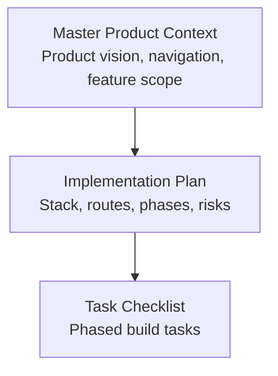
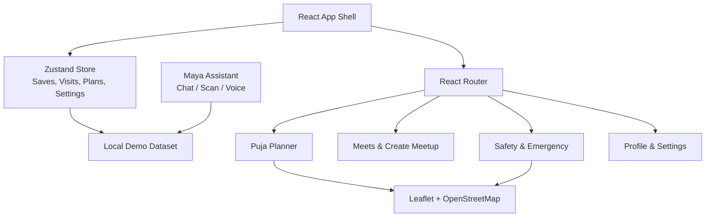
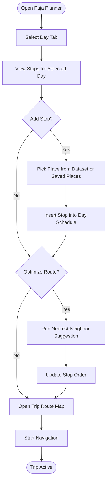
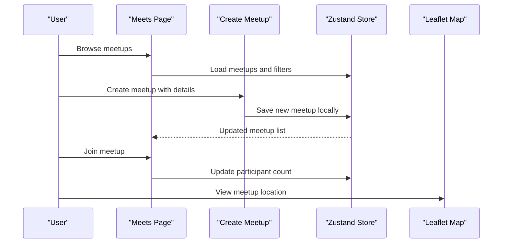
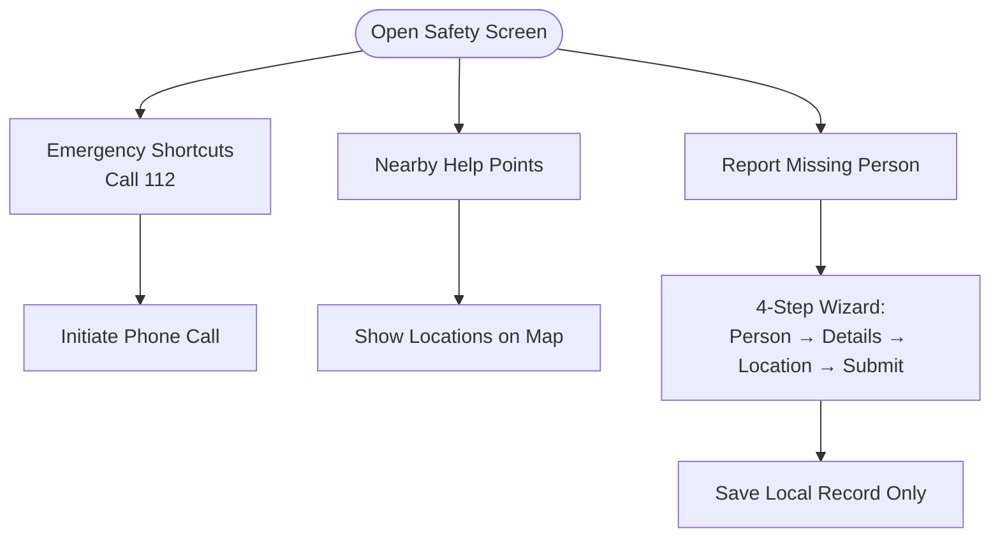
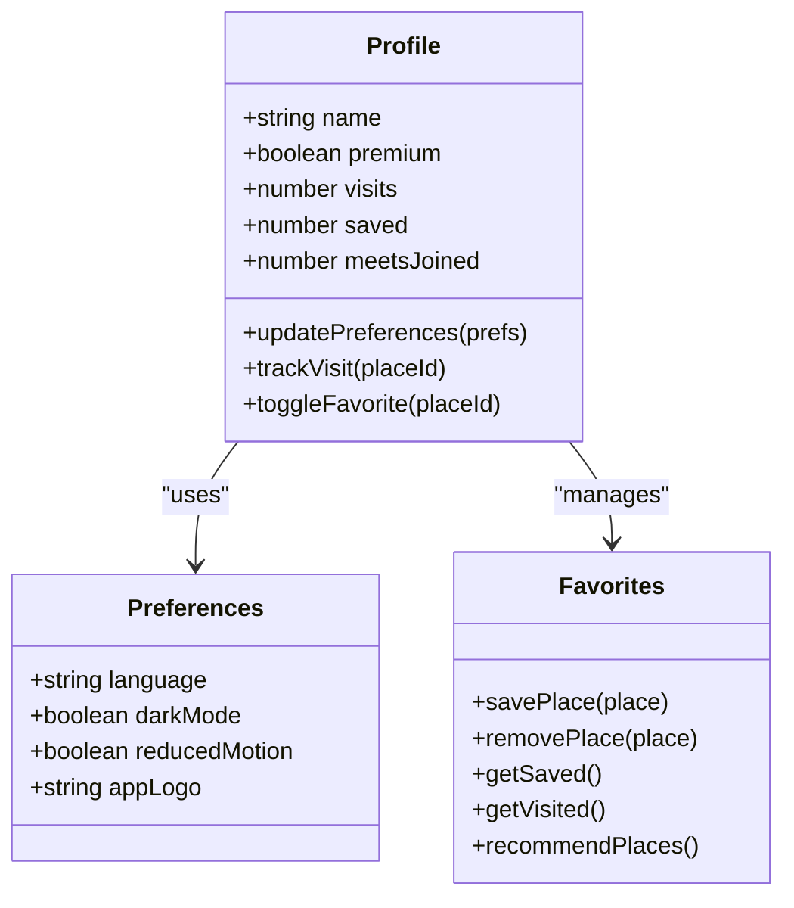
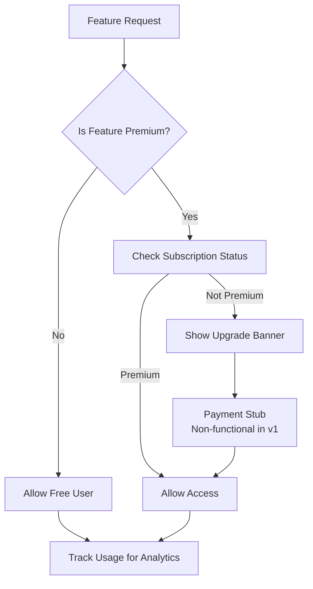
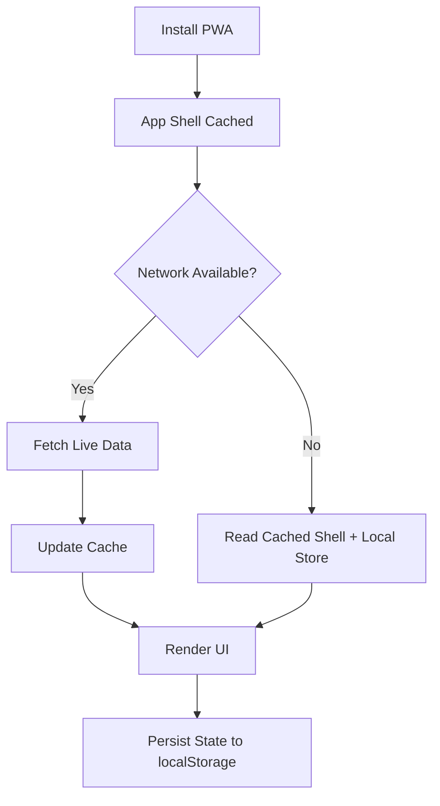
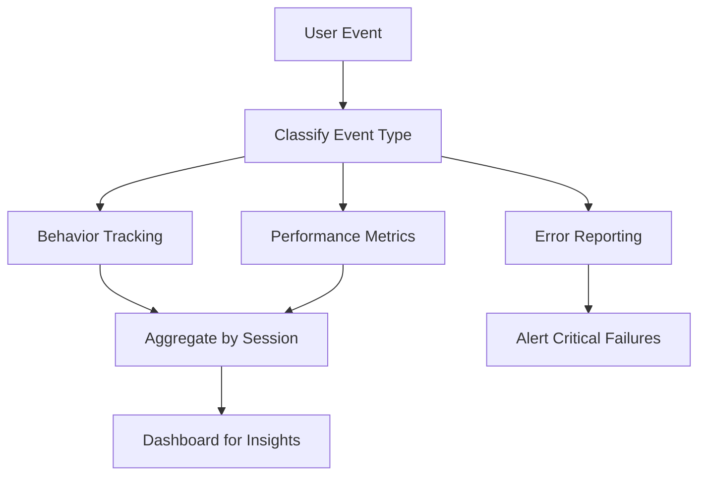
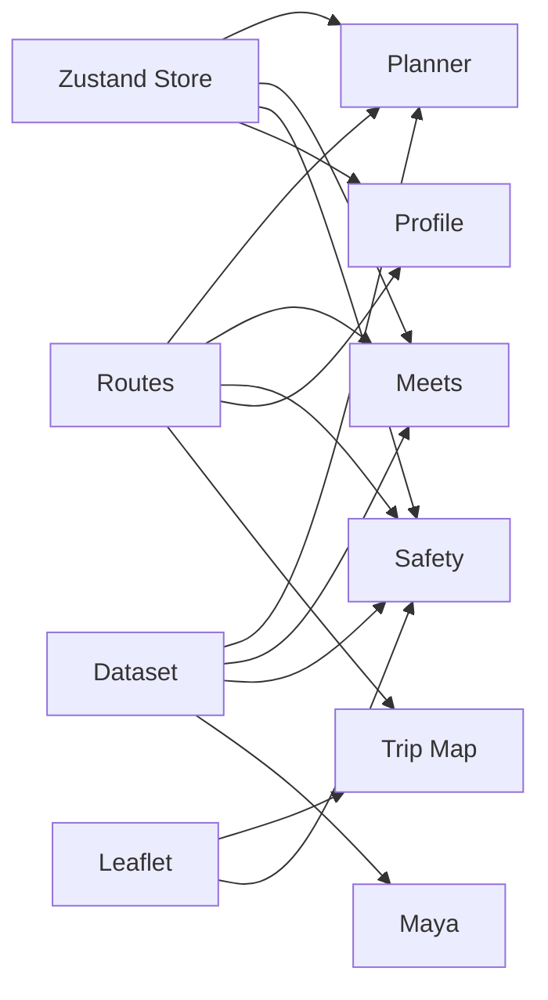

# Advanced Features Implementation

<cite>
**Referenced Files in This Document**
- [Pujo_Sahayak_Master_Project_Context.md](file://Pujo_Sahayak_Master_Project_Context.md)
- [plan.md](file://tasks/plan.md)
- [todo.md](file://tasks/todo.md)
</cite>

## Table of Contents
1. [Introduction](#introduction)
2. [Project Structure](#project-structure)
3. [Core Components](#core-components)
4. [Architecture Overview](#architecture-overview)
5. [Detailed Component Analysis](#detailed-component-analysis)
6. [Dependency Analysis](#dependency-analysis)
7. [Performance Considerations](#performance-considerations)
8. [Troubleshooting Guide](#troubleshooting-guide)
9. [Security, Privacy, and Consent](#security-privacy-and-consent)
10. [Conclusion](#conclusion)

## Introduction
This document explains how the advanced features of Puja Sahayak should be implemented: multi-day planning and itinerary management, social meetups, safety and emergency services, personalization and profile management, payment and subscription tiers, offline PWA behavior, analytics and monitoring, and security and privacy considerations. The guidance is grounded in the product context and implementation plan for a mobile-first React + Vite PWA with local demo data, Zustand state, Leaflet maps, and an AI assistant called Maya.

The product’s core philosophy is a continuous user journey: discover, explore, understand, plan, visit, share, meet people, and discover again. All advanced features should reinforce this flow rather than act as isolated tools.

**Section sources**
- [Pujo_Sahayak_Master_Project_Context.md:21-73](file://Pujo_Sahayak_Master_Project_Context.md#L21-L73)
- [plan.md:1-18](file://tasks/plan.md#L1-L18)

## Project Structure
At this stage, the repository contains:
- A master product context describing the app’s purpose, navigation, screens, premium concepts, social features, safety utilities, and off-season continuity.
- An implementation plan defining the React + Vite PWA stack, routes, screen-to-route mapping, task phases, verification criteria, risks, and open questions.
- A task checklist tracking foundation, discovery, Maya, planning, social, utility, account, and polish work.

**Diagram sources**
- [Pujo_Sahayak_Master_Project_Context.md:1-20](file://Pujo_Sahayak_Master_Project_Context.md#L1-L20)
- [plan.md:1-18](file://tasks/plan.md#L1-L18)
- [todo.md:1-16](file://tasks/todo.md#L1-L16)

**Section sources**
- [Pujo_Sahayak_Master_Project_Context.md:1-20](file://Pujo_Sahayak_Master_Project_Context.md#L1-L20)
- [plan.md:1-18](file://tasks/plan.md#L1-L18)
- [todo.md:1-16](file://tasks/todo.md#L1-L16)

## Core Components
The advanced features are built around these core components:

- Planning and Itinerary Management
  - Multi-day Puja planner with day tabs from Panchami through Dashami.
  - Stop cards including place type, duration, and travel segments.
  - Add-place picker and AI-assisted optimization using nearest-neighbor reordering.
  - Trip route map with numbered stops, polyline, distance, and estimated time.

- Social Features
  - Meetup discovery with filters such as all, nearby, and interest-based views.
  - Meetup creation workflow with title, date, time, location, description, interests, capacity, and visibility.
  - Participant management via join actions and attendee counts.
  - Activity-based matching based on shared interests like photography, pandal hopping, food, music, art, night exploration, heritage, and family-friendly exploration.

- Safety and Emergency Services
  - Quick access to emergency numbers and nearby help points.
  - Missing person reporting wizard with steps for person details, location, and submission.
  - Safety point locations integrated with the dataset and map.

- Personalization and Profile Management
  - Preference settings including language, theme, reduced motion, and app logo selection.
  - Visit tracking and favorites management.
  - Premium subscription handling through upgrade banners and profile badges.

- Payment and Subscription System
  - Free tier supporting basic discovery, saved places, normal exploration, and limited planning.
  - Premium tier supporting multi-day itinerary planning, AI-assisted planning, and potentially advanced recommendations or meetup capabilities.
  - Non-functional stubs for payments and donations in v1.

- Offline Functionality and PWA Capabilities
  - Installable PWA shell with manifest and service worker.
  - Local persistence of saves, visits, plans, and settings.
  - Offline-ready UI shell; images may fall back to gradients or placeholders.

- Analytics and Monitoring
  - User behavior tracking through interactions such as saves, visits, searches, planner usage, meetup joins, and safety actions.
  - Performance metrics for page loads, map rendering, camera access, and store updates.
  - Error reporting for failed permissions, missing data, and broken flows.

**Section sources**
- [Pujo_Sahayak_Master_Project_Context.md:353-445](file://Pujo_Sahayak_Master_Project_Context.md#L353-L445)
- [Pujo_Sahayak_Master_Project_Context.md:664-771](file://Pujo_Sahayak_Master_Project_Context.md#L664-L771)
- [Pujo_Sahayak_Master_Project_Context.md:517-556](file://Pujo_Sahayak_Master_Project_Context.md#L517-L556)
- [plan.md:1-18](file://tasks/plan.md#L1-L18)
- [todo.md:45-75](file://tasks/todo.md#L45-L75)

## Architecture Overview
The advanced features sit on top of a React + Vite PWA architecture with:
- React Router for navigation across discovery, planning, social, safety, profile, and trip screens.
- Zustand with persist middleware for client-side state.
- Leaflet and OpenStreetMap for routing and nearby help points.
- Maya as a contextual AI assistant backed by local dataset retrieval.
- A typed local demo dataset representing real Kolkata pandals, restaurants, events, meetups, offers, and safety points.

**Diagram sources**
- [plan.md:1-18](file://tasks/plan.md#L1-L18)
- [todo.md:45-75](file://tasks/todo.md#L45-L75)

## Detailed Component Analysis

### Planning and Itinerary Management
The planning system supports multi-day Puja schedules with stop management, route optimization, and time-based scheduling.

Key behaviors:
- Day tabs span Panchami through Dashami.
- Each day holds multiple stops with place type, approximate timing, and travel segments.
- Users can add places from the dataset or saved places.
- AI-assisted optimization suggests a reordered sequence using nearest-neighbor logic.
- The trip route map shows numbered markers, polylines, total distance, and estimated time.

**Diagram sources**
- [Pujo_Sahayak_Master_Project_Context.md:353-422](file://Pujo_Sahayak_Master_Project_Context.md#L353-L422)
- [todo.md:50-51](file://tasks/todo.md#L50-L51)
- [todo.md:63-64](file://tasks/todo.md#L63-L64)

Implementation notes:
- Treat AI-generated plans as suggestions, not guaranteed optimal routes.
- Persist each day’s stops in the Zustand store so plans survive reloads.
- Use haversine calculations for distance and estimated time between stops.
- Keep the “Optimize with AI” label honest about its simulated nature in v1.

**Section sources**
- [Pujo_Sahayak_Master_Project_Context.md:353-422](file://Pujo_Sahayak_Master_Project_Context.md#L353-L422)
- [todo.md:50-51](file://tasks/todo.md#L50-L51)
- [todo.md:63-64](file://tasks/todo.md#L63-L64)

### Social Features: Meetup Discovery, Creation, and Matching
Social features center on discovering and organizing meetups around shared interests and plans.

Core workflows:
- Discover existing meetups with filters for all, nearby, and interest-based categories.
- Create a meetup with title, date, time, location, description, interest chips, maximum participants, and public or restricted visibility.
- Join meetups and view attendee avatars and counts.
- Match users by activity-based interests such as photography, pandal hopping, food, music, art, night exploration, heritage, and family-friendly exploration.

**Diagram sources**
- [Pujo_Sahayak_Master_Project_Context.md:664-771](file://Pujo_Sahayak_Master_Project_Context.md#L664-L771)
- [todo.md:53-54](file://tasks/todo.md#L53-L54)

Matching algorithm guidance:
- Use interest tags attached to user profiles and meetup descriptions.
- Score matches by overlap of interests, proximity, and time availability.
- Present matches as suggestions rather than deterministic pairings.
- Avoid dating-app framing; emphasize activity-based social discovery.

**Section sources**
- [Pujo_Sahayak_Master_Project_Context.md:664-771](file://Pujo_Sahayak_Master_Project_Context.md#L664-L771)
- [todo.md:53-54](file://tasks/todo.md#L53-L54)

### Safety and Emergency Services Integration
Safety features provide quick access to emergency contacts, nearby help points, and a missing person reporting flow.

Key elements:
- Emergency shortcuts such as calling 112.
- Nearby help points sourced from the dataset with latitude and longitude.
- Missing person report wizard guiding users through person details, additional information, location, and submission.
- Safety point locations displayed on the map alongside other utilities.

**Diagram sources**
- [Pujo_Sahayak_Master_Project_Context.md:517-556](file://Pujo_Sahayak_Master_Project_Context.md#L517-L556)
- [todo.md:66-67](file://tasks/todo.md#L66-L67)

Implementation notes:
- Do not fabricate emergency integrations; keep calls as tel links and records as local-only in v1.
- Clearly mark demo data and simulated results.
- Ensure accessibility for urgent use cases, including large tap targets and clear labels.

**Section sources**
- [Pujo_Sahayak_Master_Project_Context.md:517-556](file://Pujo_Sahayak_Master_Project_Context.md#L517-L556)
- [todo.md:66-67](file://tasks/todo.md#L66-L67)

### Personalization and Profile Management
Personalization covers preference settings, visit tracking, favorites, and premium subscription indicators.

Core areas:
- Preferences: language toggle, dark mode, reduced motion, and app logo selection.
- Favorites: saved places and previously visited places.
- Recommendations: “You might like” based on saved places, visited places, area, theme, preferences, and potentially AI recommendations.
- Profile: stats for visits, saved places, and meetups; upgrade banner; payments and subscriptions entry.

**Diagram sources**
- [Pujo_Sahayak_Master_Project_Context.md:320-350](file://Pujo_Sahayak_Master_Project_Context.md#L320-L350)
- [todo.md:66-72](file://tasks/todo.md#L66-L72)

**Section sources**
- [Pujo_Sahayak_Master_Project_Context.md:320-350](file://Pujo_Sahayak_Master_Project_Context.md#L320-L350)
- [todo.md:66-72](file://tasks/todo.md#L66-L72)

### Payment and Subscription System Architecture
The payment and subscription system separates free and premium feature tiers without hard-coding pricing rules prematurely.

Tier model:
- Free tier: basic discovery, saved places, normal exploration, and limited planning.
- Premium tier: multi-day itinerary planning, AI-assisted planning, potentially advanced recommendations, and potentially advanced meetup capabilities.
- Meetups conceptually support free, paid, and premium-only meetups.

**Diagram sources**
- [Pujo_Sahayak_Master_Project_Context.md:424-445](file://Pujo_Sahayak_Master_Project_Context.md#L424-L445)
- [Pujo_Sahayak_Master_Project_Context.md:753-771](file://Pujo_Sahayak_Master_Project_Context.md#L753-L771)
- [plan.md:81-86](file://tasks/plan.md#L81-L86)

Implementation notes:
- Keep payment integration as non-functional stubs in v1.
- Gate premium features behind a subscription flag in the store.
- Use upgrade banners and donation entries as UI placeholders.
- Avoid hard-coding a large subscription system until business rules are finalized.

**Section sources**
- [Pujo_Sahayak_Master_Project_Context.md:424-445](file://Pujo_Sahayak_Master_Project_Context.md#L424-L445)
- [Pujo_Sahayak_Master_Project_Context.md:753-771](file://Pujo_Sahayak_Master_Project_Context.md#L753-L771)
- [plan.md:81-86](file://tasks/plan.md#L81-L86)

### Offline Functionality and PWA Capabilities
The PWA provides an installable shell, offline readiness, and local persistence.

Capabilities:
- Service worker and manifest configured through vite-plugin-pwa.
- Offline shell that remains usable even when network is unavailable.
- Local storage for saves, visits, plans, and settings.
- Image fallbacks using gradients or placeholders when assets are unavailable.

**Diagram sources**
- [plan.md:1-18](file://tasks/plan.md#L1-L18)
- [todo.md:74-75](file://tasks/todo.md#L74-L75)

Implementation notes:
- Validate Lighthouse PWA installability.
- Ensure every critical route renders at least the shell offline.
- Keep demo data honesty: crowd levels, hours, and identification results must be clearly labeled as demo where applicable.

**Section sources**
- [plan.md:1-18](file://tasks/plan.md#L1-L18)
- [todo.md:74-75](file://tasks/todo.md#L74-L75)

### Analytics and Monitoring
Analytics and monitoring should capture user behavior, performance, and errors without compromising privacy.

Metrics to track:
- Behavior: search queries, category browsing, saves, visits, planner edits, meetup joins, safety actions, and Maya interactions.
- Performance: page load times, map render times, camera permission latency, store update frequency, and offline cache hits.
- Errors: permission denials, missing dataset entries, failed navigation, and malformed inputs.

**Diagram sources**
- [todo.md:63-75](file://tasks/todo.md#L63-L75)

Implementation notes:
- Use lightweight event logging tied to Zustand store actions.
- Respect reduced-motion and privacy preferences.
- Avoid sending sensitive personal data unless explicitly consented.

**Section sources**
- [todo.md:63-75](file://tasks/todo.md#L63-L75)

## Dependency Analysis
Advanced features depend on shared infrastructure:
- Routes connect discovery, planning, social, safety, profile, and trip screens.
- Zustand store coordinates state across features.
- Dataset drives content for planners, meetups, safety points, and Maya responses.
- Maps integrate with planner trips and safety help points.
- Maya relies on contextual data and dataset-backed answers.

**Diagram sources**
- [plan.md:19-40](file://tasks/plan.md#L19-L40)
- [todo.md:45-75](file://tasks/todo.md#L45-L75)

**Section sources**
- [plan.md:19-40](file://tasks/plan.md#L19-L40)
- [todo.md:45-75](file://tasks/todo.md#L45-L75)

## Performance Considerations
- Keep planner optimization lightweight; nearest-neighbor reordering should run on small arrays per day.
- Defer heavy operations such as map polyline generation until the trip screen mounts.
- Limit camera processing to preview frames and captured snapshots; avoid unnecessary image analysis in v1.
- Batch Zustand updates to reduce re-renders during bulk imports or bulk plan edits.
- Use lazy loading for routes and components to improve initial load time.
- Honor reduced-motion preferences to minimize animation overhead.

[No sources needed since this section provides general guidance]

## Troubleshooting Guide
Common issues and resolutions:
- Camera permission denied: show a friendly error and allow retry; do not block the rest of the app.
- Missing dataset entries: display graceful fallbacks and avoid hallucinated facts in Maya.
- Offline map failures: fall back to cached shell and local store; indicate offline status clearly.
- Planner save failures: validate input before saving and surface actionable errors.
- Meetup join conflicts: handle duplicate joins and capacity limits gracefully.
- Premium gate errors: ensure upgrade banners appear consistently when premium features are accessed without subscription.

**Section sources**
- [plan.md:71-86](file://tasks/plan.md#L71-L86)
- [todo.md:66-75](file://tasks/todo.md#L66-L75)

## Security, Privacy, and Consent
Security and privacy are essential for sensitive features such as safety reporting, camera access, location sharing, and personal preferences.

Guidelines:
- Collect only necessary data for each feature.
- Provide clear consent prompts for camera, location, and emergency reporting.
- Store sensitive user data locally unless explicit backend sync is implemented.
- Mark demo data and simulated AI results honestly.
- Avoid presenting fake integrations as production-ready.
- Respect user preferences including language, theme, and reduced motion.
- Implement audit trails for premium upgrades and meetup participation once backend systems exist.

**Section sources**
- [plan.md:71-86](file://tasks/plan.md#L71-L86)
- [Pujo_Sahayak_Master_Project_Context.md:558-662](file://Pujo_Sahayak_Master_Project_Context.md#L558-L662)

## Conclusion
The advanced features of Puja Sahayak form a cohesive ecosystem around discovery, planning, social connection, safety, personalization, and offline usability. The planning system enables multi-day itineraries with optimized routes; social features enable activity-based meetups; safety features provide emergency access and reporting; personalization tailors the experience; payments and subscriptions separate free and premium tiers; PWA capabilities ensure reliability offline; and analytics and monitoring guide improvements. Security and privacy must remain central, especially for sensitive features. By following the phased implementation plan and keeping demo data honest, the product can evolve from a strong seasonal companion into a broader local-discovery platform.

[No sources needed since this section summarizes without analyzing specific files]