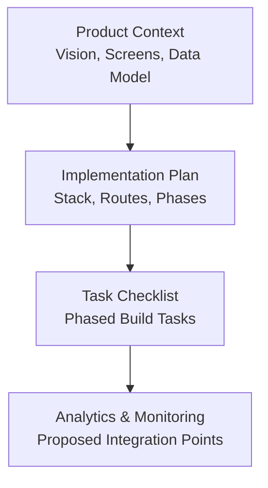
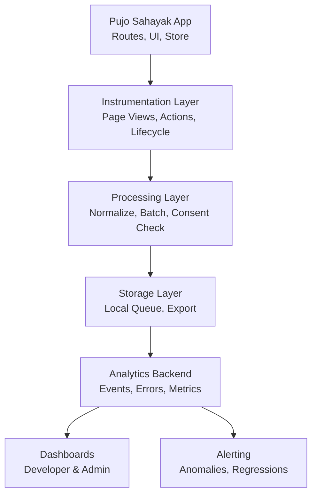
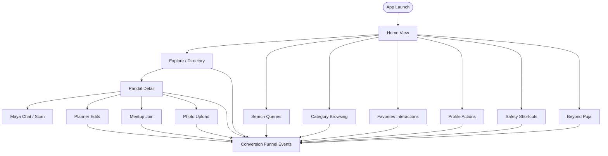
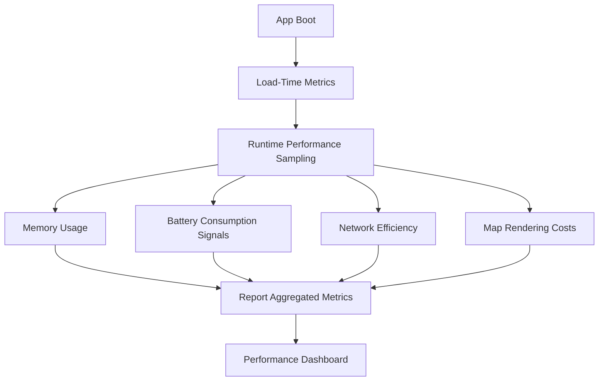
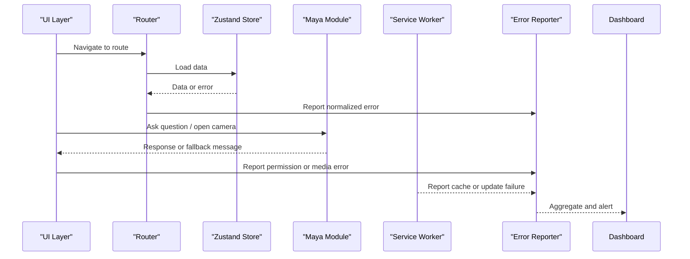
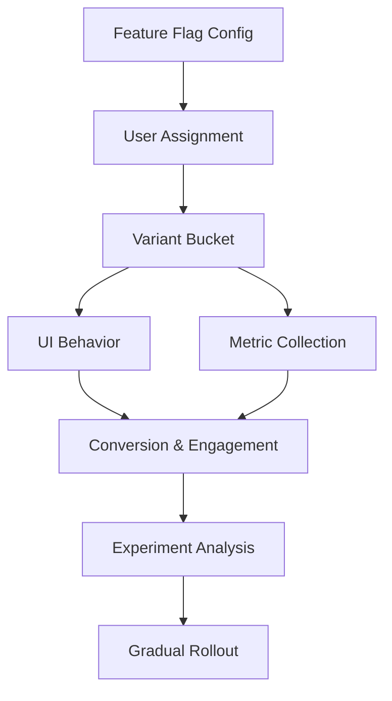
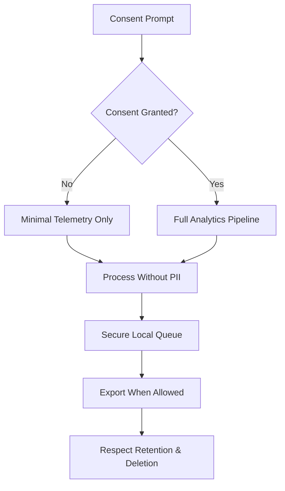
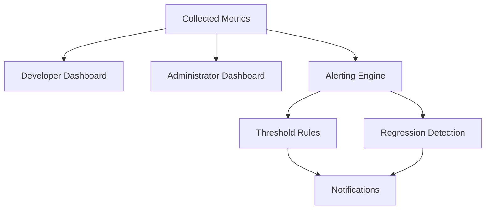
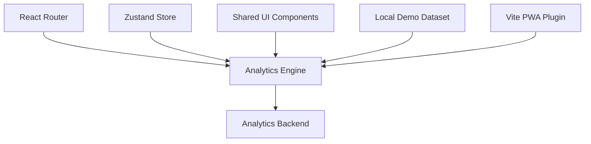

# Analytics and Monitoring System

<cite>
**Referenced Files in This Document**
- [Pujo_Sahayak_Master_Project_Context.md](file://Pujo_Sahayak_Master_Project_Context.md)
- [tasks/plan.md](file://tasks/plan.md)
- [tasks/todo.md](file://tasks/todo.md)
</cite>

## Table of Contents
1. [Introduction](#introduction)
2. [Project Structure](#project-structure)
3. [Core Components](#core-components)
4. [Architecture Overview](#architecture-overview)
5. [Detailed Component Analysis](#detailed-component-analysis)
6. [Dependency Analysis](#dependency-analysis)
7. [Performance Considerations](#performance-considerations)
8. [Troubleshooting Guide](#troubleshooting-guide)
9. [Conclusion](#conclusion)

## Introduction
This document defines the Analytics and Monitoring system for Pujo Sahayak, a mobile-first React + Vite PWA focused on Durga Puja discovery, planning, community meetups, safety, and off-season local exploration. The analytics strategy is designed around the product’s core user journey: discover, explore, understand, plan, visit, share, and return. It covers user behavior tracking, performance monitoring, error reporting, A/B testing and feature flags, privacy-compliant data collection, dashboards, alerting, and automated regression detection.

The implementation guidance here is grounded in the project’s documented product philosophy, navigation model, AI assistant behavior, safety requirements, personalization settings, and planned screen set. Where the repository does not yet contain concrete analytics code, this document proposes architecture and integration points that fit naturally into the existing stack described in the project context.

## Project Structure
At the time of analysis, the workspace contains:
- A master product context document describing the platform vision, screens, data model, AI assistant rules, safety systems, personalization, and final product map.
- An implementation plan describing the React + TypeScript + Vite PWA stack, routing, state management, motion, maps, and phased task breakdown.
- A task checklist tracking phases from foundation through polish.

**Diagram sources**
- [Pujo_Sahayak_Master_Project_Context.md:1-1878](file://Pujo_Sahayak_Master_Project_Context.md#L1-L1878)
- [tasks/plan.md:1-86](file://tasks/plan.md#L1-L86)
- [tasks/todo.md:1-81](file://tasks/todo.md#L1-L81)

**Section sources**
- [Pujo_Sahayak_Master_Project_Context.md:1-1878](file://Pujo_Sahayak_Master_Project_Context.md#L1-L1878)
- [tasks/plan.md:1-86](file://tasks/plan.md#L1-L86)
- [tasks/todo.md:1-81](file://tasks/todo.md#L1-L81)

## Core Components
The Analytics and Monitoring system should be composed of these primary components:

- User Behavior Tracking Engine
  - Page views, route transitions, search queries, category browsing, pandal detail views, favorites interactions, planner edits, meetup joins, photo uploads, Maya chat and camera flows, profile actions, and safety shortcuts.
- Performance Monitoring Agent
  - Load times, memory usage, battery consumption, network efficiency, offline shell behavior, and map rendering costs.
- Error Reporting and Crash Analytics
  - Frontend exceptions, async failures, API or dataset errors, permission denials (camera, location), and service worker issues.
- Experimentation and Feature Flags
  - A/B tests for Home sections, recommendation strategies, premium CTAs, Maya responses, and off-season content.
- Privacy and Consent Manager
  - Consent prompts, anonymization, data retention controls, and alignment with account and privacy settings.
- Dashboards and Alerting
  - Developer dashboards for app health, administrator dashboards for engagement and conversion, and alerts for regressions and anomalies.

These components integrate with the application’s existing state store, routing layer, UI components, and local demo dataset.

**Section sources**
- [tasks/plan.md:1-86](file://tasks/plan.md#L1-L86)
- [tasks/todo.md:1-81](file://tasks/todo.md#L1-L81)
- [Pujo_Sahayak_Master_Project_Context.md:140-158](file://Pujo_Sahayak_Master_Project_Context.md#L140-L158)
- [Pujo_Sahayak_Master_Project_Context.md:1601-1618](file://Pujo_Sahayak_Master_Project_Context.md#L1601-L1618)

## Architecture Overview
The analytics architecture follows a layered design:

- Instrumentation Layer
  - Wraps page views, user actions, and lifecycle events at the router and component level.
- Processing Layer
  - Normalizes events, attaches session and consent metadata, deduplicates, and batches telemetry.
- Storage Layer
  - Local persistence for offline resilience, then secure export to analytics backends when permitted by consent.
- Observability Layer
  - Error aggregation, performance metrics, and experiment attribution.
- Visualization Layer
  - Dashboards for developers and administrators, plus alerting and regression detection.

**Diagram sources**
- [tasks/plan.md:1-86](file://tasks/plan.md#L1-L86)
- [Pujo_Sahayak_Master_Project_Context.md:1601-1618](file://Pujo_Sahayak_Master_Project_Context.md#L1601-L1618)

## Detailed Component Analysis

### User Behavior Tracking
User behavior tracking should capture the full discovery-to-retention loop defined by the product context.

Key tracked behaviors:
- Navigation and page views across Home, Explore, Pandal Detail, Search, Categories, Meets, Planner, Profile, Safety, and Beyond Puja.
- Engagement signals such as saves, visits, reviews, photo uploads, meetup joins, and planner edits.
- Maya interactions including chat questions, voice input toggles, and camera scan attempts.
- Recommendation exposure and clicks, trending and nearby results, and similar place views.
- Conversion funnels such as Discover → Explore → Understand → Plan → Visit → Share.

**Diagram sources**
- [Pujo_Sahayak_Master_Project_Context.md:140-158](file://Pujo_Sahayak_Master_Project_Context.md#L140-L158)
- [Pujo_Sahayak_Master_Project_Context.md:1601-1618](file://Pujo_Sahayak_Master_Project_Context.md#L1601-L1618)
- [tasks/todo.md:19-55](file://tasks/todo.md#L19-L55)

Implementation notes:
- Wrap route changes with page view events, capturing route name, query parameters, and previous route.
- Emit action events for save, visit, review, upload, join, optimize-plan, and emergency shortcut taps.
- Track Maya context-aware interactions without storing raw conversation logs unless explicitly consented; instead, record intent categories and outcomes.
- Record funnel steps with timestamps to compute drop-off rates per stage.

**Section sources**
- [Pujo_Sahayak_Master_Project_Context.md:140-158](file://Pujo_Sahayak_Master_Project_Context.md#L140-L158)
- [Pujo_Sahayak_Master_Project_Context.md:1601-1618](file://Pujo_Sahayak_Master_Project_Context.md#L1601-L1618)
- [tasks/todo.md:19-55](file://tasks/todo.md#L19-L55)

### Performance Monitoring
Performance monitoring should cover load times, memory usage, battery consumption, and network efficiency while respecting the PWA and offline-first nature of the app.

Metrics to collect:
- Time to Interactive, First Contentful Paint, Largest Contentful Paint, and route transition latency.
- Memory growth during long sessions, especially with maps, images, and Maya media previews.
- Battery drain indicators inferred from CPU usage, GPS polling, and background tasks.
- Network efficiency including cache hits, failed requests, retry patterns, and offline fallbacks.
- Map rendering performance, polyline calculations, and marker density.

**Diagram sources**
- [tasks/plan.md:1-86](file://tasks/plan.md#L1-L86)
- [tasks/todo.md:60-75](file://tasks/todo.md#L60-L75)

Implementation notes:
- Use browser APIs and lightweight sampling to avoid adding overhead.
- Respect reduced-motion and accessibility preferences when measuring visual performance.
- Defer heavy metric collection until after critical rendering paths.
- For PWA, track install prompt visibility, service worker activation, and offline shell availability.

**Section sources**
- [tasks/plan.md:1-86](file://tasks/plan.md#L1-L86)
- [tasks/todo.md:60-75](file://tasks/todo.md#L60-L75)

### Error Reporting and Crash Analytics
Error reporting should provide actionable insights for debugging and quality assurance without exposing sensitive user data.

Coverage areas:
- JavaScript exceptions, promise rejections, and unhandled errors.
- Permission denials for camera, location, and microphone.
- Service worker registration, update, and caching failures.
- Dataset loading errors and malformed records.
- Maya simulation boundaries and fallback messages.

**Diagram sources**
- [tasks/plan.md:1-86](file://tasks/plan.md#L1-L86)
- [tasks/todo.md:36-40](file://tasks/todo.md#L36-L40)
- [tasks/todo.md:60-67](file://tasks/todo.md#L60-L67)

Implementation notes:
- Normalize error payloads to include context such as route, feature flag, device type, and consent status.
- Avoid logging personally identifiable information; mask tokens, locations, and user identifiers.
- Provide user-friendly fallbacks for non-critical errors, especially for Maya and camera features.
- Integrate with crash reporting tools and maintain severity levels for triage.

**Section sources**
- [tasks/plan.md:1-86](file://tasks/plan.md#L1-L86)
- [tasks/todo.md:36-40](file://tasks/todo.md#L36-L40)
- [tasks/todo.md:60-67](file://tasks/todo.md#L60-L67)

### A/B Testing Framework and Feature Flag Management
A/B testing and feature flags should support controlled experimentation for UI sections, recommendations, premium CTAs, and off-season content.

Experiment surfaces:
- Home spotlight variants, sponsored card placement, and “Continue where you left off” prominence.
- Recommendation strategies based on location, favorites, trending, and similarity.
- Premium upgrade banners and donation prompts.
- Maya response styles and quick-reply chips.
- Beyond Puja content ordering and messaging.

**Diagram sources**
- [Pujo_Sahayak_Master_Project_Context.md:1055-1074](file://Pujo_Sahayak_Master_Project_Context.md#L1055-L1074)
- [Pujo_Sahayak_Master_Project_Context.md:1636-1688](file://Pujo_Sahayak_Master_Project_Context.md#L1636-L1688)
- [tasks/todo.md:71-75](file://tasks/todo.md#L71-L75)

Implementation notes:
- Keep flags simple initially, stored in configuration and persisted alongside user settings.
- Ensure experiments are opt-in where required by consent policies.
- Measure impact using funnel conversions, engagement duration, and retention signals.
- Gradually roll out winning variants while monitoring regressions.

**Section sources**
- [Pujo_Sahayak_Master_Project_Context.md:1055-1074](file://Pujo_Sahayak_Master_Project_Context.md#L1055-L1074)
- [Pujo_Sahayak_Master_Project_Context.md:1636-1688](file://Pujo_Sahayak_Master_Project_Context.md#L1636-L1688)
- [tasks/todo.md:71-75](file://tasks/todo.md#L71-L75)

### Privacy-Compliant Analytics and Consent Management
Privacy must be central to analytics collection, especially given location, photos, meetups, and emergency features.

Consent model:
- Explicit consent for analytics, performance telemetry, and personalized recommendations.
- Granular controls aligned with Account and Privacy settings.
- Clear language explaining what is collected, why, and how it improves the experience.

Data handling:
- Anonymize or pseudonymize user identifiers.
- Avoid storing raw conversations, precise location trails, or sensitive safety reports.
- Honor data deletion requests and retention limits.

**Diagram sources**
- [Pujo_Sahayak_Master_Project_Context.md:1076-1091](file://Pujo_Sahayak_Master_Project_Context.md#L1076-L1091)
- [Pujo_Sahayak_Master_Project_Context.md:1390-1439](file://Pujo_Sahayak_Master_Project_Context.md#L1390-L1439)

Implementation notes:
- Gate analytics initialization on consent state.
- Provide easy access to consent controls from Profile and Settings.
- Log only consent decisions and feature toggles, never sensitive content.
- Align with legal and regional requirements for location and biometric-related features like camera scanning.

**Section sources**
- [Pujo_Sahayak_Master_Project_Context.md:1076-1091](file://Pujo_Sahayak_Master_Project_Context.md#L1076-L1091)
- [Pujo_Sahayak_Master_Project_Context.md:1390-1439](file://Pujo_Sahayak_Master_Project_Context.md#L1390-L1439)

### Dashboards, Alerting, and Automated Regression Detection
Dashboards should serve two audiences:

- Developer Dashboard
  - Error rates, crash stability, performance budgets, memory trends, and build health.
- Administrator Dashboard
  - Engagement funnels, conversion rates, feature adoption, retention cohorts, and experiment results.

Alerting and regression detection:
- Alerts for sudden spikes in errors, increased load times, or dropped conversion rates.
- Automated checks comparing current metrics against baselines.
- Notifications for privacy policy violations or consent-related anomalies.

**Diagram sources**
- [tasks/plan.md:63-86](file://tasks/plan.md#L63-L86)
- [tasks/todo.md:77-81](file://tasks/todo.md#L77-L81)

Implementation notes:
- Define clear SLOs for load time, error rate, and conversion stability.
- Use cohort-based analysis to distinguish seasonal effects from regressions.
- Include manual override capabilities for alert suppression during known maintenance or event-driven traffic spikes.

**Section sources**
- [tasks/plan.md:63-86](file://tasks/plan.md#L63-L86)
- [tasks/todo.md:77-81](file://tasks/todo.md#L77-L81)

## Dependency Analysis
The analytics system depends on several existing or planned parts of the application:

- Routing Layer
  - Page view tracking integrates with route changes and nested routes.
- State Management
  - Zustand store provides saved places, visited places, plans, meetups, language, theme, and session state used for contextual analytics.
- UI Components
  - Cards, chips, bottom navigation, waveform, and scan frame components generate interaction events.
- Data Layer
  - Local demo dataset drives recommendation and trending metrics; analytics should treat demo data distinctly from production data.
- PWA Infrastructure
  - Service worker and manifest affect offline behavior and install metrics.

**Diagram sources**
- [tasks/plan.md:1-86](file://tasks/plan.md#L1-L86)
- [tasks/todo.md:1-15](file://tasks/todo.md#L1-L15)

**Section sources**
- [tasks/plan.md:1-86](file://tasks/plan.md#L1-L86)
- [tasks/todo.md:1-15](file://tasks/todo.md#L1-L15)

## Performance Considerations
- Keep instrumentation lightweight; avoid synchronous blocking calls in hot paths.
- Sample memory and CPU measurements rather than recording every frame.
- Batch and throttle telemetry exports to reduce network overhead.
- Respect user preferences such as reduced motion and dark mode when measuring perceived performance.
- Monitor PWA-specific metrics like install success, update frequency, and offline usability.
- Separate demo dataset performance from real data performance to avoid skewed baselines.

[No sources needed since this section provides general guidance]

## Troubleshooting Guide
Common issues and resolutions:

- Consent not granted
  - Verify consent prompt appears before analytics initialization.
  - Ensure settings can toggle consent and persist the decision.
- Camera or location permissions denied
  - Handle permission errors gracefully and log them without sensitive details.
  - Provide fallback UI for features requiring permissions.
- Offline analytics queue not exporting
  - Check service worker status and network connectivity.
  - Validate queue size and retry logic.
- Performance regressions
  - Compare load-time metrics and memory usage against baselines.
  - Investigate recent UI changes, image sizes, and map rendering updates.
- Experiment attribution missing
  - Confirm variant assignment and flag evaluation order.
  - Validate that metrics are tagged with experiment IDs.

**Section sources**
- [tasks/todo.md:36-40](file://tasks/todo.md#L36-L40)
- [tasks/todo.md:60-75](file://tasks/todo.md#L60-L75)

## Conclusion
The Analytics and Monitoring system for Pujo Sahayak should be built around the product’s core journey: helping users discover, understand, plan, visit, and return to meaningful experiences. By combining robust user behavior tracking, performance monitoring, error reporting, experimentation, privacy-compliant data practices, and clear dashboards, the system will enable both developers and administrators to improve quality, engagement, and trust. The proposed architecture fits naturally into the existing React + Vite PWA stack, respects the documented product principles, and leaves room for future expansion beyond the Puja season.

[No sources needed since this section summarizes without analyzing specific files]