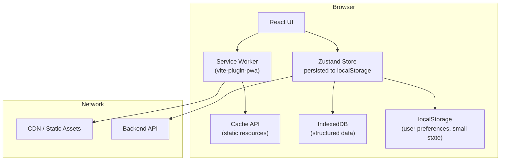
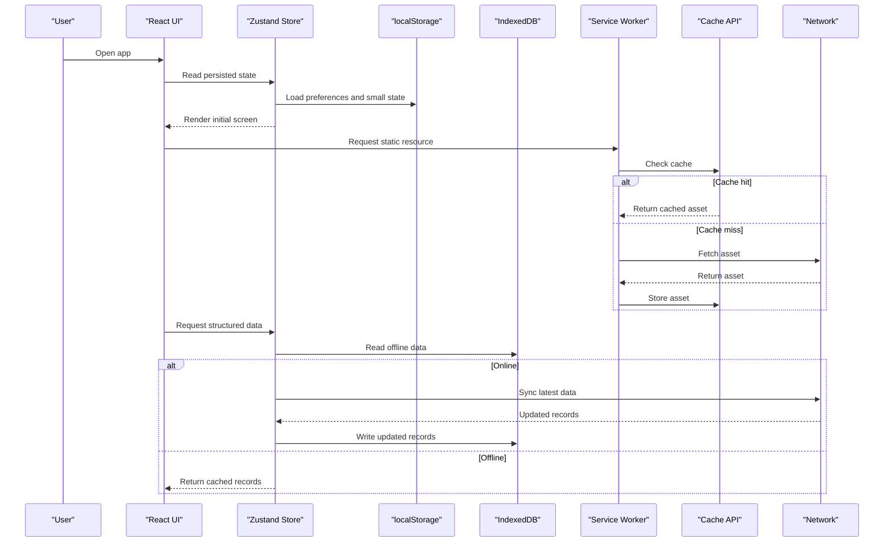
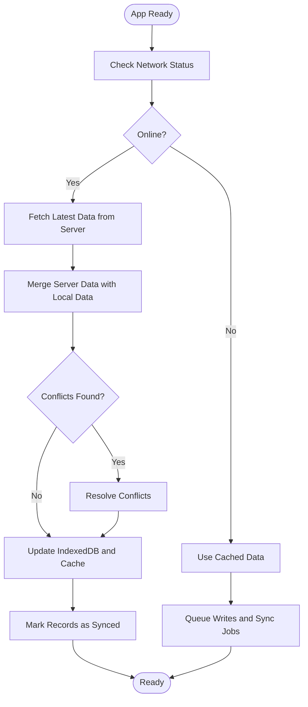
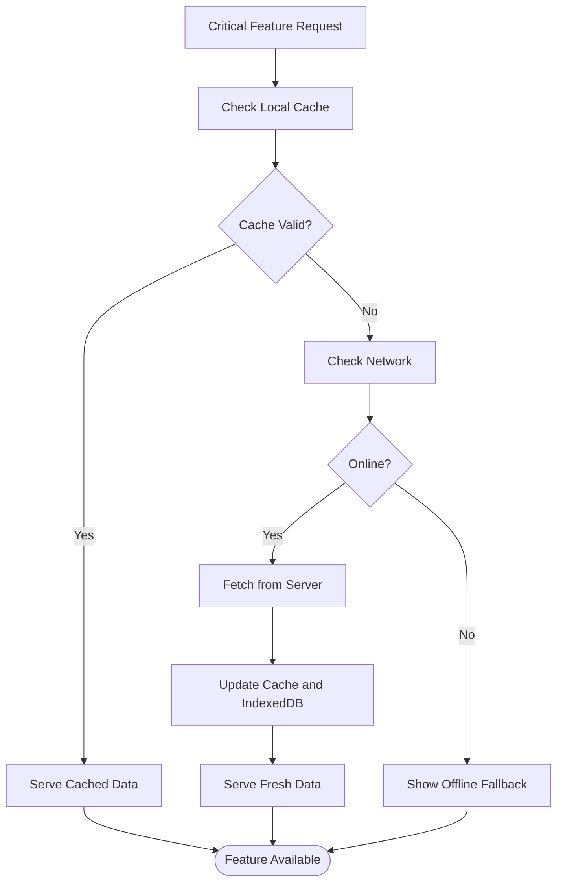
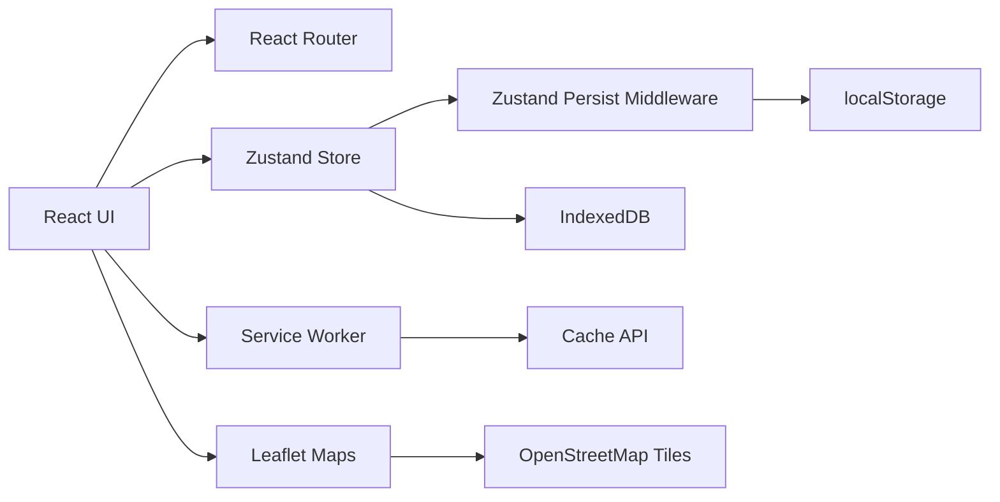

# Caching Strategies and Data Management

<cite>
**Referenced Files in This Document**   
- [Pujo_Sahayak_Master_Project_Context.md](file://Pujo_Sahayak_Master_Project_Context.md)
- [tasks/plan.md](file://tasks/plan.md)
- [tasks/todo.md](file://tasks/todo.md)
</cite>

## Table of Contents
1. [Introduction](#introduction)
2. [Project Structure](#project-structure)
3. [Core Components](#core-components)
4. [Architecture Overview](#architecture-overview)
5. [Detailed Component Analysis](#detailed-component-analysis)
6. [Dependency Analysis](#dependency-analysis)
7. [Performance Considerations](#performance-considerations)
8. [Troubleshooting Guide](#troubleshooting-guide)
9. [Conclusion](#conclusion)

## Introduction

This document defines the caching and offline data-management strategy for Pujo Sahayak, a React + Vite PWA built with Tailwind CSS, Zustand persistence, Leaflet maps, and vite-plugin-pwa. It explains how browser storage, IndexedDB, and the Cache API work together to keep critical features available offline, how data synchronizes when connectivity returns, and how to manage quotas and cleanup.

The app’s core user journey—discover, explore, understand, plan, visit, share, meet, repeat—must remain usable even when the network is unavailable. Offline-first behavior is therefore central to the product experience: users should be able to open the app shell, view saved places, continue their last exploration, and navigate routes without an active connection.

## Project Structure

At this stage, the repository contains product context and implementation plans rather than source code. The architecture decisions and tasks define where caching and persistence will live:

- PWA shell and offline support are provided by vite-plugin-pwa (manifest, icons, service worker).
- Client state (saved places, visited places, puja plan, settings, language, theme, “continue where you left off”) uses Zustand with a persist middleware backed by localStorage.
- Maps use Leaflet with OpenStreetMap tiles; tile caching depends on browser and CDN behavior.
- Images are local placeholders or curated assets at build time, with layout fallbacks when images are missing.

**Diagram sources**
- [tasks/plan.md:7-17](file://tasks/plan.md#L7-L17)
- [tasks/todo.md:7-14](file://tasks/todo.md#L7-L14)

**Section sources**
- [tasks/plan.md:7-17](file://tasks/plan.md#L7-L17)
- [tasks/todo.md:7-14](file://tasks/todo.md#L7-L14)

## Core Components

### Multi-layered Caching Model

| Layer | Purpose | Typical Content | Persistence Target | Invalidation Trigger |
|---|---|---|---|---|
| Application shell | Loads the app quickly and reliably | HTML, JS bundles, CSS, icons, manifest | Service Worker cache via vite-plugin-pwa | New build deployment |
| Static resources | Reduces repeated downloads | Fonts, images, map tiles, third-party assets | Cache API | Versioned URLs or explicit cache update |
| Structured data | Supports rich offline features | Places, pandals, restaurants, events, meetups, safety points, plans | IndexedDB | Server sync, schema migration, TTL policy |
| Lightweight client state | Fast access to user preferences and session hints | Language, theme, logo choice, “continue where you left off” | localStorage via Zustand persist | User action or app reset |

This layered model ensures:

- The app shell loads offline after first install.
- Critical static assets are cached for fast rendering.
- Rich data remains available locally for discovery, planning, and navigation.
- Small user preferences stay responsive and survive reloads.

**Section sources**
- [tasks/plan.md:7-17](file://tasks/plan.md#L7-L17)
- [tasks/todo.md:7-14](file://tasks/todo.md#L7-L14)

### Browser Storage Responsibilities

- **localStorage**: Best for small, simple key-value data such as language, theme, logo selection, and short-lived session hints like “continue where you left off.”
- **IndexedDB**: Best for structured, queryable, and larger datasets such as places, pandals, restaurants, events, meetups, reviews, photos, plans, offers, and safety points.
- **Cache API**: Best for immutable or versioned static assets served by the service worker.
- **Service Worker**: Manages installation, update, fetch interception, and cache lifecycle for the app shell and selected static resources.

The current design explicitly persists user state through Zustand’s persist middleware into localStorage. For future scalability, structured data should move to IndexedDB while keeping lightweight preferences in localStorage.

**Section sources**
- [tasks/plan.md:7-17](file://tasks/plan.md#L7-L17)
- [tasks/todo.md:10-14](file://tasks/todo.md#L10-L14)

## Architecture Overview

The offline-first architecture separates concerns between UI, store, persistence, and network layers.

**Diagram sources**
- [tasks/plan.md:7-17](file://tasks/plan.md#L7-L17)
- [tasks/todo.md:7-14](file://tasks/todo.md#L7-L14)

## Detailed Component Analysis

### Browser Storage Strategy

#### localStorage Usage

localStorage should store:

- App preferences: language, theme, reduced motion preference, logo choice.
- Lightweight session state: “continue where you left off,” last viewed place, last search context.
- Small flags: demo mode indicator, feature toggles, consent or privacy flags.

Guidelines:

- Keep values small and serializable.
- Avoid storing large arrays or nested objects unless necessary.
- Use clear keys and version prefixes if schema changes occur.
- Wrap access in a small storage utility to handle quota errors and serialization safely.

#### IndexedDB Usage

IndexedDB should store:

- Place entities: pandals, restaurants, events, attractions, services.
- Relationship data: saved places, visited places, favorites.
- Plans: multi-day Puja itineraries with stops, timings, and route segments.
- Meetups: existing meetups and user participation state.
- Safety points: hospitals, police stations, ATMs, pharmacies, help points.
- Reviews and photos: user-generated content queued for upload.
- Metadata: last-sync timestamps, server versions, conflict markers.

Guidelines:

- Define typed schemas for each entity.
- Use object stores per domain or grouped by feature.
- Index fields used for filtering and searching, such as area, category, coordinates, and tags.
- Separate read-heavy cached data from write-heavy user actions.
- Implement migrations when data models evolve.

#### Cache API Usage

The Cache API should store:

- App shell assets: HTML entry, JavaScript bundles, CSS.
- Fonts and icons required for offline rendering.
- Static images and SVGs used by the UI.
- Map tiles may be handled by the map library or browser tile cache; the app should not assume long-term tile availability.

Guidelines:

- Use versioned asset URLs so new builds invalidate old caches cleanly.
- Pre-cache the shell during service worker installation.
- Optionally pre-cache critical static assets during activation.
- Avoid caching dynamic or frequently changing content in the Cache API.

**Section sources**
- [tasks/plan.md:7-17](file://tasks/plan.md#L7-L17)
- [tasks/todo.md:7-14](file://tasks/todo.md#L7-L14)

### Cache Invalidation Policies

| Resource Type | Invalidation Policy | Rationale |
|---|---|---|
| App shell | Invalidate on new deployment | Ensures users receive updated code and fixes. |
| Static assets | Invalidate on version change | Prevents stale fonts, images, or bundles. |
| Structured data | Invalidate on server sync or TTL expiry | Keeps offline data consistent with backend updates. |
| Map tiles | Let browser/CDN manage or use short TTL | Tiles change over time and vary by zoom level. |
| User preferences | Invalidate on user action or app reset | Reflects intentional user choices. |

Recommended practices:

- Use semantic versioning for data schemas and cache namespaces.
- Tag caches with build identifiers.
- On service worker update, migrate or clear outdated caches.
- For structured data, track `lastSyncTime`, `serverVersion`, and `recordVersion`.
- Provide manual refresh controls for sensitive or time-critical data.

**Section sources**
- [tasks/plan.md:7-17](file://tasks/plan.md#L7-L17)

### Storage Quotas and Cleanup

Browser storage is limited and shared across sites. The app should proactively manage space:

- Monitor storage usage through browser APIs where available.
- Set soft and hard limits for IndexedDB and cache sizes.
- Prioritize cleanup order:
  1. Expired or low-value cached assets.
  2. Old map tiles or temporary downloads.
  3. Stale structured data older than a defined retention window.
  4. Duplicate or unneeded demo data.
  5. User preferences only as a last resort.
- Notify users when storage pressure is high and offer cleanup options.
- Avoid blocking UI operations due to quota errors; degrade gracefully.

Cleanup strategies:

- Time-based cleanup: remove records older than N days.
- Size-based cleanup: trim oldest or least-used entries when nearing quota.
- Priority-based cleanup: keep emergency contacts, saved plans, and recent navigation data longer than promotional content.
- Manual cleanup: allow users to clear cache, reset preferences, or delete stored plans.

**Section sources**
- [tasks/plan.md:7-17](file://tasks/plan.md#L7-L17)

### Data Synchronization Workflow

The synchronization workflow should distinguish between online and offline states.

Key rules:

- Always prefer fresh data when online.
- Never overwrite user edits with stale server data without conflict resolution.
- Queue writes made offline until connectivity returns.
- Track sync status per record and per operation.
- Surface sync failures clearly to the user.

**Diagram sources**
- [tasks/plan.md:7-17](file://tasks/plan.md#L7-L17)
- [tasks/todo.md:7-14](file://tasks/todo.md#L7-L14)

### Conflict Resolution Mechanisms

Conflicts arise when local and remote data diverge. Recommended policies:

- Last-writer-wins with metadata: compare timestamps, server versions, and edit origins.
- Field-level merging: merge non-conflicting fields and flag conflicting ones for review.
- User-assisted resolution: present differences and let the user choose which version to keep.
- Automatic safe merges: for read-only reference data, prefer server version; for user-generated content, prefer local edits unless explicitly overridden.
- Audit trail: keep conflict history for debugging and recovery.

For Pujo Sahayak:

- Saved places and visited places should preserve user intent.
- Plans should avoid silently removing user-added stops.
- Reviews and photos should queue uploads and resolve conflicts before finalizing.
- Emergency and safety data should prefer verified server data.

**Section sources**
- [tasks/plan.md:7-17](file://tasks/plan.md#L7-L17)

### Background Sync Operations

Background sync should run when:

- The device becomes online.
- The user opens the app and connectivity is available.
- A scheduled maintenance window allows batch operations.

Operations include:

- Uploading queued reviews, photos, and meetup participation.
- Pulling updated place listings, events, and safety points.
- Reconciling plans and favorites.
- Updating cache manifests and static assets.
- Cleaning expired or oversized data.

Constraints:

- Respect battery and network conditions.
- Retry failed operations with backoff.
- Fail fast on unrecoverable errors.
- Provide visible sync status and error messages.

**Section sources**
- [tasks/plan.md:7-17](file://tasks/plan.md#L7-L17)

### Cache-First Patterns for Critical Features

#### Emergency Contacts and Safety Points

Pattern: cache-first with background validation.

- Serve emergency contacts and nearby help points from IndexedDB immediately.
- Validate freshness against server when online.
- Never block emergency actions on network calls.
- Clearly label whether data is current or cached.

#### Saved Plans

Pattern: local-first with optional sync.

- Save plans entirely in IndexedDB.
- Allow full editing offline.
- Sync changes when online.
- Preserve user-created itineraries even if server sync fails.

#### Basic Navigation and Route Map

Pattern: shell and essential assets cached; route data local-first.

- Cache app shell and essential UI assets.
- Store planned stops, coordinates, and route metadata locally.
- Render Leaflet maps using cached or available tiles.
- Show estimated distance and time based on local calculations.
- Gracefully degrade when tiles or routing data are unavailable.

**Diagram sources**
- [tasks/plan.md:7-17](file://tasks/plan.md#L7-L17)
- [tasks/todo.md:63-64](file://tasks/todo.md#L63-L64)

**Section sources**
- [tasks/plan.md:7-17](file://tasks/plan.md#L7-L17)
- [tasks/todo.md:63-64](file://tasks/todo.md#L63-L64)

### Data Versioning and Migration

Data versioning prevents corruption when the app evolves.

Recommended approach:

- Maintain a global `schemaVersion` in IndexedDB and localStorage.
- Store per-entity versions for fine-grained migrations.
- Run migrations on app startup before exposing data to the UI.
- Support forward and backward compatibility where possible.
- Log migration results and failures.

Migration steps:

1. Detect current schema version.
2. Compare with expected schema version.
3. Apply incremental migrations.
4. Validate data integrity.
5. Update version marker.
6. Clear or rebuild caches if needed.

Example migration scenarios:

- Renaming a field in place or safety point records.
- Adding a new category or tag system.
- Changing plan structure from single-day to multi-day.
- Introducing conflict metadata for synced records.

**Section sources**
- [tasks/plan.md:7-17](file://tasks/plan.md#L7-L17)

### Storage Optimization Techniques

Optimization techniques include:

- Deduplicate identical records in IndexedDB.
- Compress large payloads before storing them.
- Limit image sizes and resolutions for offline storage.
- Paginate or lazy-load large lists.
- Remove unused indexes and object stores.
- Avoid storing base64-encoded images unless necessary.
- Use efficient queries by indexing frequently filtered fields.
- Batch writes to reduce IndexedDB transaction overhead.
- Separate volatile cache data from durable user data.

**Section sources**
- [tasks/plan.md:7-17](file://tasks/plan.md#L7-L17)

## Dependency Analysis

The caching and data-management dependencies are centered around the PWA stack and client store.

**Diagram sources**
- [tasks/plan.md:7-17](file://tasks/plan.md#L7-L17)
- [tasks/todo.md:7-14](file://tasks/todo.md#L7-L14)

Coupling considerations:

- The UI should not directly manage cache lifecycles; delegate to a service layer.
- The store should abstract persistence behind interfaces so IndexedDB can replace localStorage later.
- The service worker should not depend on application state; it manages resources.
- Map tiles are external dependencies and should not be treated as guaranteed offline assets.

**Section sources**
- [tasks/plan.md:7-17](file://tasks/plan.md#L7-L17)
- [tasks/todo.md:7-14](file://tasks/todo.md#L7-L14)

## Performance Considerations

- Prefer reading from IndexedDB for structured data instead of repeatedly parsing large JSON blobs.
- Use pagination for large lists such as pandals, restaurants, and events.
- Avoid synchronous IndexedDB operations in the render path.
- Debounce frequent writes such as location updates or scroll-driven saves.
- Preload critical assets during idle time.
- Minimize re-renders by keeping store state normalized.
- Monitor memory usage for camera, voice, and map interactions.
- Respect reduced-motion preferences for animations and scanning effects.

[No sources needed since this section provides general guidance]

## Troubleshooting Guide

Common issues and resolutions:

| Symptom | Likely Cause | Resolution |
|---|---|---|
| App shell does not load offline | Service worker not installed or cache not populated | Verify PWA installation and cache initialization. |
| Static assets are stale | Cache not invalidated on deployment | Use versioned URLs and update service worker on new build. |
| Saved data disappears after reload | localStorage quota exceeded or corrupted | Check quota, clear corrupted entries, migrate to IndexedDB. |
| Plans do not persist | Zustand persist misconfigured or wrong storage target | Verify persist middleware configuration and storage backend. |
| Map tiles missing offline | Tiles not cached by browser or CDN | Treat tiles as best-effort; provide fallback UI. |
| Sync fails silently | Background sync not triggered or network unavailable | Add explicit sync triggers and error logging. |
| Conflicting data overwritten | Missing conflict resolution logic | Implement version-aware merge and user-assisted resolution. |

Debugging tips:

- Inspect service worker caches and registration state.
- Check IndexedDB databases and object stores.
- Review localStorage keys and values for unexpected growth.
- Log sync attempts, retries, and failures.
- Test offline behavior by disabling network in developer tools.
- Validate migrations by simulating schema upgrades.

**Section sources**
- [tasks/plan.md:7-17](file://tasks/plan.md#L7-L17)
- [tasks/todo.md:7-14](file://tasks/todo.md#L7-L14)

## Conclusion

Pujo Sahayak’s offline-first design should rely on a layered caching strategy: the service worker and Cache API for the app shell and static assets, IndexedDB for structured and queryable data, and localStorage for small, fast-access preferences. A robust synchronization layer should reconcile online and offline state, resolve conflicts safely, and perform background sync without blocking the user.

By enforcing clear invalidation policies, proactive quota management, and careful data versioning, the app can remain fast, reliable, and useful throughout the Puja season and beyond. The most important rule is simple: critical user workflows—emergency contacts, saved plans, and basic navigation—must work offline, while richer features gracefully fall back when data or connectivity is unavailable.

[No sources needed since this section summarizes without analyzing specific files]