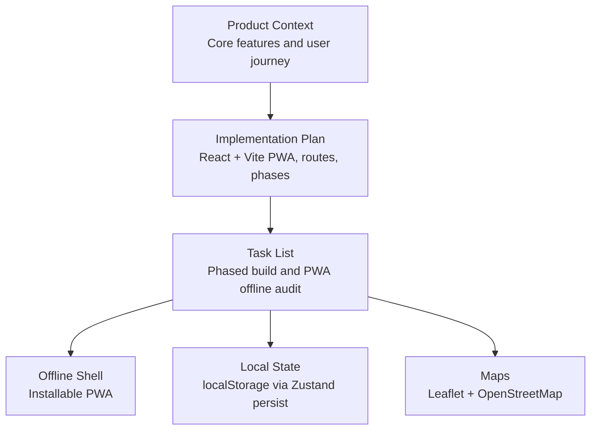
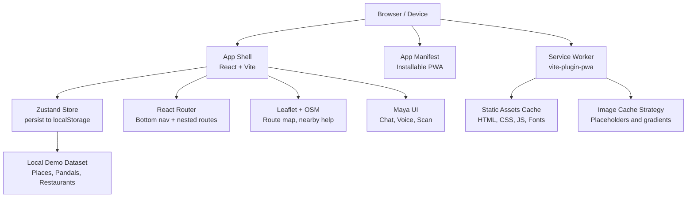
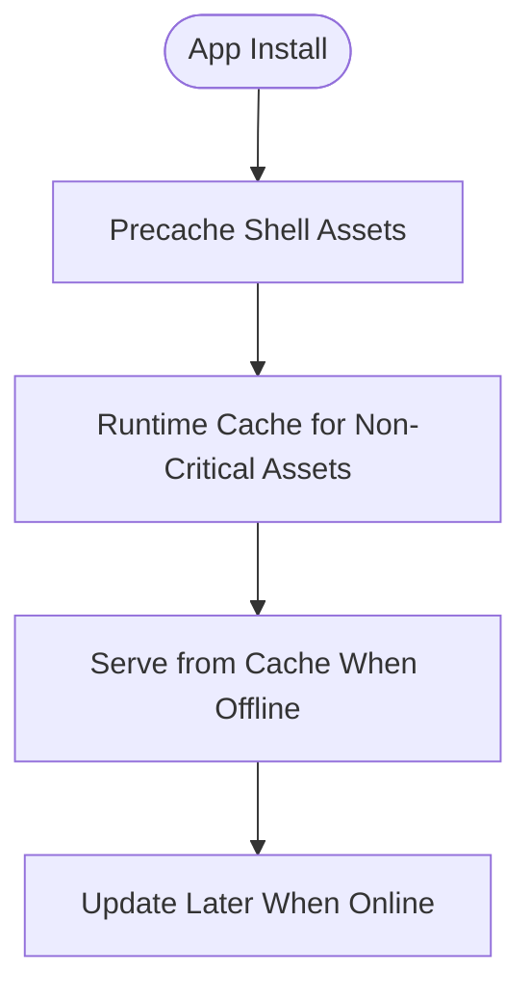
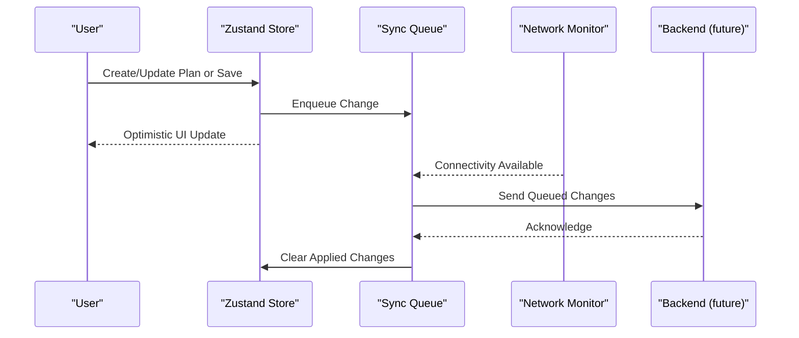
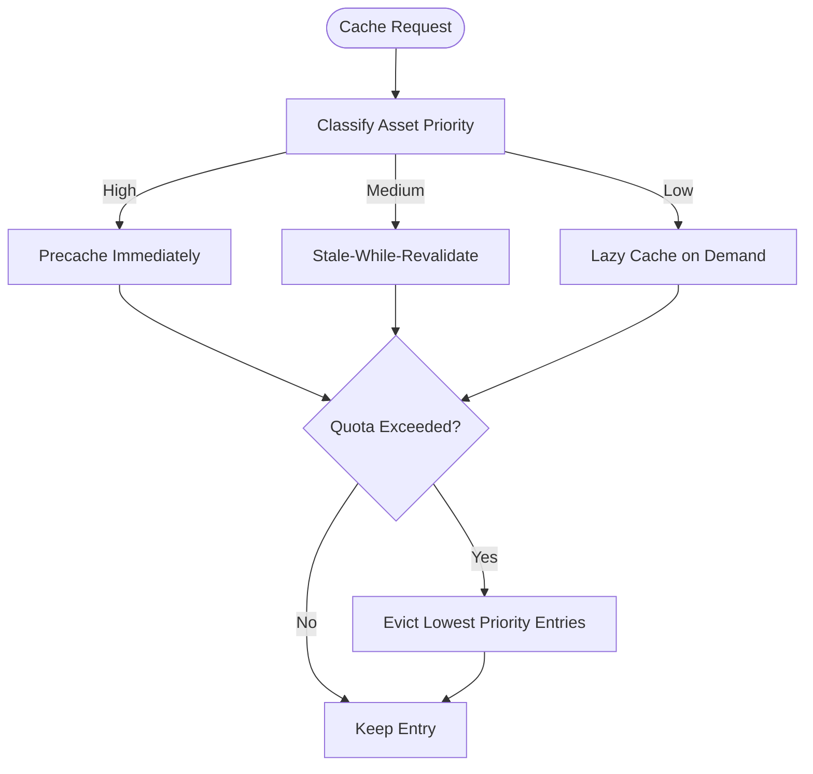
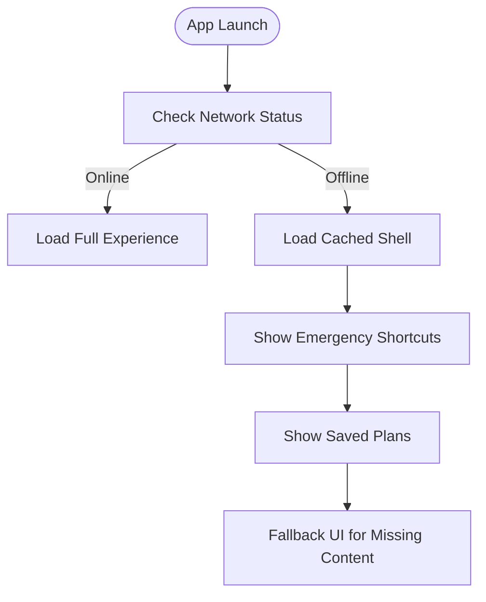
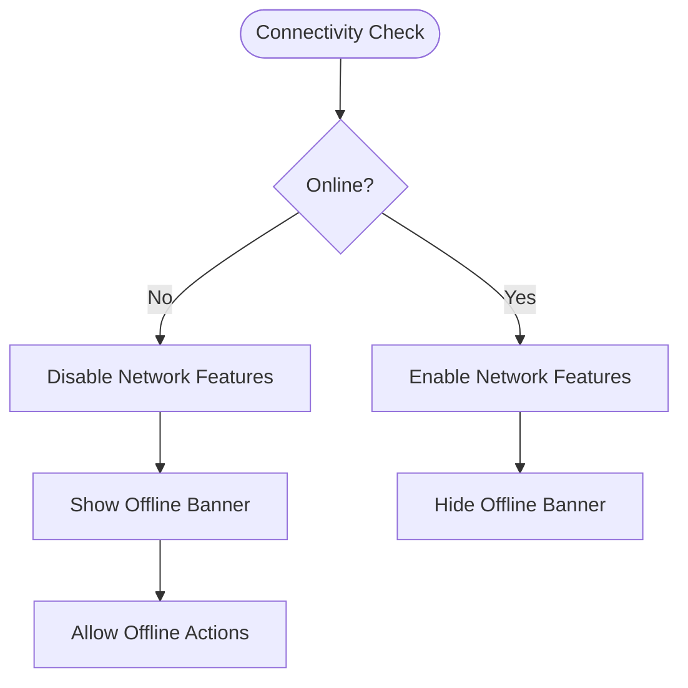
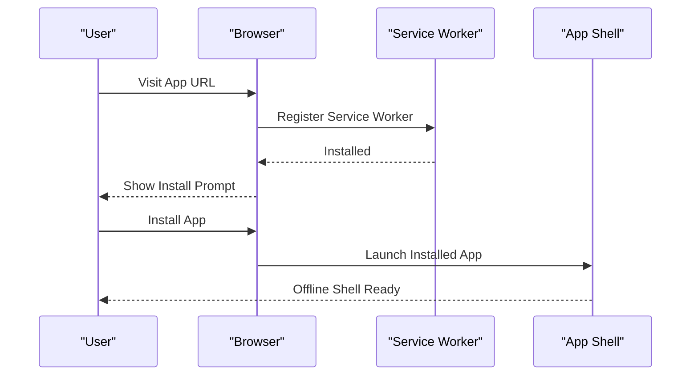
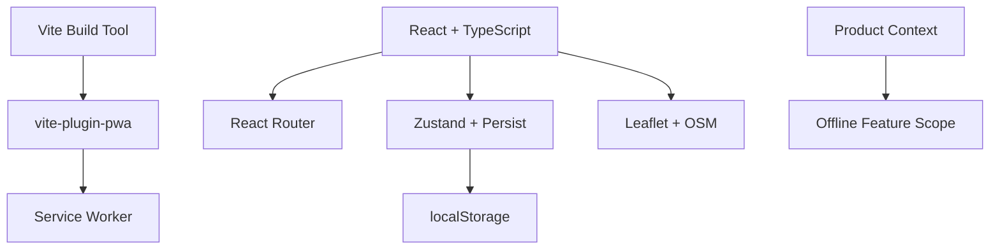

# Offline Functionality and PWA Implementation

<cite>
**Referenced Files in This Document**
- [Pujo_Sahayak_Master_Project_Context.md](file://Pujo_Sahayak_Master_Project_Context.md)
- [plan.md](file://tasks/plan.md)
- [todo.md](file://tasks/todo.md)
</cite>

## Table of Contents
1. [Introduction](#introduction)
2. [Project Structure](#project-structure)
3. [Core Components](#core-components)
4. [Architecture Overview](#architecture-overview)
5. [Detailed Component Analysis](#detailed-component-analysis)
6. [Dependency Analysis](#dependency-analysis)
7. [Performance Considerations](#performance-considerations)
8. [Troubleshooting Guide](#troubleshooting-guide)
9. [Conclusion](#conclusion)
10. [Appendices](#appendices)

## Introduction
This document defines the offline functionality and Progressive Web App (PWA) strategy for Pujo Sahayak. The project is a mobile-first React + Vite application intended to remain useful during Durga Puja and beyond, with strong emphasis on discovery, planning, social meetups, safety, and local exploration.

At this stage, the repository contains product context and implementation plans rather than source code. The PWA and offline capabilities are therefore described as a design and implementation plan aligned with the documented architecture decisions and task breakdown.

Key goals:
- Provide an installable PWA with an offline-capable app shell.
- Cache static assets and critical UI resources so navigation works without network access.
- Support offline-first patterns for emergency contacts, saved plans, and basic navigation.
- Plan data synchronization for user-generated content when connectivity returns.
- Define cache policies, storage quotas, cleanup strategies, and priority-based caching.
- Implement network detection, fallback behaviors, and clear user feedback for offline states.

## Project Structure
The current workspace includes:
- A master product context describing the product philosophy, core features, and user journeys.
- An implementation plan outlining the React + Vite PWA stack, routes, and phased delivery.
- A task list tracking foundation, feature phases, and polish including PWA offline audit.

**Diagram sources**
- [plan.md:1-18](file://tasks/plan.md#L1-L18)
- [todo.md:1-15](file://tasks/todo.md#L1-L15)

**Section sources**
- [plan.md:1-18](file://tasks/plan.md#L1-L18)
- [todo.md:1-15](file://tasks/todo.md#L1-L15)

## Core Components
Based on the documented architecture decisions and tasks, the following components underpin offline and PWA behavior:

- PWA shell and installation
  - Built with Vite and `vite-plugin-pwa` to generate a manifest and service worker.
  - Provides an installable experience and an offline shell that loads even when the network is unavailable.

- Client state persistence
  - Uses Zustand with a persist middleware to store user state such as saved places, visited places, Puja plan, meetups, language, theme, logo choice, and “continue where you left off” session.
  - Persists to localStorage, enabling offline continuity of user-driven data.

- Data model and demo dataset
  - Typed models include Place, Pandal, Restaurant, Event, Meetup, Review, Photo, PlanDay, Offer, SafetyPoint, Category.
  - Includes a Kolkata demo dataset with real pandals and restaurants; marked as demo data.

- Maps and navigation
  - Leaflet with OpenStreetMap tiles supports route maps, nearby help points, and multi-stop trip visualization.

- Maya assistant
  - Chat, voice waveform, and camera scan UIs are implemented locally using dataset-grounded responses and simulated identification.

These components collectively enable offline-first experiences for critical flows while keeping the app lightweight and focused on local exploration.

**Section sources**
- [plan.md:7-18](file://tasks/plan.md#L7-L18)
- [todo.md:13-15](file://tasks/todo.md#L13-L15)
- [todo.md:36-43](file://tasks/todo.md#L36-L43)

## Architecture Overview
The PWA architecture centers around an installable shell, a typed client store, and a local dataset. Network-dependent features fall back gracefully to cached or local data.

**Diagram sources**
- [plan.md:7-18](file://tasks/plan.md#L7-L18)
- [todo.md:1-15](file://tasks/todo.md#L1-L15)

## Detailed Component Analysis

### Service Worker and Caching Strategy
The plan specifies using `vite-plugin-pwa` to generate a service worker and manifest, providing an installable PWA and an offline shell. The caching strategy should prioritize:
- Static assets: HTML, CSS, JavaScript bundles, fonts, and icons.
- Critical UI images: placeholder gradients and curated images used by the shell and key screens.
- Optional API responses: only if they are small, stable, and beneficial for offline UX.

Recommended policy:
- Precache essential shell assets at install time.
- Use a stale-while-revalidate pattern for non-critical assets.
- Avoid aggressive caching of large media unless explicitly needed for offline use.

[No sources needed since this diagram shows conceptual workflow, not actual code structure]

### Data Synchronization Strategy
User-generated content such as saves, visits, plans, settings, and meetup participation is persisted locally via Zustand’s persist middleware. In a future backend-integrated version, synchronization should follow these principles:
- Queue changes locally when offline.
- Apply optimistic updates for immediate UX.
- Sync queued changes when connectivity returns.
- Resolve conflicts using deterministic rules (e.g., last-write-wins with timestamps, server-authoritative fields).
- Use background sync APIs where supported to retry failed operations.

[No sources needed since this diagram shows conceptual workflow, not actual code structure]

### Cache Management Policies
To keep the app responsive and within device storage limits:
- Storage quotas: Respect browser quotas; avoid storing excessive media.
- Cleanup strategies: Remove expired or low-priority entries; prefer placeholders over full-resolution images when offline.
- Priority-based caching:
  - High priority: Shell assets, fonts, critical icons, and essential UI images.
  - Medium priority: Route-specific assets like map markers and small illustrations.
  - Low priority: Large photos and optional media; load on demand and do not aggressively cache.

[No sources needed since this diagram shows conceptual workflow, not actual code structure]

### Offline-First Patterns for Critical Features
- Emergency contacts and safety shortcuts:
  - Preload and cache emergency numbers and nearby help points.
  - Ensure quick access even without network.
- Saved plans:
  - Persist all day slots and stops in localStorage.
  - Allow editing and viewing offline.
- Basic navigation:
  - Cache the app shell and essential routes.
  - Show a minimal offline-friendly view when network is unavailable.

[No sources needed since this diagram shows conceptual workflow, not actual code structure]

### Network Connectivity Detection and Fallback Behaviors
- Detect online/offline status using standard browser events.
- Update UI indicators to reflect connectivity.
- For network-dependent actions (e.g., fetching live data), show a clear offline banner and disable non-functional controls.
- Provide actionable guidance: “You’re offline. You can still view your saved plans and emergency contacts.”

[No sources needed since this diagram shows conceptual workflow, not actual code structure]

### PWA Installation and Native-like Experience
- Manifest configuration:
  - Provide app name, short name, description, theme color, and icons.
  - Set appropriate display mode and orientation hints.
- Install prompt:
  - Trigger installability when criteria are met.
  - Respect user choice and avoid repeated prompts.
- Native-like behaviors:
  - Splash screen and smooth transitions.
  - Bottom navigation mapped to routes.
  - Reduced-motion support and accessibility considerations.

**Diagram sources**
- [plan.md:7-10](file://tasks/plan.md#L7-L10)
- [todo.md:7-9](file://tasks/todo.md#L7-L9)

**Section sources**
- [plan.md:7-10](file://tasks/plan.md#L7-L10)
- [todo.md:7-9](file://tasks/todo.md#L7-L9)

## Dependency Analysis
The PWA and offline strategy depends on several layers:
- Build tooling: Vite and `vite-plugin-pwa`.
- Routing: React Router for bottom navigation and nested detail pages.
- State management: Zustand with persist middleware for localStorage-backed state.
- Media and maps: Placeholder gradients and Leaflet with OpenStreetMap.
- Product context: Feature scope and user journeys guide what must be available offline.

**Diagram sources**
- [plan.md:7-18](file://tasks/plan.md#L7-L18)
- [todo.md:1-15](file://tasks/todo.md#L1-L15)

**Section sources**
- [plan.md:7-18](file://tasks/plan.md#L7-L18)
- [todo.md:1-15](file://tasks/todo.md#L1-L15)

## Performance Considerations
- Minimize payload size for the offline shell to ensure fast cold starts.
- Prefer lightweight placeholders and gradients for images until real photography is integrated.
- Avoid caching large media unless explicitly required for offline scenarios.
- Use lazy loading for heavy components and defer non-critical work until after initial render.
- Honor reduced-motion preferences to improve performance and accessibility.

[No sources needed since this section provides general guidance]

## Troubleshooting Guide
Common issues and mitigations:
- Service worker registration failures:
  - Verify correct plugin configuration and build output.
  - Check browser console for registration errors.
- Offline shell not loading:
  - Ensure precache includes essential shell assets.
  - Validate manifest and icon paths.
- Local state not persisting:
  - Confirm Zustand persist middleware is configured and localStorage is available.
- Map tiles failing offline:
  - Do not rely on tile caches for offline navigation; provide alternative views or instructions.
- Image placeholders breaking layout:
  - Ensure image-agnostic layouts and consistent aspect ratios.

**Section sources**
- [plan.md:7-18](file://tasks/plan.md#L7-L18)
- [todo.md:7-9](file://tasks/todo.md#L7-L9)

## Conclusion
The Pujo Sahayak project plans a robust PWA built with React, Vite, and `vite-plugin-pwa`, backed by a typed local dataset and Zustand-managed state persisted to localStorage. The offline strategy focuses on a reliable app shell, careful cache prioritization, and graceful fallbacks for critical features like emergency contacts and saved plans. As the project progresses through its phased tasks, the PWA offline audit will validate installability, shell caching, and responsiveness across devices.

[No sources needed since this section summarizes without analyzing specific files]

## Appendices

### Offline Feature Mapping to Product Context
- Discovery and exploration:
  - Home, Explore, Categories, Search, and Pandal Detail should be accessible offline via cached shell and local dataset.
- Planning and memory:
  - Favorites, Puja Planner, and “Continue Where You Left Off” rely on localStorage-backed state.
- Social and utility:
  - Meets and restaurant details can show cached or local data; live interactions require network.
- Safety:
  - Emergency shortcuts and nearby help points should be preloaded and available offline.

**Section sources**
- [Pujo_Sahayak_Master_Project_Context.md:1-12](file://Pujo_Sahayak_Master_Project_Context.md#L1-L12)
- [Pujo_Sahayak_Master_Project_Context.md:140-158](file://Pujo_Sahayak_Master_Project_Context.md#L140-L158)
- [Pujo_Sahayak_Master_Project_Context.md:320-351](file://Pujo_Sahayak_Master_Project_Context.md#L320-L351)
- [Pujo_Sahayak_Master_Project_Context.md:353-445](file://Pujo_Sahayak_Master_Project_Context.md#L353-L445)
- [Pujo_Sahayak_Master_Project_Context.md:447-556](file://Pujo_Sahayak_Master_Project_Context.md#L447-L556)
- [Pujo_Sahayak_Master_Project_Context.md:664-772](file://Pujo_Sahayak_Master_Project_Context.md#L664-L772)