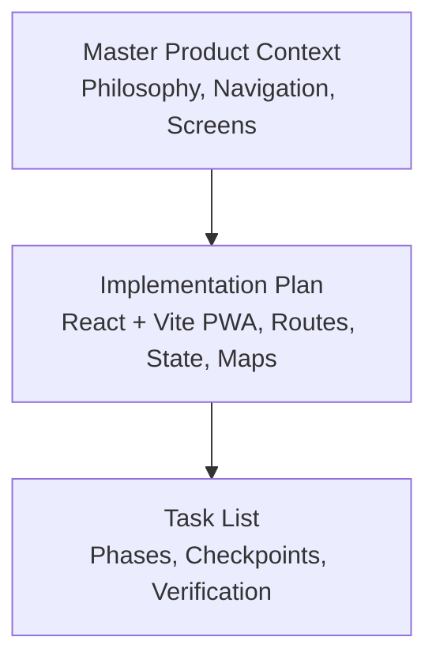
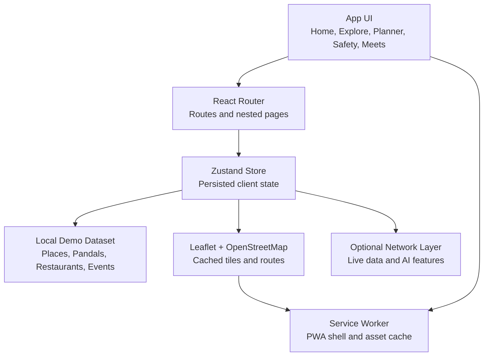
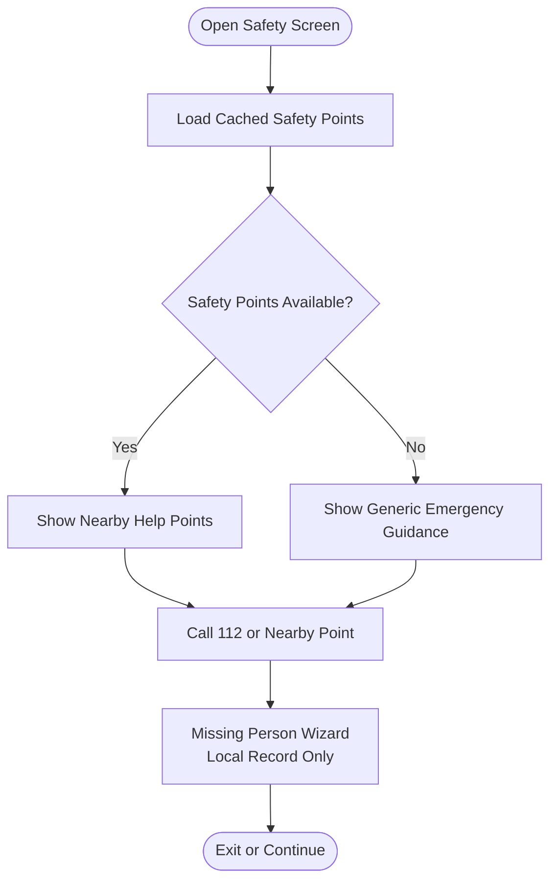
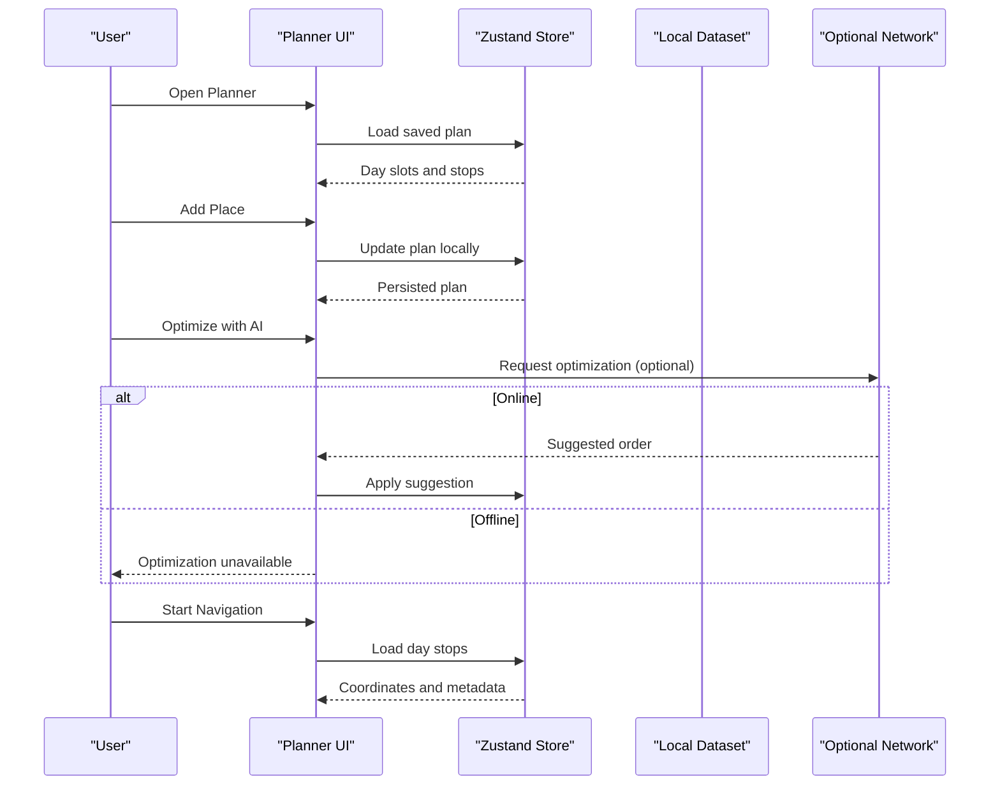
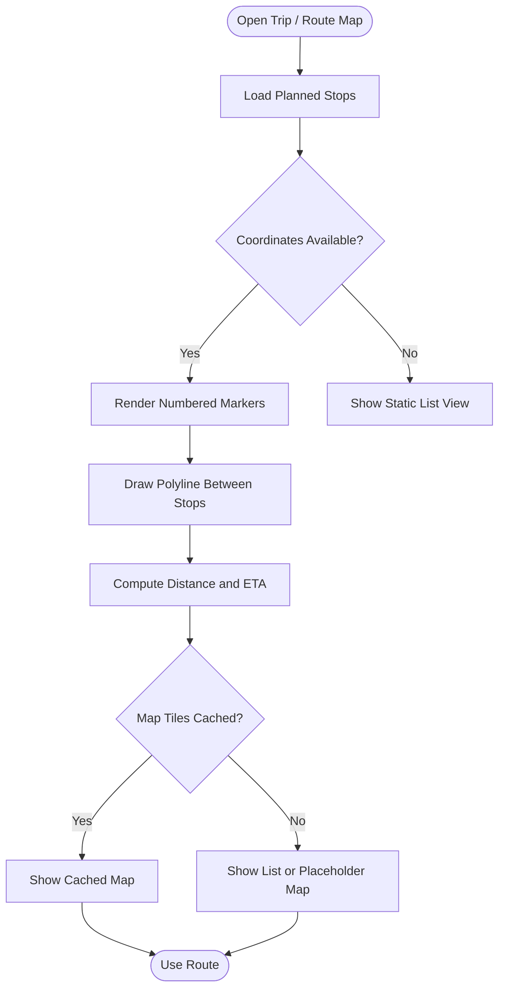
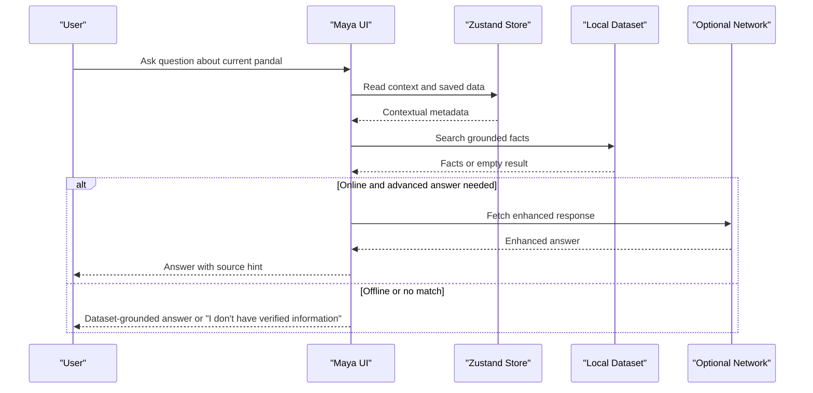
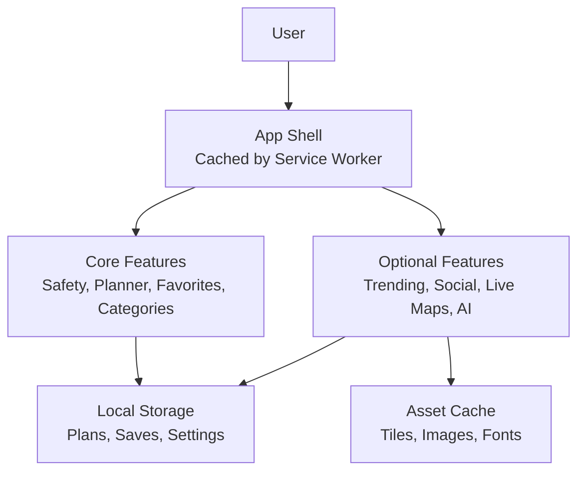
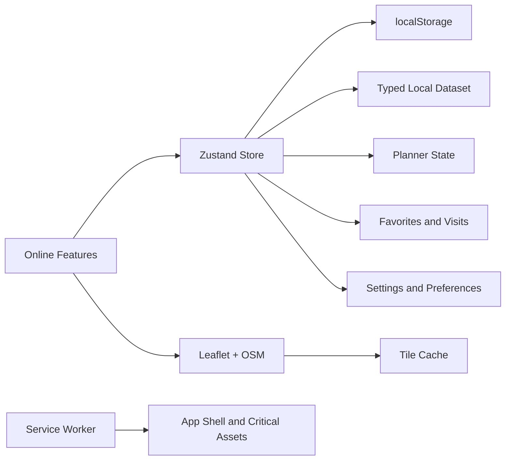

# Offline-First Patterns and User Experience

<cite>
**Referenced Files in This Document**
- [Pujo_Sahayak_Master_Project_Context.md](file://Pujo_Sahayak_Master_Project_Context.md)
- [plan.md](file://tasks/plan.md)
- [todo.md](file://tasks/todo.md)
</cite>

## Table of Contents
1. [Introduction](#introduction)
2. [Project Structure](#project-structure)
3. [Core Components](#core-components)
4. [Architecture Overview](#architecture-overview)
5. [Detailed Component Analysis](#detailed-component-analysis)
6. [Dependency Analysis](#dependency-analysis)
7. [Performance Considerations](#performance-considerations)
8. [Troubleshooting Guide](#troubleshooting-guide)
9. [Conclusion](#conclusion)
10. [Appendices](#appendices)

## Introduction
This document defines offline-first patterns and user experience guidelines for Pujo Sahayak, an offline-capable PWA focused on Durga Puja discovery, planning, safety, and local exploration. The goal is to ensure that core features remain usable without internet connectivity while providing graceful degradation when the network is unavailable.

Key offline-first principles applied here:
- Local data as the source of truth for critical flows.
- Network requests only when required or optional.
- Clear user feedback for offline states.
- Progressive enhancement so online capabilities improve but do not block basic usage.
- Safety-critical actions remaining available offline.

The product context emphasizes a continuous journey from discovery through planning, visiting, sharing, and meeting people, with utilities such as transport, emergency information, and route planning supporting the experience. Offline design must preserve this flow wherever possible.

**Section sources**
- [Pujo_Sahayak_Master_Project_Context.md:1-18](file://Pujo_Sahayak_Master_Project_Context.md#L1-L18)
- [Pujo_Sahayak_Master_Project_Context.md:77-100](file://Pujo_Sahayak_Master_Project_Context.md#L77-L100)
- [Pujo_Sahayak_Master_Project_Context.md:140-157](file://Pujo_Sahayak_Master_Project_Context.md#L140-L157)

## Project Structure
At this stage, the repository contains:
- A master product context describing the app’s philosophy, navigation, screens, and feature areas.
- An implementation plan outlining React + Vite PWA architecture, routes, state management, maps, and phased delivery.
- A task list tracking phases from foundation through polish, including PWA offline audit.

**Diagram sources**
- [Pujo_Sahayak_Master_Project_Context.md:1-18](file://Pujo_Sahayak_Master_Project_Context.md#L1-L18)
- [plan.md:1-18](file://tasks/plan.md#L1-L18)
- [todo.md:1-16](file://tasks/todo.md#L1-L16)

**Section sources**
- [Pujo_Sahayak_Master_Project_Context.md:1-18](file://Pujo_Sahayak_Master_Project_Context.md#L1-L18)
- [plan.md:1-18](file://tasks/plan.md#L1-L18)
- [todo.md:1-16](file://tasks/todo.md#L1-L16)

## Core Components
Offline-first design should focus on these core components:

- Emergency contacts and safety utilities
- Saved plans and itinerary data
- Basic navigation and route visualization
- Essential app shell and persistent UI

### Emergency Contacts and Safety Utilities
Safety and emergency functionality must be accessible offline because users may need help while traveling around Kolkata during events.

Recommended offline behavior:
- Preload essential safety points (police stations, hospitals, ATMs, pharmacies) into local storage.
- Provide quick-call shortcuts using `tel:` links where supported by the platform.
- Show nearby help points from cached data even if location services are partially unavailable.
- Keep the missing-person report wizard functional locally, storing records until the user reconnects.

User feedback patterns:
- Clearly label offline mode and what is available.
- Indicate which safety features are fully offline versus requiring network.
- Avoid blocking the user from calling emergency numbers due to connectivity status.

### Saved Plans and Itinerary Data
Plans should persist locally and be editable without internet.

Recommended offline behavior:
- Store saved places, visited places, and multi-day plans in localStorage via Zustand persistence.
- Allow adding, removing, reordering stops, and switching between days offline.
- Defer AI-assisted optimization until online; present it as a suggestion rather than a guarantee.
- Persist partial plans so users can continue where they left off.

User feedback patterns:
- Show “Saved locally” indicators for unsynced changes.
- Offer “Optimize with AI” only when online, with a clear fallback message.
- Preserve continuity across reloads and app restarts.

### Basic Navigation and Route Visualization
Navigation should work with cached map tiles and precomputed distances.

Recommended offline behavior:
- Use Leaflet with OpenStreetMap tiles, caching tiles for frequently visited areas.
- Compute distances and estimated times using haversine calculations against stored coordinates.
- Display numbered markers and polylines for planned routes.
- Disable live traffic or dynamic routing updates when offline.

User feedback patterns:
- Show a small indicator that map tiles are cached.
- Explain that route suggestions are based on stored data.
- Provide alternative directions or static maps when live routing is unavailable.

### Essential App Shell and Persistent UI
The app shell should load quickly and remain usable offline.

Recommended offline behavior:
- Cache the application shell, fonts, icons, and critical assets via service worker.
- Serve the home screen, favorites, planner, categories, and safety pages from cache.
- Gracefully degrade nonessential content such as sponsored cards, trending lists, and social feeds.

User feedback patterns:
- Display a subtle offline banner when needed.
- Replace failing images with placeholders or gradients.
- Keep primary navigation and core actions visible.

**Section sources**
- [Pujo_Sahayak_Master_Project_Context.md:140-157](file://Pujo_Sahayak_Master_Project_Context.md#L140-L157)
- [Pujo_Sahayak_Master_Project_Context.md:320-350](file://Pujo_Sahayak_Master_Project_Context.md#L320-L350)
- [Pujo_Sahayak_Master_Project_Context.md:353-421](file://Pujo_Sahayak_Master_Project_Context.md#L353-L421)
- [Pujo_Sahayak_Master_Project_Context.md:517-556](file://Pujo_Sahayak_Master_Project_Context.md#L517-L556)
- [plan.md:5-18](file://tasks/plan.md#L5-L18)
- [todo.md:45-68](file://tasks/todo.md#L45-L68)

## Architecture Overview
The offline-first architecture separates concerns between local state, cached data, and optional network operations.

**Diagram sources**
- [plan.md:5-18](file://tasks/plan.md#L5-L18)
- [todo.md:45-68](file://tasks/todo.md#L45-L68)

### Connectivity Detection Strategy
Connectivity detection should be lightweight and integrated into the store or a dedicated utility:

- Listen to browser `online` and `offline` events.
- Track connection type when available (e.g., cellular vs Wi-Fi).
- Debounce rapid state changes to avoid UI flicker.
- Surface connectivity state to components that need it.

Fallback behaviors:
- If offline, read from localStorage and cached map tiles.
- If online, attempt to refresh nonessential data.
- Never block emergency calls or core navigation.

Graceful degradation strategies:
- Hide or disable features that require live data.
- Show cached results with timestamps.
- Provide actionable error messages explaining what is unavailable and why.

**Section sources**
- [plan.md:5-18](file://tasks/plan.md#L5-L18)
- [todo.md:74-81](file://tasks/todo.md#L74-L81)

## Detailed Component Analysis

### Emergency and Safety Flow
Emergency features must remain accessible offline.

**Diagram sources**
- [todo.md:60-68](file://tasks/todo.md#L60-L68)
- [Pujo_Sahayak_Master_Project_Context.md:517-556](file://Pujo_Sahayak_Master_Project_Context.md#L517-L556)

#### Implementation Notes
- Safety points should be part of the typed dataset and persisted locally.
- Emergency call shortcuts should use platform-supported tel links.
- Missing person reports should be stored locally and marked as unsynced until connectivity is restored.

**Section sources**
- [todo.md:60-68](file://tasks/todo.md#L60-L68)
- [Pujo_Sahayak_Master_Project_Context.md:517-556](file://Pujo_Sahayak_Master_Project_Context.md#L517-L556)

### Saved Plans and Planner Flow
Planner functionality should be fully usable offline.

**Diagram sources**
- [todo.md:45-55](file://tasks/todo.md#L45-L55)
- [plan.md:5-18](file://tasks/plan.md#L5-L18)

#### Implementation Notes
- Use Zustand with persist middleware to keep plans across sessions.
- Present AI optimization as a suggestion, not a guaranteed optimal route.
- Keep add/remove/reorder operations local and immediate.

**Section sources**
- [todo.md:45-55](file://tasks/todo.md#L45-L55)
- [plan.md:5-18](file://tasks/plan.md#L5-L18)

### Basic Navigation and Route Map Flow
Route visualization should rely on cached data when offline.

**Diagram sources**
- [todo.md:60-68](file://tasks/todo.md#L60-L68)
- [plan.md:5-18](file://tasks/plan.md#L5-L18)

#### Implementation Notes
- Use Leaflet with OpenStreetMap tiles.
- Cache tiles for frequently visited areas.
- Compute distances using haversine formulas against stored lat-lng values.
- Disable live traffic and dynamic rerouting when offline.

**Section sources**
- [todo.md:60-68](file://tasks/todo.md#L60-L68)
- [plan.md:5-18](file://tasks/plan.md#L5-L18)

### Maya Assistant Offline Behavior
Maya should provide grounded responses from the local dataset and clearly indicate when live data is unavailable.

**Diagram sources**
- [todo.md:34-44](file://tasks/todo.md#L34-L44)
- [Pujo_Sahayak_Master_Project_Context.md:558-606](file://Pujo_Sahayak_Master_Project_Context.md#L558-L606)

#### Implementation Notes
- Keep Maya answers grounded in the local dataset.
- Avoid hallucination and mark demo behavior honestly.
- Provide a clear fallback when no verified information exists.

**Section sources**
- [todo.md:34-44](file://tasks/todo.md#L34-L44)
- [Pujo_Sahayak_Master_Project_Context.md:558-606](file://Pujo_Sahayak_Master_Project_Context.md#L558-L606)

### Conceptual Overview
The following conceptual diagram shows how offline-first patterns integrate across the app without mapping to specific files:

[No sources needed since this diagram shows conceptual workflow, not actual code structure]

## Dependency Analysis
Offline-first dependencies center on local state, cached assets, and optional network access.

**Diagram sources**
- [plan.md:5-18](file://tasks/plan.md#L5-L18)
- [todo.md:45-68](file://tasks/todo.md#L45-L68)

**Section sources**
- [plan.md:5-18](file://tasks/plan.md#L5-L18)
- [todo.md:45-68](file://tasks/todo.md#L45-L68)

## Performance Considerations
- Prefer local reads over network calls for critical paths.
- Cache map tiles for frequently visited areas to reduce latency.
- Debounce connectivity checks to avoid unnecessary re-renders.
- Lazy-load nonessential sections such as offers, trending items, and social feeds.
- Keep the app shell small and fast to improve cold-start performance offline.
- Use placeholder gradients and lightweight images to maintain layout integrity when real assets are unavailable.

[No sources needed since this section provides general guidance]

## Troubleshooting Guide
Common offline scenarios and resolutions:

- Emergency screen does not show nearby help points:
  - Verify that safety points were included in the local dataset.
  - Ensure the safety screen loads from local storage before attempting network access.
  - Confirm that emergency call shortcuts are enabled and supported by the platform.

- Planner optimization fails offline:
  - Treat AI optimization as optional and present a clear fallback message.
  - Keep manual reorder and save operations functional.
  - Persist unsynced changes and sync when connectivity returns.

- Route map shows blank tiles:
  - Check whether tiles are cached by the service worker.
  - Fall back to a list view or static representation when tiles are unavailable.
  - Avoid blocking navigation behind tile loading.

- Maya returns no verified information:
  - Ensure dataset queries return grounded facts.
  - Display a helpful fallback message instead of generic errors.
  - Do not fabricate answers or imply live connectivity.

**Section sources**
- [todo.md:34-44](file://tasks/todo.md#L34-L44)
- [todo.md:60-68](file://tasks/todo.md#L60-L68)
- [plan.md:5-18](file://tasks/plan.md#L5-L18)

## Conclusion
Offline-first design for Pujo Sahayak should prioritize safety, planning, and essential navigation. Core features must work reliably without internet, while optional enhancements such as live maps, trending content, and AI assistance improve the experience when connectivity is available. Clear user feedback, progressive enhancement, and robust local persistence are essential to delivering a trustworthy offline experience.

[No sources needed since this section summarizes without analyzing specific files]

## Appendices

### Testing Strategies for Offline Scenarios
- Manual offline testing:
  - Disable network and verify emergency shortcuts, planner edits, favorites, and categories.
  - Confirm that the app shell loads and primary navigation remains functional.
- Automated checks:
  - Assert that critical stores initialize from localStorage.
  - Validate that offline banners and fallback messages appear as expected.
  - Ensure map rendering falls back gracefully when tiles are missing.
- Acceptance criteria:
  - All core routes render offline.
  - Safety features remain accessible.
  - Plans and saves persist across reloads.
  - Nonessential features degrade gracefully without breaking the UI.

**Section sources**
- [todo.md:74-81](file://tasks/todo.md#L74-L81)
- [plan.md:63-70](file://tasks/plan.md#L63-L70)