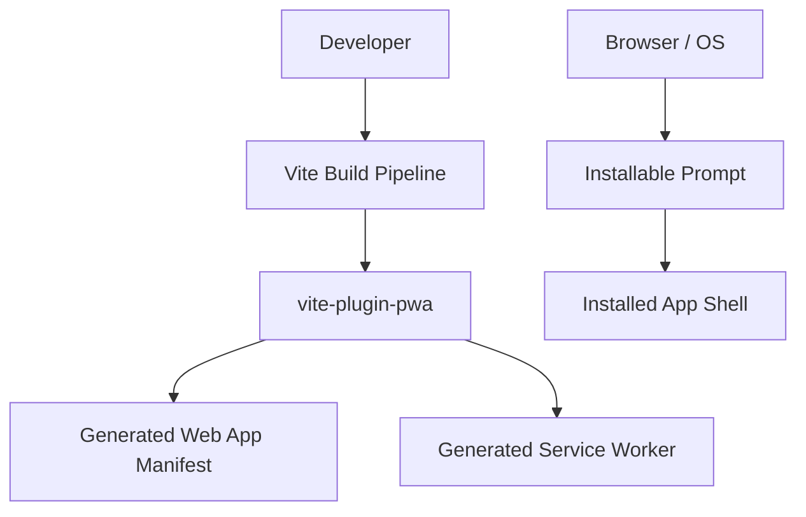
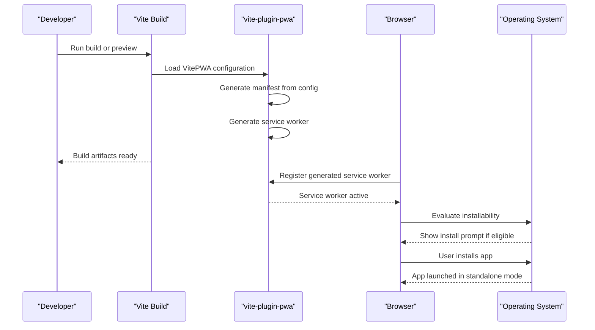
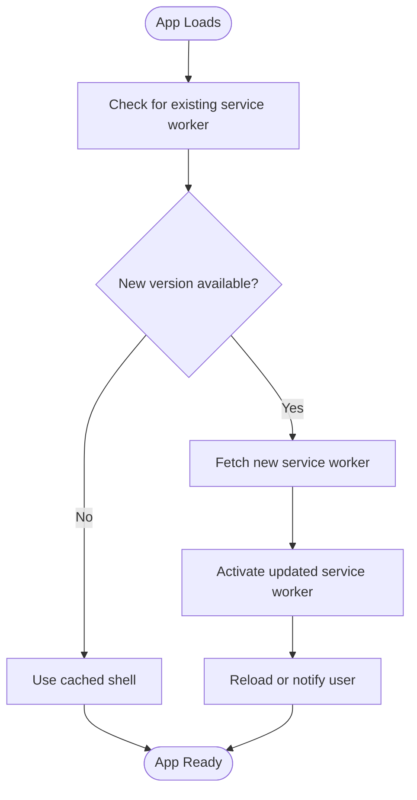
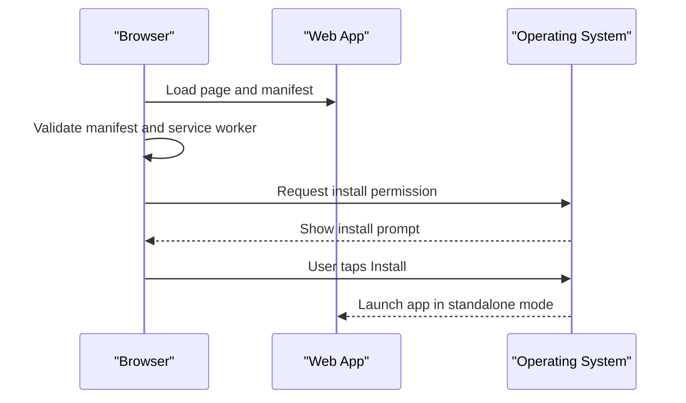
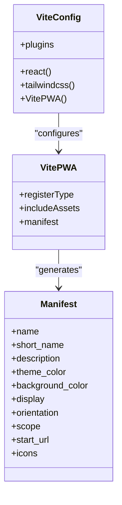
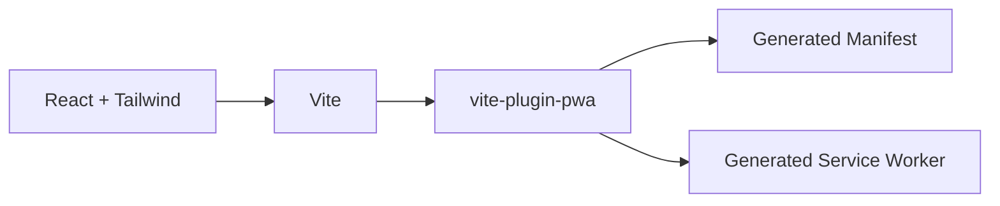

# PWA Installation and App Manifest

<cite>
**Referenced Files in This Document**
- [vite.config.ts](file://vite.config.ts)
- [package.json](file://package.json)
- [plan.md](file://tasks/plan.md)
</cite>

## Table of Contents
1. [Introduction](#introduction)
2. [Project Structure](#project-structure)
3. [Core Components](#core-components)
4. [Architecture Overview](#architecture-overview)
5. [Detailed Component Analysis](#detailed-component-analysis)
6. [Dependency Analysis](#dependency-analysis)
7. [Performance Considerations](#performance-considerations)
8. [Troubleshooting Guide](#troubleshooting-guide)
9. [Conclusion](#conclusion)

## Introduction
This document explains how the Pujo Sahayak project implements Progressive Web App installation through a web app manifest and `vite-plugin-pwa`. It covers:
- The manifest structure currently configured at build time.
- Required and optional manifest fields relevant to installation, full-screen mode, status bar customization, and home screen shortcuts.
- Platform-specific considerations for iOS and Android.
- How the Vite build pipeline generates the service worker and registers it automatically.
- Practical guidance for testing installation flows and troubleshooting common issues across devices and browsers.

The goal is to make the installation experience feel native-like while keeping configuration centralized in the Vite configuration file.

## Project Structure
At this stage, PWA-related configuration lives primarily in two files:
- `vite.config.ts`: Defines the `VitePWA` plugin, including the generated manifest and registration behavior.
- `package.json`: Declares `vite-plugin-pwa` as a development dependency and provides build scripts.

**Diagram sources**
- [vite.config.ts:11-34](file://vite.config.ts#L11-L34)
- [package.json:20-30](file://package.json#L20-L30)

**Section sources**
- [vite.config.ts:1-37](file://vite.config.ts#L1-L37)
- [package.json:1-32](file://package.json#L1-L32)

## Core Components
The PWA installation stack consists of three main parts:

| Component | Responsibility | Current Status |
|---|---|---|
| Web App Manifest | Describes app name, icons, display mode, colors, scope, and start URL. | Generated by `VitePWA` from the object in `vite.config.ts`. |
| Service Worker | Provides caching, offline shell, and update strategies. | Generated by `vite-plugin-pwa`; registration type is set to auto-update. |
| Installability Signals | Tells browsers and operating systems that the app can be installed. | Derived from manifest and service worker presence. |

Key behaviors derived from the current configuration:
- The app uses `display: standalone`, which requests full-screen-like behavior when installed.
- The theme color and background color are defined, allowing status bar and splash customization on supported platforms.
- Icons are declared using an SVG asset with `purpose: any`.
- The scope and start URL are both set to the root path.

**Section sources**
- [vite.config.ts:11-34](file://vite.config.ts#L11-L34)
- [plan.md:7-10](file://tasks/plan.md#L7-L10)

## Architecture Overview
The PWA architecture follows a standard Vite + `vite-plugin-pwa` flow:

**Diagram sources**
- [vite.config.ts:11-34](file://vite.config.ts#L11-L34)
- [package.json:29-30](file://package.json#L29-L30)

## Detailed Component Analysis

### Web App Manifest Configuration
The manifest is defined inside the `VitePWA` configuration object. It controls how the app appears on the home screen and how the browser renders it in standalone mode.

Current manifest-related settings include:
- Application identity: name and short name.
- Description text shown during installation or in app listings.
- Visual branding: theme color and background color.
- Display mode: standalone for a native-like experience.
- Orientation preference: portrait.
- Scope and start URL: root-level navigation.
- Icon definition: SVG icon with generic purpose.

#### Manifest Field Reference
| Field | Purpose | Current Value | Notes |
|---|---|---|---|
| `name` | Full app name | `Pujo Sahayak` | Used by install prompts and home screen labels. |
| `short_name` | Short label where space is limited | `PujoSahayak` | Useful for home screen tiles. |
| `description` | Explains app purpose | Long descriptive string | Shown in some install UIs and stores. |
| `theme_color` | Status bar and UI accent color | Vermilion shade | Affects Chrome Android status bar. |
| `background_color` | Splash screen background | Dark charcoal tone | Used during launch. |
| `display` | Rendering mode | `standalone` | Removes browser chrome; native-like shell. |
| `orientation` | Preferred orientation | `portrait` | Suggests mobile-first layout. |
| `scope` | Navigation scope | `/` | All routes under root are considered part of the app. |
| `start_url` | Launch entry point | `/` | Where the app starts after installation. |
| `icons` | Home screen and task switcher images | SVG icon array | Currently single SVG entry. |

#### Required vs Optional Fields
- **Required for installability**:
  - A valid manifest.
  - At least one icon suitable for the platform.
  - A registered service worker.
- **Recommended for best experience**:
  - `name` and `short_name`.
  - `description`.
  - `theme_color` and `background_color`.
  - `display: standalone`.
  - `start_url` and `scope`.
  - Multiple icon sizes for different densities and platforms.

#### Platform-Specific Considerations
- **Android**:
  - Relies heavily on the manifest and service worker.
  - Shows install prompt when criteria are met.
  - Uses `theme_color` for the status bar and `background_color` for splash.
- **iOS (Safari)**:
  - Does not use the standard web app manifest for installation.
  - Requires Apple-specific meta tags and touch icons in the HTML head.
  - Uses `apple-touch-icon` assets and related meta elements.
  - Standalone-like behavior is achieved through these Apple-specific hints rather than the W3C manifest alone.

Because the current configuration only defines the W3C manifest, iOS-specific installation metadata should be added separately in the application’s HTML entry point.

**Section sources**
- [vite.config.ts:14-33](file://vite.config.ts#L14-L33)

### Service Worker Registration and Updates
The service worker is generated by `vite-plugin-pwa`. Its registration behavior is controlled by `registerType`.

Current behavior:
- `registerType: 'autoUpdate'` means the plugin handles registration and updates automatically.
- The generated service worker participates in caching and offline capabilities according to default plugin behavior.
- Developers do not need to manually register the service worker unless they override the plugin’s defaults.

**Diagram sources**
- [vite.config.ts:11-13](file://vite.config.ts#L11-L13)

**Section sources**
- [vite.config.ts:11-13](file://vite.config.ts#L11-L13)

### Installation Prompt and User Consent Flow
The installation prompt is not implemented as custom JavaScript in the provided configuration. Instead, it relies on browser and OS behavior:
- The browser evaluates whether the app meets installability requirements.
- If eligible, the browser shows its native install prompt.
- The user consents by tapping Install.
- After installation, the app launches in standalone mode based on the manifest’s `display` value.

**Diagram sources**
- [vite.config.ts:14-33](file://vite.config.ts#L14-L33)

**Section sources**
- [vite.config.ts:14-33](file://vite.config.ts#L14-L33)

### Native-Like Experience Features
The current configuration supports several native-like behaviors:

| Feature | How It Is Configured | Expected Behavior |
|---|---|---|
| Full-screen mode | `display: standalone` | Removes browser address bar and tabs when installed. |
| Status bar customization | `theme_color` | Colors the status bar on supported Android browsers. |
| Splash screen background | `background_color` | Sets initial background color during app launch. |
| Home screen shortcut | `icons` and `name` | Creates a home screen tile with the app name and icon. |
| Orientation hint | `orientation: portrait` | Suggests portrait usage on mobile devices. |
| Scoped navigation | `scope: '/'` | Treats all root paths as part of the installed app. |
| Launch entry point | `start_url: '/'` | Opens the root route after installation. |

For iOS, additional Apple-specific metadata is required to achieve a similar native-like experience because Safari does not fully honor the W3C manifest for installation.

**Section sources**
- [vite.config.ts:14-33](file://vite.config.ts#L14-L33)

### Integration with `vite-plugin-pwa`
The project integrates `vite-plugin-pwa` as a Vite plugin. This integration:
- Generates the web app manifest at build time.
- Generates the service worker.
- Registers the service worker automatically based on `registerType`.
- Includes specified static assets such as the favicon.

**Diagram sources**
- [vite.config.ts:1-37](file://vite.config.ts#L1-L37)

**Section sources**
- [vite.config.ts:1-37](file://vite.config.ts#L1-L37)
- [package.json:29-30](file://package.json#L29-L30)

## Dependency Analysis
The PWA setup depends on:
- Vite as the build tool.
- `vite-plugin-pwa` as the PWA automation layer.
- React and Tailwind CSS as the frontend stack, though they are not directly responsible for PWA behavior.

**Diagram sources**
- [package.json:25-30](file://package.json#L25-L30)
- [vite.config.ts:1-11](file://vite.config.ts#L1-L11)

**Section sources**
- [package.json:20-30](file://package.json#L20-L30)
- [vite.config.ts:1-11](file://vite.config.ts#L1-L11)

## Performance Considerations
- Keep the manifest minimal and accurate so browsers can quickly evaluate installability.
- Prefer vector icons like SVG when appropriate, but also provide raster icons for broader platform support.
- Avoid overly large icons; generate multiple sizes for different device densities.
- Use `scope` carefully to limit caching to relevant routes.
- Test service worker updates with `autoUpdate` to ensure smooth rollouts without breaking user sessions.
- Audit performance and PWA compliance using Lighthouse or similar tools.

[No sources needed since this section provides general guidance]

## Troubleshooting Guide

### App Not Showing Install Prompt
Common causes:
- Missing or invalid manifest.
- Missing service worker.
- Incorrect `display` value.
- Non-HTTPS context during production.
- iOS requiring Apple-specific metadata instead of relying solely on the W3C manifest.

Checks:
- Verify the generated manifest exists in the build output.
- Confirm the service worker is registered and active.
- Ensure the site is served over HTTPS in production.
- For iOS, add Apple-specific meta tags and touch icons in the HTML entry point.

**Section sources**
- [vite.config.ts:11-34](file://vite.config.ts#L11-L34)

### Installed App Looks Like a Regular Website
Likely cause:
- The app is not installed, so the browser still shows normal chrome.
- On iOS, missing Apple-specific metadata prevents native-like behavior.

Resolution:
- Complete the installation flow.
- Add iOS-specific meta tags and icons.
- Confirm `display: standalone` is present for Android and other supporting browsers.

**Section sources**
- [vite.config.ts:21-22](file://vite.config.ts#L21-L22)

### Status Bar or Splash Screen Colors Are Wrong
Likely causes:
- `theme_color` or `background_color` not set.
- Platform does not support those fields.
- Cached service worker serving an older build.

Resolution:
- Set `theme_color` and `background_color` in the manifest.
- Force a service worker update or clear cache.
- Test on supported Android browsers.

**Section sources**
- [vite.config.ts:19-20](file://vite.config.ts#L19-L20)

### Home Screen Shortcut Missing or Incorrect
Likely causes:
- No valid icon defined.
- Icon format or size not supported by the platform.
- iOS missing `apple-touch-icon`.

Resolution:
- Provide multiple icon sizes and formats.
- Keep `purpose` appropriate for each icon.
- Add Apple-specific touch icons for iOS.

**Section sources**
- [vite.config.ts:25-32](file://vite.config.ts#L25-L32)

### Testing PWA Installation Flows
Recommended steps:
1. Run the development server and inspect the Network tab for the generated service worker.
2. Open Chrome DevTools and go to the Application panel to check the manifest and service worker status.
3. Use Lighthouse to verify PWA criteria, including installability.
4. Test on Android Chrome for native install prompts.
5. Test on iOS Safari with Apple-specific metadata to validate home screen behavior.
6. Simulate network conditions and offline behavior after installation.

**Section sources**
- [plan.md:7-10](file://tasks/plan.md#L7-L10)

## Conclusion
The Pujo Sahayak project uses `vite-plugin-pwa` to centralize PWA configuration in `vite.config.ts`. The current setup defines a manifest that enables a native-like experience on supported platforms, including full-screen mode, status bar coloring, splash background, and home screen shortcuts. Service worker registration is automated through `autoUpdate`.

To complete the PWA experience across platforms:
- Expand icon coverage for better compatibility.
- Add iOS-specific metadata for Safari installation and native-like behavior.
- Validate installability and runtime behavior using Lighthouse and manual testing on target devices.
- Monitor service worker updates and caching behavior during development and production.

[No sources needed since this section summarizes without analyzing specific files]