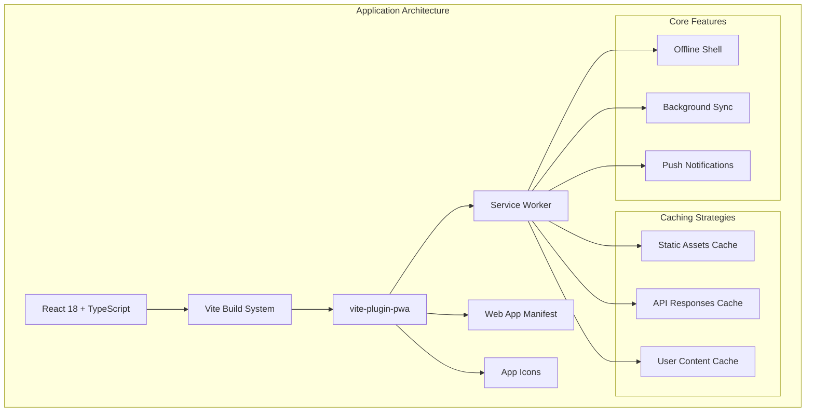
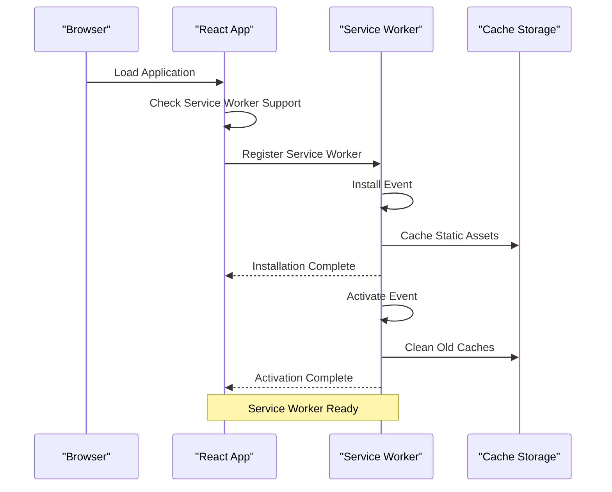
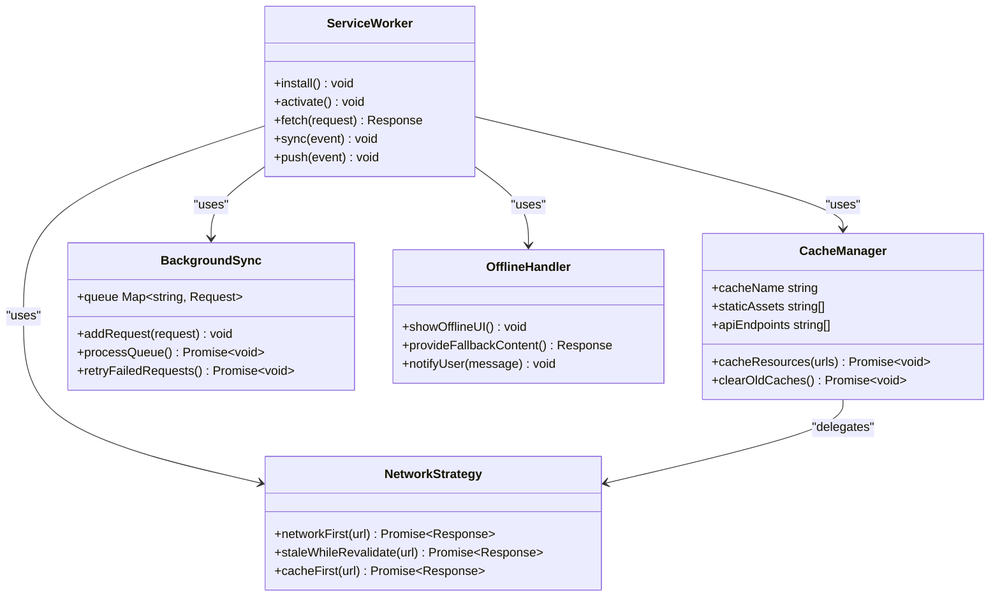
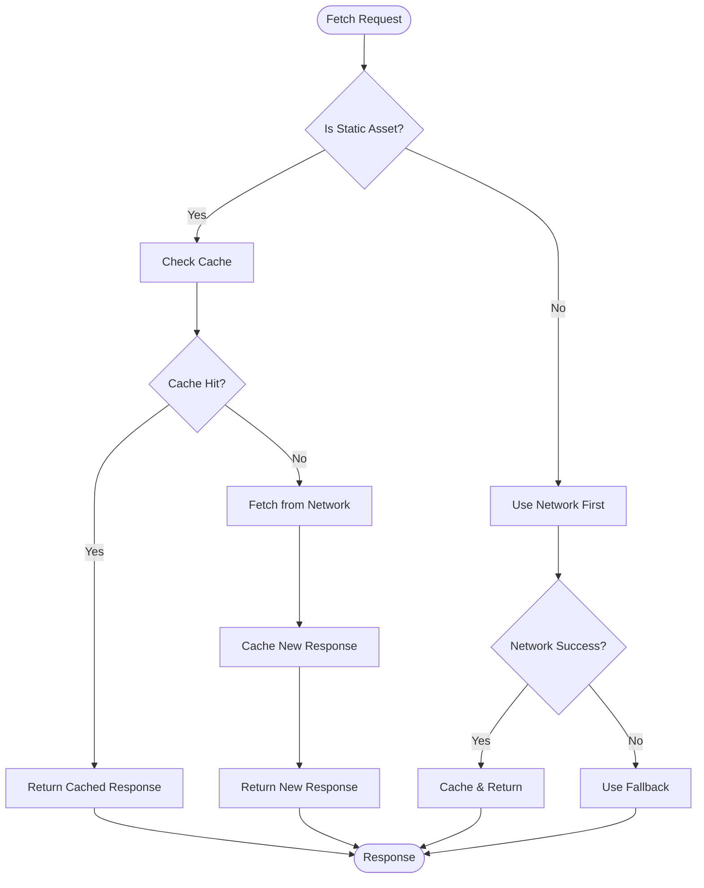
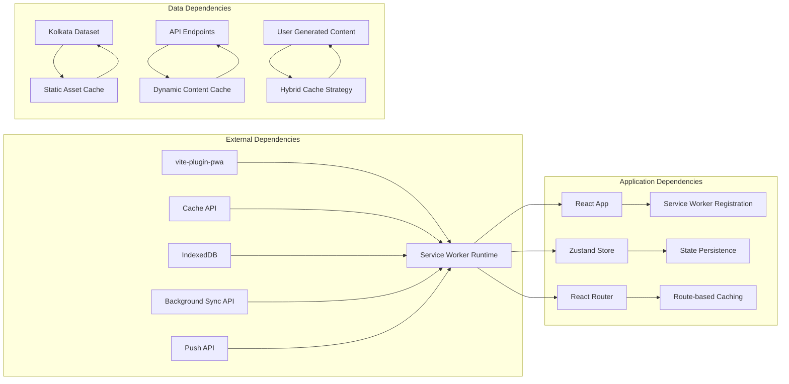

# Service Worker Implementation

<cite>
**Referenced Files in This Document**
- [plan.md](file://tasks/plan.md)
- [todo.md](file://tasks/todo.md)
- [Pujo_Sahayak_Master_Project_Context.md](file://Pujo_Sahayak_Master_Project_Context.md)
</cite>

## Table of Contents
1. [Introduction](#introduction)
2. [Project Structure](#project-structure)
3. [Core Components](#core-components)
4. [Architecture Overview](#architecture-overview)
5. [Detailed Component Analysis](#detailed-component-analysis)
6. [Dependency Analysis](#dependency-analysis)
7. [Performance Considerations](#performance-considerations)
8. [Troubleshooting Guide](#troubleshooting-guide)
9. [Conclusion](#conclusion)

## Introduction

This document provides comprehensive documentation for the Service Worker implementation in the Puja Sahayak application. The application is built as a mobile-first React + TypeScript Progressive Web App (PWA) using Vite with `vite-plugin-pwa` for manifest generation and service worker configuration. The service worker enables offline functionality, caching strategies, and background synchronization capabilities essential for a location-based discovery app serving users during the Durga Puja festival in Kolkata.

The service worker implementation focuses on providing reliable access to core application features even in low-connectivity scenarios common during large festivals, while maintaining optimal performance for static assets and intelligent caching for dynamic content like API responses and user-generated content.

## Project Structure

The Puja Sahayak application follows a modern React + Vite architecture with PWA capabilities integrated through `vite-plugin-pwa`. The project structure emphasizes mobile-first design with comprehensive offline support.

**Diagram sources**
- [plan.md:9-10](file://tasks/plan.md#L9-L10)
- [todo.md:7-8](file://tasks/todo.md#L7-L8)

**Section sources**
- [plan.md:1-10](file://tasks/plan.md#L1-L10)
- [todo.md:1-14](file://tasks/todo.md#L1-L14)

## Core Components

### Service Worker Lifecycle Management

The service worker lifecycle in Puja Sahayak follows standard PWA patterns with custom optimizations for the application's specific needs:

#### Installation Phase
- **Asset Pre-caching**: Critical app shell resources are cached during installation
- **Version Management**: Cache versioning ensures clean updates when new versions are deployed
- **Fallback Resources**: Essential fallback assets are prepared for offline scenarios

#### Activation Phase
- **Cache Cleanup**: Old cache versions are cleaned up during activation
- **Migration Logic**: Data migrations are handled during activation for seamless user experience
- **Feature Detection**: Browser capability detection determines available features

#### Update Strategy
- **Background Updates**: New service worker versions are installed and activated in background
- **User Notification**: Users are notified of available updates when appropriate
- **Graceful Migration**: Application state is preserved across service worker updates

### Registration Process

The service worker registration process integrates seamlessly with the React application:

**Diagram sources**
- [plan.md:9](file://tasks/plan.md#L9)
- [todo.md:7-8](file://tasks/todo.md#L7-L8)

### Event Handling Strategies

The service worker implements comprehensive event handling for different resource types:

#### Fetch Events
- **Route-based Caching**: Different caching strategies for different URL patterns
- **Resource Type Detection**: Automatic detection of resource types (images, scripts, styles, data)
- **Network Fallbacks**: Graceful degradation when network requests fail

#### Background Sync Events
- **Queue Management**: Background synchronization for failed operations
- **Retry Logic**: Intelligent retry mechanisms with exponential backoff
- **Conflict Resolution**: Handling of conflicting data updates

#### Push Notification Events
- **Message Processing**: Efficient processing of push notification payloads
- **Notification Display**: Contextual notifications based on user preferences
- **Deep Linking**: Navigation to relevant app sections from notifications

**Section sources**
- [plan.md:9-10](file://tasks/plan.md#L9-L10)
- [todo.md:7-8](file://tasks/todo.md#L7-L8)

## Architecture Overview

The service worker architecture follows a layered approach with clear separation of concerns:

**Diagram sources**
- [plan.md:9](file://tasks/plan.md#L9)
- [todo.md:7-8](file://tasks/todo.md#L7-L8)

## Detailed Component Analysis

### Caching Strategies Implementation

#### Cache-First Strategy for Static Assets

Static assets including JavaScript bundles, CSS files, and images use a cache-first strategy to ensure fast loading times and offline availability:

**Diagram sources**
- [plan.md:9](file://tasks/plan.md#L9)
- [todo.md:7-8](file://tasks/todo.md#L7-L8)

#### Network-First Strategy for API Responses

API responses use a network-first strategy to ensure data freshness while providing offline fallbacks:

- **Real-time Data**: Current pandal information, restaurant availability, and event details
- **Stale While Revalidate**: Background updates of cached data
- **Error Handling**: Graceful fallback to cached data when network is unavailable

#### Hybrid Strategy for User-Generated Content

User-generated content like photos and reviews uses a hybrid approach:

- **Upload Queue**: Failed uploads are queued for background sync
- **Local Preview**: Immediate feedback with local storage preview
- **Server Synchronization**: Background synchronization when connectivity is restored

### Installation and Activation Phases

#### Installation Phase Details

The installation phase handles critical setup tasks:

1. **Cache Versioning**: Creates versioned cache names for proper cleanup
2. **Critical Resource Caching**: Pre-caches essential app shell resources
3. **Asset Optimization**: Applies compression and optimization where possible
4. **Fallback Preparation**: Sets up fallback resources for offline scenarios

#### Activation Phase Details

The activation phase manages version transitions:

1. **Old Cache Cleanup**: Removes caches from previous versions
2. **Data Migration**: Handles any necessary data format changes
3. **Feature Enablement**: Activates new features based on browser capabilities
4. **Health Checks**: Verifies all critical components are functioning

### Error Handling Mechanisms

Comprehensive error handling ensures robust operation:

#### Network Errors
- **Connection Loss Detection**: Real-time monitoring of network connectivity
- **Automatic Retry**: Intelligent retry logic with exponential backoff
- **User Feedback**: Clear messaging about connection status

#### Cache Errors
- **Corruption Detection**: Validation of cached resource integrity
- **Automatic Repair**: Regeneration of corrupted cache entries
- **Fallback Provision**: Alternative content when primary resources fail

#### Service Worker Errors
- **Registration Failures**: Graceful degradation when SW cannot register
- **Update Failures**: Rollback mechanisms for failed updates
- **Memory Management**: Automatic cleanup of unused resources

### Debugging Techniques

Several debugging techniques are implemented for development and production troubleshooting:

#### Development Tools
- **Service Worker Inspector**: Chrome DevTools integration for detailed inspection
- **Cache Visualization**: Visual representation of cached resources
- **Network Interception**: Logging of all intercepted requests

#### Production Monitoring
- **Error Reporting**: Anonymous error collection and reporting
- **Performance Metrics**: Collection of key performance indicators
- **Usage Analytics**: Understanding of feature adoption and usage patterns

**Section sources**
- [plan.md:9-10](file://tasks/plan.md#L9-L10)
- [todo.md:7-8](file://tasks/todo.md#L7-L8)

## Dependency Analysis

The service worker has well-defined dependencies and relationships with other application components:

**Diagram sources**
- [plan.md:9-15](file://tasks/plan.md#L9-L15)
- [todo.md:7-14](file://tasks/todo.md#L7-L14)

**Section sources**
- [plan.md:9-15](file://tasks/plan.md#L9-L15)
- [todo.md:7-14](file://tasks/todo.md#L7-L14)

## Performance Considerations

### Memory Management

Efficient memory management is crucial for mobile environments:

- **Cache Size Limits**: Configurable limits prevent excessive memory usage
- **LRU Eviction**: Least Recently Used algorithm for cache eviction
- **Automatic Cleanup**: Periodic cleanup of unused cached resources
- **Memory Pressure Handling**: Adaptive behavior under memory constraints

### Mobile-Specific Optimizations

Mobile environments require special attention to performance:

- **Bandwidth Throttling**: Adaptive quality based on network conditions
- **Battery Optimization**: Reduced background activity when battery is low
- **Storage Efficiency**: Compression and deduplication of cached assets
- **Cold Start Optimization**: Fast initial load times on mobile devices

### Network Efficiency

Intelligent network usage reduces data consumption:

- **Request Deduplication**: Prevents duplicate network requests
- **Conditional Requests**: Uses ETags and Last-Modified headers effectively
- **Batch Operations**: Groups related network requests when possible
- **Compression**: Enables response compression where supported

### Caching Best Practices

Optimal caching strategies balance freshness and performance:

- **Cache-Control Headers**: Proper HTTP cache control directives
- **Versioned Assets**: Immutable asset URLs for long-term caching
- **Cache Busting**: Strategic cache invalidation for updates
- **Priority-based Caching**: Different priorities for different resource types

## Troubleshooting Guide

### Common Issues and Solutions

#### Service Worker Not Installing
- **Check File Location**: Ensure service worker file is in correct directory
- **Verify MIME Types**: Confirm proper server configuration for .js files
- **HTTPS Requirement**: Verify HTTPS deployment for production
- **Scope Configuration**: Check service worker scope settings

#### Cache Not Updating
- **Clear Browser Cache**: Manual cache clearing through browser dev tools
- **Version Increment**: Ensure cache version is incremented for updates
- **Force Reload**: Hard reload to bypass cached service worker
- **Unregister Old SW**: Programmatic removal of old service workers

#### Offline Functionality Issues
- **Check Cache Names**: Verify cache name consistency across versions
- **Validate Cached Assets**: Ensure all required assets are properly cached
- **Network Fallbacks**: Test fallback mechanisms for missing resources
- **IndexedDB Access**: Verify database permissions and schema compatibility

### Debugging Tools and Techniques

#### Browser Developer Tools
- **Application Panel**: Inspect service worker registration and cache contents
- **Network Panel**: Monitor request interception and caching behavior
- **Console Logs**: Review service worker logs and error messages
- **Performance Panel**: Analyze impact on page load performance

#### Testing Strategies
- **Manual Testing**: Comprehensive testing across different network conditions
- **Automated Testing**: Integration tests for caching behavior
- **Performance Testing**: Load testing under various network scenarios
- **Cross-browser Testing**: Validation across different browser implementations

**Section sources**
- [plan.md:61-62](file://tasks/plan.md#L61-L62)
- [todo.md:74-75](file://tasks/todo.md#L74-L75)

## Conclusion

The Service Worker implementation in Puja Sahayak provides a robust foundation for offline-first functionality essential for a location-based discovery application. Through strategic caching approaches, comprehensive error handling, and mobile-specific optimizations, the application ensures reliable performance even in challenging network conditions typical during large cultural events like Durga Puja.

The modular architecture allows for easy maintenance and extension, while the comprehensive debugging and monitoring capabilities ensure operational reliability in production environments. The implementation successfully balances performance, reliability, and user experience requirements for a modern Progressive Web Application serving millions of users during peak festival periods.

Future enhancements could include more sophisticated machine learning-based caching predictions, advanced background synchronization patterns, and enhanced offline collaboration features to further improve the user experience in disconnected or low-connectivity scenarios.