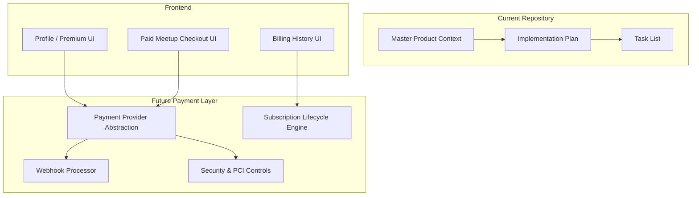
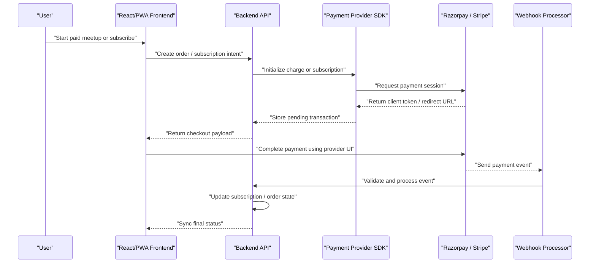
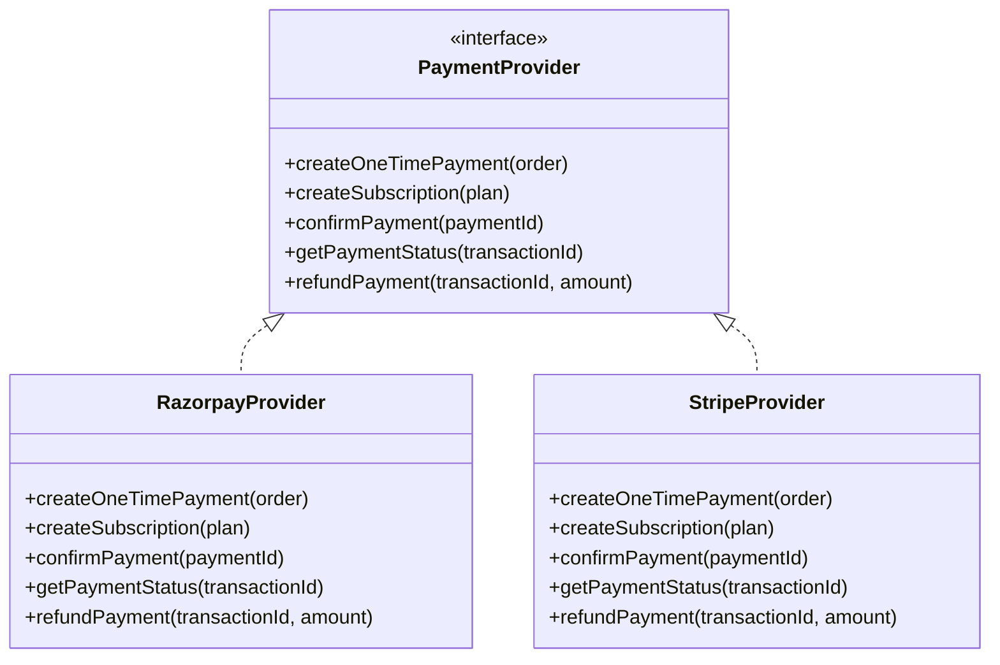
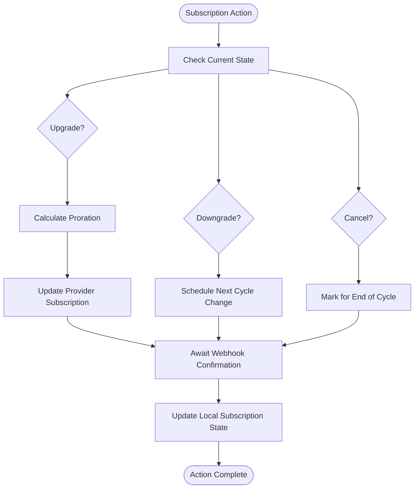
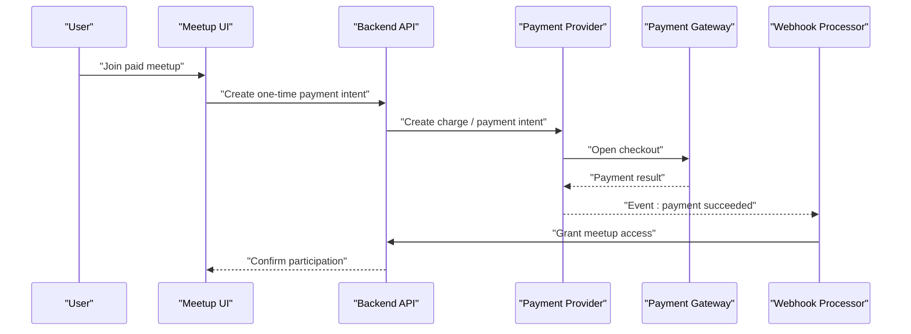
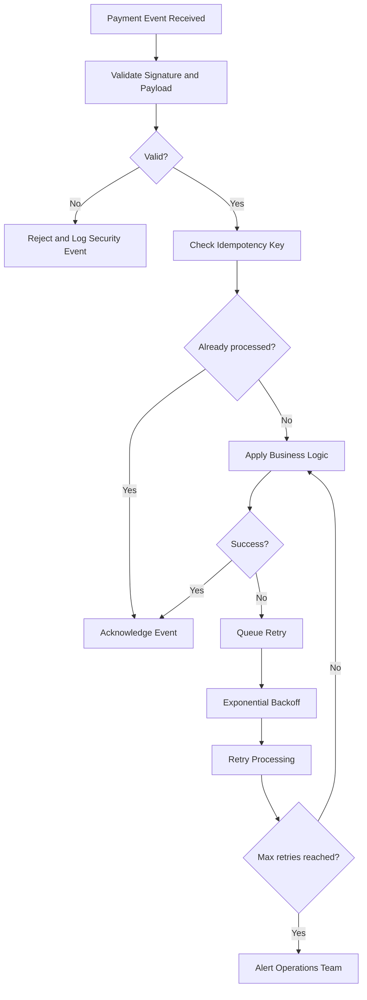
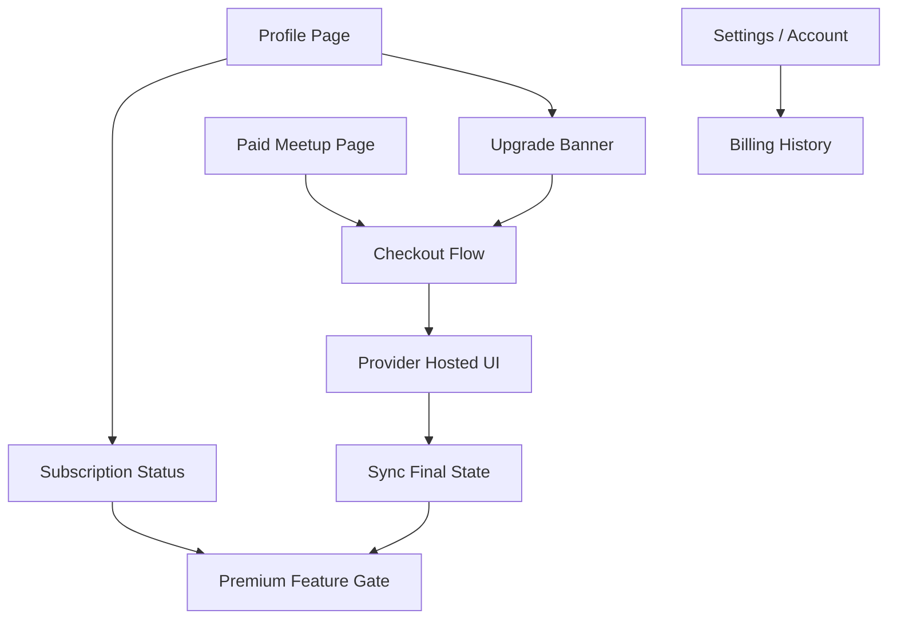
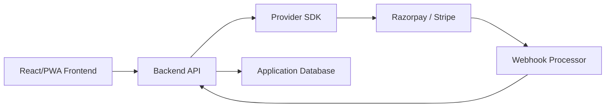

# Payment Processing and Gateway Integration

<cite>
**Referenced Files in This Document**
- [Pujo_Sahayak_Master_Project_Context.md](file://Pujo_Sahayak_Master_Project_Context.md)
- [plan.md](file://tasks/plan.md)
- [todo.md](file://tasks/todo.md)
</cite>

## Table of Contents
1. [Introduction](#introduction)
2. [Project Structure](#project-structure)
3. [Core Components](#core-components)
4. [Architecture Overview](#architecture-overview)
5. [Detailed Component Analysis](#detailed-component-analysis)
6. [Dependency Analysis](#dependency-analysis)
7. [Performance Considerations](#performance-considerations)
8. [Troubleshooting Guide](#troubleshooting-guide)
9. [Conclusion](#conclusion)
10. [Appendices](#appendices)

## Introduction
This document defines the payment processing integration patterns for Pujo Sahayak, focusing on a future-ready abstraction layer that can support multiple payment providers such as Razorpay and Stripe. It also documents subscription lifecycle management (upgrade, downgrade, billing cycles, cancellation), one-time payments for paid meetups, recurring subscription billing, security and PCI compliance considerations, error handling and retry strategies, webhook processing, and frontend integration patterns with the subscription UI.

The current codebase is a React + Vite PWA focused on discovery, planning, social features, and local exploration. Payments are intentionally not implemented in v1; the product context explicitly marks premium/payments as non-functional stubs at this stage. The architecture should remain extensible so that a provider-agnostic payment layer can be added later without disrupting existing screens and flows.

**Section sources**
- [plan.md:1-18](file://tasks/plan.md#L1-L18)
- [plan.md:81-86](file://tasks/plan.md#L81-L86)
- [Pujo_Sahayak_Master_Project_Context.md:424-444](file://Pujo_Sahayak_Master_Project_Context.md#L424-L444)
- [Pujo_Sahayak_Master_Project_Context.md:1013-1039](file://Pujo_Sahayak_Master_Project_Context.md#L1013-L1039)
- [Pujo_Sahayak_Master_Project_Context.md:1300-1312](file://Pujo_Sahayak_Master_Project_Context.md#L1300-L1312)

## Project Structure
At present, the repository contains:
- A master product context describing user journeys, feature scope, and open questions.
- An implementation plan outlining screen routes, phases, and verification criteria.
- A task list tracking build phases from foundation through polish.

There is no production payment or gateway code yet. The documentation below therefore describes an intended integration design aligned with the documented product goals rather than an existing implementation.

[No diagram sources needed since this diagram shows conceptual project structure, not actual code files]

**Section sources**
- [Pujo_Sahayak_Master_Project_Context.md:1781-1859](file://Pujo_Sahayak_Master_Project_Context.md#L1781-L1859)
- [plan.md:19-40](file://tasks/plan.md#L19-L40)
- [todo.md:1-16](file://tasks/todo.md#L1-L16)

## Core Components
The payment system should be introduced as a small set of cohesive components:

- **Payment Provider Abstraction**: A single interface for creating charges, subscriptions, refunds, and querying payment status. Concrete implementations exist per provider (for example, Razorpay and Stripe).
- **Subscription Lifecycle Engine**: Manages subscription states, upgrades, downgrades, proration, billing cycles, trials, and cancellations.
- **Webhook Processor**: Validates and processes provider events such as payment success, failure, subscription created, updated, canceled, and invoice generated.
- **Security & PCI Controls**: Ensures sensitive data never touches application servers unnecessarily, uses tokenization, enforces HTTPS, validates webhooks, and follows least-privilege access.
- **Frontend Integration Layer**: Connects the React/PWA UI to the backend via secure endpoints and provider SDKs where appropriate.

These components align with the product’s stated direction: keep initial payment functionality focused on premium subscriptions, authorized meetup payments, partner services, donations, and verified purchases, while leaving room for broader wallet-like capabilities later.

**Section sources**
- [Pujo_Sahayak_Master_Project_Context.md:1013-1039](file://Pujo_Sahayak_Master_Project_Context.md#L1013-L1039)
- [Pujo_Sahayak_Master_Project_Context.md:1300-1312](file://Pujo_Sahayak_Master_Project_Context.md#L1300-L1312)

## Architecture Overview
The recommended architecture separates concerns between the frontend, backend orchestration, provider SDKs, and external payment gateways.

**Diagram sources**
- [Pujo_Sahayak_Master_Project_Context.md:1300-1312](file://Pujo_Sahayak_Master_Project_Context.md#L1300-L1312)
- [Pujo_Sahayak_Master_Project_Context.md:1013-1039](file://Pujo_Sahayak_Master_Project_Context.md#L1013-L1039)

## Detailed Component Analysis

### Payment Provider Abstraction
The abstraction layer should define a consistent contract regardless of whether Razorpay, Stripe, or another provider is used. This allows switching providers without changing business logic.

Key responsibilities:
- Create one-time payment intents for paid meetups.
- Create recurring subscription intents for premium plans.
- Capture or confirm payments after successful authorization.
- Query payment status and receipts.
- Handle provider-specific metadata, currency, and localization.

Recommended interface concepts:
- `createOneTimePayment(order)`
- `createSubscription(plan)`
- `confirmPayment(paymentId)`
- `getPaymentStatus(transactionId)`
- `refundPayment(transactionId, amount?)`

Provider implementations:
- Razorpay implementation maps its order, payment, and subscription objects to the abstraction.
- Stripe implementation maps its PaymentIntent, Subscription, and Invoice objects similarly.

[No diagram sources needed since this diagram represents a proposed abstraction, not existing source code]

**Section sources**
- [Pujo_Sahayak_Master_Project_Context.md:1300-1312](file://Pujo_Sahayak_Master_Project_Context.md#L1300-L1312)

### Subscription Lifecycle Management
The subscription engine should model the full lifecycle of a premium membership, including trial periods, upgrades, downgrades, proration, billing cycles, and cancellations.

Lifecycle states:
- Not subscribed
- Trial active
- Active
- Past due
- Canceled
- Expired

Upgrade flow:
1. User selects a higher-tier plan.
2. Backend calculates proration based on remaining billing period.
3. Provider creates an upgrade subscription update.
4. Webhook confirms the new plan and effective date.
5. Frontend updates the profile to show the upgraded plan.

Downgrade flow:
1. User selects a lower-tier plan.
2. Backend schedules the downgrade to take effect at the next billing cycle.
3. Provider records the upcoming change.
4. Webhook confirms the scheduled downgrade.
5. Frontend displays the effective date and current plan.

Cancellation flow:
1. User cancels the subscription.
2. Backend sets cancellation reason and preserves history.
3. Provider marks the subscription for end-of-cycle cancellation.
4. Webhook confirms cancellation.
5. Frontend hides premium-only features according to policy.

[No diagram sources needed since this diagram shows conceptual workflow, not actual code structure]

**Section sources**
- [Pujo_Sahayak_Master_Project_Context.md:424-444](file://Pujo_Sahayak_Master_Project_Context.md#L424-L444)
- [Pujo_Sahayak_Master_Project_Context.md:970-975](file://Pujo_Sahayak_Master_Project_Context.md#L970-L975)

### One-Time Payments for Paid Meetups
Paid meetups are explicitly mentioned as a supported transaction type. The flow should treat each paid meetup as a discrete order rather than a recurring subscription.

Recommended flow:
1. Frontend collects meetup details and user confirmation.
2. Backend creates a one-time payment intent with meetup metadata.
3. Provider returns a client-side checkout payload.
4. Frontend completes payment through the provider’s UI.
5. Webhook confirms payment and grants meetup access.
6. Frontend updates the meetup participation state.

[No diagram sources needed since this diagram shows conceptual workflow, not actual code structure]

**Section sources**
- [Pujo_Sahayak_Master_Project_Context.md:1013-1039](file://Pujo_Sahayak_Master_Project_Context.md#L1013-L1039)

### Recurring Subscription Billing
Recurring billing supports the premium subscription concept described in the product context. The system should handle:
- Initial subscription creation
- Recurring invoice generation
- Payment method updates
- Failed payment retries
- Plan changes
- Cancellation and retention policies

Important constraints from the product context:
- Do not hard-code a large subscription system around assumptions.
- Keep the initial product focused on relevant transactions.
- Leave architectural room for broader payment capabilities if the business model evolves.

**Section sources**
- [Pujo_Sahayak_Master_Project_Context.md:424-444](file://Pujo_Sahayak_Master_Project_Context.md#L424-L444)
- [Pujo_Sahayak_Master_Project_Context.md:1013-1039](file://Pujo_Sahayak_Master_Project_Context.md#L1013-L1039)

### Security Considerations and PCI Compliance
Payment data handling must follow strict security practices:

- Never store raw card numbers, CVV, or sensitive authentication tokens in application databases.
- Use provider-hosted checkout or tokenization so sensitive data is handled by the payment provider.
- Enforce HTTPS for all payment-related endpoints.
- Validate and verify webhooks using provider signatures.
- Restrict server-side API keys to backend environments only.
- Log minimal payment information; avoid logging payloads that may contain sensitive data.
- Implement idempotency keys for payment operations to prevent duplicate charges.
- Apply rate limiting and fraud checks where available.
- Follow PCI Service Provider Level requirements when any custom payment handling is introduced.

The product context emphasizes that payments should go through a payment provider rather than being treated as ordinary software behavior.

**Section sources**
- [Pujo_Sahayak_Master_Project_Context.md:1300-1312](file://Pujo_Sahayak_Master_Project_Context.md#L1300-L1312)

### Error Handling Strategies and Retry Mechanisms
Error handling should cover both synchronous failures and asynchronous webhook events.

Common error categories:
- Network timeouts
- Invalid payment methods
- Insufficient funds
- Provider outages
- Webhook delivery failures
- Duplicate events

Retry strategy:
- Exponential backoff for transient network errors.
- Idempotent processing of repeated webhooks.
- Dead-letter queue for failed webhook processing.
- Alerting for persistent provider failures.
- User-facing messages that do not expose internal error details.

[No diagram sources needed since this diagram shows conceptual workflow, not actual code structure]

**Section sources**
- [Pujo_Sahayak_Master_Project_Context.md:1300-1312](file://Pujo_Sahayak_Master_Project_Context.md#L1300-L1312)

### Frontend Integration Patterns with Subscription UI
The frontend should integrate with the payment layer through clear boundaries:

- Profile page: Shows subscription status, upgrade banner, and links to billing history.
- Paid meetup pages: Trigger one-time payment intents and display confirmation.
- Settings or account area: Allow updating payment methods and viewing invoices.
- Feature gates: Hide premium-only features until the backend confirms an active subscription.

Integration principles:
- Keep UI state synchronized with backend subscription state.
- Show loading and error states during checkout.
- Avoid exposing provider-specific internals to users.
- Provide accessible messaging for failed payments and subscription changes.

[No diagram sources needed since this diagram shows conceptual workflow, not actual code structure]

**Section sources**
- [Pujo_Sahayak_Master_Project_Context.md:970-975](file://Pujo_Sahayak_Master_Project_Context.md#L970-L975)
- [Pujo_Sahayak_Master_Project_Context.md:1848-1859](file://Pujo_Sahayak_Master_Project_Context.md#L1848-L1859)

## Dependency Analysis
The payment subsystem introduces dependencies between frontend screens, backend APIs, provider SDKs, and external gateways. At this stage, these are design dependencies rather than implemented imports.

[No diagram sources needed since this diagram shows conceptual dependency relationships, not actual code files]

**Section sources**
- [Pujo_Sahayak_Master_Project_Context.md:1300-1312](file://Pujo_Sahayak_Master_Project_Context.md#L1300-L1312)

## Performance Considerations
- Prefer provider-hosted checkout to reduce frontend and backend overhead.
- Cache non-sensitive subscription metadata locally only when safe.
- Debounce repeated checkout attempts.
- Use background job queues for webhook processing and reconciliation.
- Monitor provider latency and implement timeouts with graceful fallbacks.
- Avoid heavy computation during checkout; defer billing calculations to the backend.

[No sources needed since this section provides general guidance]

## Troubleshooting Guide
Common issues and resolutions:

- **Failed payment at checkout**: Verify payment method validity, check provider logs, and prompt the user to try another method.
- **Subscription not activated**: Confirm webhook delivery, check signature validation, and reconcile provider state with local state.
- **Duplicate charges**: Ensure idempotency keys are used and deduplicated in webhook processing.
- **Webhook not received**: Check provider webhook configuration, firewall rules, and endpoint availability.
- **Plan change not reflected**: Verify proration logic and wait for the correct billing cycle transition.
- **PCI-related warnings**: Remove any sensitive data logging and ensure tokenization is used throughout.

**Section sources**
- [Pujo_Sahayak_Master_Project_Context.md:1300-1312](file://Pujo_Sahayak_Master_Project_Context.md#L1300-L1312)

## Conclusion
Pujo Sahayak currently does not include a working payment integration. The product context clearly marks premium/payments as non-functional stubs in v1 and directs development toward discovery, planning, social features, and local experiences. However, the architecture should be designed to support a provider-agnostic payment layer that can later enable premium subscriptions, paid meetups, partner services, donations, and potentially broader payment capabilities.

When implementing payments, prioritize:
- A clean abstraction over Razorpay, Stripe, or other providers.
- Robust subscription lifecycle management.
- Secure, PCI-compliant transaction handling.
- Reliable webhook processing with retries and idempotency.
- Clear frontend integration points tied to the profile, meetup, and settings screens.

[No sources needed since this section summarizes without analyzing specific files]

## Appendices

### Appendix A: Current Payment-Related Product Notes
- Premium subscription is a planned monetization path.
- Profile includes subscription and premium references.
- Payments section exists conceptually but should not become a full wallet ecosystem prematurely.
- Payments are categorized as provider-driven behavior.

**Section sources**
- [Pujo_Sahayak_Master_Project_Context.md:424-444](file://Pujo_Sahayak_Master_Project_Context.md#L424-L444)
- [Pujo_Sahayak_Master_Project_Context.md:970-975](file://Pujo_Sahayak_Master_Project_Context.md#L970-L975)
- [Pujo_Sahayak_Master_Project_Context.md:1013-1039](file://Pujo_Sahayak_Master_Project_Context.md#L1013-L1039)
- [Pujo_Sahayak_Master_Project_Context.md:1300-1312](file://Pujo_Sahayak_Master_Project_Context.md#L1300-L1312)
- [plan.md:81-86](file://tasks/plan.md#L81-L86)