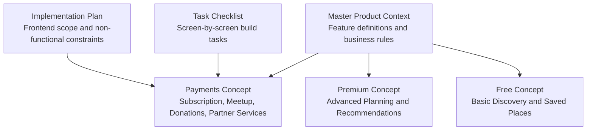
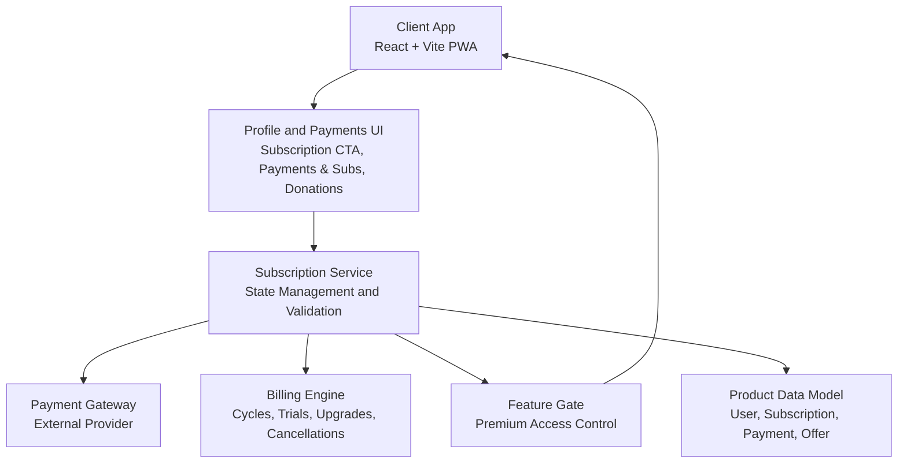
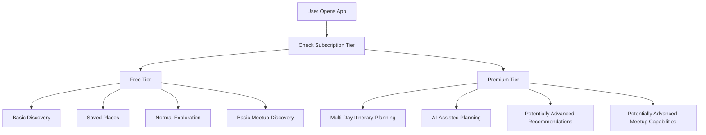
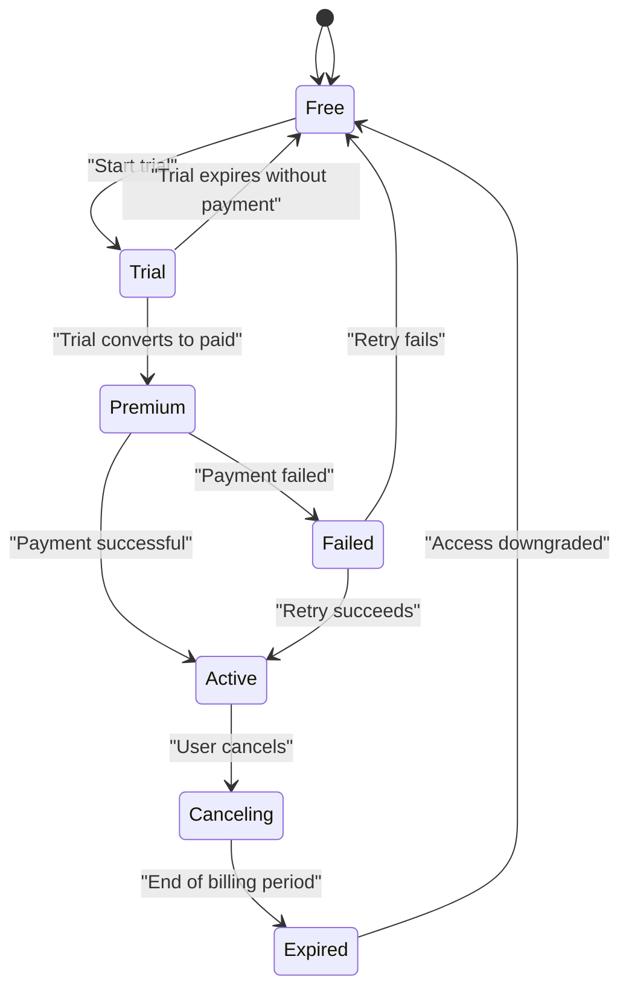
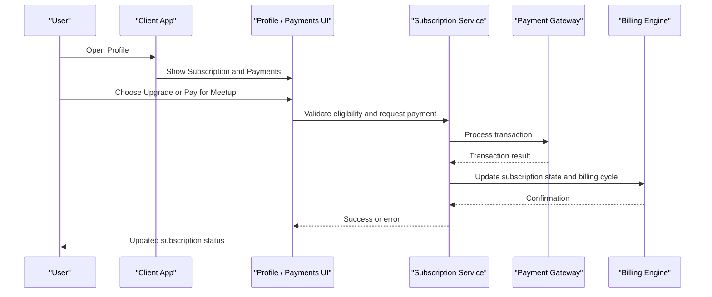
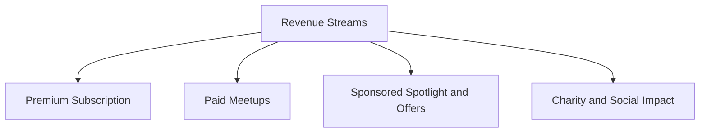
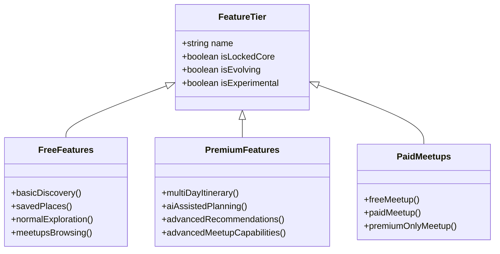
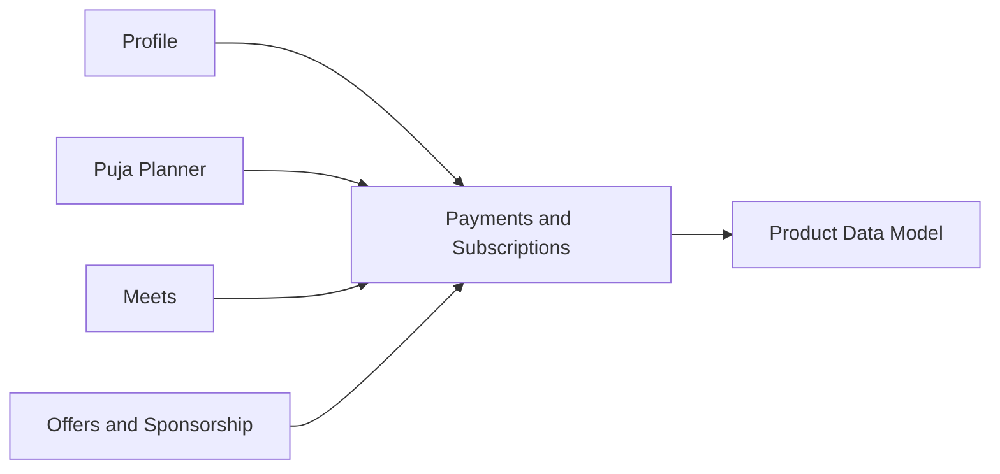

# Payment and Subscription System

<cite>
**Referenced Files in This Document**
- [Pujo_Sahayak_Master_Project_Context.md](file://Pujo_Sahayak_Master_Project_Context.md)
- [plan.md](file://tasks/plan.md)
- [todo.md](file://tasks/todo.md)
</cite>

## Table of Contents
1. [Introduction](#introduction)
2. [Project Structure](#project-structure)
3. [Core Components](#core-components)
4. [Architecture Overview](#architecture-overview)
5. [Detailed Component Analysis](#detailed-component-analysis)
6. [Dependency Analysis](#dependency-analysis)
7. [Performance Considerations](#performance-considerations)
8. [Troubleshooting Guide](#troubleshooting-guide)
9. [Conclusion](#conclusion)
10. [Appendices](#appendices)

## Introduction
This document describes the intended Payment and Subscription System for Pujo Sahayak, a location-aware local discovery platform centered around Durga Puja with broader Kolkata exploration capabilities. The system supports:

- A free tier providing basic discovery, saved places, normal exploration, and core navigation.
- A premium tier focused on advanced planning, AI-assisted itinerary generation, potentially advanced recommendations, and potentially advanced meetup capabilities.
- Paid or premium-only meetups as a monetization path.
- A payments section that can cover premium subscriptions, authorized meetup payments, partner services, donations, and other verified purchases.

The current repository is a product context and implementation plan rather than a production backend. There is no live payment gateway integration yet; the UI includes subscription and payment-related screens, but they are stubs in the initial build.

**Section sources**
- [Pujo_Sahayak_Master_Project_Context.md:10-13](file://Pujo_Sahayak_Master_Project_Context.md#L10-L13)
- [Pujo_Sahayak_Master_Project_Context.md:424-444](file://Pujo_Sahayak_Master_Project_Context.md#L424-L444)
- [Pujo_Sahayak_Master_Project_Context.md:753-771](file://Pujo_Sahayak_Master_Project_Context.md#L753-L771)
- [Pujo_Sahayak_Master_Project_Context.md:1013-1039](file://Pujo_Sahayak_Master_Project_Context.md#L1013-L1039)
- [plan.md:81-86](file://tasks/plan.md#L81-L86)

## Project Structure
At this stage, the repository contains:

- A master product context document describing features, user journeys, data model concepts, and business-model ideas.
- An implementation plan for a React + Vite PWA frontend.
- A task checklist tracking screen-by-screen development.

There is no backend code, API server, database schema, or payment provider SDK present in the workspace. Therefore, the Payment and Subscription System documentation below is architectural and conceptual, grounded only in what the project context explicitly states.

**Diagram sources**
- [Pujo_Sahayak_Master_Project_Context.md:1013-1039](file://Pujo_Sahayak_Master_Project_Context.md#L1013-L1039)
- [Pujo_Sahayak_Master_Project_Context.md:424-444](file://Pujo_Sahayak_Master_Project_Context.md#L424-L444)
- [plan.md:1-18](file://tasks/plan.md#L1-L18)
- [todo.md:1-15](file://tasks/todo.md#L1-L15)

**Section sources**
- [Pujo_Sahayak_Master_Project_Context.md:1-13](file://Pujo_Sahayak_Master_Project_Context.md#L1-L13)
- [plan.md:1-18](file://tasks/plan.md#L1-L18)
- [todo.md:1-15](file://tasks/todo.md#L1-L15)

## Core Components
The Payment and Subscription System should be understood as a set of related components rather than one single module:

| Component | Purpose | Current Status |
|---|---|---|
| Free Tier | Basic discovery, saved places, normal exploration, search, categories, favorites, visited places, Maya assistant access, safety, and meetups browsing. | Defined conceptually in product context. |
| Premium Tier | Advanced multi-day itinerary planning, AI-assisted planning, potentially advanced recommendations, and potentially advanced meetup capabilities. | Defined as a potential premium feature list; not finalized. |
| Subscription State | Tracks whether a user is free or premium, including upgrade state, billing cycle, trial status, and cancellation handling. | Not implemented; needs backend design. |
| Payment Processing | Handles charges for premium subscriptions, paid meetups, partner services, donations, and other verified purchases. | UI exists as stubs; no payment integration in v1. |
| Feature Gating | Controls access to premium features such as advanced planning and potentially advanced recommendations or meetup features. | Needs implementation; currently conceptual. |
| Pricing and Promotions | Manages pricing flexibility, promotional offers, trial periods, and refund handling. | Conceptual; exact rules are not defined. |
| Monetization Strategy | Combines subscription revenue, paid meetups, sponsor/offers ecosystem, and optional charity donation flow. | Described as proposed business-model layers. |

**Section sources**
- [Pujo_Sahayak_Master_Project_Context.md:424-444](file://Pujo_Sahayak_Master_Project_Context.md#L424-L444)
- [Pujo_Sahayak_Master_Project_Context.md:753-771](file://Pujo_Sahayak_Master_Project_Context.md#L753-L771)
- [Pujo_Sahayak_Master_Project_Context.md:1013-1039](file://Pujo_Sahayak_Master_Project_Context.md#L1013-L1039)
- [plan.md:81-86](file://tasks/plan.md#L81-L86)

## Architecture Overview
The intended architecture separates concerns between client-facing flows, subscription state, payment processing, and feature gating.

**Diagram sources**
- [Pujo_Sahayak_Master_Project_Context.md:1232-1255](file://Pujo_Sahayak_Master_Project_Context.md#L1232-L1255)
- [Pujo_Sahayak_Master_Project_Context.md:1013-1039](file://Pujo_Sahayak_Master_Project_Context.md#L1013-L1039)
- [plan.md:1-18](file://tasks/plan.md#L1-L18)

### High-Level Flow
1. User opens the app and uses free features.
2. User encounters premium planning or paid meetup prompts.
3. User navigates to Profile → Become a Premium Member or Payments & Subs.
4. Subscription service validates eligibility and initiates payment if required.
5. Payment gateway processes the transaction.
6. Billing engine updates subscription state and billing cycle.
7. Feature gate grants or denies access to premium features.
8. Client UI reflects subscription status and available features.

**Section sources**
- [Pujo_Sahayak_Master_Project_Context.md:954-976](file://Pujo_Sahayak_Master_Project_Context.md#L954-L976)
- [Pujo_Sahayak_Master_Project_Context.md:1013-1039](file://Pujo_Sahayak_Master_Project_Context.md#L1013-L1039)

## Detailed Component Analysis

### Free vs Premium Feature Tiers
The product context defines a clear separation between free and premium functionality.

- **Free tier**: Basic discovery, saved places, normal exploration, search, categories, favorites, visited places, Maya assistant, safety, and general meetup discovery.
- **Premium tier**: Multi-day itinerary planning, AI-assisted planning, potentially advanced recommendations, and potentially advanced meetup capabilities.

The premium feature list is explicitly not finalized, so the system must avoid hard-coding a large subscription model around assumptions.

**Diagram sources**
- [Pujo_Sahayak_Master_Project_Context.md:424-444](file://Pujo_Sahayak_Master_Project_Context.md#L424-L444)
- [Pujo_Sahayak_Master_Project_Context.md:1636-1688](file://Pujo_Sahayak_Master_Project_Context.md#L1636-L1688)

**Section sources**
- [Pujo_Sahayak_Master_Project_Context.md:424-444](file://Pujo_Sahayak_Master_Project_Context.md#L424-L444)
- [Pujo_Sahayak_Master_Project_Context.md:1636-1688](file://Pujo_Sahayak_Master_Project_Context.md#L1636-L1688)

### Subscription Lifecycle
The subscription lifecycle should support:

- **Upgrade flow**: User upgrades from free to premium through the profile or payments section.
- **Payment processing**: External payment provider handles the charge.
- **Billing cycles**: Recurring billing for subscriptions, with configurable intervals.
- **Trial periods**: Optional trials before charging.
- **Cancellation handling**: Graceful downgrade or termination of premium access.
- **Refund handling**: Refund policy and execution depending on jurisdiction and provider rules.

The product context does not define exact durations, prices, or provider-specific behavior. These should be configured externally and validated by the backend.

**Diagram sources**
- [Pujo_Sahayak_Master_Project_Context.md:1013-1039](file://Pujo_Sahayak_Master_Project_Context.md#L1013-L1039)

**Section sources**
- [Pujo_Sahayak_Master_Project_Context.md:1013-1039](file://Pujo_Sahayak_Master_Project_Context.md#L1013-L1039)

### Payment Processing and Gateway Integration
The payments section is intentionally scoped to relevant transactions rather than building a full wallet/payment ecosystem immediately. Relevant transaction types include:

- Premium subscription
- Authorized meetup payments
- Partner services
- Donations
- Potentially other verified purchases

The implementation plan explicitly states that premium/payments UI is present but non-functional stubs, with no payment integration in v1.

**Diagram sources**
- [Pujo_Sahayak_Master_Project_Context.md:1013-1039](file://Pujo_Sahayak_Master_Project_Context.md#L1013-L1039)
- [plan.md:81-86](file://tasks/plan.md#L81-L86)

**Section sources**
- [Pujo_Sahayak_Master_Project_Context.md:1013-1039](file://Pujo_Sahayak_Master_Project_Context.md#L1013-L1039)
- [plan.md:81-86](file://tasks/plan.md#L81-L86)

### Monetization Strategies
Monetization is described as a combination of several layers:

1. **Premium subscription**: Advanced planning and potentially advanced recommendation or meetup features.
2. **Paid meetups**: First meetup may be free, later meetups may be paid, and some meetups may be premium-only.
3. **Sponsored spotlight and offers**: Advertising and partner promotions integrated into discovery surfaces.
4. **Donations**: Optional social impact layer where part of the margin may be donated during Puja.

These are business-model concepts, not finalized pricing rules.

**Diagram sources**
- [Pujo_Sahayak_Master_Project_Context.md:168-187](file://Pujo_Sahayak_Master_Project_Context.md#L168-L187)
- [Pujo_Sahayak_Master_Project_Context.md:235-247](file://Pujo_Sahayak_Master_Project_Context.md#L235-L247)
- [Pujo_Sahayak_Master_Project_Context.md:753-771](file://Pujo_Sahayak_Master_Project_Context.md#L753-L771)
- [Pujo_Sahayak_Master_Project_Context.md:1041-1053](file://Pujo_Sahayak_Master_Project_Context.md#L1041-L1053)

**Section sources**
- [Pujo_Sahayak_Master_Project_Context.md:168-187](file://Pujo_Sahayak_Master_Project_Context.md#L168-L187)
- [Pujo_Sahayak_Master_Project_Context.md:235-247](file://Pujo_Sahayak_Master_Project_Context.md#L235-L247)
- [Pujo_Sahayak_Master_Project_Context.md:753-771](file://Pujo_Sahayak_Master_Project_Context.md#L753-L771)
- [Pujo_Sahayak_Master_Project_Context.md:1041-1053](file://Pujo_Sahayak_Master_Project_Context.md#L1041-L1053)

### Feature Gating Mechanisms
Feature gating should separate locked core features from designed-but-evolving features and experimental/partner-dependent features.

- **Locked core**: Includes discovery, favorites, visits, Maya assistant, maps, trip planning, safety, meetups, reviews, user photos, recommendations, and profile.
- **Designed but still evolving**: Includes offers, restaurants, events, shopping, off-season activities, premium subscription, donation, payment system, and AI recommendations.
- **Experimental/partner-dependent**: Includes VIP passes, authority integrations, real-time crowd infrastructure, advanced missing-person integration, and marketplace.

This classification prevents assuming every experimental feature requires immediate production implementation.

**Diagram sources**
- [Pujo_Sahayak_Master_Project_Context.md:1636-1688](file://Pujo_Sahayak_Master_Project_Context.md#L1636-L1688)
- [Pujo_Sahayak_Master_Project_Context.md:753-771](file://Pujo_Sahayak_Master_Project_Context.md#L753-L771)

**Section sources**
- [Pujo_Sahayak_Master_Project_Context.md:1636-1688](file://Pujo_Sahayak_Master_Project_Context.md#L1636-L1688)
- [Pujo_Sahayak_Master_Project_Context.md:753-771](file://Pujo_Sahayak_Master_Project_Context.md#L753-L771)

### Pricing Flexibility, Promotional Offers, Trials, and Refunds
The product context does not define fixed pricing, promotional mechanics, trial lengths, or refund policies. Instead, it emphasizes:

- Avoiding hard-coded subscription assumptions.
- Treating monetization as flexible business-model concepts.
- Keeping payment functionality focused until the business model requires more.
- Allowing room for future expansion such as wallets, donations, and partner services.

Therefore, any pricing configuration should be externalized and validated by backend services rather than embedded in the frontend.

**Section sources**
- [Pujo_Sahayak_Master_Project_Context.md:424-444](file://Pujo_Sahayak_Master_Project_Context.md#L424-L444)
- [Pujo_Sahayak_Master_Project_Context.md:1013-1039](file://Pujo_Sahayak_Master_Project_Context.md#L1013-L1039)
- [plan.md:81-86](file://tasks/plan.md#L81-L86)

### Backend API Endpoints
No backend API endpoints exist in the current repository. However, based on the product context and data model concepts, the following endpoint families would be appropriate when implementing the backend:

| Endpoint Family | Intended Purpose | Request Highlights | Response Highlights |
|---|---|---|---|
| `POST /payments/initiate` | Start a payment for subscription or meetup | User ID, item type, price, currency, offer code | Payment session ID, provider redirect or token |
| `POST /payments/confirm` | Confirm payment result | Payment session ID, provider confirmation | Success/failure, updated subscription or purchase record |
| `GET /subscriptions/status` | Check current subscription state | User ID or authenticated context | Tier, trial status, billing cycle, expiration |
| `POST /subscriptions/upgrade` | Upgrade free to premium | Tier, payment method, promo code | Upgrade result, next billing date |
| `POST /subscriptions/cancel` | Cancel subscription | Reason, effective date | Cancellation result, end-of-period access |
| `GET /features/check` | Validate feature access | Feature key, user context | Allowed/denied, reason |
| `POST /meetups/pay` | Pay for a paid meetup | Meetup ID, attendee count, payment method | Booking confirmation, receipt |
| `POST /donations/create` | Create donation transaction | Amount, recipient, optional recurring flag | Donation confirmation |
| `GET /offers/validate` | Validate promotional offers | Offer code, eligible items | Validity, discount, conditions |

These are design recommendations derived from the documented data model and payment concepts, not existing endpoints.

**Section sources**
- [Pujo_Sahayak_Master_Project_Context.md:1232-1255](file://Pujo_Sahayak_Master_Project_Context.md#L1232-L1255)
- [Pujo_Sahayak_Master_Project_Context.md:1013-1039](file://Pujo_Sahayak_Master_Project_Context.md#L1013-L1039)

## Dependency Analysis
The Payment and Subscription System depends on several product areas:

- **User profile and account**: Subscription status is displayed and managed from the profile.
- **Planner**: Premium planning features depend on subscription validation.
- **Meets**: Paid and premium-only meetups depend on payment and subscription state.
- **Offers and sponsorships**: Sponsored content and discounts interact with monetization.
- **Data model**: Subscription and Payment entities are part of the broader product data model.

**Diagram sources**
- [Pujo_Sahayak_Master_Project_Context.md:954-976](file://Pujo_Sahayak_Master_Project_Context.md#L954-L976)
- [Pujo_Sahayak_Master_Project_Context.md:1232-1255](file://Pujo_Sahayak_Master_Project_Context.md#L1232-L1255)
- [Pujo_Sahayak_Master_Project_Context.md:1013-1039](file://Pujo_Sahayak_Master_Project_Context.md#L1013-L1039)

**Section sources**
- [Pujo_Sahayak_Master_Project_Context.md:954-976](file://Pujo_Sahayak_Master_Project_Context.md#L954-L976)
- [Pujo_Sahayak_Master_Project_Context.md:1232-1255](file://Pujo_Sahayak_Master_Project_Context.md#L1232-L1255)
- [Pujo_Sahayak_Master_Project_Context.md:1013-1039](file://Pujo_Sahayak_Master_Project_Context.md#L1013-L1039)

## Performance Considerations
Since there is no backend implementation yet, performance considerations are architectural:

- Keep payment calls asynchronous and idempotent to avoid duplicate charges.
- Cache subscription status locally only after server-side validation.
- Avoid blocking UI on payment provider responses; show loading and retry states.
- Separate expensive operations like recommendation evaluation from payment flows.
- Use minimal payload sizes for subscription and feature-check endpoints.
- Ensure offline-capable UI does not expose premium features unless validated by the server.

[No sources needed since this section provides general guidance]

## Troubleshooting Guide
Common issues and recommended handling:

| Issue | Likely Cause | Recommended Handling |
|---|---|---|
| Premium feature blocked for paying user | Subscription state not updated after payment | Re-validate subscription status and refresh feature gate. |
| Payment succeeds but UI shows free tier | Client cache stale or missing confirmation event | Sync with backend subscription status before rendering premium UI. |
| Meetup payment fails repeatedly | Invalid payment method or insufficient funds | Surface provider error, allow retry, and log transaction attempt. |
| Trial converts unexpectedly | Trial expiration logic misconfigured | Audit billing engine trial-to-paid conversion rules. |
| Refund requested but unclear policy | Missing refund configuration | Route to support flow with transaction ID and provider reference. |
| Feature gate allows free user | Incorrect feature-key mapping or missing subscription check | Review feature-gate rules and subscription validation endpoint. |

**Section sources**
- [plan.md:81-86](file://tasks/plan.md#L81-L86)
- [Pujo_Sahayak_Master_Project_Context.md:1013-1039](file://Pujo_Sahayak_Master_Project_Context.md#L1013-L1039)

## Conclusion
The Payment and Subscription System for Pujo Sahayak is currently a conceptual design supported by product context and frontend planning. The intended model centers on:

- A free tier for basic discovery and saved places.
- A premium tier for advanced planning and potentially advanced recommendations or meetup features.
- Paid or premium-only meetups as an additional monetization path.
- A payments section scoped to subscriptions, authorized meetups, partner services, donations, and verified purchases.
- Flexible pricing, promotions, trials, and refunds that should be configured externally.

The next step is to implement a backend that owns subscription state, validates feature access, integrates with a payment provider, and exposes secure APIs for the frontend. Until then, all payment-related UI should remain clearly non-functional and should not imply production payment capability.

[No sources needed since this section summarizes without analyzing specific files]

## Appendices

### Appendix A: Data Model References
The product context identifies `Subscription` and `Payment` as part of the broader data model alongside User, Place, Pandal, Restaurant, Event, Meetup, Review, Photo, Trip, Category, Offer, SafetyPoint, EmergencyReport, and Recommendation.

**Section sources**
- [Pujo_Sahayak_Master_Project_Context.md:1232-1255](file://Pujo_Sahayak_Master_Project_Context.md#L1232-L1255)

### Appendix B: Frontend Scope for Payments
The implementation plan notes that premium/payments UI is present but non-functional stubs, with no payment integration in v1. Authentication is also skipped in v1, and the profile is local-only.

**Section sources**
- [plan.md:81-86](file://tasks/plan.md#L81-L86)