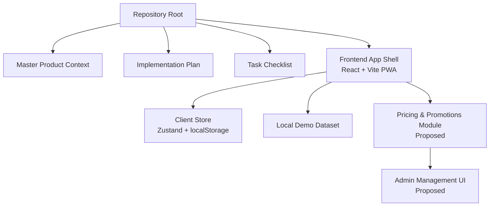
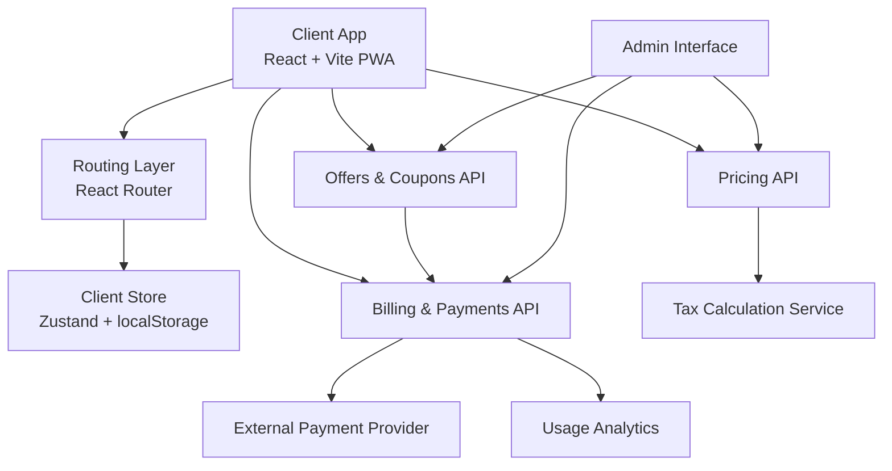
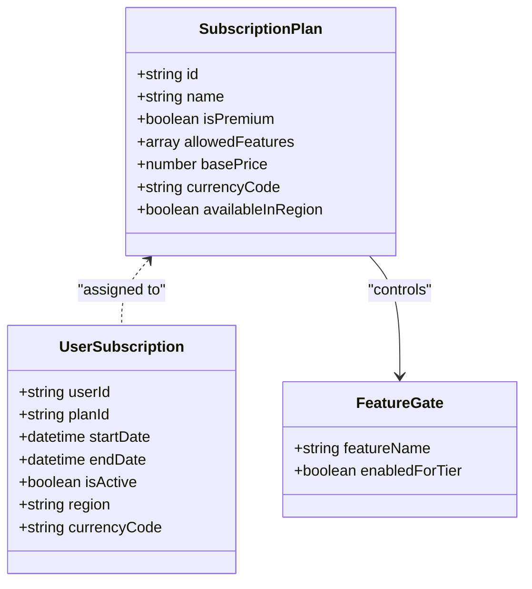
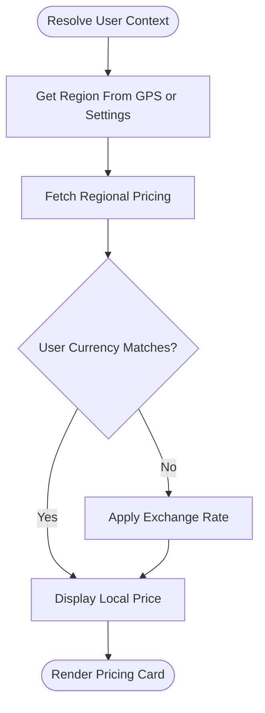
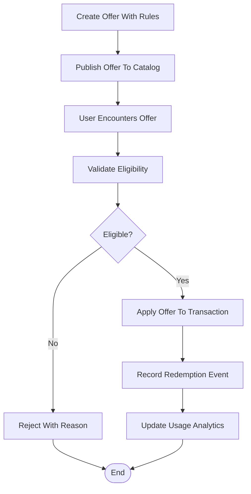
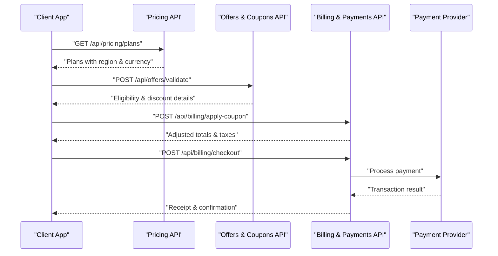
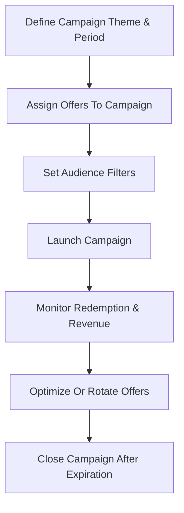
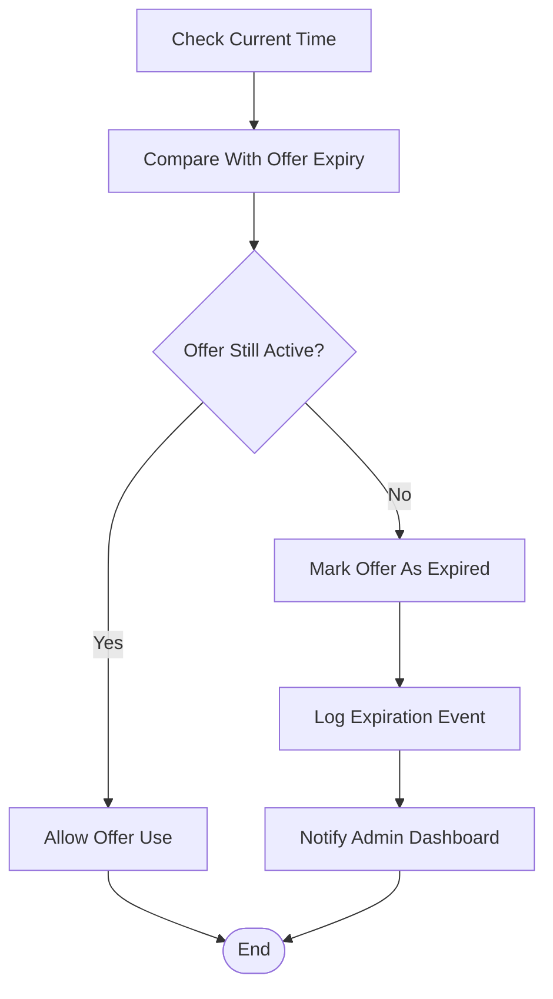
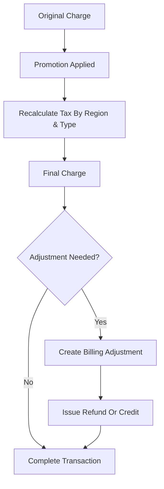
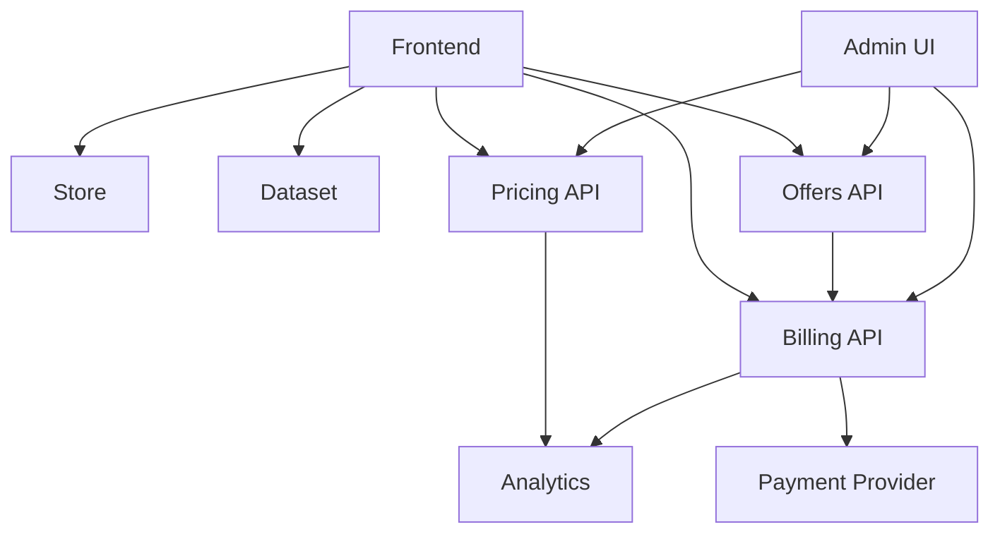

# Pricing Configuration and Promotional Offers

<cite>
**Referenced Files in This Document**
- [Pujo_Sahayak_Master_Project_Context.md](file://Pujo_Sahayak_Master_Project_Context.md)
- [plan.md](file://tasks/plan.md)
- [todo.md](file://tasks/todo.md)
</cite>

## Table of Contents
1. [Introduction](#introduction)
2. [Project Structure](#project-structure)
3. [Core Components](#core-components)
4. [Architecture Overview](#architecture-overview)
5. [Detailed Component Analysis](#detailed-component-analysis)
6. [Dependency Analysis](#dependency-analysis)
7. [Performance Considerations](#performance-considerations)
8. [Troubleshooting Guide](#troubleshooting-guide)
9. [Conclusion](#conclusion)
10. [Appendices](#appendices)

## Introduction
This document describes the flexible pricing configuration and promotional offer system for Pujo Sahayak as it is currently scoped in the repository. The project is a mobile-first React + Vite PWA focused on Durga Puja discovery, planning, community meetups, and local exploration. Pricing and promotions are intentionally treated as evolving business features rather than fully implemented production systems at this stage.

The documentation covers:
- The conceptual pricing model architecture for subscription plans, regional pricing variations, and currency support.
- The promotional offer system including discount codes, trial periods, referral bonuses, and seasonal promotions.
- Proposed backend API endpoints for pricing retrieval, offer validation, and coupon application.
- Examples of promotional campaign management, offer expiration handling, and usage analytics.
- An admin interface concept for managing pricing tiers and promotional campaigns.
- Guidance for tax calculation, refund policies, and billing adjustments for promotional pricing.

Where the repository does not define implementation details, this document proposes safe, extensible designs aligned with the product’s current status and future evolution.

**Section sources**
- [Pujo_Sahayak_Master_Project_Context.md:104-122](file://Pujo_Sahayak_Master_Project_Context.md#L104-L122)
- [Pujo_Sahayak_Master_Project_Context.md:424-445](file://Pujo_Sahayak_Master_Project_Context.md#L424-L445)
- [Pujo_Sahayak_Master_Project_Context.md:753-773](file://Pujo_Sahayak_Master_Project_Context.md#L753-L773)
- [Pujo_Sahayak_Master_Project_Context.md:1013-1039](file://Pujo_Sahayak_Master_Project_Context.md#L1013-L1039)
- [Pujo_Sahayak_Master_Project_Context.md:1636-1687](file://Pujo_Sahayak_Master_Project_Context.md#L1636-L1687)
- [plan.md:45-61](file://tasks/plan.md#L45-L61)
- [todo.md:13-14](file://tasks/todo.md#L13-L14)

## Project Structure
At present, the repository contains:
- A master product context describing the platform vision, user journeys, feature status, and data model concepts.
- An implementation plan outlining phases, routes, and verification criteria.
- A task checklist tracking foundation, discovery, Maya, planning, social, utility, and polish work.

There is no source code directory for pricing or promotion logic yet. The pricing and promotional systems should be introduced as new modules that integrate with the existing frontend shell, store, dataset, and profile/payment surfaces.

**Diagram sources**
- [plan.md:1-18](file://tasks/plan.md#L1-L18)
- [todo.md:1-14](file://tasks/todo.md#L1-L14)

**Section sources**
- [plan.md:1-18](file://tasks/plan.md#L1-L18)
- [todo.md:1-14](file://tasks/todo.md#L1-L14)

## Core Components
The pricing and promotional system should be built around these core components:

- **Subscription Plans**: Free, Premium, and potentially premium-only meetup access.
- **Regional Pricing Variations**: Location-aware pricing for services such as paid meetups, partner services, or donations.
- **Currency Support**: Localized currency display and conversion for transactions.
- **Promotional Offers**: Discount codes, trial periods, referral bonuses, and seasonal promotions.
- **Offer Validation Engine**: Rules-based validation for eligibility, expiration, stacking, and usage limits.
- **Coupon Application Service**: Applies eligible offers to subscriptions, meetups, or partner purchases.
- **Billing Adjustments**: Handles prorated charges, refunds, credits, and promotional price overrides.
- **Tax Calculation**: Computes taxes based on region, product type, and promotional pricing.
- **Usage Analytics**: Tracks offer redemption, revenue impact, churn reduction, and campaign performance.
- **Admin Interface**: Manages pricing tiers, regions, currencies, offers, campaigns, and billing adjustments.

These components align with the product’s current “designed but still evolving” status for offers, premium subscription, donation, and payment system.

**Section sources**
- [Pujo_Sahayak_Master_Project_Context.md:424-445](file://Pujo_Sahayak_Master_Project_Context.md#L424-L445)
- [Pujo_Sahayak_Master_Project_Context.md:753-773](file://Pujo_Sahayak_Master_Project_Context.md#L753-L773)
- [Pujo_Sahayak_Master_Project_Context.md:1013-1039](file://Pujo_Sahayak_Master_Project_Context.md#L1013-L1039)
- [Pujo_Sahayak_Master_Project_Context.md:1636-1687](file://Pujo_Sahayak_Master_Project_Context.md#L1636-L1687)

## Architecture Overview
The proposed architecture separates concerns between client-facing flows, pricing rules, offer validation, billing, and administration.

**Diagram sources**
- [plan.md:1-18](file://tasks/plan.md#L1-L18)
- [Pujo_Sahayak_Master_Project_Context.md:1013-1039](file://Pujo_Sahayak_Master_Project_Context.md#L1013-L1039)

## Detailed Component Analysis

### Subscription Plans
The repository identifies premium planning as a potential premium feature and explicitly warns against hard-coding a large subscription system prematurely. Meetup monetization is also described as a business-model concept supporting free, paid, and premium-only experiences without locking into one model.

Recommended design:
- Define subscription tiers as configurable entities with clear feature gates.
- Keep tier definitions decoupled from UI so they can evolve without breaking screens.
- Use feature flags for premium-only capabilities such as advanced planning or exclusive meetups.
- Surface subscription state in the Profile page where the “Become a Premium Member” CTA exists.

**Diagram sources**
- [Pujo_Sahayak_Master_Project_Context.md:424-445](file://Pujo_Sahayak_Master_Project_Context.md#L424-L445)
- [Pujo_Sahayak_Master_Project_Context.md:753-773](file://Pujo_Sahayak_Master_Project_Context.md#L753-L773)

**Section sources**
- [Pujo_Sahayak_Master_Project_Context.md:424-445](file://Pujo_Sahayak_Master_Project_Context.md#L424-L445)
- [Pujo_Sahayak_Master_Project_Context.md:753-773](file://Pujo_Sahayak_Master_Project_Context.md#L753-L773)

### Regional Pricing Variations and Currency Support
The product emphasizes location-awareness and off-season expansion across Kolkata. Pricing should therefore respect:
- Region codes (city, district, or service area).
- Currency codes and localized formatting.
- Exchange rates or fixed regional price lists.
- Seasonal demand adjustments during Puja versus off-season.

Recommended behavior:
- Resolve user region from GPS or explicit selection.
- Fetch pricing using region-scoped endpoints.
- Display prices in the user’s preferred currency while preserving the original transaction currency for accounting.
- Avoid hard-coded pricing assumptions; treat all monetary values as configuration-driven.

**Diagram sources**
- [Pujo_Sahayak_Master_Project_Context.md:1360-1388](file://Pujo_Sahayak_Master_Project_Context.md#L1360-L1388)

**Section sources**
- [Pujo_Sahayak_Master_Project_Context.md:1360-1388](file://Pujo_Sahayak_Master_Project_Context.md#L1360-L1388)

### Promotional Offer System
The repository includes an `Offer` entity in the data model and mentions offers/discounts on the Home page, sponsor offers, local business offers, Puja-related discounts, and partner promotions. It also warns against making the app look like a coupon website.

Supported offer types:
- Discount codes applied at checkout.
- Trial periods for subscriptions.
- Referral bonuses credited after successful actions.
- Seasonal promotions tied to Puja or off-season campaigns.
- Partner-sponsored discounts displayed organically alongside discovery content.

Offer lifecycle:
- Create offer with eligibility rules, validity window, and usage limits.
- Validate offer before applying to a purchase or subscription.
- Record redemption events for analytics.
- Expire or deactivate offers automatically when conditions are no longer met.

**Diagram sources**
- [Pujo_Sahayak_Master_Project_Context.md:235-247](file://Pujo_Sahayak_Master_Project_Context.md#L235-L247)
- [Pujo_Sahayak_Master_Project_Context.md:1232-1255](file://Pujo_Sahayak_Master_Project_Context.md#L1232-L1255)

**Section sources**
- [Pujo_Sahayak_Master_Project_Context.md:235-247](file://Pujo_Sahayak_Master_Project_Context.md#L235-L247)
- [Pujo_Sahayak_Master_Project_Context.md:1232-1255](file://Pujo_Sahayak_Master_Project_Context.md#L1232-L1255)

### Backend API Endpoints
The repository does not define backend endpoints. The following are proposed contracts for future implementation, aligned with the product’s modular approach and the need to keep payments separate from AI and discovery logic.

#### Pricing Retrieval
- `GET /api/pricing/plans`
  - Returns subscription plans with region and currency metadata.
- `GET /api/pricing/services/{serviceId}`
  - Returns pricing for a specific service such as a paid meetup or partner offering.
- `GET /api/pricing/currency-rates`
  - Returns supported currencies and exchange rates.

#### Offer Validation
- `POST /api/offers/validate`
  - Validates discount codes, trials, referrals, or seasonal promotions.
  - Returns eligibility, discount amount, expiration, and restrictions.

#### Coupon Application
- `POST /api/billing/apply-coupon`
  - Applies validated coupons to a cart or subscription.
  - Returns adjusted totals and applicable taxes.

#### Billing and Payments
- `POST /api/billing/checkout`
  - Creates a charge through an external payment provider.
- `POST /api/billing/refund`
  - Processes refunds or credits for promotional pricing adjustments.
- `GET /api/billing/history`
  - Returns user billing history and adjustment records.

**Diagram sources**
- [Pujo_Sahayak_Master_Project_Context.md:1013-1039](file://Pujo_Sahayak_Master_Project_Context.md#L1013-L1039)

**Section sources**
- [Pujo_Sahayak_Master_Project_Context.md:1013-1039](file://Pujo_Sahayak_Master_Project_Context.md#L1013-L1039)

### Promotional Campaign Management
Campaigns should group multiple offers under a theme such as Puja season, off-season local discovery, or partner promotions. Campaign management should include:
- Campaign start and end dates.
- Target audience filters (region, user tier, referral source).
- Offer inventory and rotation.
- Performance metrics per campaign.

Example campaign:
- Name: “Puja Season Discovery Discounts”
- Period: During Puja weeks
- Offers: Sponsor discounts, local business offers, partner promotions
- Metrics: Redemption rate, revenue uplift, new user acquisition

**Diagram sources**
- [Pujo_Sahayak_Master_Project_Context.md:235-247](file://Pujo_Sahayak_Master_Project_Context.md#L235-L247)
- [Pujo_Sahayak_Master_Project_Context.md:1144-1179](file://Pujo_Sahayak_Master_Project_Context.md#L1144-L1179)

**Section sources**
- [Pujo_Sahayak_Master_Project_Context.md:235-247](file://Pujo_Sahayak_Master_Project_Context.md#L235-L247)
- [Pujo_Sahayak_Master_Project_Context.md:1144-1179](file://Pujo_Sahayak_Master_Project_Context.md#L1144-L1179)

### Offer Expiration Handling
Offers must expire cleanly to avoid stale discounts and billing inconsistencies.

Expiration rules:
- Hard expiration date/time.
- Soft deactivation when campaign ends.
- Grace period handling for pending transactions.
- Audit trail for expired offers.

**Diagram sources**
- [Pujo_Sahayak_Master_Project_Context.md:1232-1255](file://Pujo_Sahayak_Master_Project_Context.md#L1232-L1255)

**Section sources**
- [Pujo_Sahayak_Master_Project_Context.md:1232-1255](file://Pujo_Sahayak_Master_Project_Context.md#L1232-L1255)

### Usage Analytics
Analytics should capture:
- Offer impressions and clicks.
- Redemption counts by offer type.
- Revenue impact of promotions.
- Churn reduction attributed to trials or discounts.
- Regional and currency performance.
- Campaign ROI.

Metrics should feed dashboards for marketing, finance, and product teams while respecting privacy and data minimization principles.

**Section sources**
- [Pujo_Sahayak_Master_Project_Context.md:1263-1294](file://Pujo_Sahayak_Master_Project_Context.md#L1263-L1294)

### Admin Interface for Pricing Tiers and Promotional Campaigns
The admin interface should allow operators to:
- Create and edit subscription plans.
- Configure regional pricing and currency rules.
- Create discount codes, trials, referrals, and seasonal promotions.
- Manage campaigns and offer rotations.
- Review billing adjustments, refunds, and audit logs.
- Export analytics reports.

The interface should be role-restricted and include validation warnings for risky changes such as negative pricing or overlapping promotions.

**Section sources**
- [Pujo_Sahayak_Master_Project_Context.md:1013-1039](file://Pujo_Sahayak_Master_Project_Context.md#L1013-L1039)

### Tax Calculation, Refund Policies, and Billing Adjustments
Tax calculation should consider:
- Jurisdiction and region.
- Product category (subscription, meetup, partner service, donation).
- Promotional pricing and discounts.
- Whether the transaction is taxable.

Refund policies should distinguish:
- Full refunds for failed or canceled transactions.
- Partial refunds for prorated subscription changes.
- Credits for promotional overcharges.
- Non-refundable donations if configured.

Billing adjustments should record:
- Original charge.
- Adjustment reason.
- New total.
- Tax recalculation.
- Approval workflow if required.

**Diagram sources**
- [Pujo_Sahayak_Master_Project_Context.md:1013-1039](file://Pujo_Sahayak_Master_Project_Context.md#L1013-L1039)

**Section sources**
- [Pujo_Sahayak_Master_Project_Context.md:1013-1039](file://Pujo_Sahayak_Master_Project_Context.md#L1013-L1039)

## Dependency Analysis
The pricing and promotional system depends on:
- Client routing and store for displaying pricing and persisting user preferences.
- Local demo dataset for placeholder pricing and offer examples.
- External payment providers for actual transactions.
- Analytics pipelines for measuring campaign effectiveness.
- Admin tools for operational control.

**Diagram sources**
- [plan.md:1-18](file://tasks/plan.md#L1-L18)
- [todo.md:13-14](file://tasks/todo.md#L13-L14)

**Section sources**
- [plan.md:1-18](file://tasks/plan.md#L1-L18)
- [todo.md:13-14](file://tasks/todo.md#L13-L14)

## Performance Considerations
- Cache regional pricing and currency rates to reduce API calls.
- Defer expensive tax calculations until checkout.
- Batch analytics events to minimize network overhead.
- Avoid rendering full offer catalogs on every screen; load only relevant offers.
- Use feature flags to gate premium pricing UI until subscriptions are active.
- Keep offer validation fast by precomputing eligibility where possible.

[No sources needed since this section provides general guidance]

## Troubleshooting Guide
Common issues and resolutions:
- **Stale pricing displayed**: Refresh pricing cache and invalidate region-specific entries.
- **Invalid discount code**: Verify offer eligibility, expiration, and usage limits.
- **Incorrect tax amount**: Confirm jurisdiction, product type, and promotional adjustments.
- **Failed payment**: Retry with updated payment method; log provider error codes.
- **Missing refund record**: Check billing adjustment logs and approval workflows.
- **Analytics gaps**: Ensure event tracking is enabled for offer impressions and redemptions.

**Section sources**
- [Pujo_Sahayak_Master_Project_Context.md:1013-1039](file://Pujo_Sahayak_Master_Project_Context.md#L1013-L1039)

## Conclusion
Pujo Sahayak’s pricing and promotional systems are currently conceptual and evolving. The repository emphasizes flexibility, avoiding premature hard-coding, and keeping commercial features supportive of the core discovery and community experience. The proposed architecture introduces subscription plans, regional pricing, currency support, offer validation, coupon application, billing adjustments, tax calculation, analytics, and an admin interface. These components should be implemented incrementally, starting with simple configurable pricing and basic offer validation, then expanding to full billing, tax compliance, and campaign analytics as the product matures.

[No sources needed since this section summarizes without analyzing specific files]

## Appendices

### Appendix A: Data Model Alignment
The repository defines a broad product data model including Offer, Subscription, Payment, and related entities. Pricing and promotions should map to these models rather than introducing unrelated structures.

**Section sources**
- [Pujo_Sahayak_Master_Project_Context.md:1232-1255](file://Pujo_Sahayak_Master_Project_Context.md#L1232-L1255)

### Appendix B: Feature Status Guidance
Offers, premium subscription, donation, and payment system are classified as designed but still evolving. Implementation should prioritize safety, clarity, and extensibility over immediate production complexity.

**Section sources**
- [Pujo_Sahayak_Master_Project_Context.md:1636-1687](file://Pujo_Sahayak_Master_Project_Context.md#L1636-L1687)