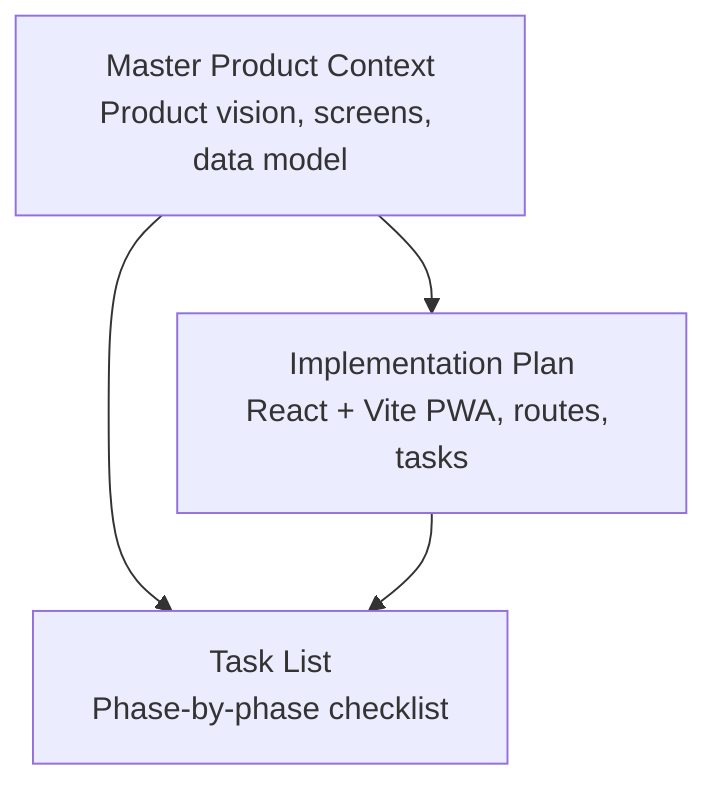
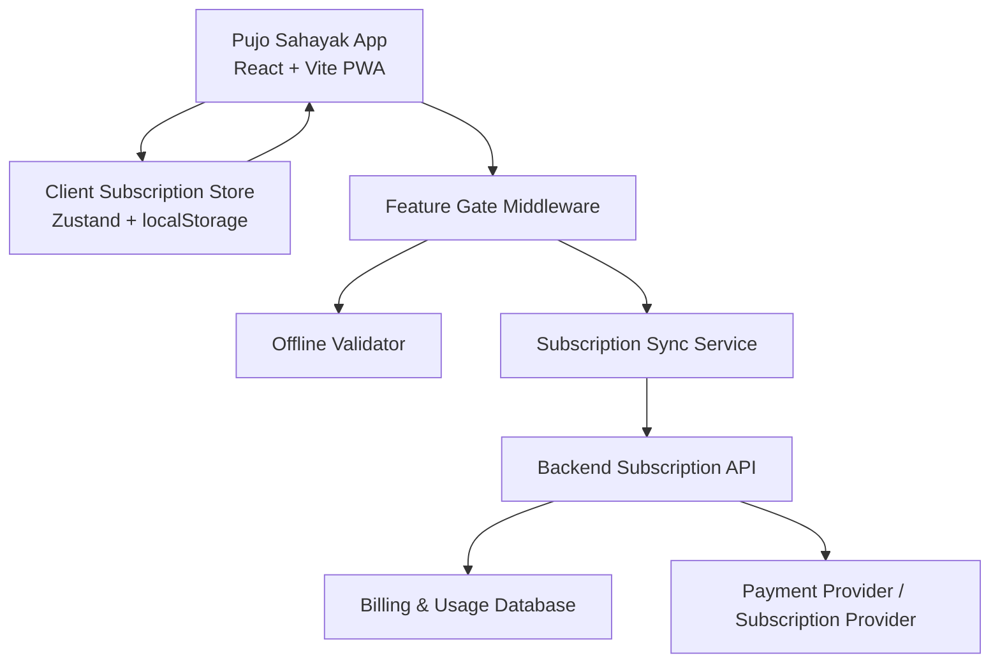
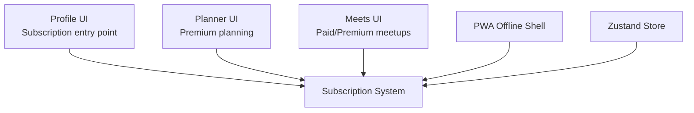
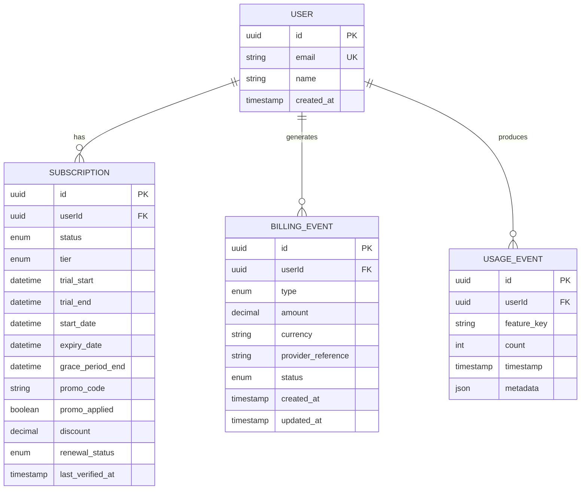
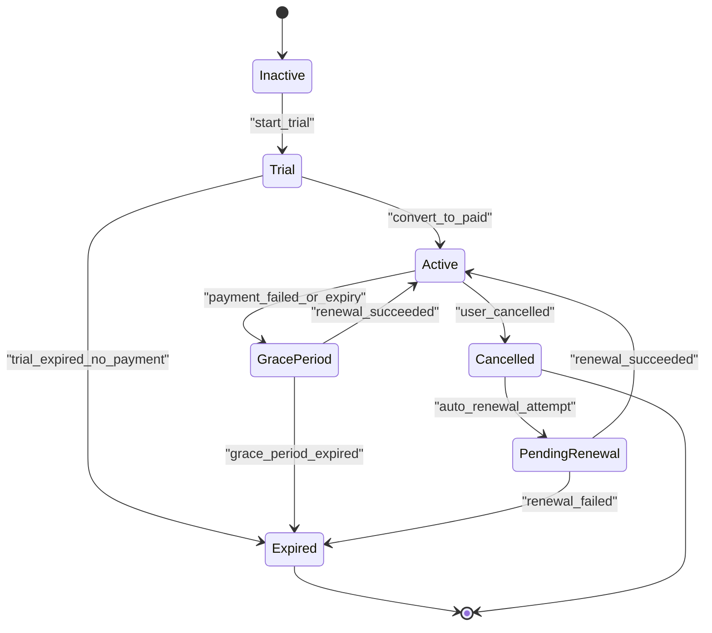
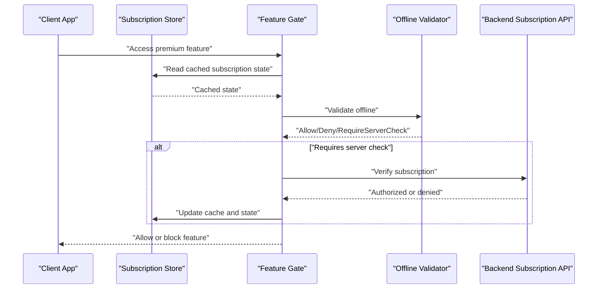

# Subscription State Management and Validation

<cite>
**Referenced Files in This Document**
- [Pujo_Sahayak_Master_Project_Context.md](file://Pujo_Sahayak_Master_Project_Context.md)
- [plan.md](file://tasks/plan.md)
- [todo.md](file://tasks/todo.md)
</cite>

## Table of Contents
1. [Introduction](#introduction)
2. [Project Structure](#project-structure)
3. [Core Components](#core-components)
4. [Architecture Overview](#architecture-overview)
5. [Detailed Component Analysis](#detailed-component-analysis)
6. [Dependency Analysis](#dependency-analysis)
7. [Performance Considerations](#performance-considerations)
8. [Troubleshooting Guide](#troubleshooting-guide)
9. [Conclusion](#conclusion)
10. [Appendices](#appendices)

## Introduction
This document defines the subscription state management and validation system for Pujo Sahayak. It focuses on:
- Local client-side subscription state, including status, trial periods, promotional offers, and premium feature gating.
- Server-side validation endpoints for subscription verification and feature access control.
- Synchronization between local subscription state and backend validation.
- Expiration handling, grace periods, automatic renewal processing, and offline behavior.
- Data models for subscriptions, billing history, usage tracking, and related entities.
- Examples of subscription state transitions and validation workflows.

The current repository is a product context and task plan rather than an implementation codebase. Therefore, this document proposes a concrete, production-ready design that aligns with the existing product goals, especially the planned Premium planning features, profile-based subscription entry points, payments section, and off-season monetization concepts.

## Project Structure
At present, the workspace contains:
- A master product context describing the app’s philosophy, screens, data model, and feature status.
- An implementation plan for a React + Vite PWA.
- A task list covering foundation, discovery, Maya, planning, social, utility, account, and polish phases.

**Diagram sources**
- [Pujo_Sahayak_Master_Project_Context.md:1-1878](file://Pujo_Sahayak_Master_Project_Context.md#L1-L1878)
- [plan.md:1-86](file://tasks/plan.md#L1-L86)
- [todo.md:1-81](file://tasks/todo.md#L1-L81)

**Section sources**
- [Pujo_Sahayak_Master_Project_Context.md:1-1878](file://Pujo_Sahayak_Master_Project_Context.md#L1-L1878)
- [plan.md:1-86](file://tasks/plan.md#L1-L86)
- [todo.md:1-81](file://tasks/todo.md#L1-L81)

## Core Components
The subscription system should be composed of these core components:

- Client subscription store
  - Holds subscription status, trial start/end, promo codes, expiration, grace period flags, last sync time, and cached validation result.
  - Persists to `localStorage` as part of the existing Zustand-based user state.
- Feature gate middleware
  - Guards premium features such as multi-day itinerary planning, AI-assisted planning, advanced recommendations, and potentially paid meetups.
- Subscription lifecycle manager
  - Handles activation, trial conversion, expiration, grace period, cancellation, and renewal events.
- Offline validator
  - Validates cached subscription state against expiry, grace period, and trust rules when network is unavailable.
- Backend subscription service
  - Provides endpoints for subscription verification, purchase/renewal callbacks, trial/promo validation, and billing/usage records.
- Billing and usage tracker
  - Records payment events, subscription changes, and feature usage for analytics and reconciliation.

**Section sources**
- [plan.md:5-18](file://tasks/plan.md#L5-L18)
- [todo.md:45-55](file://tasks/todo.md#L45-L55)
- [Pujo_Sahayak_Master_Project_Context.md:424-445](file://Pujo_Sahayak_Master_Project_Context.md#L424-L445)
- [Pujo_Sahayak_Master_Project_Context.md:753-772](file://Pujo_Sahayak_Master_Project_Context.md#L753-L772)
- [Pujo_Sahayak_Master_Project_Context.md:954-976](file://Pujo_Sahayak_Master_Project_Context.md#L954-L976)
- [Pujo_Sahayak_Master_Project_Context.md:1013-1039](file://Pujo_Sahayak_Master_Project_Context.md#L1013-L1039)

## Architecture Overview
The architecture separates trusted server-side validation from optimistic client-side state. The client can show premium UI quickly using cached state, but critical actions must be verified by the backend.

**Diagram sources**
- [plan.md:5-18](file://tasks/plan.md#L5-L18)
- [todo.md:60-68](file://tasks/todo.md#L60-L68)
- [Pujo_Sahayak_Master_Project_Context.md:424-445](file://Pujo_Sahayak_Master_Project_Context.md#L424-L445)
- [Pujo_Sahayak_Master_Project_Context.md:1013-1039](file://Pujo_Sahayak_Master_Project_Context.md#L1013-L1039)

## Detailed Component Analysis

### Client Subscription Store
Responsibilities:
- Maintain subscription status, trial window, promo state, expiration timestamps, grace period flag, last successful server sync timestamp, and cached validation result.
- Persist state through the existing Zustand persist middleware so it survives reloads.
- Provide selectors for premium feature availability and UI state.

Key behaviors:
- On app startup, load cached subscription state.
- If cached state is stale or missing, request server validation.
- Update UI immediately based on cached state while awaiting server confirmation.
- Invalidate cache after explicit logout, subscription change, or policy-defined TTL.

Data fields (conceptual):
- `subscription.status`: active, trial, expired, cancelled, pending_renewal, grace_period.
- `subscription.trialStart`, `subscription.trialEnd`.
- `subscription.promoCode`, `promoApplied`, `promoDiscount`.
- `subscription.expiryDate`, `gracePeriodEnd`.
- `subscription.lastSyncTime`, `cachedValid`.

**Section sources**
- [plan.md:12-18](file://tasks/plan.md#L12-L18)
- [todo.md:60-68](file://tasks/todo.md#L60-L68)
- [Pujo_Sahayak_Master_Project_Context.md:954-976](file://Pujo_Sahayak_Master_Project_Context.md#L954-L976)

### Feature Gate Middleware
Responsibilities:
- Evaluate whether a route or action requires premium access.
- Use offline validation first for fast UX.
- Trigger background server validation when needed.
- Block or downgrade functionality if validation fails.

Validation logic:
- Allow free features without subscription.
- Allow premium features only when:
  - Cached state says active or trial, and
  - Offline validator confirms not expired beyond grace period, and
  - Server validation confirms entitlement.

Premium features referenced by the project:
- Multi-day itinerary planning.
- AI-assisted planning.
- Potentially advanced recommendations.
- Potentially advanced meetup capabilities.
- Paid meetups conceptually supported as Free / Paid / Premium-only.

**Section sources**
- [Pujo_Sahayak_Master_Project_Context.md:424-445](file://Pujo_Sahayak_Master_Project_Context.md#L424-L445)
- [Pujo_Sahayak_Master_Project_Context.md:753-772](file://Pujo_Sahayak_Master_Project_Context.md#L753-L772)
- [todo.md:45-55](file://tasks/todo.md#L45-L55)

### Subscription Lifecycle Manager
Responsibilities:
- Handle subscription activation from trial or direct purchase.
- Convert trial to paid subscription at trial end.
- Manage cancellation and renewal scheduling.
- Track grace period after expiration.
- Emit lifecycle events for UI updates and analytics.

Lifecycle states:
- inactive → trial → active → grace_period → expired → cancelled → pending_renewal → active.

Important constraints:
- Do not hard-code pricing or feature lists; keep them configurable.
- Treat premium/meetup monetization as business-model concepts until finalized.

**Section sources**
- [Pujo_Sahayak_Master_Project_Context.md:424-445](file://Pujo_Sahayak_Master_Project_Context.md#L424-L445)
- [Pujo_Sahayak_Master_Project_Context.md:753-772](file://Pujo_Sahayak_Master_Project_Context.md#L753-L772)

### Offline Validator
Responsibilities:
- Validate cached subscription state without network access.
- Enforce trust boundaries:
  - Reject obviously tampered or expired cached state.
  - Allow short grace-period continuation if allowed by policy.
- Return a deterministic offline decision: allow, deny, or require_server_check.

Rules:
- If `subscription.cachedValid` is false or missing, require server check.
- If `subscription.status` is expired and outside grace period, deny premium.
- If within grace period, optionally allow limited premium behavior.
- If active or trial and not expired, allow premium until server sync.

**Section sources**
- [plan.md:9-18](file://tasks/plan.md#L9-L18)
- [todo.md:74-81](file://tasks/todo.md#L74-L81)

### Backend Subscription Service
Responsibilities:
- Verify subscription entitlement for a user.
- Process purchase, trial start, promo application, cancellation, and renewal.
- Record billing events and usage metrics.
- Return canonical subscription state to clients.

Endpoints (conceptual):
- `POST /api/subscription/verify`
- `POST /api/subscription/purchase`
- `POST /api/subscription/trial/start`
- `POST /api/subscription/promo/apply`
- `POST /api/subscription/cancel`
- `POST /api/subscription/renew`
- `GET /api/billing/history`
- `GET /api/subscription/usage`

Security:
- Require authenticated requests.
- Validate payment provider webhooks.
- Rate-limit sensitive endpoints.
- Never trust client-provided subscription state for authorization decisions.

**Section sources**
- [Pujo_Sahayak_Master_Project_Context.md:1013-1039](file://Pujo_Sahayak_Master_Project_Context.md#L1013-L1039)
- [Pujo_Sahayak_Master_Project_Context.md:1636-1688](file://Pujo_Sahayak_Master_Project_Context.md#L1636-L1688)

### Billing and Usage Tracker
Responsibilities:
- Record subscription purchases, trials, promos, cancellations, renewals, and failures.
- Track feature usage for premium vs free users.
- Support reconciliation with payment providers.
- Provide read-only endpoints for user-facing billing history.

Data fields (conceptual):
- Billing event type, amount, currency, provider reference, status, timestamps.
- Usage event type, feature key, user id, timestamps, counts.

**Section sources**
- [Pujo_Sahayak_Master_Project_Context.md:1013-1039](file://Pujo_Sahayak_Master_Project_Context.md#L1013-L1039)
- [Pujo_Sahayak_Master_Project_Context.md:1232-1255](file://Pujo_Sahayak_Master_Project_Context.md#L1232-L1255)

## Dependency Analysis
The subscription system depends on several existing and proposed parts of the product:

- Profile and Payments UI
  - Entry point for subscription upgrade and billing history.
- Premium Planning Features
  - Multi-day itinerary planning and AI-assisted planning are explicitly identified as potential premium features.
- Meetup Monetization Concept
  - Supports Free, Paid, and Premium-only meetups conceptually.
- PWA and Offline Shell
  - Requires robust offline validation because the app may run without network.
- User State Persistence
  - Uses Zustand with persist middleware for local state.

**Diagram sources**
- [Pujo_Sahayak_Master_Project_Context.md:954-976](file://Pujo_Sahayak_Master_Project_Context.md#L954-L976)
- [Pujo_Sahayak_Master_Project_Context.md:1013-1039](file://Pujo_Sahayak_Master_Project_Context.md#L1013-L1039)
- [plan.md:5-18](file://tasks/plan.md#L5-L18)
- [todo.md:45-55](file://tasks/todo.md#L45-L55)
- [todo.md:60-68](file://tasks/todo.md#L60-L68)

**Section sources**
- [Pujo_Sahayak_Master_Project_Context.md:424-445](file://Pujo_Sahayak_Master_Project_Context.md#L424-L445)
- [Pujo_Sahayak_Master_Project_Context.md:753-772](file://Pujo_Sahayak_Master_Project_Context.md#L753-L772)
- [Pujo_Sahayak_Master_Project_Context.md:954-976](file://Pujo_Sahayak_Master_Project_Context.md#L954-L976)
- [Pujo_Sahayak_Master_Project_Context.md:1013-1039](file://Pujo_Sahayak_Master_Project_Context.md#L1013-L1039)
- [plan.md:5-18](file://tasks/plan.md#L5-L18)
- [todo.md:45-55](file://tasks/todo.md#L45-L55)
- [todo.md:60-68](file://tasks/todo.md#L60-L68)

## Performance Considerations
- Prefer optimistic UI updates from cached subscription state to avoid perceived lag.
- Batch subscription sync requests during idle times or app initialization.
- Cache invalidation should be conservative: invalidate on logout, explicit subscription change, or after a defined TTL.
- Avoid heavy server calls on every route change; gate expensive checks behind feature gates.
- Keep offline validation lightweight and deterministic.
- Log failed validations and retries for observability without exposing sensitive data.

[No sources needed since this section provides general guidance]

## Troubleshooting Guide
Common issues and resolutions:

- Cached subscription shows premium but server denies access
  - Cause: Stale cache or race condition.
  - Resolution: Force server validation, update cache, downgrade UI, and retry background sync.

- Trial expires but premium remains available
  - Cause: Grace period misconfiguration or offline validator too permissive.
  - Resolution: Tighten grace period rules, ensure server validation overrides cache, and notify user.

- Promo code applied locally but rejected by server
  - Cause: Promo validation mismatch or expired promo.
  - Resolution: Re-validate promo server-side, clear local promo state, and show error.

- Offline mode blocks all premium features
  - Cause: Offline validator set to deny when no cached valid state exists.
  - Resolution: Allow grace-period behavior if policy permits, or clearly explain why premium is unavailable offline.

- Renewal fails silently
  - Cause: Payment provider webhook not processed or subscription sync missed.
  - Resolution: Add webhook logging, retry mechanism, and user-visible renewal status.

**Section sources**
- [plan.md:9-18](file://tasks/plan.md#L9-L18)
- [todo.md:74-81](file://tasks/todo.md#L74-L81)
- [Pujo_Sahayak_Master_Project_Context.md:1013-1039](file://Pujo_Sahayak_Master_Project_Context.md#L1013-L1039)

## Conclusion
The subscription state management and validation system for Pujo Sahayak should combine:
- A fast, optimistic client store backed by `localStorage`.
- A strict offline validator for safe UX without network.
- A backend service that owns authoritative subscription state and billing records.
- Clear feature gates for premium planning, AI assistance, and potentially paid meetups.
- Careful handling of trials, promotions, expiration, grace periods, and renewals.

This design respects the current product context, which treats premium and payment systems as evolving rather than fully implemented, while providing a solid foundation for future monetization.

[No sources needed since this section summarizes without analyzing specific files]

## Appendices

### Data Models

#### Subscription Model
- `id`: unique subscription identifier.
- `userId`: user owning the subscription.
- `status`: active, trial, expired, cancelled, pending_renewal, grace_period.
- `tier`: free, premium, or provider-specific tier.
- `trialStart`, `trialEnd`.
- `startDate`, `expiryDate`.
- `gracePeriodEnd`.
- `promoCode`, `promoApplied`, `discount`.
- `renewalStatus`: manual, automatic.
- `lastVerifiedAt`: last successful server verification timestamp.

#### Billing History Model
- `id`: billing event identifier.
- `userId`: user associated with the event.
- `type`: purchase, trial_start, promo_applied, renewal, refund, failure.
- `amount`, `currency`.
- `providerReference`: external payment reference.
- `status`: success, pending, failed.
- `createdAt`, `updatedAt`.

#### Usage Tracking Model
- `id`: usage event identifier.
- `userId`: user who used the feature.
- `featureKey`: premium feature identifier.
- `count`: number of uses.
- `timestamp`: event time.
- `metadata`: optional contextual data.

**Diagram sources**
- [Pujo_Sahayak_Master_Project_Context.md:1232-1255](file://Pujo_Sahayak_Master_Project_Context.md#L1232-L1255)
- [Pujo_Sahayak_Master_Project_Context.md:1013-1039](file://Pujo_Sahayak_Master_Project_Context.md#L1013-L1039)

### Subscription State Transitions

**Diagram sources**
- [Pujo_Sahayak_Master_Project_Context.md:424-445](file://Pujo_Sahayak_Master_Project_Context.md#L424-L445)
- [Pujo_Sahayak_Master_Project_Context.md:753-772](file://Pujo_Sahayak_Master_Project_Context.md#L753-L772)

### Validation Workflow Sequence

**Diagram sources**
- [plan.md:5-18](file://tasks/plan.md#L5-L18)
- [todo.md:60-68](file://tasks/todo.md#L60-L68)
- [Pujo_Sahayak_Master_Project_Context.md:1013-1039](file://Pujo_Sahayak_Master_Project_Context.md#L1013-L1039)