# Subscription Tiers and Feature Gating

<cite>
**Referenced Files in This Document**   
- [Pujo_Sahayak_Master_Project_Context.md](file://Pujo_Sahayak_Master_Project_Context.md)
- [plan.md](file://tasks/plan.md)
- [todo.md](file://tasks/todo.md)
</cite>

## Table of Contents
1. [Introduction](#introduction)
2. [Project Structure](#project-structure)
3. [Core Components](#core-components)
4. [Architecture Overview](#architecture-overview)
5. [Detailed Component Analysis](#detailed-component-analysis)
6. [Dependency Analysis](#dependency-analysis)
7. [Performance Considerations](#performance-considerations)
8. [Troubleshooting Guide](#troubleshooting-guide)
9. [Conclusion](#conclusion)

## Introduction
This document explains the subscription tier system and feature gating mechanism for Pujo Sahayak. It focuses on how free and premium features are differentiated, how access control should be implemented, and how to build a flexible architecture that enables or disables features based on user subscription status without hard-coding pricing models.

The product context defines:
- Free capabilities such as basic discovery, saved places, normal exploration, and core navigation.
- Premium capabilities such as multi-day itinerary planning, AI-assisted planning, potentially advanced recommendations, and potentially advanced meetup capabilities.
- A profile-driven subscription experience with a clear “Become a Premium Member” call-to-action.
- A broad data model that includes `User`, `Subscription`, `Payment`, and other entities needed for future monetization.

The goal is to design a clean separation between business logic, feature flags, permission checks, and UI presentation so that premium features can be gated safely and flexibly.

**Section sources**
- [Pujo_Sahayak_Master_Project_Context.md:424-445](file://Pujo_Sahayak_Master_Project_Context.md#L424-L445)
- [Pujo_Sahayak_Master_Project_Context.md:954-976](file://Pujo_Sahayak_Master_Project_Context.md#L954-L976)
- [Pujo_Sahayak_Master_Project_Context.md:1232-1255](file://Pujo_Sahayak_Master_Project_Context.md#L1232-L1255)

## Project Structure
At this stage, the repository contains:
- A master product context document describing the full product vision, feature set, user flows, and conceptual architecture.
- Task files under `tasks/` that may contain implementation plans and TODOs.

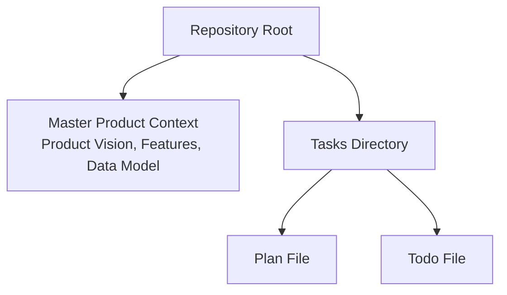

**Diagram sources**
- [Pujo_Sahayak_Master_Project_Context.md:1-10](file://Pujo_Sahayak_Master_Project_Context.md#L1-L10)
- [plan.md](file://tasks/plan.md)
- [todo.md](file://tasks/todo.md)

**Section sources**
- [Pujo_Sahayak_Master_Project_Context.md:1-10](file://Pujo_Sahayak_Master_Project_Context.md#L1-L10)
- [plan.md](file://tasks/plan.md)
- [todo.md](file://tasks/todo.md)

## Core Components
The subscription and feature gating system should be built around these core components:

- **User**: The authenticated person using the app.
- **Subscription**: The current plan state, including whether the user is free or premium.
- **Feature Flag**: A declarative configuration that marks a feature as free, premium, experimental, or partner-dependent.
- **Permission Checker**: A service that evaluates whether a user has access to a specific feature based on their subscription and role.
- **UI Gate**: A presentation-layer component that hides, locks, or upsells premium-only features.
- **Premium Feature Services**: Backend services for premium-only capabilities such as detailed itinerary planning, AI-assisted planning, advanced recommendations, and advanced meetups.

From the product context:
- Free tier supports basic discovery, saved places, and normal exploration.
- Premium tier supports multi-day itinerary planning, AI-assisted planning, potentially advanced recommendations, and potentially advanced meetup capabilities.
- The profile page exposes subscription information and a “Become a Premium Member” CTA.
- The data model explicitly includes `Subscription` and `Payment`.

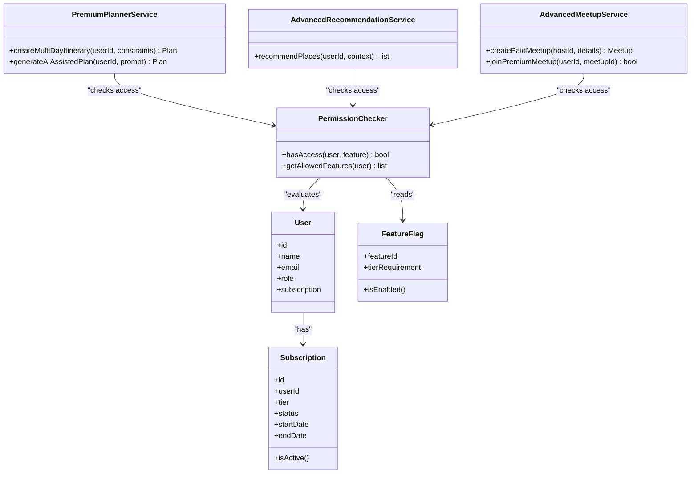

**Diagram sources**
- [Pujo_Sahayak_Master_Project_Context.md:1232-1255](file://Pujo_Sahayak_Master_Project_Context.md#L1232-L1255)
- [Pujo_Sahayak_Master_Project_Context.md:424-445](file://Pujo_Sahayak_Master_Project_Context.md#L424-L445)

**Section sources**
- [Pujo_Sahayak_Master_Project_Context.md:424-445](file://Pujo_Sahayak_Master_Project_Context.md#L424-L445)
- [Pujo_Sahayak_Master_Project_Context.md:954-976](file://Pujo_Sahayak_Master_Project_Context.md#L954-L976)
- [Pujo_Sahayak_Master_Project_Context.md:1232-1255](file://Pujo_Sahayak_Master_Project_Context.md#L1232-L1255)

## Architecture Overview
The recommended architecture separates concerns into layers:

- **Presentation Layer**: UI gates, locked states, and upgrade prompts.
- **Application Layer**: Feature flag evaluation, permission checks, and orchestration of premium services.
- **Domain Layer**: Business rules for subscriptions, roles, and feature entitlements.
- **Infrastructure Layer**: Storage for users, subscriptions, payments, and feature configurations.

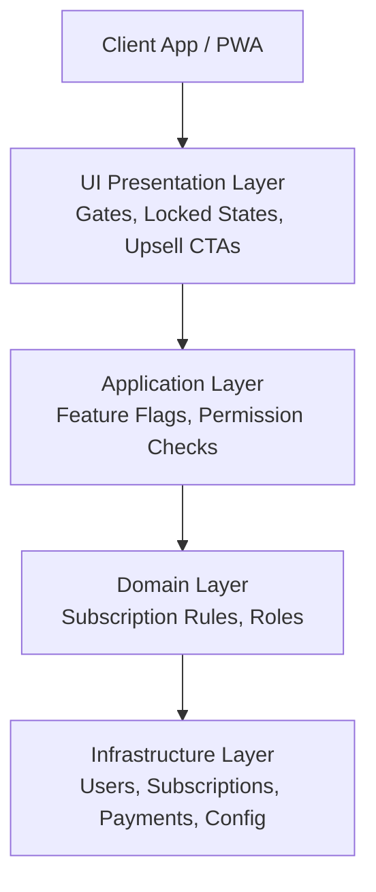

**Diagram sources**
- [Pujo_Sahayak_Master_Project_Context.md:1232-1255](file://Pujo_Sahayak_Master_Project_Context.md#L1232-L1255)
- [Pujo_Sahayak_Master_Project_Context.md:424-445](file://Pujo_Sahayak_Master_Project_Context.md#L424-L445)

## Detailed Component Analysis

### Free vs Premium Feature Differentiation
Free features include:
- Basic discovery of pandals, restaurants, events, and local places.
- Saved places and favorites.
- Normal exploration through Home, Search, Categories, and Place Details.
- Core navigation and safety utilities.

Premium features include:
- Multi-day itinerary planning.
- AI-assisted planning.
- Potentially advanced recommendations.
- Potentially advanced meetup capabilities.

The product context explicitly warns against hard-coding a large subscription system around assumptions. Instead, treat premium features as configurable entitlements.

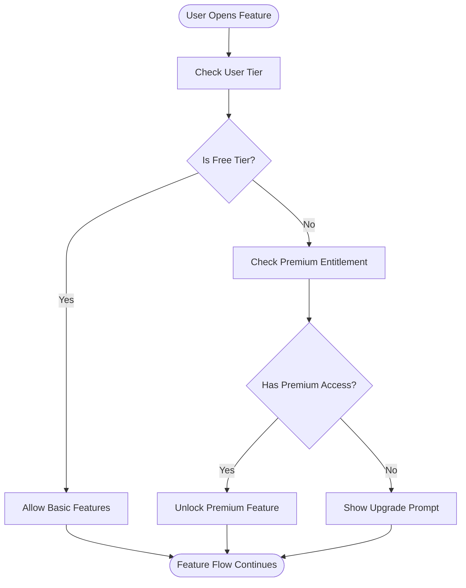

**Diagram sources**
- [Pujo_Sahayak_Master_Project_Context.md:424-445](file://Pujo_Sahayak_Master_Project_Context.md#L424-L445)

**Section sources**
- [Pujo_Sahayak_Master_Project_Context.md:424-445](file://Pujo_Sahayak_Master_Project_Context.md#L424-L445)

### Feature Access Control System
The feature access control system should enforce permissions at multiple points:

1. **UI Gate**: Hide or lock premium-only UI elements.
2. **Route Guard**: Prevent navigation to premium-only screens.
3. **API Guard**: Reject requests to premium endpoints if the user lacks entitlement.
4. **Service Guard**: Validate permissions before executing expensive or sensitive operations.

Recommended permission model:
- Each feature has a required tier: `free`, `premium`, or conditional.
- The `PermissionChecker` reads the user’s subscription and returns whether access is granted.
- Premium-only services should not execute unless the permission check passes.

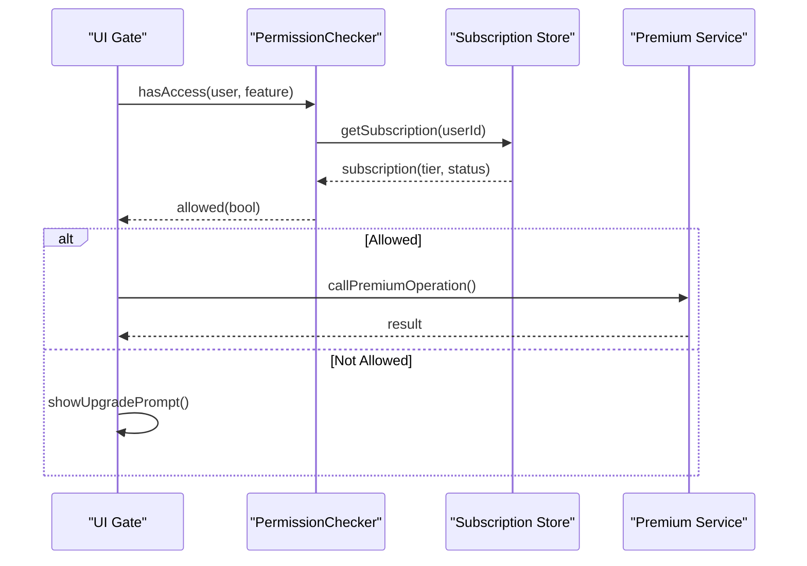

**Diagram sources**
- [Pujo_Sahayak_Master_Project_Context.md:1232-1255](file://Pujo_Sahayak_Master_Project_Context.md#L1232-L1255)
- [Pujo_Sahayak_Master_Project_Context.md:424-445](file://Pujo_Sahayak_Master_Project_Context.md#L424-L445)

**Section sources**
- [Pujo_Sahayak_Master_Project_Context.md:424-445](file://Pujo_Sahayak_Master_Project_Context.md#L424-L445)
- [Pujo_Sahayak_Master_Project_Context.md:1232-1255](file://Pujo_Sahayak_Master_Project_Context.md#L1232-L1255)

### User Role Management
While the product context emphasizes `User` and `Subscription`, it also mentions account-related settings such as privacy, security, notifications, language, and permissions. Role management should therefore support:

- **Anonymous User**: Limited discovery and public content.
- **Authenticated Free User**: Basic discovery, saved places, normal exploration.
- **Authenticated Premium User**: All free features plus premium entitlements.
- **Host or Organizer**: Ability to create meetups or manage community features where permitted.
- **Moderator or Admin**: Future capability for moderation, safety reporting, and platform governance.

Roles should be separate from subscription tiers:
- Subscription determines billing and entitlements.
- Role determines operational permissions.

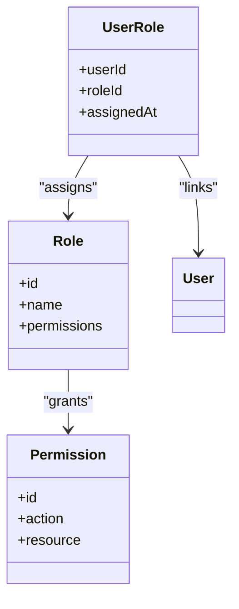

**Diagram sources**
- [Pujo_Sahayak_Master_Project_Context.md:1076-1090](file://Pujo_Sahayak_Master_Project_Context.md#L1076-L1090)
- [Pujo_Sahayak_Master_Project_Context.md:1232-1255](file://Pujo_Sahayak_Master_Project_Context.md#L1232-L1255)

**Section sources**
- [Pujo_Sahayak_Master_Project_Context.md:1076-1090](file://Pujo_Sahayak_Master_Project_Context.md#L1076-L1090)
- [Pujo_Sahayak_Master_Project_Context.md:1232-1255](file://Pujo_Sahayak_Master_Project_Context.md#L1232-L1255)

### Implementing Feature Flags
Feature flags should be:
- Declarative and centralized.
- Independent of hardcoded pricing logic.
- Evaluated by the permission layer.
- Visible to both backend and frontend for consistent behavior.

Recommended flag structure:
- `featureId`: Unique identifier for the feature.
- `tierRequirement`: Minimum tier required (`free`, `premium`).
- `enabled`: Whether the feature is currently active.
- `metadata`: Optional notes about rollout, experiments, or partner dependencies.

Example premium-only features:
- Detailed Puja planner with multi-day itineraries.
- AI-assisted planning via Maya.
- Advanced recommendations.
- Advanced or paid meetup capabilities.

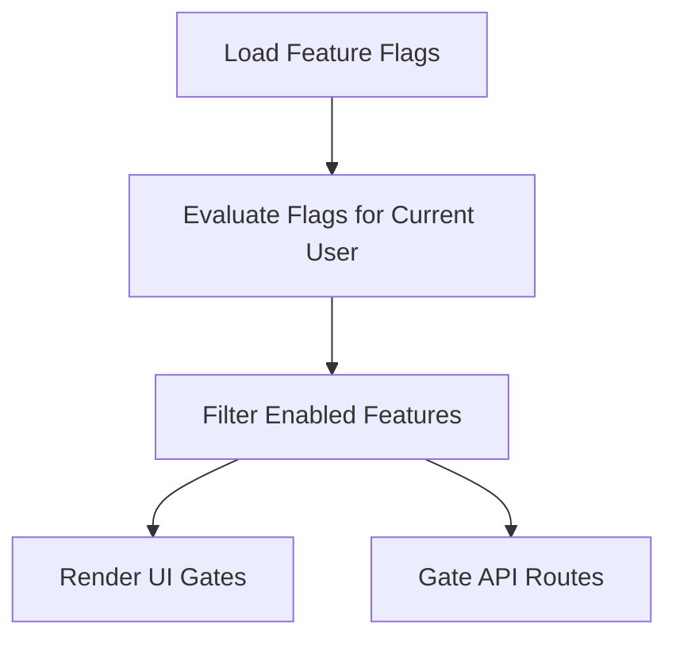

**Diagram sources**
- [Pujo_Sahayak_Master_Project_Context.md:424-445](file://Pujo_Sahayak_Master_Project_Context.md#L424-L445)

**Section sources**
- [Pujo_Sahayak_Master_Project_Context.md:424-445](file://Pujo_Sahayak_Master_Project_Context.md#L424-L445)

### Premium-Only Feature Examples

#### Detailed Puja Planner
- Supports multi-day itinerary construction.
- Can include pandals, restaurants, events, travel segments, and timings.
- Should be gated behind premium access.

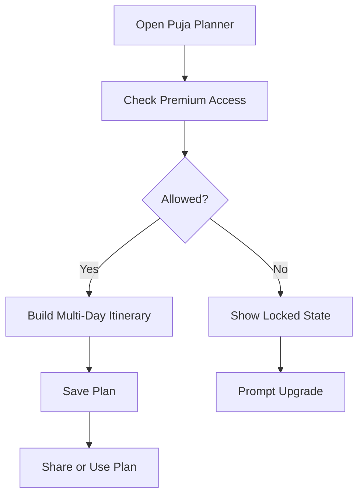

**Diagram sources**
- [Pujo_Sahayak_Master_Project_Context.md:353-402](file://Pujo_Sahayak_Master_Project_Context.md#L353-L402)
- [Pujo_Sahayak_Master_Project_Context.md:424-445](file://Pujo_Sahayak_Master_Project_Context.md#L424-L445)

**Section sources**
- [Pujo_Sahayak_Master_Project_Context.md:353-402](file://Pujo_Sahayak_Master_Project_Context.md#L353-L402)
- [Pujo_Sahayak_Master_Project_Context.md:424-445](file://Pujo_Sahayak_Master_Project_Context.md#L424-L445)

#### AI Planning Assistance
- Maya assists with natural-language planning.
- Inputs include location, distance, operating hours, crowd information, preferences, saved places, and available events.
- Generated plans must be presented as suggestions, not guaranteed optimal routes.

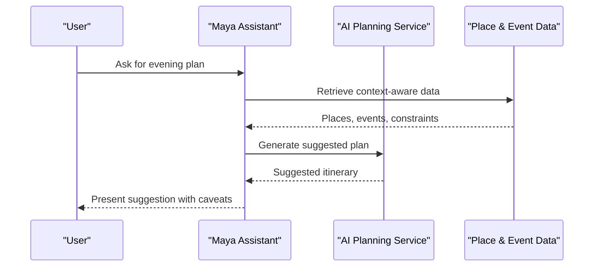

**Diagram sources**
- [Pujo_Sahayak_Master_Project_Context.md:404-422](file://Pujo_Sahayak_Master_Project_Context.md#L404-L422)
- [Pujo_Sahayak_Master_Project_Context.md:558-606](file://Pujo_Sahayak_Master_Project_Context.md#L558-L606)

**Section sources**
- [Pujo_Sahayak_Master_Project_Context.md:404-422](file://Pujo_Sahayak_Master_Project_Context.md#L404-L422)
- [Pujo_Sahayak_Master_Project_Context.md:558-606](file://Pujo_Sahayak_Master_Project_Context.md#L558-L606)

#### Advanced Meetup Capabilities
- Meetups can be free, paid, or premium-only.
- The architecture should support conceptually different meetup types without hard-coding one pricing model.
- Safety controls, moderation, and participant restrictions are important.

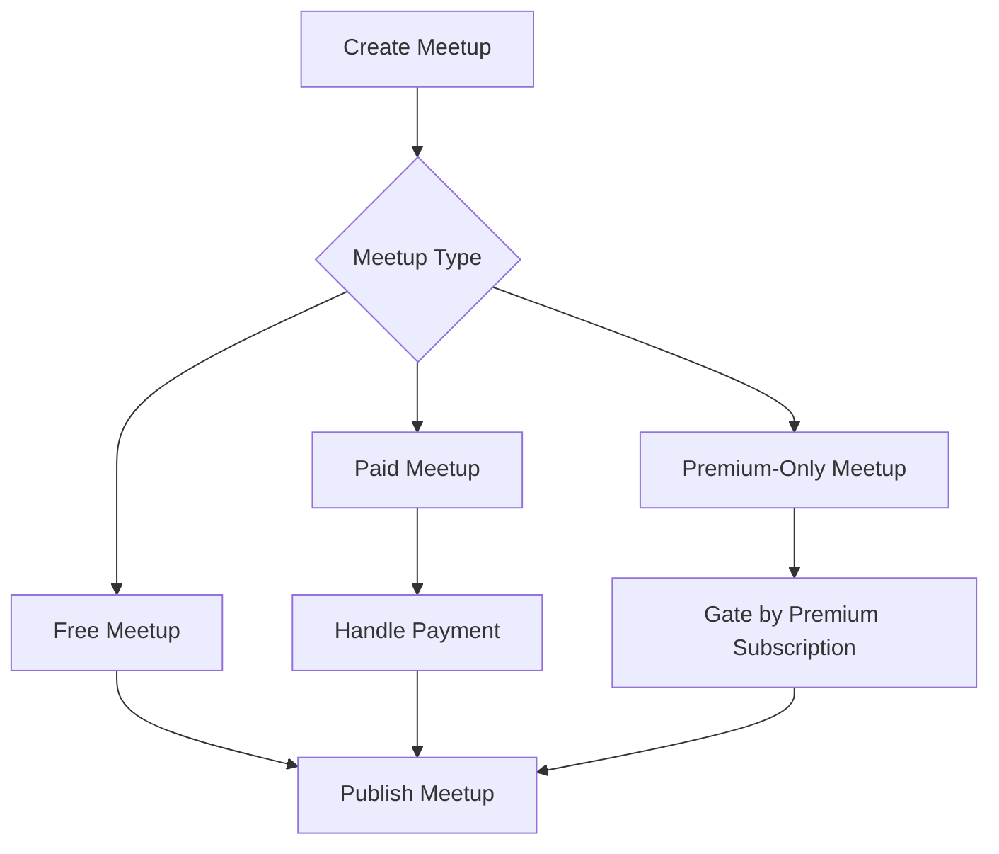

**Diagram sources**
- [Pujo_Sahayak_Master_Project_Context.md:753-772](file://Pujo_Sahayak_Master_Project_Context.md#L753-L772)
- [Pujo_Sahayak_Master_Project_Context.md:1441-1455](file://Pujo_Sahayak_Master_Project_Context.md#L1441-L1455)

**Section sources**
- [Pujo_Sahayak_Master_Project_Context.md:753-772](file://Pujo_Sahayak_Master_Project_Context.md#L753-L772)
- [Pujo_Sahayak_Master_Project_Context.md:1441-1455](file://Pujo_Sahayak_Master_Project_Context.md#L1441-L1455)

### Dynamic Enablement Without Hard-Coded Pricing Models
To avoid hard-coding pricing models:
- Treat pricing and entitlements as configuration rather than business logic.
- Use feature flags and subscription records to determine access.
- Keep UI gates and API guards aligned with the same permission model.
- Allow future changes such as new tiers, trials, partner-specific access, or regional rollouts.

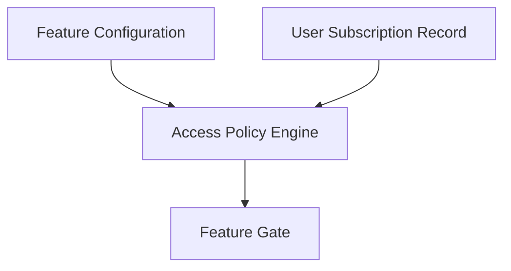

**Diagram sources**
- [Pujo_Sahayak_Master_Project_Context.md:424-445](file://Pujo_Sahayak_Master_Project_Context.md#L424-L445)
- [Pujo_Sahayak_Master_Project_Context.md:1232-1255](file://Pujo_Sahayak_Master_Project_Context.md#L1232-L1255)

**Section sources**
- [Pujo_Sahayak_Master_Project_Context.md:424-445](file://Pujo_Sahayak_Master_Project_Context.md#L424-L445)
- [Pujo_Sahayak_Master_Project_Context.md:1232-1255](file://Pujo_Sahayak_Master_Project_Context.md#L1232-L1255)

## Dependency Analysis
The subscription and feature gating system depends on:
- User identity and authentication.
- Subscription state and validity.
- Feature flag definitions.
- Premium service implementations.
- UI components that render locked or unlocked states.

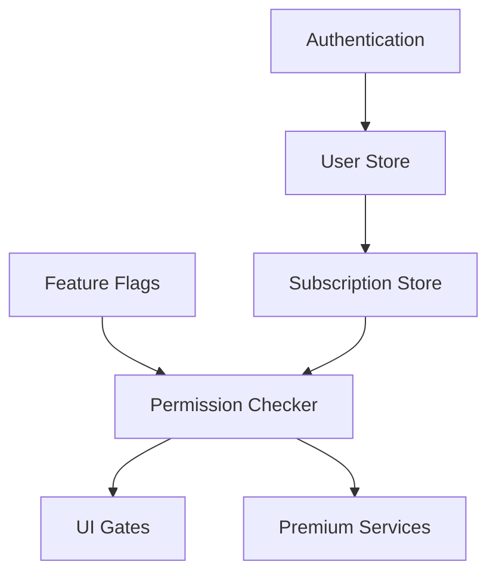

**Diagram sources**
- [Pujo_Sahayak_Master_Project_Context.md:1232-1255](file://Pujo_Sahayak_Master_Project_Context.md#L1232-L1255)
- [Pujo_Sahayak_Master_Project_Context.md:424-445](file://Pujo_Sahayak_Master_Project_Context.md#L424-L445)

**Section sources**
- [Pujo_Sahayak_Master_Project_Context.md:424-445](file://Pujo_Sahayak_Master_Project_Context.md#L424-L445)
- [Pujo_Sahayak_Master_Project_Context.md:1232-1255](file://Pujo_Sahayak_Master_Project_Context.md#L1232-L1255)

## Performance Considerations
- Cache feature flags and subscription status where appropriate to reduce repeated checks.
- Avoid expensive permission evaluations on every UI render; compute once per session or route change.
- Defer loading premium-only content until access is confirmed.
- Keep AI-assisted planning responses lightweight and clearly labeled as suggestions.
- Ensure that locked UI states do not trigger unnecessary network calls.

[No sources needed since this section provides general guidance]

## Troubleshooting Guide
Common issues and resolutions:

- **Premium feature visible to free users**:
  - Verify that the UI gate checks the permission result.
  - Confirm that the API guard rejects unauthorized requests.
  - Ensure feature flags are correctly configured.

- **Premium feature hidden for paying users**:
  - Check subscription status and expiration.
  - Verify that the permission checker reads the correct tier.
  - Confirm that the feature flag is enabled.

- **Inconsistent behavior between UI and API**:
  - Align permission logic across frontend and backend.
  - Use a shared permission model or contract.

- **Upgrade prompt not showing**:
  - Ensure the UI renders an upsell path when access is denied.
  - Confirm that the profile page exposes the “Become a Premium Member” CTA.

**Section sources**
- [Pujo_Sahayak_Master_Project_Context.md:954-976](file://Pujo_Sahayak_Master_Project_Context.md#L954-L976)
- [Pujo_Sahayak_Master_Project_Context.md:424-445](file://Pujo_Sahayak_Master_Project_Context.md#L424-L445)

## Conclusion
The subscription tier system for Pujo Sahayak should separate free and premium experiences cleanly while remaining flexible enough to evolve. Free users get core discovery, saved places, and normal exploration. Premium users gain advanced planning, AI-assisted planning, potentially advanced recommendations, and potentially advanced meetup capabilities.

The recommended approach uses:
- Centralized feature flags.
- A permission checker that evaluates subscription status.
- UI gates and API guards that consistently enforce access.
- A data model that includes `User`, `Subscription`, and `Payment`.
- Clear upgrade prompts and a profile-driven subscription experience.

This design avoids hard-coding pricing models, supports future tiers and experiments, and keeps the product focused on discovery, planning, understanding, experiencing, and remembering places.

[No sources needed since this section summarizes without analyzing specific files]