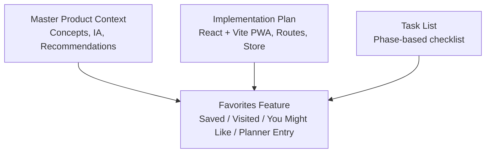
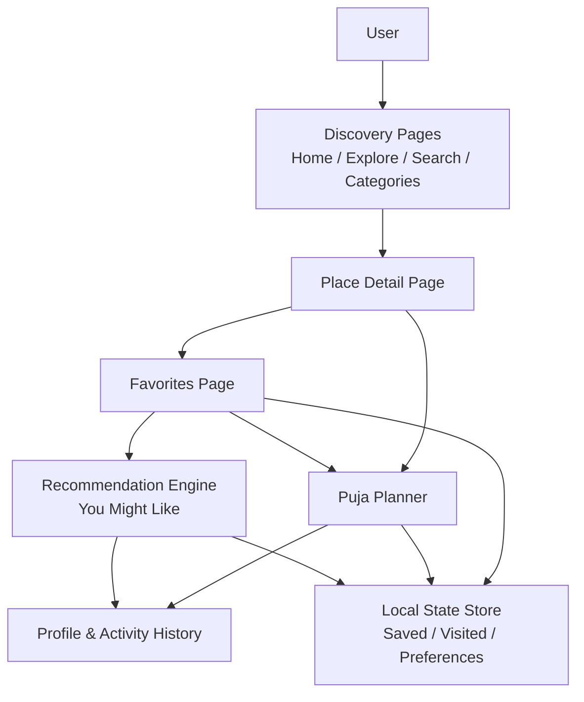
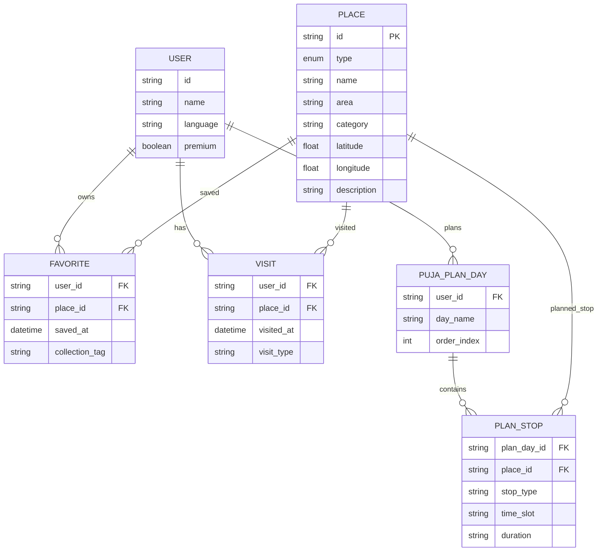
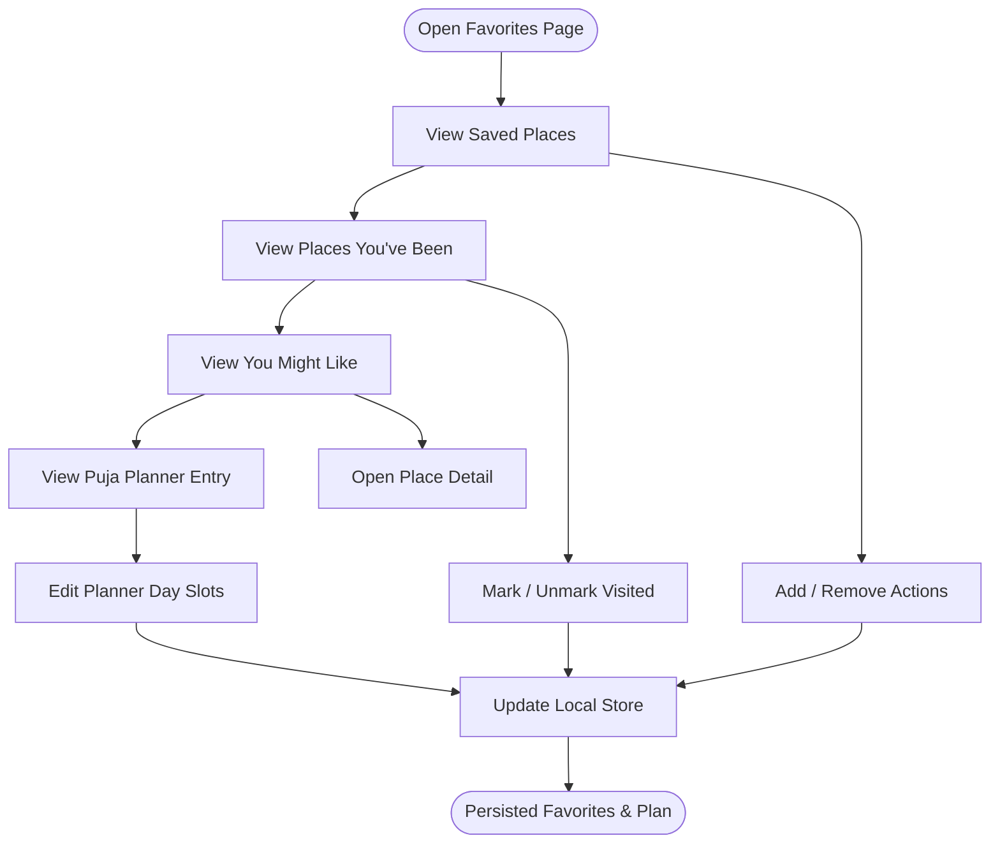
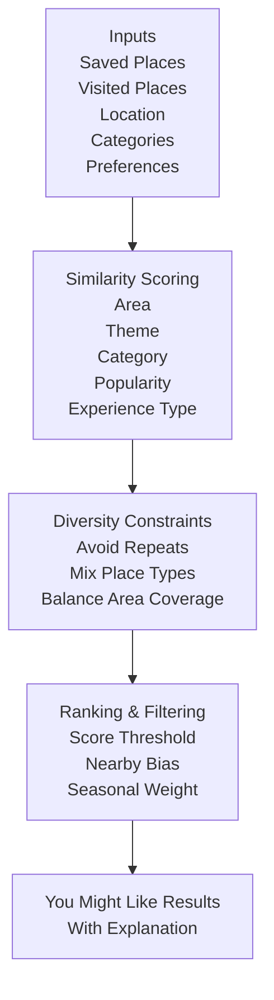
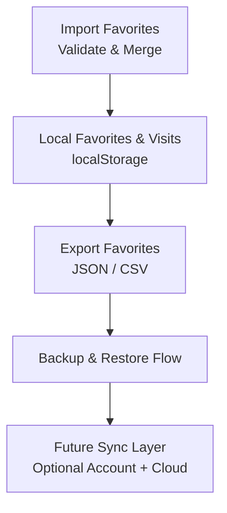
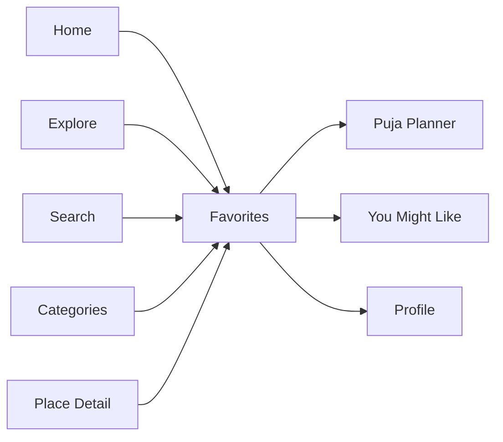

# Favorites Management

<cite>
**Referenced Files in This Document**
- [Pujo_Sahayak_Master_Project_Context.md](file://Pujo_Sahayak_Master_Project_Context.md)
- [plan.md](file://tasks/plan.md)
- [todo.md](file://tasks/todo.md)
</cite>

## Table of Contents
1. [Introduction](#introduction)
2. [Project Structure](#project-structure)
3. [Core Components](#core-components)
4. [Architecture Overview](#architecture-overview)
5. [Detailed Component Analysis](#detailed-component-analysis)
6. [Dependency Analysis](#dependency-analysis)
7. [Performance Considerations](#performance-considerations)
8. [Troubleshooting Guide](#troubleshooting-guide)
9. [Conclusion](#conclusion)
10. [Appendices](#appendices)

## Introduction
This document explains the Favorites Management system for Pujo Sahayak. It covers saved places, visited history, collection organization, categorization, UI interactions, and the “You Might Like” recommendation concept. It also outlines how favorites relate to planning, search, categories, profile activity, and future synchronization or backup strategies. The documentation is grounded in the project’s master context and implementation plan rather than assuming production backend behavior that does not exist yet.

## Project Structure
At this stage, the repository contains:
- A master product context describing features, navigation, data model concepts, and recommendations.
- An implementation plan describing a React + Vite PWA with local state persistence.
- A task list tracking feature phases, including Favorites as part of Phase 4.

**Diagram sources**
- [Pujo_Sahayak_Master_Project_Context.md:140-152](file://Pujo_Sahayak_Master_Project_Context.md#L140-L152)
- [plan.md:1-18](file://tasks/plan.md#L1-L18)
- [todo.md:45-55](file://tasks/todo.md#L45-L55)

**Section sources**
- [Pujo_Sahayak_Master_Project_Context.md:140-152](file://Pujo_Sahayak_Master_Project_Context.md#L140-L152)
- [plan.md:1-18](file://tasks/plan.md#L1-L18)
- [todo.md:45-55](file://tasks/todo.md#L45-L55)

## Core Components
The Favorites system includes four main areas:

- Saved Places
  - Explicitly saved items such as pandals, restaurants, events, or other local places.
  - Represented by user-driven save actions from discovery and detail pages.

- Places You’ve Been
  - Previously visited places across place types.
  - Tied to visit tracking and activity history.

- You Might Like
  - Recommendation section based on saved places, visited places, location, categories, preferences, and potentially AI-assisted suggestions.

- Puja Planner Integration
  - Favorites can be added into multi-day Puja plans.
  - Planner entries include stops, timing, and travel segments.

These components are explicitly listed in the master context and implemented as part of the planning phase.

**Section sources**
- [Pujo_Sahayak_Master_Project_Context.md:320-350](file://Pujo_Sahayak_Master_Project_Context.md#L320-L350)
- [Pujo_Sahayak_Master_Project_Context.md:353-401](file://Pujo_Sahayak_Master_Project_Context.md#L353-L401)
- [todo.md:45-55](file://tasks/todo.md#L45-L55)

## Architecture Overview
The Favorites system sits at the intersection of discovery, personal memory, planning, and recommendations.

**Diagram sources**
- [Pujo_Sahayak_Master_Project_Context.md:140-152](file://Pujo_Sahayak_Master_Project_Context.md#L140-L152)
- [Pujo_Sahayak_Master_Project_Context.md:320-350](file://Pujo_Sahayak_Master_Project_Context.md#L320-L350)
- [plan.md:1-18](file://tasks/plan.md#L1-L18)

## Detailed Component Analysis

### Favorites Data Model
The product context defines a broad data model where Place is a general entity specialized by Pandal, Restaurant, Event, and other local experiences. Favorites should therefore support multiple place types rather than being limited to pandals.

Key modeling considerations:
- Place base type with subtype specialization.
- Favorite entry linking a user to a place.
- Save timestamp for when a place was added to favorites.
- Visit record for previously visited places.
- Collection or organizational metadata such as tags, categories, or planner day slots.
- Category metadata enabling filtering and recommendations.

**Diagram sources**
- [Pujo_Sahayak_Master_Project_Context.md:1232-1260](file://Pujo_Sahayak_Master_Project_Context.md#L1232-L1260)
- [Pujo_Sahayak_Master_Project_Context.md:353-401](file://Pujo_Sahayak_Master_Project_Context.md#L353-L401)
- [plan.md:1-18](file://tasks/plan.md#L1-L18)

**Section sources**
- [Pujo_Sahayak_Master_Project_Context.md:1232-1260](file://Pujo_Sahayak_Master_Project_Context.md#L1232-L1260)
- [Pujo_Sahayak_Master_Project_Context.md:353-401](file://Pujo_Sahayak_Master_Project_Context.md#L353-L401)

### Favorites UI Components
The Favorites page is more than a simple bookmark list. It includes:
- Saved Pandals
- Places You’ve Been
- You Might Like
- Puja Planner entry card

UI operations should include:
- Add to favorites from discovery and detail pages.
- Remove from favorites.
- Mark as visited.
- Move saved places into planner day slots.
- Filter or search within saved items.
- Bulk actions such as removing multiple saved places or clearing visited history.

**Diagram sources**
- [Pujo_Sahayak_Master_Project_Context.md:320-350](file://Pujo_Sahayak_Master_Project_Context.md#L320-L350)
- [todo.md:45-55](file://tasks/todo.md#L45-L55)

**Section sources**
- [Pujo_Sahayak_Master_Project_Context.md:320-350](file://Pujo_Sahayak_Master_Project_Context.md#L320-L350)
- [todo.md:45-55](file://tasks/todo.md#L45-L55)

### Recommendation Engine: “You Might Like”
The “You Might Like” section is driven by:
- Saved places
- Visited places
- Location
- Categories
- Preferences
- Potentially AI-assisted recommendations

The master context emphasizes understandable explanations and avoids absolute claims about what users will enjoy.

**Diagram sources**
- [Pujo_Sahayak_Master_Project_Context.md:320-350](file://Pujo_Sahayak_Master_Project_Context.md#L320-L350)
- [Pujo_Sahayak_Master_Project_Context.md:895-910](file://Pujo_Sahayak_Master_Project_Context.md#L895-L910)
- [Pujo_Sahayak_Master_Project_Context.md:1263-1295](file://Pujo_Sahayak_Master_Project_Context.md#L1263-L1295)

#### Similarity Scoring Logic
A practical scoring approach can combine:
- Same area or nearby distance.
- Same theme or category.
- Similar popularity signals such as views, saves, visits, or engagement.
- Similar experience type (e.g., traditional vs modern, food vs cultural).

Scores should be normalized and combined with weights that can evolve over time.

#### Diversity Constraints
To avoid repetitive suggestions:
- Limit repeated place types in a single result set.
- Spread results across different areas when possible.
- Avoid suggesting already saved or recently visited places unless explicitly requested.
- Balance between high-confidence matches and exploratory options.

#### Explanation Requirements
Recommendations should explain why a place is suggested, using plain language tied to user behavior and place attributes.

**Section sources**
- [Pujo_Sahayak_Master_Project_Context.md:320-350](file://Pujo_Sahayak_Master_Project_Context.md#L320-L350)
- [Pujo_Sahayak_Master_Project_Context.md:895-910](file://Pujo_Sahayak_Master_Project_Context.md#L895-L910)
- [Pujo_Sahayak_Master_Project_Context.md:1263-1295](file://Pujo_Sahayak_Master_Project_Context.md#L1263-L1295)

### Favorites Synchronization, Import/Export, and Backup Strategy
Current implementation guidance indicates:
- Client-side store backed by localStorage.
- No authentication layer in v1.
- Demo data and local-only state.

Therefore, cross-device synchronization, import/export, and cloud backup are not implemented yet. They should be treated as future architectural extensions.

Recommended strategy:
- Keep local-first storage for offline resilience.
- Introduce an optional account layer later if sync is required.
- Export favorites and visits as structured JSON or CSV.
- Import from exported files to restore state.
- Provide manual backup and restore flows before introducing automatic cloud sync.
- Clearly mark any sync or backup behavior as experimental until fully implemented.

**Diagram sources**
- [plan.md:1-18](file://tasks/plan.md#L1-L18)
- [plan.md:81-86](file://tasks/plan.md#L81-L86)

**Section sources**
- [plan.md:1-18](file://tasks/plan.md#L1-L18)
- [plan.md:81-86](file://tasks/plan.md#L81-L86)

## Dependency Analysis
Favorites depend on several parts of the application:

- Discovery surfaces provide places to save.
- Place detail pages provide save, visit, and similar-place actions.
- Planner consumes saved places to build itineraries.
- Profile aggregates activity history including favorites and visits.
- Recommendations consume saved and visited data plus contextual signals.

**Diagram sources**
- [Pujo_Sahayak_Master_Project_Context.md:140-152](file://Pujo_Sahayak_Master_Project_Context.md#L140-L152)
- [Pujo_Sahayak_Master_Project_Context.md:320-350](file://Pujo_Sahayak_Master_Project_Context.md#L320-L350)
- [plan.md:19-39](file://tasks/plan.md#L19-L39)

**Section sources**
- [Pujo_Sahayak_Master_Project_Context.md:140-152](file://Pujo_Sahayak_Master_Project_Context.md#L140-L152)
- [Pujo_Sahayak_Master_Project_Context.md:320-350](file://Pujo_Sahayak_Master_Project_Context.md#L320-L350)
- [plan.md:19-39](file://tasks/plan.md#L19-L39)

## Performance Considerations
- Keep favorites and visited lists lightweight for mobile rendering.
- Avoid recomputing recommendations on every render; cache results per user session or preference change.
- Use efficient filtering for saved-item search and bulk operations.
- Defer heavy similarity calculations until needed, such as when opening the Favorites page or triggering refresh.
- Respect reduced-motion preferences for smooth but non-distracting transitions.

[No sources needed since this section provides general guidance]

## Troubleshooting Guide
Common issues and resolutions:

- Favorites disappear after reload
  - Verify localStorage persistence and Zustand persist middleware usage.
  - Confirm that saved and visited state is written on add/remove actions.

- Recommendations feel repetitive
  - Check diversity constraints in the “You Might Like” logic.
  - Ensure already saved or visited places are excluded unless intended.

- Planner cannot use saved places
  - Confirm that saved places are correctly linked to place IDs used by the planner.
  - Validate day-slot ordering and stop metadata.

- Search inside favorites returns no results
  - Ensure search filters operate on saved item metadata such as name, area, category, and tags.

- Offline behavior breaks favorites
  - Verify that the app shell and local store remain functional without network access.

**Section sources**
- [plan.md:1-18](file://tasks/plan.md#L1-L18)
- [todo.md:45-55](file://tasks/todo.md#L45-L55)

## Conclusion
The Favorites Management system is a core personal-memory and planning feature for Pujo Sahayak. It supports saved places, visited history, collection organization, and personalized recommendations. The current implementation is local-first, with favorites stored in client state and persisted via localStorage. The “You Might Like” engine should start simple, focusing on area, theme, category, and user behavior while enforcing diversity to avoid repetitive suggestions. Cross-device synchronization, import/export, and backup strategies should be designed as future enhancements rather than assumed capabilities.

[No sources needed since this section summarizes without analyzing specific files]

## Appendices

### Implementation Checklist for Favorites
- Implement Saved Pandals and broader place-type saves.
- Implement Places You’ve Been with visit tracking.
- Implement You Might Like with simple similarity and explanation.
- Connect Favorites to Puja Planner day slots.
- Persist all favorite and visit state locally.
- Prepare architecture for future sync and backup.

**Section sources**
- [todo.md:45-55](file://tasks/todo.md#L45-L55)
- [plan.md:1-18](file://tasks/plan.md#L1-L18)