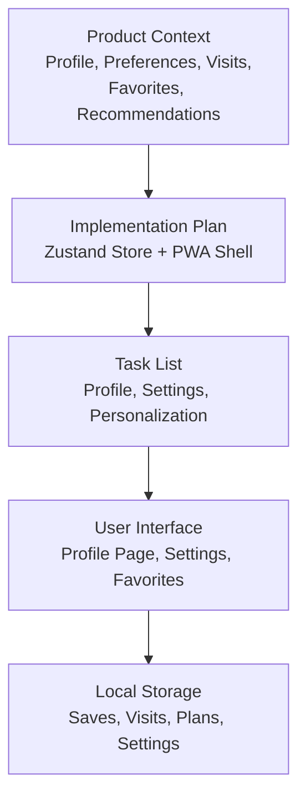
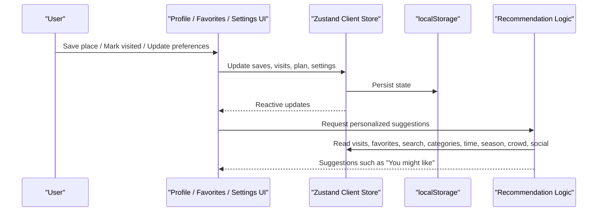
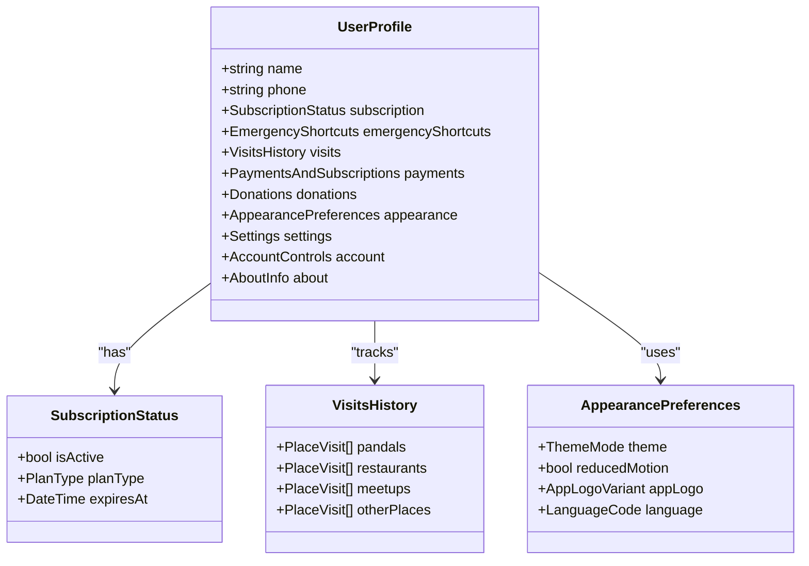
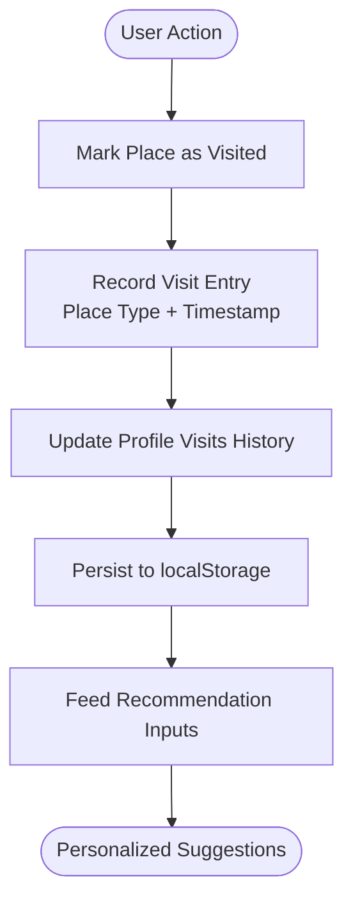
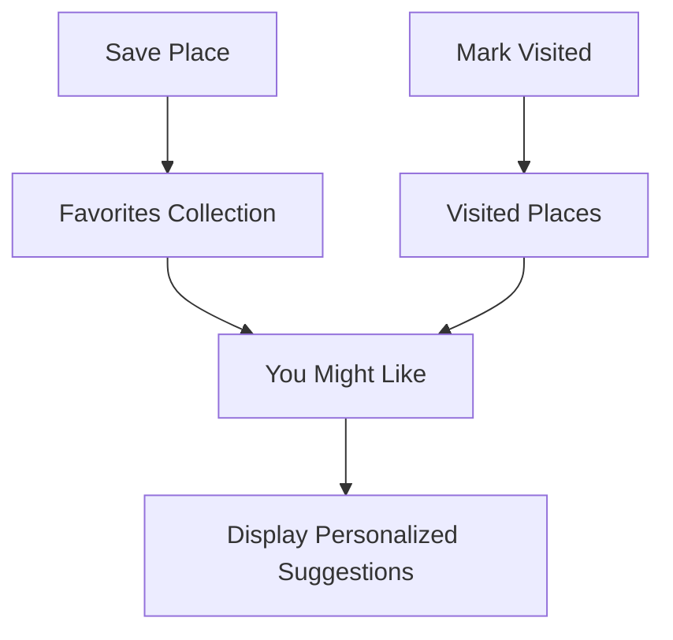
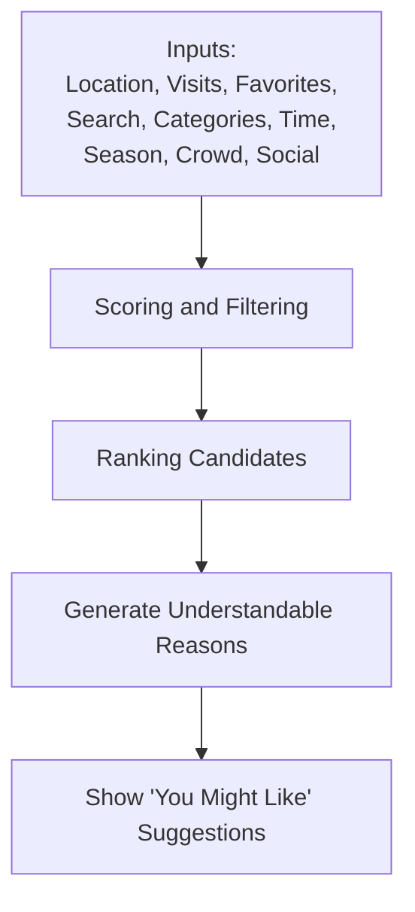
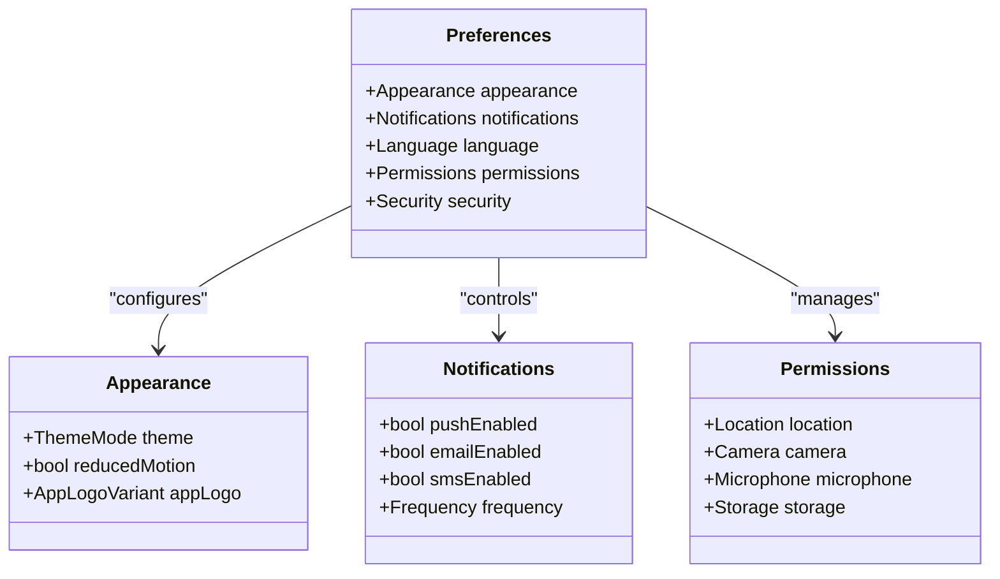
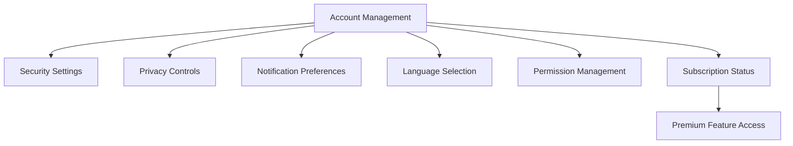
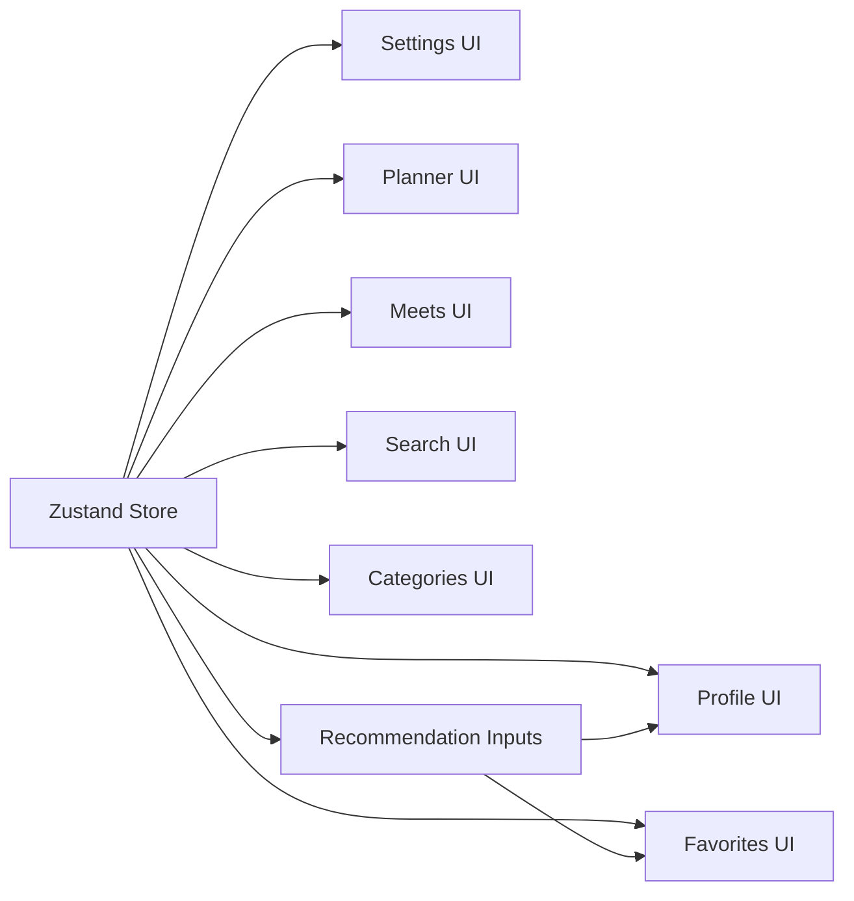

# Personalization and Profile Management

<cite>
**Referenced Files in This Document**
- [Pujo_Sahayak_Master_Project_Context.md](file://Pujo_Sahayak_Master_Project_Context.md)
- [plan.md](file://tasks/plan.md)
- [todo.md](file://tasks/todo.md)
</cite>

## Table of Contents
1. [Introduction](#introduction)
2. [Project Structure](#project-structure)
3. [Core Components](#core-components)
4. [Architecture Overview](#architecture-overview)
5. [Detailed Component Analysis](#detailed-component-analysis)
6. [Dependency Analysis](#dependency-analysis)
7. [Performance Considerations](#performance-considerations)
8. [Troubleshooting Guide](#troubleshooting-guide)
9. [Conclusion](#conclusion)

## Introduction
This document explains the Personalization and Profile Management system for Pujo Sahayak. It focuses on:
- User profile structure, including statistics tracking, premium status indicators, and preference settings for language, appearance, notifications, permissions, and account controls.
- Visit tracking across pandals, restaurants, events, and other local places.
- Favorites management, including saved places, curated collections such as a multi-day Puja plan, and personalized recommendations.
- Preference learning that adapts recommendations based on saved places, visited locations, search patterns, categories, time, season, crowd signals, and social activity.
- Data privacy controls, export considerations, and account management features such as security settings and subscription status.

The product is a mobile-first web application/PWA built with React, TypeScript, Vite, Zustand, Tailwind CSS, Framer Motion, and Leaflet. The personalization and profile features are part of the locked core and designed screens, while some advanced capabilities remain evolving or experimental.

**Section sources**
- [Pujo_Sahayak_Master_Project_Context.md:104-122](file://Pujo_Sahayak_Master_Project_Context.md#L104-L122)
- [Pujo_Sahayak_Master_Project_Context.md:140-158](file://Pujo_Sahayak_Master_Project_Context.md#L140-L158)
- [Pujo_Sahayak_Master_Project_Context.md:954-1090](file://Pujo_Sahayak_Master_Project_Context.md#L954-L1090)
- [plan.md:1-18](file://tasks/plan.md#L1-L18)
- [todo.md:60-75](file://tasks/todo.md#L60-L75)

## Project Structure
Personalization and profile-related responsibilities are spread across product context, implementation planning, and task breakdown:

- Product context defines profile sections, preferences, visits, favorites, recommendations, and account controls.
- Implementation plan describes the client store for user state, including saved places, visited places, plans, meetups, language, theme, logo choice, and session continuity.
- Task list enumerates profile, settings, personalization, and off-season continuation tasks.

**Diagram sources**
- [Pujo_Sahayak_Master_Project_Context.md:954-1090](file://Pujo_Sahayak_Master_Project_Context.md#L954-L1090)
- [plan.md:1-18](file://tasks/plan.md#L1-L18)
- [todo.md:60-75](file://tasks/todo.md#L60-L75)

**Section sources**
- [Pujo_Sahayak_Master_Project_Context.md:954-1090](file://Pujo_Sahayak_Master_Project_Context.md#L954-L1090)
- [plan.md:1-18](file://tasks/plan.md#L1-L18)
- [todo.md:60-75](file://tasks/todo.md#L60-L75)

## Core Components
The personalization and profile system includes these core components:

- **User Profile**: Central control center showing name, phone, subscription status, emergency shortcuts, payments, donations, personalization, and account settings.
- **Visit Tracking**: Unified activity history grouped by type, such as pandals, restaurants, and meetups.
- **Favorites Management**: Saved places, previously visited places, and recommendation surfaces like “You might like.”
- **Preference Learning Engine Inputs**: Location, previous visits, favorites, search activity, categories, time, season, crowd, and social activity.
- **Account Controls**: Privacy, security, notifications, language, and permissions.
- **Premium Status Indicators**: Subscription banner and upgrade prompts within the profile.

These components align with the product’s emphasis on memory, continuity, discovery, planning, community, safety, and off-season relevance.

**Section sources**
- [Pujo_Sahayak_Master_Project_Context.md:954-1090](file://Pujo_Sahayak_Master_Project_Context.md#L954-L1090)
- [Pujo_Sahayak_Master_Project_Context.md:1232-1287](file://Pujo_Sahayak_Master_Project_Context.md#L1232-L1287)
- [plan.md:1-18](file://tasks/plan.md#L1-L18)

## Architecture Overview
At a high level, the personalization and profile system connects user actions to persistent state and recommendation logic:

**Diagram sources**
- [plan.md:1-18](file://tasks/plan.md#L1-L18)
- [Pujo_Sahayak_Master_Project_Context.md:320-350](file://Pujo_Sahayak_Master_Project_Context.md#L320-L350)
- [Pujo_Sahayak_Master_Project_Context.md:1263-1287](file://Pujo_Sahayak_Master_Project_Context.md#L1263-L1287)

## Detailed Component Analysis

### User Profile Structure
The profile page acts as the user’s personal control center. It displays:
- Basic identity fields such as name and phone.
- Subscription status and an upgrade call-to-action.
- Emergency shortcuts for quick access to help services.
- Navigation to visits, payments and subscriptions, donations, appearance, settings, account, and about sections.

Statistics tracking is represented through profile entries such as visits, saved items, and meetup participation. Premium status is indicated via a badge or banner and can be used to gate advanced features like detailed itinerary planning.

**Diagram sources**
- [Pujo_Sahayak_Master_Project_Context.md:954-1090](file://Pujo_Sahayak_Master_Project_Context.md#L954-L1090)
- [todo.md:60-75](file://tasks/todo.md#L60-L75)

**Section sources**
- [Pujo_Sahayak_Master_Project_Context.md:954-1090](file://Pujo_Sahayak_Master_Project_Context.md#L954-L1090)
- [todo.md:60-75](file://tasks/todo.md#L60-L75)

### Visit Tracking System
Visit tracking records previously visited places across multiple types:
- Pandals
- Restaurants
- Events
- Other local experiences

The profile provides a unified activity history with tabs or sections for different visit types. This supports continuity, memory, and later personalization.

**Diagram sources**
- [Pujo_Sahayak_Master_Project_Context.md:320-350](file://Pujo_Sahayak_Master_Project_Context.md#L320-L350)
- [Pujo_Sahayak_Master_Project_Context.md:978-992](file://Pujo_Sahayak_Master_Project_Context.md#L978-L992)
- [Pujo_Sahayak_Master_Project_Context.md:1263-1287](file://Pujo_Sahayak_Master_Project_Context.md#L1263-L1287)

**Section sources**
- [Pujo_Sahayak_Master_Project_Context.md:320-350](file://Pujo_Sahayak_Master_Project_Context.md#L320-L350)
- [Pujo_Sahayak_Master_Project_Context.md:978-992](file://Pujo_Sahayak_Master_Project_Context.md#L978-L992)

### Favorites Management System
Favorites include:
- Saved places explicitly bookmarked by the user.
- Places the user has been to.
- A recommendation section labeled “You might like,” grounded in saved places, visited places, location, categories, preferences, and potentially AI-assisted suggestions.

The system also supports curated collections such as a multi-day Puja plan, which can contain pandals, restaurants, events, attractions, travel segments, and approximate timings.

**Diagram sources**
- [Pujo_Sahayak_Master_Project_Context.md:320-350](file://Pujo_Sahayak_Master_Project_Context.md#L320-L350)
- [Pujo_Sahayak_Master_Project_Context.md:353-421](file://Pujo_Sahayak_Master_Project_Context.md#L353-L421)

**Section sources**
- [Pujo_Sahayak_Master_Project_Context.md:320-350](file://Pujo_Sahayak_Master_Project_Context.md#L320-L350)
- [Pujo_Sahayak_Master_Project_Context.md:353-421](file://Pujo_Sahayak_Master_Project_Context.md#L353-L421)

### Preference Learning and Recommendations
Recommendations adapt based on:
- Location
- Previous visits
- Favorites
- Search activity
- Categories
- Time
- Season
- Crowd signals
- Social activity

The system should present understandable explanations for suggestions, avoiding absolute claims. For example, if a user liked traditional pandals, nearby heritage-style places may be suggested.

**Diagram sources**
- [Pujo_Sahayak_Master_Project_Context.md:1263-1287](file://Pujo_Sahayak_Master_Project_Context.md#L1263-L1287)

**Section sources**
- [Pujo_Sahayak_Master_Project_Context.md:1263-1287](file://Pujo_Sahayak_Master_Project_Context.md#L1263-L1287)

### Preference Settings: Language, Appearance, Notifications, Permissions
Profile and settings support:
- Appearance options such as light mode, dark mode, system default, and reduced motion.
- App logo customization.
- Account controls including privacy, security, notifications, language, and permissions.
- Language selection for multilingual interaction.

These preferences persist in the client store and affect UI rendering, accessibility, and assistant behavior.

**Diagram sources**
- [Pujo_Sahayak_Master_Project_Context.md:1055-1090](file://Pujo_Sahayak_Master_Project_Context.md#L1055-L1090)
- [plan.md:1-18](file://tasks/plan.md#L1-L18)
- [todo.md:60-75](file://tasks/todo.md#L60-L75)

**Section sources**
- [Pujo_Sahayak_Master_Project_Context.md:1055-1090](file://Pujo_Sahayak_Master_Project_Context.md#L1055-L1090)
- [plan.md:1-18](file://tasks/plan.md#L1-L18)
- [todo.md:60-75](file://tasks/todo.md#L60-L75)

### Data Privacy Controls and Export Capabilities
Privacy controls should be easy to find because the application handles location, photographs, and potentially meetup information. The product emphasizes clear privacy and security settings.

Export capabilities are not explicitly defined in the provided materials. As a best practice, consider allowing users to export their personal data, including:
- Saved places
- Visited places
- Puja plans
- Preferences
- Meetup participation
- Uploaded photos metadata

Export should respect user consent, allow selective export, and provide machine-readable formats where appropriate.

**Section sources**
- [Pujo_Sahayak_Master_Project_Context.md:1076-1090](file://Pujo_Sahayak_Master_Project_Context.md#L1076-L1090)

### Account Management Features: Security and Subscription Status
Account management includes:
- Security settings
- Privacy controls
- Notification preferences
- Language selection
- Permission management
- Subscription status and upgrade prompts

Premium features may include advanced planning, AI-assisted planning, advanced recommendations, and potentially advanced meetup capabilities. The exact premium feature list is evolving and should not be hard-coded prematurely.

**Diagram sources**
- [Pujo_Sahayak_Master_Project_Context.md:1076-1090](file://Pujo_Sahayak_Master_Project_Context.md#L1076-L1090)
- [Pujo_Sahayak_Master_Project_Context.md:424-444](file://Pujo_Sahayak_Master_Project_Context.md#L424-L444)

**Section sources**
- [Pujo_Sahayak_Master_Project_Context.md:424-444](file://Pujo_Sahayak_Master_Project_Context.md#L424-L444)
- [Pujo_Sahayak_Master_Project_Context.md:1076-1090](file://Pujo_Sahayak_Master_Project_Context.md#L1076-L1090)

## Dependency Analysis
Personalization and profile features depend on several interconnected parts of the product:

- **Client Store**: Zustand persists saves, visits, plans, meetups, language, theme, logo choice, and session continuity.
- **Data Model**: The broader model includes User, Place, Pandal, Restaurant, Event, Meetup, Review, Photo, Trip, Category, Offer, Subscription, Payment, SafetyPoint, EmergencyReport, and Recommendation.
- **UI Screens**: Profile, Favorites, Settings, Planner, Meets, Search, and Categories all read from and write to the same state.
- **Recommendation Inputs**: Visits, favorites, search, categories, time, season, crowd, and social activity inform personalized suggestions.

**Diagram sources**
- [plan.md:1-18](file://tasks/plan.md#L1-L18)
- [Pujo_Sahayak_Master_Project_Context.md:1232-1287](file://Pujo_Sahayak_Master_Project_Context.md#L1232-L1287)

**Section sources**
- [plan.md:1-18](file://tasks/plan.md#L1-L18)
- [Pujo_Sahayak_Master_Project_Context.md:1232-1287](file://Pujo_Sahayak_Master_Project_Context.md#L1232-L1287)

## Performance Considerations
- Keep recommendation logic lightweight during development; start with simple similarity rules before introducing heavier algorithms.
- Persist only necessary user state to localStorage to avoid large payloads.
- Avoid fabricating statistics or reviews; use real dataset values and clearly mark demo data.
- Honor reduced-motion preferences to improve accessibility and performance on lower-end devices.
- Cache frequently accessed preference and profile data locally to reduce re-computation.

[No sources needed since this section provides general guidance]

## Troubleshooting Guide
Common issues and resolutions:

- **Preferences not persisting**: Verify Zustand persistence middleware and localStorage availability. Ensure theme, language, logo, and reduced-motion toggles update the store and survive reloads.
- **Recommendations not updating**: Confirm that saves, visits, search activity, and category interactions are recorded in the store and consumed by recommendation inputs.
- **Profile statistics incorrect**: Validate that visit tracking increments counts per place type and that favorites reflect actual saved items.
- **Premium features unexpectedly available or blocked**: Check subscription status flags and ensure premium gating is not hard-coded beyond the intended evolving design.
- **Privacy controls unclear**: Make sure privacy, security, notifications, language, and permissions are easily reachable from the profile and settings pages.

**Section sources**
- [plan.md:60-86](file://tasks/plan.md#L60-L86)
- [todo.md:60-81](file://tasks/todo.md#L60-L81)
- [Pujo_Sahayak_Master_Project_Context.md:1055-1090](file://Pujo_Sahayak_Master_Project_Context.md#L1055-L1090)

## Conclusion
The Personalization and Profile Management system centers the user’s journey around memory, continuity, and tailored discovery. Profile structure captures identity, subscription status, emergency shortcuts, and preference controls. Visit tracking unifies activity across pandals, restaurants, events, and other places. Favorites management supports saved places, visited places, curated plans, and personalized recommendations. Preference learning uses location, visits, favorites, search, categories, time, season, crowd, and social signals to suggest relevant places. Privacy controls and account management keep the experience safe, transparent, and user-controlled. As the platform evolves beyond Puja, these personalization foundations continue to support Kolkata’s broader local-discovery ecosystem.

[No sources needed since this section summarizes without analyzing specific files]