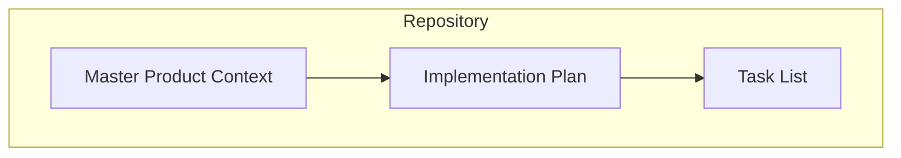
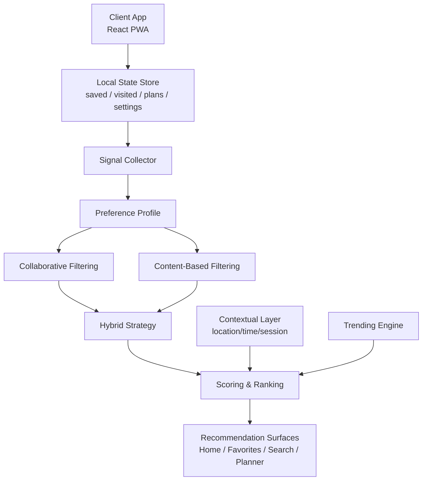
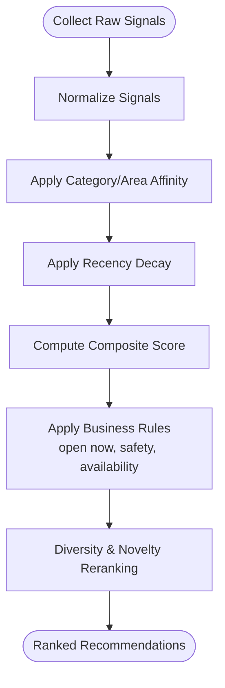
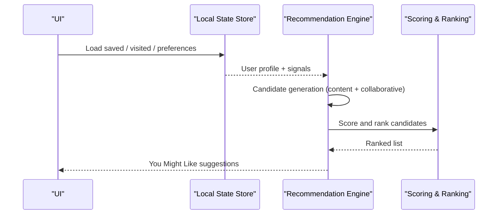
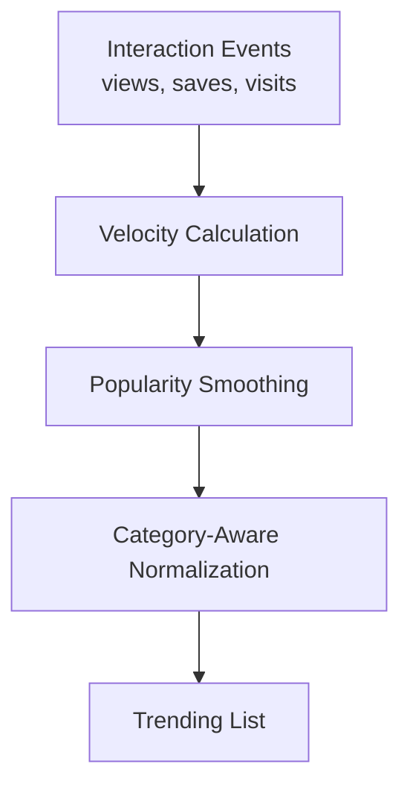
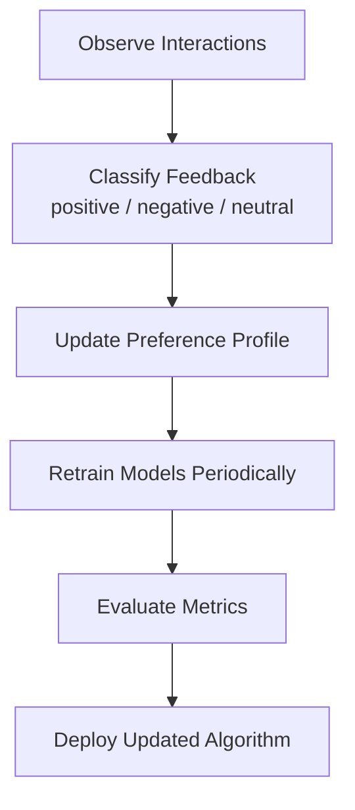
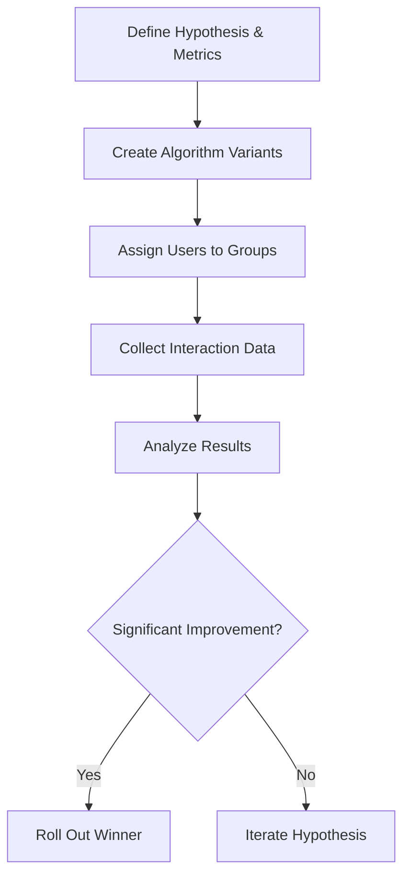
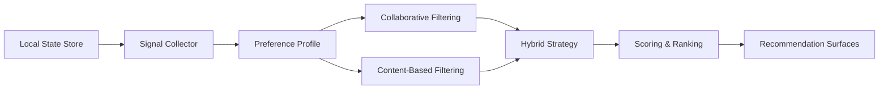

# Preference Learning Algorithms

<cite>
**Referenced Files in This Document**
- [Pujo_Sahayak_Master_Project_Context.md](file://Pujo_Sahayak_Master_Project_Context.md)
- [tasks/plan.md](file://tasks/plan.md)
- [tasks/todo.md](file://tasks/todo.md)
</cite>

## Table of Contents
1. [Introduction](#introduction)
2. [Project Structure](#project-structure)
3. [Core Components](#core-components)
4. [Architecture Overview](#architecture-overview)
5. [Detailed Component Analysis](#detailed-component-analysis)
6. [Dependency Analysis](#dependency-analysis)
7. [Performance Considerations](#performance-considerations)
8. [Troubleshooting Guide](#troubleshooting-guide)
9. [Conclusion](#conclusion)
10. [Appendices](#appendices)

## Introduction
This document defines the preference learning and recommendation strategy for Pujo Sahayak, a mobile-first local discovery app centered on Durga Puja with broader utility beyond the festival season. The goal is to explain how user signals such as saved places, visited locations, search patterns, and interaction history are transformed into personalized recommendations: “You Might Like” suggestions, trending place discovery, and contextual recommendations based on current location and time. It also documents feedback loops, cold-start handling, A/B testing approaches, privacy considerations, and user control over personalization settings.

The product context emphasizes a continuous journey from discovery through exploration, understanding, planning, visiting, sharing, meeting people, and discovering more. Personalization should feel like a digital companion rather than a generic directory or chatbot.

**Section sources**
- [Pujo_Sahayak_Master_Project_Context.md:1-18](file://Pujo_Sahayak_Master_Project_Context.md#L1-L18)
- [Pujo_Sahayak_Master_Project_Context.md:21-43](file://Pujo_Sahayak_Master_Project_Context.md#L21-L43)

## Project Structure
At this stage, the repository contains:
- A master product context document describing the product philosophy, navigation, screens, AI assistant behavior, social features, and monetization concepts.
- An implementation plan outlining phases, routes, tech stack, and verification criteria.
- A task list tracking feature delivery across foundation, discovery core, Maya + Search/Categories, planning & social, utility & account, and polish.

**Diagram sources**
- [Pujo_Sahayak_Master_Project_Context.md:1-18](file://Pujo_Sahayak_Master_Project_Context.md#L1-L18)
- [tasks/plan.md:1-18](file://tasks/plan.md#L1-L18)
- [tasks/todo.md:1-10](file://tasks/todo.md#L1-L10)

**Section sources**
- [Pujo_Sahayak_Master_Project_Context.md:1-18](file://Pujo_Sahayak_Master_Project_Context.md#L1-L18)
- [tasks/plan.md:1-18](file://tasks/plan.md#L1-L18)
- [tasks/todo.md:1-10](file://tasks/todo.md#L1-L10)

## Core Components
The preference learning system is built around these components:
- User Signal Collector: Captures explicit and implicit signals (saves, visits, searches, dwell time, route interactions).
- Preference Model: Aggregates signals into a per-user preference profile including categories, areas, themes, price tiers, crowd tolerance, and temporal preferences.
- Recommendation Engine: Produces candidate lists using collaborative filtering, content-based filtering, and hybrid strategies.
- Scoring and Ranking Module: Applies weights, recency decay, diversity, and business rules to rank candidates.
- Contextual Recommender: Adjusts results by current location, time of day, and active session context.
- Feedback Loop: Observes clicks, saves, visits, dismissals, and negative feedback to update the model.
- Cold Start Resolver: Uses popularity, area-based defaults, and onboarding questions for new users.
- Experimentation Layer: Supports A/B tests for algorithm variants and metrics.
- Privacy and Control: Provides opt-in controls, transparency, and data minimization.

These components align with the product’s emphasis on saving places, visiting them, planning multi-day itineraries, and continuing where the user left off.

**Section sources**
- [Pujo_Sahayak_Master_Project_Context.md:320-350](file://Pujo_Sahayak_Master_Project_Context.md#L320-L350)
- [Pujo_Sahayak_Master_Project_Context.md:286-318](file://Pujo_Sahayak_Master_Project_Context.md#L286-L318)
- [tasks/todo.md:45-55](file://tasks/todo.md#L45-L55)

## Architecture Overview
The recommendation architecture integrates user state, dataset-driven discovery, and contextual signals.

**Diagram sources**
- [tasks/plan.md:7-18](file://tasks/plan.md#L7-L18)
- [tasks/todo.md:45-55](file://tasks/todo.md#L45-L55)
- [Pujo_Sahayak_Master_Project_Context.md:320-350](file://Pujo_Sahayak_Master_Project_Context.md#L320-L350)

## Detailed Component Analysis

### Preference Scoring System
The scoring system converts raw user signals into a weighted score used to rank recommended places.

Signals and suggested weights:
- Save: strong positive intent; higher weight.
- Visit: strongest behavioral confirmation; highest weight.
- Search query match: moderate positive signal; decays faster.
- Click/view: weak positive signal; low weight.
- Dwell time on detail page: moderate positive signal; scaled by duration thresholds.
- Route inclusion: moderate positive signal; indicates planning intent.
- Dismissal/negative feedback: negative adjustment; reduces future ranking.
- Recency decay: recent interactions weigh more than older ones.
- Category affinity: boosts similar categories and areas.
- Temporal preference: adjusts ranking by time-of-day patterns.

A practical approach:
- Normalize each signal to a common scale.
- Apply category and area affinity modifiers.
- Apply recency decay function.
- Combine into a composite score.
- Apply business rules (e.g., open now, safety constraints).
- Re-rank with diversity and novelty constraints.

[No sources needed since this diagram shows conceptual workflow, not actual code structure]

**Section sources**
- [Pujo_Sahayak_Master_Project_Context.md:469-493](file://Pujo_Sahayak_Master_Project_Context.md#L469-L493)
- [tasks/todo.md:45-55](file://tasks/todo.md#L45-L55)

### Collaborative Filtering
Approach:
- Build a user-item interaction matrix from saves, visits, and route selections.
- Compute similarity between users using cosine similarity or item-based correlations.
- For a target user, aggregate items liked by similar users but not yet interacted with.
- Use popularity and recency to smooth noise for sparse data.

Data requirements:
- Anonymous user IDs or device-bound profiles.
- Interaction events with timestamps.
- Place metadata for grouping and filtering.

Cold start mitigation:
- Fall back to content-based and trending when interactions are too sparse.

**Section sources**
- [Pujo_Sahayak_Master_Project_Context.md:320-350](file://Pujo_Sahayak_Master_Project_Context.md#L320-L350)
- [tasks/todo.md:45-55](file://tasks/todo.md#L45-L55)

### Content-Based Filtering
Approach:
- Represent places by attributes: category, area, theme, cuisine type, price tier, facilities, crowd level, operating hours.
- Represent user preferences by aggregating attributes of saved and visited places.
- Score candidate places by attribute overlap and affinity strength.
- Boost area proximity and time-appropriate categories (e.g., restaurants near evening).

Strengths:
- Works well for cold start and niche interests.
- Transparent and explainable.

Limitations:
- May overfit to known preferences.
- Less serendipitous without diversity controls.

**Section sources**
- [Pujo_Sahayak_Master_Project_Context.md:495-556](file://Pujo_Sahayak_Master_Project_Context.md#L495-L556)
- [tasks/todo.md:45-55](file://tasks/todo.md#L45-L55)

### Hybrid Recommendation Strategy
Approach:
- Combine collaborative and content-based scores via weighted blending.
- Use collaborative filtering for generalization and content-based for specificity.
- Apply contextual adjustments (location, time, session context).
- Enforce diversity and novelty to avoid echo chambers.
- Incorporate trending signals for discoverability.

Blending options:
- Linear blend with tunable weights.
- Stacked model using meta-features (affinity, recency, popularity).
- Rule-based overrides for safety, availability, and business goals.

**Section sources**
- [Pujo_Sahayak_Master_Project_Context.md:320-350](file://Pujo_Sahayak_Master_Project_Context.md#L320-L350)
- [Pujo_Sahayak_Master_Project_Context.md:469-493](file://Pujo_Sahayak_Master_Project_Context.md#L469-L493)

### Personalized “You Might Like” Suggestions
Goal:
- Surface places likely to interest the user based on saved places, visited places, location, categories, and preferences.

Inputs:
- Saved places and visited places.
- Current location and nearby places.
- Categories and themes.
- Session context (e.g., planner day, selected area).

Algorithm outline:
- Generate candidate set from content-based affinity and collaborative neighbors.
- Score using preference weights and recency decay.
- Adjust for proximity and time relevance.
- Apply diversity and novelty filters.
- Present as “You might like” with transparent rationale.

**Diagram sources**
- [tasks/todo.md:45-55](file://tasks/todo.md#L45-L55)
- [Pujo_Sahayak_Master_Project_Context.md:320-350](file://Pujo_Sahayak_Master_Project_Context.md#L320-L350)

**Section sources**
- [Pujo_Sahayak_Master_Project_Context.md:320-350](file://Pujo_Sahayak_Master_Project_Context.md#L320-L350)
- [tasks/todo.md:45-55](file://tasks/todo.md#L45-L55)

### Trending Place Discovery
Definition:
- Trending reflects currently popular places based on views, saves, recent interactions, visits, and engagement.

Metrics:
- Velocity-weighted counts for recent activity.
- Popularity smoothing to avoid spikes from outliers.
- Category-aware normalization to compare within relevant groups.

Display guidance:
- Do not manufacture rankings unless underlying metrics exist.
- Clearly distinguish organic trends from sponsored content.

**Diagram sources**
- [Pujo_Sahayak_Master_Project_Context.md:469-493](file://Pujo_Sahayak_Master_Project_Context.md#L469-L493)

**Section sources**
- [Pujo_Sahayak_Master_Project_Context.md:469-493](file://Pujo_Sahayak_Master_Project_Context.md#L469-L493)

### Contextual Recommendations
Context inputs:
- Current location and radius.
- Time of day and day of week.
- Active session context (selected pandal, restaurant, trip day).
- Language and theme preferences.

Behavior:
- Boost nearby places during active exploration.
- Prioritize open-now venues at night.
- Suggest food near evening pandal routes.
- Adjust language and cultural framing.

Integration points:
- Home page dynamic surfaces.
- Search results.
- Pandal detail “nearby” sections.
- Planner optimization.

**Section sources**
- [Pujo_Sahayak_Master_Project_Context.md:643-660](file://Pujo_Sahayak_Master_Project_Context.md#L643-L660)
- [tasks/todo.md:45-55](file://tasks/todo.md#L45-L55)

### Feedback Loops
Objective:
- Continuously improve accuracy by observing user reactions.

Feedback types:
- Positive: save, visit, route add, long dwell, repeat view.
- Negative: dismiss, quick back, explicit dislike.
- Neutral: view without interaction.

Update mechanism:
- Incrementally adjust preference weights.
- Apply exponential decay to older signals.
- Track conversion funnels (view → save → visit).
- Monitor drift and retrain periodically.

[No sources needed since this diagram shows conceptual workflow, not actual code structure]

**Section sources**
- [Pujo_Sahayak_Master_Project_Context.md:320-350](file://Pujo_Sahayak_Master_Project_Context.md#L320-L350)
- [tasks/todo.md:45-55](file://tasks/todo.md#L45-L55)

### Cold Start Problem Solutions
For new users:
- Onboarding questions about interests (photography, food, heritage, family-friendly).
- Default to trending and area-popular places.
- Use location-based defaults and open-now logic.
- Encourage first save or visit to bootstrap signals.

For new places:
- Promote via editorial spotlight and offers.
- Use content-based matching to early adopters.
- Gradually introduce via collaborative signals once enough interactions exist.

**Section sources**
- [Pujo_Sahayak_Master_Project_Context.md:168-188](file://Pujo_Sahayak_Master_Project_Context.md#L168-L188)
- [Pujo_Sahayak_Master_Project_Context.md:469-493](file://Pujo_Sahayak_Master_Project_Context.md#L469-L493)

### A/B Testing Framework
Goals:
- Compare algorithm variants (weights, blending ratios, diversity parameters).
- Measure impact on engagement, saves, visits, and retention.

Design:
- Randomize users into control and variant groups.
- Log experiment identifiers with interactions.
- Define primary metrics (save rate, visit rate, dwell time) and guardrail metrics (error rates, latency).
- Run experiments until statistical significance.
- Roll out winners gradually.

[No sources needed since this diagram shows conceptual workflow, not actual code structure]

**Section sources**
- [tasks/plan.md:63-79](file://tasks/plan.md#L63-L79)
- [tasks/todo.md:77-81](file://tasks/todo.md#L77-L81)

### Privacy Considerations and User Control
Principles:
- Minimize data collection to what is necessary for personalization.
- Provide clear consent and transparency.
- Allow users to manage personalization settings.
- Support opt-out of personalized recommendations.
- Ensure sensitive location data is handled securely.

Controls:
- Toggle personalization on/off.
- Clear history of saves, visits, and searches.
- Adjust sensitivity of recommendations (more exploratory vs. conservative).
- View why a place was recommended.

Compliance:
- Follow applicable privacy regulations.
- Avoid storing unnecessary personal data.
- Provide easy access to data export and deletion.

**Section sources**
- [tasks/todo.md:69-75](file://tasks/todo.md#L69-L75)
- [Pujo_Sahayak_Master_Project_Context.md:168-188](file://Pujo_Sahayak_Master_Project_Context.md#L168-L188)

## Dependency Analysis
Key dependencies among components:
- Local state store underpins saved places, visited places, plans, and settings.
- Signal collector depends on user interactions captured by the client.
- Preference profile aggregates signals and feeds both collaborative and content-based models.
- Hybrid strategy combines outputs and applies contextual adjustments.
- Ranking module enforces business rules and diversity.
- UI surfaces render recommendations across Home, Favorites, Search, and Planner.

**Diagram sources**
- [tasks/plan.md:7-18](file://tasks/plan.md#L7-L18)
- [tasks/todo.md:45-55](file://tasks/todo.md#L45-L55)

**Section sources**
- [tasks/plan.md:7-18](file://tasks/plan.md#L7-L18)
- [tasks/todo.md:45-55](file://tasks/todo.md#L45-L55)

## Performance Considerations
- Prefer lightweight algorithms for client-side demo; move heavy computation to server if scaling.
- Cache frequent queries (trending, nearby) to reduce latency.
- Limit candidate set size before ranking to keep response times low.
- Use incremental updates to preference profiles instead of full retraining.
- Monitor memory usage in PWA environment.
- Defer non-critical computations (e.g., complex similarity matrices) to background tasks.

[No sources needed since this section provides general guidance]

## Troubleshooting Guide
Common issues and resolutions:
- No recommendations for new users:
  - Enable trending and area-defaults.
  - Prompt onboarding questions.
  - Encourage first save or visit.
- Overly narrow recommendations:
  - Increase diversity and novelty parameters.
  - Reduce content-based weight temporarily.
- Poor contextual relevance:
  - Validate location permissions and time inputs.
  - Check session context propagation.
- High latency:
  - Reduce candidate set size.
  - Precompute trending and nearby caches.
- Inaccurate feedback loop:
  - Verify signal classification and decay functions.
  - Review conversion funnel metrics.

**Section sources**
- [tasks/todo.md:71-75](file://tasks/todo.md#L71-L75)
- [Pujo_Sahayak_Master_Project_Context.md:469-493](file://Pujo_Sahayak_Master_Project_Context.md#L469-L493)

## Conclusion
The preference learning system for Pujo Sahayak blends collaborative filtering, content-based filtering, and hybrid strategies to deliver personalized “You Might Like” suggestions, trending place discovery, and contextual recommendations. A robust scoring and ranking layer ensures relevance, diversity, and safety, while feedback loops continuously refine accuracy. Cold-start solutions ensure new users and places can participate meaningfully, and an A/B testing framework supports iterative improvement. Privacy and user control remain central to responsible personalization.

[No sources needed since this section summarizes without analyzing specific files]

## Appendices

### Appendix A: Key Screens and Personalization Touchpoints
- Home: dynamic surfaces, sponsored vs organic distinction.
- Favorites: saved places, visited places, “You Might Like”.
- Search: trending and nearby discovery.
- Planner: context-aware suggestions and optimization.
- Pandal Detail: nearby and similar places.

**Section sources**
- [Pujo_Sahayak_Master_Project_Context.md:160-188](file://Pujo_Sahayak_Master_Project_Context.md#L160-L188)
- [Pujo_Sahayak_Master_Project_Context.md:320-350](file://Pujo_Sahayak_Master_Project_Context.md#L320-L350)
- [Pujo_Sahayak_Master_Project_Context.md:469-493](file://Pujo_Sahayak_Master_Project_Context.md#L469-L493)