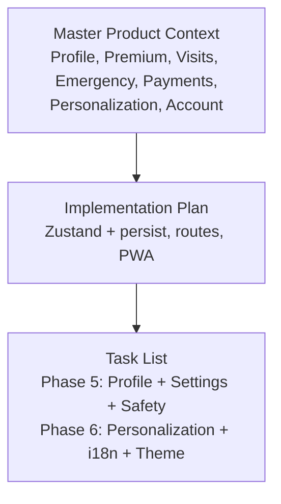
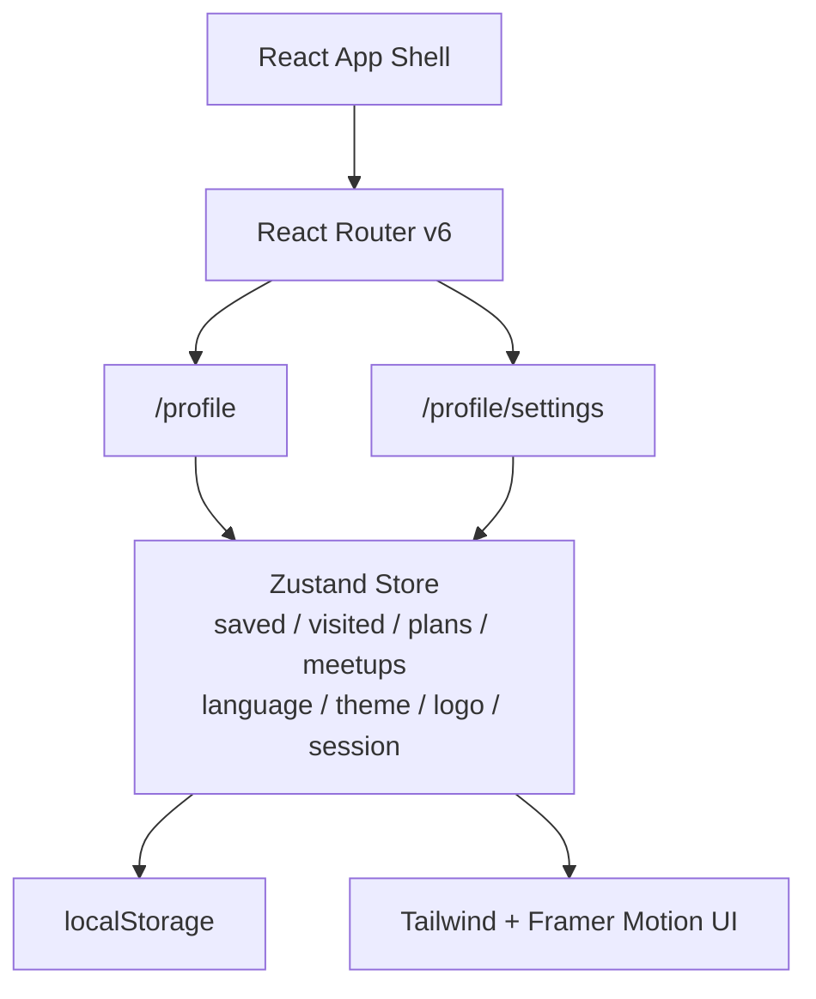
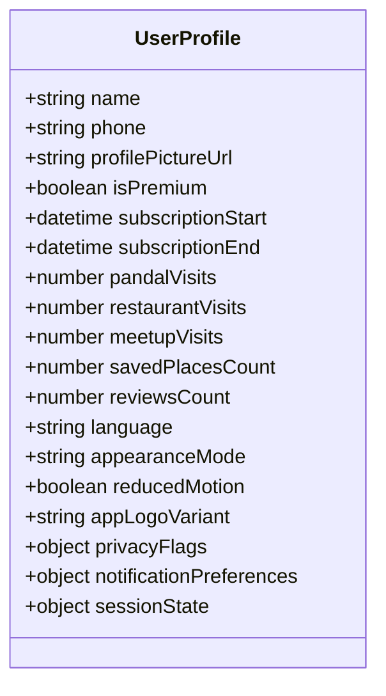
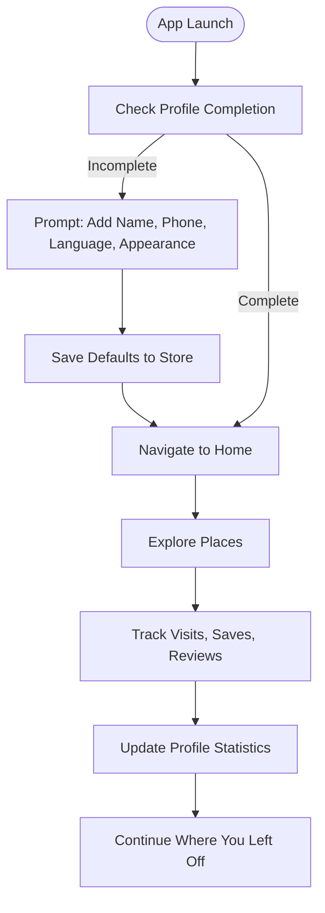
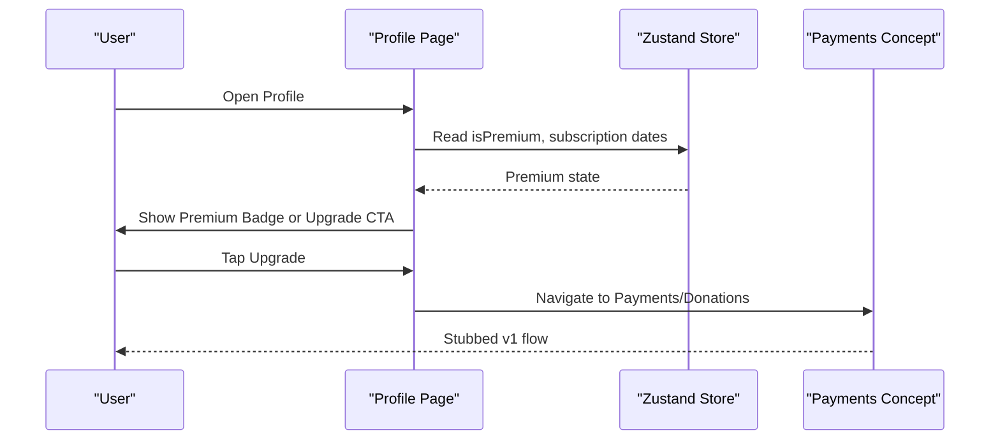
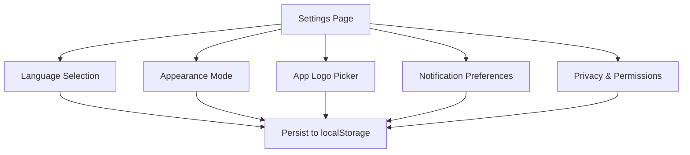
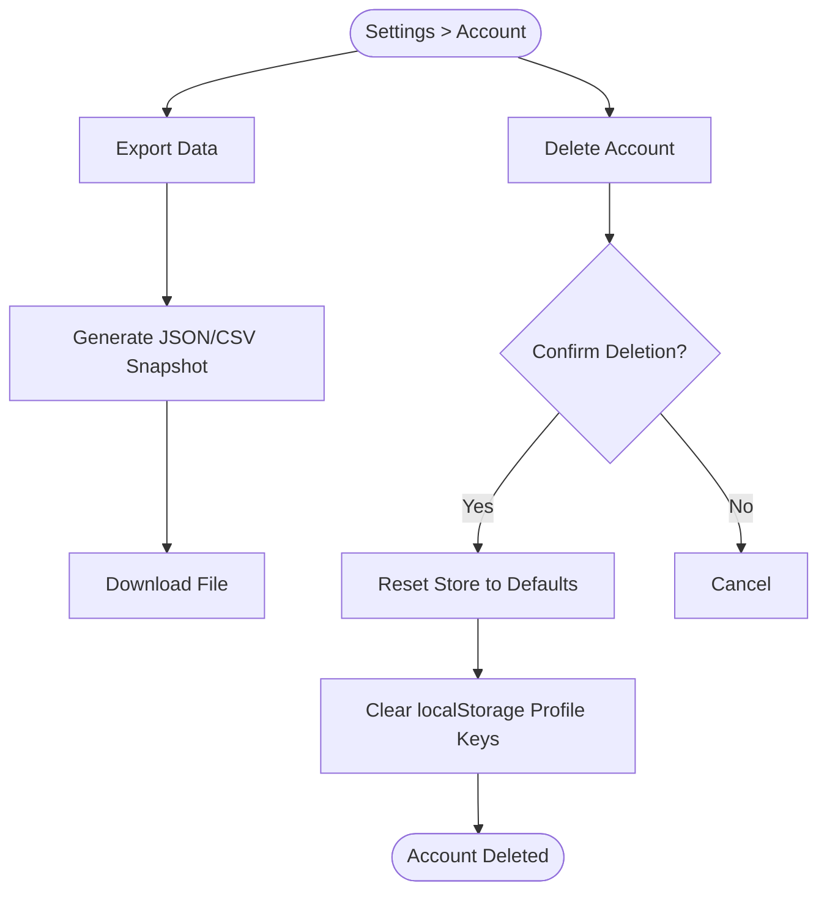
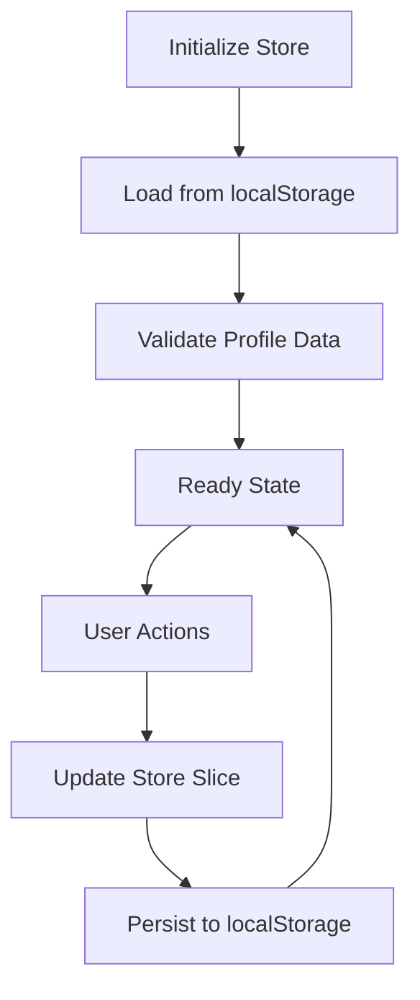
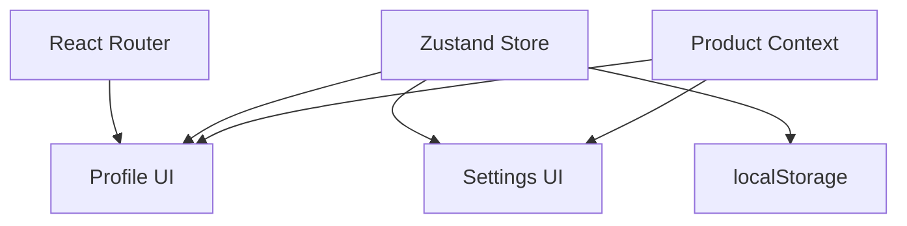

# User Profile System

<cite>
**Referenced Files in This Document**   
- [Pujo_Sahayak_Master_Project_Context.md](file://Pujo_Sahayak_Master_Project_Context.md)
- [plan.md](file://tasks/plan.md)
- [todo.md](file://tasks/todo.md)
</cite>

## Table of Contents
1. [Introduction](#introduction)
2. [Project Structure](#project-structure)
3. [Core Components](#core-components)
4. [Architecture Overview](#architecture-overview)
5. [Detailed Component Analysis](#detailed-component-analysis)
6. [Dependency Analysis](#dependency-analysis)
7. [Performance Considerations](#performance-considerations)
8. [Troubleshooting Guide](#troubleshooting-guide)
9. [Conclusion](#conclusion)
10. [Appendices](#appendices)

## Introduction
This document describes the User Profile System for Pujo Sahayak as defined by the project’s master product context and implementation plan. The profile is the user’s personal control center: it shows identity, subscription status, activity statistics, emergency shortcuts, payments, personalization, account controls, privacy, security, notifications, language, and permissions. In the current v1 scope, authentication is skipped and the profile is local-only; all user state persists to localStorage through a Zustand store with persistence middleware.

The profile system supports:
- User statistics tracking such as visits, saved places, and reviews.
- Premium status indicators and subscription management entry points.
- Preference settings including language selection (Bengali, English, Hindi), appearance customization (light mode, dark mode, system default, reduced motion), and app logo choice.
- Notification preferences and privacy/security controls.
- A conceptual onboarding flow around profile completion prompts.
- Data export and account deletion procedures at a conceptual level.
- Example patterns for Zustand store state management and localStorage persistence.

[No sources needed since this section summarizes without analyzing specific files]

## Project Structure
At this stage, the repository contains product context and task planning documents rather than source code. The relevant structure for the User Profile System is therefore documented from these artifacts:

- Master product context defines the profile page, premium membership, visit tabs, emergency shortcuts, payments, personalization, and account sections.
- Implementation plan specifies that Zustand + persist middleware stores saved places, visited places, puja plan, meetups, language, theme, app-logo choice, and session data.
- Task list maps the Profile + Settings + Safety + Missing Person route into Phase 5 and ties personalization and i18n into Phase 6.

**Diagram sources**
- [Pujo_Sahayak_Master_Project_Context.md:954-1092](file://Pujo_Sahayak_Master_Project_Context.md#L954-L1092)
- [plan.md:7-17](file://tasks/plan.md#L7-L17)
- [todo.md:58-75](file://tasks/todo.md#L58-L75)

**Section sources**
- [Pujo_Sahayak_Master_Project_Context.md:954-1092](file://Pujo_Sahayak_Master_Project_Context.md#L954-L1092)
- [plan.md:7-17](file://tasks/plan.md#L7-L17)
- [todo.md:58-75](file://tasks/todo.md#L58-L75)

## Core Components
The User Profile System is composed of several conceptual components derived from the product context and plan:

- Profile Header
  - Displays profile picture, name, phone, and subscription status.
  - Includes a “Become a Premium Member” call-to-action.

- Activity Statistics
  - Tracks visits across categories such as Pandals, Restaurants, and Meetups.
  - Provides a unified activity history view.

- Premium and Subscription Management
  - Shows premium status and provides upgrade entry points.
  - Connects to payments and donations conceptually.

- Emergency Shortcuts
  - Quick access to Ambulance, Police, Women, Child, and other emergency contacts.
  - Should not be buried deep inside settings.

- Payments and Donations
  - Entry points for bill payments, wallet, payment method, and donations.
  - Intended to support premium subscriptions, authorized meetup payments, partner services, and donations.

- Personalization and Appearance
  - Light mode, dark mode, system default, reduced motion.
  - App logo picker.

- Account Controls
  - Privacy, Security, Notifications, Language, Permissions.
  - Location, photographs, and meetup-related privacy controls.

- Settings Page
  - Route `/profile/settings`.
  - Contains per-mockup options including app logo picker.

**Section sources**
- [Pujo_Sahayak_Master_Project_Context.md:954-1092](file://Pujo_Sahayak_Master_Project_Context.md#L954-L1092)
- [todo.md:58-75](file://tasks/todo.md#L58-L75)

## Architecture Overview
The profile system is part of a React + TypeScript + Vite PWA using React Router, Zustand with persist middleware, Tailwind CSS, Framer Motion, and Leaflet. The profile route is `/profile`, and settings are nested under `/profile/settings`. All user state is persisted to localStorage via Zustand’s persist middleware.

**Diagram sources**
- [plan.md:7-17](file://tasks/plan.md#L7-L17)
- [todo.md:19-39](file://tasks/todo.md#L19-L39)

**Section sources**
- [plan.md:7-17](file://tasks/plan.md#L7-L17)
- [todo.md:19-39](file://tasks/todo.md#L19-L39)

## Detailed Component Analysis

### Profile Data Model
The profile data model is conceptual and should include fields aligned with the product context and plan:

- Identity
  - Name
  - Phone
  - Profile picture URL or placeholder
  - Created date (optional)

- Subscription and Premium Status
  - Is premium boolean flag
  - Subscription start date
  - Subscription end date
  - Payment method reference (conceptual)
  - Donation history entries (conceptual)

- Activity Statistics
  - Visit counts by category: Pandals, Restaurants, Meetups
  - Saved places count
  - Reviews count
  - Last active timestamp

- Preferences
  - Language: Bengali, English, Hindi
  - Appearance: light mode, dark mode, system default
  - Reduced motion preference
  - App logo variant

- Privacy and Security
  - Location permission status
  - Photo permission status
  - Notification preferences
  - Consent flags for data usage

- Session and Continuity
  - Continue where you left off
  - Last viewed place or category
  - Unfinished route or search

Validation rules should ensure:
- Language is one of the supported values.
- Appearance mode is one of the supported modes.
- Dates are valid ISO strings when present.
- Boolean flags are strictly true/false.
- Counts are non-negative integers.

Storage mechanisms:
- Primary storage: localStorage via Zustand persist middleware.
- Optional future extension: server-side sync once authentication is added.

**Diagram sources**
- [Pujo_Sahayak_Master_Project_Context.md:954-1092](file://Pujo_Sahayak_Master_Project_Context.md#L954-L1092)
- [plan.md:7-17](file://tasks/plan.md#L7-L17)

**Section sources**
- [Pujo_Sahayak_Master_Project_Context.md:954-1092](file://Pujo_Sahayak_Master_Project_Context.md#L954-L1092)
- [plan.md:7-17](file://tasks/plan.md#L7-L17)

### User Onboarding Flow and Profile Completion Prompts
Onboarding should guide users to complete their profile and set initial preferences:

Key behaviors:
- If the profile is incomplete, show a lightweight prompt before entering the main experience.
- Persist defaults immediately so the app feels personalized.
- Track activity as users interact with places, reviews, and meetups.
- Maintain continuity by remembering last viewed content.

**Diagram sources**
- [Pujo_Sahayak_Master_Project_Context.md:286-318](file://Pujo_Sahayak_Master_Project_Context.md#L286-L318)
- [Pujo_Sahayak_Master_Project_Context.md:954-1092](file://Pujo_Sahayak_Master_Project_Context.md#L954-L1092)
- [plan.md:7-17](file://tasks/plan.md#L7-L17)

**Section sources**
- [Pujo_Sahayak_Master_Project_Context.md:286-318](file://Pujo_Sahayak_Master_Project_Context.md#L286-L318)
- [Pujo_Sahayak_Master_Project_Context.md:954-1092](file://Pujo_Sahayak_Master_Project_Context.md#L954-L1092)
- [plan.md:7-17](file://tasks/plan.md#L7-L17)

### Premium Status Indicators and Subscription Management
Premium status is displayed in the profile header and drives upgrade prompts:

- Display premium badge if `isPremium` is true.
- Show subscription dates when available.
- Provide an “Upgrade” CTA leading to payments and donation flows.
- Keep payment integrations as stubs in v1; do not hard-code pricing models.

**Diagram sources**
- [Pujo_Sahayak_Master_Project_Context.md:954-1092](file://Pujo_Sahayak_Master_Project_Context.md#L954-L1092)
- [plan.md:81-86](file://tasks/plan.md#L81-L86)

**Section sources**
- [Pujo_Sahayak_Master_Project_Context.md:954-1092](file://Pujo_Sahayak_Master_Project_Context.md#L954-L1092)
- [plan.md:81-86](file://tasks/plan.md#L81-L86)

### Preference Settings: Language, Appearance, Notifications
Preference settings cover language selection, appearance customization, and notification preferences:

- Language: Bengali, English, Hindi.
- Appearance: light mode, dark mode, system default, reduced motion.
- App logo picker.
- Notifications: toggles for push/email/in-app alerts (conceptual).
- Privacy and permissions: location, photos, meetups.

**Diagram sources**
- [Pujo_Sahayak_Master_Project_Context.md:1055-1092](file://Pujo_Sahayak_Master_Project_Context.md#L1055-L1092)
- [plan.md:7-17](file://tasks/plan.md#L7-L17)
- [todo.md:71-75](file://tasks/todo.md#L71-L75)

**Section sources**
- [Pujo_Sahayak_Master_Project_Context.md:1055-1092](file://Pujo_Sahayak_Master_Project_Context.md#L1055-L1092)
- [plan.md:7-17](file://tasks/plan.md#L7-L17)
- [todo.md:71-75](file://tasks/todo.md#L71-L75)

### Profile Data Export and Account Deletion
Data export and account deletion are conceptual requirements for privacy and compliance:

- Data Export
  - Export profile data, activity statistics, saved places, visits, reviews, preferences, and session state.
  - Format: JSON or CSV for machine readability.
  - Triggered from Settings > Account > Export Data.

- Account Deletion
  - Clear all local profile data and reset store to defaults.
  - Confirm destructive action with a modal.
  - Optionally log deletion event locally for debugging.

[No sources needed since this diagram shows conceptual workflow, not actual code structure]

**Section sources**
- [Pujo_Sahayak_Master_Project_Context.md:1076-1092](file://Pujo_Sahayak_Master_Project_Context.md#L1076-L1092)
- [plan.md:7-17](file://tasks/plan.md#L7-L17)

### Example Patterns: Zustand Store and localStorage Persistence
Conceptual patterns for managing profile state with Zustand and localStorage:

- Store Shape
  - `profile`: identity, subscription, preferences, privacy flags.
  - `activity`: saved places, visited places, reviews, meetups.
  - `session`: continue where you left off, last viewed item.

- Actions
  - `updateProfile(partialProfile)`
  - `incrementVisit(category)`
  - `toggleSavedPlace(placeId)`
  - `setLanguage(lang)`
  - `setAppearance(mode)`
  - `exportProfile()`
  - `deleteAccount()`

- Persistence
  - Use Zustand persist middleware to serialize store slices to localStorage.
  - Ensure sensitive fields are excluded from logs.
  - Validate deserialized data on load.

[No sources needed since this diagram shows conceptual workflow, not actual code structure]

**Section sources**
- [plan.md:7-17](file://tasks/plan.md#L7-L17)

## Dependency Analysis
The profile system depends on:

- React Router for navigation between `/profile` and `/profile/settings`.
- Zustand with persist middleware for state management and localStorage persistence.
- Tailwind CSS for styling and design tokens.
- Framer Motion for transitions and animations.
- Product context for feature definitions and UX expectations.

**Diagram sources**
- [plan.md:7-17](file://tasks/plan.md#L7-L17)
- [Pujo_Sahayak_Master_Project_Context.md:954-1092](file://Pujo_Sahayak_Master_Project_Context.md#L954-L1092)

**Section sources**
- [plan.md:7-17](file://tasks/plan.md#L7-L17)
- [Pujo_Sahayak_Master_Project_Context.md:954-1092](file://Pujo_Sahayak_Master_Project_Context.md#L954-L1092)

## Performance Considerations
- Keep profile state minimal and normalized to avoid large localStorage payloads.
- Debounce frequent updates such as visit counters.
- Avoid re-rendering heavy profile sections unless necessary.
- Use lazy loading for settings and export dialogs.
- Respect reduced-motion preference for animations.

[No sources needed since this section provides general guidance]

## Troubleshooting Guide
Common issues and resolutions:

- Profile data not persisting
  - Verify Zustand persist middleware configuration.
  - Check browser localStorage for corrupted JSON.
  - Validate store schema on load.

- Language toggle not applying
  - Ensure language preference is read from store and applied globally.
  - Confirm i18n strings are loaded for selected language.

- Premium badge not showing
  - Check `isPremium` flag in store.
  - Verify subscription dates are valid when present.

- Emergency shortcuts not accessible
  - Ensure shortcuts are placed prominently in the profile.
  - Confirm navigation routes are correct.

**Section sources**
- [plan.md:7-17](file://tasks/plan.md#L7-L17)
- [Pujo_Sahayak_Master_Project_Context.md:995-1010](file://Pujo_Sahayak_Master_Project_Context.md#L995-L1010)

## Conclusion
The User Profile System for Pujo Sahayak is designed as a local-first, preference-driven control center. It tracks user activity, displays premium status, supports personalization, and provides privacy and account controls. While authentication is out of scope for v1, the architecture leaves room for future backend integration. The recommended implementation uses Zustand with localStorage persistence, React Router for navigation, and Tailwind/Framer Motion for a polished mobile-first experience.

[No sources needed since this section summarizes without analyzing specific files]

## Appendices

### Profile Fields Reference
- Identity: name, phone, profile picture URL.
- Subscription: isPremium, subscriptionStart, subscriptionEnd.
- Activity: pandalVisits, restaurantVisits, meetupVisits, savedPlacesCount, reviewsCount.
- Preferences: language, appearanceMode, reducedMotion, appLogoVariant.
- Privacy: locationPermission, photoPermission, notificationPreferences.
- Session: continueWhereYouLeftOff, lastViewedItem.

**Section sources**
- [Pujo_Sahayak_Master_Project_Context.md:954-1092](file://Pujo_Sahayak_Master_Project_Context.md#L954-L1092)
- [plan.md:7-17](file://tasks/plan.md#L7-L17)