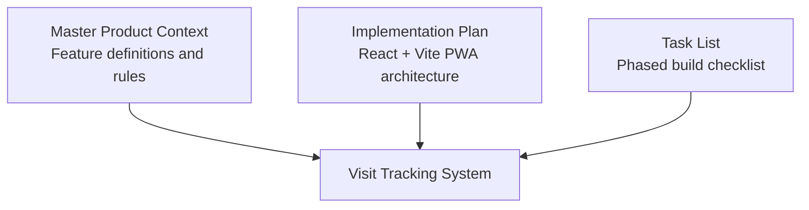
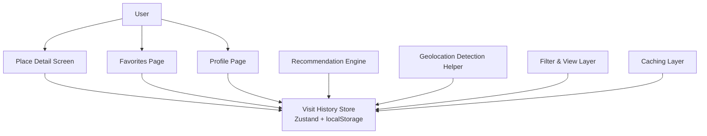
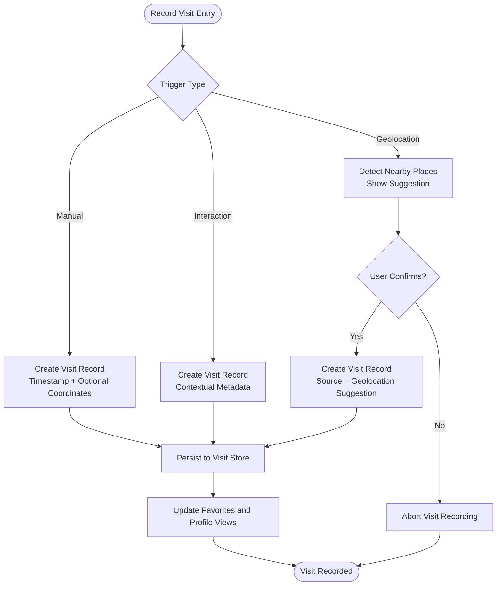
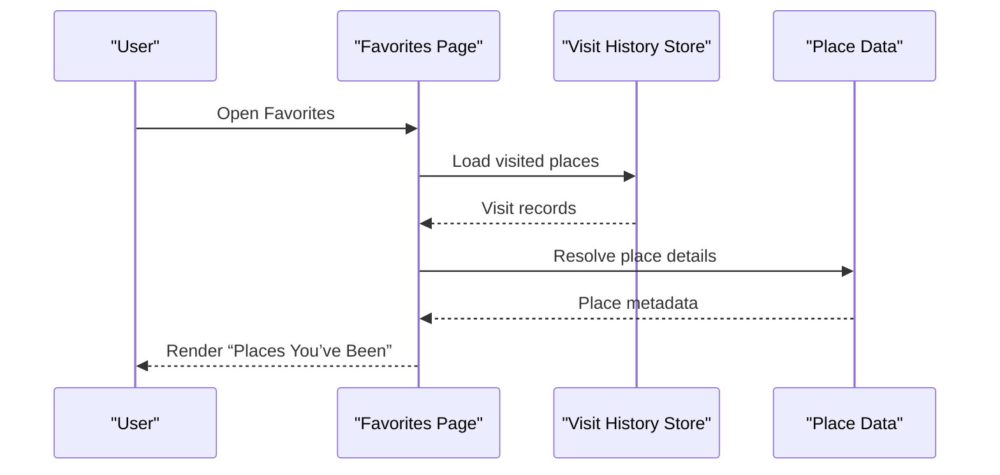
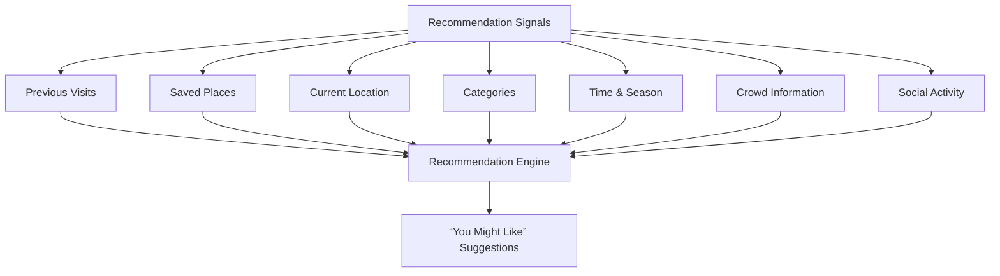
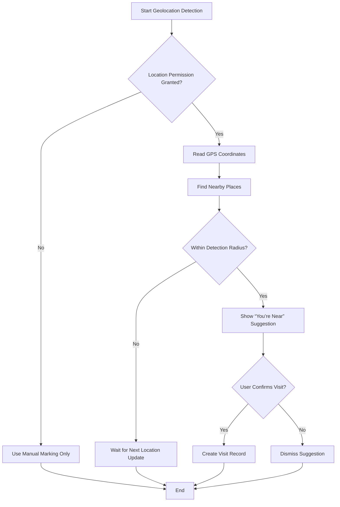
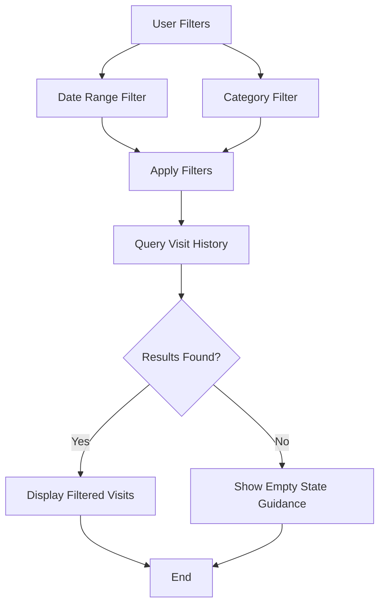
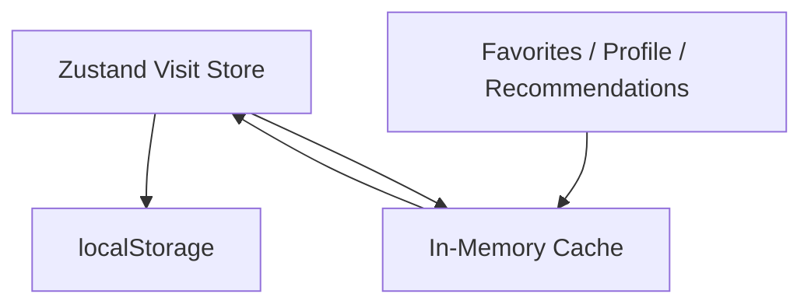
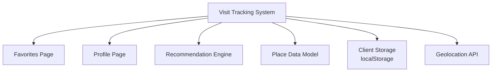

# Visit Tracking System

<cite>
**Referenced Files in This Document**
- [Pujo_Sahayak_Master_Project_Context.md](file://Pujo_Sahayak_Master_Project_Context.md)
- [plan.md](file://tasks/plan.md)
- [todo.md](file://tasks/todo.md)
</cite>

## Table of Contents
1. [Introduction](#introduction)
2. [Project Structure](#project-structure)
3. [Core Components](#core-components)
4. [Architecture Overview](#architecture-overview)
5. [Detailed Component Analysis](#detailed-component-analysis)
6. [Dependency Analysis](#dependency-analysis)
7. [Performance Considerations](#performance-considerations)
8. [Troubleshooting Guide](#troubleshooting-guide)
9. [Conclusion](#conclusion)

## Introduction
This document explains the Visit Tracking System for Pujo Sahayak. It covers how previously visited places are recorded, how visit history is structured, how it integrates with the Favorites page and recommendations, and how geolocation-based detection and manual marking should work. It also documents filtering by date ranges and categories, performance considerations for large histories, and caching strategies for frequently accessed visit data.

The system supports multiple place types: pandals, restaurants, events, meetups, attractions, services, and other local experiences. The product context treats “Place” as a broad entity with specialized subtypes such as Pandal, Restaurant, Event, Meetup, Attraction, Service, and Other Local Experience.

**Section sources**
- [Pujo_Sahayak_Master_Project_Context.md:120-138](file://Pujo_Sahayak_Master_Project_Context.md#L120-L138)
- [Pujo_Sahayak_Master_Project_Context.md:1232-1260](file://Pujo_Sahayak_Master_Project_Context.md#L1232-L1260)

## Project Structure
At this stage, the repository contains the master product context and implementation planning artifacts rather than full application source code. The Visit Tracking System is therefore documented as a feature specification aligned with the product context and task plan.

**Diagram sources**
- [Pujo_Sahayak_Master_Project_Context.md:1-20](file://Pujo_Sahayak_Master_Project_Context.md#L1-L20)
- [plan.md:1-18](file://tasks/plan.md#L1-L18)
- [todo.md:1-15](file://tasks/todo.md#L1-L15)

**Section sources**
- [Pujo_Sahayak_Master_Project_Context.md:1-20](file://Pujo_Sahayak_Master_Project_Context.md#L1-L20)
- [plan.md:1-18](file://tasks/plan.md#L1-L18)
- [todo.md:1-15](file://tasks/todo.md#L1-L15)

## Core Components
The Visit Tracking System consists of these conceptual components:

- **Visit Record**: A persistent record that a user has visited or interacted with a place.
- **Visit History Store**: Client-side storage for all visits, backed by `localStorage` according to the implementation plan.
- **Visit Recording Trigger**: UI actions such as marking a place as visited or completing an interaction.
- **Geolocation Detection Helper**: Optional helper that suggests nearby places based on GPS location.
- **Favorites Integration Layer**: Reads visit history to populate the “Places You’ve Been” section.
- **Recommendation Influence Layer**: Uses visit history alongside saved places, location, categories, time, season, crowd, and social activity to influence “You Might Like” recommendations.
- **Filtering and View Layer**: Allows users to browse visit history by date range and category tabs such as Pandals, Restaurants, and Meetups.
- **Caching Layer**: Caches frequently accessed visit data for fast rendering of Favorites, Profile, and recommendation surfaces.

Key product requirements that shape these components:

- Visited places are part of the Favorites page under “Places You’ve Been.”
- Recommendations can use previous visits along with other signals.
- Location should be used intelligently, not assumed as exact presence inside a place.
- The profile tracks unified activity history across categories.
- User state including saves and visits persists to `localStorage`.

**Section sources**
- [Pujo_Sahayak_Master_Project_Context.md:320-350](file://Pujo_Sahayak_Master_Project_Context.md#L320-L350)
- [Pujo_Sahayak_Master_Project_Context.md:40-75](file://Pujo_Sahayak_Master_Project_Context.md#L40-L75)
- [Pujo_Sahayak_Master_Project_Context.md:978-993](file://Pujo_Sahayak_Master_Project_Context.md#L978-L993)
- [Pujo_Sahayak_Master_Project_Context.md:1263-1295](file://Pujo_Sahayak_Master_Project_Context.md#L1263-L1295)
- [Pujo_Sahayak_Master_Project_Context.md:1360-1388](file://Pujo_Sahayak_Master_Project_Context.md#L1360-L1388)
- [plan.md:5-18](file://tasks/plan.md#L5-L18)

## Architecture Overview
The Visit Tracking System sits between user-facing screens and the client store. It does not require AI for basic recording; AI is reserved for identification, explanation, recommendations, and planning.

**Diagram sources**
- [Pujo_Sahayak_Master_Project_Context.md:320-350](file://Pujo_Sahayak_Master_Project_Context.md#L320-L350)
- [Pujo_Sahayak_Master_Project_Context.md:1263-1295](file://Pujo_Sahayak_Master_Project_Context.md#L1263-L1295)
- [plan.md:5-18](file://tasks/plan.md#L5-L18)

## Detailed Component Analysis

### Visit Record Data Model
A visit record should capture enough information to support browsing, filtering, recommendations, and analytics without overcomplicating the initial implementation.

Recommended fields:

| Field | Type | Purpose | Notes |
|---|---|---|---|
| `id` | string | Unique visit identifier | Generated locally during creation |
| `placeId` | string | Reference to the place | Links to Place/Pandal/Restaurant/Event/Meetup |
| `placeType` | enum | Category of the place | Supports Pandals, Restaurants, Events, Meetups, Attractions, Services, Other |
| `userId` | string | Owner of the visit | Local-only in v1 unless authentication is added later |
| `visitedAt` | timestamp | When the visit was recorded | Primary sorting field for history |
| `durationSeconds` | number | Time spent at the place | Optional; may be missing if user marks visited instantly |
| `latitude` | number | Approximate latitude | Optional; useful for geolocation detection |
| `longitude` | number | Approximate longitude | Optional; useful for geolocation detection |
| `source` | enum | How the visit was recorded | Manual, Geolocation Suggestion, Interaction Completion |
| `notes` | string | Optional user notes | Free-form text for personal memory |
| `isVerified` | boolean | Whether the visit passed validation | Useful when geolocation or AI verification is involved |

Complexity considerations:

- Reading visit history is typically O(n) over stored records.
- Filtering by date range and category can be optimized with indexes or precomputed views.
- Duration and coordinates are optional to keep manual marking simple.
- The model aligns with the broader product data model where Place is a supertype and Pandal, Restaurant, Event, Meetup, etc., are specialized types.

**Section sources**
- [Pujo_Sahayak_Master_Project_Context.md:1232-1260](file://Pujo_Sahayak_Master_Project_Context.md#L1232-L1260)
- [Pujo_Sahayak_Master_Project_Context.md:978-993](file://Pujo_Sahayak_Master_Project_Context.md#L978-L993)

### Visit Recording Mechanism
Visits are recorded when users explicitly mark a place as visited or complete relevant interactions.

Primary triggers:

1. **Manual Mark as Visited**
   - User taps a “Visited” action on a place detail screen.
   - System creates a visit record with current timestamp.
   - Coordinates may be captured if location permission is available.
   - Source is marked as manual.

2. **Interaction Completion**
   - Examples include completing a trip segment, joining a meetup, or finishing a planned stop.
   - System creates a visit record with contextual metadata.
   - Source is marked as interaction completion.

3. **Geolocation-Based Suggestion**
   - System detects that the user is near a known place.
   - System shows a non-intrusive suggestion such as “You’re near [Place].”
   - User confirms before recording a visit.
   - Source is marked as geolocation suggestion.

Important rule: do not assume exact presence inside a place solely from GPS. Use cautious wording and require confirmation when appropriate.

**Diagram sources**
- [Pujo_Sahayak_Master_Project_Context.md:40-75](file://Pujo_Sahayak_Master_Project_Context.md#L40-L75)
- [Pujo_Sahayak_Master_Project_Context.md:1360-1388](file://Pujo_Sahayak_Master_Project_Context.md#L1360-L1388)

**Section sources**
- [Pujo_Sahayak_Master_Project_Context.md:40-75](file://Pujo_Sahayak_Master_Project_Context.md#L40-L75)
- [Pujo_Sahayak_Master_Project_Context.md:1360-1388](file://Pujo_Sahayak_Master_Project_Context.md#L1360-L1388)

### Favorites Page Integration: “Places You’ve Been”
The Favorites page includes three main sections:

- Saved Pandals
- Places You’ve Been
- You Might Like

“Places You’ve Been” reads directly from the visit history store. It should display:

- Place name
- Place type
- Last visited date
- Optional duration or activity summary
- Navigation back to the place detail

It must remain separate from saved places. Saving a place means bookmarking it; visiting a place means the user experienced it.

**Diagram sources**
- [Pujo_Sahayak_Master_Project_Context.md:320-350](file://Pujo_Sahayak_Master_Project_Context.md#L320-L350)

**Section sources**
- [Pujo_Sahayak_Master_Project_Context.md:320-350](file://Pujo_Sahayak_Master_Project_Context.md#L320-L350)

### Recommendation Influence
Visit history influences recommendations through the “You Might Like” section and broader recommendation logic.

Signals that can influence recommendations include:

- Previous visits
- Saved places
- Current location
- Categories
- Preferences
- Time
- Season
- Crowd
- Social activity

The system should avoid making absolute claims about what a user will like. Wording should be suggestive, such as “You might like,” rather than definitive.

**Diagram sources**
- [Pujo_Sahayak_Master_Project_Context.md:320-350](file://Pujo_Sahayak_Master_Project_Context.md#L320-L350)
- [Pujo_Sahayak_Master_Project_Context.md:1263-1295](file://Pujo_Sahayak_Master_Project_Context.md#L1263-L1295)

**Section sources**
- [Pujo_Sahayak_Master_Project_Context.md:320-350](file://Pujo_Sahayak_Master_Project_Context.md#L320-L350)
- [Pujo_Sahayak_Master_Project_Context.md:1263-1295](file://Pujo_Sahayak_Master_Project_Context.md#L1263-L1295)

### Geolocation-Based Visit Detection
Geolocation detection should assist, not replace, user intent.

Recommended behavior:

1. Request location permission only when needed.
2. Compute distance between current GPS position and known places.
3. Show a suggestion card when the user is within a reasonable radius.
4. Use cautious language such as “You’re near…” instead of claiming exact presence.
5. Require explicit confirmation before recording a visit.
6. Store coordinates only if the user allows location access.

**Diagram sources**
- [Pujo_Sahayak_Master_Project_Context.md:1360-1388](file://Pujo_Sahayak_Master_Project_Context.md#L1360-L1388)

**Section sources**
- [Pujo_Sahayak_Master_Project_Context.md:1360-1388](file://Pujo_Sahayak_Master_Project_Context.md#L1360-L1388)

### Manual Visit Marking Workflow
Manual marking is the simplest and most reliable flow.

Workflow:

1. User opens a place detail screen.
2. User taps “Mark as Visited.”
3. System captures:
   - Timestamp
   - Place ID and type
   - Optional coordinates
   - Source as manual
4. System persists the visit.
5. UI updates:
   - Favorites page
   - Profile visit history
   - Recommendation engine inputs

Edge cases:

- Duplicate visits: allow multiple visits but deduplicate by place and close timestamps if needed.
- Missing coordinates: still allow manual marking.
- Offline mode: queue visit creation and sync when possible.

**Section sources**
- [Pujo_Sahayak_Master_Project_Context.md:40-75](file://Pujo_Sahayak_Master_Project_Context.md#L40-L75)
- [plan.md:5-18](file://tasks/plan.md#L5-L18)

### Visit History Filtering by Date Range and Category
The profile’s unified activity history should support filtering by:

- Date range
- Category tabs such as Pandals, Restaurants, Meetups
- Optional search by place name

Filtering rules:

- Default view shows recent visits.
- Category tabs filter by `placeType`.
- Date range filters by `visitedAt`.
- Combined filters apply intersection logic.
- Empty states should guide users to explore more places.

**Diagram sources**
- [Pujo_Sahayak_Master_Project_Context.md:978-993](file://Pujo_Sahayak_Master_Project_Context.md#L978-L993)

**Section sources**
- [Pujo_Sahayak_Master_Project_Context.md:978-993](file://Pujo_Sahayak_Master_Project_Context.md#L978-L993)

### Performance Considerations for Large Visit Histories
As visit history grows, rendering and querying become more expensive.

Recommendations:

- Paginate or virtualize long lists in Favorites and Profile.
- Sort visits by `visitedAt` descending so recent visits render first.
- Index visits by `userId`, `placeType`, and `visitedAt`.
- Debounce geolocation suggestions to avoid excessive queries.
- Avoid recomputing recommendations on every render; compute only when inputs change.
- Keep visit records lightweight; defer heavy metadata resolution until needed.

Storage characteristics:

- Client-side persistence uses `localStorage`.
- `localStorage` is synchronous and limited in size.
- For very large histories, consider moving to IndexedDB or a backend database in later phases.

**Section sources**
- [plan.md:5-18](file://tasks/plan.md#L5-L18)

### Caching Strategies for Frequently Accessed Visit Data
Frequently accessed visit data should be cached to improve responsiveness.

Suggested cache layers:

1. **In-Memory Cache**
   - Recent visits for active screens.
   - Resolved place metadata for rendered cards.
   - Short-lived cache invalidated on navigation or store update.

2. **Store-Level Cache**
   - Zustand store holds normalized visit records.
   - Derived selectors compute filtered views.

3. **Disk Cache**
   - `localStorage` persists core visit records.
   - Optionally persist computed summaries such as last visited place counts per category.

Cache invalidation rules:

- Invalidate after manual visit creation.
- Invalidate after geolocation confirmation.
- Refresh when user navigates away from Favorites or Profile.
- Do not block UI while resolving place details; resolve lazily.

**Diagram sources**
- [plan.md:5-18](file://tasks/plan.md#L5-L18)

**Section sources**
- [plan.md:5-18](file://tasks/plan.md#L5-L18)

## Dependency Analysis
The Visit Tracking System depends on several product areas.

**Diagram sources**
- [Pujo_Sahayak_Master_Project_Context.md:320-350](file://Pujo_Sahayak_Master_Project_Context.md#L320-L350)
- [Pujo_Sahayak_Master_Project_Context.md:978-993](file://Pujo_Sahayak_Master_Project_Context.md#L978-L993)
- [Pujo_Sahayak_Master_Project_Context.md:1263-1295](file://Pujo_Sahayak_Master_Project_Context.md#L1263-L1295)
- [plan.md:5-18](file://tasks/plan.md#L5-L18)

**Section sources**
- [Pujo_Sahayak_Master_Project_Context.md:320-350](file://Pujo_Sahayak_Master_Project_Context.md#L320-L350)
- [Pujo_Sahayak_Master_Project_Context.md:978-993](file://Pujo_Sahayak_Master_Project_Context.md#L978-L993)
- [Pujo_Sahayak_Master_Project_Context.md:1263-1295](file://Pujo_Sahayak_Master_Project_Context.md#L1263-L1295)
- [plan.md:5-18](file://tasks/plan.md#L5-L18)

## Performance Considerations
- Prefer lazy loading of place details instead of eagerly resolving all metadata for every visit.
- Use pagination or virtual scrolling for long visit lists.
- Debounce location updates to reduce unnecessary computations.
- Avoid blocking the main thread with synchronous `localStorage` operations on large datasets.
- Keep recommendation computation incremental and input-driven.
- Monitor memory usage for in-memory caches and clear them when screens unmount.

[No sources needed since this section provides general guidance]

## Troubleshooting Guide
Common issues and resolutions:

| Issue | Likely Cause | Resolution |
|---|---|---|
| Visits not appearing in Favorites | Visit not persisted or wrong user context | Verify store persistence and userId association |
| Geolocation suggestion appears too often | Radius too small or no debounce | Increase threshold and debounce location updates |
| Exact presence claimed incorrectly | GPS treated as proof of entry | Enforce confirmation and cautious wording |
| Slow Favorites rendering | Large dataset resolved eagerly | Add pagination, virtualization, and lazy metadata resolution |
| Recommendations stale | Recomputed on unrelated renders | Cache derived recommendations and invalidate on relevant changes |
| Duplicate visits clutter history | Multiple quick taps or background updates | Deduplicate by place and close timestamps |

**Section sources**
- [Pujo_Sahayak_Master_Project_Context.md:1360-1388](file://Pujo_Sahayak_Master_Project_Context.md#L1360-L1388)
- [plan.md:5-18](file://tasks/plan.md#L5-L18)

## Conclusion
The Visit Tracking System provides a foundation for remembering where users have explored. It supports manual marking, geolocation-assisted suggestions, and interaction-triggered visits. Visit history feeds the Favorites page, profile activity view, and recommendation engine. With careful filtering, caching, and performance strategies, the system can scale to larger histories while keeping the experience responsive and trustworthy.

[No sources needed since this section summarizes without analyzing specific files]