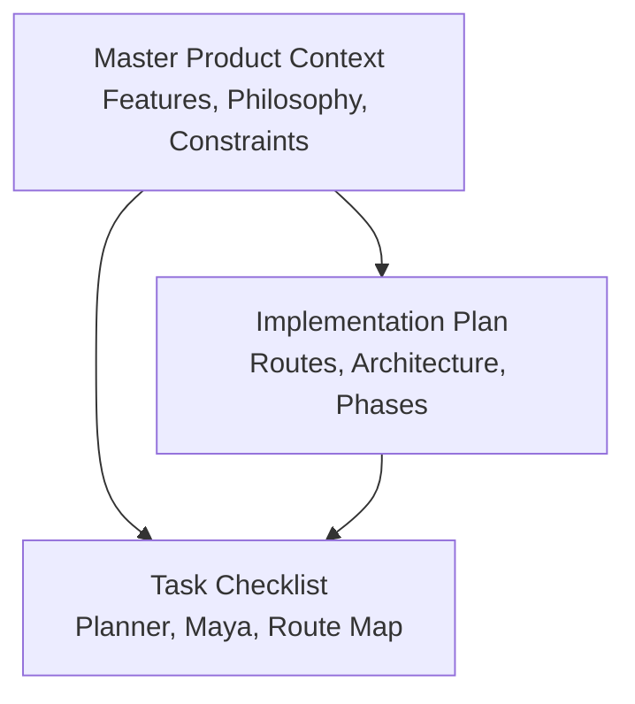
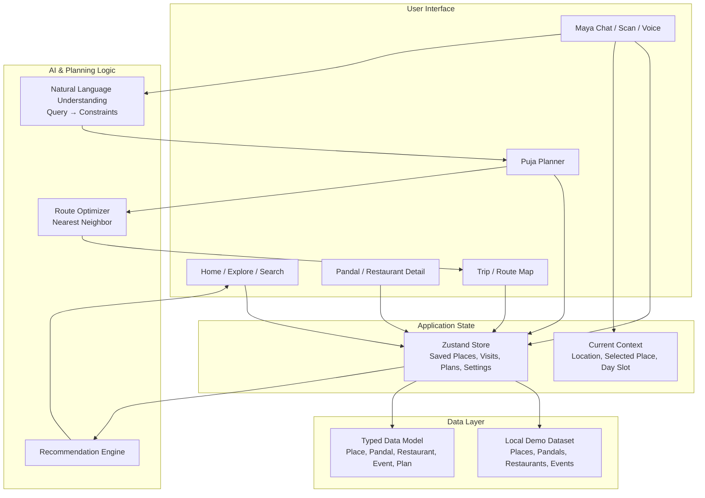
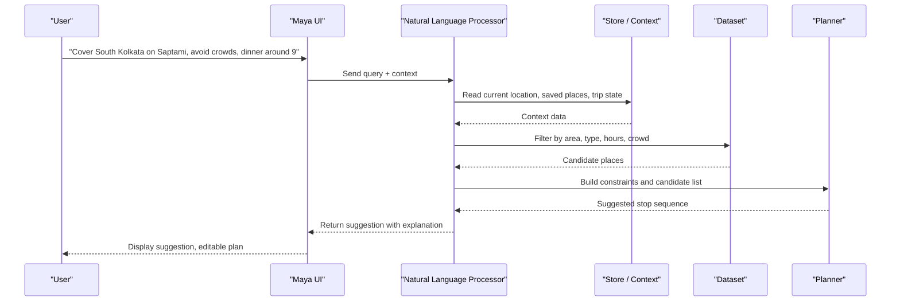
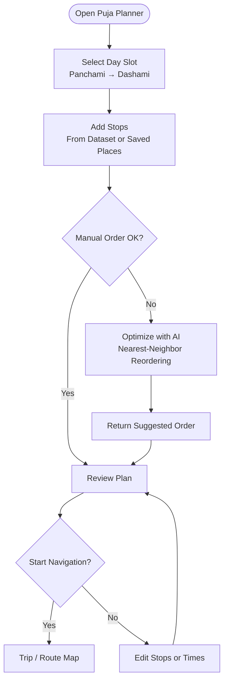
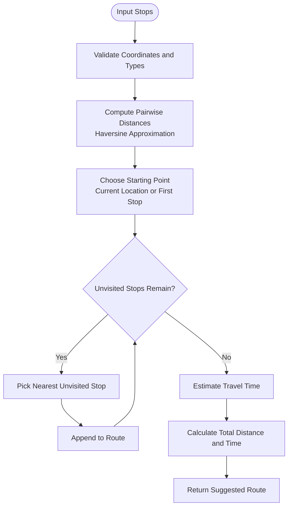
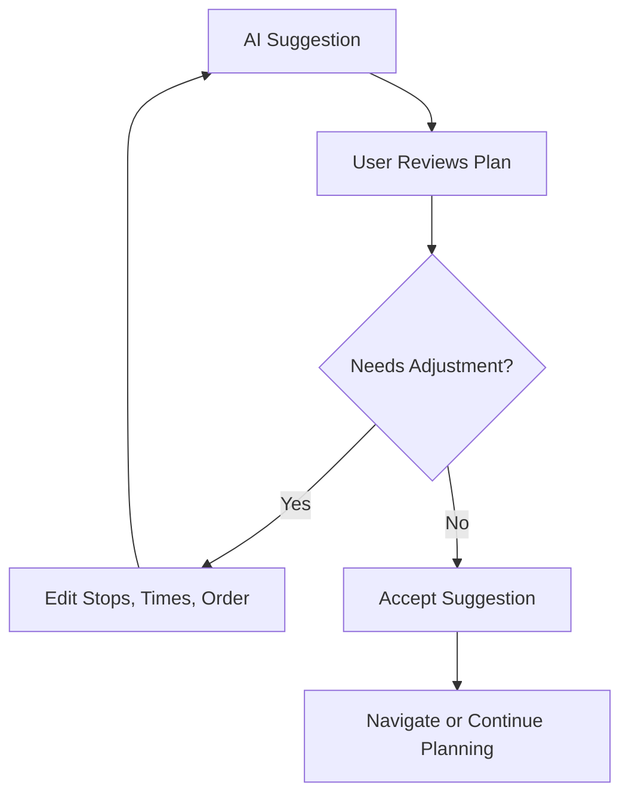
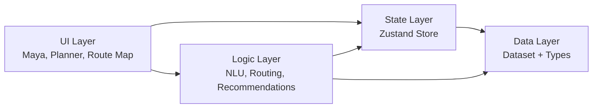

# AI-Assisted Planning Algorithms

<cite>
**Referenced Files in This Document**
- [Pujo_Sahayak_Master_Project_Context.md](file://Pujo_Sahayak_Master_Project_Context.md)
- [plan.md](file://tasks/plan.md)
- [todo.md](file://tasks/todo.md)
</cite>

## Table of Contents
1. [Introduction](#introduction)
2. [Project Structure](#project-structure)
3. [Core Components](#core-components)
4. [Architecture Overview](#architecture-overview)
5. [Detailed Component Analysis](#detailed-component-analysis)
6. [Dependency Analysis](#dependency-analysis)
7. [Performance Considerations](#performance-considerations)
8. [Troubleshooting Guide](#troubleshooting-guide)
9. [Conclusion](#conclusion)

## Introduction
This document explains the AI-assisted planning algorithms for Puja Sahayak, focusing on how Maya generates intelligent itinerary suggestions and how route optimization is intended to work. The system is designed around a multi-day Puja planner where users can ask natural-language requests such as:

> "I want to cover South Kolkata on Saptami, avoid very crowded places and have dinner around 9."

The product context defines this as an AI-assisted planning experience that proposes plans based on location, distance, operating hours, crowd information, user preferences, saved places, and available events. Generated plans must be presented as suggestions rather than guaranteed optimal routes.

At present, the repository contains product context, implementation planning, and task tracking rather than full source code. Therefore, this document describes the intended algorithmic approach, data inputs, processing logic, and user-facing behavior as defined by the project documentation.

**Section sources**
- [Pujo_Sahayak_Master_Project_Context.md:353-420](file://Pujo_Sahayak_Master_Project_Context.md#L353-L420)
- [Pujo_Sahayak_Master_Project_Context.md:404-420](file://Pujo_Sahayak_Master_Project_Context.md#L404-L420)

## Project Structure
The relevant repository structure for understanding AI-assisted planning is small and focused:

- `Pujo_Sahayak_Master_Project_Context.md` — Master product context describing features, philosophy, Maya, planning, recommendations, and constraints.
- `tasks/plan.md` — Implementation plan for a React + Vite PWA with routes, architecture decisions, phases, and verification criteria.
- `tasks/todo.md` — Task checklist including Maya chat, Puja Planner, Trip/Route Map, and related UI flows.

**Diagram sources**
- [Pujo_Sahayak_Master_Project_Context.md:1-20](file://Pujo_Sahayak_Master_Project_Context.md#L1-L20)
- [plan.md:1-18](file://tasks/plan.md#L1-L18)
- [todo.md:1-14](file://tasks/todo.md#L1-L14)

**Section sources**
- [Pujo_Sahayak_Master_Project_Context.md:1-20](file://Pujo_Sahayak_Master_Project_Context.md#L1-L20)
- [plan.md:1-18](file://tasks/plan.md#L1-L18)
- [todo.md:1-14](file://tasks/todo.md#L1-L14)

## Core Components
The AI-assisted planning system revolves around these core components:

| Component | Responsibility | Key Inputs | Key Outputs |
|---|---|---|---|
| Maya Assistant | Natural-language understanding, contextual awareness, grounded responses | User query, current location, selected place, saved places, trip state, language preference | Suggestions, explanations, next-step recommendations |
| Puja Planner | Multi-day itinerary construction | Day slot (Panchami–Dashami), stops, timings, user constraints | Ordered day plan with suggested reordering |
| Route Optimizer | Nearest-neighbor reordering and travel estimation | Stops with coordinates, distances, estimated times | Reordered suggestion, total distance/time |
| Data Model | Typed entities for places, pandals, restaurants, events, meetups, plans | Dataset fields | Structured data used by discovery, planning, and recommendations |
| Recommendation Engine | Personalized suggestions | Location, visits, favorites, search activity, categories, time, season, crowd, social activity | “You might like” or similar suggestions |

Maya is explicitly not a generic chatbot; it should understand application data and context. It should also avoid hallucinating facts and return grounded answers when possible.

**Section sources**
- [Pujo_Sahayak_Master_Project_Context.md:353-420](file://Pujo_Sahayak_Master_Project_Context.md#L353-L420)
- [Pujo_Sahayak_Master_Project_Context.md:558-660](file://Pujo_Sahayak_Master_Project_Context.md#L558-L660)
- [Pujo_Sahayak_Master_Project_Context.md:1232-1295](file://Pujo_Sahayak_Master_Project_Context.md#L1232-L1295)
- [plan.md:1-18](file://tasks/plan.md#L1-L18)
- [todo.md:34-54](file://tasks/todo.md#L34-L54)

## Architecture Overview
The intended architecture separates concerns between user interface, local dataset, planning logic, and optional future AI integration.

**Diagram sources**
- [plan.md:1-18](file://tasks/plan.md#L1-L18)
- [plan.md:19-39](file://tasks/plan.md#L19-L39)
- [todo.md:34-54](file://tasks/todo.md#L34-L54)
- [Pujo_Sahayak_Master_Project_Context.md:353-420](file://Pujo_Sahayak_Master_Project_Context.md#L353-L420)
- [Pujo_Sahayak_Master_Project_Context.md:558-660](file://Pujo_Sahayak_Master_Project_Context.md#L558-L660)
- [Pujo_Sahayak_Master_Project_Context.md:1232-1295](file://Pujo_Sahayak_Master_Project_Context.md#L1232-L1295)

## Detailed Component Analysis

### Maya Natural-Language Planning Flow
Maya receives natural-language queries and converts them into structured planning constraints. A representative example is:

> "I want to cover South Kolkata on Saptami, avoid very crowded places and have dinner around 9."

Intended processing steps:

1. **Context capture**: Current location, selected place, saved places, current trip, language, and category context are considered.
2. **Intent extraction**: Identify that the user wants a daily itinerary suggestion.
3. **Constraint extraction**:
   - Area: South Kolkata
   - Day: Saptami
   - Crowd preference: Avoid very crowded places
   - Meal timing: Dinner around 9
4. **Candidate selection**: Filter places from the dataset using area, type (pandal, restaurant, event), operating hours, and crowd level.
5. **Suggestion generation**: Produce a sequence of stops with approximate timings.
6. **Presentation**: Present the result as a suggestion, not a guaranteed optimal route.

**Diagram sources**
- [Pujo_Sahayak_Master_Project_Context.md:404-420](file://Pujo_Sahayak_Master_Project_Context.md#L404-L420)
- [Pujo_Sahayak_Master_Project_Context.md:558-660](file://Pujo_Sahayak_Master_Project_Context.md#L558-L660)
- [Pujo_Sahayak_Master_Project_Context.md:1330-1358](file://Pujo_Sahayak_Master_Project_Context.md#L1330-L1358)
- [todo.md:34-54](file://tasks/todo.md#L34-L54)

**Section sources**
- [Pujo_Sahayak_Master_Project_Context.md:404-420](file://Pujo_Sahayak_Master_Project_Context.md#L404-L420)
- [Pujo_Sahayak_Master_Project_Context.md:558-660](file://Pujo_Sahayak_Master_Project_Context.md#L558-L660)
- [Pujo_Sahayak_Master_Project_Context.md:1330-1358](file://Pujo_Sahayak_Master_Project_Context.md#L1330-L1358)
- [todo.md:34-54](file://tasks/todo.md#L34-L54)

### Puja Planner and Optimize-with-AI
The Puja Planner supports:

- Day tabs from Panchami through Dashami.
- Stop cards showing image, type, duration, and travel-between rows.
- Adding places from the dataset or saved places.
- An “Optimize with AI” action described as nearest-neighbor reordering.
- Navigation to the Trip/Route Map screen.

The key constraint here is wording: the optimizer produces suggestions, not guarantees.

**Diagram sources**
- [todo.md:50-51](file://tasks/todo.md#L50-L51)
- [plan.md:54-55](file://tasks/plan.md#L54-L55)
- [Pujo_Sahayak_Master_Project_Context.md:353-420](file://Pujo_Sahayak_Master_Project_Context.md#L353-L420)

**Section sources**
- [todo.md:50-51](file://tasks/todo.md#L50-L51)
- [plan.md:54-55](file://tasks/plan.md#L54-L55)
- [Pujo_Sahayak_Master_Project_Context.md:353-420](file://Pujo_Sahayak_Master_Project_Context.md#L353-L420)

### Route Optimization Algorithm
The planned route optimization uses a nearest-neighbor approach. While the repository does not include full algorithm source code, the implementation plan and task list define the expected behavior:

- Input: A set of stops with geographic coordinates.
- Distance calculation: Haversine distance is mentioned for estimating total distance and time on the Trip/Route Map.
- Ordering strategy: Nearest-neighbor reordering to reduce backtracking.
- Output: A reordered suggestion plus total distance and estimated time.

**Diagram sources**
- [todo.md:63-64](file://tasks/todo.md#L63-L64)
- [plan.md:54-55](file://tasks/plan.md#L54-L55)

**Section sources**
- [todo.md:63-64](file://tasks/todo.md#L63-L64)
- [plan.md:54-55](file://tasks/plan.md#L54-L55)

### Data Model and Planning Inputs
The product context defines a broad data model beyond just pandals. For planning, the most relevant entities include:

| Entity | Role in Planning |
|---|---|
| Place | Base entity for locations |
| Pandal | Primary destination during Puja |
| Restaurant | Dining stops, especially for meal-time constraints |
| Event | Scheduled activities that may anchor timings |
| Plan / PlanDay | Stores user’s multi-day itinerary |
| SafetyPoint | Emergency and utility context |
| Category | Helps filter and group places |

The dataset is typed and includes real Kolkata pandals and restaurants. Crowd levels and operating hours are rendered from dataset fields, and the dataset is marked as demo data.

**Section sources**
- [Pujo_Sahayak_Master_Project_Context.md:1232-1259](file://Pujo_Sahayak_Master_Project_Context.md#L1232-L1259)
- [plan.md:1-18](file://tasks/plan.md#L1-L18)
- [todo.md:13-14](file://tasks/todo.md#L13-L14)

### Recommendations and Personalization
The recommendation engine is conceptually separate from direct route optimization but feeds into planning suggestions. Inputs include:

- Location
- Previous visits
- Favorites
- Search activity
- Categories
- Time
- Season
- Crowd
- Social activity

The output should be understandable and avoid overclaiming. Wording such as “You might like” is preferred over absolute claims.

**Section sources**
- [Pujo_Sahayak_Master_Project_Context.md:1263-1295](file://Pujo_Sahayak_Master_Project_Context.md#L1263-L1295)
- [Pujo_Sahayak_Master_Project_Context.md:320-350](file://Pujo_Sahayak_Master_Project_Context.md#L320-L350)

### Balance Between AI Suggestions and Manual Control
A critical design principle is that AI-generated plans are suggestions, not guarantees. Users should retain control:

- Maya returns suggestions grounded in data.
- The planner allows manual addition, removal, and reordering of stops.
- “Optimize with AI” is framed as nearest-neighbor reordering, not a black-box guarantee.
- The Trip/Route Map shows total distance and estimated time, helping users evaluate feasibility.
- The system avoids presenting AI outputs as authoritative truth when real-world conditions may differ.

**Diagram sources**
- [Pujo_Sahayak_Master_Project_Context.md:404-420](file://Pujo_Sahayak_Master_Project_Context.md#L404-L420)
- [todo.md:50-51](file://tasks/todo.md#L50-L51)

**Section sources**
- [Pujo_Sahayak_Master_Project_Context.md:404-420](file://Pujo_Sahayak_Master_Project_Context.md#L404-L420)
- [todo.md:50-51](file://tasks/todo.md#L50-L51)

## Dependency Analysis
The AI-assisted planning flow depends on several layers:

- **UI layer**: Maya UI, Planner UI, Trip/Route Map UI.
- **State layer**: Zustand store with saved places, visited places, plans, settings, and session state.
- **Data layer**: Local demo dataset and typed data model.
- **Logic layer**: Natural-language parsing, constraint extraction, nearest-neighbor routing, and recommendation scoring.

**Diagram sources**
- [plan.md:1-18](file://tasks/plan.md#L1-L18)
- [plan.md:19-39](file://tasks/plan.md#L19-L39)
- [todo.md:34-54](file://tasks/todo.md#L34-L54)

**Section sources**
- [plan.md:1-18](file://tasks/plan.md#L1-L18)
- [plan.md:19-39](file://tasks/plan.md#L19-L39)
- [todo.md:34-54](file://tasks/todo.md#L34-L54)

## Performance Considerations
Based on the documented approach, performance considerations include:

- **Local dataset operations**: Filtering and nearest-neighbor calculations run client-side against a limited demo dataset, which should remain responsive on mobile devices.
- **Haversine distance**: Used for distance estimation; pairwise distance computation should be bounded by the number of stops per day.
- **AI simulation**: Maya responses are grounded in local data rather than heavy external API calls in the current implementation scope.
- **UI responsiveness**: Motion and animations are controlled by Framer Motion and should respect reduced-motion preferences.
- **Scalability**: If the dataset grows significantly, indexing, caching, and server-side routing APIs would likely be needed.

[No sources needed since this section provides general guidance]

## Troubleshooting Guide
Common issues and their documented mitigations include:

| Issue | Symptom | Mitigation |
|---|---|---|
| Maya hallucinates facts | AI invents artist names, timings, or crowd status | Ground responses in dataset; use “I don’t have verified information” fallback |
| Generated plan feels unrealistic | Route ignores operating hours or crowd constraints | Ensure constraints are applied before suggestion; present as editable suggestion |
| Route distance/time seems off | Haversine approximation differs from real traffic | Show estimates clearly; allow manual adjustment |
| Offline images missing | Placeholder gradients or broken images | Layout should not break without images; use placeholders at build time |
| Bengali text rendering problems | Incorrect fonts or display issues | Use supported fonts with system fallback |

**Section sources**
- [Pujo_Sahayak_Master_Project_Context.md:1330-1358](file://Pujo_Sahayak_Master_Project_Context.md#L1330-L1358)
- [plan.md:14-18](file://tasks/plan.md#L14-L18)
- [plan.md:71-79](file://tasks/plan.md#L71-L79)

## Conclusion
The AI-assisted planning algorithms in Puja Sahayak are designed to make Maya a contextual, grounded assistant that turns natural-language requests into editable itinerary suggestions. The intended pipeline combines:

- Natural-language understanding to extract area, day, crowd preferences, and meal timing.
- Dataset-driven filtering using location, distance, operating hours, crowd information, preferences, saved places, and events.
- Nearest-neighbor route optimization for practical ordering.
- Clear presentation of results as suggestions, preserving manual control.

The current repository documents the product vision, implementation plan, and task breakdown rather than complete source code. Future development should keep Maya’s knowledge grounded, ensure generated plans remain suggestions, and maintain strong user control over the final itinerary.

[No sources needed since this section summarizes without analyzing specific files]