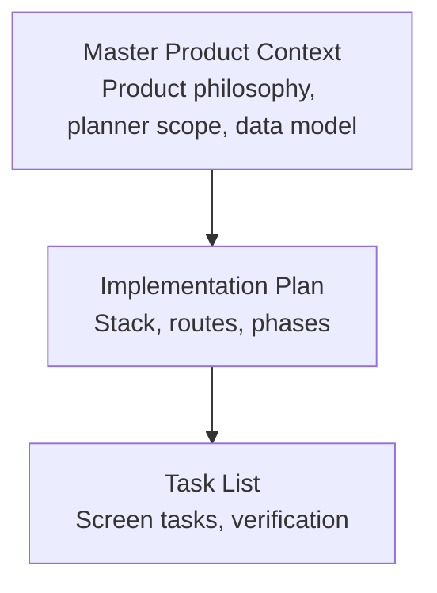
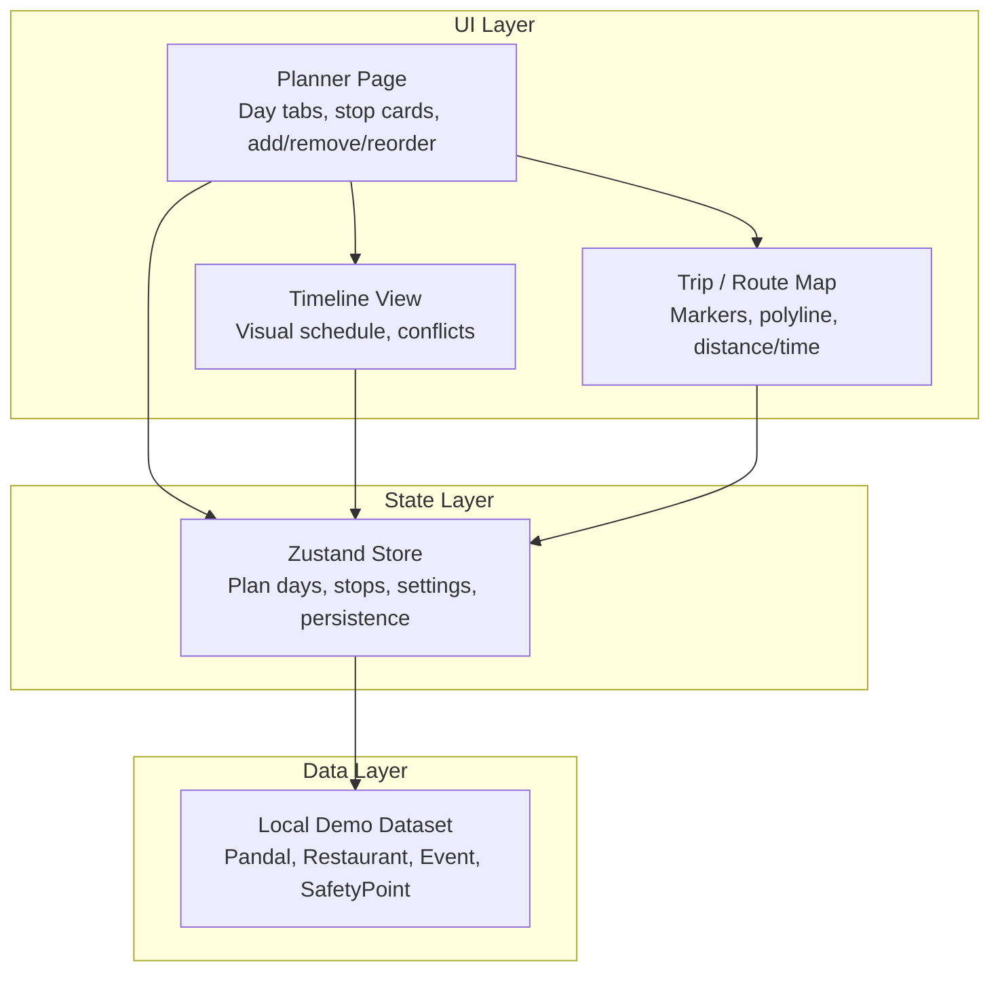
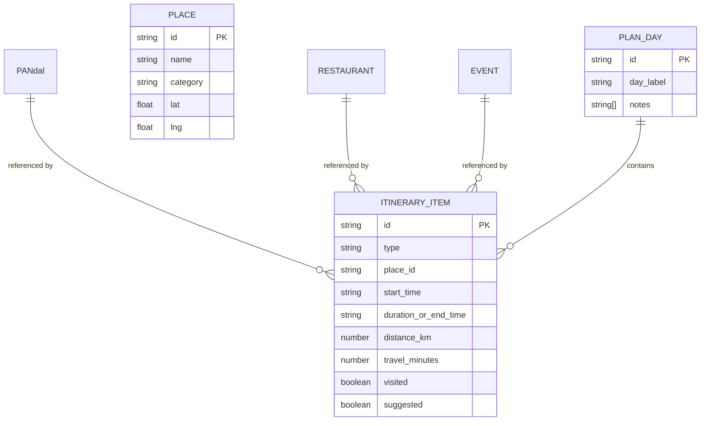
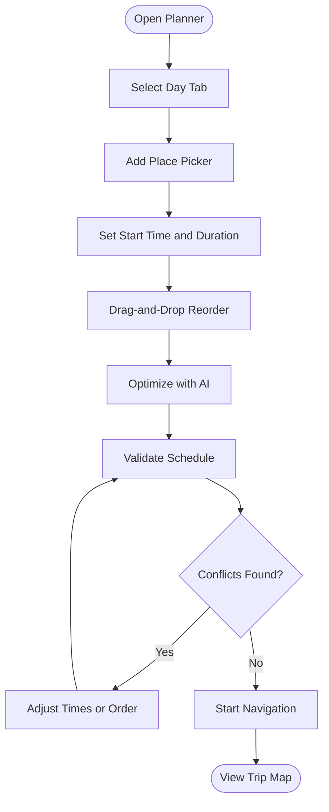
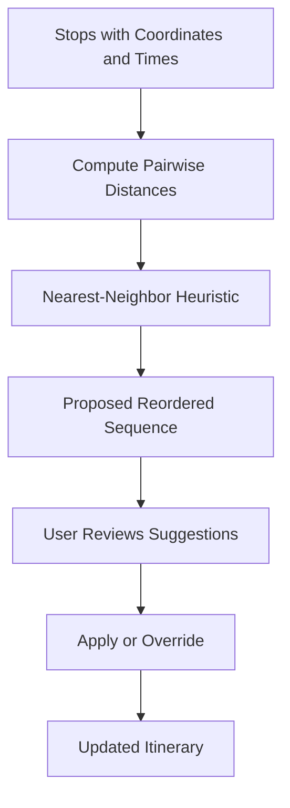
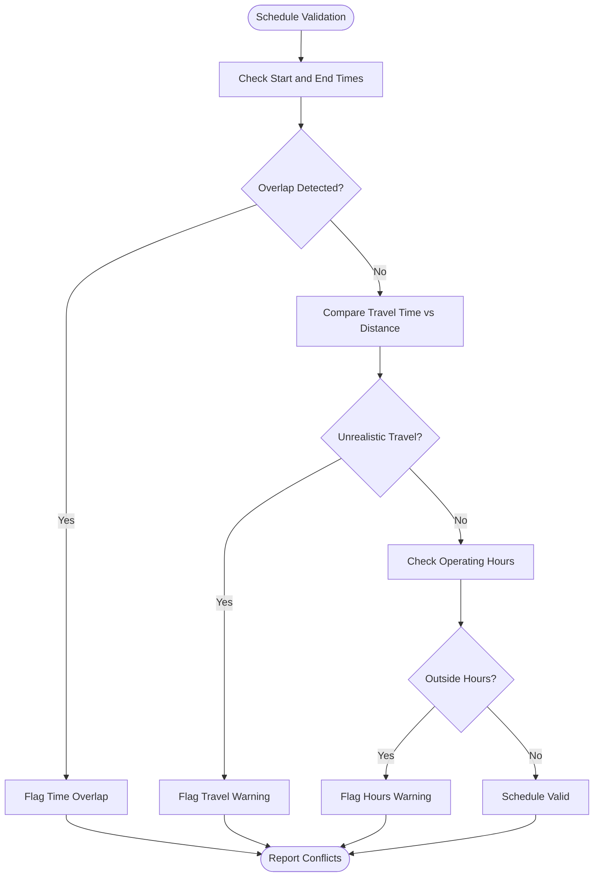
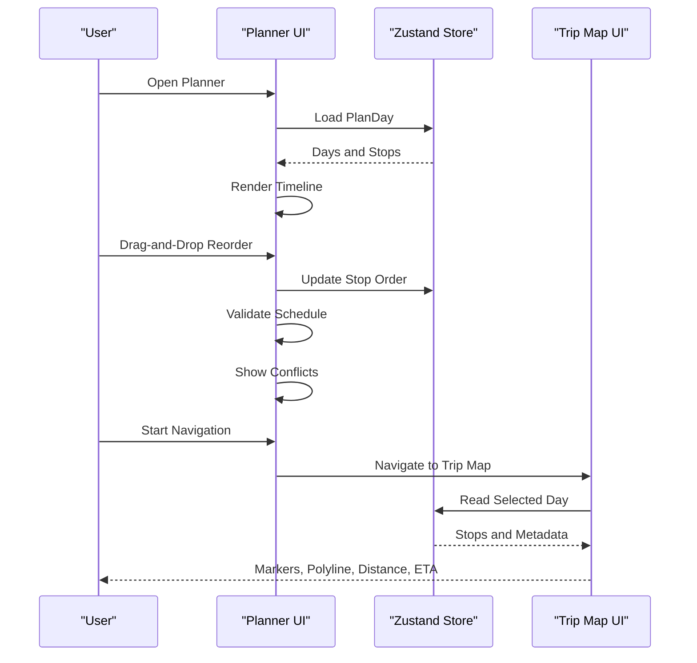
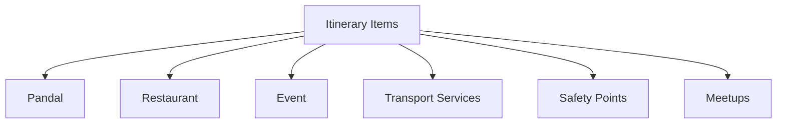
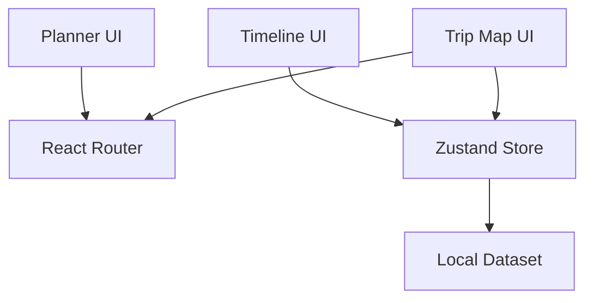

# Core Itinerary Management

<cite>
**Referenced Files in This Document**
- [Pujo_Sahayak_Master_Project_Context.md](file://Pujo_Sahayak_Master_Project_Context.md)
- [plan.md](file://tasks/plan.md)
- [todo.md](file://tasks/todo.md)
</cite>

## Table of Contents
1. [Introduction](#introduction)
2. [Project Structure](#project-structure)
3. [Core Components](#core-components)
4. [Architecture Overview](#architecture-overview)
5. [Detailed Component Analysis](#detailed-component-analysis)
6. [Dependency Analysis](#dependency-analysis)
7. [Performance Considerations](#performance-considerations)
8. [Troubleshooting Guide](#troubleshooting-guide)
9. [Conclusion](#conclusion)

## Introduction
This document explains the core itinerary management system for Puja Sahayak, focusing on multi-day Puja planning from Panchami through Dashami. The itinerary is a sequence of stops such as pandals, restaurants, events, and transportation segments, each with approximate timings. The system supports stop management, time-based scheduling, route optimization suggestions, conflict detection, and visual timeline representation. It also documents how itinerary items relate to the broader place ecosystem including pandals, restaurants, events, meetups, and safety points.

The documentation is based on the product context, implementation plan, and task list for the project. No application source code exists in this workspace; therefore, this guide describes the intended architecture, data model, UI behavior, and state management approach as specified by the repository’s planning documents.

## Project Structure
At present, the repository contains:
- A master product context describing the overall platform, user flows, premium features, and data model principles.
- An implementation plan describing the React + Vite PWA stack, routes, and phased delivery.
- A task list detailing screen-by-screen responsibilities, including the Puja Planner and Trip/Route Map.

**Diagram sources**
- [Pujo_Sahayak_Master_Project_Context.md:1-100](file://Pujo_Sahayak_Master_Project_Context.md#L1-L100)
- [plan.md:1-20](file://tasks/plan.md#L1-L20)
- [todo.md:1-15](file://tasks/todo.md#L1-L15)

**Section sources**
- [Pujo_Sahayak_Master_Project_Context.md:1-100](file://Pujo_Sahayak_Master_Project_Context.md#L1-L100)
- [plan.md:1-20](file://tasks/plan.md#L1-L20)
- [todo.md:1-15](file://tasks/todo.md#L1-L15)

## Core Components
The itinerary management system centers around these components:

- Multi-day planner: Supports day tabs from Panchami through Dashami. Each day holds an ordered list of stops.
- Stop types: Pandal, Restaurant, Event, Transportation segment, and Return trip.
- Approximate timing: Each stop has a start time and optional duration or end time.
- Stop management: Add, remove, reorder, and edit stops per day.
- Time-based scheduling: Visual timeline showing stops and travel segments between them.
- Route optimization: AI-assisted nearest-neighbor suggestion that proposes reordering stops to reduce travel distance while keeping it clear that outputs are suggestions.
- Conflict detection: Detect overlapping times, unrealistic travel durations, or missing timing information.
- Place ecosystem integration: Stops reference places (pandals, restaurants, events) and can connect to nearby services and meetups.
- State management: Zustand store persists saves, visits, plans, settings, and session continuity.

Key behaviors derived from the planning documents:
- The planner is a premium feature concept but should not be hard-coded into a subscription system at this stage.
- Generated plans must be presented as suggestions, not guaranteed optimal routes.
- The Trip/Route Map renders the selected day’s stops as numbered markers and polylines, with total distance and estimated time.

**Section sources**
- [Pujo_Sahayak_Master_Project_Context.md:353-421](file://Pujo_Sahayak_Master_Project_Context.md#L353-L421)
- [plan.md:54-58](file://tasks/plan.md#L54-L58)
- [todo.md:50-64](file://tasks/todo.md#L50-L64)

## Architecture Overview
The itinerary system spans UI, state, and data layers:

- UI layer:
  - Planner page with day tabs and stop cards.
  - Timeline view for visual scheduling.
  - Trip/Route Map page for navigation visualization.
- State layer:
  - Zustand store holding plan days, stops, preferences, and persistence.
- Data layer:
  - Typed local demo dataset containing places and metadata used by itinerary items.

**Diagram sources**
- [plan.md:7-17](file://tasks/plan.md#L7-L17)
- [todo.md:50-64](file://tasks/todo.md#L50-L64)

## Detailed Component Analysis

### Data Model for PlanDay and Itinerary Items
A PlanDay represents one day of the Puja itinerary. It contains:
- Day identifier and label (e.g., Panchami, Shashthi, Saptami, Ashtami, Navami, Dashami).
- Ordered array of itinerary items (stops).
- Optional global notes or constraints for the day.

Each itinerary item includes:
- Type: Pandal, Restaurant, Event, Transportation, Return.
- Place reference: ID linking to the place ecosystem (pandal, restaurant, event).
- Timing: Start time, duration or end time, and approximate visit length.
- Travel segment: Distance and estimated travel time to the next stop.
- Status flags: Conflicts, suggestions, visited, saved.

Relationships to the place ecosystem:
- Pandal, Restaurant, and Event items reference corresponding entities in the dataset.
- Transportation segments may link to transport services or generic travel actions.
- Nearby services and meetups can be surfaced from the same place ecosystem.

**Diagram sources**
- [Pujo_Sahayak_Master_Project_Context.md:1232-1259](file://Pujo_Sahayak_Master_Project_Context.md#L1232-L1259)
- [todo.md:13-14](file://tasks/todo.md#L13-L14)

**Section sources**
- [Pujo_Sahayak_Master_Project_Context.md:353-421](file://Pujo_Sahayak_Master_Project_Context.md#L353-L421)
- [Pujo_Sahayak_Master_Project_Context.md:1232-1259](file://Pujo_Sahayak_Master_Project_Context.md#L1232-L1259)
- [todo.md:13-14](file://tasks/todo.md#L13-L14)

### UI Components for Itinerary Builder
The itinerary builder provides:
- Day tabs for Panchami through Dashami.
- Stop cards showing image, type, duration, and travel-between rows.
- Add Place picker sourced from the dataset or saved places.
- Optimize with AI button that suggests nearest-neighbor reordering.
- Start Navigation action that navigates to the Trip/Route Map for the selected day.

Conflict detection and timeline visualization:
- Overlapping time windows are flagged.
- Missing or inconsistent timing is highlighted.
- Travel durations are compared against distances to warn about unrealistic schedules.
- Timeline rendering shows stops and gaps, making it easy to spot bottlenecks.

**Diagram sources**
- [todo.md:50-64](file://tasks/todo.md#L50-L64)

**Section sources**
- [todo.md:50-64](file://tasks/todo.md#L50-L64)

### Time-Based Scheduling and Route Optimization
Time-based scheduling ensures:
- Each stop has a start time.
- Duration or end time is provided where applicable.
- Travel segments include distance and estimated minutes.
- The system warns when travel time is shorter than expected given distance.

Route optimization:
- Uses nearest-neighbor heuristic to propose a reordered sequence.
- Presents suggestions rather than guarantees.
- Allows manual override after suggestion.

**Diagram sources**
- [Pujo_Sahayak_Master_Project_Context.md:404-421](file://Pujo_Sahayak_Master_Project_Context.md#L404-L421)
- [todo.md:50-64](file://tasks/todo.md#L50-L64)

**Section sources**
- [Pujo_Sahayak_Master_Project_Context.md:404-421](file://Pujo_Sahayak_Master_Project_Context.md#L404-L421)
- [todo.md:50-64](file://tasks/todo.md#L50-L64)

### Conflict Detection Logic
Conflict detection covers:
- Time overlaps between consecutive stops.
- Missing timing fields.
- Unrealistic travel durations relative to distance.
- Stops scheduled outside operating hours when available.

**Diagram sources**
- [todo.md:50-64](file://tasks/todo.md#L50-L64)

**Section sources**
- [todo.md:50-64](file://tasks/todo.md#L50-L64)

### Visual Timeline Representation
The timeline view displays:
- Chronological order of stops.
- Visual gaps representing travel segments.
- Color-coded warnings for conflicts.
- Quick-edit controls for adjusting times and order.

**Diagram sources**
- [plan.md:28-38](file://tasks/plan.md#L28-L38)
- [todo.md:50-64](file://tasks/todo.md#L50-L64)

**Section sources**
- [plan.md:28-38](file://tasks/plan.md#L28-L38)
- [todo.md:50-64](file://tasks/todo.md#L50-L64)

### Relationship Between Itinerary Items and the Place Ecosystem
Itinerary items are linked to the broader place ecosystem:
- Pandal, Restaurant, and Event items reference typed place entities.
- Nearby restaurants and meetups are surfaced from the same dataset.
- Safety points and transport services support travel segments.
- The product model emphasizes a broad Place hierarchy with specialized categories like Pandal and Restaurant.

**Diagram sources**
- [Pujo_Sahayak_Master_Project_Context.md:1232-1259](file://Pujo_Sahayak_Master_Project_Context.md#L1232-L1259)
- [todo.md:13-14](file://tasks/todo.md#L13-L14)

**Section sources**
- [Pujo_Sahayak_Master_Project_Context.md:1232-1259](file://Pujo_Sahayak_Master_Project_Context.md#L1232-L1259)
- [todo.md:13-14](file://tasks/todo.md#L13-L14)

### Implementation Examples Using Zustand
Although no source code is present, the intended implementation follows these patterns:

- Creating a new day:
  - Initialize a PlanDay with a day label and empty stops.
  - Persist via Zustand with localStorage.
- Adding a stop:
  - Pick a place from the dataset or saved places.
  - Assign start time and duration.
  - Append to the current day’s stops.
- Reordering stops:
  - Use drag-and-drop to update order.
  - Recalculate travel segments and validate schedule.
- Optimizing route:
  - Trigger nearest-neighbor suggestion.
  - Present proposed order as suggestions.
  - Allow user to accept or override.
- Managing conflicts:
  - Highlight overlaps and unrealistic travel.
  - Provide quick-edit controls to fix issues.
- Navigating to the map:
  - Pass selected day ID to the Trip/Route Map route.
  - Render markers, polyline, distance, and estimated time.

These operations align with the documented stack and verification requirements:
- React Router for routing.
- Zustand with persist middleware for state.
- Leaflet for maps.
- Local dataset for place references.

**Section sources**
- [plan.md:7-17](file://tasks/plan.md#L7-L17)
- [plan.md:28-38](file://tasks/plan.md#L28-L38)
- [todo.md:50-64](file://tasks/todo.md#L50-L64)

## Dependency Analysis
The itinerary system depends on:
- UI components for planner, timeline, and map.
- Zustand store for state and persistence.
- Local dataset for place references and metadata.
- React Router for navigation between planner and trip map.

**Diagram sources**
- [plan.md:7-17](file://tasks/plan.md#L7-L17)
- [plan.md:28-38](file://tasks/plan.md#L28-L38)
- [todo.md:50-64](file://tasks/todo.md#L50-L64)

**Section sources**
- [plan.md:7-17](file://tasks/plan.md#L7-L17)
- [plan.md:28-38](file://tasks/plan.md#L28-L38)
- [todo.md:50-64](file://tasks/todo.md#L50-L64)

## Performance Considerations
- Keep stop lists small per day to avoid heavy re-renders during drag-and-drop.
- Debounce validation triggers to prevent excessive conflict checks.
- Precompute pairwise distances for optimization suggestions when possible.
- Use memoization for timeline rendering and conflict calculations.
- Avoid unnecessary reflows by batching state updates in Zustand.
- Ensure map rendering uses efficient marker and polyline updates.

[No sources needed since this section provides general guidance]

## Troubleshooting Guide
Common issues and resolutions:
- Missing timing fields:
  - Require start time for every stop.
  - Warn if duration or end time is absent.
- Time overlaps:
  - Highlight overlapping intervals.
  - Provide quick-adjust controls to shift times.
- Unrealistic travel durations:
  - Compare travel minutes with distance.
  - Show warnings and suggest longer breaks.
- Out-of-hours visits:
  - If operating hours are available, flag stops outside those hours.
- Persistence failures:
  - Verify Zustand persist middleware configuration.
  - Confirm localStorage availability and quota.
- Map rendering errors:
  - Validate coordinates and polyline data.
  - Ensure Leaflet tiles load correctly.

**Section sources**
- [todo.md:50-64](file://tasks/todo.md#L50-L64)

## Conclusion
The core itinerary management system for Puja Sahayak is designed to support detailed multi-day planning from Panchami through Dashami. It integrates pandals, restaurants, events, and transportation segments into a cohesive schedule with approximate timings, conflict detection, and route optimization suggestions. The UI provides an intuitive planner, timeline visualization, and a trip map for navigation. State is managed with Zustand and persisted to localStorage, while the place ecosystem provides rich context for itinerary items. The system emphasizes suggestions over guarantees, ensuring users retain control over their plans while benefiting from intelligent assistance.

[No sources needed since this section summarizes without analyzing specific files]