# Planning and Itinerary Management

<cite>
**Referenced Files in This Document**
- [Pujo_Sahayak_Master_Project_Context.md](file://Pujo_Sahayak_Master_Project_Context.md)
- [plan.md](file://tasks/plan.md)
- [todo.md](file://tasks/todo.md)
</cite>

## Table of Contents
1. [Introduction](#introduction)
2. [Project Structure](#project-structure)
3. [Core Components](#core-components)
4. [Architecture Overview](#architecture-overview)
5. [Detailed Component Analysis](#detailed-component-analysis)
6. [Dependency Analysis](#dependency-analysis)
7. [Performance Considerations](#performance-considerations)
8. [Troubleshooting Guide](#troubleshooting-guide)
9. [Conclusion](#conclusion)
10. [Appendices](#appendices)

## Introduction
This document explains the Planning and Itinerary Management system for Puja Sahayak. The system supports multi-day Durga Puja planning from Panchami through Dashami, with stop management, approximate timings, transportation segments, route visualization, AI-assisted suggestions, premium gating, sharing concepts, and integration points for navigation.

The product is a location-aware local discovery platform centered on Durga Puja, where planning is one of the core user journeys alongside discovery, understanding, visiting, sharing, and community interaction. Planning is explicitly positioned as a premium capability in the product context, while still being part of the overall ecosystem that remains useful beyond the festival season.

**Section sources**
- [Pujo_Sahayak_Master_Project_Context.md:15-17](file://Pujo_Sahayak_Master_Project_Context.md#L15-L17)
- [Pujo_Sahayak_Master_Project_Context.md:87-100](file://Pujo_Sahayak_Master_Project_Context.md#L87-L100)
- [Pujo_Sahayak_Master_Project_Context.md:1734-1738](file://Pujo_Sahayak_Master_Project_Context.md#L1734-L1738)

## Project Structure
At this stage, the repository contains:
- A master product context document describing the full product vision, feature map, data model direction, premium positioning, and development principles.
- An implementation plan outlining the React + Vite PWA architecture, screen-to-route mapping, task phases, verification criteria, risks, and open questions.
- A task checklist tracking progress across foundation, discovery, Maya, planning, social, utility, account, and polish phases.

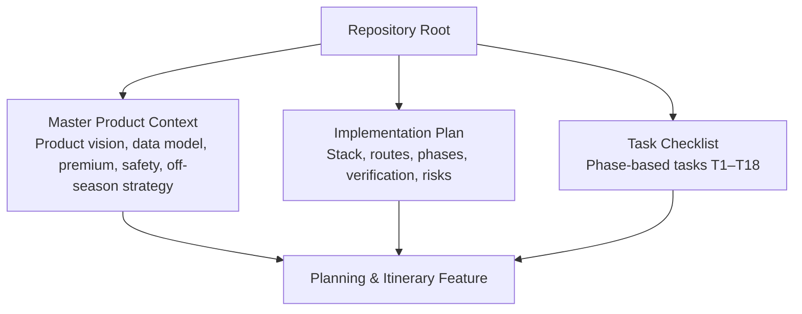

**Diagram sources**
- [Pujo_Sahayak_Master_Project_Context.md:1-120](file://Pujo_Sahayak_Master_Project_Context.md#L1-L120)
- [plan.md:1-20](file://tasks/plan.md#L1-L20)
- [todo.md:1-15](file://tasks/todo.md#L1-L15)

**Section sources**
- [Pujo_Sahayak_Master_Project_Context.md:1-120](file://Pujo_Sahayak_Master_Project_Context.md#L1-L120)
- [plan.md:1-20](file://tasks/plan.md#L1-L20)
- [todo.md:1-15](file://tasks/todo.md#L1-L15)

## Core Components
The Planning and Itinerary Management system is composed of several conceptual components:

- **PlanDay**: Represents one day of the Puja itinerary, such as Panchami, Shashthi, Saptami, Ashtami, Navami, or Dashami.
- **Stops**: Ordered stops within a PlanDay, including pandals, restaurants, events, and other places.
- **Transportation Segments**: Travel legs between stops, including approximate travel time and distance.
- **Approximate Timings**: Start times, durations, and end windows for each stop and segment.
- **AI-Assisted Suggestions**: Route optimization and stop recommendations based on location, distance, operating hours, crowd information, user preferences, saved places, and available events.
- **UI Itinerary Builder**: Day tabs, drag-and-drop reordering, conflict detection, timeline visualization, add/remove stops, and optimization actions.
- **Premium Gating**: Control surface for advanced planning features behind a subscription or premium state.
- **Sharing Surface**: Conceptual export/share of plans to friends or meetups.
- **Navigation Integration**: Entry point to external navigation apps or built-in trip routing.

These components are described conceptually by the product context and implementation plan. There is no separate codebase yet; the planning feature is planned under Phase 4 tasks.

**Section sources**
- [Pujo_Sahayak_Master_Project_Context.md:353-420](file://Pujo_Sahayak_Master_Project_Context.md#L353-L420)
- [plan.md:41-58](file://tasks/plan.md#L41-L58)
- [todo.md:45-56](file://tasks/todo.md#L45-L56)

## Architecture Overview
The planning system sits at the intersection of discovery, personalization, AI assistance, and navigation.

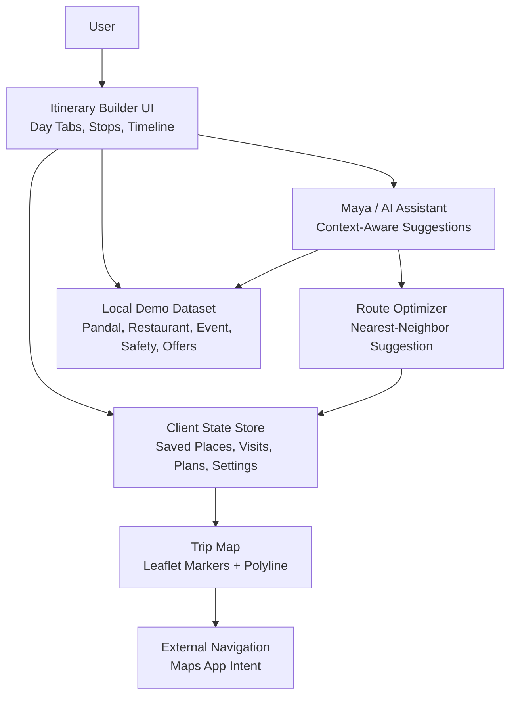

**Diagram sources**
- [Pujo_Sahayak_Master_Project_Context.md:353-420](file://Pujo_Sahayak_Master_Project_Context.md#L353-L420)
- [plan.md:1-18](file://tasks/plan.md#L1-L18)
- [todo.md:45-64](file://tasks/todo.md#L45-L64)

## Detailed Component Analysis

### PlanDay Data Model
A PlanDay represents one scheduled day of the Puja itinerary. Based on the product context and implementation plan, it should include:

| Field | Purpose | Notes |
|---|---|---|
| `dayName` | Identifies the Puja day | Values include Panchami, Shashthi, Saptami, Ashtami, Navami, Dashami |
| `stops` | Ordered list of itinerary stops | Each stop references a place entity such as a pandal, restaurant, or event |
| `transportSegments` | Travel legs between stops | Includes approximate duration and distance |
| `approximateTimings` | Time windows per stop | Start time, expected duration, and optional end window |
| `notes` | Optional user notes | Free-form text for reminders or preferences |
| `isOptimized` | Whether AI optimization was applied | Helps communicate suggestion vs. guaranteed optimal route |
| `createdAt` | Creation timestamp | Useful for history and sorting |
| `updatedAt` | Last modification timestamp | Useful for persistence and conflict resolution |

Each stop can be modeled as a typed reference to a Place entity, with additional fields for timing and user intent:

| Stop Field | Purpose |
|---|---|
| `placeId` | Reference to a pandal, restaurant, event, or other place |
| `placeType` | Category such as Pandal, Restaurant, Event |
| `startTime` | Planned start time |
| `durationMinutes` | Expected visit duration |
| `priority` | Optional preference weight for ordering |
| `constraints` | Operating hours, crowd tolerance, accessibility, dietary needs |

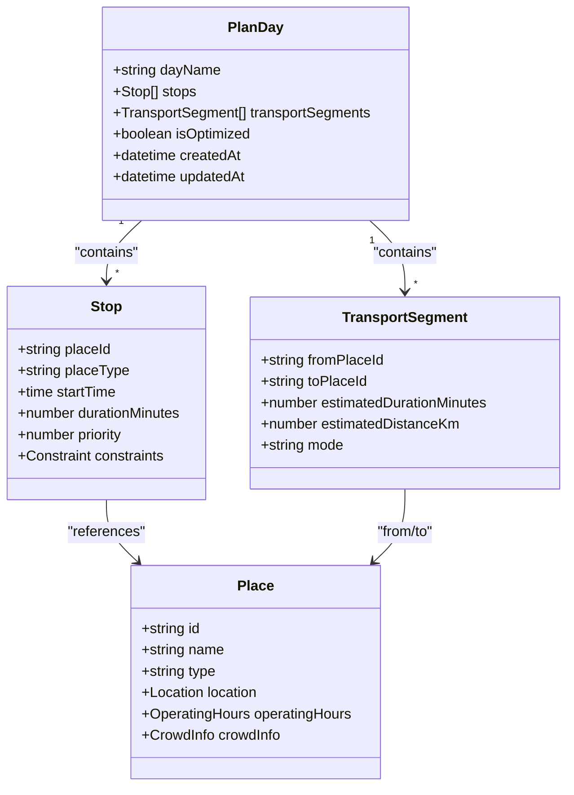

**Diagram sources**
- [Pujo_Sahayak_Master_Project_Context.md:353-420](file://Pujo_Sahayak_Master_Project_Context.md#L353-L420)
- [Pujo_Sahayak_Master_Project_Context.md:1232-1260](file://Pujo_Sahayak_Master_Project_Context.md#L1232-L1260)
- [todo.md:13-14](file://tasks/todo.md#L13-L14)

**Section sources**
- [Pujo_Sahayak_Master_Project_Context.md:353-420](file://Pujo_Sahayak_Master_Project_Context.md#L353-L420)
- [Pujo_Sahayak_Master_Project_Context.md:1232-1260](file://Pujo_Sahayak_Master_Project_Context.md#L1232-L1260)
- [todo.md:13-14](file://tasks/todo.md#L13-L14)

### Multi-Day Schedule Creation
The planner supports creating schedules across multiple days:

- Days: Panchami through Dashami.
- Per-day content: pandals, restaurants, events, local attractions, transportation segments, and approximate timings.
- Example flow: evening schedule starting with a pandal, followed by another pandal, dinner, another pandal, and return.

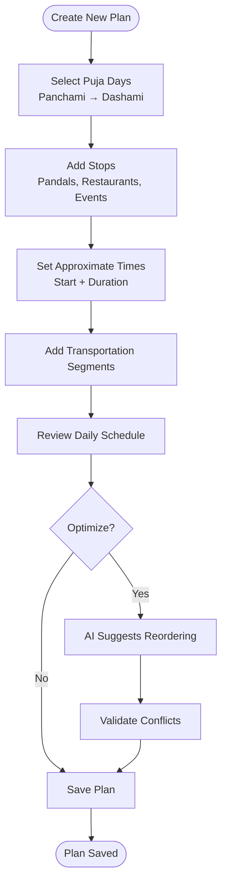

**Diagram sources**
- [Pujo_Sahayak_Master_Project_Context.md:353-400](file://Pujo_Sahayak_Master_Project_Context.md#L353-L400)
- [todo.md:50-51](file://tasks/todo.md#L50-L51)

**Section sources**
- [Pujo_Sahayak_Master_Project_Context.md:353-400](file://Pujo_Sahayak_Master_Project_Context.md#L353-L400)
- [todo.md:50-51](file://tasks/todo.md#L50-L51)

### Stop Management and Drag-and-Drop Reordering
The UI should allow users to:

- Add stops from saved places, favorites, search results, or nearby recommendations.
- Remove or replace stops.
- Reorder stops using drag-and-drop.
- See travel segments update automatically when order changes.
- View approximate total time and distance.

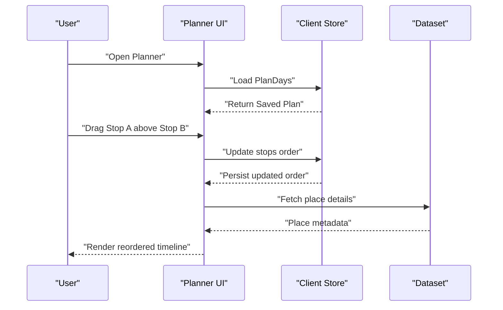

**Diagram sources**
- [todo.md:50-51](file://tasks/todo.md#L50-L51)
- [plan.md:1-18](file://tasks/plan.md#L1-L18)

**Section sources**
- [todo.md:50-51](file://tasks/todo.md#L50-L51)
- [plan.md:1-18](file://tasks/plan.md#L1-L18)

### Conflict Detection
Conflict detection should validate:

- Overlapping time windows for two stops.
- Unrealistic travel durations between stops.
- Stops scheduled outside operating hours.
- Excessively long days without breaks.
- Missing return or final transportation segment.

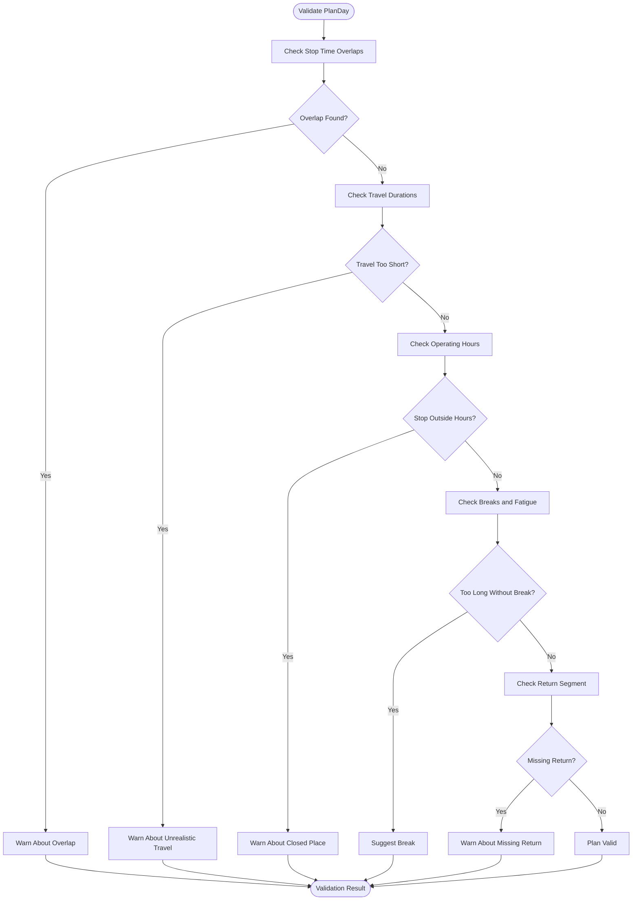

**Diagram sources**
- [Pujo_Sahayak_Master_Project_Context.md:404-420](file://Pujo_Sahayak_Master_Project_Context.md#L404-L420)
- [todo.md:50-51](file://tasks/todo.md#L50-L51)

**Section sources**
- [Pujo_Sahayak_Master_Project_Context.md:404-420](file://Pujo_Sahayak_Master_Project_Context.md#L404-L420)
- [todo.md:50-51](file://tasks/todo.md#L50-L51)

### Visual Timeline Representation
The itinerary builder should present a visual timeline per day:

- Vertical or horizontal timeline showing stops in chronological order.
- Stop cards with image, name, type, duration, and travel-between rows.
- Color-coded categories for pandals, restaurants, events, and transportation.
- Indicators for conflicts, warnings, and optimization status.
- Quick actions to edit, remove, or reorder stops.

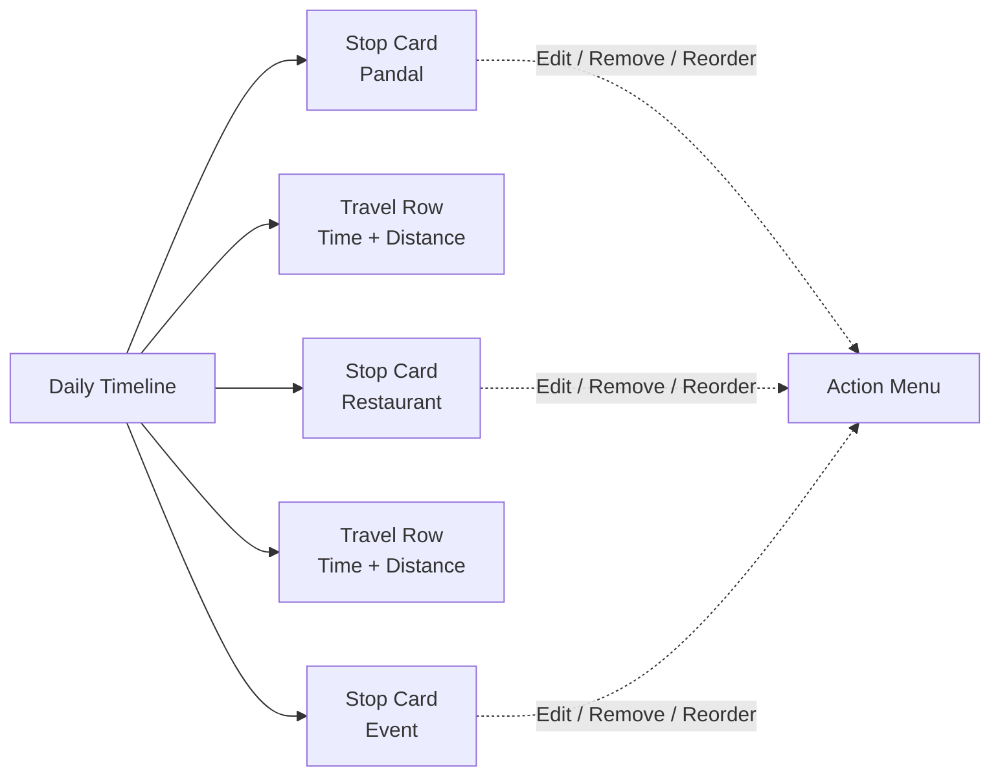

**Diagram sources**
- [todo.md:50-51](file://tasks/todo.md#L50-L51)

**Section sources**
- [todo.md:50-51](file://tasks/todo.md#L50-L51)

### AI-Assisted Planning Algorithms
AI-assisted planning should provide suggestions rather than guaranteed optimal routes. Inputs include:

- Current location and selected area.
- Distance between stops.
- Operating hours of places.
- Crowd information.
- User preferences such as cuisine, theme, accessibility, and budget.
- Saved places and visited places.
- Available events during the selected day.

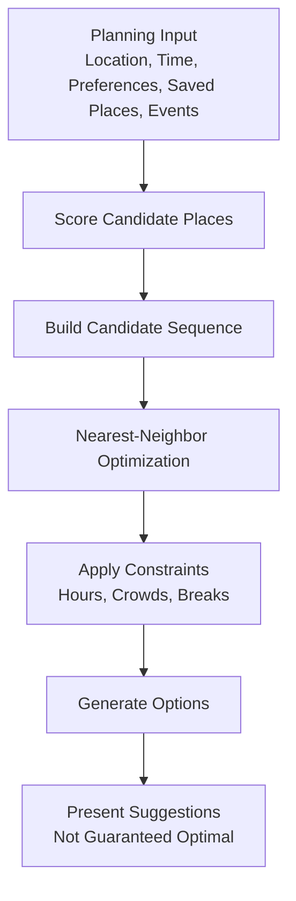

**Diagram sources**
- [Pujo_Sahayak_Master_Project_Context.md:404-420](file://Pujo_Sahayak_Master_Project_Context.md#L404-L420)
- [todo.md:50-51](file://tasks/todo.md#L50-L51)

**Section sources**
- [Pujo_Sahayak_Master_Project_Context.md:404-420](file://Pujo_Sahayak_Master_Project_Context.md#L404-L420)
- [todo.md:50-51](file://tasks/todo.md#L50-L51)

### Premium Feature Gating
Detailed itinerary planning is positioned as a potential premium feature. The implementation should:

- Gate advanced planning capabilities behind a premium check.
- Allow basic discovery, saved places, and exploration for free users.
- Avoid hard-coding a complex subscription system prematurely.
- Support future monetization models such as subscriptions, paid meetups, or partner services.

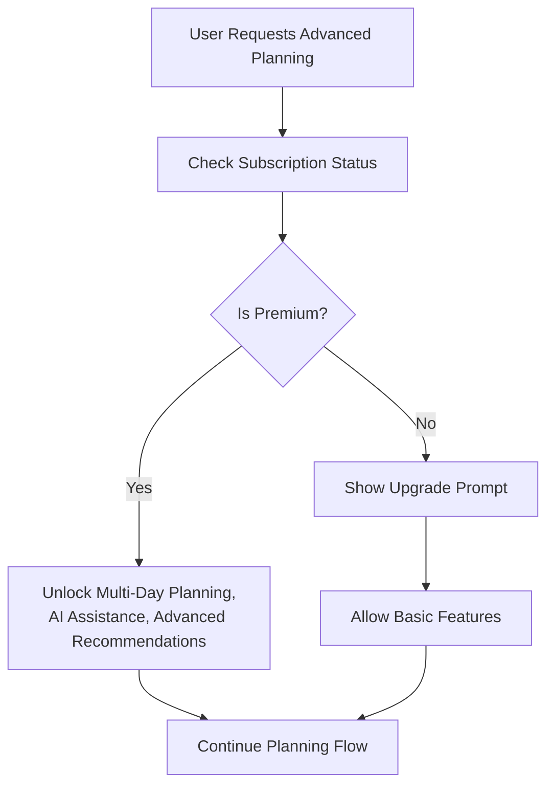

**Diagram sources**
- [Pujo_Sahayak_Master_Project_Context.md:424-444](file://Pujo_Sahayak_Master_Project_Context.md#L424-L444)
- [plan.md:81-85](file://tasks/plan.md#L81-L85)

**Section sources**
- [Pujo_Sahayak_Master_Project_Context.md:424-444](file://Pujo_Sahayak_Master_Project_Context.md#L424-L444)
- [plan.md:81-85](file://tasks/plan.md#L81-L85)

### Plan Sharing Capabilities
Plan sharing is conceptually supported by the broader product ecosystem:

- Users may share plans with friends or meetup participants.
- Plans can be exported or linked through deep links.
- Meetups can reference selected pandals, restaurants, or routes.
- Sharing should respect privacy and safety considerations.

```mermaid
sequenceDiagram
participant User as "User"
participant Planner as "Planner"
participant ShareService as "Share Surface"
participant Recipient as "Recipient"
User->>Planner : "Share Plan"
Planner->>ShareService : "Generate Shareable Link or Export"
ShareService-->>Recipient : "Open Shared Plan"
Recipient->>Recipient : "View Stops, Times, Route"
```

**Diagram sources**
- [Pujo_Sahayak_Master_Project_Context.md:664-727](file://Pujo_Sahayak_Master_Project_Context.md#L664-L727)
- [todo.md:53-54](file://tasks/todo.md#L53-L54)

**Section sources**
- [Pujo_Sahayak_Master_Project_Context.md:664-727](file://Pujo_Sahayak_Master_Project_Context.md#L664-L727)
- [todo.md:53-54](file://tasks/todo.md#L53-L54)

### Integration with Navigation Systems
The planning system integrates with navigation through:

- Trip/Route Map view with Leaflet markers and polylines.
- Estimated total distance and time.
- “Start Navigation” action that can open external maps or navigation apps.
- Location-aware routing and nearby help points.

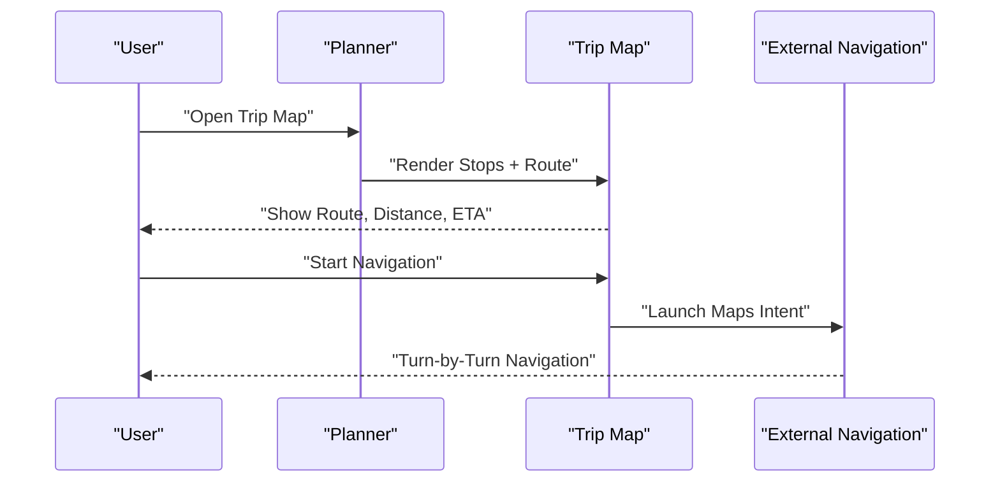

**Diagram sources**
- [todo.md:63-64](file://tasks/todo.md#L63-L64)
- [plan.md:1-18](file://tasks/plan.md#L1-L18)

**Section sources**
- [todo.md:63-64](file://tasks/todo.md#L63-L64)
- [plan.md:1-18](file://tasks/plan.md#L1-L18)

### Implementation Examples

#### Creating a Multi-Day Plan
1. Open the planner from Favorites or the main navigation.
2. Select one or more Puja days from Panchami to Dashami.
3. Add stops such as pandals, restaurants, and events.
4. Assign approximate start times and durations.
5. Add transportation segments between stops.
6. Review the daily timeline and resolve any conflicts.
7. Save the plan to local storage.

**Section sources**
- [Pujo_Sahayak_Master_Project_Context.md:353-400](file://Pujo_Sahayak_Master_Project_Context.md#L353-L400)
- [todo.md:50-51](file://tasks/todo.md#L50-L51)

#### Modifying an Existing Plan
1. Load the saved PlanDay from the client store.
2. Edit stop order using drag-and-drop.
3. Update approximate timings or replace a stop.
4. Recalculate transportation segments.
5. Run conflict validation.
6. Persist updated plan.

**Section sources**
- [todo.md:50-51](file://tasks/todo.md#L50-L51)
- [plan.md:1-18](file://tasks/plan.md#L1-L18)

#### Optimizing a Route
1. Trigger “Optimize with AI.”
2. Collect current location, distances, operating hours, crowd levels, preferences, saved places, and events.
3. Generate candidate sequences using nearest-neighbor logic.
4. Apply constraints such as closed hours and realistic travel times.
5. Present suggestions clearly as recommendations, not guarantees.
6. Allow the user to accept, tweak, or reject the suggested order.

**Section sources**
- [Pujo_Sahayak_Master_Project_Context.md:404-420](file://Pujo_Sahayak_Master_Project_Context.md#L404-L420)
- [todo.md:50-51](file://tasks/todo.md#L50-L51)

## Dependency Analysis
The planning feature depends on several foundational elements:

- **Data Model**: Typed entities for Place, Pandal, Restaurant, Event, PlanDay, and related types.
- **Client Store**: Zustand-based state for saved places, visits, plans, language, theme, and session continuity.
- **Dataset**: Local demo dataset grounded in real Kolkata locations, marked as demo data.
- **UI Components**: Cards, chips, buttons, bottom navigation, motion primitives, and map components.
- **Maya AI Shell**: Context-aware assistant UI that can assist with planning suggestions.
- **Map Integration**: Leaflet-based trip routing and nearby help points.

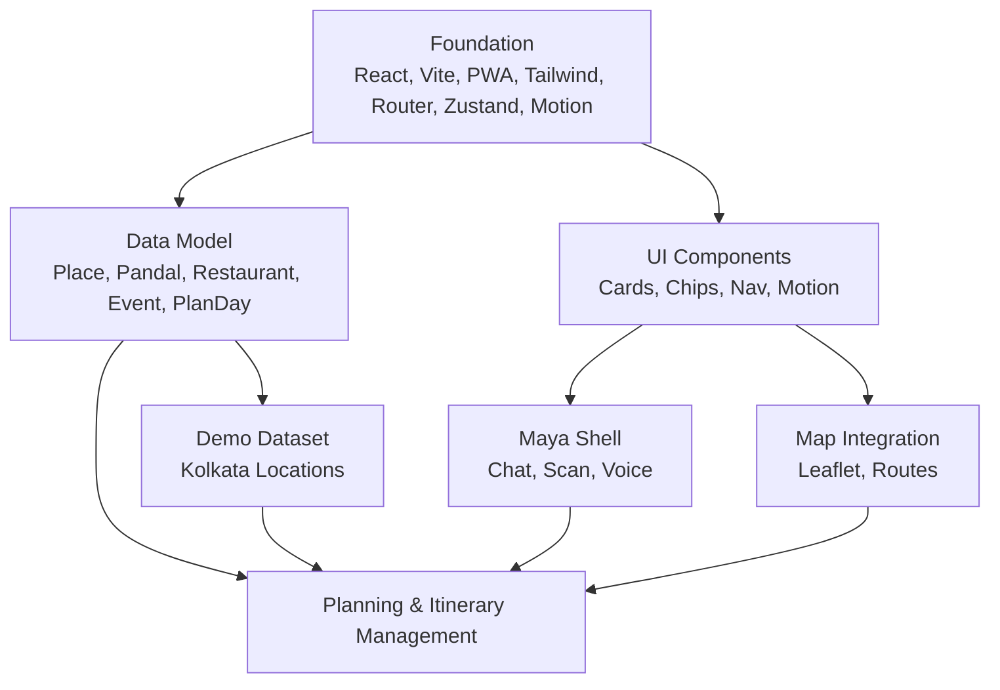

**Diagram sources**
- [plan.md:1-18](file://tasks/plan.md#L1-L18)
- [todo.md:5-14](file://tasks/todo.md#L5-L14)

**Section sources**
- [plan.md:1-18](file://tasks/plan.md#L1-L18)
- [todo.md:5-14](file://tasks/todo.md#L5-L14)

## Performance Considerations
- Keep itinerary rendering efficient by batching updates when reordering stops.
- Avoid recalculating all transportation segments on every minor change; compute only affected segments.
- Use lazy loading for place details and images.
- Cache frequently accessed place metadata and operating hours.
- Debounce AI optimization triggers to prevent excessive recomputation.
- Respect reduced-motion preferences for smoother UX on lower-end devices.
- Ensure offline shell caching does not block critical planning flows.

[No sources needed since this section provides general guidance]

## Troubleshooting Guide
Common issues and resolutions:

- **Plan disappears after reload**: Verify localStorage persistence for plans and ensure the store is initialized correctly.
- **Stops overlap unexpectedly**: Check conflict validation logic and ensure time windows are normalized.
- **Travel time seems unrealistic**: Validate haversine distance calculations and speed assumptions.
- **AI suggestion appears too aggressive**: Clarify that suggestions are not guaranteed optimal routes.
- **Premium gating blocks basic features**: Ensure premium checks do not gate essential free functionality.
- **Map does not render stops**: Confirm Leaflet initialization, marker coordinates, and polyline data.

**Section sources**
- [plan.md:63-79](file://tasks/plan.md#L63-L79)
- [todo.md:77-80](file://tasks/todo.md#L77-L80)

## Conclusion
The Planning and Itinerary Management system for Puja Sahayak is designed to support structured, multi-day Puja planning with flexible stop management, approximate timing, transportation segments, conflict detection, visual timelines, AI-assisted suggestions, premium gating, sharing concepts, and navigation integration. At this stage, the system is defined by product context and implementation planning rather than implemented source code. Future development should prioritize clarity, grounded data, user control, and performance while keeping AI assistance advisory rather than authoritative.

[No sources needed since this section summarizes without analyzing specific files]

## Appendices

### Appendix A: Key Feature References
- Multi-day Puja schedule creation: Panchami through Dashami.
- Stop types: pandals, restaurants, events, local attractions.
- Transportation segments: travel legs with approximate time and distance.
- Approximate timings: start times and durations per stop.
- AI-assisted planning: location, distance, hours, crowds, preferences, saved places, events.
- Premium gating: advanced planning as a premium capability.
- Sharing: conceptual plan sharing and meetup linkage.
- Navigation: trip map and external navigation integration.

**Section sources**
- [Pujo_Sahayak_Master_Project_Context.md:353-420](file://Pujo_Sahayak_Master_Project_Context.md#L353-L420)
- [plan.md:41-58](file://tasks/plan.md#L41-L58)
- [todo.md:45-64](file://tasks/todo.md#L45-L64)