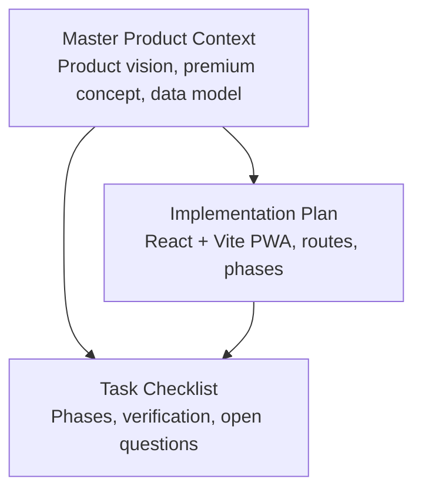
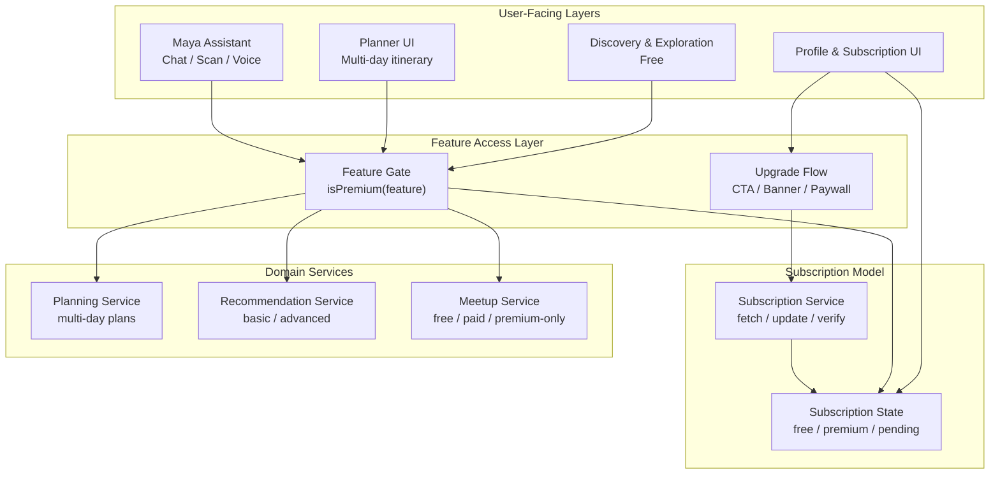
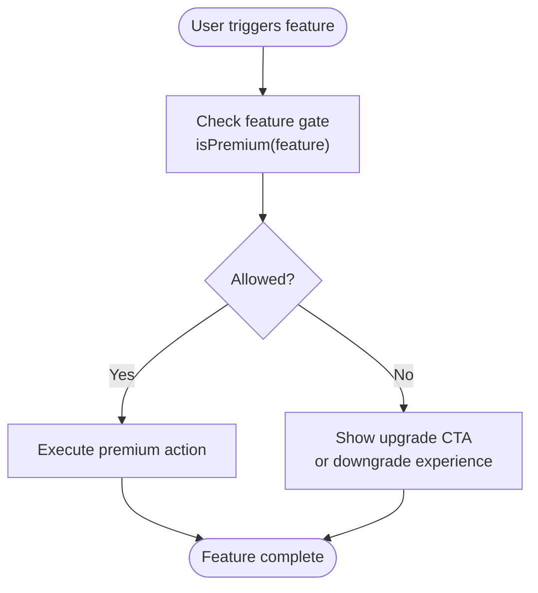
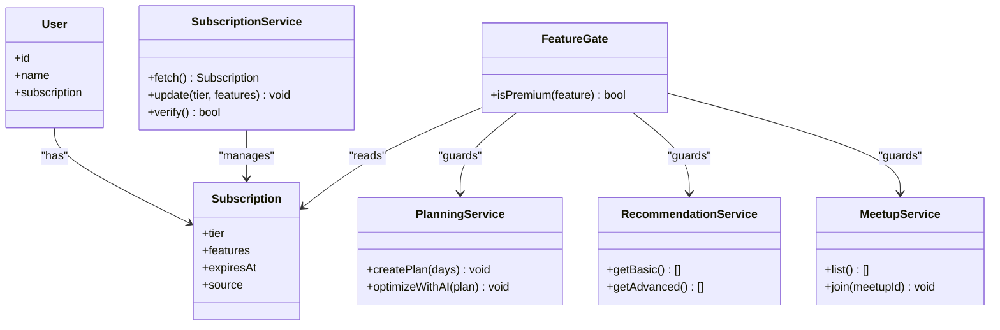
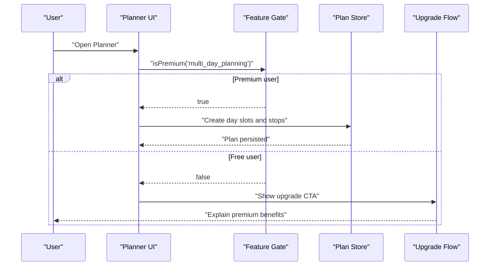
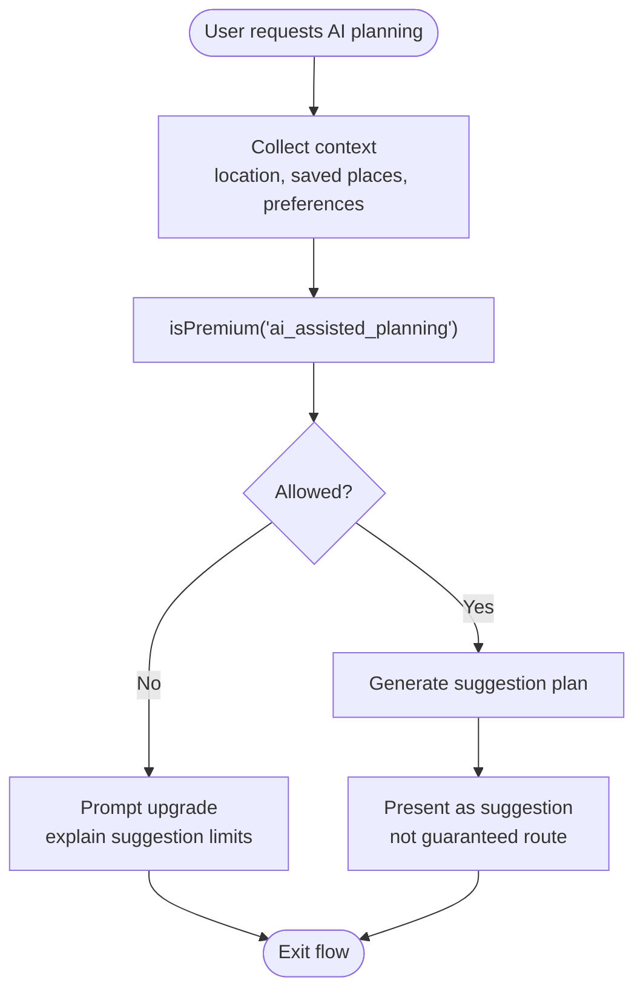
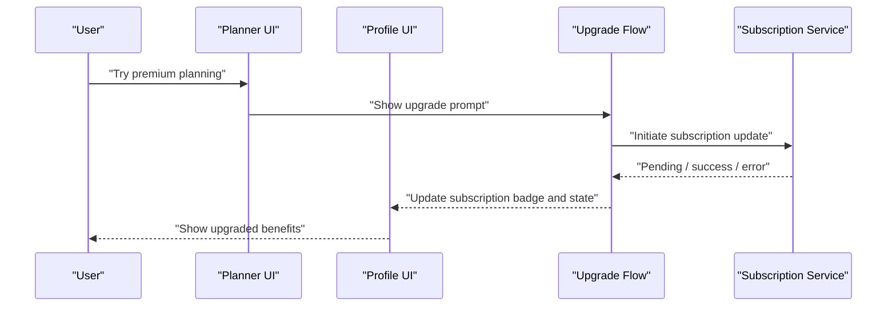
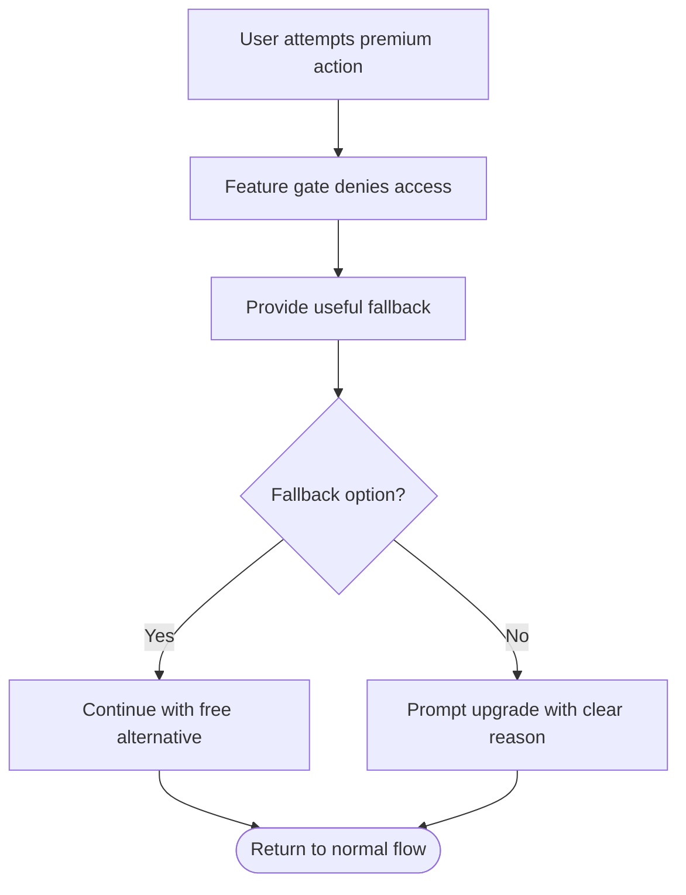
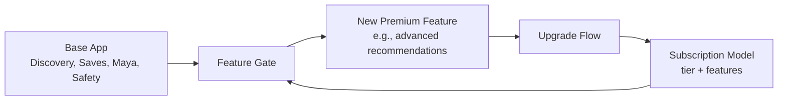
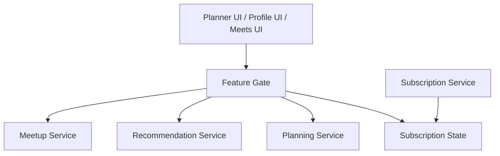

# Premium Features Integration

<cite>
**Referenced Files in This Document**
- [Pujo_Sahayak_Master_Project_Context.md](file://Pujo_Sahayak_Master_Project_Context.md)
- [plan.md](file://tasks/plan.md)
- [todo.md](file://tasks/todo.md)
</cite>

## Table of Contents
1. [Introduction](#introduction)
2. [Project Structure](#project-structure)
3. [Core Components](#core-components)
4. [Architecture Overview](#architecture-overview)
5. [Detailed Component Analysis](#detailed-component-analysis)
6. [Dependency Analysis](#dependency-analysis)
7. [Performance Considerations](#performance-considerations)
8. [Troubleshooting Guide](#troubleshooting-guide)
9. [Conclusion](#conclusion)

## Introduction
This document explains how premium features should be integrated into the Pujo Sahayak planning system while keeping basic discovery, saved places, and core exploration free. It focuses on:
- Gating multi-day itinerary planning and AI-assisted planning as premium features
- Keeping free basic discovery and saved places accessible without paywalls
- Designing a subscription model architecture that supports free and premium tiers without hard-coding pricing assumptions
- Providing implementation patterns for feature gating, upgrade flows, and graceful degradation
- Supporting future premium capabilities such as advanced recommendations and meetup enhancements

The guidance is derived from the product context, implementation plan, and task checklist for Pujo Sahayak.

## Project Structure
At this stage, the repository contains:
- A master product context describing the full product vision, user journeys, data model, premium concepts, and final product map
- An implementation plan describing the React + Vite PWA scope, routes, and phases
- A task checklist tracking build phases, including planning, social, profile, and premium-related UI stubs

**Diagram sources**
- [Pujo_Sahayak_Master_Project_Context.md:1-120](file://Pujo_Sahayak_Master_Project_Context.md#L1-L120)
- [plan.md:1-40](file://tasks/plan.md#L1-L40)
- [todo.md:1-20](file://tasks/todo.md#L1-L20)

**Section sources**
- [Pujo_Sahayak_Master_Project_Context.md:1-120](file://Pujo_Sahayak_Master_Project_Context.md#L1-L120)
- [plan.md:1-40](file://tasks/plan.md#L1-L40)
- [todo.md:1-20](file://tasks/todo.md#L1-L20)

## Core Components
The premium integration touches several areas already defined by the project:

- Free tier
  - Basic discovery: Home, Explore, Search, Categories
  - Saved places and visited places
  - Maya AI assistant (contextual Q&A and identification shell)
  - Safety and emergency shortcuts
  - Meetups discovery and creation (as currently scoped)

- Premium tier
  - Multi-day itinerary planning
  - AI-assisted planning suggestions
  - Potentially advanced recommendations
  - Potentially advanced or paid meetup capabilities

The product context explicitly warns against hard-coding a large subscription system around assumptions and treats premium features as evolving rather than finalized.

**Section sources**
- [Pujo_Sahayak_Master_Project_Context.md:355-443](file://Pujo_Sahayak_Master_Project_Context.md#L355-L443)
- [Pujo_Sahayak_Master_Project_Context.md:753-772](file://Pujo_Sahayak_Master_Project_Context.md#L753-L772)
- [Pujo_Sahayak_Master_Project_Context.md:954-975](file://Pujo_Sahayak_Master_Project_Context.md#L954-L975)
- [Pujo_Sahayak_Master_Project_Context.md:1232-1255](file://Pujo_Sahayak_Master_Project_Context.md#L1232-L1255)
- [Pujo_Sahayak_Master_Project_Context.md:1636-1687](file://Pujo_Sahayak_Master_Project_Context.md#L1636-L1687)

## Architecture Overview
The premium architecture should be layered so that access control is centralized, UI behavior adapts to subscription status, and premium features can be added without changing core discovery logic.

Key principles:
- The Feature Gate is the single place where premium checks are made.
- The Subscription State holds the current tier without embedding pricing.
- The Subscription Service abstracts fetching and updating subscription information.
- Domain services implement premium-specific logic only when required.
- The Upgrade Flow provides consistent CTAs and banners across the app.

[No diagram sources needed since this diagram shows conceptual architecture, not actual code structure]

## Detailed Component Analysis

### Premium Feature Gating Strategy
Premium gating should be implemented as a reusable check rather than scattered boolean flags. The gate should answer whether a specific feature is available to the current user.

Recommended pattern:
- Define feature identifiers, such as `multi_day_planning`, `ai_assisted_planning`, `advanced_recommendations`, `premium_meetups`.
- Implement an `isPremium(feature)` function that reads the current subscription state.
- Use the gate in UI components before rendering premium actions.
- When access is denied, show a clear upgrade prompt instead of silently hiding functionality.

Example usage points:
- Planner entry card
- Optimize-with-AI button
- Advanced recommendation sections
- Paid or premium-only meetup actions
- Upgrade banner in Profile

[No diagram sources needed since this diagram shows conceptual workflow, not actual code structure]

### Subscription Model Architecture
The subscription model should support:
- Free users with basic discovery and saved places
- Premium users with advanced planning and optional advanced features
- Pending or transitional states during upgrades or trials

Data model alignment:
- The product context defines a `Subscription` entity alongside `User`, `Place`, `Plan`, `Meetup`, etc.
- The Profile page includes a Subscription section and a “Become a Premium Member” call-to-action.
- Payments and donations are part of the broader concept but should not force a full wallet ecosystem at v1.

Recommended state shape:
- `tier`: `free` | `premium` | `pending`
- `features`: list of enabled feature identifiers
- `expiresAt`: optional expiration timestamp
- `source`: optional metadata about the subscription source

Important constraint:
- Do not hard-code pricing, currency, or payment provider details in the feature gate.
- Keep pricing and payment logic isolated behind the Subscription Service.

**Section sources**
- [Pujo_Sahayak_Master_Project_Context.md:1232-1255](file://Pujo_Sahayak_Master_Project_Context.md#L1232-L1255)
- [Pujo_Sahayak_Master_Project_Context.md:954-975](file://Pujo_Sahayak_Master_Project_Context.md#L954-L975)
- [Pujo_Sahayak_Master_Project_Context.md:1013-1039](file://Pujo_Sahayak_Master_Project_Context.md#L1013-L1039)

### Multi-Day Itinerary Planning as Premium
Multi-day itinerary planning is explicitly identified as a potential premium feature. The planner should:
- Allow users to construct detailed plans across Puja days
- Include pandals, restaurants, events, attractions, travel segments, and approximate timings
- Present AI-generated plans as suggestions, not guaranteed optimal routes

Graceful degradation:
- Free users should still see the Planner entry point if it exists in the UI, but premium actions such as creating multi-day plans or using AI optimization should be gated.
- If the Planner is fully premium, the UI should guide users toward free alternatives like saving places and exploring nearby options.

**Section sources**
- [Pujo_Sahayak_Master_Project_Context.md:355-402](file://Pujo_Sahayak_Master_Project_Context.md#L355-L402)
- [Pujo_Sahayak_Master_Project_Context.md:424-443](file://Pujo_Sahayak_Master_Project_Context.md#L424-L443)
- [todo.md:47-54](file://tasks/todo.md#L47-L54)

### AI-Assisted Planning as Premium
AI-assisted planning should remain separate from basic Maya interactions. The context distinguishes:
- Maya as a contextual assistant grounded in application data
- AI-assisted planning as a premium capability that proposes itineraries based on location, distance, hours, crowd information, preferences, saved places, and events

Implementation guidance:
- Keep basic Maya chat and camera identification available as core features.
- Gate AI-assisted planning behind the same premium gate used for multi-day planning.
- Always present generated plans as suggestions.
- Avoid making every feature “AI powered”; use AI where it adds real value.

**Section sources**
- [Pujo_Sahayak_Master_Project_Context.md:404-422](file://Pujo_Sahayak_Master_Project_Context.md#L404-L422)
- [Pujo_Sahayak_Master_Project_Context.md:558-605](file://Pujo_Sahayak_Master_Project_Context.md#L558-L605)
- [Pujo_Sahayak_Master_Project_Context.md:1297-1327](file://Pujo_Sahayak_Master_Project_Context.md#L1297-L1327)

### Free Basic Discovery and Saved Places
The free tier must remain valuable even when premium features are unavailable. Free capabilities include:
- Home discovery surface
- Explore and search
- Categories
- Pandal detail pages
- Favorites and visited places
- Maya assistant interactions
- Safety and emergency shortcuts
- Meetups discovery and creation as currently scoped

These features should never require a premium subscription. They form the foundation of the product and keep users engaged even if they do not subscribe.

**Section sources**
- [Pujo_Sahayak_Master_Project_Context.md:21-43](file://Pujo_Sahayak_Master_Project_Context.md#L21-L43)
- [Pujo_Sahayak_Master_Project_Context.md:140-158](file://Pujo_Sahayak_Master_Project_Context.md#L140-L158)
- [Pujo_Sahayak_Master_Project_Context.md:320-351](file://Pujo_Sahayak_Master_Project_Context.md#L320-L351)
- [Pujo_Sahayak_Master_Project_Context.md:447-556](file://Pujo_Sahayak_Master_Project_Context.md#L447-L556)
- [Pujo_Sahayak_Master_Project_Context.md:775-951](file://Pujo_Sahayak_Master_Project_Context.md#L775-L951)
- [Pujo_Sahayak_Master_Project_Context.md:1636-1660](file://Pujo_Sahayak_Master_Project_Context.md#L1636-L1660)

### Premium Upgrade Flows
The Profile page is the central place for subscription management and upgrade prompts. The context describes:
- A Subscription field in the profile header
- A “Become a Premium Member” CTA
- A Payments section that may include premium subscription, authorized meetup payments, partner services, and donations

Upgrade flow guidelines:
- Surface upgrade CTAs near premium features, not just in Profile.
- Explain what the user gains, not just that something is locked.
- Avoid hard-coding pricing; let the Subscription Service provide configuration.
- Support pending states for incomplete purchases or trials.
- Keep non-premium users able to continue using free features without interruption.

**Section sources**
- [Pujo_Sahayak_Master_Project_Context.md:954-975](file://Pujo_Sahayak_Master_Project_Context.md#L954-L975)
- [Pujo_Sahayak_Master_Project_Context.md:1013-1039](file://Pujo_Sahayak_Master_Project_Context.md#L1013-L1039)
- [plan.md:81-86](file://tasks/plan.md#L81-L86)

### Graceful Degradation When Premium Is Unavailable
Graceful degradation means the app remains usable and informative even when premium features are disabled.

Guidelines:
- Replace premium actions with descriptive fallbacks.
- For AI-assisted planning, offer manual planning steps or suggest saving places for later.
- For advanced recommendations, fall back to basic similarity-based suggestions.
- For premium meetups, allow viewing public meetups but restrict joining or creating paid/premium-only events.
- Never break navigation or hide core discovery paths.

[No diagram sources needed since this diagram shows conceptual workflow, not actual code structure]

### Extensible Design for Future Premium Features
The product context identifies advanced recommendations and advanced meetup capabilities as potential premium features. The design should allow new premium features to be added without rewriting core logic.

Recommended extension points:
- Add new feature identifiers to the feature gate.
- Extend the `features` list in the subscription state.
- Implement premium-specific logic inside domain services.
- Add UI hooks for upgrade prompts near the new feature.
- Keep pricing and payment logic outside the feature gate.

**Section sources**
- [Pujo_Sahayak_Master_Project_Context.md:424-443](file://Pujo_Sahayak_Master_Project_Context.md#L424-L443)
- [Pujo_Sahayak_Master_Project_Context.md:753-772](file://Pujo_Sahayak_Master_Project_Context.md#L753-L772)
- [Pujo_Sahayak_Master_Project_Context.md:1263-1294](file://Pujo_Sahayak_Master_Project_Context.md#L1263-L1294)

### Examples of Checking Premium Status and Handling Access Control
Below are practical examples of how premium checks should appear throughout the planning workflow. These are behavioral examples, not code snippets.

- Planner entry card
  - Check: `isPremium('multi_day_planning')`
  - If true: navigate to planner
  - If false: show upgrade banner explaining multi-day planning and AI assistance

- Optimize-with-AI button
  - Check: `isPremium('ai_assisted_planning')`
  - If true: run nearest-neighbor suggestion and present as a suggestion
  - If false: disable button and show tooltip linking to upgrade

- Advanced recommendations section
  - Check: `isPremium('advanced_recommendations')`
  - If true: load advanced recommendation service
  - If false: show basic recommendations or a “You might like” section

- Premium-only meetup
  - Check: `meetup.requiresPremium()`
  - If true and user is premium: allow join
  - If true and user is free: show upgrade prompt
  - If false: allow join as normal

- Profile subscription badge
  - Read: `subscription.tier`
  - Display: free or premium indicator
  - Action: navigate to subscription management or upgrade flow

**Section sources**
- [Pujo_Sahayak_Master_Project_Context.md:355-443](file://Pujo_Sahayak_Master_Project_Context.md#L355-L443)
- [Pujo_Sahayak_Master_Project_Context.md:753-772](file://Pujo_Sahayak_Master_Project_Context.md#L753-L772)
- [todo.md:47-54](file://tasks/todo.md#L47-L54)
- [todo.md:63-68](file://tasks/todo.md#L63-L68)

## Dependency Analysis
Premium integration introduces dependencies between UI layers, feature gates, subscription state, and domain services.

Coupling considerations:
- UI should depend on the Feature Gate, not directly on subscription state.
- Subscription Service should be the only component responsible for fetching and updating subscription data.
- Domain services should remain focused on their own responsibilities and only expose premium behavior through the gate.
- Avoid circular dependencies between UI and subscription services.

**Section sources**
- [Pujo_Sahayak_Master_Project_Context.md:1232-1255](file://Pujo_Sahayak_Master_Project_Context.md#L1232-L1255)
- [plan.md:1-18](file://tasks/plan.md#L1-L18)

## Performance Considerations
Premium gating should be lightweight:
- Cache subscription state locally after initial fetch.
- Avoid network calls on every UI render.
- Defer premium feature loading until the user actually attempts to use it.
- Keep basic discovery fast and independent of premium checks.
- Avoid heavy AI calls for free users; reserve AI-assisted planning for premium flows.

[No sources needed since this section provides general guidance]

## Troubleshooting Guide
Common issues and resolutions:

- Premium feature appears unlocked for free users
  - Verify the Feature Gate returns false for free users
  - Ensure subscription state is loaded before rendering premium UI
  - Check that upgrade flows do not accidentally set premium state prematurely

- Upgrade banner does not appear
  - Confirm the UI component subscribes to subscription state changes
  - Ensure the upgrade flow is wired to the correct premium feature identifier
  - Validate that the Profile UI renders the subscription section

- AI-assisted planning fails for premium users
  - Check that `ai_assisted_planning` is included in the enabled features list
  - Verify the Planning Service is called only after the premium gate passes
  - Ensure generated plans are presented as suggestions, not guarantees

- Free users cannot save places or discover locations
  - Confirm these features are not gated by premium checks
  - Verify that basic discovery and saved places are part of the locked core or free tier

**Section sources**
- [Pujo_Sahayak_Master_Project_Context.md:424-443](file://Pujo_Sahayak_Master_Project_Context.md#L424-L443)
- [Pujo_Sahayak_Master_Project_Context.md:954-975](file://Pujo_Sahayak_Master_Project_Context.md#L954-L975)
- [plan.md:81-86](file://tasks/plan.md#L81-L86)

## Conclusion
The premium integration for Pujo Sahayak should center on a clean Feature Gate, a flexible Subscription Model, and well-scoped premium features. Multi-day itinerary planning and AI-assisted planning are strong candidates for premium gating, while basic discovery, saved places, Maya interactions, safety, and core exploration should remain free. The architecture should avoid hard-coded pricing assumptions, support future premium features like advanced recommendations and meetup enhancements, and provide consistent upgrade flows with graceful degradation. This approach keeps the product valuable for free users while enabling monetization through meaningful premium capabilities.

[No sources needed since this section summarizes without analyzing specific files]