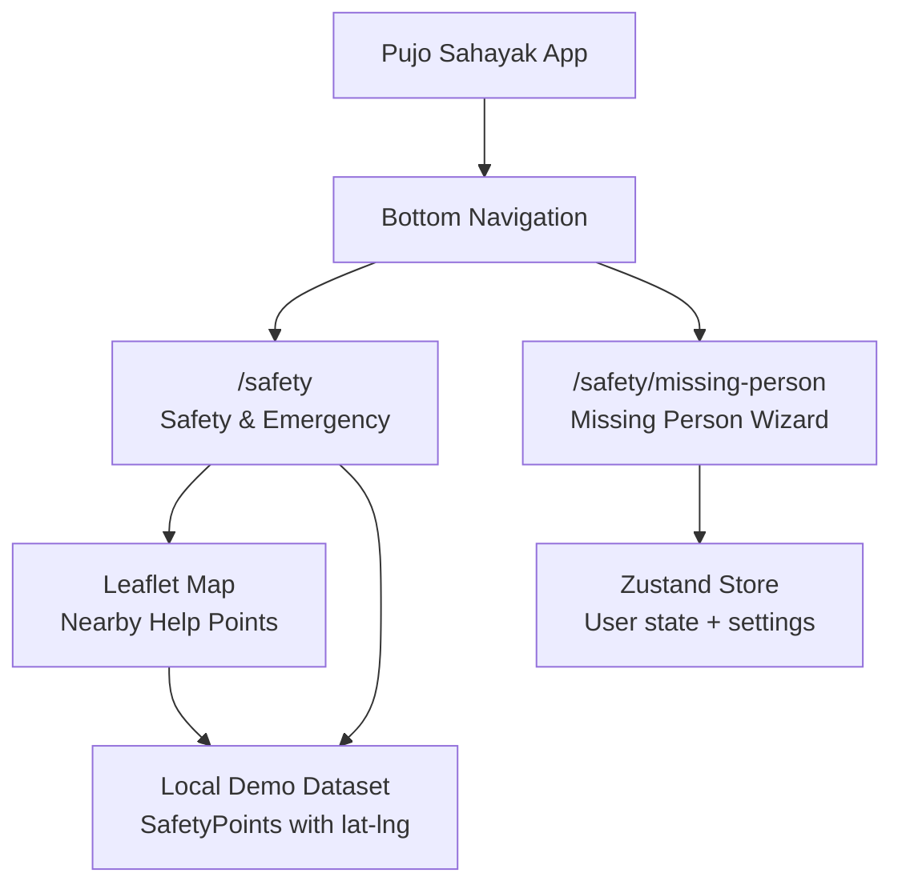
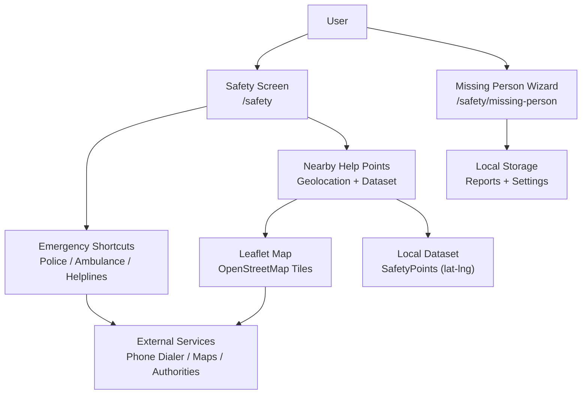
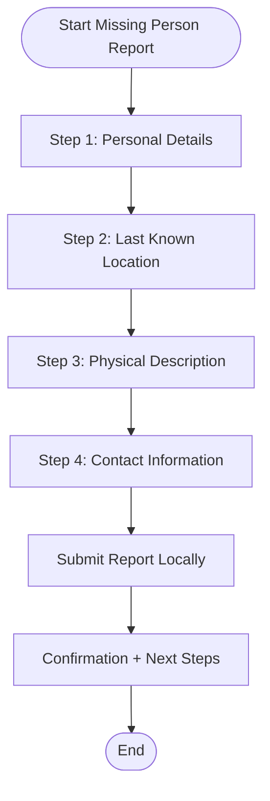
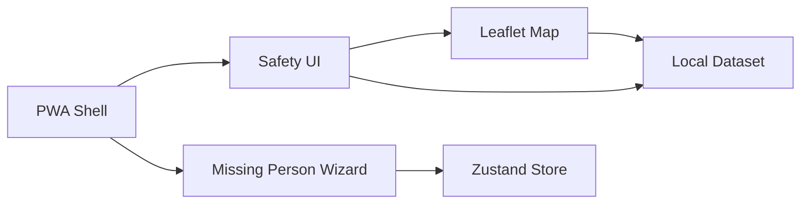

# Safety and Emergency Services

<cite>
**Referenced Files in This Document**
- [Pujo_Sahayak_Master_Project_Context.md](file://Pujo_Sahayak_Master_Project_Context.md)
- [plan.md](file://tasks\plan.md)
- [todo.md](file://tasks\todo.md)
</cite>

## Table of Contents
1. [Introduction](#introduction)
2. [Project Structure](#project-structure)
3. [Core Components](#core-components)
4. [Architecture Overview](#architecture-overview)
5. [Detailed Component Analysis](#detailed-component-analysis)
6. [Dependency Analysis](#dependency-analysis)
7. [Performance Considerations](#performance-considerations)
8. [Troubleshooting Guide](#troubleshooting-guide)
9. [Conclusion](#conclusion)

## Introduction
This document explains the Safety and Emergency Services integration for Puja Sahayak. It focuses on:
- Quick access emergency shortcuts for police stations, ambulance services, women’s assistance helplines, and nearby hospitals.
- A missing person reporting system implemented as a four-step wizard.
- A safety points mapping system covering hospitals, help desks, ATMs, pharmacies, and other essential services.
- Geolocation-based discovery of emergency services.
- Offline access to critical contacts.
- Integration with local emergency response systems at a conceptual level.
- Data accuracy requirements, real-time update expectations, and accessibility considerations during emergencies.

The project is a mobile-first React + Vite PWA that combines pandal discovery, AI assistance, route planning, social meetups, and safety utilities. Safety is treated as a locked core capability, while advanced authority integrations are marked experimental or partner-dependent.

**Section sources**
- [Pujo_Sahayak_Master_Project_Context.md:7-18](file://Pujo_Sahayak_Master_Project_Context.md#L7-L18)
- [Pujo_Sahayak_Master_Project_Context.md:90-100](file://Pujo_Sahayak_Master_Project_Context.md#L90-L100)
- [Pujo_Sahayak_Master_Project_Context.md:1636-1684](file://Pujo_Sahayak_Master_Project_Context.md#L1636-L1684)

## Project Structure
Safety and Emergency Services are part of the utility layer in the application. The implementation plan maps these features to specific routes:
- `/safety` — Safety and Emergency screen.
- `/safety/missing-person` — Missing Person Report wizard.

The task list also defines the data model used by safety features, including a `SafetyPoint` type and a demo dataset containing safety points with latitude and longitude.

**Diagram sources**
- [plan.md:19-39](file://tasks\plan.md#L19-L39)
- [todo.md:45-67](file://tasks\todo.md#L45-L67)

**Section sources**
- [plan.md:19-39](file://tasks\plan.md#L19-L39)
- [todo.md:45-67](file://tasks\todo.md#L45-L67)

## Core Components
The safety feature set includes:

- **Emergency Shortcuts**: Direct actions for calling emergency numbers and reaching key services such as police, ambulance, women’s assistance, child assistance, hospitals, pharmacies, and help desks.
- **Nearby Help Points**: A geolocation-driven view showing nearby safety points from the dataset, rendered using Leaflet and OpenStreetMap tiles.
- **Missing Person Reporting Wizard**: A four-step flow capturing personal details, last known location, physical description, and contact information, storing reports locally without exposing sensitive data publicly.
- **Safety Points Mapping**: A map-based interface for discovering hospitals, help desks, ATMs, pharmacies, and other essential services near the user.
- **Offline Access**: Critical emergency contacts and basic safety information should remain accessible through the PWA shell and cached assets.

Key design principles:
- Safety UI must prioritize clarity and speed over visual effects.
- Location context should be used intelligently, avoiding false precision.
- Sensitive missing-person data must not become public content.

**Section sources**
- [Pujo_Sahayak_Master_Project_Context.md:1390-1438](file://Pujo_Sahayak_Master_Project_Context.md#L1390-L1438)
- [Pujo_Sahayak_Master_Project_Context.md:1360-1388](file://Pujo_Sahayak_Master_Project_Context.md#L1360-L1388)
- [todo.md:13-14](file://tasks\todo.md#L13-L14)

## Architecture Overview
The safety architecture connects user-facing screens to local data and mapping tools:

**Diagram sources**
- [plan.md:19-39](file://tasks\plan.md#L19-L39)
- [todo.md:45-67](file://tasks\todo.md#L45-L67)
- [Pujo_Sahayak_Master_Project_Context.md:1390-1438](file://Pujo_Sahayak_Master_Project_Context.md#L1390-L1438)

## Detailed Component Analysis

### Emergency Shortcuts
The Safety screen provides quick access to emergency services:
- Call 112 and other emergency numbers via phone dialer links.
- Shortcuts for police, ambulance, women’s assistance, child assistance, hospitals, pharmacies, and help desks.
- Clear labeling and minimal interaction steps so users can act quickly under stress.

Implementation notes:
- Use `tel:` links for direct calls where supported by the device.
- Provide fallback instructions when automatic dialing is unavailable.
- Keep emergency actions prominent and visually distinct from exploratory features.

Accessibility considerations:
- High contrast and large tap targets.
- Minimal animations; respect reduced-motion preferences.
- Clear labels and concise descriptions for screen readers.

**Section sources**
- [Pujo_Sahayak_Master_Project_Context.md:1390-1410](file://Pujo_Sahayak_Master_Project_Context.md#L1390-L1410)
- [todo.md:66-67](file://tasks\todo.md#L66-L67)

### Nearby Help Points and Safety Points Mapping
The app shows nearby safety points using:
- Device geolocation.
- Leaflet map with OpenStreetMap tiles.
- Local dataset of `SafetyPoint` entries with latitude and longitude.

Workflow:
1. Request current location.
2. Filter dataset by proximity.
3. Render markers on the map.
4. Allow users to select a point for more details or navigation.

Data accuracy:
- Mark all demo data clearly as demo.
- Avoid claiming exact distances or operating hours unless explicitly provided by the dataset.
- Use cautious wording for location (“near” rather than “inside”).

Real-time updates:
- In v1, rely on static dataset fields.
- Future integrations may add live status for hospitals, pharmacies, and help desks if partners provide reliable APIs.

**Section sources**
- [todo.md:13-14](file://tasks\todo.md#L13-L14)
- [plan.md:13-14](file://tasks\plan.md#L13-L14)
- [Pujo_Sahayak_Master_Project_Context.md:1360-1388](file://Pujo_Sahayak_Master_Project_Context.md#L1360-L1388)

### Missing Person Reporting Wizard
The missing person report is a four-step wizard designed for clarity and privacy:
1. Personal Details: Name, age, relationship to reporter, and optional photo.
2. Last Known Location: Address, landmark, or coordinates.
3. Physical Description: Height, clothing, distinguishing features.
4. Contact Information: Reporter’s name, phone number, and preferred contact method.

Flow:

Privacy and security:
- Store reports locally only in v1.
- Do not publish sensitive missing-person details to public feeds.
- Clearly indicate whether any future integration with authorities is partner-dependent.

Integration points:
- Route to nearest relevant help desk based on location.
- Provide guidance to contact local authorities directly when needed.
- Keep authority integration as experimental until confirmed by partners.

**Diagram sources**
- [todo.md:66-67](file://tasks\todo.md#L66-L67)
- [Pujo_Sahayak_Master_Project_Context.md:1413-1438](file://Pujo_Sahayak_Master_Project_Context.md#L1413-L1438)

**Section sources**
- [todo.md:66-67](file://tasks\todo.md#L66-L67)
- [Pujo_Sahayak_Master_Project_Context.md:1413-1438](file://Pujo_Sahayak_Master_Project_Context.md#L1413-L1438)

### Offline Access to Critical Contacts
As a PWA, Puja Sahayak can cache essential assets and allow offline access to:
- Emergency shortcut actions.
- Basic safety information.
- Cached map tiles for areas already viewed.

Recommendations:
- Cache the safety screen shell and critical icons.
- Preload or lazy-load map tiles around frequently visited areas.
- Provide clear messaging when network-dependent features are unavailable.

**Section sources**
- [plan.md:9-15](file://tasks\plan.md#L9-L15)
- [todo.md:74-75](file://tasks\todo.md#L74-L75)

### Integration with Local Emergency Response Systems
At this stage:
- Authority emergency integration is experimental.
- Advanced missing-person authority integration is partner-dependent.
- The app should guide users to call official emergency numbers and visit nearby help desks rather than implying direct backend integration.

Future roadmap:
- Partner APIs for verified hospital availability, pharmacy stock, and police station status.
- Secure submission channels for missing-person reports to authorized operators.
- Real-time alerts for crowd levels, road closures, and service disruptions.

**Section sources**
- [Pujo_Sahayak_Master_Project_Context.md:1676-1684](file://Pujo_Sahayak_Master_Project_Context.md#L1676-L1684)
- [Pujo_Sahayak_Master_Project_Context.md:1435-1438](file://Pujo_Sahayak_Master_Project_Context.md#L1435-L1438)

## Dependency Analysis
Safety features depend on several shared components and data layers:

**Diagram sources**
- [plan.md:9-15](file://tasks\plan.md#L9-L15)
- [todo.md:45-67](file://tasks\todo.md#L45-L67)

Coupling and cohesion:
- Safety UI is loosely coupled to the dataset and map component.
- Missing person wizard stores local records independently of public feeds.
- PWA shell supports offline access to critical safety functions.

Potential risks:
- Over-reliance on precise GPS in dense urban areas.
- Misleading claims about real-time service availability.
- Accidental exposure of sensitive missing-person data.

**Section sources**
- [Pujo_Sahayak_Master_Project_Context.md:1360-1388](file://Pujo_Sahayak_Master_Project_Context.md#L1360-L1388)
- [Pujo_Sahayak_Master_Project_Context.md:1435-1438](file://Pujo_Sahayak_Master_Project_Context.md#L1435-L1438)

## Performance Considerations
- Prioritize fast load times for the Safety screen and emergency shortcuts.
- Defer heavy map rendering until the user opens the nearby help points view.
- Avoid complex animations on emergency actions.
- Respect reduced-motion preferences globally.
- Cache critical assets for offline use.

[No sources needed since this section provides general guidance]

## Troubleshooting Guide
Common issues and resolutions:

- **Emergency call does not start automatically**: Some devices require manual confirmation for `tel:` links. Provide clear instructions and fallback options.
- **Location permission denied**: Explain why location is needed for nearby help points and offer manual search or address input.
- **Map not loading offline**: Ensure map tiles are cached for previously viewed areas; otherwise, show a message indicating online-only map behavior.
- **Missing person report not saved**: Verify local storage permissions and confirm that the final step completes successfully.
- **Incorrect nearby results**: Check dataset accuracy and avoid claiming exact distances or operating hours unless explicitly provided.

**Section sources**
- [todo.md:66-67](file://tasks\todo.md#L66-L67)
- [Pujo_Sahayak_Master_Project_Context.md:1360-1388](file://Pujo_Sahayak_Master_Project_Context.md#L1360-L1388)

## Conclusion
Puja Sahayak’s Safety and Emergency Services provide essential support during high-stress situations. The system emphasizes quick access to emergency contacts, geolocation-based discovery of nearby help points, and a private, four-step missing person reporting wizard. While advanced authority integrations remain experimental or partner-dependent, the current design ensures clarity, speed, and privacy. Future enhancements can introduce real-time updates, verified service statuses, and secure authority channels while maintaining the principle that safety UI must prioritize usability over visual effects.

[No sources needed since this section summarizes without analyzing specific files]