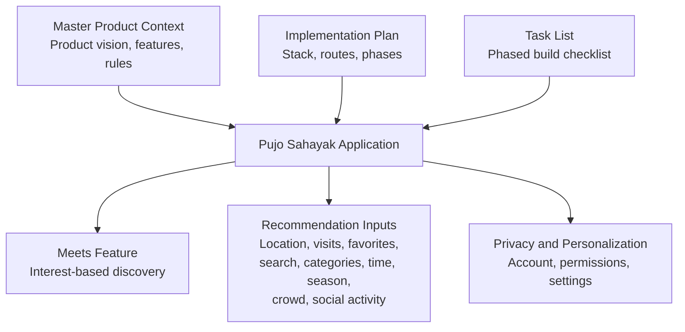
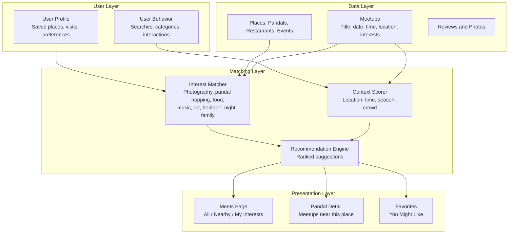
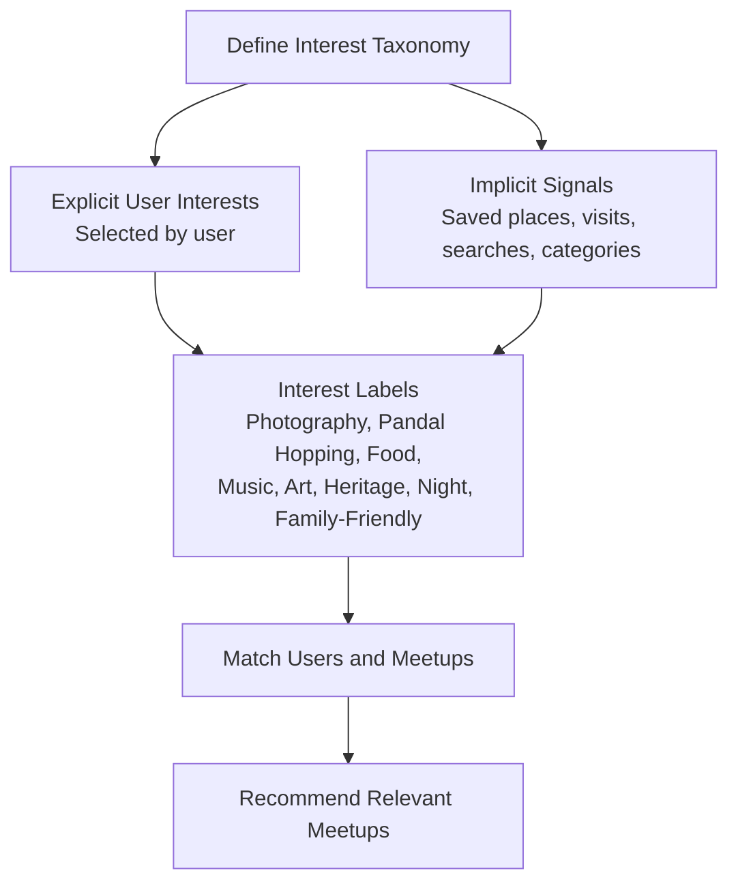
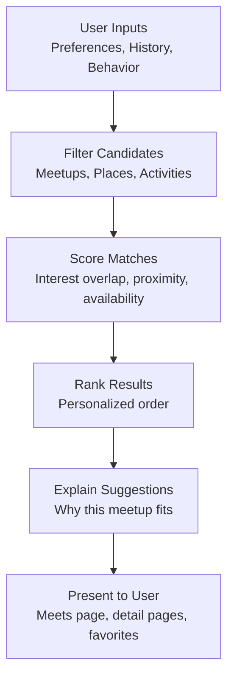
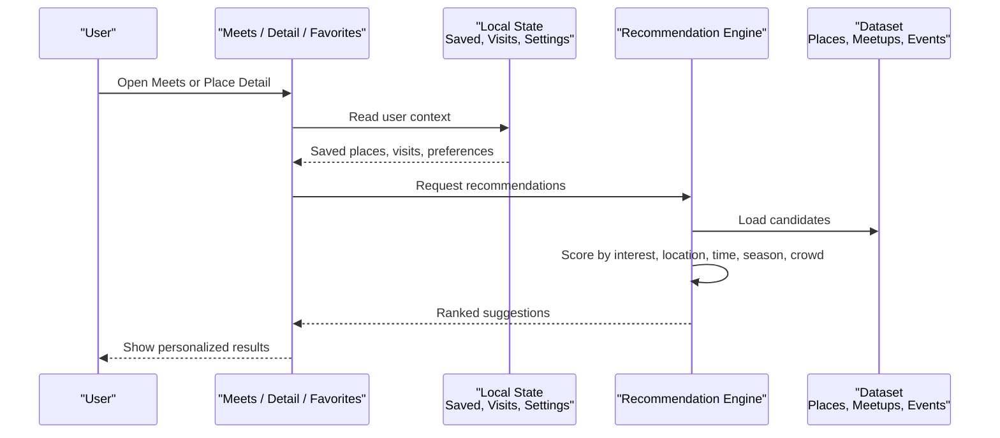
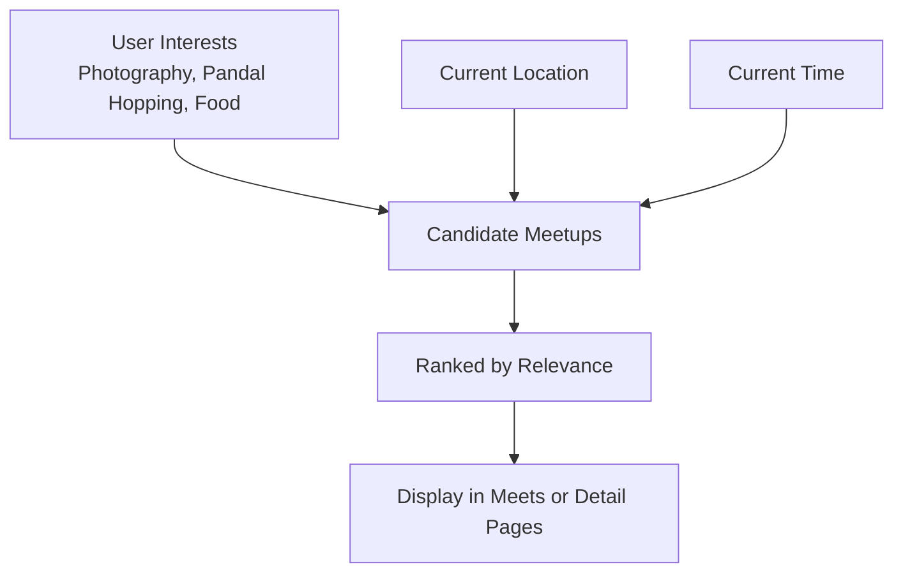
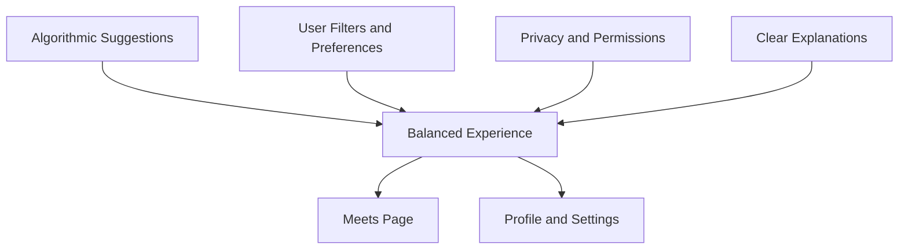
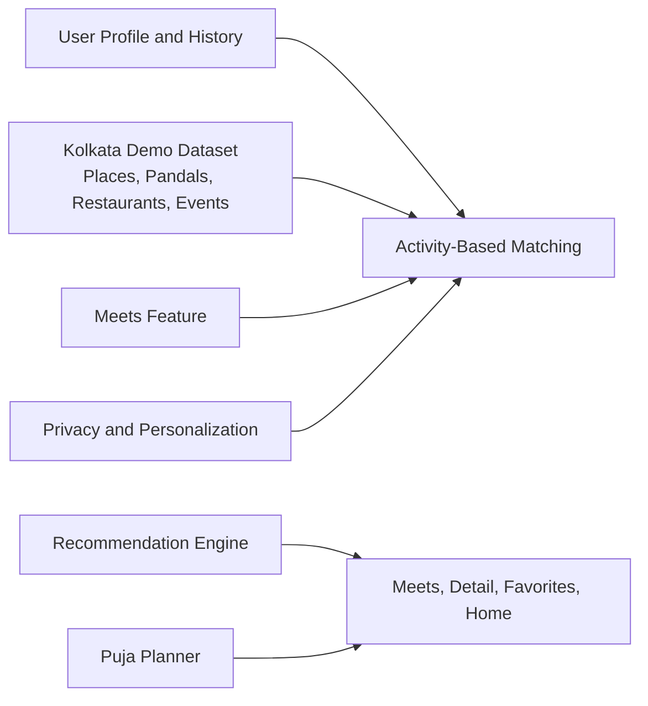

# Activity-Based Matching System

<cite>
**Referenced Files in This Document**
- [Pujo_Sahayak_Master_Project_Context.md](file://Pujo_Sahayak_Master_Project_Context.md)
- [plan.md](file://tasks/plan.md)
- [todo.md](file://tasks/todo.md)
</cite>

## Table of Contents
1. [Introduction](#introduction)
2. [Project Structure](#project-structure)
3. [Core Components](#core-components)
4. [Architecture Overview](#architecture-overview)
5. [Detailed Component Analysis](#detailed-component-analysis)
6. [Dependency Analysis](#dependency-analysis)
7. [Performance Considerations](#performance-considerations)
8. [Troubleshooting Guide](#troubleshooting-guide)
9. [Conclusion](#conclusion)

## Introduction
This document explains the Activity-Based Matching System that connects users with shared interests and relevant meetups within the Pujo Sahayak ecosystem. The system is not a standalone module; it is part of a broader local discovery platform whose core identity revolves around Durga Puja exploration, planning, community, safety, and off-season local experiences.

The matching system focuses on:
- Interest-based discovery for activities such as photography, pandal hopping, food exploration, music, art, heritage tours, night exploration, and family-friendly activities.
- Connecting users to meetups and people who share similar activity preferences.
- Using user context such as location, saved places, visited places, search behavior, categories, time, season, crowd signals, and social activity to generate recommendations.
- Balancing algorithmic suggestions with user control over privacy and personalization.

The documentation is grounded in the project’s master product context and implementation plan, which describe the Meets feature, interest taxonomy, recommendation inputs, and the overall product philosophy.

**Section sources**
- [Pujo_Sahayak_Master_Project_Context.md:7-18](file://Pujo_Sahayak_Master_Project_Context.md#L7-L18)
- [Pujo_Sahayak_Master_Project_Context.md:78-101](file://Pujo_Sahayak_Master_Project_Context.md#L78-L101)
- [Pujo_Sahayak_Master_Project_Context.md:1093-1177](file://Pujo_Sahayak_Master_Project_Context.md#L1093-L1177)

## Project Structure
At this stage, the repository contains:
- A master product context document describing the full product vision, navigation, AI assistant, discovery flows, social features, and recommendation principles.
- An implementation plan describing the React + Vite PWA stack, routes, data model, and phased task breakdown.
- A task list tracking foundation, discovery, Maya, planning, social, utility, and polish phases.

**Diagram sources**
- [Pujo_Sahayak_Master_Project_Context.md:140-158](file://Pujo_Sahayak_Master_Project_Context.md#L140-L158)
- [Pujo_Sahayak_Master_Project_Context.md:664-751](file://Pujo_Sahayak_Master_Project_Context.md#L664-L751)
- [plan.md:1-18](file://tasks/plan.md#L1-L18)
- [todo.md:45-55](file://tasks/todo.md#L45-L55)

**Section sources**
- [Pujo_Sahayak_Master_Project_Context.md:140-158](file://Pujo_Sahayak_Master_Project_Context.md#L140-L158)
- [plan.md:1-18](file://tasks/plan.md#L1-L18)
- [todo.md:1-14](file://tasks/todo.md#L1-L14)

## Core Components
The Activity-Based Matching System is centered around these components:

| Component | Responsibility | Key Inputs | Output |
|---|---|---|---|
| Interest Taxonomy | Defines activity categories used for matching and discovery | User-selected interests, meetup tags, content metadata | Structured interest labels |
| User Profile and History | Stores explicit preferences and implicit behavioral signals | Saved places, visited places, searches, category usage, language, theme | Personalized context |
| Meetup Catalog | Lists existing meetups and allows creation | Title, date, time, location, description, interest/vibe, participant limits, visibility | Discoverable and joinable meetups |
| Recommendation Engine | Suggests meetups, people, and related activities | Location, previous visits, favorites, search activity, categories, time, season, crowd, social activity | Ranked or filtered recommendations |
| Privacy Controls | Manages visibility, permissions, and personalization | Account settings, privacy toggles, notification preferences | Controlled exposure of profile and activity data |

The interest taxonomy explicitly includes:
- Photography
- Pandal hopping
- Food exploration
- Music
- Art
- Night exploration
- Heritage
- Family-friendly exploration

These are described as shared interests for finding people and organizing activity-based social discovery rather than dating-style matching.

**Section sources**
- [Pujo_Sahayak_Master_Project_Context.md:730-751](file://Pujo_Sahayak_Master_Project_Context.md#L730-L751)
- [Pujo_Sahayak_Master_Project_Context.md:664-728](file://Pujo_Sahayak_Master_Project_Context.md#L664-L728)
- [Pujo_Sahayak_Master_Project_Context.md:1263-1295](file://Pujo_Sahayak_Master_Project_Context.md#L1263-L1295)

## Architecture Overview
The matching system sits inside the application’s discovery and social layers. It does not replace normal software logic; instead, it augments structured features like favorites, visits, search, categories, maps, meetups, reviews, and recommendations.

**Diagram sources**
- [Pujo_Sahayak_Master_Project_Context.md:664-751](file://Pujo_Sahayak_Master_Project_Context.md#L664-L751)
- [Pujo_Sahayak_Master_Project_Context.md:895-950](file://Pujo_Sahayak_Master_Project_Context.md#L895-L950)
- [Pujo_Sahayak_Master_Project_Context.md:1263-1295](file://Pujo_Sahayak_Master_Project_Context.md#L1263-L1295)
- [todo.md:47-55](file://tasks/todo.md#L47-L55)

## Detailed Component Analysis

### Interest Taxonomy
The interest taxonomy is the vocabulary through which users express what they enjoy and how meetups are categorized. The documented interests include:
- Photography
- Pandal hopping
- Food exploration
- Music
- Art
- Night exploration
- Heritage
- Family-friendly exploration

This taxonomy supports:
- Filtering meetups by interest.
- Grouping users by shared activity preferences.
- Labeling meetups and content so the recommendation engine can match them to user history and preferences.
- Supporting both Puja-season and off-season discovery, since the same structure should remain useful beyond Durga Puja.

**Diagram sources**
- [Pujo_Sahayak_Master_Project_Context.md:730-751](file://Pujo_Sahayak_Master_Project_Context.md#L730-L751)
- [Pujo_Sahayak_Master_Project_Context.md:1093-1177](file://Pujo_Sahayak_Master_Project_Context.md#L1093-L1177)

**Section sources**
- [Pujo_Sahayak_Master_Project_Context.md:730-751](file://Pujo_Sahayak_Master_Project_Context.md#L730-L751)
- [Pujo_Sahayak_Master_Project_Context.md:1093-1177](file://Pujo_Sahayak_Master_Project_Context.md#L1093-L1177)

### Matching Algorithms
The matching algorithms analyze three main dimensions:

1. **User Preferences**
   - Explicit interests selected by the user.
   - Saved places and favorites.
   - Category preferences.
   - Language and personalization choices.

2. **Activity History**
   - Previously visited places.
   - Search activity.
   - Reviews and photos.
   - Joining or creating meetups.

3. **Behavioral Patterns**
   - Time of day and day of week.
   - Season (Puja vs off-season).
   - Crowd signals.
   - Social activity and nearby events.

The documented recommendation inputs include:
- Location
- Previous visits
- Favorites
- Search activity
- Categories
- Time
- Season
- Crowd
- Social activity

The matching process should be explainable and avoid making absolute claims about what a user will enjoy. Wording such as “You might like” is preferred.

**Diagram sources**
- [Pujo_Sahayak_Master_Project_Context.md:1263-1295](file://Pujo_Sahayak_Master_Project_Context.md#L1263-L1295)
- [Pujo_Sahayak_Master_Project_Context.md:339-350](file://Pujo_Sahayak_Master_Project_Context.md#L339-L350)

**Section sources**
- [Pujo_Sahayak_Master_Project_Context.md:1263-1295](file://Pujo_Sahayak_Master_Project_Context.md#L1263-L1295)
- [Pujo_Sahayak_Master_Project_Context.md:339-350](file://Pujo_Sahayak_Master_Project_Context.md#L339-L350)

### Recommendation Engine Architecture
The recommendation engine is designed to start simple and evolve. It combines structured data with contextual signals.

Key architectural elements:
- **Input Collection**: Gather location, visits, favorites, search activity, categories, time, season, crowd, and social activity.
- **Candidate Generation**: Identify meetups, places, and activities that align with user interests and current context.
- **Scoring and Ranking**: Apply weights based on interest overlap, geographic relevance, temporal availability, and engagement signals.
- **Explanation Layer**: Provide understandable reasons for suggestions, avoiding overpromising.
- **Presentation Layer**: Surface recommendations in Meets, Pandal Detail, Favorites, and Home sections.

**Diagram sources**
- [Pujo_Sahayak_Master_Project_Context.md:1263-1295](file://Pujo_Sahayak_Master_Project_Context.md#L1263-L1295)
- [todo.md:47-55](file://tasks/todo.md#L47-L55)

**Section sources**
- [Pujo_Sahayak_Master_Project_Context.md:1263-1295](file://Pujo_Sahayak_Master_Project_Context.md#L1263-L1295)
- [todo.md:47-55](file://tasks/todo.md#L47-L55)

### Personalization Strategies
Personalization is built into multiple parts of the product:
- **Favorites and Visits**: Used to infer interests and suggest similar places or meetups.
- **Search and Categories**: Used to understand what the user is actively exploring.
- **Time and Season**: Used to adjust whether Puja-focused or off-season content is shown.
- **Crowd and Location**: Used to make suggestions practical and timely.
- **Social Activity**: Used to connect users with relevant meetups and communities.

The product also emphasizes that AI should not control everything. Normal software logic should handle straightforward tasks like favorites, visits, search, maps, meetups, reviews, and categories. AI should be reserved for areas where it adds clear value, including recommendations and itinerary assistance.

**Section sources**
- [Pujo_Sahayak_Master_Project_Context.md:339-350](file://Pujo_Sahayak_Master_Project_Context.md#L339-L350)
- [Pujo_Sahayak_Master_Project_Context.md:1144-1177](file://Pujo_Sahayak_Master_Project_Context.md#L1144-L1177)
- [Pujo_Sahayak_Master_Project_Context.md:1297-1328](file://Pujo_Sahayak_Master_Project_Context.md#L1297-L1328)

### Examples of Matching Logic

#### Overlapping Interests
A user interested in photography and pandal hopping may be matched with:
- A “Photography Walk” meetup.
- A “South Kolkata Pandal Hop” meetup.
- A “Late-night Puja Food Crawl” if the user also shows interest in food exploration.

The matching relies on interest overlap between the user’s profile and the meetup’s interest tags.

#### Geographic Proximity
Meetups near a selected pandal or restaurant are surfaced from the detail page. This connects individual place exploration to community activities.

#### Temporal Availability
Meetups include date and time fields. The system can prioritize meetups that align with the user’s current time, planned itinerary, or typical exploration patterns.

**Diagram sources**
- [Pujo_Sahayak_Master_Project_Context.md:689-700](file://Pujo_Sahayak_Master_Project_Context.md#L689-L700)
- [Pujo_Sahayak_Master_Project_Context.md:935-950](file://Pujo_Sahayak_Master_Project_Context.md#L935-L950)

**Section sources**
- [Pujo_Sahayak_Master_Project_Context.md:689-700](file://Pujo_Sahayak_Master_Project_Context.md#L689-L700)
- [Pujo_Sahayak_Master_Project_Context.md:935-950](file://Pujo_Sahayak_Master_Project_Context.md#L935-L950)

### Balance Between Algorithmic Recommendations and User Control
The system must balance automated suggestions with user agency:
- **User-Controlled Discovery**: Users can browse All, Nearby, and My Interests filters on the Meets page.
- **Explicit Preferences**: Users select interests and set account-level privacy and permission controls.
- **Transparent Explanations**: Recommendations should use understandable wording and avoid absolute guarantees.
- **Privacy Controls**: The product acknowledges that location, photographs, and meetup information require easy-to-find privacy controls.
- **Non-Dating Context**: The system should feel like activity-based social discovery, not a dating application.

**Diagram sources**
- [Pujo_Sahayak_Master_Project_Context.md:730-751](file://Pujo_Sahayak_Master_Project_Context.md#L730-L751)
- [Pujo_Sahayak_Master_Project_Context.md:1055-1091](file://Pujo_Sahayak_Master_Project_Context.md#L1055-L1091)
- [todo.md:53-55](file://tasks/todo.md#L53-L55)

**Section sources**
- [Pujo_Sahayak_Master_Project_Context.md:730-751](file://Pujo_Sahayak_Master_Project_Context.md#L730-L751)
- [Pujo_Sahayak_Master_Project_Context.md:1055-1091](file://Pujo_Sahayak_Master_Project_Context.md#L1055-L1091)
- [todo.md:53-55](file://tasks/todo.md#L53-L55)

## Dependency Analysis
The Activity-Based Matching System depends on several interconnected parts of the product:

**Diagram sources**
- [Pujo_Sahayak_Master_Project_Context.md:1232-1261](file://Pujo_Sahayak_Master_Project_Context.md#L1232-L1261)
- [Pujo_Sahayak_Master_Project_Context.md:1263-1295](file://Pujo_Sahayak_Master_Project_Context.md#L1263-L1295)
- [todo.md:47-55](file://tasks/todo.md#L47-L55)

**Section sources**
- [Pujo_Sahayak_Master_Project_Context.md:1232-1261](file://Pujo_Sahayak_Master_Project_Context.md#L1232-L1261)
- [Pujo_Sahayak_Master_Project_Context.md:1263-1295](file://Pujo_Sahayak_Master_Project_Context.md#L1263-L1295)
- [todo.md:47-55](file://tasks/todo.md#L47-L55)

## Performance Considerations
Since the current repository describes a conceptual and phased implementation, performance considerations should focus on scalable design rather than premature optimization:

- **Start Simple**: Begin with basic similarity such as area or theme, then add richer signals like crowd, time, and social activity.
- **Client-Side State**: The implementation plan uses client-side state persistence for saves, visits, plans, and settings, which is appropriate for a demo and early product phase.
- **Avoid Over-AI**: Use AI only where it provides clear value, keeping normal software logic for straightforward features.
- **Explainability**: Keep recommendation explanations simple and understandable to reduce cognitive load and improve trust.
- **Off-Season Scalability**: Design the system so it can expand from Puja discovery to general Kolkata local discovery without restructuring the core matching concepts.

[No sources needed since this section provides general guidance]

## Troubleshooting Guide
Common issues and their likely causes in the context of the Activity-Based Matching System:

| Issue | Likely Cause | Recommended Action |
|---|---|---|
| No meetups appear for a user | Missing or empty interest tags, no location context, or no dataset entries | Verify user interests, location, and dataset coverage for meetups and places |
| Irrelevant recommendations | Overreliance on weak signals or missing context | Add stronger signals such as saved places, visits, categories, and time/season |
| Privacy concerns | Unclear visibility controls or overly broad sharing | Ensure privacy settings, permissions, and account controls are visible and functional |
| Confusing UX | Treating activity-based discovery like dating or feed-style browsing | Reinforce activity-based social discovery and structured presentation |
| Unexplained suggestions | Lack of transparent reasoning | Add clear “why this suggestion” messaging using understandable wording |

**Section sources**
- [Pujo_Sahayak_Master_Project_Context.md:730-751](file://Pujo_Sahayak_Master_Project_Context.md#L730-L751)
- [Pujo_Sahayak_Master_Project_Context.md:1055-1091](file://Pujo_Sahayak_Master_Project_Context.md#L1055-L1091)
- [Pujo_Sahayak_Master_Project_Context.md:1297-1328](file://Pujo_Sahayak_Master_Project_Context.md#L1297-L1328)

## Conclusion
The Activity-Based Matching System in Pujo Sahayak is an interest-driven, context-aware layer that connects users with relevant meetups and community connections. Its strength lies in combining explicit interests with implicit behavioral signals, while remaining grounded in structured product features like places, pandals, restaurants, events, reviews, and planning.

For future development, the system should:
- Formalize the interest taxonomy across user profiles, meetups, and content.
- Implement a transparent recommendation pipeline that starts simple and grows with richer signals.
- Preserve user control through filters, preferences, and privacy settings.
- Maintain the product’s identity as a location-aware local discovery platform, not a generic social or dating app.

[No sources needed since this section summarizes without analyzing specific files]