# Meetup Creation Workflow

<cite>
**Referenced Files in This Document**
- [Pujo_Sahayak_Master_Project_Context.md](file://Pujo_Sahayak_Master_Project_Context.md)
- [plan.md](file://tasks/plan.md)
- [todo.md](file://tasks/todo.md)
</cite>

## Table of Contents
1. [Introduction](#introduction)
2. [Project Structure](#project-structure)
3. [Core Components](#core-components)
4. [Architecture Overview](#architecture-overview)
5. [Detailed Component Analysis](#detailed-component-analysis)
6. [Dependency Analysis](#dependency-analysis)
7. [Performance Considerations](#performance-considerations)
8. [Troubleshooting Guide](#troubleshooting-guide)
9. [Conclusion](#conclusion)

## Introduction
This document describes the **Meetup Creation Workflow** for Pujo Sahayak. It explains how an organizer should create a meetup through a multi-step form, including:
- Title input
- Date and time scheduling
- Location selection with map integration
- Description editing
- Interest tagging
- Participant limit configuration
- Privacy settings (public or restricted)
- Optional place selection for pandals, restaurants, or routes
- Validation rules, error handling, user feedback, safety considerations, content moderation, and organizer verification

The current repository is a product context and implementation plan rather than a fully implemented codebase. Therefore, this documentation defines the intended workflow, data model, state management, and validation strategy based on the documented requirements and task breakdown.

## Project Structure
At this stage, the project contains:
- A master product context describing features, navigation, discovery, planning, social meetups, safety, and premium concepts
- An implementation plan outlining React + Vite PWA architecture, routing, stores, maps, and screen targets
- A task checklist tracking phases from foundation to polish

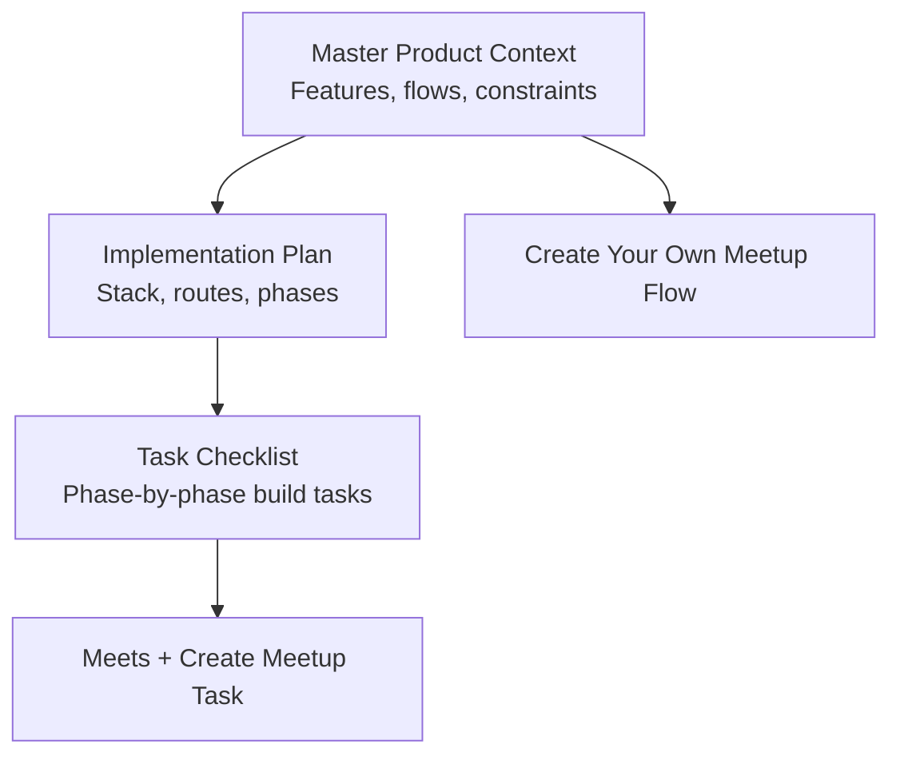

**Diagram sources**
- [Pujo_Sahayak_Master_Project_Context.md:664-727](file://Pujo_Sahayak_Master_Project_Context.md#L664-L727)
- [plan.md:19-39](file://tasks/plan.md#L19-L39)
- [todo.md:53-54](file://tasks/todo.md#L53-L54)

**Section sources**
- [Pujo_Sahayak_Master_Project_Context.md:1-18](file://Pujo_Sahayak_Master_Project_Context.md#L1-L18)
- [plan.md:1-18](file://tasks/plan.md#L1-L18)
- [todo.md:1-16](file://tasks/todo.md#L1-L16)

## Core Components
The Meetup Creation Workflow is part of the social layer of Pujo Sahayak. The core components are:

| Component | Responsibility |
|---|---|
| Meets List Page | Displays existing meetups with filters such as All, Nearby, and My Interests |
| Create Meetup Form | Collects title, date, time, location, description, interests, participant limit, and privacy setting |
| Place Selection Integration | Allows selecting pandals, restaurants, or routes associated with the meetup |
| Validation Engine | Enforces required fields, sensible dates/times, valid participant limits, and safe content |
| Store Layer | Persists created meetups locally and updates the Meets list |
| Safety and Moderation Controls | Provides guidelines, flags, reporting, and optional organizer verification |

**Section sources**
- [Pujo_Sahayak_Master_Project_Context.md:664-727](file://Pujo_Sahayak_Master_Project_Context.md#L664-L727)
- [todo.md:53-54](file://tasks/todo.md#L53-L54)

## Architecture Overview
The intended architecture follows the documented stack and design decisions:
- React + TypeScript + Vite PWA
- React Router for navigation, including `/meets` and `/meets/create`
- Zustand store for local state, including meetups
- Leaflet + OpenStreetMap for map-based location selection
- Local demo dataset for places, pandals, restaurants, and sample meetups
- UI components for chips, cards, buttons, and motion primitives

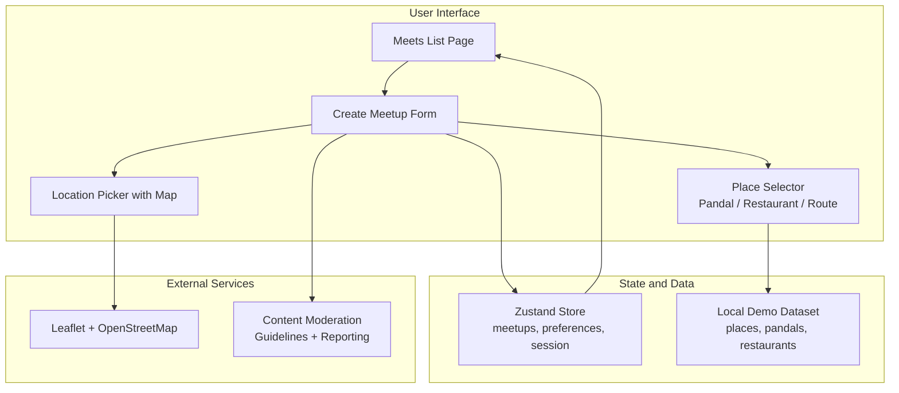

**Diagram sources**
- [plan.md:1-18](file://tasks/plan.md#L1-L18)
- [plan.md:19-39](file://tasks/plan.md#L19-L39)
- [todo.md:53-54](file://tasks/todo.md#L53-L54)

## Detailed Component Analysis

### Multi-Step Create Meetup Form
The form collects the following fields:
- Title
- Date
- Time
- Location
- Description
- Interest / vibe tags
- Maximum participants
- Public / restricted privacy setting
- Optional: selected pandals, restaurants, or route

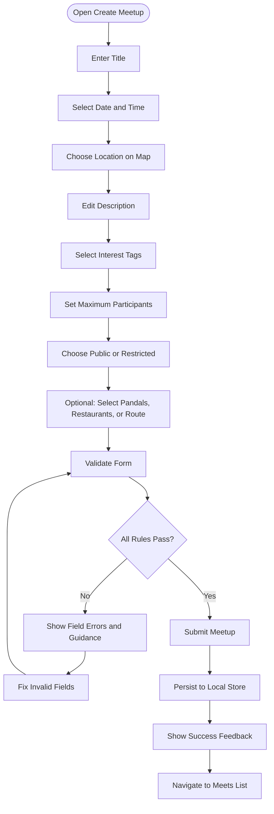

**Diagram sources**
- [Pujo_Sahayak_Master_Project_Context.md:703-727](file://Pujo_Sahayak_Master_Project_Context.md#L703-L727)
- [todo.md:53-54](file://tasks/todo.md#L53-L54)

#### Field-Level Behavior
| Field | Expected Behavior | Validation Notes |
|---|---|---|
| Title | Short, clear meetup name | Required; trim whitespace; enforce maximum length |
| Date | Calendar picker | Required; must be today or future |
| Time | Time picker | Required; must be valid and consistent with date |
| Location | Map pin or place selection | Required; must resolve to a real place |
| Description | Free-form text | Required; moderate for spam/inappropriate content |
| Interest Tags | Chips from predefined set | At least one recommended; allow multiple |
| Maximum Participants | Numeric input | Required; positive integer; reasonable upper bound |
| Privacy | Toggle or radio between public and restricted | Required; affects visibility and join behavior |
| Selected Places | Optional pandal/restaurant/route selection | Optional; improves discoverability |

**Section sources**
- [Pujo_Sahayak_Master_Project_Context.md:703-727](file://Pujo_Sahayak_Master_Project_Context.md#L703-L727)
- [todo.md:53-54](file://tasks/todo.md#L53-L54)

### Location Selection with Map Integration
The location selection integrates with Leaflet and OpenStreetMap as defined by the project’s architecture decision. The organizer can:
- Open a map view
- Pin a location
- Search nearby places
- Confirm coordinates before saving

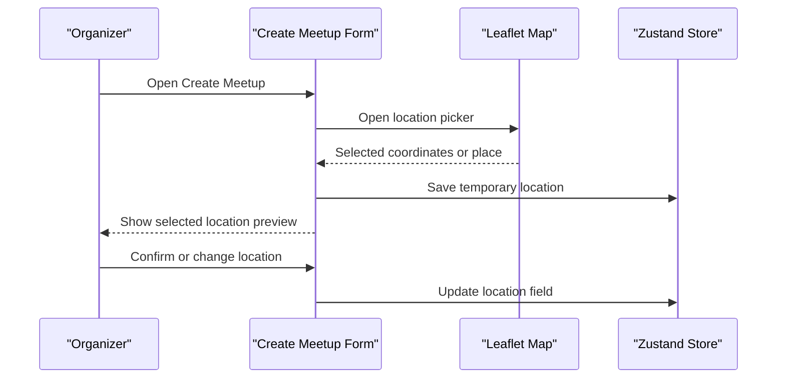

**Diagram sources**
- [plan.md:1-18](file://tasks/plan.md#L1-L18)
- [plan.md:19-39](file://tasks/plan.md#L19-L39)
- [todo.md:53-54](file://tasks/todo.md#L53-L54)

### Place Selection for Pandals, Restaurants, and Routes
The product context explicitly allows optionally selecting:
- Pandals
- Restaurants
- Routes

This helps organizers connect meetups to the broader local ecosystem.

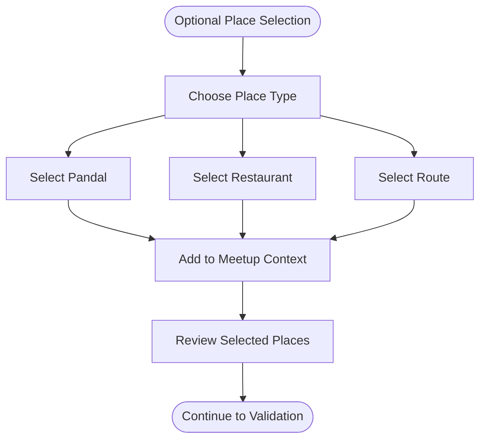

**Diagram sources**
- [Pujo_Sahayak_Master_Project_Context.md:720-726](file://Pujo_Sahayak_Master_Project_Context.md#L720-L726)

### Data Model for Meetup Entities
Based on the documented types and fields, the Meetup entity should include:

| Field | Type | Required | Notes |
|---|---|---:|---|
| id | string or number | Yes | Unique identifier |
| title | string | Yes | Trimmed, limited length |
| description | string | Yes | Moderated content |
| date | date | Yes | Today or future |
| time | time | Yes | Valid time value |
| location | object | Yes | Coordinates and resolved place |
| interests | string[] | No | Interest tags |
| maxParticipants | number | Yes | Positive integer with bounds |
| privacy | enum | Yes | Public or restricted |
| selectedPlaces | array | No | Pandals, restaurants, or route references |
| organizerId | string | Yes | Organizer identity reference |
| status | enum | Yes | Draft, published, cancelled, completed |
| createdAt | timestamp | Yes | Creation time |
| updatedAt | timestamp | Yes | Last update time |
| isDemo | boolean | No | For demo dataset entries |

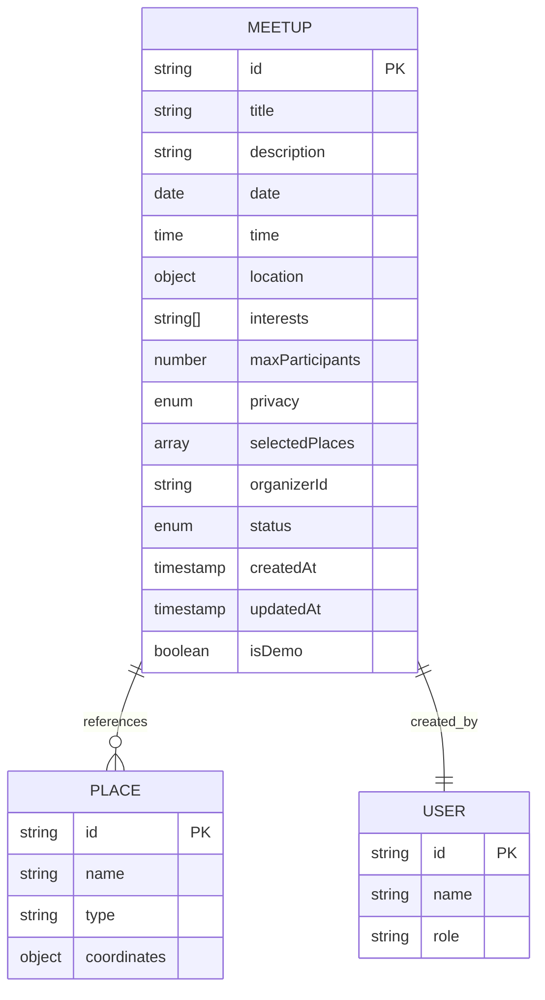

**Diagram sources**
- [todo.md:13-14](file://tasks/todo.md#L13-L14)
- [Pujo_Sahayak_Master_Project_Context.md:703-727](file://Pujo_Sahayak_Master_Project_Context.md#L703-L727)

**Section sources**
- [todo.md:13-14](file://tasks/todo.md#L13-L14)
- [Pujo_Sahayak_Master_Project_Context.md:703-727](file://Pujo_Sahayak_Master_Project_Context.md#L703-L727)

### Form State Management
The form state should be managed in a client store using Zustand, as specified by the implementation plan. The store should track:
- Current form values
- Validation errors
- Temporary draft state
- Submitted meetup entry
- Meets list updates

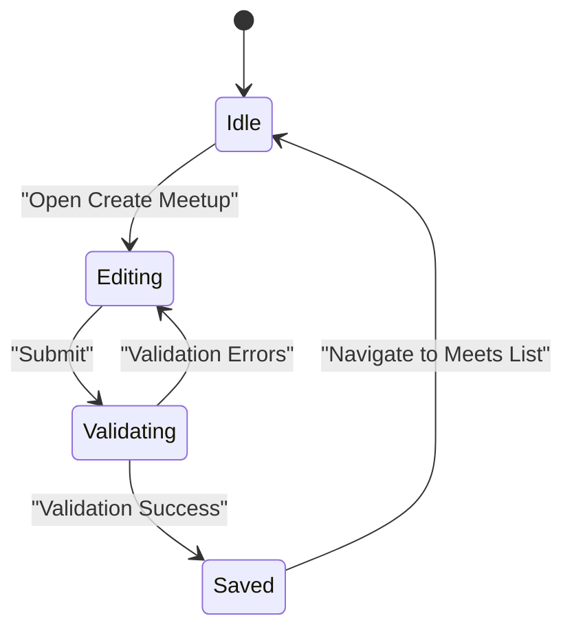

**Diagram sources**
- [plan.md:1-18](file://tasks/plan.md#L1-L18)
- [todo.md:53-54](file://tasks/todo.md#L53-L54)

### Submission Workflow
The submission flow should:
1. Validate all required fields
2. Check business rules such as date/time consistency and participant limits
3. Apply content moderation checks
4. Persist the meetup to the local store
5. Provide success feedback
6. Navigate back to the Meets list

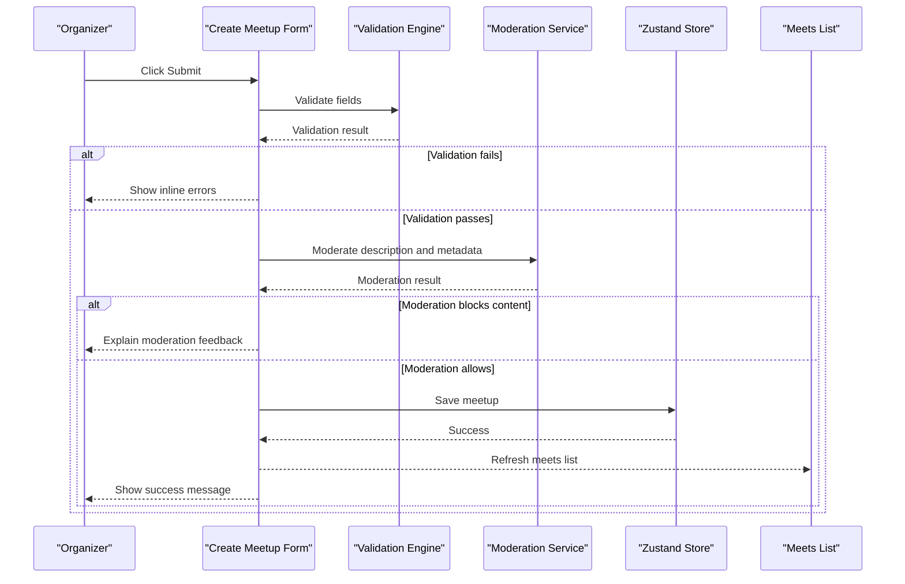

**Diagram sources**
- [todo.md:53-54](file://tasks/todo.md#L53-L54)
- [Pujo_Sahayak_Master_Project_Context.md:869-892](file://Pujo_Sahayak_Master_Project_Context.md#L869-L892)

### Validation Rules
Recommended validation rules include:

| Rule | Description | Error Handling |
|---|---|---|
| Title required | Must not be empty after trimming | Inline error under title |
| Title length | Limit maximum characters | Suggest shorter title |
| Date required | Must be selected | Inline calendar error |
| Date not past | Must be today or later | Explain that past dates are invalid |
| Time required | Must be selected | Inline time error |
| Time format | Must be valid time | Suggest correct format |
| Location required | Must have coordinates | Prompt to select on map |
| Description required | Must not be empty | Inline textarea error |
| Description moderated | Must pass moderation | Explain allowed content |
| Interests | At least one interest recommended | Gentle guidance |
| Max participants | Positive integer | Show minimum and maximum bounds |
| Privacy required | Must choose public or restricted | Inline toggle/radio error |
| Duplicate title | Avoid duplicate titles | Suggest unique title |
| Organizer verified | Optional verification gate | Explain verification requirement if enforced |

**Section sources**
- [Pujo_Sahayak_Master_Project_Context.md:703-727](file://Pujo_Sahayak_Master_Project_Context.md#L703-L727)
- [todo.md:53-54](file://tasks/todo.md#L53-L54)

### Error Handling and User Feedback
Error handling should be:
- Immediate where possible
- Clear and actionable
- Respectful and non-punitive
- Consistent across fields
- Accessible to keyboard and screen reader users

Feedback mechanisms include:
- Inline field errors
- Summary error banner for critical failures
- Success toast or confirmation
- Disabled submit button while validating
- Loading indicator during moderation and persistence

**Section sources**
- [todo.md:53-54](file://tasks/todo.md#L53-L54)

### Safety Considerations
Safety is central to Pujo Sahayak. For meetups, safety considerations include:
- Clear location disclosure
- Public vs restricted visibility controls
- Participant limits to avoid overcrowding
- Emergency shortcuts accessible from profile and safety pages
- Reporting mechanisms for unsafe or suspicious meetups
- Optional organizer verification for trusted creators

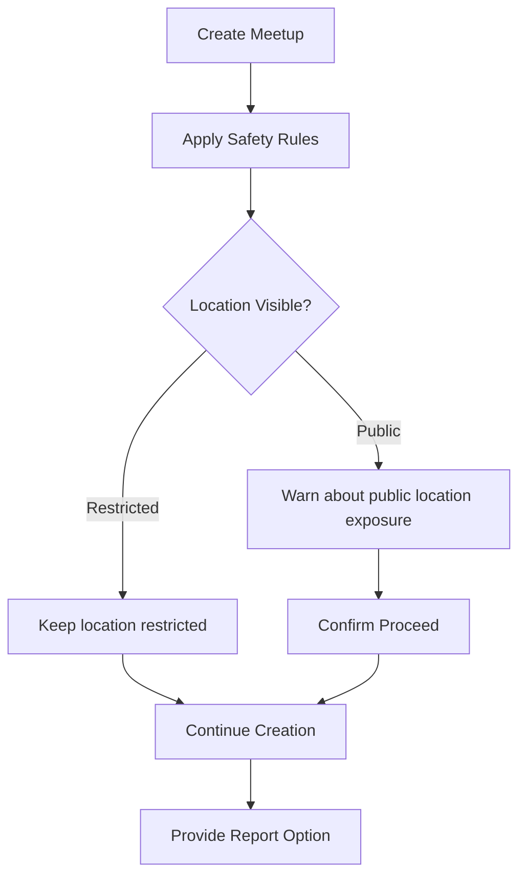

**Diagram sources**
- [Pujo_Sahayak_Master_Project_Context.md:995-1010](file://Pujo_Sahayak_Master_Project_Context.md#L995-L1010)
- [Pujo_Sahayak_Master_Project_Context.md:1076-1092](file://Pujo_Sahayak_Master_Project_Context.md#L1076-L1092)

### Content Moderation
Although the photo verification section focuses on images, the same moderation principles apply to meetup descriptions and metadata:
- Prevent spam
- Block inappropriate content
- Avoid copyrighted or promotional material without authorization
- Reject unrelated or misleading information
- Allow human review when AI assistance is uncertain

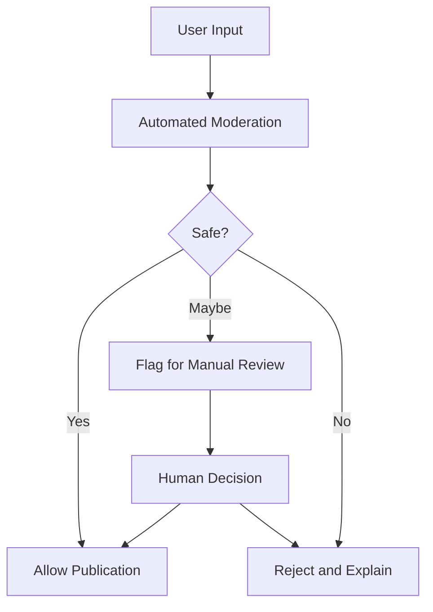

**Diagram sources**
- [Pujo_Sahayak_Master_Project_Context.md:869-892](file://Pujo_Sahayak_Master_Project_Context.md#L869-L892)

### Organizer Verification Processes
Organizer verification is not finalized in the current context, but it can be introduced to improve trust:
- Phone OTP verification
- Identity verification for paid or high-impact meetups
- Trust badges for verified organizers
- Restrictions for unverified organizers, such as requiring approval before publishing

Verification should be optional initially and tied to risk level, monetization, and community safety needs.

**Section sources**
- [plan.md:81-86](file://tasks/plan.md#L81-L86)
- [Pujo_Sahayak_Master_Project_Context.md:1076-1092](file://Pujo_Sahayak_Master_Project_Context.md#L1076-L1092)

## Dependency Analysis
The Meetup Creation Workflow depends on several layers:

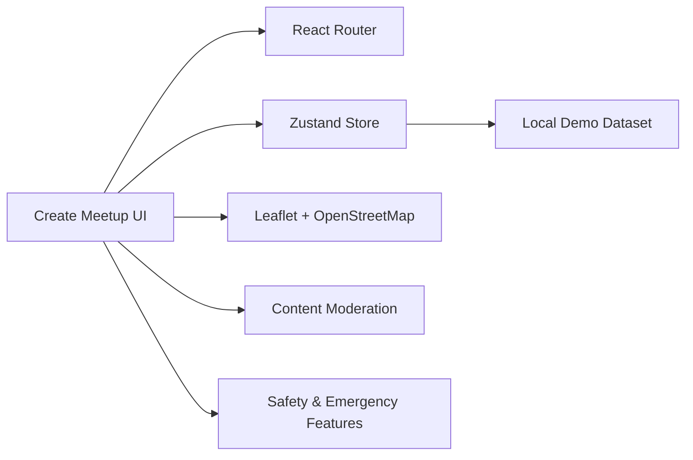

**Diagram sources**
- [plan.md:1-18](file://tasks/plan.md#L1-L18)
- [plan.md:19-39](file://tasks/plan.md#L19-L39)
- [todo.md:53-54](file://tasks/todo.md#L53-L54)

**Section sources**
- [plan.md:1-18](file://tasks/plan.md#L1-L18)
- [todo.md:53-54](file://tasks/todo.md#L53-L54)

## Performance Considerations
- Keep form validation synchronous where possible to avoid perceived lag
- Debounce search inputs for place selection
- Load map tiles lazily when the location picker opens
- Avoid heavy moderation calls until submit time
- Cache nearby places and interests to reduce repeated lookups
- Persist drafts locally to prevent data loss on reload

[No sources needed since this section provides general guidance]

## Troubleshooting Guide
Common issues and resolutions:

| Issue | Likely Cause | Resolution |
|---|---|---|
| Submit button never enables | Missing required fields or failed validation | Highlight invalid fields and explain fixes |
| Date/time mismatch | Past date or invalid time | Restrict picker to valid ranges |
| Location not saved | Map interaction incomplete | Require explicit pin confirmation |
| Description rejected | Moderation flag | Explain policy and suggest edits |
| Meetup not visible after creation | Store not updated or wrong privacy | Verify store write and privacy setting |
| Map does not load | Network or tile service issue | Show fallback message and retry option |
| Organizer cannot publish | Verification required | Guide user through verification flow |

**Section sources**
- [todo.md:53-54](file://tasks/todo.md#L53-L54)
- [Pujo_Sahayak_Master_Project_Context.md:869-892](file://Pujo_Sahayak_Master_Project_Context.md#L869-L892)

## Conclusion
The Meetup Creation Workflow is a structured, safety-aware process designed to help organizers plan community gatherings around Durga Puja and local exploration. It combines a clear multi-step form, map-based location selection, optional place associations, robust validation, moderation, and privacy controls. While the repository currently documents intent and planning rather than full implementation, the workflow described here aligns with the product context, implementation plan, and task breakdown. When implemented, it should prioritize clarity, safety, accessibility, and reliable local state management.

[No sources needed since this section summarizes without analyzing specific files]