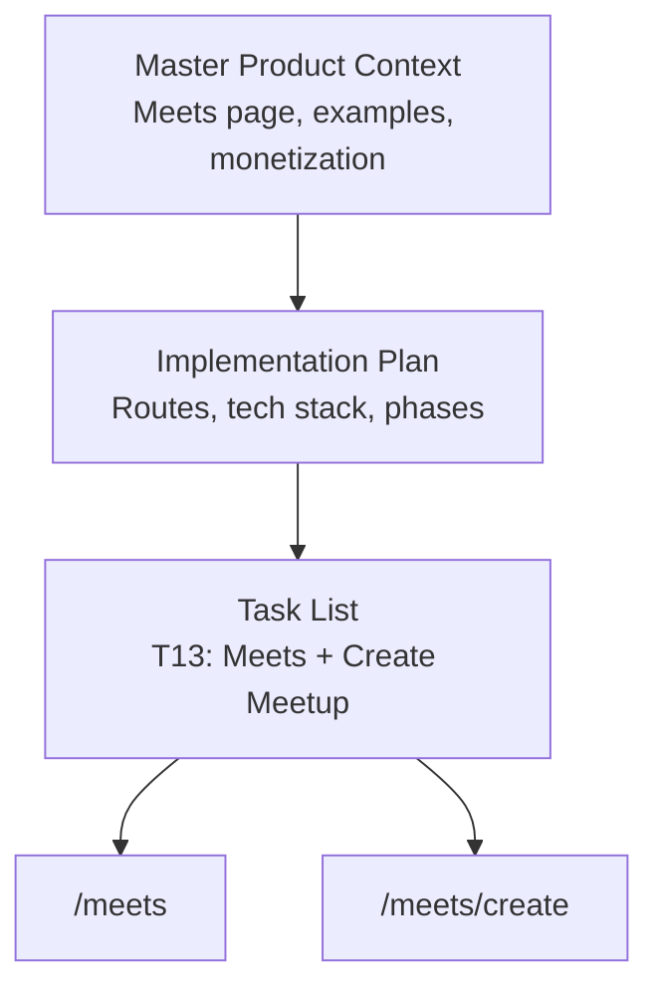
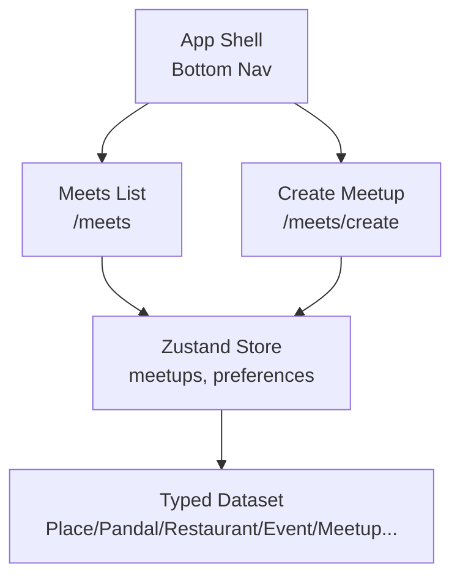
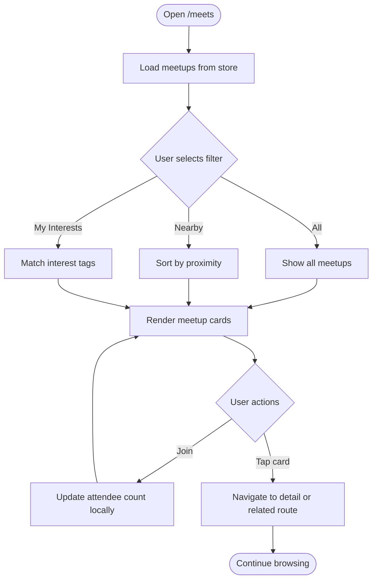
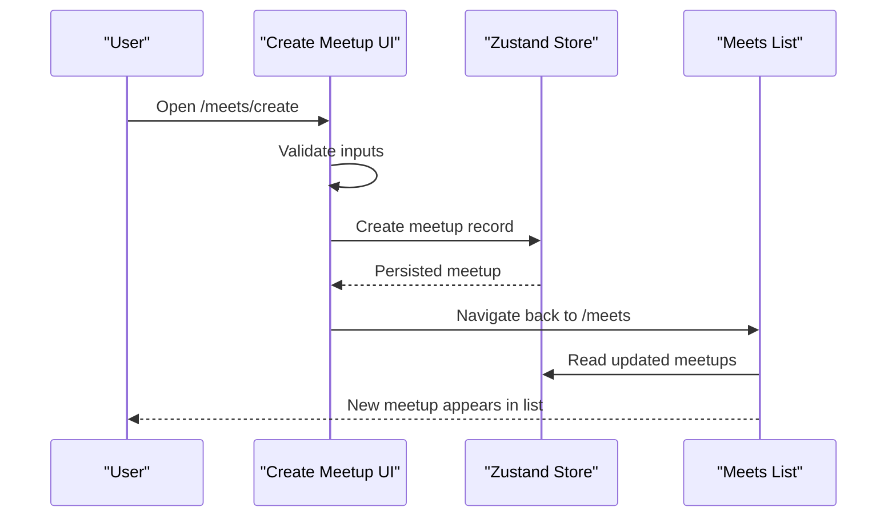
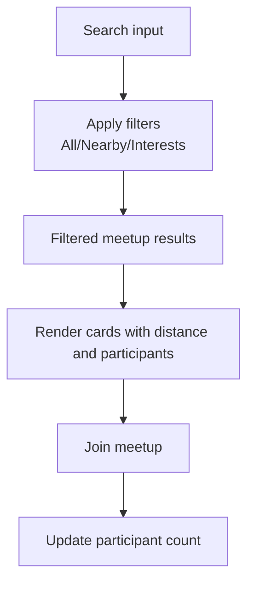
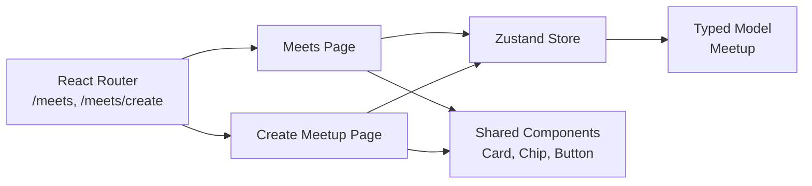

# Meetup Discovery Interface

<cite>
**Referenced Files in This Document**
- [Pujo_Sahayak_Master_Project_Context.md](file://Pujo_Sahayak_Master_Project_Context.md)
- [plan.md](file://tasks/plan.md)
- [todo.md](file://tasks/todo.md)
</cite>

## Table of Contents
1. [Introduction](#introduction)
2. [Project Structure](#project-structure)
3. [Core Components](#core-components)
4. [Architecture Overview](#architecture-overview)
5. [Detailed Component Analysis](#detailed-component-analysis)
6. [Dependency Analysis](#dependency-analysis)
7. [Performance Considerations](#performance-considerations)
8. [Troubleshooting Guide](#troubleshooting-guide)
9. [Conclusion](#conclusion)

## Introduction
This document describes the Meetup Discovery Interface for Pujo Sahayak, centered on the Meets page and its role within the broader app experience. The Meets feature helps users discover or organize meetups around shared interests such as photography, pandal hopping, food, music, art, night exploration, heritage, and family-friendly activities. It is part of a social layer that connects discovery, planning, visiting, and community interaction.

The documentation explains:
- What the Meets page shows and how it fits into navigation.
- How meetup cards should present name, date, time, location, participant count, and description.
- Filtering and sorting by proximity, timing, and interest categories.
- Card structure, visual hierarchy, interactive elements, and responsive behavior.
- Examples of meetup types including “South Kolkata Pandal Hop,” “Photography Walk,” and “Late-night Puja Food Crawl.”
- Search integration, location-based filtering, and real-time availability updates.

## Project Structure
At the repository level, the project is defined by product context and implementation plans rather than source code files. The relevant artifacts are:
- Master product context describing screens, flows, and requirements.
- Implementation plan mapping screens to routes and technology choices.
- Task list detailing what to build for the Meets feature.

**Diagram sources**
- [Pujo_Sahayak_Master_Project_Context.md:664-700](file://Pujo_Sahayak_Master_Project_Context.md#L664-L700)
- [plan.md:19-39](file://tasks/plan.md#L19-L39)
- [todo.md:53-54](file://tasks/todo.md#L53-L54)

**Section sources**
- [Pujo_Sahayak_Master_Project_Context.md:140-157](file://Pujo_Sahayak_Master_Project_Context.md#L140-L157)
- [plan.md:1-17](file://tasks/plan.md#L1-L17)
- [plan.md:19-39](file://tasks/plan.md#L19-L39)
- [todo.md:53-54](file://tasks/todo.md#L53-L54)

## Core Components
The Meets interface consists of two primary surfaces:
- Meets list at `/meets`
- Create Meetup at `/meets/create`

Key responsibilities:
- Display existing meetups with cards containing image, name, date·time, location·distance, attendee avatars + count, and Join action.
- Provide filter pills: All, Nearby, My Interests.
- Allow creating new meetups with title, date, time, location, description, interest chips, maximum participants, and public/restricted visibility.
- Update local state when joining or creating meetups.

Examples of meetup types include:
- South Kolkata Pandal Hop
- Photography Walk
- Late-night Puja Food Crawl

These examples illustrate activity-based social discovery rather than dating-style profiles.

**Section sources**
- [Pujo_Sahayak_Master_Project_Context.md:664-700](file://Pujo_Sahayak_Master_Project_Context.md#L664-L700)
- [Pujo_Sahayak_Master_Project_Context.md:703-729](file://Pujo_Sahayak_Master_Project_Context.md#L703-L729)
- [todo.md:53-54](file://tasks/todo.md#L53-L54)

## Architecture Overview
The Meets feature integrates with the app’s global store and routing:
- Routes: `/meets` and `/meets/create`.
- State: Zustand store persists meetups alongside saved places, visited places, plans, language, theme, and session data.
- Data model: Typed `Meetup` entity participates in the dataset and UI components.
- Navigation: Bottom nav includes Meets; deep links support direct access.

**Diagram sources**
- [plan.md:1-17](file://tasks/plan.md#L1-L17)
- [plan.md:19-39](file://tasks/plan.md#L19-L39)
- [todo.md:13-14](file://tasks/todo.md#L13-L14)

**Section sources**
- [plan.md:1-17](file://tasks/plan.md#L1-L17)
- [plan.md:19-39](file://tasks/plan.md#L19-L39)
- [todo.md:13-14](file://tasks/todo.md#L13-L14)

## Detailed Component Analysis

### Meets Page Layout and Cards
The Meets page lists existing meetups using cards with:
- Image
- Name
- Date and time
- Location and distance
- Attendee avatars and participant count
- Join action

Filtering and sorting:
- Filter pills: All, Nearby, My Interests.
- Sorting options (conceptual): proximity, start time, interest match.
- Responsive layout: single-column on mobile, multi-column on larger screens.

Visual hierarchy:
- Primary: meetup name and key details (date/time/location).
- Secondary: short description and participant count.
- Tertiary: images and avatars.

Interactive elements:
- Tap card to view details or navigate to related place/event.
- Join button to update attendance locally.
- Filter pills to refine results.

Responsive design patterns:
- Mobile-first grid/list toggle.
- Touch-friendly tap targets.
- Accessible labels for avatars and counts.

**Diagram sources**
- [todo.md:53-54](file://tasks/todo.md#L53-L54)
- [Pujo_Sahayak_Master_Project_Context.md:664-700](file://Pujo_Sahayak_Master_Project_Context.md#L664-L700)

**Section sources**
- [todo.md:53-54](file://tasks/todo.md#L53-L54)
- [Pujo_Sahayak_Master_Project_Context.md:664-700](file://Pujo_Sahayak_Master_Project_Context.md#L664-L700)

### Create Meetup Flow
The Create Meetup form collects:
- Title
- Date
- Time
- Location
- Description
- Interest/vibe chips
- Maximum participants
- Public or restricted visibility

Optional integrations:
- Select pandals, restaurants, or route segments to associate with the meetup.

Validation and feedback:
- Required fields highlighted.
- Clear success message after creation.
- Immediate addition to the local meetup list.

**Diagram sources**
- [todo.md:53-54](file://tasks/todo.md#L53-L54)
- [Pujo_Sahayak_Master_Project_Context.md:703-729](file://Pujo_Sahayak_Master_Project_Context.md#L703-L729)

**Section sources**
- [todo.md:53-54](file://tasks/todo.md#L53-L54)
- [Pujo_Sahayak_Master_Project_Context.md:703-729](file://Pujo_Sahayak_Master_Project_Context.md#L703-L729)

### Examples of Meetup Types
- South Kolkata Pandal Hop: Group exploration focused on specific areas during Puja.
- Photography Walk: Activity-based gathering for capturing images and sharing tips.
- Late-night Puja Food Crawl: Evening meetup combining food discovery with cultural experiences.

These examples demonstrate the breadth of activity-based social discovery supported by the platform.

**Section sources**
- [Pujo_Sahayak_Master_Project_Context.md:689-699](file://Pujo_Sahayak_Master_Project_Context.md#L689-L699)

### Search Integration and Location-Based Filtering
Search and categories complement the Meets experience:
- Search supports querying across the ecosystem, including meetups.
- Category shortcuts help narrow focus quickly.
- Popular nearby places and trending items can surface relevant meetups based on current location and user interests.

Location-based filtering:
- Nearby filter prioritizes meetups close to the user’s current location.
- Distance metadata on cards supports quick comparison.

Real-time availability:
- Join actions update attendee counts locally.
- Future enhancements may integrate live availability signals from backend services.

**Diagram sources**
- [todo.md:53-54](file://tasks/todo.md#L53-L54)
- [Pujo_Sahayak_Master_Project_Context.md:447-493](file://Pujo_Sahayak_Master_Project_Context.md#L447-L493)

**Section sources**
- [todo.md:53-54](file://tasks/todo.md#L53-L54)
- [Pujo_Sahayak_Master_Project_Context.md:447-493](file://Pujo_Sahayak_Master_Project_Context.md#L447-L493)

## Dependency Analysis
The Meets feature depends on:
- Routing: `/meets` and `/meets/create`.
- Global store: Zustand with persist middleware for meetups and preferences.
- Data model: Typed `Meetup` type integrated with the demo dataset.
- Shared components: Cards, chips, buttons, bottom nav, section headers.

**Diagram sources**
- [plan.md:1-17](file://tasks/plan.md#L1-L17)
- [plan.md:19-39](file://tasks/plan.md#L19-L39)
- [todo.md:10-14](file://tasks/todo.md#L10-L14)

**Section sources**
- [plan.md:1-17](file://tasks/plan.md#L1-L17)
- [plan.md:19-39](file://tasks/plan.md#L19-L39)
- [todo.md:10-14](file://tasks/todo.md#L10-L14)

## Performance Considerations
- Keep meetup lists lightweight by paginating or virtualizing long lists.
- Defer heavy image loading until cards enter viewport.
- Use memoized selectors for filtered/sorted results to avoid unnecessary re-renders.
- Debounce search input and filter changes.
- Respect reduced-motion settings for animations.

[No sources needed since this section provides general guidance]

## Troubleshooting Guide
Common issues and resolutions:
- Meetup not appearing after creation:
  - Verify create flow updates the store and navigates back to `/meets`.
  - Confirm persisted state survives reload.
- Join action not updating count:
  - Ensure join handler updates attendee metadata in the store.
  - Check that the list component subscribes to store changes.
- Nearby filter not working:
  - Validate distance calculation and location metadata on meetups.
  - Confirm user location permission handling and fallbacks.
- Interest matching not filtering:
  - Ensure interest chips are normalized and compared against meetup tags.
  - Verify case-insensitive and whitespace-trimmed comparisons.

**Section sources**
- [todo.md:53-54](file://tasks/todo.md#L53-L54)
- [plan.md:63-69](file://tasks/plan.md#L63-L69)

## Conclusion
The Meetup Discovery Interface centers on a clear, mobile-first Meets page and a straightforward Create Meetup flow. It emphasizes activity-based social discovery, with cards presenting essential details and interactive controls for joining and organizing meetups. Filtering by proximity, timing, and interests, combined with search and location-aware features, supports users in finding relevant gatherings. The architecture leverages React Router, Zustand, typed models, and shared components to keep the feature cohesive with the rest of the app.

[No sources needed since this section summarizes without analyzing specific files]