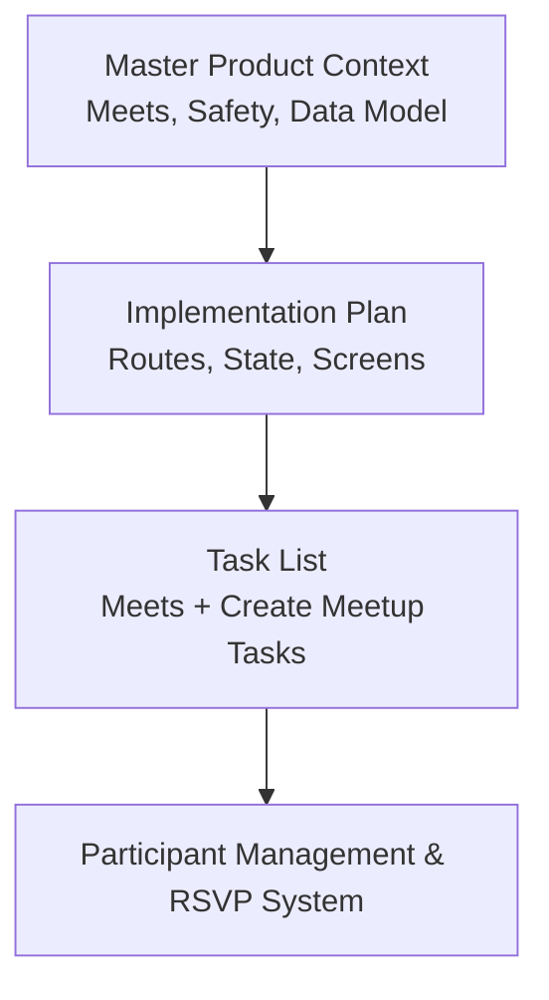
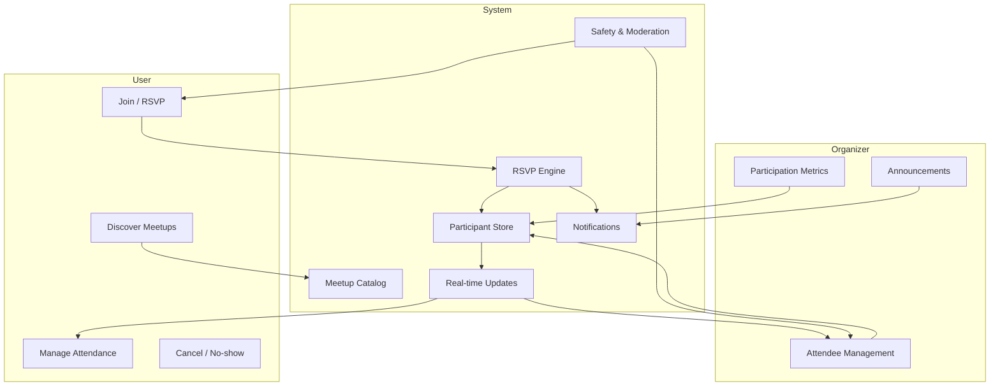
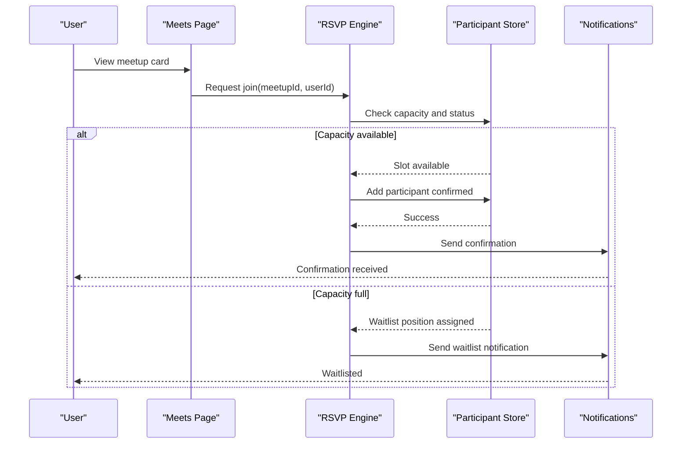
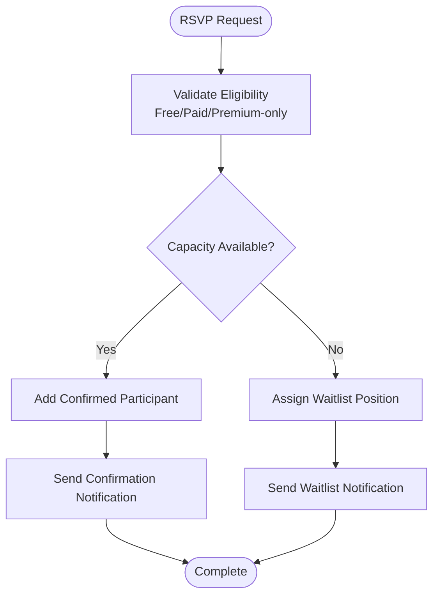
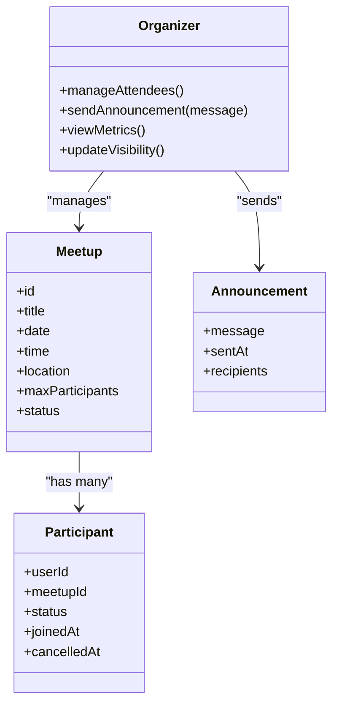
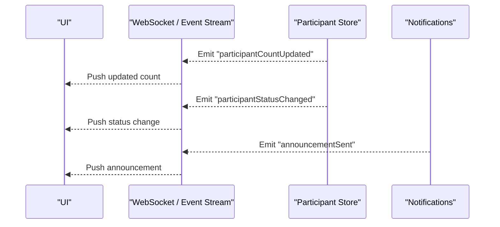
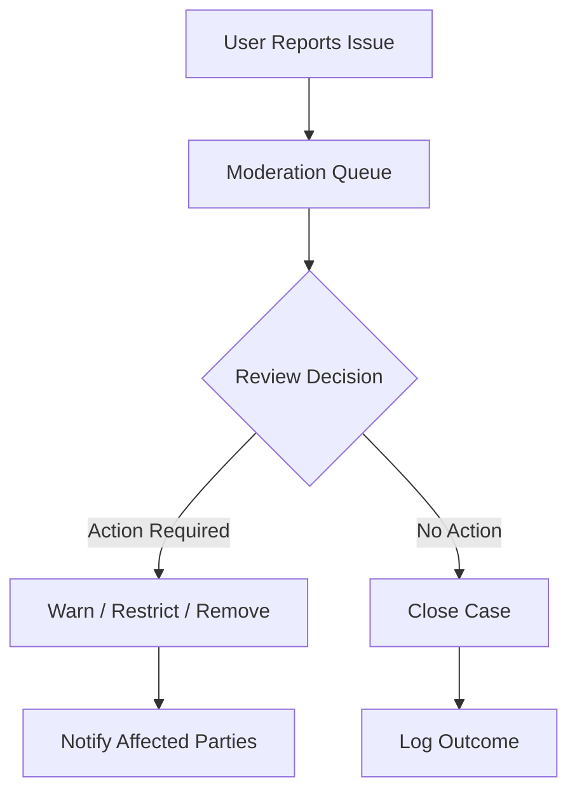
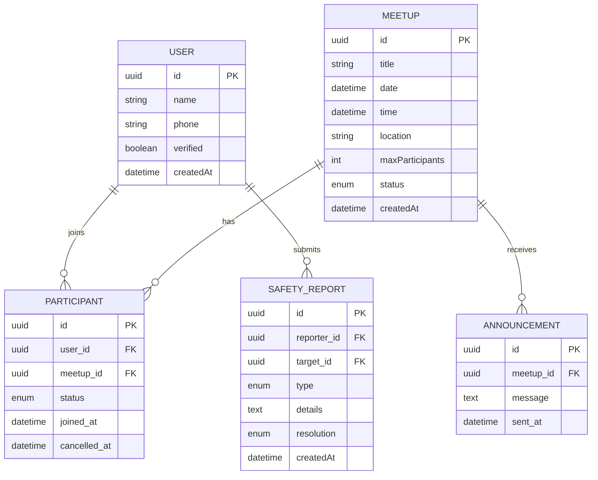
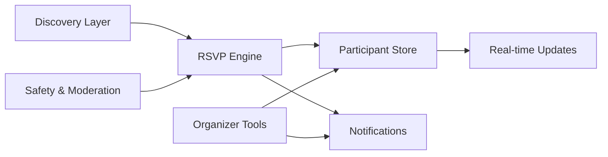

# Participant Management and RSVP System

<cite>
**Referenced Files in This Document**
- [Pujo_Sahayak_Master_Project_Context.md](file://Pujo_Sahayak_Master_Project_Context.md)
- [plan.md](file://tasks/plan.md)
- [todo.md](file://tasks/todo.md)
</cite>

## Table of Contents
1. [Introduction](#introduction)
2. [Project Structure](#project-structure)
3. [Core Components](#core-components)
4. [Architecture Overview](#architecture-overview)
5. [Detailed Component Analysis](#detailed-component-analysis)
6. [Dependency Analysis](#dependency-analysis)
7. [Performance Considerations](#performance-considerations)
8. [Troubleshooting Guide](#troubleshooting-guide)
9. [Conclusion](#conclusion)
10. [Appendices](#appendices)

## Introduction
This document describes the Participant Management and RSVP System for Pujo Sahayak’s Meets feature. It explains how users discover meetups, join them, manage their attendance, and handle cancellations. It also outlines the organizer experience for managing attendees, sending announcements, and tracking participation metrics. The system is designed to be safe, transparent, and community-oriented, with clear boundaries between discovery, planning, social interaction, and safety.

The scope includes:
- User journey from discovering a meetup to joining and managing attendance
- RSVP workflow including confirmation notifications, participant limits, and waitlist behavior when capacity is reached
- Organizer dashboard capabilities for attendee management, announcements, and participation metrics
- Real-time update mechanisms for participant counts, status changes, and communication channels
- Safety features such as user verification, reporting/blocking, moderation, and emergency access
- Data models for participant relationships, attendance tracking, and communication logs

## Project Structure
At this stage, the repository contains product context and implementation plans rather than source code. The relevant information for the Participant Management and RSVP System comes from:
- Master product context describing the Meets page, create-meetup flow, participant controls, safety requirements, and data model
- Implementation plan defining routes, state storage, and screen responsibilities
- Task list detailing the Meets and Create Meetup screens, including maximum participants and local join/create behavior

**Diagram sources**
- [Pujo_Sahayak_Master_Project_Context.md:664-773](file://Pujo_Sahayak_Master_Project_Context.md#L664-L773)
- [plan.md:19-39](file://tasks/plan.md#L19-L39)
- [todo.md:53-55](file://tasks/todo.md#L53-L55)

**Section sources**
- [Pujo_Sahayak_Master_Project_Context.md:664-773](file://Pujo_Sahayak_Master_Project_Context.md#L664-L773)
- [plan.md:19-39](file://tasks/plan.md#L19-L39)
- [todo.md:53-55](file://tasks/todo.md#L53-L55)

## Core Components
The Participant Management and RSVP System centers on these components:
- Meetup entity and metadata (title, date, time, location, description, interests, maximum participants, public/restricted)
- Participant relationship (user, meetup, status, timestamps)
- Attendance tracking (confirmed, waiting, cancelled, no-show)
- Organizer role and permissions (manage attendees, send announcements, view metrics)
- Notifications and communications (confirmation, reminders, updates, announcements)
- Safety and moderation (report/block, host info, public meeting locations, age restrictions where appropriate, emergency access)
- Real-time updates (participant count, status changes, communication channel events)

These components are grounded in the product context’s Meets design, the create-meetup form fields, and the safety requirements for meetups.

**Section sources**
- [Pujo_Sahayak_Master_Project_Context.md:664-773](file://Pujo_Sahayak_Master_Project_Context.md#L664-L773)
- [Pujo_Sahayak_Master_Project_Context.md:1232-1255](file://Pujo_Sahayak_Master_Project_Context.md#L1232-L1255)
- [Pujo_Sahayak_Master_Project_Context.md:1441-1455](file://Pujo_Sahayak_Master_Project_Context.md#L1441-L1455)
- [todo.md:53-55](file://tasks/todo.md#L53-L55)

## Architecture Overview
The RSVP system integrates discovery, planning, social interaction, and safety into one cohesive flow. Users discover meetups through the Meets page or from place detail pages; they can join free or paid meetups; organizers manage attendees and communicate updates; safety tools protect participants.

**Diagram sources**
- [Pujo_Sahayak_Master_Project_Context.md:664-773](file://Pujo_Sahayak_Master_Project_Context.md#L664-L773)
- [Pujo_Sahayak_Master_Project_Context.md:1441-1455](file://Pujo_Sahayak_Master_Project_Context.md#L1441-L1455)
- [todo.md:53-55](file://tasks/todo.md#L53-L55)

## Detailed Component Analysis

### User Journey: Discover to Join
Users discover meetups via:
- Meets page cards showing name, date/time, location, distance, participant avatars/count, and Join action
- Pandal detail page “Meetups near this place” section
- Interest-based filtering (All/Nearby/My Interests)

Joining a meetup involves:
- Validating user eligibility (free/paid/premium-only)
- Enforcing participant limits
- Confirming RSVP and updating participant count
- Sending confirmation notification
- Adding user to waitlist if capacity is reached

**Diagram sources**
- [Pujo_Sahayak_Master_Project_Context.md:664-773](file://Pujo_Sahayak_Master_Project_Context.md#L664-L773)
- [todo.md:53-55](file://tasks/todo.md#L53-L55)

**Section sources**
- [Pujo_Sahayak_Master_Project_Context.md:664-773](file://Pujo_Sahayak_Master_Project_Context.md#L664-L773)
- [todo.md:53-55](file://tasks/todo.md#L53-L55)

### RSVP Workflow: Confirmation, Limits, and Waitlist
The RSVP workflow enforces:
- Participant limit validation
- Status transitions (pending → confirmed/waitlisted)
- Confirmation notifications upon successful RSVP
- Waitlist assignment when capacity is reached
- Automatic promotion from waitlist to confirmed if a spot opens

**Diagram sources**
- [Pujo_Sahayak_Master_Project_Context.md:703-728](file://Pujo_Sahayak_Master_Project_Context.md#L703-L728)
- [todo.md:53-55](file://tasks/todo.md#L53-L55)

**Section sources**
- [Pujo_Sahayak_Master_Project_Context.md:703-728](file://Pujo_Sahayak_Master_Project_Context.md#L703-L728)
- [todo.md:53-55](file://tasks/todo.md#L53-L55)

### Organizer Dashboard: Attendees, Announcements, Metrics
Organizers can:
- Manage attendees (confirm, remove, promote from waitlist)
- Send announcements to all participants
- Track participation metrics (join rate, cancellation rate, attendance rate)
- Control visibility and permissions (public/restricted, location visibility)

**Diagram sources**
- [Pujo_Sahayak_Master_Project_Context.md:1441-1455](file://Pujo_Sahayak_Master_Project_Context.md#L1441-L1455)
- [todo.md:53-55](file://tasks/todo.md#L53-L55)

**Section sources**
- [Pujo_Sahayak_Master_Project_Context.md:1441-1455](file://Pujo_Sahayak_Master_Project_Context.md#L1441-L1455)
- [todo.md:53-55](file://tasks/todo.md#L53-L55)

### Real-time Update Mechanisms
Real-time updates ensure:
- Participant counts reflect current confirmed and waitlisted numbers
- Status changes propagate to both users and organizers
- Communication channels deliver timely announcements and reminders

[No sources needed since this diagram shows conceptual real-time flow]

### Safety Features: Verification, Reporting, Moderation
Safety measures include:
- Host information visibility
- Public meeting locations
- Report/block functionality
- Moderation controls
- Optional age restrictions
- Emergency access

**Diagram sources**
- [Pujo_Sahayak_Master_Project_Context.md:1441-1455](file://Pujo_Sahayak_Master_Project_Context.md#L1441-L1455)

**Section sources**
- [Pujo_Sahayak_Master_Project_Context.md:1441-1455](file://Pujo_Sahayak_Master_Project_Context.md#L1441-L1455)

### Data Models: Participants, Attendance, Communications
Core entities and relationships:
- User
- Meetup
- Participant (relationship between User and Meetup with status and timestamps)
- Announcement (communication log)
- SafetyReport (moderation record)

**Diagram sources**
- [Pujo_Sahayak_Master_Project_Context.md:1232-1255](file://Pujo_Sahayak_Master_Project_Context.md#L1232-L1255)
- [Pujo_Sahayak_Master_Project_Context.md:1441-1455](file://Pujo_Sahayak_Master_Project_Context.md#L1441-L1455)

**Section sources**
- [Pujo_Sahayak_Master_Project_Context.md:1232-1255](file://Pujo_Sahayak_Master_Project_Context.md#L1232-L1255)
- [Pujo_Sahayak_Master_Project_Context.md:1441-1455](file://Pujo_Sahayak_Master_Project_Context.md#L1441-L1455)

## Dependency Analysis
The RSVP system depends on:
- Meets catalog and filters (discovery)
- Participant store (state persistence)
- Notifications service (confirmation and announcements)
- Safety and moderation tools (report/block, host info, emergency access)
- Real-time event stream (count/status updates)

**Diagram sources**
- [plan.md:19-39](file://tasks/plan.md#L19-L39)
- [todo.md:53-55](file://tasks/todo.md#L53-L55)
- [Pujo_Sahayak_Master_Project_Context.md:1441-1455](file://Pujo_Sahayak_Master_Project_Context.md#L1441-L1455)

**Section sources**
- [plan.md:19-39](file://tasks/plan.md#L19-L39)
- [todo.md:53-55](file://tasks/todo.md#L53-L55)
- [Pujo_Sahayak_Master_Project_Context.md:1441-1455](file://Pujo_Sahayak_Master_Project_Context.md#L1441-L1455)

## Performance Considerations
- Keep participant count updates lightweight by batching events and debouncing UI re-renders
- Use optimistic UI for join actions to improve perceived responsiveness
- Cache meetup metadata locally to reduce network calls during RSVP
- Limit real-time payload size by sending only necessary fields (status, count, timestamp)
- Implement server-side throttling for announcements to prevent notification storms

[No sources needed since this section provides general guidance]

## Troubleshooting Guide
Common issues and resolutions:
- RSVP fails due to capacity: check waitlist logic and notify user appropriately
- Participant count not updating: verify real-time event emission and subscription handling
- Announcement not delivered: confirm recipient list and notification queue processing
- Safety report unresolved: review moderation queue and escalation paths
- Organizer cannot manage attendees: validate permissions and role checks

**Section sources**
- [Pujo_Sahayak_Master_Project_Context.md:1441-1455](file://Pujo_Sahayak_Master_Project_Context.md#L1441-L1455)
- [todo.md:53-55](file://tasks/todo.md#L53-L55)

## Conclusion
The Participant Management and RSVP System for Pujo Sahayak integrates discovery, RSVP, attendance tracking, organizer tools, real-time updates, and safety features into a cohesive platform. It supports free, paid, and premium-only meetups while enforcing participant limits and providing waitlist management. Organizers gain control over attendees, announcements, and metrics, and users benefit from transparent status updates and robust safety mechanisms. The data model ensures clear relationships between users, meetups, participants, announcements, and safety reports, enabling scalable growth beyond the Puja season.

[No sources needed since this section summarizes without analyzing specific files]

## Appendices

### Key Requirements Summary
- Meets page with discoverability and join actions
- Create meetup form with maximum participants and visibility settings
- RSVP enforcement with confirmation and waitlist
- Organizer tools for attendee management, announcements, and metrics
- Safety features including report/block, host info, public locations, and emergency access
- Real-time updates for counts, statuses, and communications

**Section sources**
- [Pujo_Sahayak_Master_Project_Context.md:664-773](file://Pujo_Sahayak_Master_Project_Context.md#L664-L773)
- [Pujo_Sahayak_Master_Project_Context.md:1441-1455](file://Pujo_Sahayak_Master_Project_Context.md#L1441-L1455)
- [todo.md:53-55](file://tasks/todo.md#L53-L55)