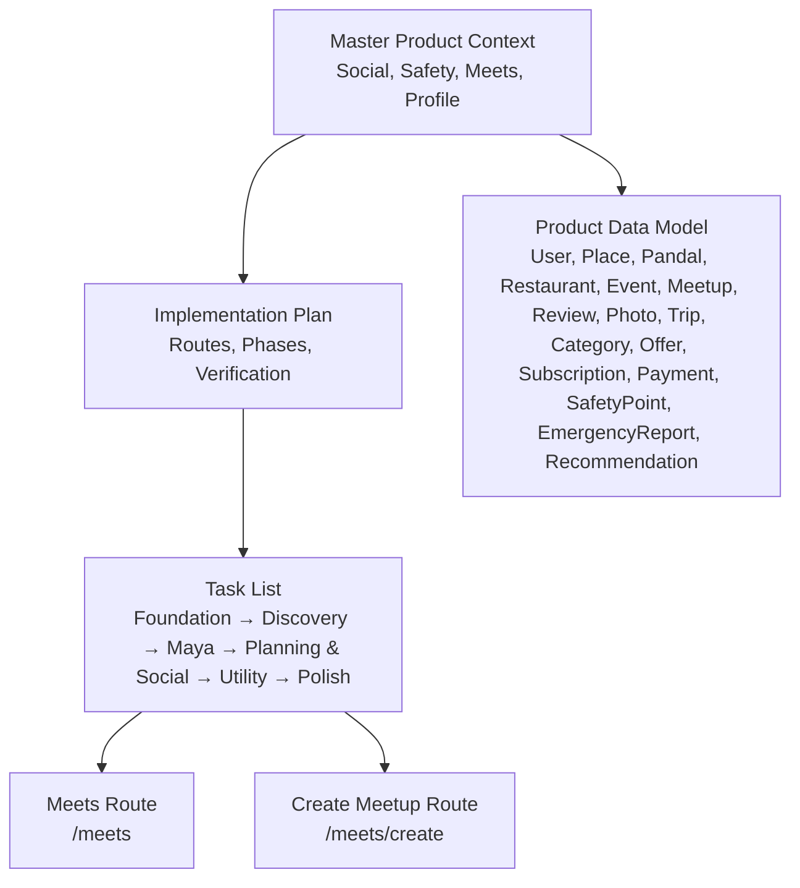
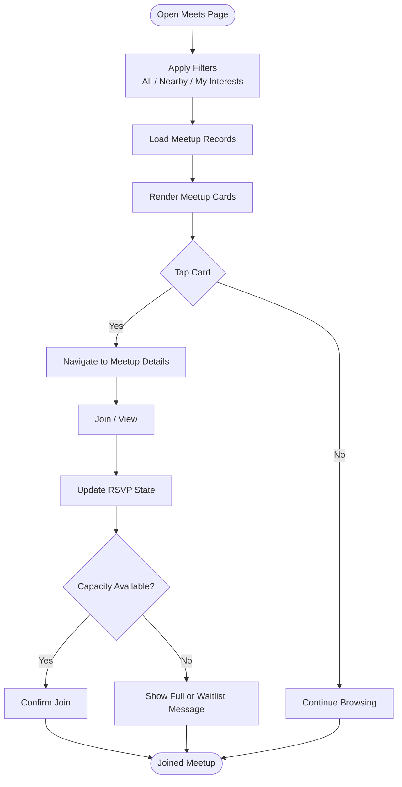
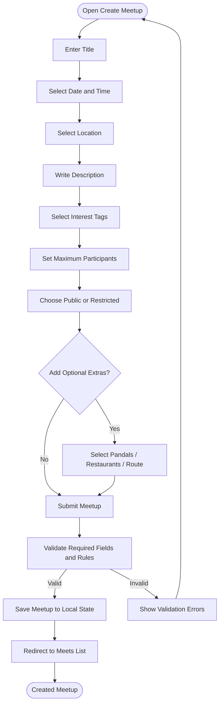
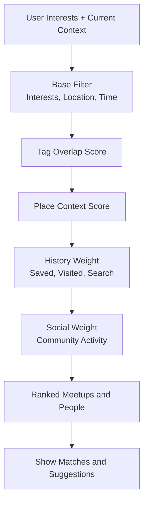
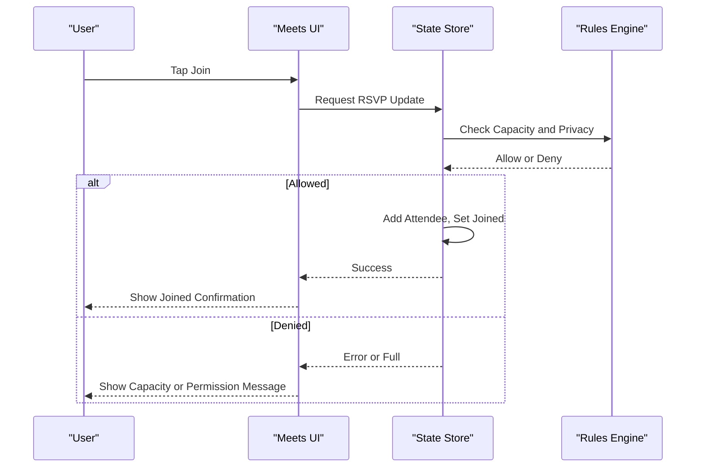
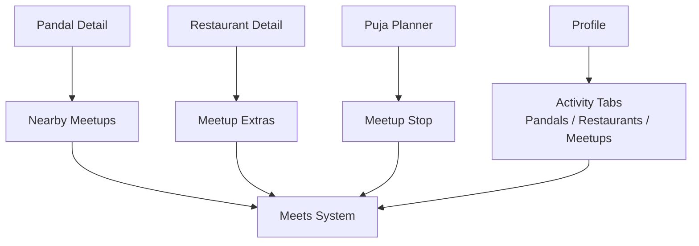
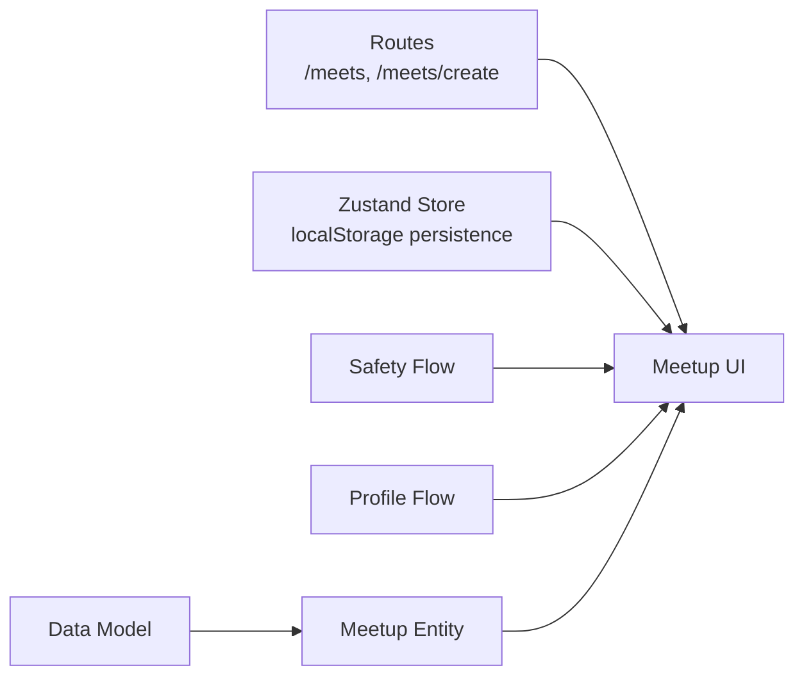

# Social Features and Meetup System

<cite>
**Referenced Files in This Document**
- [Pujo_Sahayak_Master_Project_Context.md](file://Pujo_Sahayak_Master_Project_Context.md)
- [plan.md](file://tasks/plan.md)
- [todo.md](file://tasks/todo.md)
</cite>

## Table of Contents
1. [Introduction](#introduction)
2. [Project Structure](#project-structure)
3. [Core Components](#core-components)
4. [Architecture Overview](#architecture-overview)
5. [Detailed Component Analysis](#detailed-component-analysis)
6. [Dependency Analysis](#dependency-analysis)
7. [Performance Considerations](#performance-considerations)
8. [Troubleshooting Guide](#troubleshooting-guide)
9. [Conclusion](#conclusion)

## Introduction
This document explains the social features and meetup system for Pujo Sahayak as defined by the project context and implementation plan. The system is part of a broader local-discovery platform whose initial focus is Durga Puja but which should remain useful beyond the festival season.

At a high level, the social layer supports:
- Discovering existing meetups
- Creating new meetups
- Matching users with shared interests
- Managing participants and RSVPs
- Connecting meetups to places such as pandals and restaurants
- Enforcing safety, moderation, and privacy controls
- Integrating with profile, planning, discovery, and safety flows

The documentation below translates these product requirements into concrete feature behavior, data relationships, user flows, and operational considerations.

## Project Structure
The repository currently contains:
- A master product context describing the full product vision, information architecture, and feature status
- An implementation plan describing the React + Vite PWA stack, routes, phases, and verification criteria
- A task list tracking build phases from foundation through polish



**Diagram sources**
- [Pujo_Sahayak_Master_Project_Context.md:1232-1255](file://Pujo_Sahayak_Master_Project_Context.md#L1232-L1255)
- [plan.md:19-39](file://tasks/plan.md#L19-L39)
- [todo.md:45-55](file://tasks/todo.md#L45-L55)

**Section sources**
- [Pujo_Sahayak_Master_Project_Context.md:1-18](file://Pujo_Sahayak_Master_Project_Context.md#L1-L18)
- [plan.md:1-18](file://tasks/plan.md#L1-L18)
- [todo.md:1-16](file://tasks/todo.md#L1-L16)

## Core Components
The social and meetup system is composed of several interconnected components:

| Component | Responsibility | Key Inputs | Key Outputs |
|---|---|---|---|
| Meets Discovery | Show existing gatherings with name, date, time, location, participants, and description | Meetup dataset, filters, user interests, location | Meetup cards, navigation to details or creation |
| Create Meetup | Collect title, scheduling, location, description, interest tags, participant limits, and privacy | User input, place catalog, interest taxonomy | New meetup record added to local state |
| Interest Matching | Connect users with shared activities such as photography, pandal hopping, food exploration, music, art, heritage tours, and family-friendly activities | User interests, meetup tags, activity metadata | Matched meetups, suggested people, vibe-based recommendations |
| Participant Management | Track who joined, RSVP state, capacity, host identity, and visibility | Join action, capacity rules, privacy settings | Updated attendee list, RSVP confirmation, capacity warnings |
| Place Integration | Link meetups to pandals, restaurants, events, and routes | Place catalog, selected route or stops | Nearby-meetup suggestions on place detail pages |
| Safety and Moderation | Provide reporting, blocking, public meeting locations, age restrictions where appropriate, emergency access, and content filtering | Reports, moderation flags, user reports, admin tools | Safe community interactions, moderated content, emergency pathways |
| Profile and Activity History | Record visits, saved items, and meetup participation | User actions, join history | Unified activity tabs including Pandals, Restaurants, Meetups |

**Section sources**
- [Pujo_Sahayak_Master_Project_Context.md:664-749](file://Pujo_Sahayak_Master_Project_Context.md#L664-L749)
- [Pujo_Sahayak_Master_Project_Context.md:935-950](file://Pujo_Sahayak_Master_Project_Context.md#L935-L950)
- [Pujo_Sahayak_Master_Project_Context.md:954-993](file://Pujo_Sahayak_Master_Project_Context.md#L954-L993)
- [todo.md:53-55](file://tasks/todo.md#L53-L55)

## Architecture Overview
The meetup system sits between discovery, planning, profile, and safety. It uses the same underlying data model that includes Users, Places, Pandal, Restaurant, Event, Meetup, Review, Photo, Trip, Category, Offer, Subscription, Payment, SafetyPoint, EmergencyReport, and Recommendation.

```mermaid
graph TB
subgraph "Discovery"
Home["Home"]
Explore["Explore / Pandal Directory"]
Detail["Pandal Detail"]
end
subgraph "Social"
Meets["Meets List"]
Create["Create Meetup"]
Match["Interest Matching"]
end
subgraph "Planning"
Planner["Puja Planner"]
Trip["Trip / Route Map"]
end
subgraph "Profile"
Profile["Profile"]
Visits["All Visits"]
end
subgraph "Safety"
Safety["Safety / Emergency"]
Missing["Missing Person Report"]
end
Data["Data Model<br/>User, Place, Pandal, Restaurant, Event, Meetup, Review, Photo, Trip, Category, Offer, Subscription, Payment, SafetyPoint, EmergencyReport, Recommendation"]
Home --> Meets
Explore --> Meets
Detail --> Meets
Meets --> Create
Meets --> Match
Planner --> Meets
Trip --> Meets
Profile --> Meets
Visits --> Meets
Safety --> Meets
Missing --> Meets
Meets --> Data
Create --> Data
Match --> Data
```

**Diagram sources**
- [Pujo_Sahayak_Master_Project_Context.md:1232-1255](file://Pujo_Sahayak_Master_Project_Context.md#L1232-L1255)
- [plan.md:19-39](file://tasks/plan.md#L19-L39)
- [todo.md:45-55](file://tasks/todo.md#L45-L55)

## Detailed Component Analysis

### Meetup Discovery Interface
The Meets page helps users find or organize meetups around shared interests and plans. Existing meetup cards can show:
- Meetup name
- Date
- Time
- Location
- Participants
- Short description

The implementation plan maps the Meets list to `/meets` and the Create Meetup flow to `/meets/create`. The task list describes filter pills such as All, Nearby, and My Interests, along with meetup cards showing image, name, date/time, location/distance, attendee avatars and count, and a Join action.



**Diagram sources**
- [Pujo_Sahayak_Master_Project_Context.md:664-701](file://Pujo_Sahayak_Master_Project_Context.md#L664-L701)
- [plan.md:29-30](file://tasks/plan.md#L29-L30)
- [todo.md:53-55](file://tasks/todo.md#L53-L55)

**Section sources**
- [Pujo_Sahayak_Master_Project_Context.md:664-701](file://Pujo_Sahayak_Master_Project_Context.md#L664-L701)
- [plan.md:29-30](file://tasks/plan.md#L29-L30)
- [todo.md:53-55](file://tasks/todo.md#L53-L55)

### Meetup Creation Workflow
The create-meetup workflow collects:
- Title
- Date
- Time
- Location
- Description
- Interest or vibe tags
- Maximum participants
- Public or restricted privacy setting

Optionally, creators can select pandals, restaurants, or a route. The business model conceptually supports free, paid, and premium-only meetups without hard-coding one pricing rule.



**Diagram sources**
- [Pujo_Sahayak_Master_Project_Context.md:703-728](file://Pujo_Sahayak_Master_Project_Context.md#L703-L728)
- [Pujo_Sahayak_Master_Project_Context.md:753-772](file://Pujo_Sahayak_Master_Project_Context.md#L753-L772)
- [plan.md:30](file://tasks/plan.md#L30)
- [todo.md:53-55](file://tasks/todo.md#L53-L55)

**Section sources**
- [Pujo_Sahayak_Master_Project_Context.md:703-728](file://Pujo_Sahayak_Master_Project_Context.md#L703-L728)
- [Pujo_Sahayak_Master_Project_Context.md:753-772](file://Pujo_Sahayak_Master_Project_Context.md#L753-L772)
- [plan.md:30](file://tasks/plan.md#L30)
- [todo.md:53-55](file://tasks/todo.md#L53-L55)

### Activity-Based Matching Algorithms
Users can find people based on shared interests such as:
- Photography
- Pandal hopping
- Food
- Music
- Art
- Night exploration
- Heritage
- Family-friendly exploration

The matching system should be framed as activity-based social discovery rather than a dating application. Matching can use:
- User-selected interests
- Meetup interest tags
- Place categories (pandals, restaurants, events)
- Location proximity
- Time availability
- Past activity and saved items

A simple matching algorithm can start with tag overlap and location filters, then evolve toward weighted scoring using visit history, favorites, search activity, categories, time, season, crowd levels, and social activity.



**Diagram sources**
- [Pujo_Sahayak_Master_Project_Context.md:730-749](file://Pujo_Sahayak_Master_Project_Context.md#L730-L749)
- [Pujo_Sahayak_Master_Project_Context.md:1263-1287](file://Pujo_Sahayak_Master_Project_Context.md#L1263-L1287)

**Section sources**
- [Pujo_Sahayak_Master_Project_Context.md:730-749](file://Pujo_Sahayak_Master_Project_Context.md#L730-L749)
- [Pujo_Sahayak_Master_Project_Context.md:1263-1287](file://Pujo_Sahayak_Master_Project_Context.md#L1263-L1287)

### Participant Management and RSVP Handling
Participant management should include:
- Host identification
- Attendee list
- RSVP state
- Capacity enforcement
- Join and leave actions
- Visibility controls based on privacy settings
- Reporting and blocking options

RSVP handling should validate capacity before confirming a join, provide clear feedback when a meetup is full, and update the user’s activity history under the Meetups tab.



**Diagram sources**
- [Pujo_Sahayak_Master_Project_Context.md:703-728](file://Pujo_Sahayak_Master_Project_Context.md#L703-L728)
- [Pujo_Sahayak_Master_Project_Context.md:1441-1455](file://Pujo_Sahayak_Master_Project_Context.md#L1441-L1455)
- [todo.md:53-55](file://tasks/todo.md#L53-L55)

**Section sources**
- [Pujo_Sahayak_Master_Project_Context.md:703-728](file://Pujo_Sahayak_Master_Project_Context.md#L703-L728)
- [Pujo_Sahayak_Master_Project_Context.md:1441-1455](file://Pujo_Sahayak_Master_Project_Context.md#L1441-L1455)
- [todo.md:53-55](file://tasks/todo.md#L53-L55)

### Real-Time Updates
Real-time updates are not explicitly implemented in the current demo scope. The implementation plan indicates that user state persists to localStorage and that the app is a React + Vite PWA. For production, real-time updates could be layered over this state store using WebSocket or server-sent events, updating:
- Live attendee counts
- Last-seen participant avatars
- Status changes such as cancelled or rescheduled meetups
- Moderation actions such as removal or reporting outcomes

Until then, the UI should refresh from the persisted store and avoid implying live connectivity unless a backend is present.

**Section sources**
- [plan.md:5-18](file://tasks/plan.md#L5-L18)
- [todo.md:63-67](file://tasks/todo.md#L63-L67)

### Community Moderation Tools
Moderation should cover:
- Reporting and blocking other users
- Host controls for participants
- Public meeting location guidance
- Age restrictions where appropriate
- Content filtering for descriptions, photos, and reviews
- Emergency access for unsafe situations

The product context emphasizes that the social system must not become an unmoderated stranger-meeting platform.

**Section sources**
- [Pujo_Sahayak_Master_Project_Context.md:1441-1455](file://Pujo_Sahayak_Master_Project_Context.md#L1441-L1455)
- [Pujo_Sahayak_Master_Project_Context.md:869-893](file://Pujo_Sahayak_Master_Project_Context.md#L869-L893)

### Safety Considerations, User Verification, and Content Filtering
Safety is a core pillar alongside discovery, understanding, planning, community, and memory. The social features must integrate with:
- Emergency shortcuts
- Police, ambulance, women’s assistance, child assistance
- Hospitals, pharmacies, help desks
- Lost and found
- Missing person reporting

User verification and content filtering should support:
- Verified user signals where appropriate
- AI-assisted photo verification for user uploads
- Moderation for spam, inappropriate content, copyrighted or promotional material, and unrelated photographs
- Clear distinction between organic and sponsored content

The missing-person system should not expose sensitive information publicly and should involve authorized operators where integration exists.

**Section sources**
- [Pujo_Sahayak_Master_Project_Context.md:995-1011](file://Pujo_Sahayak_Master_Project_Context.md#L995-L1011)
- [Pujo_Sahayak_Master_Project_Context.md:1390-1439](file://Pujo_Sahayak_Master_Project_Context.md#L1390-L1439)
- [Pujo_Sahayak_Master_Project_Context.md:853-893](file://Pujo_Sahayak_Master_Project_Context.md#L853-L893)

### Integration With Place Details and Planning
Meetups connect naturally to the rest of the platform:
- Pandal detail pages can show nearby meetups
- Restaurants and events can be linked to meetup extras
- Planners can include meetup stops
- Profiles track meetup participation alongside pandals and restaurants



**Diagram sources**
- [Pujo_Sahayak_Master_Project_Context.md:935-950](file://Pujo_Sahayak_Master_Project_Context.md#L935-L950)
- [Pujo_Sahayak_Master_Project_Context.md:954-993](file://Pujo_Sahayak_Master_Project_Context.md#L954-L993)
- [plan.md:25-38](file://tasks/plan.md#L25-L38)

**Section sources**
- [Pujo_Sahayak_Master_Project_Context.md:935-950](file://Pujo_Sahayak_Master_Project_Context.md#L935-L950)
- [Pujo_Sahayak_Master_Project_Context.md:954-993](file://Pujo_Sahayak_Master_Project_Context.md#L954-L993)
- [plan.md:25-38](file://tasks/plan.md#L25-L38)

## Dependency Analysis
The meetup system depends on:
- The typed data model for Meetup, User, Place, Pandal, Restaurant, Event, Review, Photo, Trip, Category, Offer, Subscription, Payment, SafetyPoint, EmergencyReport, and Recommendation
- The Meets and Create Meetup routes
- The store-backed state for saves, visits, plans, settings, and meetup participation
- Safety and profile flows for moderation, emergency access, and activity history



**Diagram sources**
- [Pujo_Sahayak_Master_Project_Context.md:1232-1255](file://Pujo_Sahayak_Master_Project_Context.md#L1232-L1255)
- [plan.md:5-18](file://tasks/plan.md#L5-L18)
- [plan.md:29-30](file://tasks/plan.md#L29-L30)

**Section sources**
- [Pujo_Sahayak_Master_Project_Context.md:1232-1255](file://Pujo_Sahayak_Master_Project_Context.md#L1232-L1255)
- [plan.md:5-18](file://tasks/plan.md#L5-L18)
- [plan.md:29-30](file://tasks/plan.md#L29-L30)

## Performance Considerations
- Keep meetup discovery responsive by filtering locally against the demo dataset until a backend is introduced
- Avoid heavy animations during safety-related interactions; prioritize clarity and speed
- Use lightweight interest-matching logic initially; defer complex scoring to later phases
- Persist only necessary meetup state to localStorage to keep load times predictable
- Defer real-time updates until a reliable backend is available

[No sources needed since this section provides general guidance]

## Troubleshooting Guide
Common issues and resolutions:

| Issue | Likely Cause | Resolution |
|---|---|---|
| Join button does nothing | Missing required fields or invalid capacity | Validate title, date, time, location, description, and maximum participants; check capacity rules |
| Meetup appears after refresh but disappears | State not persisted correctly | Ensure Zustand store persistence is enabled and meetup records are saved to localStorage |
| Nearby meetups do not show on place detail | Missing place-to-meetup linkage | Verify that place detail renders nearby meetups and that location filters match |
| Interest matches feel irrelevant | Simple tag overlap too narrow | Expand matching to include place categories, past activity, and location context |
| Reported user remains visible | Moderation state not updated | Implement report/block state and hide or remove reported participants according to policy |
| Photo upload accepted but unrelated | AI verification not enforced | Apply image verification and reject unrelated or inappropriate uploads |

**Section sources**
- [todo.md:53-55](file://tasks/todo.md#L53-L55)
- [Pujo_Sahayak_Master_Project_Context.md:869-893](file://Pujo_Sahayak_Master_Project_Context.md#L869-L893)
- [Pujo_Sahayak_Master_Project_Context.md:1441-1455](file://Pujo_Sahayak_Master_Project_Context.md#L1441-L1455)

## Conclusion
The social features and meetup system for Pujo Sahayak is designed as an activity-based community layer around local discovery. It supports discovering existing gatherings, creating new ones, matching users by shared interests, managing participants and RSVPs, integrating with place details and planning, and enforcing safety and moderation. The current repository defines the product vision, routes, and phased implementation tasks; actual code files for the React + Vite PWA are not present in this workspace snapshot. Future work should implement the described flows, data model, and safety controls while keeping the experience grounded, verifiable, and safe for real-world social interactions.

[No sources needed since this section summarizes without analyzing specific files]