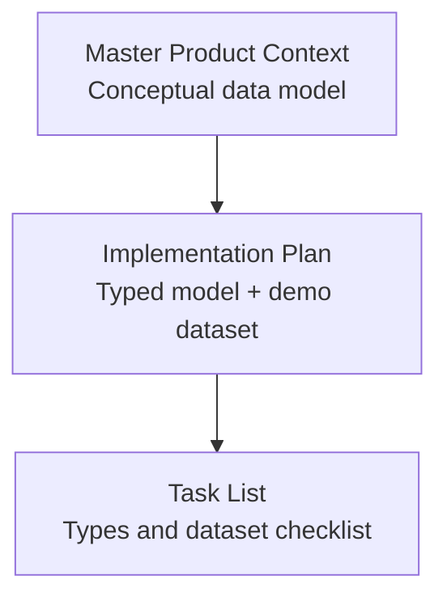
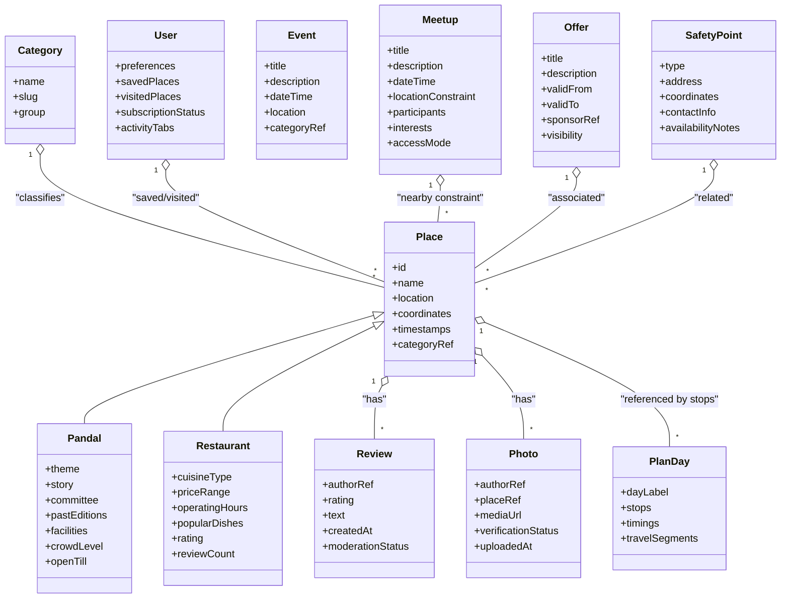
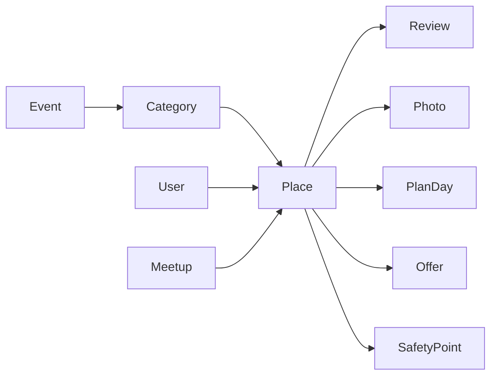

# Data Models and Schema Design

<cite>
**Referenced Files in This Document**
- [Pujo_Sahayak_Master_Project_Context.md](file://Pujo_Sahayak_Master_Project_Context.md)
- [plan.md](file://tasks/plan.md)
- [todo.md](file://tasks/todo.md)
</cite>

## Table of Contents
1. [Introduction](#introduction)
2. [Project Structure](#project-structure)
3. [Core Components](#core-components)
4. [Architecture Overview](#architecture-overview)
5. [Detailed Component Analysis](#detailed-component-analysis)
6. [Dependency Analysis](#dependency-analysis)
7. [Performance Considerations](#performance-considerations)
8. [Troubleshooting Guide](#troubleshooting-guide)
9. [Conclusion](#conclusion)
10. [Appendices](#appendices)

## Introduction
This document defines the data model for Puja Sahayak, a location-aware local discovery platform centered around Durga Puja but designed to remain useful beyond the festival season. The schema is intentionally extensible: Place is the base entity, with specialized types such as Pandal and Restaurant extending it. The system also models users, social meetups, events, reviews, photos, planning days, offers, safety points, categories, and related entities that support discovery, planning, community, safety, and monetization.

The documentation covers:
- Entity relationships starting from Place
- Specializations like Pandal and Restaurant
- User profile, preferences, saved items, visit history, and subscription status
- Social Meetup model with participants, interests, and location constraints
- Supporting entities: Event, Review, Photo, PlanDay, Offer, SafetyPoint, Category
- Validation rules, business constraints, and relationship semantics
- Demo data pattern using an `isDemo` marker
- Client-side persistence strategy via localStorage

## Project Structure
At this stage, the repository contains product context and implementation planning documents rather than source code. The data model is therefore defined by the product context and task plan:
- Master product context describes the conceptual data model and ecosystem
- Implementation plan specifies the typed data model and demo dataset requirements
- Task list enumerates the exact types and dataset expectations

**Diagram sources**
- [Pujo_Sahayak_Master_Project_Context.md:1232-1259](file://Pujo_Sahayak_Master_Project_Context.md#L1232-L1259)
- [plan.md:1-18](file://tasks/plan.md#L1-L18)
- [todo.md:13-14](file://tasks/todo.md#L13-L14)

**Section sources**
- [Pujo_Sahayak_Master_Project_Context.md:1232-1259](file://Pujo_Sahayak_Master_Project_Context.md#L1232-L1259)
- [plan.md:1-18](file://tasks/plan.md#L1-L18)
- [todo.md:13-14](file://tasks/todo.md#L13-L14)

## Core Components
The core data model centers on a base Place entity extended by specialized place types, plus user-centric and operational entities.

### Base Model: Place
Place is the foundational entity for all location-based items. It should include:
- Unique identifier
- Name
- Location (latitude, longitude, address)
- Basic metadata (created/updated timestamps)
- Optional category reference
- Optional media references (images/videos)
- Operational flags (open/closed, crowd level, distance indicators)

Validation and constraints:
- Latitude and longitude must be valid coordinates
- Name must be non-empty
- Coordinates should be within Kolkata metropolitan bounds or explicitly marked as out-of-area
- Timestamps should be ISO 8601 strings

Relationships:
- One-to-many with Review
- One-to-many with Photo
- Many-to-one with Category
- Referenced by PlanDay stops
- Referenced by Offers and SafetyPoints when applicable

### Specialization: Pandal
Pandal extends Place with festival-specific attributes:
- Theme and story
- Committee information
- Past editions (historical themes and images)
- Facilities and amenities
- Crowd level and open-till time
- Nearby restaurants and meetups linkage

Business constraints:
- Theme and committee fields are required for authentic pandal records
- Past editions should be ordered chronologically
- Crowd levels should be derived from dataset or verified signals; never fabricated

### Specialization: Restaurant
Restaurant extends Place with culinary details:
- Cuisine type
- Price range
- Operating hours
- Popular dishes
- Ratings and review count
- Distance and “Open now” indicator

Business constraints:
- Price range should use a bounded enum or numeric scale
- Operating hours must be parseable and consistent
- Open-now calculation depends on current time and operating hours

### User
User represents a client-side profile and activity record:
- Personal preferences (language, theme, reduced motion, app logo variant)
- Saved places (favorites)
- Visited places (history)
- Subscription status (free/premium concept)
- Activity tabs (Pandals, Restaurants, Meetups)
- Emergency shortcuts and account settings

Validation and constraints:
- Preferences must be validated against allowed enums
- Saved and visited lists should deduplicate by place ID
- Subscription state should be clearly labeled as UI/demo until backend integration

### Meetup
Meetup models social gatherings:
- Title, description, date/time
- Location constraints (area, radius, or specific venue)
- Participants and participant limits
- Interests/vibe tags
- Public/restricted access
- Host identity (local-only in v1)

Business constraints:
- Maximum participants must be positive
- Date/time must be in the future for new meetups
- Location must be resolvable to a geographic area
- Access control should prevent accidental exposure of sensitive meetup details

### Event
Event represents local experiences and activities:
- Title, description, date/time
- Location
- Category
- Whether it is part of Puja or off-season programming

Constraints:
- Dates must be valid and ordered
- Location must be geocodable

### Review
Review captures user-generated feedback:
- Author reference
- Rating (bounded scale)
- Text content
- Created timestamp
- Moderation status

Constraints:
- Rating must be within a fixed range
- Content should be sanitized and moderated
- Duplicate reviews per user-place pair should be prevented

### Photo
Photo stores user-contributed media:
- Author reference
- Place association
- Media URL or placeholder
- Verification status (AI-assisted moderation)
- Upload timestamp

Constraints:
- File size and format validation at upload
- AI verification result must be stored and exposed as “demo” where applicable
- Unverified photos should not influence public rankings until approved

### PlanDay
PlanDay represents a single day in the multi-day Puja itinerary:
- Day label (e.g., Panchami through Dashami)
- Ordered stop list referencing Place IDs
- Approximate timings and durations
- Travel segments between stops

Constraints:
- Stops must be unique per day
- Timings must be monotonically increasing
- Total travel distance and estimated time can be computed from coordinates

### Offer
Offer models promotions and discounts:
- Title and description
- Associated place or category
- Validity period
- Sponsor or partner reference
- Visibility flag

Constraints:
- Validity dates must be valid ranges
- Offers should not imply guarantees unless backed by verified partners

### SafetyPoint
SafetyPoint marks emergency and utility locations:
- Type (police, hospital, ATM, pharmacy, help desk, etc.)
- Address and coordinates
- Contact numbers or links
- Availability notes

Constraints:
- Coordinates must be valid
- Emergency contacts must be verified or clearly marked as demo

### Category
Category provides structured classification:
- Name and slug
- Grouping (Places, Transport & Services, Utilities)
- Icon or visual token reference

Constraints:
- Slugs must be unique
- Categories should be curated and not user-editable in v1

**Section sources**
- [Pujo_Sahayak_Master_Project_Context.md:1232-1259](file://Pujo_Sahayak_Master_Project_Context.md#L1232-L1259)
- [todo.md:13-14](file://tasks/todo.md#L13-L14)

## Architecture Overview
The data architecture follows a base-specialization pattern with Place as the root. Users interact with Places, Reviews, Photos, and Meetups. Planning ties multiple Places together across PlanDays. Offers and SafetyPoints enrich the environment. Categories provide taxonomy.

**Diagram sources**
- [Pujo_Sahayak_Master_Project_Context.md:1232-1259](file://Pujo_Sahayak_Master_Project_Context.md#L1232-L1259)
- [todo.md:13-14](file://tasks/todo.md#L13-L14)

## Detailed Component Analysis

### Place Base Model
Place is the anchor for all location entities. It ensures consistent geospatial and metadata handling across Pandal, Restaurant, Event, and other place-like items.

Key responsibilities:
- Provide shared fields for identification, location, and basic metadata
- Support category classification
- Enable distance calculations and nearby queries
- Serve as a stable reference for Reviews, Photos, Plans, Offers, and SafetyPoints

Validation rules:
- Coordinates must be valid latitude/longitude pairs
- Name must be non-empty and trimmed
- Timestamps must be ISO 8601
- Category reference must exist in the Category catalog

Complexity considerations:
- Geospatial queries should use efficient indexing on coordinates
- Nearby searches should leverage spatial indexes or haversine calculations with caching

**Section sources**
- [Pujo_Sahayak_Master_Project_Context.md:1232-1259](file://Pujo_Sahayak_Master_Project_Context.md#L1232-L1259)

### Pandal Specialization
Pandal adds cultural and operational depth to Place:
- Theme and story explain artistic intent
- Committee information connects to organizing bodies
- Past editions show evolution and historical continuity
- Facilities and crowd levels inform visitor experience
- Open-till time supports evening planning

Business constraints:
- Theme/story must be grounded in verified data; AI explanations must not hallucinate facts
- Past editions should be ordered and linked to images/media
- Crowd levels should reflect dataset or verified signals, not fabricated statistics

Data flow:
- Pandal detail surfaces theme, past editions, reviews, top-click photos, similar places, nearby restaurants, and nearby meetups
- Maya can answer questions about theme, artist, symbolism, and visit info using verified data

**Section sources**
- [Pujo_Sahayak_Master_Project_Context.md:775-808](file://Pujo_Sahayak_Master_Project_Context.md#L775-L808)
- [Pujo_Sahayak_Master_Project_Context.md:811-893](file://Pujo_Sahayak_Master_Project_Context.md#L811-L893)
- [Pujo_Sahayak_Master_Project_Context.md:1330-1358](file://Pujo_Sahayak_Master_Project_Context.md#L1330-L1358)

### Restaurant Specialization
Restaurant extends Place with culinary specifics:
- Cuisine type categorizes food offerings
- Price range indicates affordability
- Operating hours determine availability
- Popular dishes highlight signature items
- Ratings and review counts reflect community sentiment

Business constraints:
- Price range should be normalized (e.g., low/medium/high or numeric scale)
- Operating hours must be parsed into start/end times for “Open now” logic
- Ratings should be averaged from verified reviews only

Integration points:
- Nearby restaurants appear on Pandal detail pages
- Restaurants can be added to PlanDay stops
- Offers may target specific restaurants

**Section sources**
- [Pujo_Sahayak_Master_Project_Context.md:913-931](file://Pujo_Sahayak_Master_Project_Context.md#L913-L931)
- [todo.md:60-61](file://tasks/todo.md#L60-L61)

### User Model
User encapsulates personalization and activity:
- Preferences: language, theme (dark/light), reduced motion, app logo variant
- Saved places: explicit favorites
- Visited places: history of visits
- Subscription status: free/premium concept
- Activity tabs: Pandals, Restaurants, Meetups
- Emergency shortcuts and account settings

Validation and constraints:
- Preferences must match allowed enums
- Saved/visited lists should deduplicate by place ID
- Subscription state is UI/demo in v1; no payment backend

Persistence:
- All user state persists to localStorage via Zustand persist middleware

**Section sources**
- [plan.md:12-15](file://tasks/plan.md#L12-L15)
- [todo.md:66-67](file://tasks/todo.md#L66-L67)

### Meetup Model
Meetup enables activity-based social discovery:
- Title, description, date/time
- Location constraints (area/radius or venue)
- Participants and maximum participants
- Interests/vibes (photography, food, heritage, etc.)
- Access mode (public/restricted)
- Host identity (local-only in v1)

Business constraints:
- Maximum participants must be positive and enforced
- Date/time must be in the future for creation
- Location must be resolvable and safe for public display
- Safety controls: report/block, host info, moderation, optional age restrictions

Integration points:
- Meetups appear near Pandal detail pages
- Participants join locally; no backend auth in v1

**Section sources**
- [Pujo_Sahayak_Master_Project_Context.md:664-772](file://Pujo_Sahayak_Master_Project_Context.md#L664-L772)
- [Pujo_Sahayak_Master_Project_Context.md:935-950](file://Pujo_Sahayak_Master_Project_Context.md#L935-L950)
- [Pujo_Sahayak_Master_Project_Context.md:1441-1456](file://Pujo_Sahayak_Master_Project_Context.md#L1441-L1456)

### Event Model
Event represents local experiences beyond pandals:
- Title, description, date/time
- Location and category
- Seasonal relevance (Puja vs off-season)

Constraints:
- Dates must be valid and ordered
- Category must exist in the catalog

**Section sources**
- [Pujo_Sahayak_Master_Project_Context.md:268-283](file://Pujo_Sahayak_Master_Project_Context.md#L268-L283)

### Review Model
Review captures community feedback:
- Author reference
- Rating (bounded scale)
- Text content
- Created timestamp
- Moderation status

Constraints:
- Rating must be within a fixed range
- Content must be sanitized and moderated
- Duplicate reviews per user-place pair should be prevented

**Section sources**
- [Pujo_Sahayak_Master_Project_Context.md:811-828](file://Pujo_Sahayak_Master_Project_Context.md#L811-L828)

### Photo Model
Photo stores user-contributed media:
- Author reference
- Place association
- Media URL or placeholder
- Verification status (AI-assisted moderation)
- Upload timestamp

Constraints:
- File size/format validation at upload
- AI verification result stored and exposed as “demo” where applicable
- Unverified photos do not influence public rankings until approved

**Section sources**
- [Pujo_Sahayak_Master_Project_Context.md:853-893](file://Pujo_Sahayak_Master_Project_Context.md#L853-L893)

### PlanDay Model
PlanDay structures a single day’s itinerary:
- Day label (Panchami through Dashami)
- Ordered stop list referencing Place IDs
- Approximate timings and durations
- Travel segments between stops

Constraints:
- Stops must be unique per day
- Timings must be monotonically increasing
- Total distance and estimated time computed from coordinates

**Section sources**
- [Pujo_Sahayak_Master_Project_Context.md:353-421](file://Pujo_Sahayak_Master_Project_Context.md#L353-L421)
- [todo.md:50-51](file://tasks/todo.md#L50-L51)

### Offer Model
Offer models promotions and discounts:
- Title and description
- Associated place or category
- Validity period
- Sponsor/partner reference
- Visibility flag

Constraints:
- Validity dates must be valid ranges
- Offers should not imply guarantees unless backed by verified partners

**Section sources**
- [Pujo_Sahayak_Master_Project_Context.md:235-247](file://Pujo_Sahayak_Master_Project_Context.md#L235-L247)

### SafetyPoint Model
SafetyPoint marks emergency and utility locations:
- Type (police, hospital, ATM, pharmacy, help desk, etc.)
- Address and coordinates
- Contact numbers or links
- Availability notes

Constraints:
- Coordinates must be valid
- Emergency contacts must be verified or clearly marked as demo

**Section sources**
- [Pujo_Sahayak_Master_Project_Context.md:995-1010](file://Pujo_Sahayak_Master_Project_Context.md#L995-L1010)
- [Pujo_Sahayak_Master_Project_Context.md:1390-1408](file://Pujo_Sahayak_Master_Project_Context.md#L1390-L1408)

### Category Model
Category provides structured classification:
- Name and slug
- Grouping (Places, Transport & Services, Utilities)
- Icon or visual token reference

Constraints:
- Slugs must be unique
- Categories should be curated and not user-editable in v1

**Section sources**
- [Pujo_Sahayak_Master_Project_Context.md:495-556](file://Pujo_Sahayak_Master_Project_Context.md#L495-L556)

## Dependency Analysis
The data model exhibits clear cohesion and coupling patterns:
- Place is the central entity with high cohesion among its specializations
- User depends on Place for saved/visited lists
- Meetup depends on Place for location constraints
- Review and Photo depend on Place for associations
- PlanDay depends on Place for stops
- Offer and SafetyPoint may reference Place or Category
- Category is referenced by Place and Event

Potential circular dependencies:
- None expected if Place is the root and specializations do not reference each other directly
- Avoid bidirectional references between Place and Review/Photo; keep them as one-to-many from Place

External dependencies:
- Geospatial libraries for distance calculations
- Map provider (Leaflet + OpenStreetMap) for route visualization
- Local storage for client-side persistence

**Diagram sources**
- [Pujo_Sahayak_Master_Project_Context.md:1232-1259](file://Pujo_Sahayak_Master_Project_Context.md#L1232-L1259)
- [todo.md:13-14](file://tasks/todo.md#L13-L14)

**Section sources**
- [Pujo_Sahayak_Master_Project_Context.md:1232-1259](file://Pujo_Sahayak_Master_Project_Context.md#L1232-L1259)

## Performance Considerations
- Geospatial queries should use efficient indexing on coordinates to support nearby searches
- Caching strategies for popular places, reviews, and photos reduce repeated computations
- Image optimization and lazy loading improve perceived performance
- PlanDay travel calculations should be cached per day to avoid recomputation
- Meetup participant lists should be paginated or limited to avoid heavy renders
- Review and photo moderation queues should be processed asynchronously

[No sources needed since this section provides general guidance]

## Troubleshooting Guide
Common issues and resolutions:
- Invalid coordinates: Validate latitude/longitude before saving Place or SafetyPoint
- Duplicate saved/visited entries: Deduplicate by place ID in User state
- Fake reviews or stats: Ensure all reviews and ratings come from verified dataset; never fabricate
- AI hallucination: Maya responses must be grounded in dataset; fallback to “I don’t have verified information”
- Photo verification failures: Store verification status and reject unrelated uploads
- Meetup safety risks: Enforce participant limits, location visibility controls, and moderation
- Persistence failures: Verify localStorage serialization/deserialization for User state

**Section sources**
- [Pujo_Sahayak_Master_Project_Context.md:1330-1358](file://Pujo_Sahayak_Master_Project_Context.md#L1330-L1358)
- [Pujo_Sahayak_Master_Project_Context.md:1441-1456](file://Pujo_Sahayak_Master_Project_Context.md#L1441-L1456)

## Conclusion
The Puja Sahayak data model is built around a robust Place base with specialized types for Pandal and Restaurant, complemented by User, Meetup, Event, Review, Photo, PlanDay, Offer, SafetyPoint, and Category. The schema supports discovery, planning, community, safety, and monetization while remaining extensible for off-season local discovery. Validation rules and business constraints ensure data integrity, and the demo data pattern with `isDemo` markers maintains honesty about simulated features. Client-side persistence via localStorage enables a fully functional prototype without backend dependencies.

[No sources needed since this section summarizes without analyzing specific files]

## Appendices

### Sample Data Structures
Below are conceptual sample structures aligned with the documented entities. These are illustrative and not code snippets.

- Place
  - id: string
  - name: string
  - location: object
  - coordinates: object
  - timestamps: object
  - categoryRef: string

- Pandal
  - theme: string
  - story: string
  - committee: string
  - pastEditions: array
  - facilities: array
  - crowdLevel: string
  - openTill: string

- Restaurant
  - cuisineType: string
  - priceRange: number|string
  - operatingHours: object
  - popularDishes: array
  - rating: number
  - reviewCount: number

- User
  - preferences: object
  - savedPlaces: array
  - visitedPlaces: array
  - subscriptionStatus: string
  - activityTabs: array

- Meetup
  - title: string
  - description: string
  - dateTime: string
  - locationConstraint: object
  - participants: array
  - interests: array
  - accessMode: string

- Event
  - title: string
  - description: string
  - dateTime: string
  - location: object
  - categoryRef: string

- Review
  - authorRef: string
  - rating: number
  - text: string
  - createdAt: string
  - moderationStatus: string

- Photo
  - authorRef: string
  - placeRef: string
  - mediaUrl: string
  - verificationStatus: string
  - uploadedAt: string

- PlanDay
  - dayLabel: string
  - stops: array
  - timings: array
  - travelSegments: array

- Offer
  - title: string
  - description: string
  - validFrom: string
  - validTo: string
  - sponsorRef: string
  - visibility: boolean

- SafetyPoint
  - type: string
  - address: string
  - coordinates: object
  - contactInfo: string
  - availabilityNotes: string

- Category
  - name: string
  - slug: string
  - group: string

**Section sources**
- [Pujo_Sahayak_Master_Project_Context.md:1232-1259](file://Pujo_Sahayak_Master_Project_Context.md#L1232-L1259)
- [todo.md:13-14](file://tasks/todo.md#L13-L14)

### Demo Data Pattern with isDemo Markers
- Dataset entries should include an `isDemo: true` flag to indicate simulated data
- Crowd levels, hours, and ratings must be rendered only from dataset fields
- Maya responses must be grounded in dataset and never hallucinate facts
- Photo verification is simulated locally; results are marked as demo
- Premium/payments and auth are UI stubs in v1; no real integrations

**Section sources**
- [plan.md:15-17](file://tasks/plan.md#L15-L17)
- [todo.md:83-85](file://tasks/todo.md#L83-L85)

### localStorage Persistence Strategy
- Client store uses Zustand with persist middleware
- Persisted keys include: saved places, visited places, puja plan (6 day-slots), meetups, language, theme, app-logo choice, “continue where you left off” session
- Serialization must handle nested objects and arrays safely
- On app load, initialize store from localStorage; on changes, write back immediately
- Fallback behavior: if localStorage is unavailable, run in-memory mode without persistence

**Section sources**
- [plan.md:12-15](file://tasks/plan.md#L12-L15)
- [plan.md:63-68](file://tasks/plan.md#L63-L68)