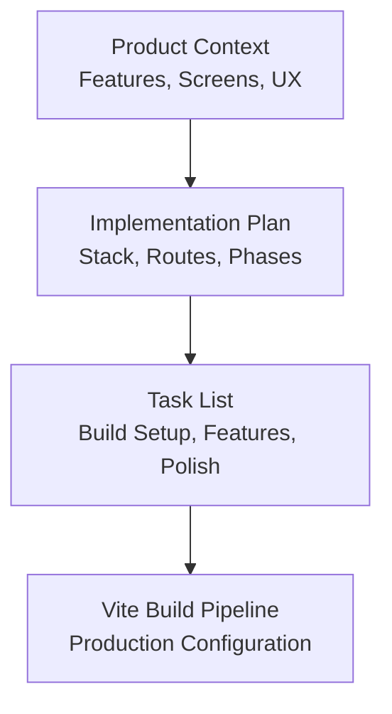
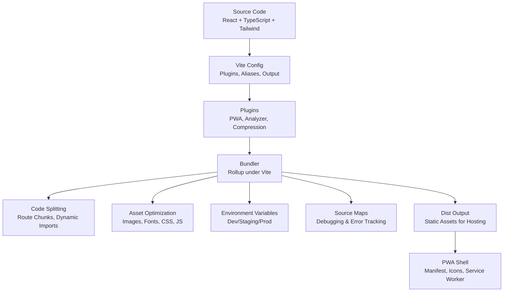
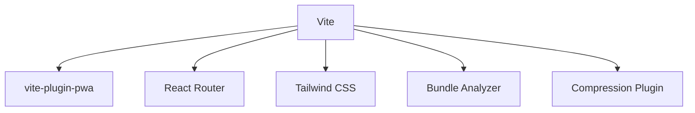

# Build Pipeline and Optimization

<cite>
**Referenced Files in This Document**
- [plan.md](file://tasks/plan.md)
- [todo.md](file://tasks/todo.md)
- [Pujo_Sahayak_Master_Project_Context.md](file://Pujo_Sahayak_Master_Project_Context.md)
</cite>

## Table of Contents
1. [Introduction](#introduction)
2. [Project Structure](#project-structure)
3. [Core Components](#core-components)
4. [Architecture Overview](#architecture-overview)
5. [Detailed Component Analysis](#detailed-component-analysis)
6. [Dependency Analysis](#dependency-analysis)
7. [Performance Considerations](#performance-considerations)
8. [Troubleshooting Guide](#troubleshooting-guide)
9. [Conclusion](#conclusion)
10. [Appendices](#appendices)

## Introduction
This document describes the production build pipeline and optimization strategy for Pujo Sahayak, a React + TypeScript PWA scaffolded with Vite. The repository currently contains product context and implementation planning rather than source code or configuration files. Therefore, this guide is prescriptive: it explains how to configure Vite for production, how to implement code splitting and lazy loading, how to optimize assets, manage environment variables across stages, integrate bundle analysis and performance monitoring, and prepare source maps for debugging and error tracking.

The guidance aligns with the project’s stated stack: React 18, TypeScript, Tailwind CSS v4, React Router v6, Zustand, Framer Motion, Leaflet, and `vite-plugin-pwa` for manifest, icons, and offline shell.

## Project Structure
At present, the workspace includes:
- A master product context describing features, screens, and UX principles.
- An implementation plan outlining phases, routes, and verification steps.
- A task list tracking build setup and feature development.

**Diagram sources**
- [Pujo_Sahayak_Master_Project_Context.md:1-120](file://Pujo_Sahayak_Master_Project_Context.md#L1-L120)
- [plan.md:1-20](file://tasks/plan.md#L1-L20)
- [todo.md:1-10](file://tasks/todo.md#L1-L10)

**Section sources**
- [Pujo_Sahayak_Master_Project_Context.md:1-120](file://Pujo_Sahayak_Master_Project_Context.md#L1-L120)
- [plan.md:1-20](file://tasks/plan.md#L1-L20)
- [todo.md:1-10](file://tasks/todo.md#L1-L10)

## Core Components
The production build pipeline should be centered around these components:
- Vite configuration for production builds, including plugins and output settings.
- PWA plugin configuration for manifest, icons, service worker, and offline shell.
- Code splitting via dynamic imports and route-based chunking.
- Asset optimization for images, fonts, CSS, and JavaScript.
- Environment variable management per deployment stage.
- Bundle analysis integration.
- Source map generation for debugging and error tracking.

Key references from the repository:
- The stack selection (React, TypeScript, Tailwind v4, React Router, Zustand, Framer Motion, Leaflet, `vite-plugin-pwa`) is documented in the implementation plan.
- The task list explicitly calls out scaffolding Vite + React + TS PWA and verifying a clean build.

**Section sources**
- [plan.md:1-20](file://tasks/plan.md#L1-L20)
- [todo.md:1-10](file://tasks/todo.md#L1-L10)

## Architecture Overview
The recommended Vite-based build architecture for production is shown below. It maps the project’s planned stack to concrete build-time responsibilities.

**Diagram sources**
- [plan.md:1-20](file://tasks/plan.md#L1-L20)
- [todo.md:1-10](file://tasks/todo.md#L1-L10)

## Detailed Component Analysis

### Vite Production Configuration
- Use Vite as the build tool with Rollup under the hood.
- Configure plugins for PWA, bundle analysis, and compression.
- Set appropriate output directory and asset handling.
- Ensure TypeScript compilation and Tailwind processing are integrated.

Recommended responsibilities:
- Define base URL and public path for hosting.
- Enable production mode optimizations.
- Configure aliasing for cleaner imports.
- Integrate `vite-plugin-pwa` for manifest, icons, and service worker.

**Section sources**
- [plan.md:1-20](file://tasks/plan.md#L1-L20)
- [todo.md:1-10](file://tasks/todo.md#L1-L10)

### PWA Plugin Integration
- Generate web app manifest with name, short name, description, theme color, and icons.
- Provide multiple icon sizes for installability across devices.
- Configure the service worker to cache the application shell and static assets.
- Ensure offline fallback pages and navigation fallbacks are configured.

Operational notes:
- Keep the offline shell minimal to reduce initial load.
- Validate installability using Lighthouse PWA audit.
- Test offline behavior on mobile and desktop browsers.

**Section sources**
- [plan.md:1-20](file://tasks/plan.md#L1-L20)
- [todo.md:74-81](file://tasks/todo.md#L74-L81)

### Code Splitting Strategies
- Route-based splitting: Use React Router with dynamic imports so each page loads only when navigated to.
- Feature-based splitting: Lazy-load heavy features like Maya chat, camera scan, and map rendering.
- Third-party library splitting: Defer large dependencies such as Leaflet and Framer Motion until needed.
- Vendor chunking: Separate common vendor libraries into shared chunks to improve caching.

Best practices:
- Avoid eager imports of heavy modules.
- Use Suspense boundaries where appropriate to show loading states.
- Monitor chunk sizes and avoid oversized bundles.

**Section sources**
- [plan.md:11-15](file://tasks/plan.md#L11-L15)
- [todo.md:36-43](file://tasks/todo.md#L36-L43)

### Lazy Loading Implementation
- Implement lazy loading for routes using React.lazy and Suspense.
- Lazy-load Maya chat UI and voice waveform components.
- Lazy-load camera scan functionality and image capture logic.
- Lazy-load map rendering and route visualization.

Verification:
- Confirm that initial bundle size excludes lazily loaded features.
- Ensure loading indicators appear during chunk downloads.
- Test network throttling to simulate slow connections.

**Section sources**
- [todo.md:36-43](file://tasks/todo.md#L36-L43)

### Asset Optimization
- Images: Convert to modern formats (WebP/AVIF), compress at build time, and use responsive srcset where applicable.
- Fonts: Subset fonts, preload critical fonts, and defer non-critical ones.
- CSS: Minify with PostCSS/Tailwind purge unused styles; split critical CSS if necessary.
- JavaScript: Minify and tree-shake unused code; prefer ESM for better dead-code elimination.

Guidelines:
- Place hero images and above-the-fold assets in critical paths.
- Defer off-screen images and background assets.
- Cache immutable assets with long-lived filenames.

**Section sources**
- [plan.md:9-10](file://tasks/plan.md#L9-L10)
- [todo.md:10-14](file://tasks/todo.md#L10-L14)

### Environment Variable Management
- Use `.env`, `.env.development`, `.env.staging`, and `.env.production`.
- Prefix variables with `VITE_` for client-side access.
- Separate API endpoints, analytics keys, and feature flags per environment.
- Validate required variables at build time to fail fast.

Recommendations:
- Store secrets in CI/CD secret stores, not in repository.
- Use different base URLs for dev/staging/prod APIs.
- Toggle experimental features via environment flags.

**Section sources**
- [plan.md:1-20](file://tasks/plan.md#L1-L20)

### Performance Monitoring During Build
- Integrate a bundle analyzer to inspect chunk sizes and dependency footprints.
- Track build times and identify slow plugins or transforms.
- Capture runtime metrics (FCP, LCP, CLS) in staging builds for validation.
- Automate bundle size thresholds in CI to prevent regressions.

Tools:
- `rollup-plugin-visualizer` or Vite’s built-in analyzer.
- Lighthouse CI for performance budgets.
- Web Vitals SDK for runtime monitoring.

**Section sources**
- [todo.md:74-81](file://tasks/todo.md#L74-L81)

### Bundle Analysis Tools Integration
- Add a visualizer plugin to generate an interactive HTML report after build.
- Include dependency breakdown and chunk size insights.
- Publish reports to artifact storage for review.
- Set alerts for oversized chunks or unexpected dependencies.

Workflow:
- Run analyzer in CI on every push to main.
- Compare against baseline sizes.
- Review changes before merging.

**Section sources**
- [plan.md:1-20](file://tasks/plan.md#L1-L20)

### Source Map Generation
- Enable source maps for production to aid debugging and error tracking.
- Choose between eval, hidden, or full source maps based on security and debugging needs.
- Upload source maps to error tracking platforms (e.g., Sentry).
- Exclude sensitive data from source maps.

Integration:
- Configure upload step in CI/CD pipeline.
- Correlate minified stacks with original sources.
- Validate sourcemap integrity in production.

**Section sources**
- [plan.md:1-20](file://tasks/plan.md#L1-L20)

### Optimizing React Components and Dependencies
- Prefer functional components with hooks.
- Memoize expensive computations with `useMemo` and `useCallback`.
- Avoid unnecessary re-renders by stabilizing props and state updates.
- Tree-shake unused React utilities and third-party libraries.
- Replace heavy dependencies with lighter alternatives where feasible.

Guidelines:
- Keep component files focused and small.
- Extract reusable logic into custom hooks.
- Audit dependencies regularly and remove unused packages.

**Section sources**
- [plan.md:1-20](file://tasks/plan.md#L1-L20)

## Dependency Analysis
The build pipeline depends on the following core elements:
- Vite as the primary build tool.
- `vite-plugin-pwa` for PWA capabilities.
- React Router for route-based code splitting.
- Tailwind CSS for styling and purging.
- Optional bundle analyzer and compression plugins.

**Diagram sources**
- [plan.md:1-20](file://tasks/plan.md#L1-L20)
- [todo.md:1-10](file://tasks/todo.md#L1-L10)

**Section sources**
- [plan.md:1-20](file://tasks/plan.md#L1-L20)
- [todo.md:1-10](file://tasks/todo.md#L1-L10)

## Performance Considerations
- Prioritize critical rendering path: minimize blocking resources and defer non-critical scripts.
- Use HTTP/2 or HTTP/3 for multiplexed asset delivery.
- Leverage CDN caching for static assets with content-hash filenames.
- Monitor Core Web Vitals and set performance budgets.
- Regularly audit bundle composition and remove dead code.

[No sources needed since this section provides general guidance]

## Troubleshooting Guide
Common issues and resolutions:
- Build fails due to missing environment variables: ensure all required `VITE_*` variables are defined in the correct `.env.*` file.
- PWA not installing: verify manifest correctness, icon availability, and HTTPS requirement.
- Large bundle size: run bundle analyzer, identify heavy dependencies, and apply lazy loading.
- Sourcemaps not mapping: confirm upload step and integrity checks in error tracking platform.
- Offline shell not working: validate service worker registration and cache strategies.

**Section sources**
- [todo.md:74-81](file://tasks/todo.md#L74-L81)

## Conclusion
This guide outlines a comprehensive Vite build pipeline tailored for Pujo Sahayak’s React + TypeScript PWA. By implementing route-based code splitting, lazy loading, asset optimization, environment-specific configuration, bundle analysis, and source map generation, the project can achieve efficient production builds suitable for diverse deployment stages. The recommendations align with the documented stack and phased implementation plan, ensuring maintainable performance and reliable user experience.

[No sources needed since this section summarizes without analyzing specific files]

## Appendices

### Recommended Build Checklist
- Scaffold Vite + React + TS PWA and verify clean build.
- Configure PWA manifest, icons, and service worker.
- Implement route-based code splitting and lazy loading.
- Optimize images, fonts, CSS, and JavaScript.
- Manage environment variables per stage.
- Integrate bundle analyzer and performance monitoring.
- Generate and upload source maps for debugging.

**Section sources**
- [todo.md:1-10](file://tasks/todo.md#L1-L10)
- [todo.md:74-81](file://tasks/todo.md#L74-L81)