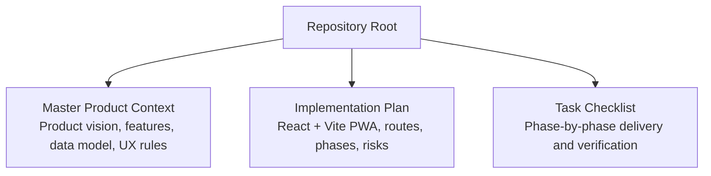
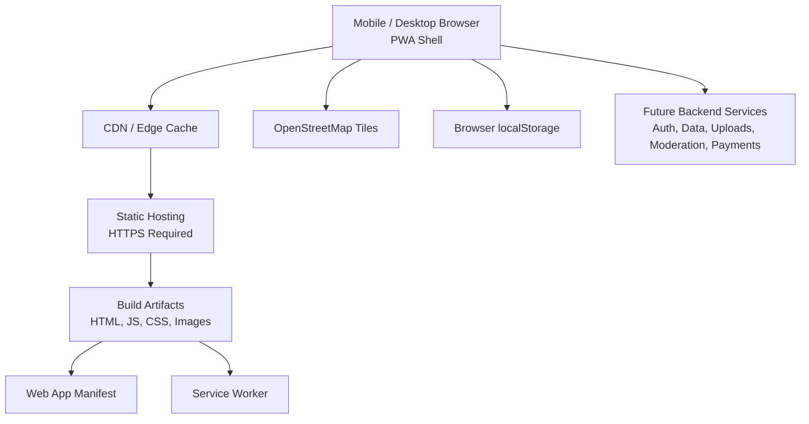
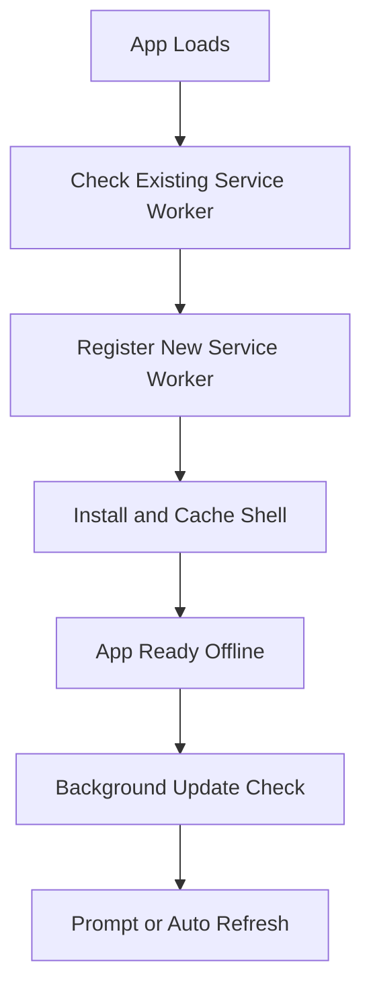
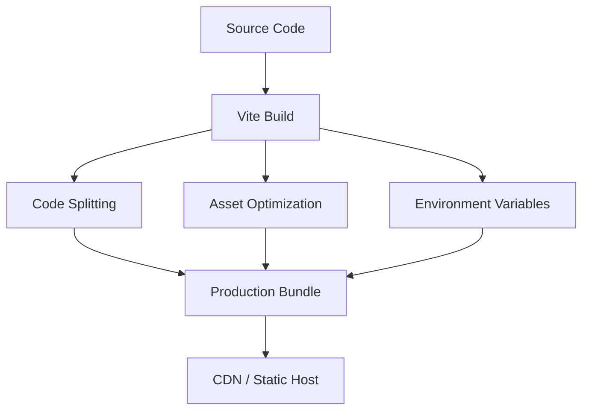
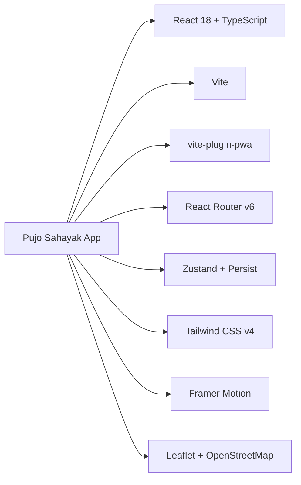

# Deployment and Production Considerations

<cite>
**Referenced Files in This Document**
- [Pujo_Sahayak_Master_Project_Context.md](file://Pujo_Sahayak_Master_Project_Context.md)
- [plan.md](file://tasks/plan.md)
- [todo.md](file://tasks/todo.md)
</cite>

## Table of Contents
1. [Introduction](#introduction)
2. [Project Structure](#project-structure)
3. [Core Components](#core-components)
4. [Architecture Overview](#architecture-overview)
5. [Detailed Component Analysis](#detailed-component-analysis)
6. [Dependency Analysis](#dependency-analysis)
7. [Performance Considerations](#performance-considerations)
8. [Troubleshooting Guide](#troubleshooting-guide)
9. [Conclusion](#conclusion)
10. [Appendices](#appendices)

## Introduction
This document provides production-oriented deployment, maintenance, scaling, monitoring, and operational guidance for Pujo Sahayak. The project is a mobile-first React + TypeScript PWA built with Vite, using `vite-plugin-pwa` for manifest and service worker configuration. It focuses on Durga Puja discovery while remaining useful as a Kolkata local-discovery platform beyond the festival season.

The current workspace contains product context and implementation planning documents. There is no application source code present yet; therefore, this guide describes how to deploy and operate the planned architecture once the build artifacts are produced by Vite.

## Project Structure
At this stage, the repository includes:
- A master product context document describing features, user flows, data model, and design principles.
- An implementation plan outlining the React + Vite PWA stack, screen routes, task phases, and verification criteria.
- A task checklist tracking feature delivery across six phases.

**Diagram sources**
- [Pujo_Sahayak_Master_Project_Context.md:1-1878](file://Pujo_Sahayak_Master_Project_Context.md#L1-L1878)
- [plan.md:1-86](file://tasks/plan.md#L1-L86)
- [todo.md:1-81](file://tasks/todo.md#L1-L81)

**Section sources**
- [Pujo_Sahayak_Master_Project_Context.md:1-1878](file://Pujo_Sahayak_Master_Project_Context.md#L1-L1878)
- [plan.md:1-86](file://tasks/plan.md#L1-L86)
- [todo.md:1-81](file://tasks/todo.md#L1-L81)

## Core Components
From a production perspective, Pujo Sahayak consists of:
- A client-side PWA shell built with Vite.
- A typed local demo dataset representing Kolkata pandals, restaurants, events, meetups, offers, and safety points.
- Client state persisted to `localStorage` via Zustand with persistence.
- Offline-capable shell caching through `vite-plugin-pwa`.
- Maps powered by Leaflet and OpenStreetMap tiles.
- AI assistant UI called Maya, which is initially simulated locally against the dataset.

Key production implications:
- The app is primarily a static frontend until backend services are added.
- User data such as saves, visits, plans, and settings live in the browser during development.
- Content such as places, reviews, photos, and meetups is currently demo data.
- Real-time or server-backed features (auth, payments, uploads, moderation, analytics) should be introduced carefully and clearly separated from the initial demo scope.

**Section sources**
- [plan.md:1-86](file://tasks/plan.md#L1-L86)
- [todo.md:1-81](file://tasks/todo.md#L1-L81)
- [Pujo_Sahayak_Master_Project_Context.md:1232-1260](file://Pujo_Sahayak_Master_Project_Context.md#L1232-L1260)

## Architecture Overview
The planned production architecture centers around a static PWA served over HTTPS, optionally behind a CDN or edge host. During Durga Puja, traffic spikes are expected due to massive movement, exploration, and social activity.

**Diagram sources**
- [plan.md:1-86](file://tasks/plan.md#L1-L86)
- [Pujo_Sahayak_Master_Project_Context.md:1232-1260](file://Pujo_Sahayak_Master_Project_Context.md#L1232-L1260)

### Hosting Options and Infrastructure Requirements
Recommended hosting options:
- Static site hosting providers that support HTTPS, custom domains, cache control, and redirects.
- CDN-backed hosting for fast global asset delivery.
- Optional origin server if future backend services are added.

Infrastructure requirements:
- HTTPS is mandatory for PWA features such as service workers and camera access.
- Proper cache headers for static assets to improve repeat-load performance.
- Environment variables for runtime configuration such as API endpoints, analytics keys, and feature flags.
- Domain security policies including HSTS where appropriate.
- Monitoring and error reporting integrated into the hosting or application layer.

**Section sources**
- [plan.md:1-86](file://tasks/plan.md#L1-L86)
- [Pujo_Sahayak_Master_Project_Context.md:1360-1388](file://Pujo_Sahayak_Master_Project_Context.md#L1360-L1388)

## Detailed Component Analysis

### PWA Deployment Configuration
The PWA is configured through Vite and `vite-plugin-pwa`. The goal is an installable experience with an offline shell and cached static assets.

#### Service Worker Setup
- Use `vite-plugin-pwa` to generate and register the service worker.
- Configure workbox strategies for HTML shell caching, JavaScript/CSS caching, and image caching.
- Ensure the service worker is registered only after the app shell loads successfully.
- Test installation prompts and update flows.

**Diagram sources**
- [plan.md:1-86](file://tasks/plan.md#L1-L86)

#### Manifest File Configuration
- Provide app name, short name, description, theme color, background color, display mode, icons, and start URL.
- Ensure icons cover multiple sizes for different devices.
- Set appropriate orientation preferences for mobile-first usage.
- Validate the manifest with Lighthouse and browser developer tools.

#### Offline Capability Testing
- Verify installability on supported browsers.
- Confirm that the shell loads without network connectivity.
- Test route navigation while offline for cached pages.
- Validate that non-cached dynamic content degrades gracefully.
- Test service worker updates and refresh behavior.

**Section sources**
- [plan.md:1-86](file://tasks/plan.md#L1-L86)
- [todo.md:74-75](file://tasks/todo.md#L74-L75)

### Build Pipeline Configuration Using Vite
The build pipeline produces optimized production assets suitable for CDN distribution.

#### Code Splitting
- Route-based code splitting ensures users download only what they need.
- Keep heavy libraries lazy-loaded where possible.
- Monitor bundle size growth as new screens and features are added.

#### Asset Optimization
- Optimize images at build time or through CDN processing.
- Use modern image formats where supported.
- Apply compression for text assets.
- Avoid large placeholder assets in production builds.

#### Environment Variable Management
- Separate development, staging, and production environment variables.
- Store secrets outside the repository.
- Inject runtime configuration through environment variables or a secure config endpoint.
- Validate required variables at startup and fail fast when missing.

**Diagram sources**
- [plan.md:1-86](file://tasks/plan.md#L1-L86)

**Section sources**
- [plan.md:1-86](file://tasks/plan.md#L1-L86)
- [todo.md:63-69](file://tasks/todo.md#L63-L69)

### Monitoring and Analytics Setup
Monitoring should track user engagement, performance, errors, and business KPIs without compromising privacy.

Recommended metrics:
- Page views and route navigation.
- Feature usage such as search, planner, meets, and Maya interactions.
- Performance metrics including load time, time to interactive, and service worker cache hit rate.
- Error rates from JavaScript exceptions, fetch failures, and map tile loading issues.
- Business KPIs such as place saves, visited places, meetup joins, and premium upgrades when available.

Privacy considerations:
- Avoid logging sensitive location data unless explicitly consented.
- Anonymize identifiers where possible.
- Respect user privacy controls and regional regulations.

Operational alerts:
- Alert on sudden increases in error rates.
- Alert on degraded performance thresholds.
- Alert on unexpected drops in key engagement metrics.

**Section sources**
- [Pujo_Sahayak_Master_Project_Context.md:1390-1454](file://Pujo_Sahayak_Master_Project_Context.md#L1390-L1454)
- [plan.md:1-86](file://tasks/plan.md#L1-L86)

### Maintenance Procedures
Maintenance covers dependency updates, security patches, content updates, and feature rollouts.

Dependency updates:
- Regularly review React, Vite, Tailwind, routing, state management, and PWA plugin dependencies.
- Use lockfiles and automated dependency scanning.
- Test major version upgrades in staging before production.

Security patches:
- Patch critical vulnerabilities immediately.
- Review third-party library advisories.
- Rotate secrets and API keys regularly.

Content updates:
- Update demo or production datasets for pandals, restaurants, events, and safety points.
- Validate geographic coordinates and contact information.
- Mark demo data clearly to avoid misleading users.

Feature rollouts:
- Use feature flags for risky changes.
- Roll out gradually to internal users first.
- Monitor metrics and error rates during rollout.

**Section sources**
- [plan.md:1-86](file://tasks/plan.md#L1-L86)
- [todo.md:63-81](file://tasks/todo.md#L63-L81)

### Backup and Disaster Recovery Strategies
Since the current application stores user state in `localStorage`, backup and recovery must account for client-side data limitations.

User data strategy:
- Encourage users to back up important plans and favorites when backend sync becomes available.
- Export functionality can help users preserve their data.
- Once a backend exists, implement encrypted backups for sensitive user data.

Application configuration strategy:
- Back up environment variables, domain configuration, CDN settings, and analytics configurations.
- Store configuration in a secure secret manager.
- Version configuration alongside application releases.

Disaster recovery:
- Define RTO and RPO for critical systems.
- Maintain rollback-ready build artifacts.
- Test recovery procedures periodically.

**Section sources**
- [plan.md:1-86](file://tasks/plan.md#L1-L86)
- [todo.md:63-69](file://tasks/todo.md#L63-L69)

### Rollback Procedures and Hotfix Deployment
Rollback procedures should be simple and reliable.

Recommended process:
- Tag each successful production build.
- Keep previous builds available for quick rollback.
- Use immutable deployments so the same artifact ID can be redeployed.
- For hotfixes, create a small branch, apply the fix, run tests, build, and deploy to staging first.

Hotfix deployment steps:
1. Identify the failing release.
2. Create a hotfix branch from the last known good commit.
3. Apply minimal change.
4. Run type checks and build validation.
5. Deploy to staging.
6. Verify critical flows.
7. Promote to production.
8. Monitor metrics and error rates.
9. Merge hotfix back into main branch.

**Section sources**
- [plan.md:63-69](file://tasks/plan.md#L63-L69)
- [todo.md:77-81](file://tasks/todo.md#L77-L81)

### Scaling Considerations During Durga Puja Season
Durga Puja creates seasonal demand spikes. The system should scale horizontally and efficiently serve static content.

Scaling recommendations:
- Serve static assets through a CDN with edge caching.
- Enable HTTP/2 or HTTP/3 where supported.
- Preload critical resources such as fonts, icons, and shell assets.
- Use aggressive but correct cache headers for immutable assets.
- Monitor bandwidth and request volume.
- Prepare capacity alerts for peak hours.

Load balancing strategies:
- If adding a backend, use health checks and auto-scaling groups.
- Distribute traffic across regions closest to users.
- Rate-limit abusive or malformed requests.
- Cache expensive computations at the edge when possible.

Peak usage patterns:
- Expect high traffic during evening exploration hours.
- Anticipate spikes around popular pandals, events, and meetups.
- Prepare for increased map tile and media requests.

**Section sources**
- [Pujo_Sahayak_Master_Project_Context.md:108-122](file://Pujo_Sahayak_Master_Project_Context.md#L108-L122)
- [plan.md:1-86](file://tasks/plan.md#L1-L86)

### Operational Runbooks

#### Common Maintenance Tasks
- Verify HTTPS certificate validity.
- Check CDN cache status and purge stale assets when needed.
- Review build logs for warnings or errors.
- Validate service worker registration and update flow.
- Confirm environment variables are set correctly.
- Test core routes: Home, Explore, Pandal Detail, Maya, Planner, Meets, Safety.

#### Incident Response Procedures
- **High error rate**: Check recent deployments, environment variables, and external API availability.
- **Slow page load**: Inspect bundle size, image optimization, CDN performance, and service worker cache behavior.
- **Offline shell failure**: Verify service worker registration, cache strategy, and HTML shell availability.
- **Map tiles not loading**: Check OpenStreetMap tile availability and CORS configuration.
- **Camera or location permission issues**: Confirm HTTPS, browser permissions, and PWA installability.

#### Escalation Guidelines
- Level 1: Frontend and hosting issues.
- Level 2: Backend integration, authentication, payments, or data consistency.
- Level 3: Security incidents, data loss, or regulatory concerns.

**Section sources**
- [plan.md:1-86](file://tasks/plan.md#L1-L86)
- [todo.md:63-81](file://tasks/todo.md#L63-L81)

## Dependency Analysis
The planned dependencies include:
- React 18 with TypeScript.
- Vite as the build tool.
- `vite-plugin-pwa` for PWA capabilities.
- Tailwind CSS v4 for styling.
- React Router v6 for routing.
- Zustand with persistence for client state.
- Framer Motion for animations.
- Leaflet and OpenStreetMap for maps.

**Diagram sources**
- [plan.md:1-86](file://tasks/plan.md#L1-L86)

**Section sources**
- [plan.md:1-86](file://tasks/plan.md#L1-L86)

## Performance Considerations
- Prioritize mobile performance since the app is mobile-first.
- Minimize initial bundle size through code splitting and lazy loading.
- Optimize images and avoid unnecessary assets.
- Use efficient state updates with Zustand.
- Avoid blocking animations on low-end devices; respect reduced-motion preferences.
- Monitor real-user performance metrics rather than relying solely on synthetic tests.

[No sources needed since this section provides general guidance]

## Troubleshooting Guide
Common issues and resolutions:
- Service worker not updating: Clear cache, force reload, check registration logic, and verify build output changes.
- Manifest not recognized: Validate JSON structure, icon paths, and MIME types.
- Offline navigation fails: Ensure routes are cached and fallback HTML is available.
- Camera access blocked: Confirm HTTPS and user permission prompts.
- Location accuracy issues: Use cautious wording and confirm user context instead of assuming precise GPS location.
- Demo data confusion: Clearly mark demo entries and avoid presenting simulated data as verified production facts.

**Section sources**
- [plan.md:1-86](file://tasks/plan.md#L1-L86)
- [Pujo_Sahayak_Master_Project_Context.md:1330-1358](file://Pujo_Sahayak_Master_Project_Context.md#L1330-L1358)

## Conclusion
Pujo Sahayak is designed as a production-grade PWA focused on Durga Puja discovery while remaining useful as a broader Kolkata local-discovery platform. The current repository contains planning and product context rather than source code. When the Vite build is ready, production deployment should emphasize HTTPS, CDN-backed static hosting, robust service worker configuration, environment variable management, monitoring, and clear rollback procedures. Scaling during the Puja season requires careful attention to asset delivery, cache strategy, and observability. As backend services are introduced, user data, privacy, security, and disaster recovery must be strengthened accordingly.

[No sources needed since this section summarizes without analyzing specific files]

## Appendices

### Recommended Production Checklist
- [ ] HTTPS enabled and certificates valid.
- [ ] Service worker installed and updating correctly.
- [ ] Manifest validated and installable.
- [ ] Offline shell tested.
- [ ] Build artifacts minified and split.
- [ ] Images and assets optimized.
- [ ] Environment variables secured.
- [ ] Monitoring and error reporting active.
- [ ] Rollback procedure tested.
- [ ] Peak load scenario reviewed.
- [ ] Privacy and security policies documented.

[No sources needed since this section provides general guidance]