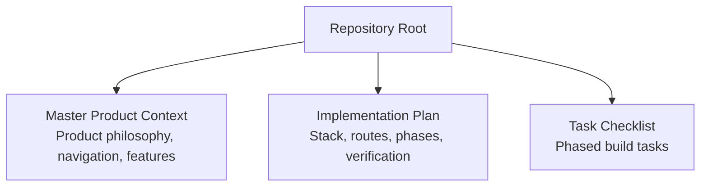
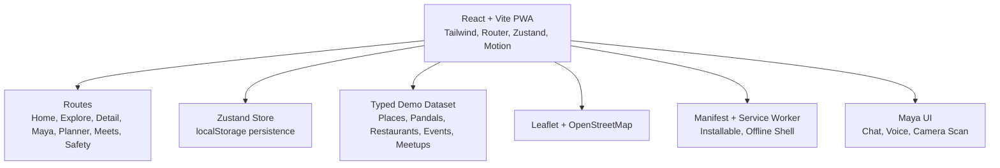
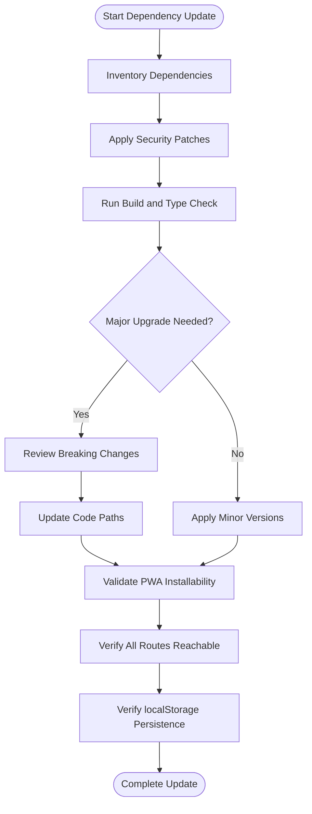
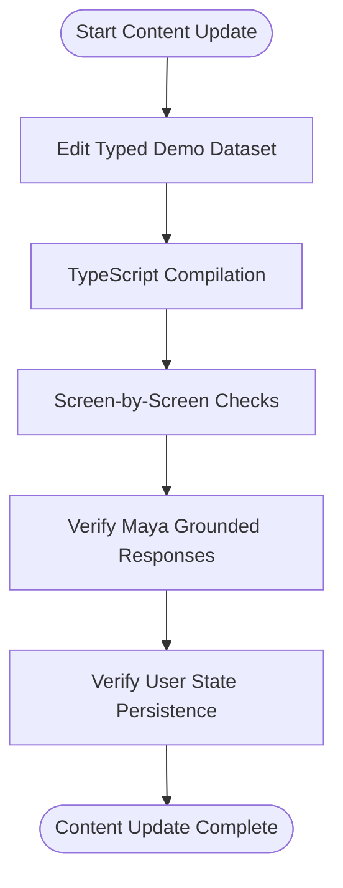
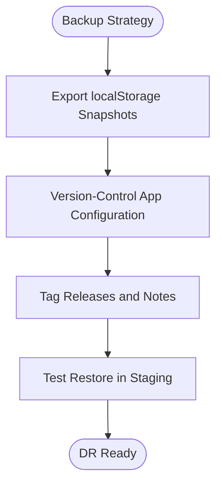
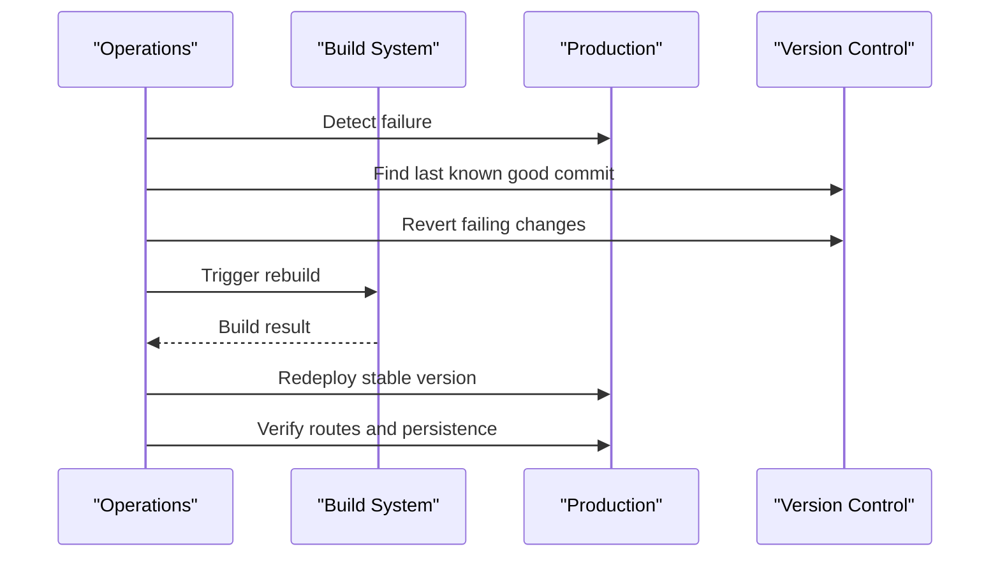
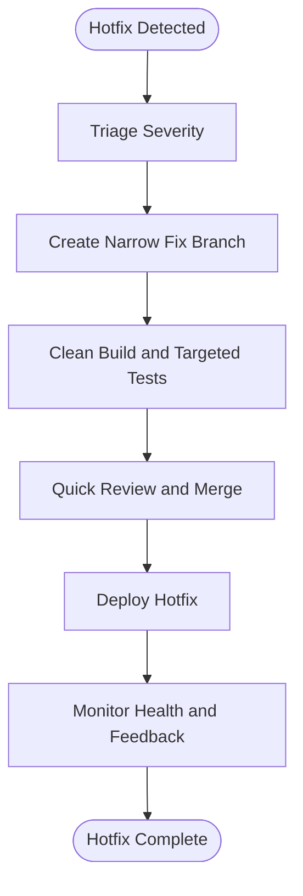
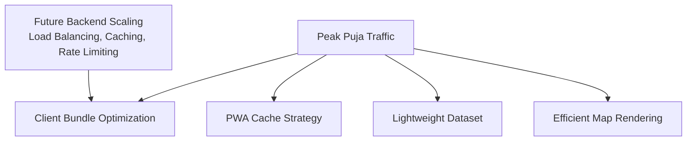
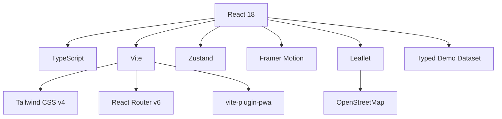
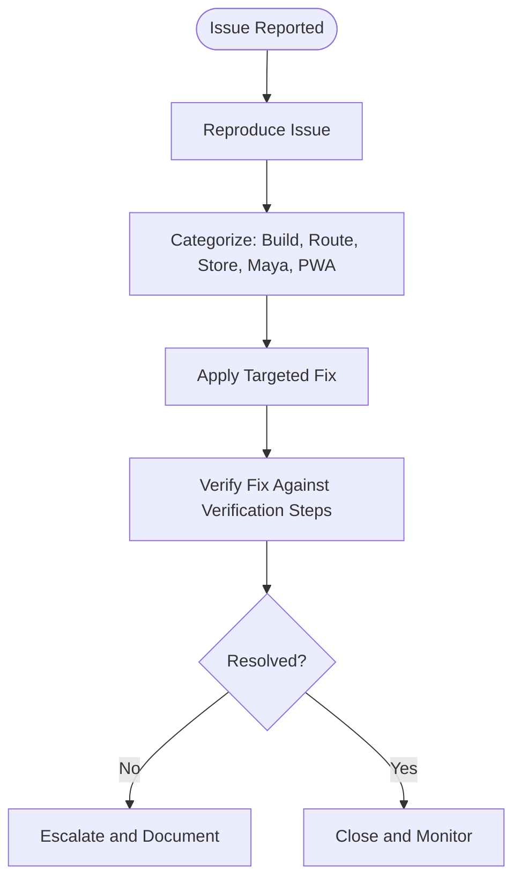

# Maintenance and Operations

<cite>
**Referenced Files in This Document**
- [Pujo_Sahayak_Master_Project_Context.md](file://Pujo_Sahayak_Master_Project_Context.md)
- [plan.md](file://tasks/plan.md)
- [todo.md](file://tasks/todo.md)
</cite>

## Table of Contents
1. [Introduction](#introduction)
2. [Project Structure](#project-structure)
3. [Core Components](#core-components)
4. [Architecture Overview](#architecture-overview)
5. [Detailed Component Analysis](#detailed-component-analysis)
6. [Dependency Analysis](#dependency-analysis)
7. [Performance Considerations](#performance-considerations)
8. [Troubleshooting Guide](#troubleshooting-guide)
9. [Conclusion](#conclusion)
10. [Appendices](#appendices)

## Introduction
This document provides routine maintenance procedures and operational runbooks for Puja Sahayak, a mobile-first React + Vite progressive web application focused on the Durga Puja experience in Kolkata. It covers dependency updates, content updates, backup and disaster recovery, rollback and hotfix workflows, scaling considerations for peak usage during the Puja season, incident response procedures, and common troubleshooting guidance.

The product is intentionally designed to remain useful beyond the Puja season through local discovery, restaurants, events, offers, meetups, safety utilities, and personalization features. The AI assistant “Maya” is UI-complete but simulated locally against a typed demo dataset grounded in real Kolkata places.

**Section sources**
- [Pujo_Sahayak_Master_Project_Context.md:1-12](file://Pujo_Sahayak_Master_Project_Context.md#L1-L12)
- [plan.md:1-18](file://tasks/plan.md#L1-L18)

## Project Structure
At this stage, the repository contains:
- A master product context document describing the product philosophy, navigation, feature areas, and design intent.
- An implementation plan outlining the React + Vite PWA stack, architecture decisions, screen-to-route mapping, task phases, verification steps, risks, and open questions.
- A task checklist tracking progress across foundation, discovery, Maya, planning, social, utility, and polish phases.

**Diagram sources**
- [Pujo_Sahayak_Master_Project_Context.md:1-12](file://Pujo_Sahayak_Master_Project_Context.md#L1-L12)
- [plan.md:1-18](file://tasks/plan.md#L1-L18)
- [todo.md:1-10](file://tasks/todo.md#L1-L10)

**Section sources**
- [Pujo_Sahayak_Master_Project_Context.md:1-12](file://Pujo_Sahayak_Master_Project_Context.md#L1-L12)
- [plan.md:1-18](file://tasks/plan.md#L1-L18)
- [todo.md:1-10](file://tasks/todo.md#L1-L10)

## Core Components
From an operations perspective, the most relevant components are:

- **Application Shell and Routing**: The app uses React Router with a bottom navigation and nested detail routes. Operational checks should verify that all documented routes are reachable from the dev server and production shell.
- **Local State Store**: Zustand persists user state such as saved places, visited places, plans, settings, and session continuity to localStorage. Backups must include browser-side persistence where applicable.
- **Demo Dataset**: Typed data models represent places, pandals, restaurants, events, meetups, reviews, photos, plans, offers, and safety points. Content updates primarily affect this dataset.
- **Maya Assistant**: UI-complete chat, voice waveform, and camera scan flows; answers are retrieved from the local dataset rather than a live LLM API at this stage.
- **Maps and Offline Capabilities**: Leaflet with OpenStreetMap tiles for route maps; `vite-plugin-pwa` configures manifest, icons, and offline shell caching.

Operational implications:
- Dependency updates should preserve TypeScript compilation, PWA installability, and route reachability.
- Content updates should be validated against mockup information architecture and dataset constraints.
- Backup and recovery must account for localStorage-based user state and any future backend configuration.

**Section sources**
- [plan.md:7-18](file://tasks/plan.md#L7-L18)
- [plan.md:19-39](file://tasks/plan.md#L19-L39)
- [todo.md:13-14](file://tasks/todo.md#L13-L14)
- [todo.md:36-43](file://tasks/todo.md#L36-L43)

## Architecture Overview
The current operational architecture is client-centric:
- Frontend: React 18, TypeScript, Vite, Tailwind CSS v4, React Router v6, Zustand, Framer Motion, Leaflet, OpenStreetMap.
- Data: Typed local demo dataset with `isDemo: true`; user state persisted to localStorage.
- PWA: Manifest, icons, and service worker configured via `vite-plugin-pwa`.
- AI: Maya is simulated locally using dataset-grounded responses; no external LLM integration is present in the documented scope.

**Diagram sources**
- [plan.md:7-18](file://tasks/plan.md#L7-L18)
- [plan.md:19-39](file://tasks/plan.md#L19-L39)
- [todo.md:13-14](file://tasks/todo.md#L13-L14)

## Detailed Component Analysis

### Dependency Update Procedures
Recommended procedure:
1. **Inventory Dependencies**
   - Identify frontend dependencies: React, TypeScript, Vite, Tailwind CSS, React Router, Zustand, Framer Motion, Leaflet, OpenStreetMap, `vite-plugin-pwa`.
   - Record current versions and lockfiles if present.

2. **Security Patching**
   - Prioritize security advisories for critical packages.
   - Apply targeted patch versions first.
   - Run `npm run build` and verify no TypeScript errors.

3. **Version Upgrades**
   - Upgrade major or minor versions incrementally.
   - Test each upgrade in isolation before combining changes.
   - Validate PWA installability and offline shell behavior.

4. **Breaking Change Management**
   - Review changelogs for breaking changes in React, Vite, Tailwind, Router, Zustand, Motion, Leaflet, and PWA plugin.
   - Update code paths only when necessary; keep the app runnable after each phase.
   - Re-run verification: clean build, route reachability, store persistence, and mockup IA alignment.

5. **Validation Gates**
   - Clean build succeeds.
   - Dev server serves all routes.
   - Saves, visits, plans, and settings survive reload.
   - No fabricated stats or hallucinated Maya responses.

[No sources needed since this diagram shows conceptual workflow, not actual code structure]

**Section sources**
- [plan.md:7-18](file://tasks/plan.md#L7-L18)
- [plan.md:63-70](file://tasks/plan.md#L63-L70)
- [todo.md:7-14](file://tasks/todo.md#L7-L14)

### Content Update Processes
Content updates cover static data, place information, and cultural content:
- **Static Data**: Update the typed demo dataset for pandals, restaurants, events, meetups, offers, and safety points. Ensure fields such as location, distance, crowd levels, hours, ratings, and categories remain consistent.
- **Place Information**: Keep coordinates, names, descriptions, themes, and nearby services accurate. Mark demo entries clearly as demo data.
- **Cultural Content**: Preserve authenticity by grounding Maya’s answers in the dataset. Do not fabricate statistics or reviews beyond the demo dataset.

Validation steps:
- Confirm TypeScript compiles with updated types.
- Verify that Home, Explore, Detail, Search, Categories, and Maya screens render correctly.
- Ensure “Continue Where You Left Off,” favorites, visits, and planner sections reflect updated data.
- Maintain mockup-aligned information architecture.

[No sources needed since this diagram shows conceptual workflow, not actual code structure]

**Section sources**
- [todo.md:13-14](file://tasks/todo.md#L13-L14)
- [todo.md:23-30](file://tasks/todo.md#L23-L30)
- [todo.md:36-43](file://tasks/todo.md#L36-L43)
- [plan.md:63-70](file://tasks/plan.md#L63-L70)

### Backup and Disaster Recovery Strategies
Current system characteristics:
- User state (saves, visits, plans, settings, session continuity) is stored in localStorage via Zustand.
- The dataset is local and marked as demo data.
- There is no backend or cloud storage referenced in the provided documents.

Recommended strategy:
- **User Data Backups**
  - Export localStorage snapshots periodically during high-risk periods such as pre-Puja setup.
  - Provide users with clear instructions to export their plan, favorites, and settings if a backend is added later.
- **Application Configuration Backups**
  - Version-control all configuration files, including Vite, PWA plugin, routing, and environment variables.
  - Tag releases and maintain release notes for rollback reference.
- **Disaster Recovery**
  - Restore from version control for application code and configuration.
  - For user data, rely on localStorage exports or implement a secure backend sync once available.
  - Test restore procedures in staging before applying to production.

[No sources needed since this diagram shows conceptual workflow, not actual code structure]

**Section sources**
- [plan.md:7-18](file://tasks/plan.md#L7-L18)
- [plan.md:63-70](file://tasks/plan.md#L63-L70)

### Rollback Procedures for Failed Deployments
Rollback steps:
1. **Detect Failure**
   - Monitor build success, route availability, PWA installability, and core user flows.
2. **Identify Last Known Good Commit**
   - Use version tags and release notes to locate the last stable deployment.
3. **Revert Changes**
   - Revert dependency upgrades or content updates that caused failures.
4. **Rebuild and Verify**
   - Run a clean build.
   - Verify all routes, store persistence, and mockup IA.
5. **Redeploy**
   - Deploy the reverted version and confirm stability.

[No sources needed since this diagram shows conceptual workflow, not actual code structure]

**Section sources**
- [plan.md:63-70](file://tasks/plan.md#L63-L70)

### Hotfix Deployment Workflow
Hotfix process:
1. **Triage**
   - Classify severity and impact on users during Puja season.
2. **Isolate Fix**
   - Create a narrow branch for the fix.
   - Avoid broad dependency or content changes unless required.
3. **Validate**
   - Run clean build and targeted verification.
   - Confirm that the specific issue is resolved without regressions.
4. **Approve and Merge**
   - Quick review with minimal scope creep.
5. **Deploy and Monitor**
   - Deploy hotfix and monitor error rates, route health, and user feedback.

[No sources needed since this diagram shows conceptual workflow, not actual code structure]

**Section sources**
- [plan.md:63-70](file://tasks/plan.md#L63-L70)

### Scaling Considerations for Peak Usage During Durga Puja Season
Scaling considerations based on the current client-centric architecture:
- **Client-Side Performance**
  - Optimize bundle size and lazy-load routes where possible.
  - Ensure PWA shell caches efficiently for offline access.
- **Data Loading**
  - Keep the demo dataset lightweight and well-structured.
  - Avoid heavy computations on the main thread; use Web Workers if needed.
- **Maps and Media**
  - Use efficient map markers and avoid unnecessary re-renders.
  - Defer non-critical images and animations.
- **Future Backend Scaling**
  - If a backend is introduced, plan for load balancing, horizontal scaling, rate limiting, and caching strategies.
  - Separate read-heavy endpoints (place details, search) from write-heavy endpoints (meetups, reports).

[No sources needed since this diagram shows conceptual workflow, not actual code structure]

**Section sources**
- [plan.md:7-18](file://tasks/plan.md#L7-L18)
- [plan.md:63-70](file://tasks/plan.md#L63-L70)

## Dependency Analysis
Key operational dependencies:
- **Frontend Stack**: React, TypeScript, Vite, Tailwind CSS, React Router, Zustand, Framer Motion.
- **Mapping and Offline**: Leaflet, OpenStreetMap, `vite-plugin-pwa`.
- **Data Model**: Typed structures for places, pandals, restaurants, events, meetups, reviews, photos, plans, offers, safety points.
- **Verification**: Clean build, route reachability, localStorage persistence, mockup IA alignment.

**Diagram sources**
- [plan.md:7-18](file://tasks/plan.md#L7-L18)
- [todo.md:13-14](file://tasks/todo.md#L13-L14)

**Section sources**
- [plan.md:7-18](file://tasks/plan.md#L7-L18)
- [todo.md:13-14](file://tasks/todo.md#L13-L14)

## Performance Considerations
- **Build and Runtime**
  - Keep builds clean and free of TypeScript errors.
  - Minimize unnecessary re-renders in complex screens like Pandal Detail and Trip Route Map.
- **PWA and Offline**
  - Ensure the service worker caches essential assets for offline shell access.
  - Validate install prompts and offline behavior regularly.
- **Maps and Animations**
  - Use efficient marker rendering and limit animation complexity on low-end devices.
  - Respect reduced-motion preferences.
- **Data Integrity**
  - Avoid fabricating statistics or reviews; rely on the demo dataset.
  - Clearly mark demo data to prevent misleading users.

[No sources needed since this section provides general guidance]

## Troubleshooting Guide
Common operational issues and resolutions:
- **Build Failures**
  - Run a clean build and inspect TypeScript errors.
  - Revert recent dependency or configuration changes if necessary.
- **Route Not Found**
  - Verify React Router configuration and bottom navigation links.
  - Ensure nested detail routes match documented patterns.
- **localStorage Not Persisting**
  - Check Zustand store initialization and persist middleware behavior.
  - Clear corrupted browser storage and test again.
- **Maya Returns Generic or Incorrect Answers**
  - Confirm dataset grounding and avoid hallucinated facts.
  - Validate context-aware behavior based on selected place or route state.
- **PWA Not Installing or Offline Shell Broken**
  - Validate manifest, icons, and service worker registration.
  - Test install prompt and offline cache behavior.

[No sources needed since this diagram shows conceptual workflow, not actual code structure]

**Section sources**
- [plan.md:63-70](file://tasks/plan.md#L63-L70)
- [todo.md:77-80](file://tasks/todo.md#L77-L80)

## Conclusion
Puja Sahayak’s maintenance and operations center around a client-focused React + Vite PWA with a typed local dataset, localStorage-backed user state, and simulated Maya interactions. Routine maintenance should emphasize safe dependency updates, careful content validation, robust backup and rollback procedures, and performance tuning for peak Puja season traffic. As the product evolves toward potential backend integrations, scaling and disaster recovery strategies should be extended accordingly while preserving the product’s cultural authenticity and user-centered design.

[No sources needed since this section summarizes without analyzing specific files]

## Appendices

### Appendix A: Key Operational Checklists
- **Pre-Puja Readiness**
  - Clean build passes.
  - All routes reachable.
  - localStorage persistence verified.
  - PWA installable and offline shell functional.
  - Mockup IA aligned.
- **Post-Deployment Validation**
  - Error rates monitored.
  - Core user flows tested.
  - User feedback reviewed.

[No sources needed since this section provides general guidance]