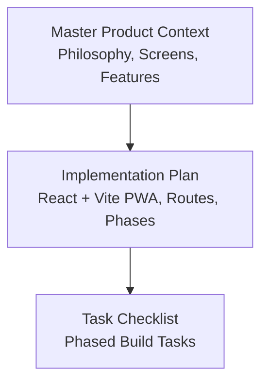
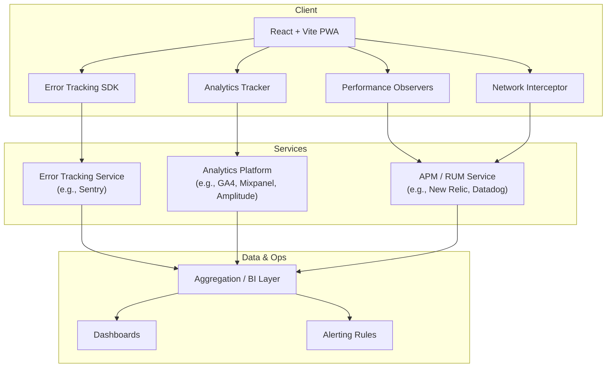
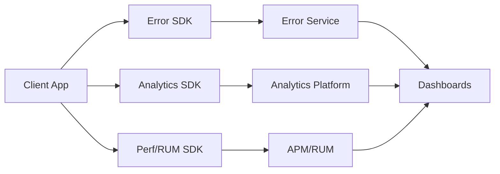

# Monitoring and Analytics Setup

<cite>
**Referenced Files in This Document**
- [Pujo_Sahayak_Master_Project_Context.md](file://Pujo_Sahayak_Master_Project_Context.md)
- [plan.md](file://tasks/plan.md)
- [todo.md](file://tasks/todo.md)
</cite>

## Table of Contents
1. [Introduction](#introduction)
2. [Project Structure](#project-structure)
3. [Core Components](#core-components)
4. [Architecture Overview](#architecture-overview)
5. [Detailed Component Analysis](#detailed-component-analysis)
6. [Dependency Analysis](#dependency-analysis)
7. [Performance Considerations](#performance-considerations)
8. [Troubleshooting Guide](#troubleshooting-guide)
9. [Conclusion](#conclusion)
10. [Appendices](#appendices)

## Introduction
This document defines a production-ready monitoring and analytics strategy for Puja Sahayak, a React + Vite PWA focused on Durga Puja discovery, planning, social meetups, and local exploration. It covers:

- Error tracking and logging (for example, Sentry or equivalent)
- User behavior analytics (page views, feature usage, funnels, engagement)
- Performance monitoring (Core Web Vitals, API response times, resource loading)
- Business KPIs for the Durga Puja season (pandal visits, meetup participation, premium subscription conversions)
- Dashboards and alerting for operational visibility
- Privacy compliance and data retention policies

The guidance is aligned with the product’s current architecture and roadmap as described in the project context and implementation plan.

## Project Structure
At this stage, the repository contains:

- A master product context describing the app’s philosophy, navigation, screens, and features
- An implementation plan outlining the React + Vite PWA stack, routes, and phased delivery
- A task checklist tracking build phases from foundation through polish

**Diagram sources**
- [Pujo_Sahayak_Master_Project_Context.md:1-120](file://Pujo_Sahayak_Master_Project_Context.md#L1-L120)
- [plan.md:1-20](file://tasks/plan.md#L1-L20)
- [todo.md:1-10](file://tasks/todo.md#L1-L10)

**Section sources**
- [Pujo_Sahayak_Master_Project_Context.md:1-120](file://Pujo_Sahayak_Master_Project_Context.md#L1-L120)
- [plan.md:1-20](file://tasks/plan.md#L1-L20)
- [todo.md:1-10](file://tasks/todo.md#L1-L10)

## Core Components
For a production-grade observability program, implement these core components:

- Application instrumentation layer
  - Error boundary and global error handler
  - Logging utility with structured logs
  - Analytics tracker with event taxonomy
  - Performance observer hooks for Core Web Vitals
  - Network interceptor for API metrics
- Configuration management
  - Environment-based toggles for analytics and error reporting
  - Consent and privacy controls
- Data pipelines
  - Event ingestion (analytics platform)
  - Error ingestion (error tracking platform)
  - Metrics aggregation (APM / RUM)
- Dashboards and alerts
  - Operational dashboards for errors, performance, and business KPIs
  - Alert rules for SLO breaches and anomalies

These components should be introduced gradually across the planned phases to avoid blocking early development while ensuring production readiness before launch.

[No sources needed since this section provides general guidance]

## Architecture Overview
The recommended observability architecture integrates client-side instrumentation with backend services and visualization layers.

Key integration points:
- Error Tracking SDK captures unhandled exceptions, promise rejections, and user-triggered errors.
- Analytics Tracker emits page views, feature interactions, and conversion events.
- Performance Observers capture Core Web Vitals and custom timing metrics.
- Network Interceptor records API latency, status codes, and payload sizes.
- Aggregation and BI tools power dashboards and alerting.

**Diagram sources**
- [plan.md:1-20](file://tasks/plan.md#L1-L20)

**Section sources**
- [plan.md:1-20](file://tasks/plan.md#L1-L20)

## Detailed Component Analysis

### Error Tracking and Logging
Objectives:
- Capture crashes, unhandled promise rejections, and user-reported issues
- Attach contextual metadata (route, device, locale, session)
- Provide actionable stack traces and grouping

Recommended setup:
- Initialize an error tracking SDK at application bootstrap
- Wrap route transitions and critical flows with error boundaries
- Log structured warnings for degraded experiences (offline mode, missing assets)
- Tag events by environment (dev, staging, prod) and version

Operational considerations:
- Avoid logging sensitive data (PII, tokens, payment details)
- Use sampling for high-volume logs if needed
- Correlate errors with analytics sessions where supported

Privacy and compliance:
- Honor consent preferences before initializing error tracking
- Provide opt-out mechanisms where required by policy
- Retain raw error payloads only as long as necessary

**Section sources**
- [plan.md:1-20](file://tasks/plan.md#L1-L20)

### User Behavior Analytics
Objectives:
- Track page views and screen navigation
- Measure feature usage (Maya chat, camera scan, planner, meets)
- Define conversion funnels (onboarding, premium upgrade, meetup join)
- Monitor engagement (retention, session length, repeat visits)

Event taxonomy examples:
- Page view: Home, Explore, Pandal Detail, Maya Chat, Planner, Meets, Profile
- Feature interaction: Save Place, Mark Visited, Start Route, Ask Maya, Scan Pandal, Join Meetup
- Conversion: Upgrade to Premium, Complete Payment, Submit Missing Person Report

Funnel design:
- Onboarding funnel: Install → First Launch → Create Plan → Visit First Pandal
- Premium funnel: View Upgrade Banner → Open Pricing → Enter Payment → Convert
- Meetup funnel: Browse Meets → View Meetup → Join Meetup → Attend

Implementation notes:
- Emit events consistently via a central analytics tracker
- Include minimal, non-sensitive context (locale, device type, feature flags)
- Respect consent and privacy settings

**Section sources**
- [Pujo_Sahayak_Master_Project_Context.md:140-158](file://Pujo_Sahayak_Master_Project_Context.md#L140-L158)
- [Pujo_Sahayak_Master_Project_Context.md:353-445](file://Pujo_Sahayak_Master_Project_Context.md#L353-L445)
- [Pujo_Sahayak_Master_Project_Context.md:558-662](file://Pujo_Sahayak_Master_Project_Context.md#L558-L662)
- [Pujo_Sahayak_Master_Project_Context.md:664-772](file://Pujo_Sahayak_Master_Project_Context.md#L664-L772)
- [plan.md:19-39](file://tasks/plan.md#L19-L39)
- [todo.md:20-54](file://tasks/todo.md#L20-L54)

### Performance Monitoring
Objectives:
- Track Core Web Vitals (LCP, FID/INP, CLS)
- Monitor API response times and failure rates
- Observe resource loading (JS bundles, images, fonts)
- Detect regressions during releases

Recommended setup:
- Enable RUM/Core Web Vitals collection in your analytics/APM tool
- Add network interceptors to measure API latency and errors
- Instrument key user journeys (search, detail pages, route map)
- Set performance budgets and alert thresholds

Optimization opportunities:
- Lazy-load heavy routes and media
- Preload critical resources
- Cache static assets via service worker
- Optimize bundle size and code splitting

**Section sources**
- [plan.md:1-20](file://tasks/plan.md#L1-L20)
- [todo.md:74-81](file://tasks/todo.md#L74-L81)

### Business KPI Tracking
Durga Puja season KPIs:
- Pandal visits: number of places marked visited, unique visitors per area/theme
- Meetup participation: joins, attendance signals, new organizers
- Premium conversions: upgrades, revenue, churn
- Engagement: daily active users, session duration, return rate

Seasonal dashboards:
- Daily visitation trends by region
- Top pandals and trending themes
- Meetup growth and capacity utilization
- Premium conversion funnel and cohort retention

Off-season continuity:
- Track restaurant discovery, events, and “Beyond Puja” engagement
- Maintain baseline KPIs to compare seasonal spikes

**Section sources**
- [Pujo_Sahayak_Master_Project_Context.md:77-122](file://Pujo_Sahayak_Master_Project_Context.md#L77-L122)
- [Pujo_Sahayak_Master_Project_Context.md:353-445](file://Pujo_Sahayak_Master_Project_Context.md#L353-L445)
- [Pujo_Sahayak_Master_Project_Context.md:664-772](file://Pujo_Sahayak_Master_Project_Context.md#L664-L772)
- [todo.md:45-68](file://tasks/todo.md#L45-L68)

### Dashboards and Alerting
Operational dashboards:
- Errors: crash rate, top exceptions, affected versions
- Performance: Core Web Vitals distribution, slow endpoints
- Business: visits, conversions, meetup participation, premium revenue

Alerting rules:
- Error rate spike above threshold
- Core Web Vitals regression beyond budget
- API error rate increase or latency SLA breach
- Conversion drop below expected range

Visualization approach:
- Real-time charts for incident response
- Historical trend lines for capacity planning
- Funnel visualizations for conversion analysis

[No sources needed since this section provides general guidance]

### Privacy Compliance and Data Retention
Principles:
- Minimize data collection to what is necessary
- Obtain explicit consent for analytics and profiling
- Allow users to opt out or delete their data
- Anonymize identifiers where possible

Retention policies:
- Short retention for raw logs and telemetry
- Aggregated metrics retained longer for trend analysis
- Clear deletion workflows for user data requests

Compliance considerations:
- Align with applicable regulations (for example, GDPR, CCPA)
- Document data flows and third-party processors
- Provide privacy notices and cookie banners

[No sources needed since this section provides general guidance]

## Dependency Analysis
Observability dependencies are layered:

- Client dependencies
  - Error tracking SDK
  - Analytics SDK
  - Performance/RUM SDK
  - Network interception utilities
- Service dependencies
  - Error tracking service
  - Analytics platform
  - APM/RUM provider
- Visualization dependencies
  - BI/dashboards
  - Alerting systems

**Diagram sources**
- [plan.md:1-20](file://tasks/plan.md#L1-L20)

**Section sources**
- [plan.md:1-20](file://tasks/plan.md#L1-L20)

## Performance Considerations
- Keep SDK initialization lightweight; defer non-critical analytics until after first paint
- Batch events and use backoff for failed transmissions
- Avoid synchronous calls that block UI threads
- Monitor SDK overhead and adjust sampling rates
- Test under low-end devices and poor network conditions

[No sources needed since this section provides general guidance]

## Troubleshooting Guide
Common issues and resolutions:
- Events not firing
  - Verify SDK initialization and consent state
  - Check network connectivity and ad blockers
  - Validate event names and properties against schema
- High error volume
  - Group similar exceptions and suppress noisy noise
  - Add context filters to reduce false positives
- Performance regressions
  - Compare Core Web Vitals across versions
  - Identify slow endpoints and large payloads
  - Roll back recent changes if SLOs are breached

[No sources needed since this section provides general guidance]

## Conclusion
Implementing robust monitoring and analytics for Puja Sahayak requires coordinated instrumentation across errors, user behavior, performance, and business KPIs. By introducing these capabilities incrementally across the planned development phases, the team can maintain velocity while ensuring production readiness. Strong privacy practices and clear retention policies will protect users and support compliance. With well-designed dashboards and alerting, operations teams will have the visibility needed to deliver a reliable, engaging experience during the Durga Puja season and beyond.

[No sources needed since this section summarizes without analyzing specific files]

## Appendices

### Screen-to-Monitoring Mapping
- Splash and Home
  - Page views, sponsored content impressions, language toggle usage
- Explore and Pandal Detail
  - Search queries, filter usage, save/visit actions, route starts
- Maya Chat and Camera
  - Chat sessions, voice input usage, scan attempts and matches
- Planner and Trip Map
  - Plan creation, optimization clicks, route navigation starts
- Meets
  - Browse, join, create meetup actions
- Profile and Settings
  - Preference changes, premium banner interactions

**Section sources**
- [plan.md:19-39](file://tasks/plan.md#L19-L39)
- [todo.md:20-68](file://tasks/todo.md#L20-L68)