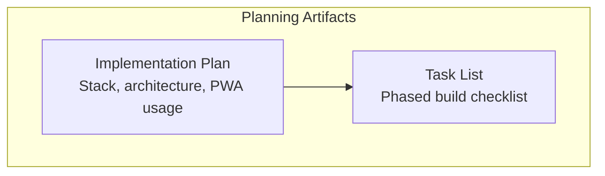
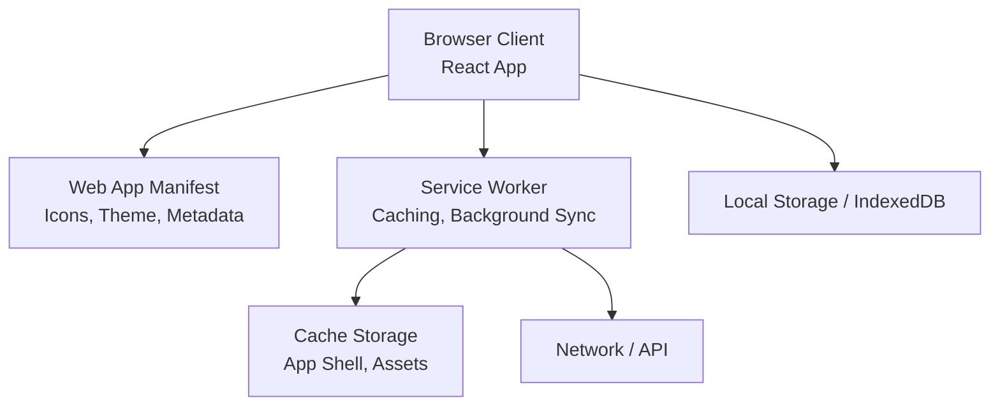
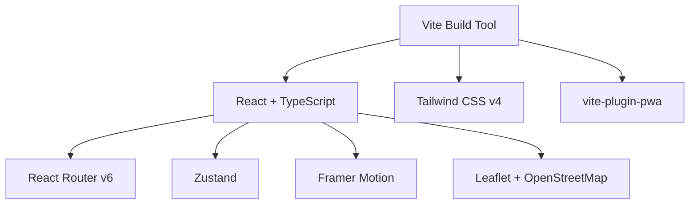

# PWA Deployment Configuration

<cite>
**Referenced Files in This Document**
- [plan.md](file://tasks/plan.md)
- [todo.md](file://tasks/todo.md)
</cite>

## Table of Contents
1. [Introduction](#introduction)
2. [Project Structure](#project-structure)
3. [Core Components](#core-components)
4. [Architecture Overview](#architecture-overview)
5. [Detailed Component Analysis](#detailed-component-analysis)
6. [Dependency Analysis](#dependency-analysis)
7. [Performance Considerations](#performance-considerations)
8. [Troubleshooting Guide](#troubleshooting-guide)
9. [Conclusion](#conclusion)

## Introduction
This document explains how to deploy Pujo Sahayak as a Progressive Web App. It focuses on the service worker configuration, caching strategies, background sync capabilities, offline functionality, manifest metadata, and the Vite PWA plugin setup. It also provides testing guidance for installability, offline access, and background sync, plus troubleshooting steps for cache invalidation, service worker updates, and browser compatibility issues.

The project context describes Pujo Sahayak as a mobile-first React + TypeScript application built with Vite and vite-plugin-pwa, intended to be installable and to serve an offline shell. The implementation plan explicitly calls out using vite-plugin-pwa for manifest generation, icons, and an offline shell, and includes a final polish task that audits PWA installability and shell caching.

**Section sources**
- [plan.md:1-18](file://tasks/plan.md#L1-L18)
- [todo.md:7-8](file://tasks/todo.md#L7-L8)
- [todo.md:74-75](file://tasks/todo.md#L74-L75)

## Project Structure
At this stage, the repository contains product context and planning documents rather than the full application source code. The relevant PWA-related information is captured in the implementation plan and task list:

- Implementation plan: defines the stack (React + TypeScript + Vite), design system, routing, state management, and the use of vite-plugin-pwa for manifest, icons, and offline shell.
- Task list: enumerates tasks including scaffolding the Vite + React + TS PWA, adding Tailwind v4, React Router, Zustand, Framer Motion, and configuring vite-plugin-pwa; it also includes a final audit for PWA installability and shell caching.

**Diagram sources**
- [plan.md:1-18](file://tasks/plan.md#L1-L18)
- [todo.md:7-8](file://tasks/todo.md#L7-L8)

**Section sources**
- [plan.md:1-18](file://tasks/plan.md#L1-L18)
- [todo.md:7-8](file://tasks/todo.md#L7-L8)

## Core Components
The PWA deployment for Pujo Sahayak centers around these components:

- Manifest file: app metadata, icons, theme colors, splash screen, and installability hints.
- Service worker: runtime caching strategy, background sync, and offline shell serving.
- vite-plugin-pwa: automatic generation of the service worker and manifest, plus cache management hooks.
- Application shell: minimal UI that loads instantly and works offline.
- Offline data layer: local storage or IndexedDB-backed caches for critical content.

Key responsibilities:

- Manifest: declares app name, short name, description, start URL, display mode, theme color, background color, icons, and related features such as screenshots and categories.
- Service worker: precaches the app shell and static assets, implements runtime caching for API responses and images, and handles background sync for queued actions when connectivity returns.
- vite-plugin-pwa: configures workbox-based strategies, injects the service worker registration, and integrates manifest generation into the Vite build pipeline.
- Offline shell: ensures core navigation and essential UI are available without network access.

[No sources needed since this section provides general guidance]

## Architecture Overview
The PWA architecture combines a client-side application with a service worker that manages caching and offline behavior. The Vite build pipeline generates both the manifest and the service worker through vite-plugin-pwa.

[No sources needed since this diagram shows conceptual workflow, not actual code structure]

## Detailed Component Analysis

### Manifest File Configuration
The manifest should include:

- App identity:
  - name: full application name
  - short_name: concise label for home screens
  - description: brief purpose statement
- Launch behavior:
  - start_url: entry point for the app
  - display: standalone or minimal-ui
  - orientation: preferred orientation
- Visual branding:
  - theme_color: primary theme color
  - background_color: splash/background color
  - icons: multiple resolutions for different devices
  - screenshots: representative app screenshots
  - categories: app category classification
- Installability:
  - prefer_related_applications: optional related native apps
  - scope: URL scope for installed app

Best practices:

- Provide at least one large icon (e.g., 512x512) for Android home screen.
- Use PNG or modern formats like AVIF/WebP where supported.
- Keep theme_color and background_color consistent with your design tokens.
- Ensure start_url resolves to the same origin as the app shell.

[No sources needed since this section provides general guidance]

### Service Worker Configuration
The service worker should implement:

- Precaching:
  - App shell HTML, CSS, JS bundles
  - Critical fonts and icons
- Runtime caching:
  - Stale-while-revalidate for API responses
  - Cache-first for static assets
  - Network-first for dynamic content when appropriate
- Background sync:
  - Queue user actions (e.g., form submissions, uploads) while offline
  - Retry logic with exponential backoff
- Offline fallback:
  - Serve cached shell and key resources
  - Show friendly offline messages

Recommended patterns:

- Use Workbox strategies via vite-plugin-pwa for predictable caching.
- Separate cache namespaces for shell, assets, and API responses.
- Implement versioning to invalidate stale caches on updates.
- Handle fetch events to intercept requests and return cached responses when offline.

[No sources needed since this section provides general guidance]

### Background Sync Capabilities
Background sync enables reliable data synchronization after connectivity is restored:

- Register a sync event for pending operations.
- Store failed requests in IndexedDB or a queue.
- On sync event, retry queued operations and update local state.
- Provide user feedback about sync status and errors.

Considerations:

- Limit sync frequency to avoid excessive battery usage.
- Prioritize critical operations (e.g., safety reports).
- Provide manual retry options for users.

[No sources needed since this section provides general guidance]

### Offline Functionality Setup
Offline support requires:

- A minimal app shell that renders without network access.
- Cached essential routes and assets.
- Graceful degradation for non-critical features.
- Clear messaging when offline.

Implementation tips:

- Precache the root route and navigation elements.
- Cache static assets (images, fonts) with long-lived strategies.
- Use IndexedDB for larger datasets or structured data.
- Detect online/offline state and adjust UI accordingly.

[No sources needed since this section provides general guidance]

### Vite Plugin PWA Setup
vite-plugin-pwa automates service worker and manifest generation:

- Configure the plugin in Vite config:
  - Enable manifest generation
  - Define cache strategies
  - Set up dev and prod modes
- Generate service worker:
  - Inject registration code
  - Manage cache lifecycles
- Integrate with build pipeline:
  - Output service worker files
  - Update index.html references

Key settings:

- registerType: immediate or deferred registration
- devOptions: enable service worker in development
- strategies: define precache and runtime rules
- manifest: inline or external manifest configuration

[No sources needed since this section provides general guidance]

### Testing PWA Features
Testing should cover:

- Installability:
  - Verify manifest validity
  - Check install prompt availability
  - Confirm app appears on home screen
- Offline access:
  - Disable network and reload
  - Validate shell rendering
  - Test cached routes and assets
- Background sync:
  - Simulate offline submission
  - Restore connectivity
  - Confirm queued actions executed

Tools:

- Browser DevTools Lighthouse PWA audit
- Application tab for cache inspection
- Network throttling for offline simulation
- Service Worker panel for debugging

[No sources needed since this section provides general guidance]

### Troubleshooting Common Issues
Cache invalidation:

- Clear site data or use hard refresh
- Increment cache version on updates
- Use unique cache names per build

Service worker updates:

- Force update by changing service worker filename
- Implement skipWaiting and claimClients
- Notify users of new versions

Browser compatibility:

- Check feature support for service workers and background sync
- Provide fallbacks for unsupported browsers
- Test across Chrome, Firefox, Safari, and Edge

Manifest issues:

- Validate JSON syntax
- Ensure all required fields are present
- Verify icon paths and sizes

[No sources needed since this section provides general guidance]

## Dependency Analysis
The PWA dependencies are defined conceptually by the implementation plan and task list:

- React + TypeScript + Vite: base framework and build toolchain
- vite-plugin-pwa: PWA automation
- Tailwind CSS v4: styling system
- React Router v6: routing
- Zustand: state management
- Framer Motion: animations
- Leaflet + OpenStreetMap: mapping

**Diagram sources**
- [plan.md:1-18](file://tasks/plan.md#L1-L18)

**Section sources**
- [plan.md:1-18](file://tasks/plan.md#L1-L18)

## Performance Considerations
- Minimize initial payload by precaching only essential assets.
- Use efficient image formats and lazy loading for non-critical visuals.
- Optimize service worker cache strategies to balance freshness and performance.
- Avoid heavy computations in the main thread during offline scenarios.
- Monitor bundle size and split code dynamically.

[No sources needed since this section provides general guidance]

## Troubleshooting Guide
Common PWA deployment issues and resolutions:

- Cache not updating:
  - Clear browser cache or force reload
  - Update cache version or asset filenames
  - Inspect cache storage in DevTools
- Service worker not registering:
  - Check HTTPS requirement
  - Validate service worker script path
  - Review console errors
- Manifest validation failures:
  - Fix JSON syntax
  - Ensure required fields exist
  - Verify icon URLs and sizes
- Background sync not triggering:
  - Confirm browser support
  - Check permission prompts
  - Validate sync event registration
- Offline shell not rendering:
  - Verify precached routes
  - Check network isolation
  - Test with network disabled

[No sources needed since this section provides general guidance]

## Conclusion
Deploying Pujo Sahayak as a PWA involves configuring the manifest for rich app metadata, setting up a robust service worker with caching and background sync, and leveraging vite-plugin-pwa for automated generation and maintenance. Thorough testing ensures installability, offline functionality, and reliable background operations. Addressing common issues proactively improves user experience and reduces support overhead.

[No sources needed since this section summarizes without analyzing specific files]