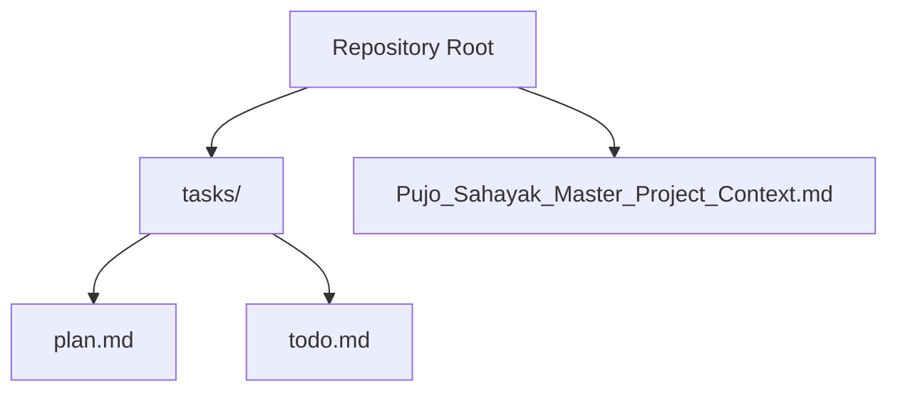
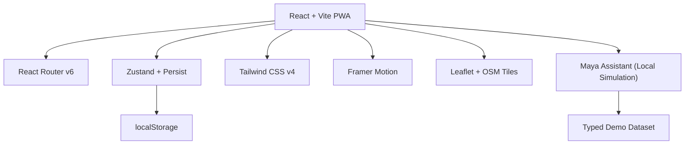
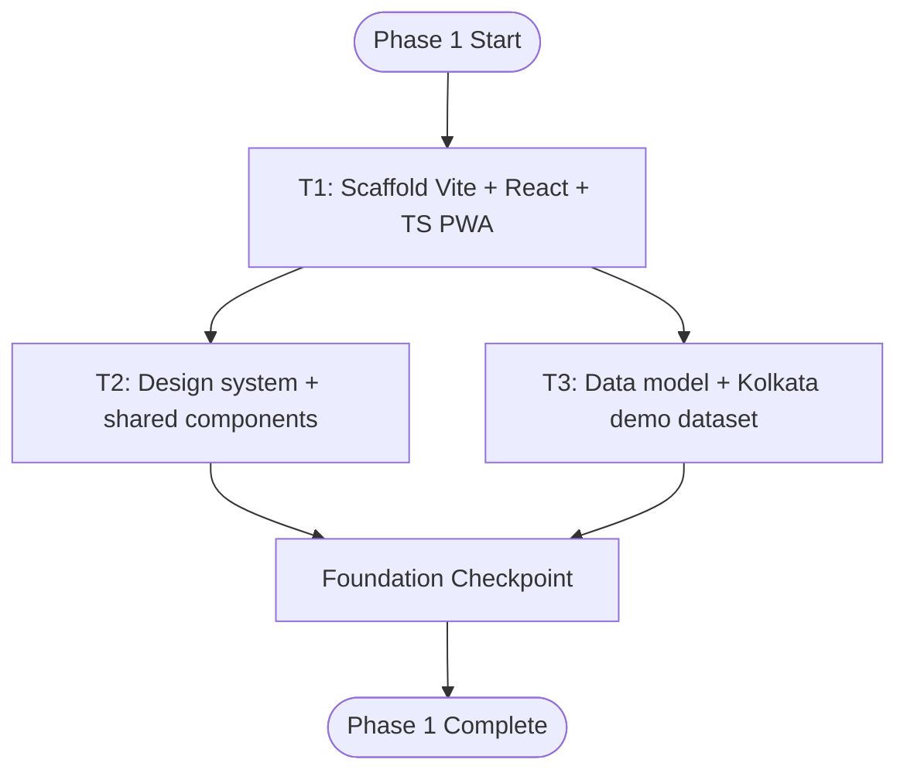
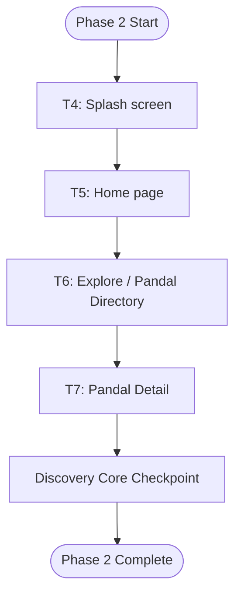
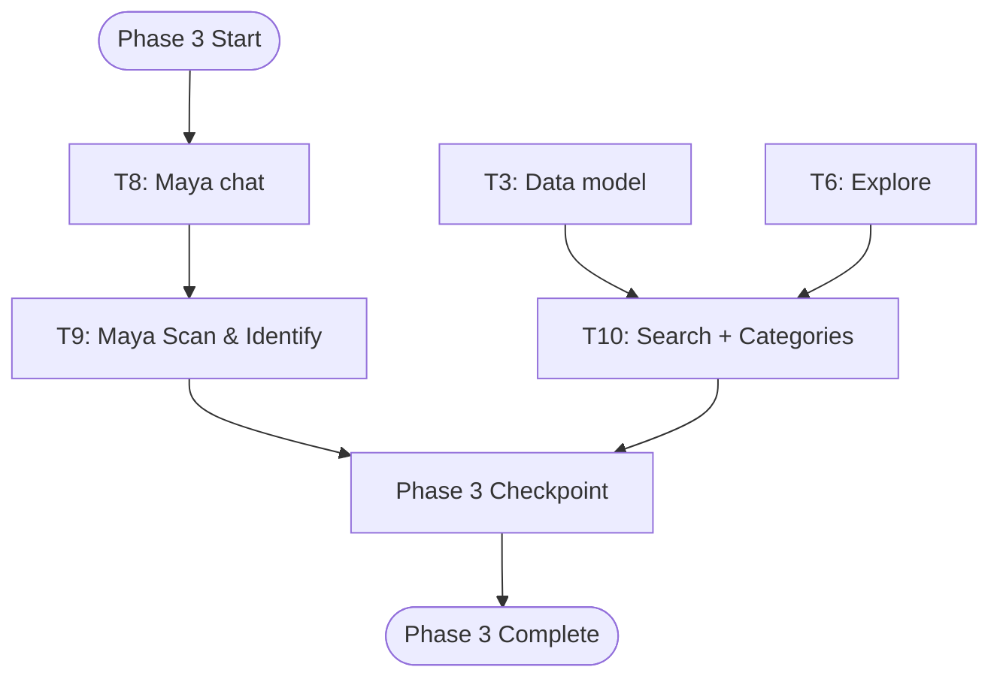
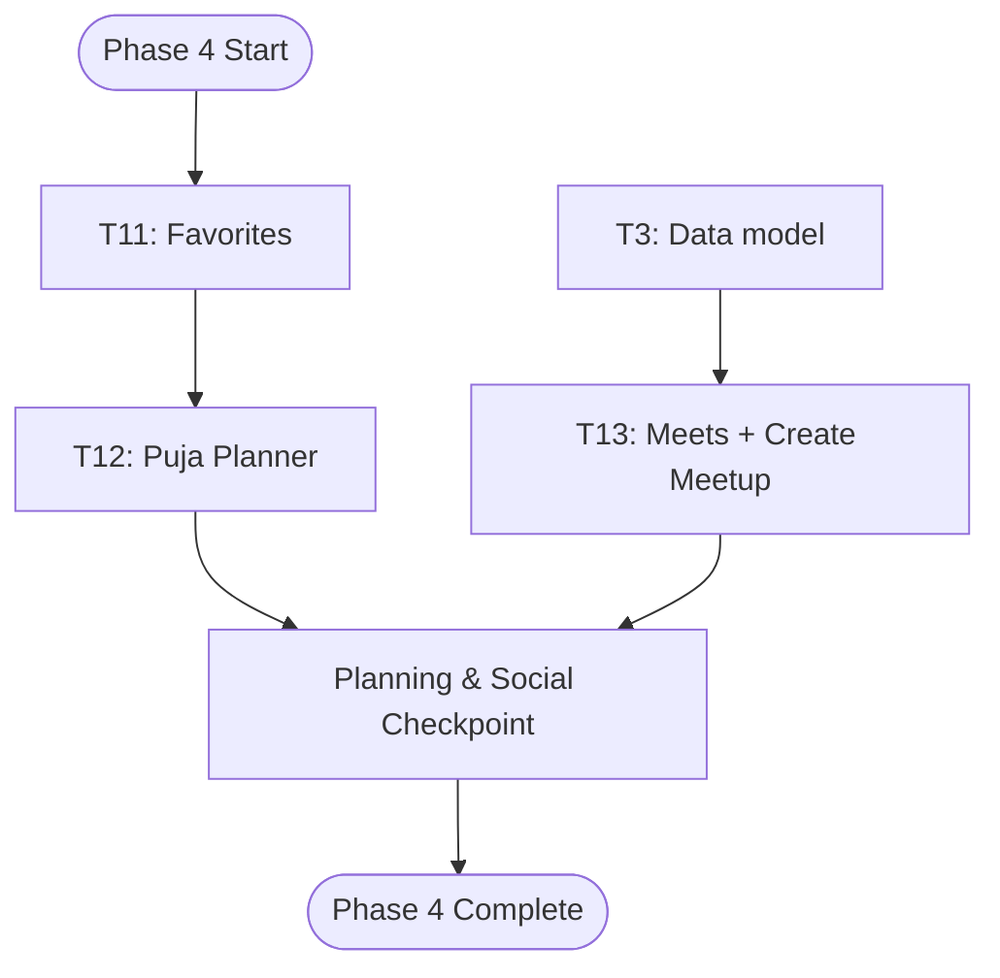
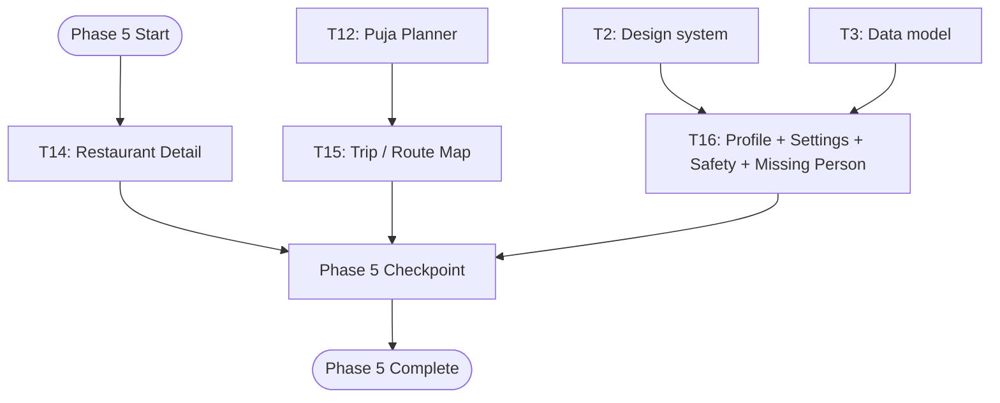
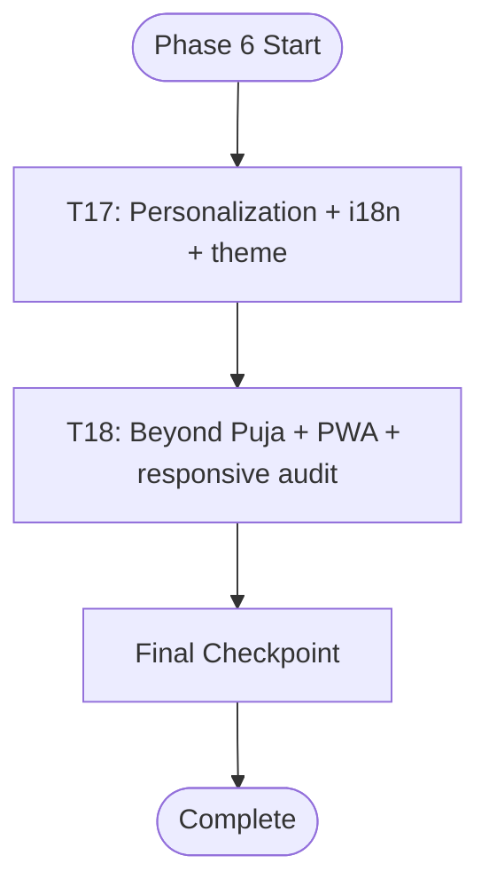
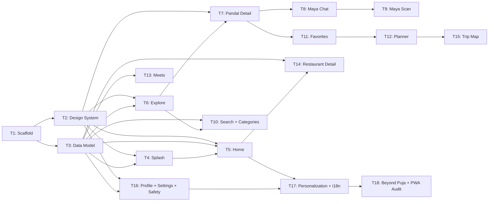

# Development Roadmap and Task Management

<cite>
**Referenced Files in This Document**
- [plan.md](file://tasks/plan.md)
- [todo.md](file://tasks/todo.md)
- [Pujo_Sahayak_Master_Project_Context.md](file://Pujo_Sahayak_Master_Project_Context.md)
</cite>

## Table of Contents
1. [Introduction](#introduction)
2. [Project Structure](#project-structure)
3. [Core Components](#core-components)
4. [Architecture Overview](#architecture-overview)
5. [Detailed Component Analysis](#detailed-component-analysis)
6. [Dependency Analysis](#dependency-analysis)
7. [Performance Considerations](#performance-considerations)
8. [Troubleshooting Guide](#troubleshooting-guide)
9. [Conclusion](#conclusion)
10. [Appendices](#appendices)

## Introduction
This document defines the development roadmap and task management approach for Puja Sahayak, a mobile-first React + Vite PWA that replicates the mockup screens while improving polish, clarity, and maintainability. The product is a digital companion for exploring Kolkata during Durga Puja, with a broader local-discovery ecosystem that remains useful beyond the festival season.

The roadmap follows six phased implementation stages:
- Phase 1: Foundation
- Phase 2: Discovery Core
- Phase 3: Maya + Search/Categories
- Phase 4: Planning & Social
- Phase 5: Utility & Account
- Phase 6: Polish

Each phase includes tasks, dependencies, verification criteria, and checkpoints to ensure quality gates are met before progression. The plan emphasizes vertical slices so the app remains runnable after each task, reducing context loss and agent fatigue.

**Section sources**
- [plan.md:1-18](file://tasks/plan.md#L1-L18)
- [Pujo_Sahayak_Master_Project_Context.md:1-18](file://Pujo_Sahayak_Master_Project_Context.md#L1-L18)

## Project Structure
The repository contains planning and tracking artifacts rather than source code at this stage:
- `tasks/plan.md`: Implementation plan, architecture decisions, screen-to-route mapping, task breakdown by phase, verification rules, risks, and open questions.
- `tasks/todo.md`: Detailed task checklist with phases, dependencies, scope estimates, and per-task verification notes.
- `Pujo_Sahayak_Master_Project_Context.md`: Master product context describing philosophy, navigation, feature areas, user journeys, and long-term vision.

**Diagram sources**
- [plan.md:1-18](file://tasks/plan.md#L1-L18)
- [todo.md:1-10](file://tasks/todo.md#L1-L10)
- [Pujo_Sahayak_Master_Project_Context.md:1-20](file://Pujo_Sahayak_Master_Project_Context.md#L1-L20)

**Section sources**
- [plan.md:1-18](file://tasks/plan.md#L1-L18)
- [todo.md:1-10](file://tasks/todo.md#L1-L10)
- [Pujo_Sahayak_Master_Project_Context.md:1-20](file://Pujo_Sahayak_Master_Project_Context.md#L1-L20)

## Core Components
The core components of the development process include:
- Phased task breakdown across six phases.
- Dependency graph between tasks.
- Verification criteria per phase and per task.
- Risk mitigation strategies.
- Open questions and defaults.

Key responsibilities:
- Foundation establishes scaffolding, design system, shared components, typed data model, and demo dataset.
- Discovery core implements Splash, Home, Explore/Pandal Directory, and Pandal Detail.
- Maya + Search/Categories implements chat shell, voice waveform UI, camera scan flow, search filters, and category grids.
- Planning & social implements Favorites, Puja Planner, Meets list, and Create Meetup.
- Utility & account implements Restaurant Detail, Trip/Route Map, Profile, Settings, Safety/Emergency, and Missing Person wizard.
- Polish implements personalization, i18n, theme, Beyond Puja content, PWA offline audit, motion pass, and responsive desktop adaptation.

**Section sources**
- [plan.md:41-61](file://tasks/plan.md#L41-L61)
- [todo.md:5-75](file://tasks/todo.md#L5-L75)

## Architecture Overview
The application architecture is defined by technology choices and runtime behavior:
- React 18 + TypeScript + Vite as the build stack.
- Tailwind CSS v4 for design tokens and bespoke UI.
- React Router v6 for routing and nested detail pages.
- Zustand + persist middleware for client state persistence to localStorage.
- Framer Motion for motion primitives honoring reduced-motion settings.
- Leaflet + OpenStreetMap tiles for maps without requiring Google Maps keys.
- Maya as a UI-complete, locally simulated assistant grounded in the dataset.
- Images handled via curated gradients and placeholders; layout is image-agnostic.
- Demo-data honesty with `isDemo: true` on dataset entries.

**Diagram sources**
- [plan.md:7-18](file://tasks/plan.md#L7-L18)

**Section sources**
- [plan.md:7-18](file://tasks/plan.md#L7-L18)

## Detailed Component Analysis

### Phase 1 — Foundation
Tasks:
- T1: Scaffold Vite + React + TS PWA
- T2: Design system + shared components
- T3: Data model + Kolkata demo dataset

Dependencies:
- T2 depends on T1.
- T3 depends on T1.

Verification:
- Build clean with no TypeScript errors.
- Dev server serves the app shell.
- Storybook-free demo route renders every component.
- Dataset loads into store and compiles cleanly.

Milestone:
- Foundation checkpoint: build clean, shell + nav + tokens visible; review with human.

**Diagram sources**
- [todo.md:5-16](file://tasks/todo.md#L5-L16)

**Section sources**
- [todo.md:5-16](file://tasks/todo.md#L5-L16)

### Phase 2 — Discovery Core
Tasks:
- T4: Splash screen
- T5: Home page
- T6: Explore / Pandal Directory
- T7: Pandal Detail

Dependencies:
- T4 depends on T2, T3.
- T5 depends on T2, T3, T4.
- T6 depends on T2, T3.
- T7 depends on T2–T6.

Verification:
- Splash renders at `/splash` and transitions.
- Home renders all sections from dataset; language toggle switches strings.
- Explore filters actually filter dataset; map shows markers.
- Pandal Detail has all sections present; Save/Visited persist.

Milestone:
- Discovery core checkpoint: Home → Explore → Detail flow works end-to-end; review with human.

**Diagram sources**
- [todo.md:18-32](file://tasks/todo.md#L18-L32)

**Section sources**
- [todo.md:18-32](file://tasks/todo.md#L18-L32)

### Phase 3 — Maya + Search/Categories
Tasks:
- T8: Maya chat
- T9: Maya Scan & Identify
- T10: Search + Categories

Dependencies:
- T8 depends on T7.
- T9 depends on T8.
- T10 depends on T3, T6.

Verification:
- Maya chat returns dataset-grounded answers; FAB mic toggles voice-input mode.
- Camera opens with permission; result navigates to pandal detail.
- Both routes reachable from nav; searches return results.

**Diagram sources**
- [todo.md:34-44](file://tasks/todo.md#L34-L44)

**Section sources**
- [todo.md:34-44](file://tasks/todo.md#L34-L44)

### Phase 4 — Planning & Social
Tasks:
- T11: Favorites
- T12: Puja Planner
- T13: Meets + Create Meetup

Dependencies:
- T11 depends on T7.
- T12 depends on T11.
- T13 depends on T3.

Verification:
- Favorites reflects store state live.
- Planner persists across reload; optimize suggestions use nearest-neighbor reordering.
- Join/create updates state locally.

Milestone:
- Planning & social checkpoint: plan a day, join a meetup; review with human.

**Diagram sources**
- [todo.md:45-56](file://tasks/todo.md#L45-L56)

**Section sources**
- [todo.md:45-56](file://tasks/todo.md#L45-L56)

### Phase 5 — Utility & Account
Tasks:
- T14: Restaurant Detail
- T15: Trip / Route Map
- T16: Profile + Settings + Safety + Missing Person

Dependencies:
- T14 depends on T3, T5.
- T15 depends on T12.
- T16 depends on T2, T3.

Verification:
- Restaurant Detail reachable from every restaurant card.
- Trip map renders from planner day; calculates total distance/time.
- All rows navigate; missing person wizard completes.

**Diagram sources**
- [todo.md:58-68](file://tasks/todo.md#L58-L68)

**Section sources**
- [todo.md:58-68](file://tasks/todo.md#L58-L68)

### Phase 6 — Polish
Tasks:
- T17: Personalization + i18n + theme
- T18: Beyond Puja + PWA + responsive audit

Dependencies:
- T17 depends on T5–T16.
- T18 depends on T17.

Verification:
- Toggles apply instantly and persist.
- Lighthouse PWA installable; layout verified at 375px and 1280px.

Final Checkpoint:
- Build clean, all routes navigable, persistence verified.
- Screen-by-screen comparison against mockups.
- Ready for review.

**Diagram sources**
- [todo.md:69-81](file://tasks/todo.md#L69-L81)

**Section sources**
- [todo.md:69-81](file://tasks/todo.md#L69-L81)

## Dependency Analysis
Task dependency relationships form a layered structure:
- Foundation tasks (T1–T3) enable all subsequent work.
- Discovery core builds on foundation and introduces primary user flows.
- Maya + Search/Categories extends discovery with intelligence and structured exploration.
- Planning & Social adds user-generated plans and community features.
- Utility & Account provides supporting screens and safety tools.
- Polish finalizes personalization, accessibility, PWA readiness, and responsiveness.

**Diagram sources**
- [todo.md:5-81](file://tasks/todo.md#L5-L81)

**Section sources**
- [todo.md:5-81](file://tasks/todo.md#L5-L81)

## Performance Considerations
- Keep the app shell lightweight; defer heavy assets until needed.
- Use gradient/placeholder images to avoid layout shifts when real photography is not available.
- Honor reduced-motion settings for accessibility and performance.
- Ensure localStorage operations remain efficient; batch updates where possible.
- Validate PWA caching strategy to keep critical resources cached without bloating storage.

[No sources needed since this section provides general guidance]

## Troubleshooting Guide
Common issues and mitigations:
- Scope creep due to 21 screens: mitigate by building vertical slices and keeping todo.md updated per session.
- Mockup fidelity vs improved polish tension: lock IA to mockups; guide visual polish via tokens; review screenshots per checkpoint.
- Maya expectations: explicitly label local retrieval demo; keep a clean swap-in point for a real LLM API later.
- Offline image availability: rely on fallbacks; ensure layout never breaks without images.
- Bengali text rendering: use appropriate fonts with system fallbacks.

Open questions and defaults:
- Reviews/photos on Pandal Detail: demo entries only; no upload backend in v1; photo upload simulates verification locally.
- Premium/payments: UI present but non-functional stubs; no payment integration in v1.
- Auth: skipped in v1; profile is local-only; phone OTP UI can come later.

**Section sources**
- [plan.md:63-86](file://tasks/plan.md#L63-L86)

## Conclusion
The Puja Sahayak development roadmap organizes complex functionality into manageable phases with clear dependencies, verification criteria, and checkpoints. By prioritizing foundational setup, then progressively adding discovery, intelligence, planning, utility, and polish, the team can maintain a runnable app throughout development. Risks are mitigated through scoped vertical slices, honest demo data, and explicit boundaries around AI simulation. The final checkpoints ensure quality gates are met before release, preparing the project for iterative improvement and future enhancements.

[No sources needed since this section summarizes without analyzing specific files]

## Appendices

### Agile Methodology Approach
- Iterative development cycles aligned with phases and tasks.
- Each task leaves the app in a runnable state to reduce risk and improve feedback loops.
- Continuous integration practices should enforce clean builds and type checks before merging changes.
- Code reviews should verify adherence to design tokens, IA, and mockup order.
- Testing requirements include manual checks against mockups, route reachability, and persistence validation.

[No sources needed since this section provides general guidance]

### Deployment Strategies
- Development: run dev server and verify every route reachable via bottom nav or documented deep links.
- Production: ensure `npm run build` is clean, PWA installable, and offline shell caches critical resources.
- Desktop adaptation: validate layout at multiple breakpoints (e.g., 375px and 1280px).

**Section sources**
- [plan.md:63-70](file://tasks/plan.md#L63-L70)
- [todo.md:77-81](file://tasks/todo.md#L77-L81)