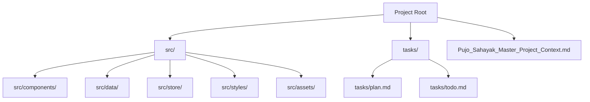
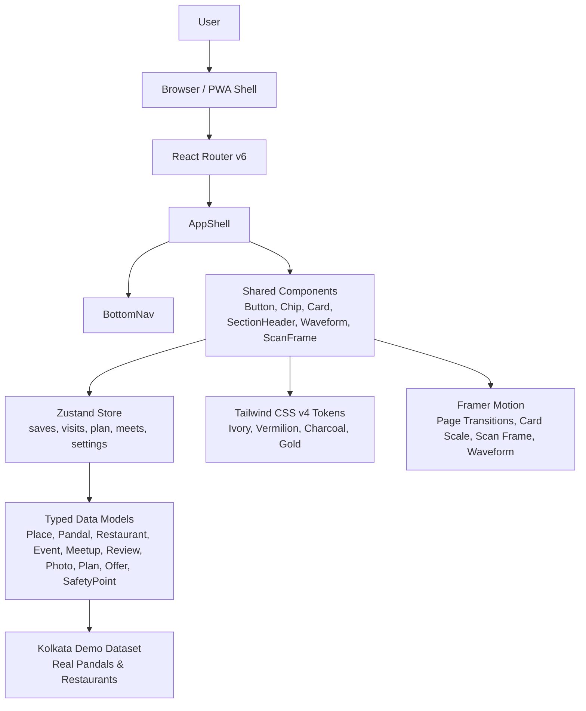
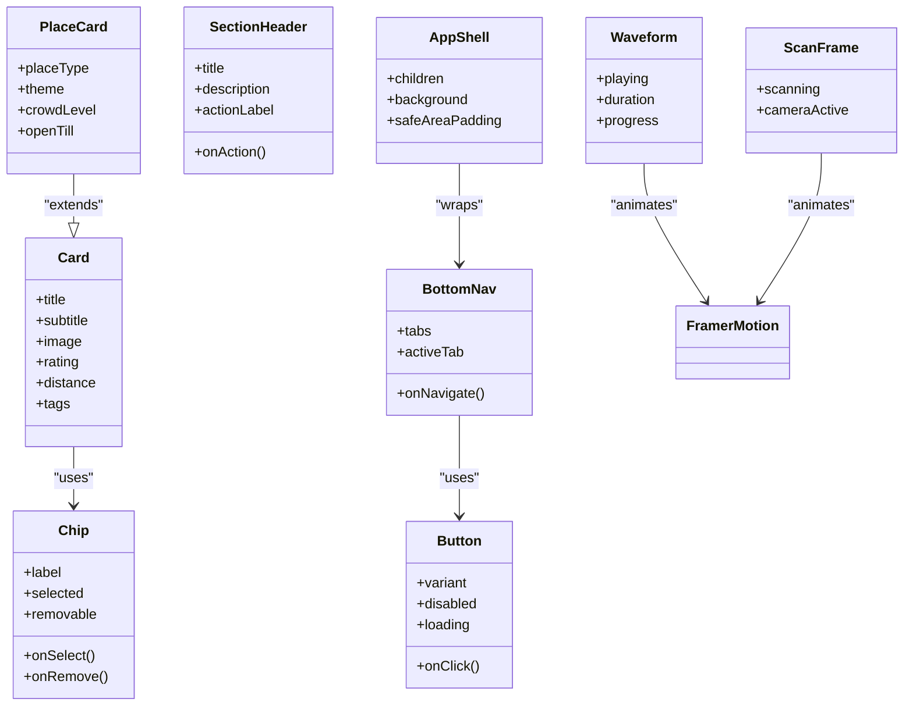
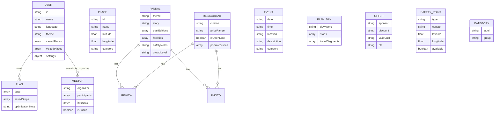
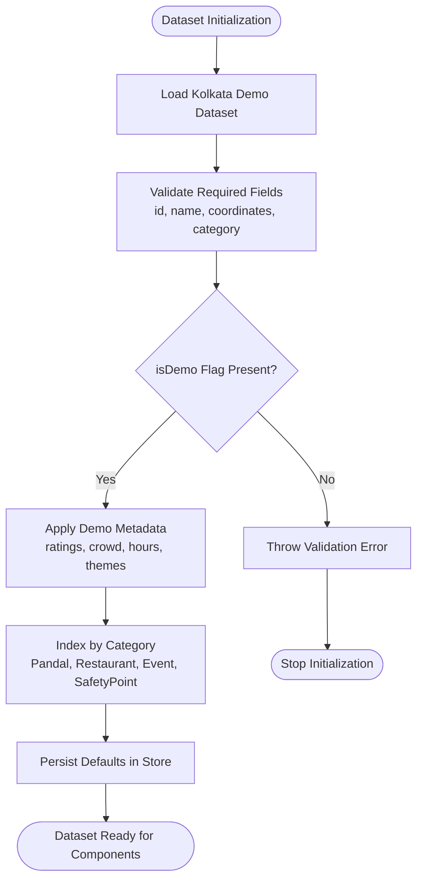
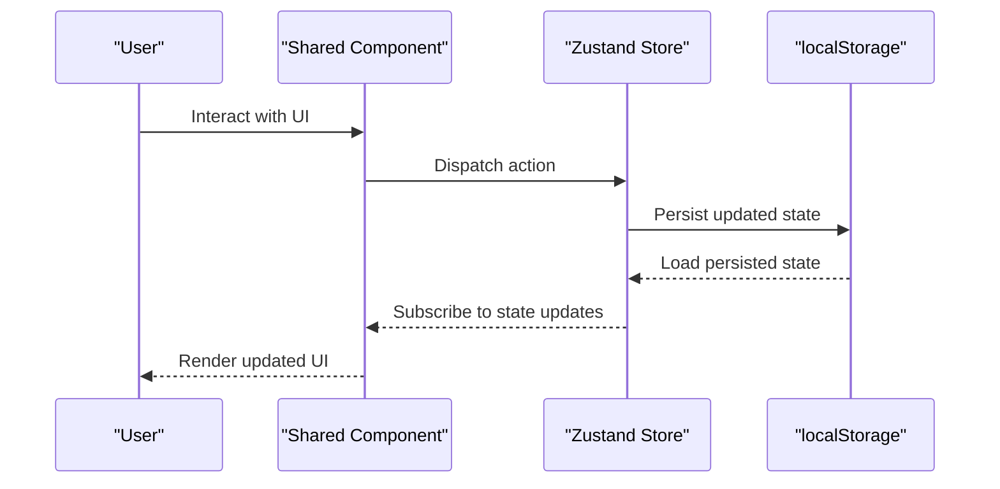
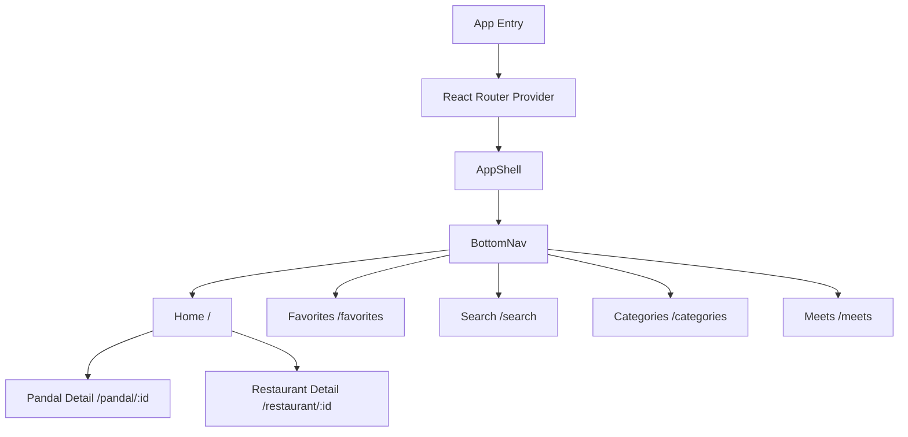
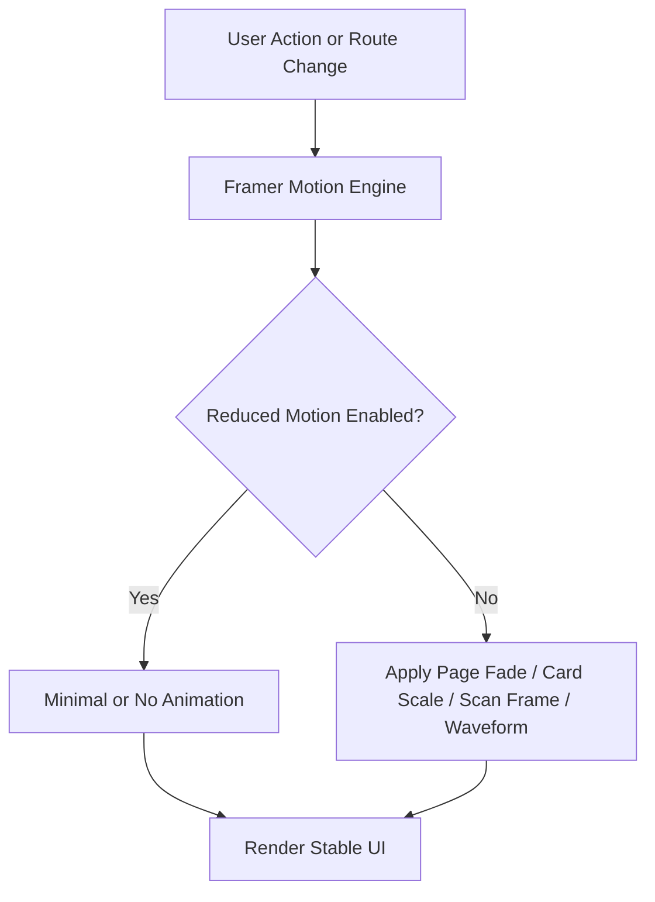
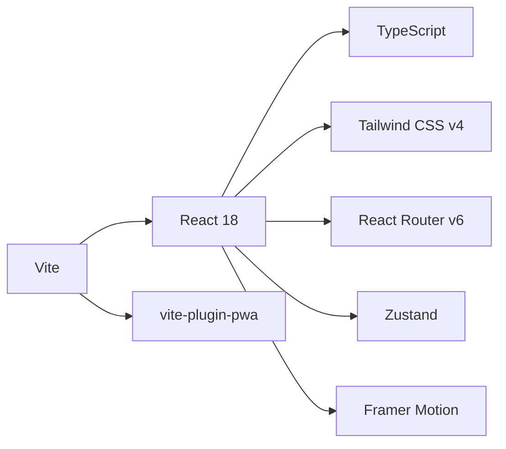

# Phase 1: Foundation Setup

<cite>
**Referenced Files in This Document**   
- [Pujo_Sahayak_Master_Project_Context.md](file://Pujo_Sahayak_Master_Project_Context.md)
- [plan.md](file://tasks/plan.md)
- [todo.md](file://tasks/todo.md)
</cite>

## Table of Contents
1. [Introduction](#introduction)
2. [Project Structure](#project-structure)
3. [Core Components](#core-components)
4. [Architecture Overview](#architecture-overview)
5. [Detailed Component Analysis](#detailed-component-analysis)
6. [Dependency Analysis](#dependency-analysis)
7. [Performance Considerations](#performance-considerations)
8. [Troubleshooting Guide](#troubleshooting-guide)
9. [Conclusion](#conclusion)
10. [Appendices](#appendices)

## Introduction
This document describes Phase 1 of the Puja Sahayak project: the foundation setup for a mobile-first React 18 + TypeScript + Vite PWA with Tailwind CSS v4, shared components, motion primitives, typed data models, and a Kolkata demo dataset. The goal is to scaffold a clean, runnable application shell that establishes the design system, navigation structure, state model, and local data layer before building feature screens.

The product context defines Puja Sahayak as a digital companion for exploring Kolkata during Durga Puja, combining discovery, intelligence, planning, community, utility, memory, and continuity beyond the festival season. Phase 1 lays the technical groundwork so later phases can implement the full set of mockup screens while keeping the app installable, responsive, accessible, and grounded in real local data.

**Section sources**
- [Pujo_Sahayak_Master_Project_Context.md:1-18](file://Pujo_Sahayak_Master_Project_Context.md#L1-L18)
- [Pujo_Sahayak_Master_Project_Context.md:21-138](file://Pujo_Sahayak_Master_Project_Context.md#L21-L138)

## Project Structure
At this stage, the repository contains the master product context and task plans. The actual codebase will be scaffolded under a Vite project root with the following conceptual layout:

**Diagram sources**
- [plan.md:1-18](file://tasks/plan.md#L1-L18)
- [todo.md:1-16](file://tasks/todo.md#L1-L16)

### Repository Layout Before Scaffolding
Before running the scaffolding commands, the workspace includes:
- A master product context file describing the product philosophy, navigation, pages, and long-term roadmap.
- An implementation plan summarizing architecture decisions, screen-to-route mapping, phase breakdown, verification criteria, risks, and open questions.
- A task checklist tracking progress across six phases, with Phase 1 covering scaffolding, design system, shared components, typed data models, and the Kolkata demo dataset.

**Section sources**
- [Pujo_Sahayak_Master_Project_Context.md:1-138](file://Pujo_Sahayak_Master_Project_Context.md#L1-L138)
- [plan.md:1-18](file://tasks/plan.md#L1-L18)
- [todo.md:1-16](file://tasks/todo.md#L1-L16)

## Core Components
Phase 1 focuses on establishing the foundational layers rather than implementing full feature screens. The core components and concerns are:

- **Scaffold**: Vite + React 18 + TypeScript + Vite PWA plugin.
- **Design System**: Tailwind CSS v4 tokens for ivory surfaces, vermilion primary, charcoal ink, muted gold, and supporting colors; typography scale including Bengali serif accents; radii and spacing tokens.
- **Shared UI Components**: Button, Chip, Card (including place-card variant), SectionHeader, BottomNav, AppShell, Waveform, ScanFrame, and page-transition wrapper with reduced-motion support.
- **Typed Data Model**: Interfaces for User, Place, Pandal, Restaurant, Event, Meetup, Review, Photo, Plan, Offer, SafetyPoint, plus supporting types such as Category and PlanDay.
- **Kolkata Demo Dataset**: Real pandals and restaurants with location metadata, ratings, themes, cuisine, crowd levels, and an explicit `isDemo` marker.
- **State Layer**: Zustand store with persistence for saves, visits, plans, meetups, language, theme, logo choice, and “continue where you left off” session.
- **Navigation**: React Router v6 with five-tab bottom navigation and nested detail routes.
- **Motion Primitives**: Framer Motion animations for soft page fades, subtle card scale, animated scan frame, voice waveform, and respect for reduced-motion preferences.

These pieces together form the foundation that later phases extend into Splash, Home, Explore, Detail, Maya, Planner, Meets, Search, Categories, Profile, Safety, and Beyond Puja experiences.

**Section sources**
- [plan.md:7-17](file://tasks/plan.md#L7-L17)
- [todo.md:5-15](file://tasks/todo.md#L5-L15)

## Architecture Overview
Phase 1 establishes a layered architecture:

- **Presentation Layer**: Shared components render reusable UI elements. Pages will later compose these components.
- **Routing Layer**: React Router v6 maps bottom navigation tabs and nested detail routes.
- **State Layer**: Zustand holds user-driven state and persists it to localStorage.
- **Data Layer**: Typed interfaces define contracts; the demo dataset provides initial Kolkata content.
- **Styling Layer**: Tailwind CSS v4 encodes the design tokens and responsive rules.
- **Animation Layer**: Framer Motion provides consistent motion primitives and respects accessibility settings.

**Diagram sources**
- [plan.md:7-17](file://tasks/plan.md#L7-L17)
- [todo.md:5-15](file://tasks/todo.md#L5-L15)

## Detailed Component Analysis

### Environment Setup and Dependency Installation
Phase 1 begins by creating a Vite-based React TypeScript application and adding the required dependencies:

- Create the Vite project using the standard interactive prompt.
- Install Tailwind CSS v4 integration appropriate for Vite.
- Install React Router v6 for routing.
- Install Zustand for client state management.
- Install Framer Motion for animation primitives.
- Install the Vite PWA plugin to generate manifest, icons, and service worker behavior.
- Verify that the development server starts and the production build completes without TypeScript errors.

After installation, configure:
- Vite entry point to mount the React app.
- Tailwind configuration to enable the design token system.
- React Router provider and route definitions for the bottom navigation.
- Zustand store initialization with persist middleware.
- Framer Motion provider or global motion configuration.
- PWA plugin configuration for manifest, icons, and offline shell behavior.

Verification goals:
- `npm run dev` serves the app shell.
- `npm run build` produces a clean build.
- The PWA manifest and service worker are generated according to the plugin configuration.

**Section sources**
- [todo.md:7-8](file://tasks/todo.md#L7-L8)
- [plan.md:7-10](file://tasks/plan.md#L7-L10)

### Design System Implementation with Tailwind CSS v4
The design system encodes the visual identity used across the app:

- **Colors**:
  - Ivory surfaces for light backgrounds and cards.
  - Vermilion as the primary action color.
  - Charcoal ink for text and high-contrast content.
  - Muted gold for accents, highlights, and premium cues.
  - Supporting indigo and other semantic colors as needed.
- **Typography**:
  - A type scale with clear hierarchy.
  - Bengali serif accent font for culturally resonant headings or greetings.
  - System fallback fonts for reliability.
- **Spacing and Radii**:
  - Consistent spacing tokens for padding, margins, and gaps.
  - Border radius tokens for cards, chips, buttons, and overlays.
- **Dark Mode Support**:
  - Token variants for dark mode to ensure contrast and readability.
- **Responsive Rules**:
  - Mobile-first breakpoints.
  - Touch-friendly sizing for buttons, chips, and navigation.
- **Accessibility**:
  - Sufficient color contrast.
  - Focus states for keyboard navigation.
  - Semantic HTML structure within components.

The design system should be consumed through Tailwind classes and component props rather than ad-hoc inline styles. This keeps the interface bespoke and aligned with the mockups instead of looking like a generic SaaS template.

**Section sources**
- [plan.md:9-10](file://tasks/plan.md#L9-L10)
- [todo.md:10-11](file://tasks/todo.md#L10-L11)

### Shared Components Development
Phase 1 defines reusable UI primitives that will compose later screens:

- **Button**: Primary, secondary, and ghost variants; disabled and loading states; focus and reduced-motion support.
- **Chip**: Filter chips, category chips, and action chips; supports selection and removal.
- **Card**: Base card with elevation, image area, title, subtitle, rating, distance, and tags; includes a place-card variant optimized for pandals and restaurants.
- **SectionHeader**: Title, description, and optional action button; used for rails such as Nearby Restaurants, Offers, Events, and Continue Where You Left Off.
- **BottomNav**: Five-tab navigation with active state, labels, and icons; maps to Home, Favorites, Search, Categories, and Meets.
- **AppShell**: Top-level layout container providing safe areas, background, and consistent padding.
- **Waveform**: Visual representation for audio playback in Maya responses.
- **ScanFrame**: Animated overlay for camera scanning in Maya’s identify flow.
- **Page Transition Wrapper**: Soft fade transitions between routes, respecting reduced-motion preferences.

Each component should accept typed props, expose meaningful accessibility attributes, and avoid hard-coding business logic. They should also be testable independently once tests are added in later phases.

**Diagram sources**
- [todo.md:10-11](file://tasks/todo.md#L10-L11)
- [plan.md:13](file://tasks/plan.md#L13)

**Section sources**
- [todo.md:10-11](file://tasks/todo.md#L10-L11)

### Typed Data Model Creation
Phase 1 introduces strongly typed interfaces that describe the domain entities:

- **User**: Local profile information, language preference, theme, saved items, visited places, and settings.
- **Place**: Common base for discoverable locations, including identifier, name, coordinates, and metadata.
- **Pandal**: Extends Place with Puja-specific fields such as theme, story, past editions, facilities, safety notes, and crowd level.
- **Restaurant**: Extends Place with cuisine, price range, operating hours, open-now status, and popular dishes.
- **Event**: Date, time, location, description, category, and visibility flags.
- **Meetup**: Organizer, participants, interest tags, public/restricted access, and join state.
- **Review**: Author, rating, comment, timestamp, and verification status.
- **Photo**: URL, caption, author, timestamp, and moderation status.
- **Plan**: Multi-day itinerary with day slots, stops, timings, and optimization suggestions.
- **Offer**: Sponsor or partner promotion, discount details, validity period, and call-to-action.
- **SafetyPoint**: Emergency contact, facility type, coordinates, and availability.
- **Category**: Grouping label for Places, Transport & Services, and Utilities.
- **PlanDay**: Individual day slot with ordered stops and travel segments.

These interfaces ensure that the demo dataset, store, components, and future API integrations share a single source of truth. They also make TypeScript errors visible early when data changes.

**Diagram sources**
- [todo.md:13-14](file://tasks/todo.md#L13-L14)
- [plan.md:12](file://tasks/plan.md#L12)

**Section sources**
- [todo.md:13-14](file://tasks/todo.md#L13-L14)
- [plan.md:12](file://tasks/plan.md#L12)

### Kolkata Demo Dataset Setup
Phase 1 populates the application with a realistic but clearly marked demo dataset:

- **Pandals**: At least eight real Kolkata pandals, such as Santosh Mitra Square, Kalyani ITI, Baghbaz Sarbojanin, Deshapriya Park, and Ekdalia Evergreen.
- **Restaurants**: At least six well-known Kolkata restaurants, such as Oh! Calcutta and 6 Ballygunge Place.
- **Events and Meetups**: Representative entries to demonstrate discovery and social features.
- **Offers**: Partner or sponsor promotions relevant to the Puja season.
- **Safety Points**: Emergency contacts, hospitals, police stations, and help points with latitude and longitude.
- **Metadata**: Ratings, distances, crowd levels, opening hours, themes, cuisines, and categories.
- **Demo Marker**: Every dataset entry should include `isDemo: true` so users and developers understand that statistics and content are not live production data.

The dataset should load into the Zustand store and be consumable by components without requiring a backend. Later phases can swap this local dataset for a real API while preserving the same typed contracts.

**Diagram sources**
- [todo.md:13-14](file://tasks/todo.md#L13-L14)
- [plan.md:17](file://tasks/plan.md#L17)

**Section sources**
- [todo.md:13-14](file://tasks/todo.md#L13-L14)

### State Management and Persistence
Phase 1 uses Zustand with a persist middleware to manage client-side state:

- Saved places.
- Visited places.
- Puja plan with six day slots.
- Meetups and participation state.
- Language, theme, and app-logo choice.
- “Continue where you left off” session data.

Persistence ensures that user actions survive reloads and that the app feels reliable even when network access is unavailable. The store should expose selectors and actions rather than raw state mutations, making it easier to test and refactor later.

**Diagram sources**
- [plan.md:12](file://tasks/plan.md#L12)
- [todo.md:5-15](file://tasks/todo.md#L5-L15)

**Section sources**
- [plan.md:12](file://tasks/plan.md#L12)
- [todo.md:5-15](file://tasks/todo.md#L5-L15)

### Navigation and Routing
Phase 1 configures React Router v6 with a five-tab bottom navigation:

- Home
- Favorites
- Search
- Categories
- Meets

Detail pages use nested routes, such as `/pandal/:id` and `/restaurant/:id`. The router should integrate with the AppShell and BottomNav so that navigation remains consistent across all screens. Deep links should work for key flows, especially Pandal Detail, Restaurant Detail, and Trip/Route Map.

**Diagram sources**
- [plan.md:11-14](file://tasks/plan.md#L11-L14)
- [todo.md:5-15](file://tasks/todo.md#L5-L15)

**Section sources**
- [plan.md:11-14](file://tasks/plan.md#L11-L14)

### Motion Primitives and Accessibility
Phase 1 integrates Framer Motion to provide consistent, respectful animations:

- Soft page fade transitions.
- Subtle card scale effects.
- Animated scan frame for Maya’s camera identification.
- Voice waveform visualization for Maya responses.
- Respect for reduced-motion preferences.

Animations should enhance usability, not distract from it. Components must honor system-level reduced-motion settings and provide non-animated fallbacks. This is especially important for accessibility and performance on lower-end devices.

**Diagram sources**
- [plan.md:13](file://tasks/plan.md#L13)
- [todo.md:10-11](file://tasks/todo.md#L10-L11)

**Section sources**
- [plan.md:13](file://tasks/plan.md#L13)
- [todo.md:10-11](file://tasks/todo.md#L10-L11)

### Mobile-First Responsive Design Principles
Phase 1 establishes mobile-first principles:

- Default styles target small screens.
- Touch targets are large enough for comfortable tapping.
- Bottom navigation replaces top-heavy menus.
- Content stacks vertically on narrow viewports.
- Rails and grids adapt to wider screens in later phases.
- Images and media have fallbacks and do not break layout.
- Typography scales remain readable at small sizes.

These principles align with the product’s emphasis on a mobile-first experience and the need for a usable app during crowded festival exploration.

**Section sources**
- [plan.md:1](file://tasks/plan.md#L1)
- [todo.md:7-11](file://tasks/todo.md#L7-L11)

### Accessibility Considerations from the Start
Phase 1 builds accessibility into the foundation:

- Semantic HTML elements for headings, lists, buttons, and navigation.
- ARIA attributes where custom components replace native semantics.
- Keyboard focus management for modals, scans, and navigation.
- Color contrast compliance for ivory, charcoal, vermilion, and gold combinations.
- Reduced-motion support for all animations.
- Clear error messages and empty states for missing data.
- Labels and descriptions for images and icons.

Accessibility is not a later add-on; it is part of the shared component contract.

**Section sources**
- [plan.md:13](file://tasks/plan.md#L13)
- [todo.md:10-11](file://tasks/todo.md#L10-L11)

## Dependency Analysis
Phase 1 dependencies are intentionally focused:

- **Vite**: Build tool and development server.
- **React 18**: UI library with modern concurrency patterns.
- **TypeScript**: Static typing for safer data models and components.
- **Tailwind CSS v4**: Utility-first styling with design tokens.
- **React Router v6**: Declarative routing and nested routes.
- **Zustand**: Lightweight client state with persistence.
- **Framer Motion**: Animation primitives and motion control.
- **Vite PWA Plugin**: Manifest, icons, and service worker generation.

Later phases introduce Leaflet and OpenStreetMap tiles for mapping, but those are outside Phase 1 scope.

**Diagram sources**
- [plan.md:7-10](file://tasks/plan.md#L7-L10)
- [todo.md:7-11](file://tasks/todo.md#L7-L11)

**Section sources**
- [plan.md:7-10](file://tasks/plan.md#L7-L10)
- [todo.md:7-11](file://tasks/todo.md#L7-L11)

## Performance Considerations
Phase 1 should keep the foundation lightweight:

- Avoid heavy third-party UI libraries; rely on Tailwind and custom components.
- Keep the demo dataset small and structured for fast loading.
- Defer heavy features such as maps and AI simulation until later phases.
- Use lazy loading for routes and components when expanding the app.
- Optimize images and placeholders to prevent layout shifts.
- Respect reduced-motion preferences to reduce CPU usage.
- Audit bundle size after adding dependencies.

These practices help maintain a smooth mobile experience and leave room for richer features in subsequent phases.

[No sources needed since this section provides general guidance]

## Troubleshooting Guide
Common issues during Phase 1 and their likely causes:

- **Build fails with TypeScript errors**:
  - Missing or mismatched types in the data model.
  - Incorrect prop types in shared components.
  - Dataset fields not matching the defined interfaces.
- **Dev server does not start**:
  - Port conflicts.
  - Missing dependencies.
  - Incorrect Vite configuration.
- **PWA manifest or service worker missing**:
  - Vite PWA plugin not configured.
  - Icons or manifest paths incorrect.
- **Animations feel janky or inaccessible**:
  - Not honoring reduced-motion preferences.
  - Overusing complex animations on low-power devices.
- **Navigation does not update UI**:
  - Router provider not wrapping the app.
  - BottomNav not connected to active route state.
- **State resets on reload**:
  - Zustand persist middleware not configured.
  - localStorage blocked or cleared by the browser.

Resolution steps:
- Run `npm run build` to surface TypeScript and bundling errors.
- Verify dependency versions match the planned stack.
- Confirm Tailwind v4 integration is correctly installed.
- Check that the Zustand store initializes with persisted defaults.
- Test reduced-motion behavior in browser developer tools.
- Validate dataset schema against the typed interfaces.

**Section sources**
- [plan.md:63-69](file://tasks/plan.md#L63-L69)
- [todo.md:7-15](file://tasks/todo.md#L7-L15)

## Conclusion
Phase 1 establishes the technical foundation for Puja Sahayak. By scaffolding a Vite + React + TypeScript PWA, defining a Tailwind CSS v4 design system, implementing shared components, creating typed data models, and loading a Kolkata demo dataset, the project gains a stable base for all future screens. The architecture emphasizes mobile-first responsiveness, accessibility, local persistence, and honest demo data. With this foundation in place, later phases can confidently implement discovery, Maya, planning, social features, utility screens, and polish without reworking core assumptions.

[No sources needed since this section summarizes without analyzing specific files]

## Appendices

### Step-by-Step Phase 1 Checklist
- Scaffold Vite + React + TypeScript + PWA.
- Install Tailwind CSS v4, React Router v6, Zustand, Framer Motion, and vite-plugin-pwa.
- Configure Tailwind tokens for ivory, vermilion, charcoal, muted gold, and supporting colors.
- Implement shared components: Button, Chip, Card, SectionHeader, BottomNav, AppShell, Waveform, ScanFrame, page transition wrapper.
- Define typed data models for User, Place, Pandal, Restaurant, Event, Meetup, Review, Photo, Plan, Offer, SafetyPoint, Category, and PlanDay.
- Populate the Kolkata demo dataset with real pandals and restaurants, including `isDemo: true`.
- Initialize Zustand store with persistence for saves, visits, plans, meetups, language, theme, logo choice, and continue-where-you-left-off.
- Set up React Router with five-tab bottom navigation and nested detail routes.
- Integrate Framer Motion with reduced-motion support.
- Verify `npm run build` is clean and the dev server serves the app shell.

**Section sources**
- [todo.md:5-15](file://tasks/todo.md#L5-L15)
- [plan.md:41-46](file://tasks/plan.md#L41-L46)