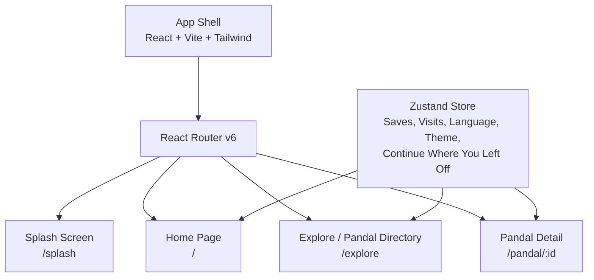
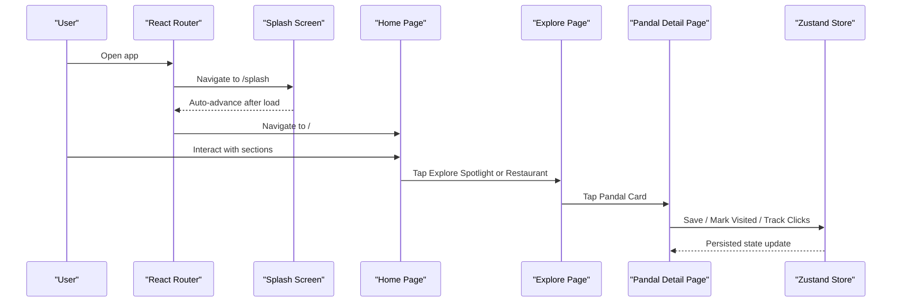
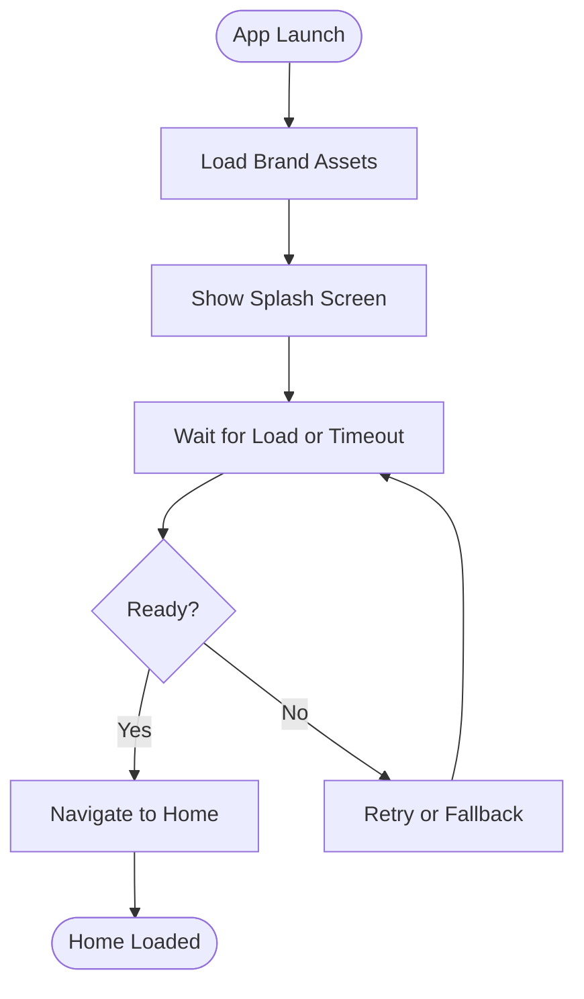
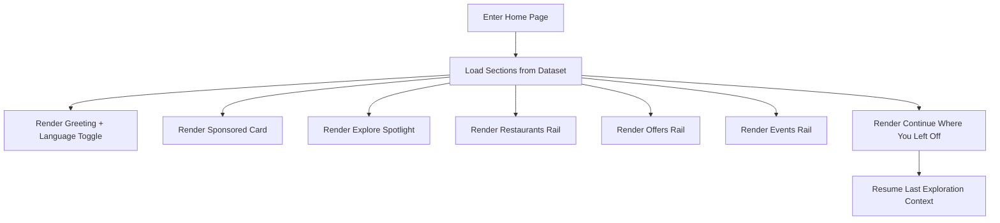
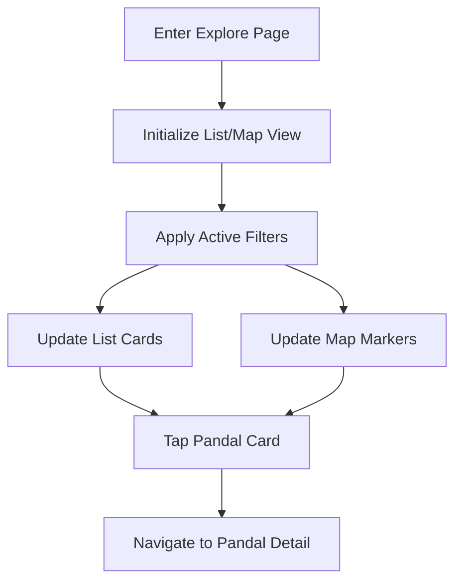
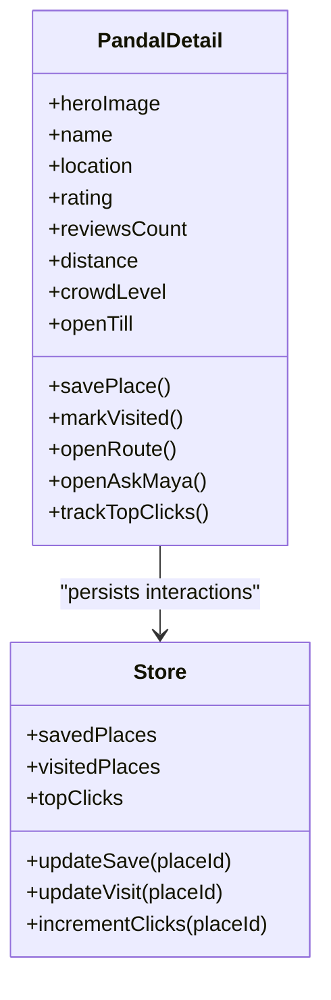
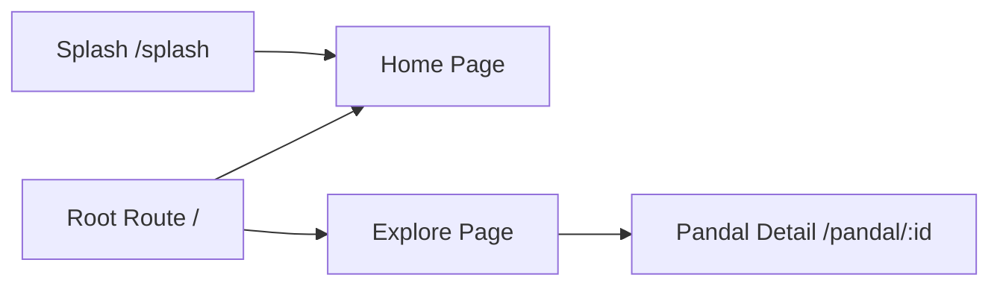
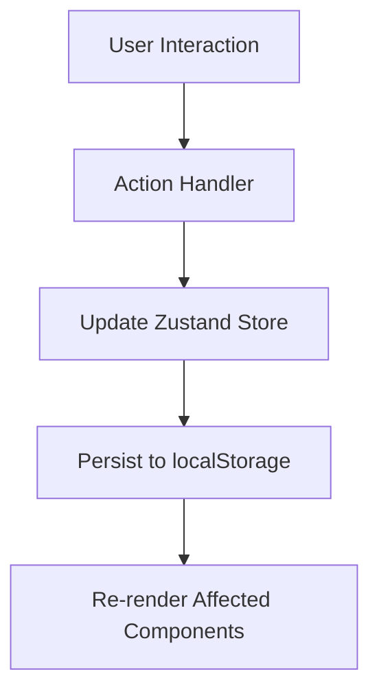
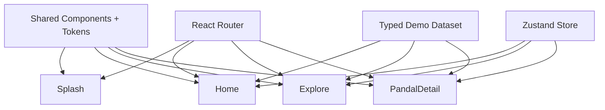

# Phase 2: Discovery Core Features

<cite>
**Referenced Files in This Document**
- [Pujo_Sahayak_Master_Project_Context.md](file://Pujo_Sahayak_Master_Project_Context.md)
- [plan.md](file://tasks/plan.md)
- [todo.md](file://tasks/todo.md)
</cite>

## Table of Contents
1. [Introduction](#introduction)
2. [Project Structure](#project-structure)
3. [Core Components](#core-components)
4. [Architecture Overview](#architecture-overview)
5. [Detailed Component Analysis](#detailed-component-analysis)
6. [Dependency Analysis](#dependency-analysis)
7. [Performance Considerations](#performance-considerations)
8. [Troubleshooting Guide](#troubleshooting-guide)
9. [Conclusion](#conclusion)
10. [Appendices](#appendices)

## Introduction
This document describes the implementation plan for Phase 2 of Pujo Sahayak, focusing on the discovery core features: Splash screen, Home page, Explore page, and Pandal Detail page. It explains how these screens fit into the product’s user journey, what data they consume, how users interact with them, and how routing and state management should be organized. The goal is to make the discovery experience feel like a digital companion for exploring Kolkata during Puja while remaining useful beyond the festival season.

The phase aligns with the documented roadmap that positions Splash, Home, Explore, and Pandal Detail as the core discovery flow before moving into Maya, Search/Categories, Planning, Social, Utility, and Polish phases.

**Section sources**
- [Pujo_Sahayak_Master_Project_Context.md:1-18](file://Pujo_Sahayak_Master_Project_Context.md#L1-L18)
- [plan.md:1-18](file://tasks/plan.md#L1-L18)
- [todo.md:18-32](file://tasks/todo.md#L18-L32)

## Project Structure
Phase 2 builds on the planned React + Vite + TypeScript + Tailwind + React Router + Zustand + Framer Motion stack. The application is mobile-first and uses a bottom navigation structure with nested routes for detail pages.

Key architectural decisions relevant to Phase 2:
- Routing: `/splash`, `/`, `/explore`, `/pandal/:id`.
- State: Zustand store persists saves, visits, language, theme, app-logo choice, and “continue where you left off” session.
- UI motion: Framer Motion provides soft page transitions and subtle card animations.
- Data: Typed local demo dataset includes pandals, restaurants, events, offers, and related metadata.

**Diagram sources**
- [plan.md:7-17](file://tasks/plan.md#L7-L17)
- [plan.md:19-39](file://tasks/plan.md#L19-L39)

**Section sources**
- [plan.md:7-17](file://tasks/plan.md#L7-L17)
- [plan.md:19-39](file://tasks/plan.md#L19-L39)

## Core Components
Phase 2 introduces four primary screens:

- Splash screen
  - Full-bleed branding image or gradient.
  - Wordmark and tagline.
  - Auto-advance to Home after loading.

- Home page
  - Greeting system with location context.
  - Language toggle (Bengali, English, Hindi).
  - Sponsored content card.
  - Explore spotlight section.
  - Restaurants showcase rail.
  - Offers & discounts rail.
  - Events listing rail.
  - Continue where you left off section.

- Explore page
  - List view and Map view toggle.
  - Filter chips for area, distance, theme, crowd level.
  - Pandal cards with rating, distance, crowd tag, and theme.
  - Action buttons for View Details and Route.

- Pandal Detail page
  - Hero image handling.
  - Save/Bookmark action.
  - Rating, reviews, distance, crowd level, open-till info.
  - Action row: Save, Visited, Route.
  - Info row: Location, Metro, Facilities, Safety.
  - About section with theme story.
  - Ask-Maya integration chip.
  - Reviews display.
  - Top clicks tracking.
  - Similar places recommendations.
  - Nearby locations such as restaurants and meetups.

These components are designed to work together through shared data models and a persistent client store.

**Section sources**
- [todo.md:18-32](file://tasks/todo.md#L18-L32)
- [Pujo_Sahayak_Master_Project_Context.md:160-318](file://Pujo_Sahayak_Master_Project_Context.md#L160-L318)
- [Pujo_Sahayak_Master_Project_Context.md:775-800](file://Pujo_Sahayak_Master_Project_Context.md#L775-L800)

## Architecture Overview
The discovery flow connects Splash → Home → Explore → Pandal Detail. Users can navigate via bottom tabs or deep links. State changes such as saving a place, marking a visit, or switching language are persisted in the Zustand store.

**Diagram sources**
- [plan.md:19-39](file://tasks/plan.md#L19-L39)
- [todo.md:18-32](file://tasks/todo.md#L18-L32)

## Detailed Component Analysis

### Splash Screen
The Splash screen establishes brand identity and sets the initial loading state before transitioning to the Home page. It should:
- Render a full-bleed dark Durga-atar-inspired background or gradient.
- Display the wordmark and tagline.
- Auto-advance to Home after a short delay or when assets are ready.
- Respect reduced-motion preferences if configured.

Implementation guidance:
- Use a simple loader state and a timeout or asset readiness check.
- Trigger a route change to `/` once the splash sequence completes.
- Keep the component minimal to avoid blocking the first meaningful paint.

**Diagram sources**
- [todo.md:20-21](file://tasks/todo.md#L20-L21)

**Section sources**
- [todo.md:20-21](file://tasks/todo.md#L20-L21)

### Home Page
The Home page is the main discovery surface. It must not only show pandals but dynamically present relevant content based on user context and time.

Key sections:
- Greeting system with location context and year.
- Search bar that navigates to `/search`.
- Language toggle supporting Bengali, English, and Hindi.
- Sponsored content card clearly labeled as sponsored.
- Explore spotlight section featuring curated content.
- Nearby restaurants rail with cards showing image, name, rating, distance, cuisine/category.
- Offers & discounts rail for sponsor or partner promotions.
- Events rail for local experiences beyond Puja.
- Continue where you left off section backed by the store.

Data binding and interaction patterns:
- Greeting and language strings come from i18n resources.
- Sponsored and spotlight items are rendered from the dataset.
- Restaurants, offers, and events rails bind to typed lists.
- Continue where you left off reads from the store and navigates back to the last exploration context.

**Diagram sources**
- [Pujo_Sahayak_Master_Project_Context.md:160-318](file://Pujo_Sahayak_Master_Project_Context.md#L160-L318)
- [todo.md:23-24](file://tasks/todo.md#L23-L24)

**Section sources**
- [Pujo_Sahayak_Master_Project_Context.md:160-318](file://Pujo_Sahayak_Master_Project_Context.md#L160-L318)
- [todo.md:23-24](file://tasks/todo.md#L23-L24)

### Explore Page
The Explore page serves as the Pandal Directory with both list and map views.

Features:
- List/Map toggle using Leaflet markers for map view.
- Filter chips for Area, Distance, Theme, Crowd.
- Pandal cards displaying rating, distance, crowd tag, and theme.
- Actions: View Details and Route.

Filtering logic:
- Filters combine to narrow the dataset.
- Map view updates markers according to active filters.
- List view re-renders cards based on filtered results.

Search integration:
- While search has its own route, Explore may integrate quick search entry points or trending/nearby suggestions.

**Diagram sources**
- [todo.md:26-27](file://tasks/todo.md#L26-L27)

**Section sources**
- [todo.md:26-27](file://tasks/todo.md#L26-L27)

### Pandal Detail Page
The Pandal Detail page is a rich content page that helps users understand and act on a selected pandal.

Core elements:
- Hero image handling with fallbacks.
- Name, location, save/bookmark action.
- Rating, number of reviews, distance, crowd level, open-till information.
- Action row: Save, Visited, Route.
- Info row: Location, Metro access, Facilities, Safety.
- About section with theme story.
- Ask-Maya integration chip linking to `/maya` with context.
- Reviews display section.
- Top clicks tracking for analytics or engagement signals.
- Similar places recommendations.
- Nearby locations such as restaurants and meetups.

State management:
- Save and Visited actions update the Zustand store.
- Top clicks increment an engagement counter.
- Ask-Maya chip passes current pandal context to the chat interface.

**Diagram sources**
- [todo.md:29-30](file://tasks/todo.md#L29-L30)
- [plan.md:7-17](file://tasks/plan.md#L7-L17)

**Section sources**
- [todo.md:29-30](file://tasks/todo.md#L29-L30)
- [Pujo_Sahayak_Master_Project_Context.md:775-800](file://Pujo_Sahayak_Master_Project_Context.md#L775-L800)

### Routing Configuration for Nested Routes
Phase 2 defines clear routes for each screen:
- `/splash`: Entry point.
- `/`: Home page.
- `/explore`: Explore/Pandal Directory.
- `/pandal/:id`: Pandal Detail with dynamic ID.

Navigation behavior:
- Bottom nav maps to primary routes.
- Detail pages are nested under dynamic IDs.
- Deep links should resolve correctly to the appropriate detail page.

**Diagram sources**
- [plan.md:19-39](file://tasks/plan.md#L19-L39)

**Section sources**
- [plan.md:19-39](file://tasks/plan.md#L19-L39)

### State Management for User Interactions
The Zustand store centralizes user interactions:
- Saved places: toggled from Home, Explore, and Pandal Detail.
- Visited places: marked from Pandal Detail.
- Language preference: toggled from Home.
- Theme and app-logo choices: persisted for personalization.
- Continue where you left off: stores last exploration context.

Interaction handlers:
- Save/Unsave: updates savedPlaces array.
- Mark Visited: updates visitedPlaces array.
- Increment Top Clicks: updates engagement metrics.
- Switch Language: updates i18n locale.
- Resume Session: restores last viewed category or place.

**Diagram sources**
- [plan.md:7-17](file://tasks/plan.md#L7-L17)
- [todo.md:18-32](file://tasks/todo.md#L18-L32)

**Section sources**
- [plan.md:7-17](file://tasks/plan.md#L7-L17)
- [todo.md:18-32](file://tasks/todo.md#L18-L32)

## Dependency Analysis
Phase 2 components depend on shared infrastructure:
- Design system tokens and reusable components.
- Typed data model and demo dataset.
- Routing configuration.
- Zustand store for persistence.
- Framer Motion for transitions.

**Diagram sources**
- [plan.md:7-17](file://tasks/plan.md#L7-L17)
- [plan.md:19-39](file://tasks/plan.md#L19-L39)

**Section sources**
- [plan.md:7-17](file://tasks/plan.md#L7-L17)
- [plan.md:19-39](file://tasks/plan.md#L19-L39)

## Performance Considerations
- Splash screen should minimize blocking operations; defer heavy work until after transition.
- Home page sections should lazy-load large images and use placeholders.
- Explore map view should batch marker updates and respect filter changes efficiently.
- Pandal Detail hero images should use responsive sizing and fallbacks.
- Store updates should be granular to avoid unnecessary re-renders.
- Respect reduced-motion settings for accessibility.

[No sources needed since this section provides general guidance]

## Troubleshooting Guide
Common issues and resolutions:
- Splash does not advance: verify timeout or asset readiness logic and ensure route navigation triggers.
- Home sections do not render: confirm dataset loading and section bindings.
- Filters in Explore do not apply: validate filter state and dataset filtering logic.
- Map markers not updating: ensure Leaflet instance updates on filter changes.
- Save/Visited not persisting: check Zustand store actions and localStorage persistence.
- Continue where you left off not resuming: verify session storage and restoration logic.

**Section sources**
- [todo.md:18-32](file://tasks/todo.md#L18-L32)

## Conclusion
Phase 2 establishes the core discovery experience for Pujo Sahayak. The Splash screen introduces the brand, the Home page curates relevant content, the Explore page enables structured discovery with list and map views, and the Pandal Detail page provides rich context and actionable interactions. Together, these screens form a cohesive flow that supports the product’s philosophy of helping users discover, understand, plan, and engage with Kolkata’s cultural landscape.

[No sources needed since this section summarizes without analyzing specific files]

## Appendices

### Appendix A: Screen-to-Route Mapping
- Splash: `/splash`
- Home: `/`
- Explore: `/explore`
- Pandal Detail: `/pandal/:id`

**Section sources**
- [plan.md:19-39](file://tasks/plan.md#L19-L39)

### Appendix B: Key Implementation Tasks
- T4: Splash screen
- T5: Home page
- T6: Explore page
- T7: Pandal Detail page

**Section sources**
- [todo.md:18-32](file://tasks/todo.md#L18-L32)