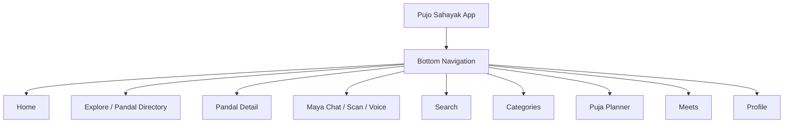
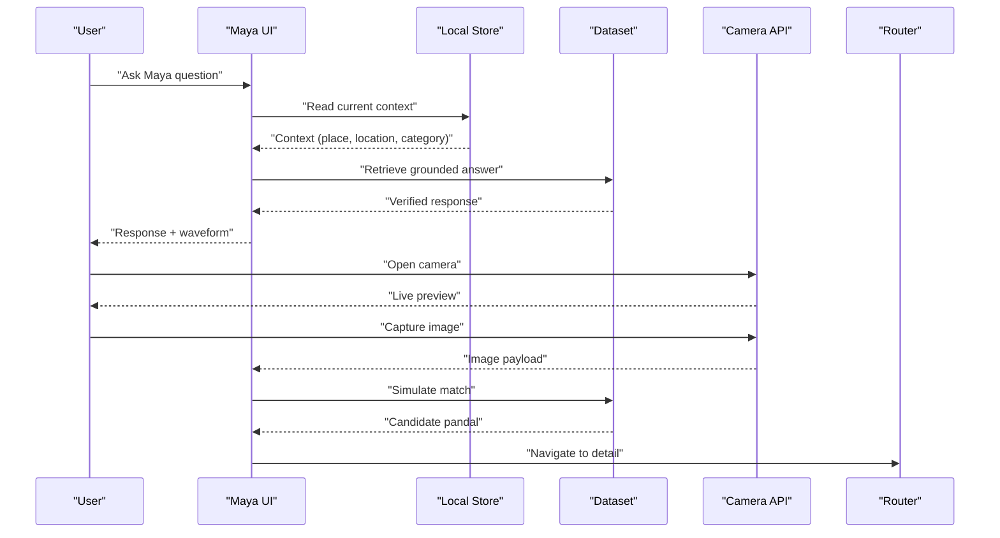
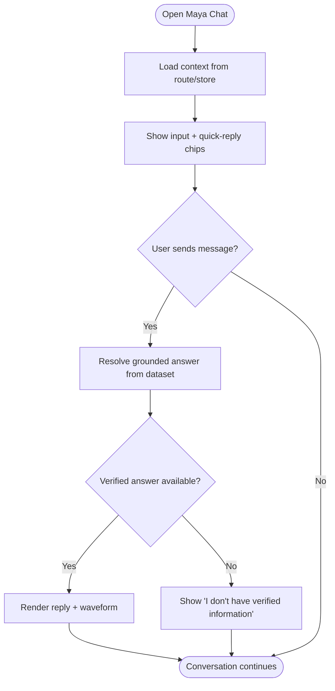
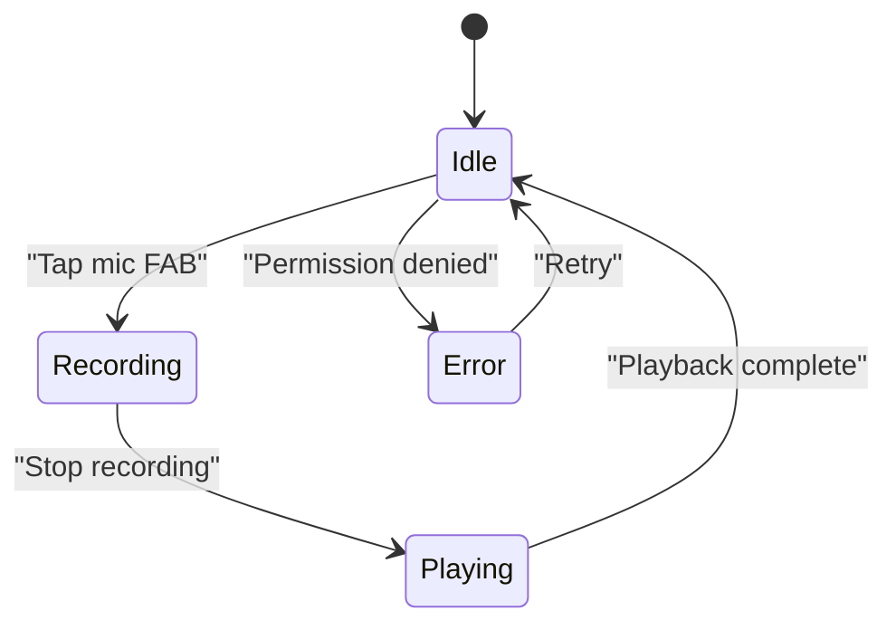
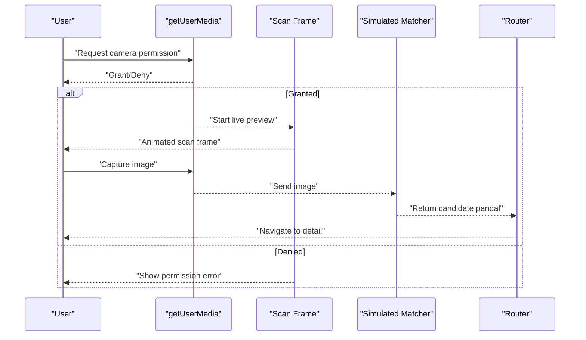
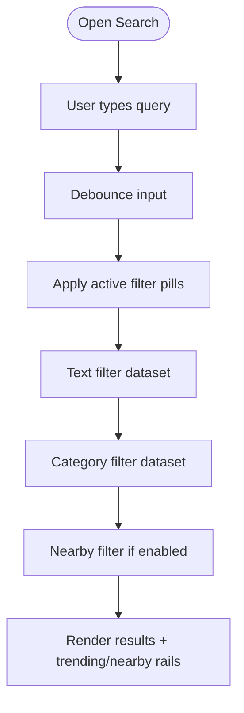
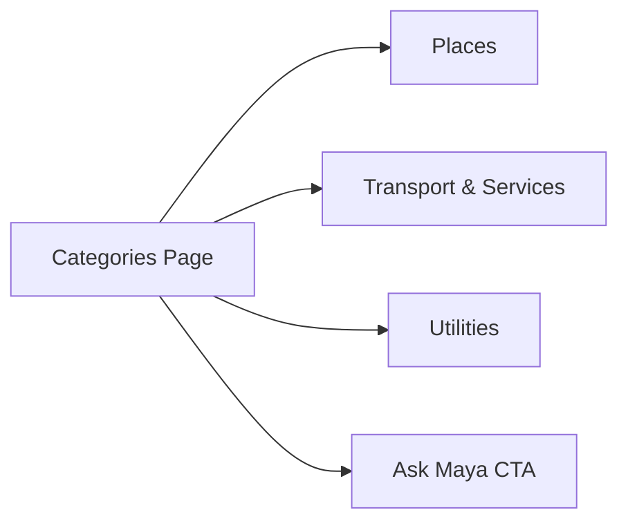
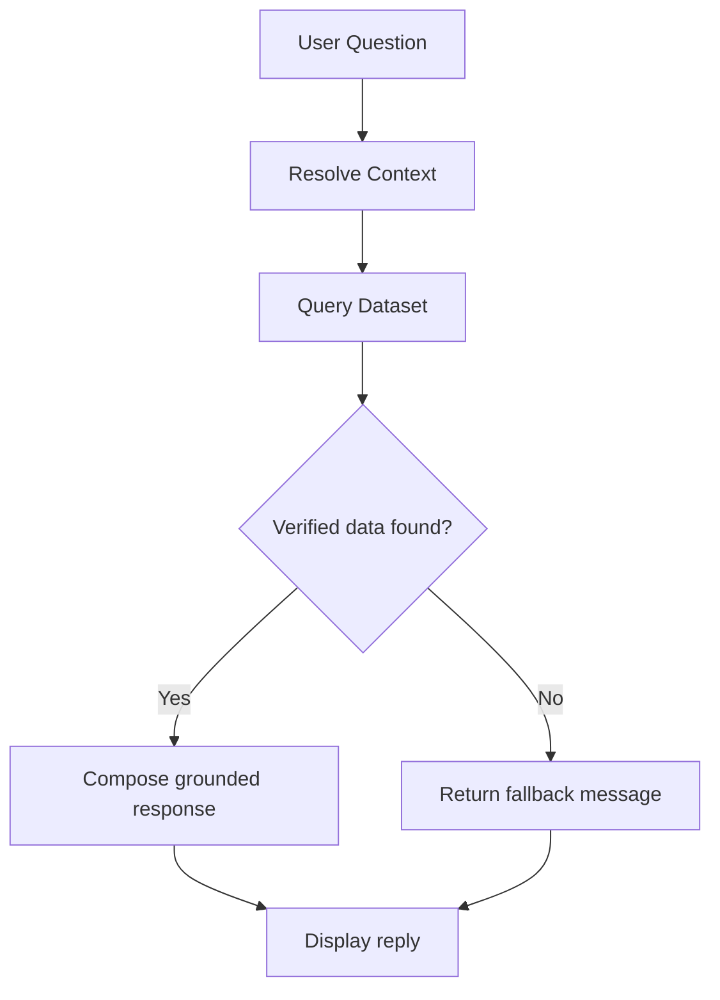
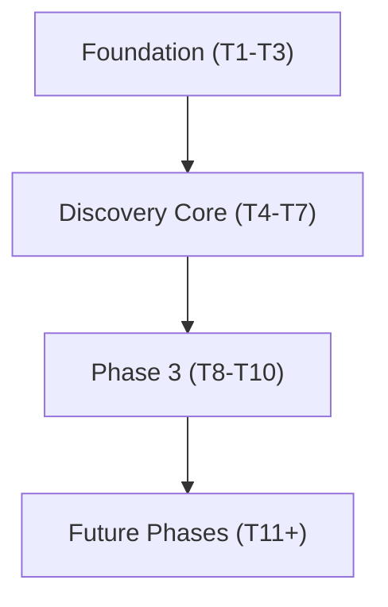

# Phase 3: Maya AI Assistant & Search

<cite>
**Referenced Files in This Document**   
- [Pujo_Sahayak_Master_Project_Context.md](file://Pujo_Sahayak_Master_Project_Context.md)
- [plan.md](file://tasks/plan.md)
- [todo.md](file://tasks/todo.md)
</cite>

## Table of Contents
1. [Introduction](#introduction)
2. [Project Structure](#project-structure)
3. [Core Components](#core-components)
4. [Architecture Overview](#architecture-overview)
5. [Detailed Component Analysis](#detailed-component-analysis)
6. [Dependency Analysis](#dependency-analysis)
7. [Performance Considerations](#performance-considerations)
8. [Troubleshooting Guide](#troubleshooting-guide)
9. [Conclusion](#conclusion)

## Introduction
This document covers Phase 3 of the Pujo Sahayak project, focusing on the Maya AI Assistant and Search functionality. It explains how Maya should behave as a dataset-grounded assistant rather than a generic chatbot, how voice waveform UI and audio processing fit into the experience, how the camera scan feature uses `getUserMedia` with an animated scan frame, and how the Search interface and Categories system are structured. It also documents the local AI simulation architecture that retrieves answers from the dataset instead of generating fake responses, along with implementation guidance for camera permissions, audio recording, real-time search filtering, category-based navigation, and performance optimization for media handling and search responsiveness.

The scope is intentionally grounded in the product context: Maya helps users understand what they see, plan their visit, and navigate Kolkata’s local ecosystem without hallucinating facts.

**Section sources**
- [Pujo_Sahayak_Master_Project_Context.md:10-18](file://Pujo_Sahayak_Master_Project_Context.md#L10-L18)
- [Pujo_Sahayak_Master_Project_Context.md:558-576](file://Pujo_Sahayak_Master_Project_Context.md#L558-L576)
- [Pujo_Sahayak_Master_Project_Context.md:1330-1358](file://Pujo_Sahayak_Master_Project_Context.md#L1330-L1358)

## Project Structure
Phase 3 sits inside the broader Pujo Sahayak roadmap. The implementation plan identifies Phase 3 tasks as building:
- Maya chat shell with dataset-grounded responses and voice waveform UI
- Maya camera scan using `getUserMedia` with an animated scan frame
- Search page with trending searches, nearby location filtering, and filter pill interactions
- Categories page covering Places, Transport & Services, and Utilities

**Diagram sources**
- [plan.md:19-39](file://tasks/plan.md#L19-L39)

**Section sources**
- [plan.md:41-53](file://tasks/plan.md#L41-L53)
- [todo.md:34-43](file://tasks/todo.md#L34-L43)

## Core Components
Phase 3 introduces several core components:

- **Maya Chat Shell**: A conversational interface where user messages appear in Bengali-style bubbles and Maya replies include inline audio playback controls and a waveform visualization. Quick-reply chips such as “Nearest Metro?”, “Medical Camp?”, and “More about the artist?” guide users toward grounded questions.
- **Voice Input Mode**: A floating action button toggles voice input; when active, the waveform animates while capturing audio.
- **Camera Scan Overlay**: A live camera preview powered by `getUserMedia`, with an animated scan frame overlay guiding the user to point the camera at a pandal. Gallery and flash controls are included. Capture triggers a simulated match against the dataset and navigates to the corresponding detail page.
- **Search Interface**: Includes filter pills (All/Pandals/Restaurants/Events), a live dataset filter, a Trending Pandals rail, and a Popular Nearby Places rail.
- **Categories System**: Organized into Places (Pandals, Restaurants, Places), Transport & Services (Metro, Bus, Parking), and Utilities (Police Station, Hospital, ATM, Pharmacy). A purple “Ask Maya” call-to-action is present.
- **Local AI Simulation**: Answers are retrieved from the local dataset based on context (current pandal, selected place, location, category). If no verified information exists, Maya returns a clear fallback message instead of inventing facts.

These components align with the product’s principle that Maya must not hallucinate pandal facts and should always ground its knowledge in application data.

**Section sources**
- [todo.md:34-43](file://tasks/todo.md#L34-L43)
- [Pujo_Sahayak_Master_Project_Context.md:558-576](file://Pujo_Sahayak_Master_Project_Context.md#L558-L576)
- [Pujo_Sahayak_Master_Project_Context.md:578-606](file://Pujo_Sahayak_Master_Project_Context.md#L578-L606)
- [Pujo_Sahayak_Master_Project_Context.md:608-641](file://Pujo_Sahayak_Master_Project_Context.md#L608-L641)
- [Pujo_Sahayak_Master_Project_Context.md:1330-1358](file://Pujo_Sahayak_Master_Project_Context.md#L1330-L1358)

## Architecture Overview
The Phase 3 architecture centers around three main flows:

1. **Chat Flow**: User asks a question → Maya resolves context → Maya retrieves dataset-grounded answer → Response rendered with optional audio waveform.
2. **Scan Flow**: Camera permission requested → Live preview shown → Animated scan frame guides capture → Simulated matching against dataset → Result card or navigation to detail page.
3. **Search Flow**: User types query → Filter pills refine results → Dataset filtered in real time → Trending and nearby rails render relevant items.

**Diagram sources**
- [todo.md:36-40](file://tasks/todo.md#L36-L40)
- [Pujo_Sahayak_Master_Project_Context.md:608-641](file://Pujo_Sahayak_Master_Project_Context.md#L608-L641)
- [Pujo_Sahayak_Master_Project_Context.md:1330-1358](file://Pujo_Sahayak_Master_Project_Context.md#L1330-L1358)

## Detailed Component Analysis

### Maya Chat Shell
The Maya chat shell provides a mobile-first conversation surface. Key behaviors:
- Header shows avatar and online status.
- Message thread displays Bengali user bubbles and Maya replies.
- Inline audio player row accompanies Maya responses.
- Quick-reply chips help users ask grounded questions.
- Context awareness pulls from route state (e.g., current pandal).
- Grounded retrieval ensures answers come from the dataset.
- Fallback message is used when verified information is unavailable.

**Diagram sources**
- [todo.md:36-38](file://tasks/todo.md#L36-L38)
- [Pujo_Sahayak_Master_Project_Context.md:1330-1358](file://Pujo_Sahayak_Master_Project_Context.md#L1330-L1358)

**Section sources**
- [todo.md:36-38](file://tasks/todo.md#L36-L38)
- [Pujo_Sahayak_Master_Project_Context.md:578-606](file://Pujo_Sahayak_Master_Project_Context.md#L578-L606)
- [Pujo_Sahayak_Master_Project_Context.md:1330-1358](file://Pujo_Sahayak_Master_Project_Context.md#L1330-L1358)

### Voice Waveform UI and Audio Processing
Voice input mode is toggled via a floating action button. When active:
- The waveform component animates to reflect audio activity.
- Audio recording captures microphone input.
- The waveform honors reduced-motion preferences.
- After recording, the audio can be played back inline within the chat response.

Implementation considerations:
- Use Web Audio API or MediaRecorder for capture.
- Debounce waveform updates to avoid jank.
- Respect browser permissions and privacy prompts.
- Provide clear visual feedback for recording state.

**Diagram sources**
- [todo.md:36-38](file://tasks/todo.md#L36-L38)
- [Pujo_Sahayak_Master_Project_Context.md:1509-1533](file://Pujo_Sahayak_Master_Project_Context.md#L1509-L1533)

**Section sources**
- [todo.md:36-38](file://tasks/todo.md#L36-L38)
- [Pujo_Sahayak_Master_Project_Context.md:1509-1533](file://Pujo_Sahayak_Master_Project_Context.md#L1509-L1533)

### Maya Camera Scan Feature
The camera scan feature uses `getUserMedia` to show a live preview with an animated scan frame overlay. Controls include gallery access and flash toggle. Capture triggers a simulated match against the dataset and navigates to the corresponding detail page.

Key steps:
- Request camera permission.
- Start video stream.
- Render animated scan frame.
- Capture image.
- Simulate matching against dataset.
- Navigate to result.

**Diagram sources**
- [todo.md:39-40](file://tasks/todo.md#L39-L40)
- [Pujo_Sahayak_Master_Project_Context.md:608-641](file://Pujo_Sahayak_Master_Project_Context.md#L608-L641)

**Section sources**
- [todo.md:39-40](file://tasks/todo.md#L39-L40)
- [Pujo_Sahayak_Master_Project_Context.md:608-641](file://Pujo_Sahayak_Master_Project_Context.md#L608-L641)

### Search Interface Development
The Search interface includes:
- Filter pills: All, Pandals, Restaurants, Events.
- Real-time dataset filtering as the user types.
- Trending Pandals rail.
- Popular Nearby Places rail using location context.

Implementation details:
- Debounce input to optimize performance.
- Maintain active pill state.
- Combine text search with category filters.
- Use location to compute nearby results.

**Diagram sources**
- [todo.md:42-43](file://tasks/todo.md#L42-L43)
- [Pujo_Sahayak_Master_Project_Context.md:447-493](file://Pujo_Sahayak_Master_Project_Context.md#L447-L493)

**Section sources**
- [todo.md:42-43](file://tasks/todo.md#L42-L43)
- [Pujo_Sahayak_Master_Project_Context.md:447-493](file://Pujo_Sahayak_Master_Project_Context.md#L447-L493)

### Categories System Implementation
The Categories system organizes discovery into three groups:
- Places: Pandals, Restaurants, Places.
- Transport & Services: Metro, Bus, Parking.
- Utilities: Police Station, Hospital, ATM, Pharmacy.

A purple “Ask Maya” CTA is present to encourage contextual assistance.

Navigation behavior:
- Each category tile navigates to a filtered view.
- Filters combine category metadata with dataset entries.
- Accessibility labels and icons improve discoverability.

**Diagram sources**
- [todo.md:42-43](file://tasks/todo.md#L42-L43)
- [Pujo_Sahayak_Master_Project_Context.md:495-556](file://Pujo_Sahayak_Master_Project_Context.md#L495-L556)

**Section sources**
- [todo.md:42-43](file://tasks/todo.md#L42-L43)
- [Pujo_Sahayak_Master_Project_Context.md:495-556](file://Pujo_Sahayak_Master_Project_Context.md#L495-L556)

### Local AI Simulation Architecture
Maya’s local AI simulation avoids hallucination by retrieving answers from the dataset rather than generating fake responses. The flow:
- Parse user question.
- Resolve context (current place, location, category).
- Query dataset for verified facts.
- Compose natural-language response.
- If no verified information exists, return a clear fallback message.

**Diagram sources**
- [Pujo_Sahayak_Master_Project_Context.md:1330-1358](file://Pujo_Sahayak_Master_Project_Context.md#L1330-L1358)
- [plan.md:15-17](file://tasks/plan.md#L15-L17)

**Section sources**
- [Pujo_Sahayak_Master_Project_Context.md:1330-1358](file://Pujo_Sahayak_Master_Project_Context.md#L1330-L1358)
- [plan.md:15-17](file://tasks/plan.md#L15-L17)

## Dependency Analysis
Phase 3 depends on foundational elements established in earlier phases:
- Data model and dataset (typed Place/Pandal/Restaurant/Event/Meetup/Review/Photo/Plan/Offer/SafetyPoint/Category).
- Shared components (Button, Chip, Card, SectionHeader, BottomNav, AppShell, Waveform, ScanFrame).
- Routing structure (Maya routes `/maya`, `/maya/scan`; Search `/search`; Categories `/categories`).
- Motion system (Framer Motion) for waveform and scan frame animations.

**Diagram sources**
- [plan.md:41-53](file://tasks/plan.md#L41-L53)

**Section sources**
- [plan.md:41-53](file://tasks/plan.md#L41-L53)
- [todo.md:5-14](file://tasks/todo.md#L5-L14)

## Performance Considerations
To ensure smooth UX during Phase 3:
- **Media Handling**:
  - Throttle camera stream resolution for mobile devices.
  - Reuse video elements and avoid recreating streams unnecessarily.
  - Release camera resources when leaving the scan screen.
- **Audio Processing**:
  - Use requestAnimationFrame sparingly for waveform updates.
  - Avoid heavy processing on the main thread; offload to Web Workers if needed.
  - Respect reduced-motion settings.
- **Search Responsiveness**:
  - Debounce input events (e.g., 150–300ms).
  - Precompute nearby results based on cached location.
  - Limit initial render size and paginate or virtualize long lists.
- **Dataset Queries**:
  - Index frequently filtered fields (category, area, name).
  - Cache recent queries to avoid recomputation.
- **Motion**:
  - Keep animations subtle and hardware-accelerated.
  - Disable complex effects on low-power devices.

[No sources needed since this section provides general guidance]

## Troubleshooting Guide
Common issues and resolutions:
- **Camera Permission Denied**:
  - Check browser/device permissions.
  - Provide clear instructions to enable camera access.
  - Fallback to gallery selection if camera is unavailable.
- **Audio Recording Failures**:
  - Verify microphone permission.
  - Handle unsupported codecs gracefully.
  - Provide user feedback for recording errors.
- **Search Returns No Results**:
  - Validate filter pill state.
  - Clear partial queries and retry.
  - Suggest trending or nearby alternatives.
- **Maya Fallback Responses**:
  - Ensure dataset contains verified information for common questions.
  - Log missing data points for future dataset expansion.
  - Communicate clearly to users that information is not yet verified.

**Section sources**
- [todo.md:36-43](file://tasks/todo.md#L36-L43)
- [Pujo_Sahayak_Master_Project_Context.md:1330-1358](file://Pujo_Sahayak_Master_Project_Context.md#L1330-L1358)

## Conclusion
Phase 3 delivers a cohesive Maya AI Assistant and Search experience grounded in the Pujo Sahayak dataset. Maya avoids hallucination by retrieving verified facts, while the camera scan and voice waveform provide rich, interactive interfaces. The Search and Categories systems offer intuitive navigation and real-time filtering. With careful attention to performance, permissions, and accessibility, Phase 3 establishes a strong foundation for the broader platform’s discovery and planning capabilities.

[No sources needed since this section summarizes without analyzing specific files]