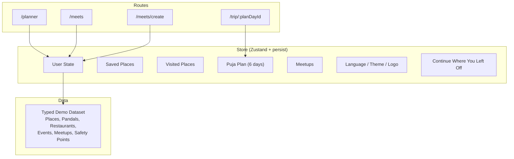
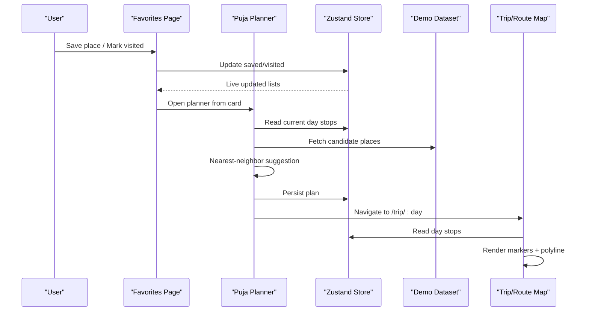
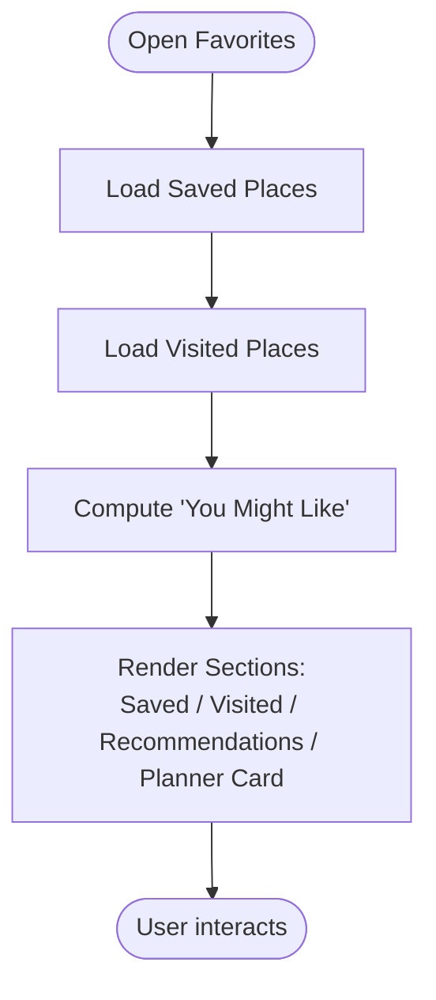
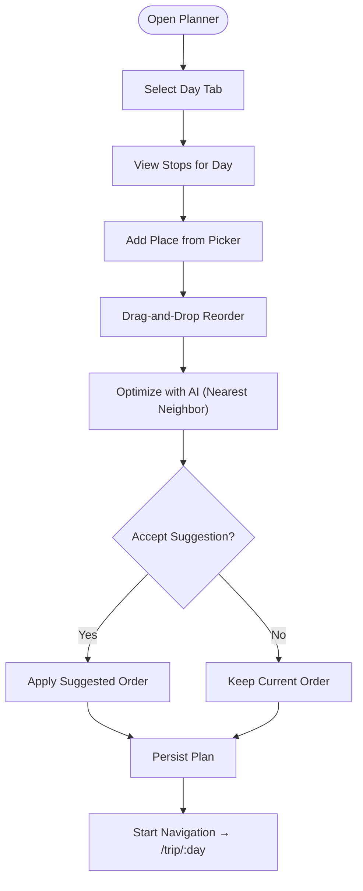
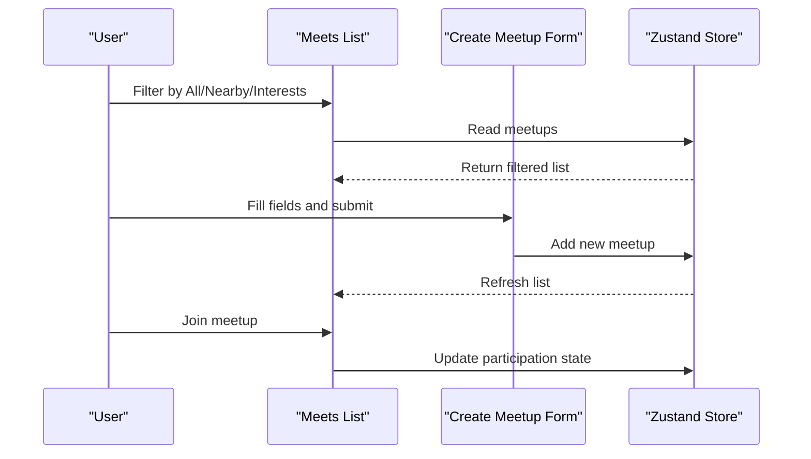
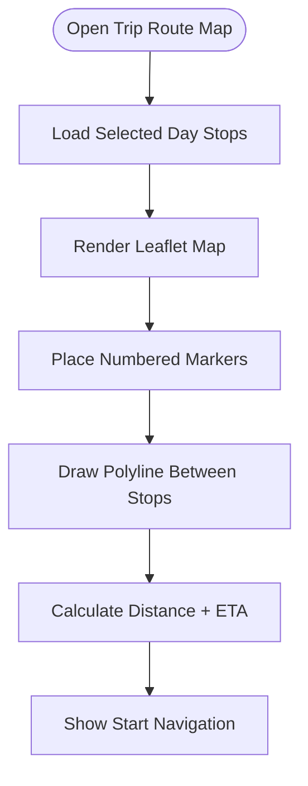
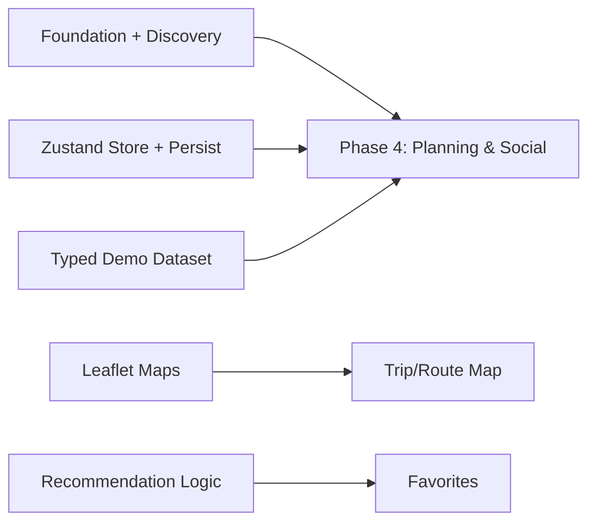
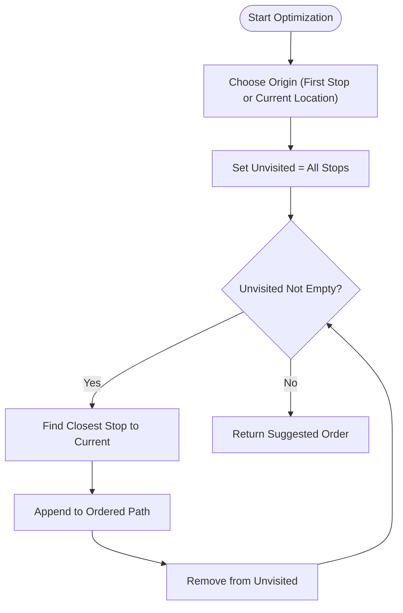

# Phase 4: Planning & Social Features

<cite>
**Referenced Files in This Document**   
- [plan.md](file://tasks/plan.md)
- [todo.md](file://tasks/todo.md)
- [Pujo_Sahayak_Master_Project_Context.md](file://Pujo_Sahayak_Master_Project_Context.md)
</cite>

## Table of Contents
1. [Introduction](#introduction)
2. [Project Structure](#project-structure)
3. [Core Components](#core-components)
4. [Architecture Overview](#architecture-overview)
5. [Detailed Component Analysis](#detailed-component-analysis)
6. [Dependency Analysis](#dependency-analysis)
7. [Performance Considerations](#performance-considerations)
8. [Troubleshooting Guide](#troubleshooting-guide)
9. [Conclusion](#conclusion)
10. [Appendices](#appendices)

## Introduction
This document defines the implementation plan for Phase 4: Planning and Social Features. It focuses on three main areas:
- Favorites system with saved places, visited locations tracking, and “You Might Like” recommendations.
- Puja Planner with day tabs, stop management, place addition, and AI-assisted route optimization using nearest-neighbor logic.
- Meets list and Create Meetup form for social event discovery and coordination.

It also covers state management for multi-day planning, location coordination, user preferences, algorithmic approaches to route optimization and distance calculations, example workflows for drag-and-drop reordering, calendar integration, social event coordination, and data persistence for plans and meetup information.

The scope is grounded in the project’s documented routes, store model, and feature descriptions.

**Section sources**
- [plan.md:1-18](file://tasks/plan.md#L1-L18)
- [plan.md:19-40](file://tasks/plan.md#L19-L40)
- [todo.md:45-55](file://tasks/todo.md#L45-L55)
- [Pujo_Sahayak_Master_Project_Context.md:320-350](file://Pujo_Sahayak_Master_Project_Context.md#L320-L350)
- [Pujo_Sahayak_Master_Project_Context.md:353-421](file://Pujo_Sahayak_Master_Project_Context.md#L353-L421)
- [Pujo_Sahayak_Master_Project_Context.md:664-771](file://Pujo_Sahayak_Master_Project_Context.md#L664-L771)

## Project Structure
Phase 4 spans multiple screens and shared state:
- Routes: `/planner`, `/meets`, `/meets/create`, `/trip/:planDayId`.
- Store: Zustand-based client store with persisted slices for saved places, visited places, puja plan (six day slots), meetups, language, theme, logo choice, and session continuity.
- Data: Typed local demo dataset including pandals, restaurants, events, meetups, offers, safety points, categories, and geographic coordinates.

**Diagram sources**
- [plan.md:19-40](file://tasks/plan.md#L19-L40)
- [plan.md:7-17](file://tasks/plan.md#L7-L17)
- [todo.md:45-55](file://tasks/todo.md#L45-L55)

**Section sources**
- [plan.md:7-17](file://tasks/plan.md#L7-L17)
- [plan.md:19-40](file://tasks/plan.md#L19-L40)
- [todo.md:45-55](file://tasks/todo.md#L45-L55)

## Core Components
Phase 4 introduces or extends these core components:
- Favorites Page: Saved Pandals, Places You’ve Been, You Might Like, and a Puja Planner entry card.
- Puja Planner: Day tabs from Panchami through Dashami; stop cards with image, type, duration, travel-between rows; Add Place picker; Optimize with AI suggestion; Start Navigation to trip route.
- Meets List: All/Nearby/My Interests filters; meetup cards with image, name, date/time, location/distance, attendee avatars/count, Join action.
- Create Meetup Form: Title, date, time, location, description, interest chips, max participants, public/restricted visibility; adds to local list.
- Trip/Route Map: Leaflet map with numbered markers, polyline, total distance, estimated time, Start Navigation.

These components share:
- A typed data model (Place/Pandal/Restaurant/Event/Meetup/Review/Photo/Plan/Offer/SafetyPoint).
- A single Zustand store with persistence to localStorage.
- Location-aware features using lat-lng coordinates.

**Section sources**
- [todo.md:45-55](file://tasks/todo.md#L45-L55)
- [todo.md:63-64](file://tasks/todo.md#L63-L64)
- [Pujo_Sahayak_Master_Project_Context.md:320-350](file://Pujo_Sahayak_Master_Project_Context.md#L320-L350)
- [Pujo_Sahayak_Master_Project_Context.md:353-421](file://Pujo_Sahayak_Master_Project_Context.md#L353-L421)
- [Pujo_Sahayak_Master_Project_Context.md:664-771](file://Pujo_Sahayak_Master_Project_Context.md#L664-L771)

## Architecture Overview
Phase 4 integrates UI screens with a centralized store and dataset. The flow emphasizes:
- User actions on Favorites and Planner update the store.
- Recommendations derive from saved/visited data and place metadata.
- Route optimization suggests a reordered itinerary without claiming guaranteed optimality.
- Social features (Meets) are stored locally and surfaced across the app.

**Diagram sources**
- [plan.md:19-40](file://tasks/plan.md#L19-L40)
- [todo.md:45-55](file://tasks/todo.md#L45-L55)
- [todo.md:63-64](file://tasks/todo.md#L63-L64)

## Detailed Component Analysis

### Favorites System
The Favorites page consolidates:
- Saved Pandals: explicitly saved by the user.
- Places You’ve Been: previously visited places across types (pandals, restaurants, events, other places).
- You Might Like: recommendations based on saved/visited places, area/theme similarity, location, categories, preferences, and potential AI assistance. Wording should be cautious (“You might like”).
- Puja Planner entry card: quick access to start or continue planning.

Implementation considerations:
- Use store slices for saved and visited IDs.
- Compute “You Might Like” by matching area/theme/category and proximity to user context.
- Keep recommendation explanations understandable and non-guaranteed.

**Diagram sources**
- [Pujo_Sahayak_Master_Project_Context.md:320-350](file://Pujo_Sahayak_Master_Project_Context.md#L320-L350)
- [todo.md:45-48](file://tasks/todo.md#L45-L48)

**Section sources**
- [Pujo_Sahayak_Master_Project_Context.md:320-350](file://Pujo_Sahayak_Master_Project_Context.md#L320-L350)
- [todo.md:45-48](file://tasks/todo.md#L45-L48)

### Puja Planner
The planner supports multi-day itineraries:
- Day tabs: Panchami through Dashami.
- Stop cards: image, type, duration, travel-between rows.
- Add Place: picker from dataset/saved.
- Optimize with AI: nearest-neighbor reordering suggestion.
- Start Navigation: navigates to `/trip/:day`.

State model:
- Six day slots, each containing an ordered list of stops.
- Each stop references a place ID and optional timing.
- Persistence via Zustand persist middleware.

Algorithmic approach:
- Nearest-neighbor heuristic starts from a chosen origin (e.g., first stop or current location) and repeatedly selects the closest unvisited stop until all are included.
- Suggestions are labeled as suggestions, not guarantees.

**Diagram sources**
- [todo.md:50-51](file://tasks/todo.md#L50-L51)
- [Pujo_Sahayak_Master_Project_Context.md:353-421](file://Pujo_Sahayak_Master_Project_Context.md#L353-L421)

**Section sources**
- [todo.md:50-51](file://tasks/todo.md#L50-L51)
- [Pujo_Sahayak_Master_Project_Context.md:353-421](file://Pujo_Sahayak_Master_Project_Context.md#L353-L421)

### Meets List and Create Meetup
Meets list:
- Filters: All, Nearby, My Interests.
- Cards: image, name, date/time, location/distance, attendee avatars + count, Join action.
- Integration: “Meetups near this place” can appear on place detail pages.

Create Meetup form:
- Fields: title, date, time, location, description, interest chips, max participants, public/restricted.
- Behavior: adds to local list; join/update state accordingly.

Social coordination:
- Activity-based social discovery rather than dating-style profiles.
- Conceptual support for free/paid/premium-only meetups without hard-coding pricing.

**Diagram sources**
- [todo.md:53-54](file://tasks/todo.md#L53-L54)
- [Pujo_Sahayak_Master_Project_Context.md:664-771](file://Pujo_Sahayak_Master_Project_Context.md#L664-L771)

**Section sources**
- [todo.md:53-54](file://tasks/todo.md#L53-L54)
- [Pujo_Sahayak_Master_Project_Context.md:664-771](file://Pujo_Sahayak_Master_Project_Context.md#L664-L771)

### Trip/Route Map
The trip route map visualizes a selected day’s stops:
- Leaflet map with numbered markers and polyline connecting stops.
- Stop list with times.
- Total distance and estimated time using haversine distance.
- Start Navigation action.

**Diagram sources**
- [todo.md:63-64](file://tasks/todo.md#L63-L64)

**Section sources**
- [todo.md:63-64](file://tasks/todo.md#L63-L64)

## Dependency Analysis
Phase 4 depends on:
- Foundation and Discovery layers (routes, design system, dataset).
- Store layer (Zustand + persist) for saving favorites, visits, plans, meetups, and preferences.
- Maps integration (Leaflet) for route visualization.
- Recommendation logic derived from saved/visited data and place metadata.

**Diagram sources**
- [plan.md:7-17](file://tasks/plan.md#L7-L17)
- [plan.md:19-40](file://tasks/plan.md#L19-L40)
- [todo.md:45-55](file://tasks/todo.md#L45-L55)

**Section sources**
- [plan.md:7-17](file://tasks/plan.md#L7-L17)
- [plan.md:19-40](file://tasks/plan.md#L19-L40)
- [todo.md:45-55](file://tasks/todo.md#L45-L55)

## Performance Considerations
- Recommendation computation should be efficient: precompute similarity scores where possible and cache results per user session.
- Nearest-neighbor optimization runs on small arrays (typical daily stops); keep it O(n^2) but bounded by daily stop count.
- Map rendering: batch marker updates and avoid unnecessary re-renders when stops change.
- Store updates: use fine-grained selectors to minimize re-renders across components.

[No sources needed since this section provides general guidance]

## Troubleshooting Guide
Common issues and resolutions:
- Favorites not updating live: ensure store subscriptions are correct and that save/visit actions dispatch updates to both saved and visited slices.
- Planner order not persisting: verify Zustand persist middleware configuration and that the plan slice schema matches the serialized format.
- Recommendations stale: refresh “You Might Like” when saved/visited state changes; clear cached recomputations if dataset changes.
- Meetup creation not reflected: confirm create action updates the meetups slice and triggers a list refresh.
- Route map distances incorrect: validate coordinate parsing and haversine calculation inputs; ensure markers are placed at correct lat-lng.

**Section sources**
- [todo.md:45-55](file://tasks/todo.md#L45-L55)
- [todo.md:63-64](file://tasks/todo.md#L63-L64)

## Conclusion
Phase 4 delivers a cohesive planning and social experience:
- Favorites provide personal curation and intelligent recommendations.
- Puja Planner enables structured multi-day itineraries with AI-assisted suggestions.
- Meets fosters community engagement around shared interests and activities.
- Trip/Route Map ties planning to real-world navigation with accurate distance and time estimates.

The architecture leverages a typed dataset, a persistent Zustand store, and Leaflet maps to deliver a mobile-first, reliable experience aligned with the product philosophy.

[No sources needed since this section summarizes without analyzing specific files]

## Appendices

### Algorithmic Approach to Route Optimization
- Nearest-Neighbor Heuristic:
  - Input: ordered stops for a day, optionally starting from the first stop or current location.
  - Process: repeatedly select the closest unvisited stop until all stops are included.
  - Output: suggested order labeled as a suggestion, not a guarantee.
- Distance Calculation:
  - Haversine formula between lat-lng pairs to compute distances for metrics and optimization.

**Diagram sources**
- [todo.md:50-51](file://tasks/todo.md#L50-L51)
- [todo.md:63-64](file://tasks/todo.md#L63-L64)

### Implementation Examples

#### Drag-and-Drop Stop Reordering
- Provide a draggable list of stops per day.
- On reorder, update the store’s plan slice for the active day.
- Debounce persistence to avoid excessive writes.

[No sources needed since this section provides general guidance]

#### Calendar Integration
- Allow users to export or import plan days into device calendars.
- Map day tabs and stop timings to calendar events.
- Handle timezone and daylight saving considerations.

[No sources needed since this section provides general guidance]

#### Social Event Coordination
- Enable joining meetups and updating participation state.
- Surface nearby meetups on place detail pages.
- Support filtering by interests and proximity.

**Section sources**
- [todo.md:53-54](file://tasks/todo.md#L53-L54)
- [Pujo_Sahayak_Master_Project_Context.md:935-950](file://Pujo_Sahayak_Master_Project_Context.md#L935-L950)

### Data Persistence for Plans and Meetups
- Plan persistence:
  - Store six day slots with ordered stops and optional timings.
  - Persist to localStorage via Zustand persist middleware.
  - Validate schema on load to handle migrations.
- Meetup persistence:
  - Store meetup records locally with fields: title, date, time, location, description, interests, max participants, visibility.
  - Track user participation status per meetup.

**Section sources**
- [plan.md:7-17](file://tasks/plan.md#L7-L17)
- [todo.md:50-54](file://tasks/todo.md#L50-L54)