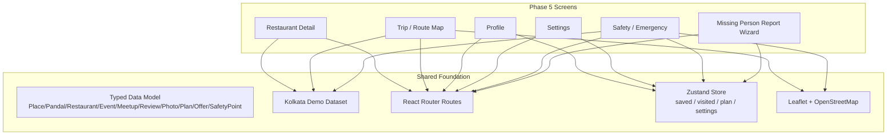
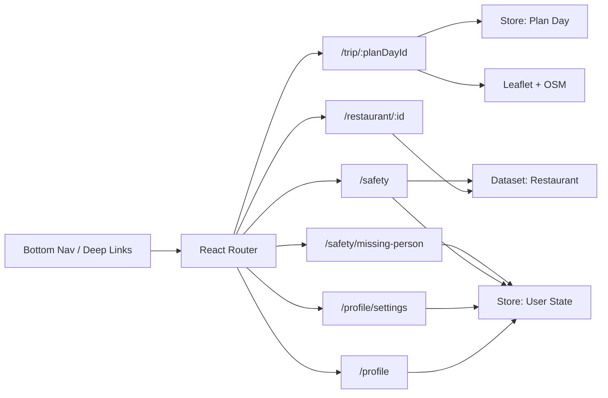
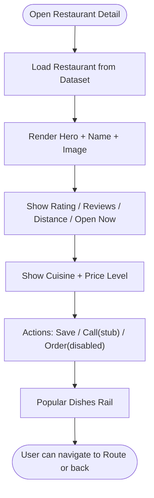
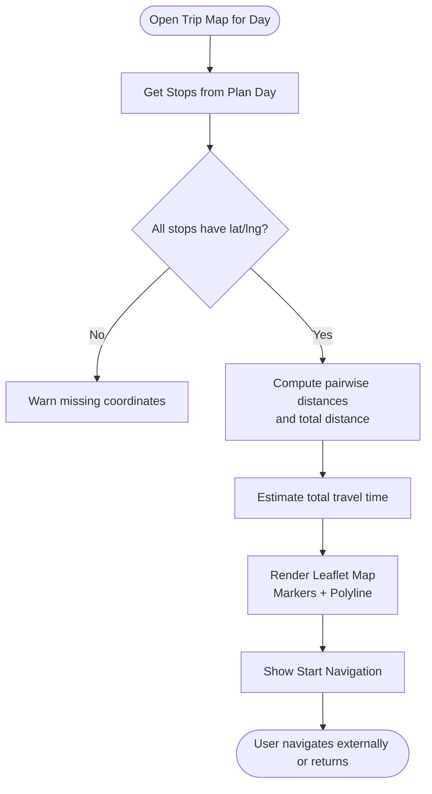
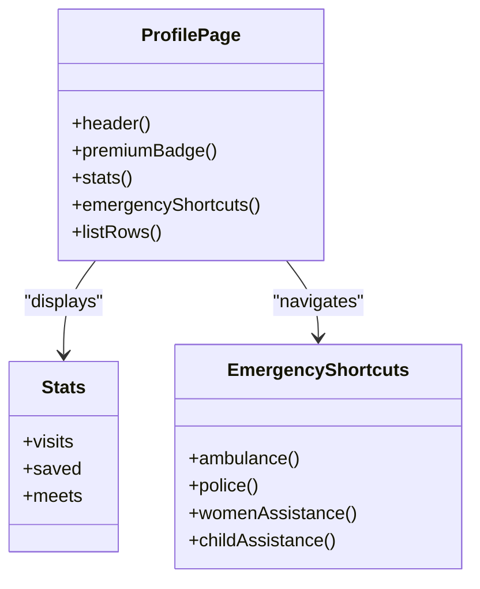
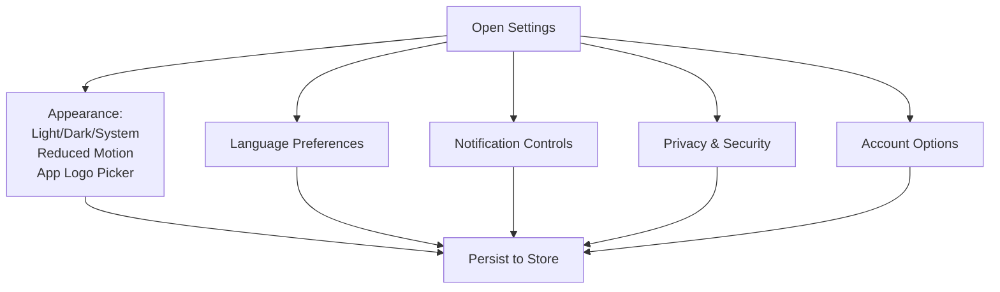
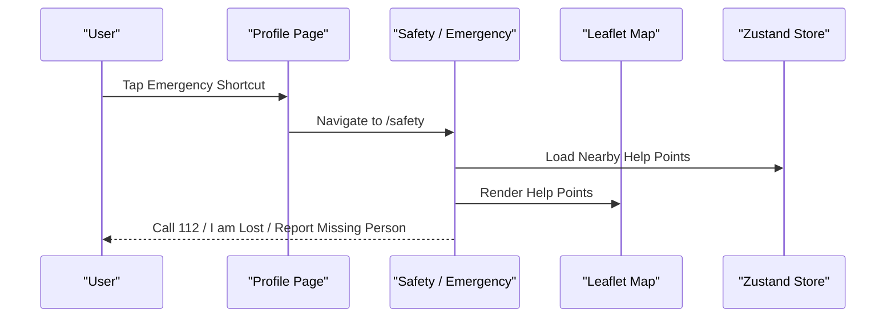
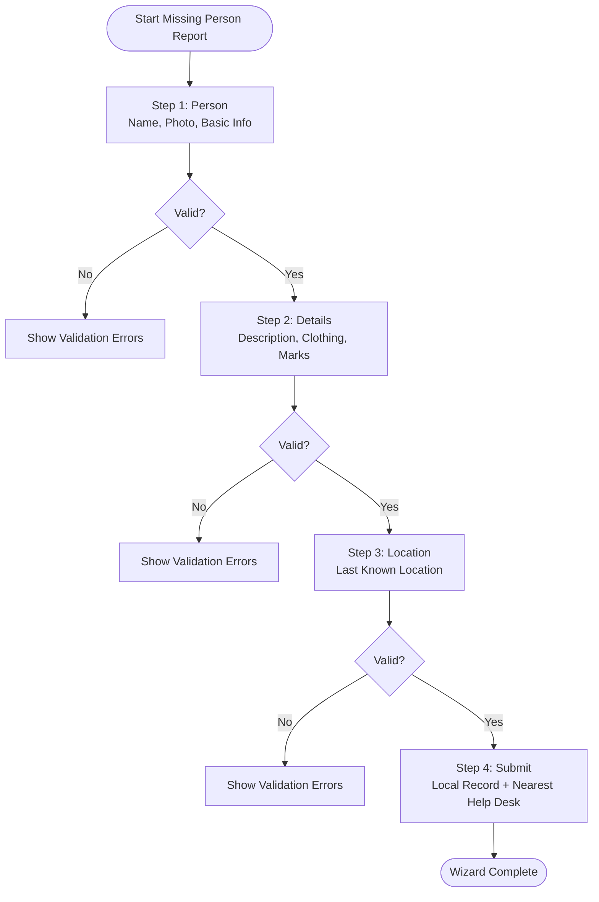
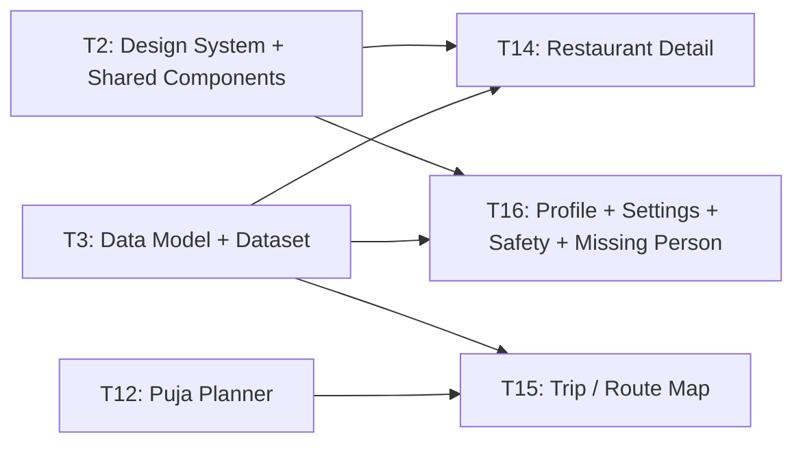

# Phase 5: Utility & Account Management

<cite>
**Referenced Files in This Document**
- [Pujo_Sahayak_Master_Project_Context.md](file://Pujo_Sahayak_Master_Project_Context.md)
- [plan.md](file://tasks/plan.md)
- [todo.md](file://tasks/todo.md)
</cite>

## Table of Contents
1. [Introduction](#introduction)
2. [Project Structure](#project-structure)
3. [Core Components](#core-components)
4. [Architecture Overview](#architecture-overview)
5. [Detailed Component Analysis](#detailed-component-analysis)
6. [Dependency Analysis](#dependency-analysis)
7. [Performance Considerations](#performance-considerations)
8. [Troubleshooting Guide](#troubleshooting-guide)
9. [Conclusion](#conclusion)

## Introduction
This document covers Phase 5 of the Pujo Sahayak project, focusing on utility and account management features. It explains how the application should implement:
- Restaurant Detail pages with cuisine, pricing, hours, popular dishes, and location context.
- Trip and Route Map functionality using Leaflet and OpenStreetMap for multi-stop navigation and distance calculation.
- Profile development including statistics, premium indicators, personal information, and emergency shortcuts.
- Settings interface covering appearance customization, language preferences, notification controls, and privacy settings.
- Safety and Emergency features such as quick emergency contacts, nearby help points, and assistance services.
- Missing Person Report wizard with a four-step flow, map integration, form validation, and local record handling.

The goal is to provide clear implementation guidance that aligns with the product’s mobile-first, discovery-driven design while keeping safety, clarity, and performance central.

## Project Structure
Phase 5 sits after the discovery, Maya, search/categories, planning, and social screens. The implementation plan defines Phase 5 tasks as:
- Restaurant Detail
- Trip / Route Map
- Profile + Settings + Safety + Missing Person wizard

These are part of a React + Vite PWA with TypeScript, Tailwind CSS v4, React Router, Zustand, Framer Motion, and Leaflet + OpenStreetMap.

**Diagram sources**
- [plan.md:1-18](file://tasks/plan.md#L1-L18)
- [plan.md:19-39](file://tasks/plan.md#L19-L39)
- [todo.md:58-67](file://tasks/todo.md#L58-L67)

**Section sources**
- [plan.md:1-18](file://tasks/plan.md#L1-L18)
- [plan.md:19-39](file://tasks/plan.md#L19-L39)
- [todo.md:58-67](file://tasks/todo.md#L58-L67)

## Core Components
Phase 5 introduces several user-facing components and flows:

- **Restaurant Detail**: Displays hero image, rating/reviews/distance, open status, cuisine and price level, save/call/order actions, and a Popular Dishes rail.
- **Trip / Route Map**: Renders a Leaflet map with numbered markers for each stop, polylines connecting stops, total distance and estimated time, and a Start Navigation action.
- **Profile**: Shows profile header, premium badge, visit/saved/meet stats, upgrade banner, emergency shortcuts, and list entries for visits, payments, donations, appearance, and settings.
- **Settings**: Provides appearance customization (light/dark/system default, reduced motion), app logo picker, language selection, notifications, privacy, security, permissions, and account options.
- **Safety / Emergency**: Red-gradient emergency screen with Call 112, nearby help points from dataset, and quick links to I am lost and Report Missing Person.
- **Missing Person Report Wizard**: Four-step flow: Person → Details → Location → Submit; stores a local report and guides users to nearest help desk without exposing sensitive data publicly.

**Section sources**
- [todo.md:58-67](file://tasks/todo.md#L58-L67)
- [Pujo_Sahayak_Master_Project_Context.md:954-1011](file://Pujo_Sahayak_Master_Project_Context.md#L954-L1011)
- [Pujo_Sahayak_Master_Project_Context.md:1055-1090](file://Pujo_Sahayak_Master_Project_Context.md#L1055-L1090)
- [Pujo_Sahayak_Master_Project_Context.md:1390-1439](file://Pujo_Sahayak_Master_Project_Context.md#L1390-L1439)

## Architecture Overview
Phase 5 integrates with existing routes, store, and dataset:

- Routes: `/restaurant/:id`, `/trip/:planDayId`, `/profile`, `/profile/settings`, `/safety`, `/safety/missing-person`.
- Store: Zustand persists saved places, visited places, puja plan, language, theme, app-logo choice, and session state.
- Dataset: Typed demo data includes restaurants, safety points, pandals, events, meetups, offers, and place metadata.
- Maps: Leaflet renders route maps and nearby help points using OpenStreetMap tiles.

**Diagram sources**
- [plan.md:19-39](file://tasks/plan.md#L19-L39)
- [todo.md:58-67](file://tasks/todo.md#L58-L67)

**Section sources**
- [plan.md:19-39](file://tasks/plan.md#L19-L39)
- [todo.md:58-67](file://tasks/todo.md#L58-L67)

## Detailed Component Analysis

### Restaurant Detail Page
The Restaurant Detail page extends local discovery by providing actionable dining information near a pandal or event.

Key responsibilities:
- Hero section with restaurant image and basic identity.
- Rating, reviews count, distance, and open-now indicator.
- Cuisine category and price level.
- Actions: Save, Call (stub), Order (disabled “coming soon”).
- Popular Dishes rail showing representative items from the dataset.

Implementation notes:
- Use typed `Restaurant` model fields for cuisine, price, hours, and popularity.
- Keep order functionality disabled until backend support exists.
- Ensure the page is reachable from every restaurant card and related sections.

**Diagram sources**
- [todo.md:58-67](file://tasks/todo.md#L58-L67)

**Section sources**
- [todo.md:58-67](file://tasks/todo.md#L58-L67)

### Trip / Route Map Using Leaflet and OpenStreetMap
The Trip / Route Map visualizes a selected day’s itinerary as a navigable route.

Core behaviors:
- Numbered markers for each stop.
- Polylines connecting stops in order.
- Total distance and estimated time computed from coordinates.
- Start Navigation action to launch external navigation or internal guidance.

Algorithm overview:
- Compute pairwise distances between consecutive stops using haversine formula.
- Sum distances for total trip distance.
- Estimate travel time based on assumed average speed or mode of transport.
- Render Leaflet markers and polyline layers over OpenStreetMap tiles.

**Diagram sources**
- [todo.md:58-67](file://tasks/todo.md#L58-L67)

**Section sources**
- [todo.md:58-67](file://tasks/todo.md#L58-L67)

### Profile Page
The Profile page acts as the user’s control center.

Features:
- Header with profile picture, name, phone, and subscription status.
- Premium membership call-to-action.
- Statistics: visits, saved places, meets attended.
- Emergency Shortcuts row for Ambulance, Police, Women’s assistance, Child assistance.
- List rows: Visits, Payments & Subs, Donations, Appearance, Settings.

Premium indicators:
- Badge or label indicating premium status.
- Upgrade banner guiding users toward paid features.

Personal information management:
- Editable fields for name and phone where applicable.
- Clear separation between public display and private data.

**Diagram sources**
- [Pujo_Sahayak_Master_Project_Context.md:954-1011](file://Pujo_Sahayak_Master_Project_Context.md#L954-L1011)

**Section sources**
- [Pujo_Sahayak_Master_Project_Context.md:954-1011](file://Pujo_Sahayak_Master_Project_Context.md#L954-L1011)

### Settings Interface
Settings provides personalization and account controls.

Appearance customization:
- Light mode, dark mode, system default.
- Reduced motion toggle.
- App logo picker for playful personalization.

Language preferences:
- Bengali, English, Hindi toggles.
- Persist user-selected language in store.

Notification controls:
- Toggle categories of notifications.
- Respect user preferences and system-level settings.

Privacy and security:
- Privacy controls for location, photos, and meetup visibility.
- Security options such as session management.
- Permissions review for camera, location, and media access.

Account:
- Standard account entry points.
- Clear paths to edit personal information and manage subscriptions.

**Diagram sources**
- [Pujo_Sahayak_Master_Project_Context.md:1055-1090](file://Pujo_Sahayak_Master_Project_Context.md#L1055-L1090)

**Section sources**
- [Pujo_Sahayak_Master_Project_Context.md:1055-1090](file://Pujo_Sahayak_Master_Project_Context.md#L1055-L1090)

### Safety / Emergency Features
Safety prioritizes clarity and speed.

Quick access:
- Prominent Call 112 button.
- Emergency shortcuts from Profile leading to Safety Center.

Nearby help points:
- Display hospitals, pharmacies, police stations, help desks, and other utilities from the dataset.
- Optionally show on map with Leaflet markers.

Assistance services:
- “I am lost” quick action.
- “Report Missing Person” link to wizard.

Design principle:
- Avoid burying emergency functions deep in settings.
- Keep UI minimal and fast under stress.

**Diagram sources**
- [Pujo_Sahayak_Master_Project_Context.md:995-1011](file://Pujo_Sahayak_Master_Project_Context.md#L995-L1011)
- [Pujo_Sahayak_Master_Project_Context.md:1390-1439](file://Pujo_Sahayak_Master_Project_Context.md#L1390-L1439)

**Section sources**
- [Pujo_Sahayak_Master_Project_Context.md:995-1011](file://Pujo_Sahayak_Master_Project_Context.md#L995-L1011)
- [Pujo_Sahayak_Master_Project_Context.md:1390-1439](file://Pujo_Sahayak_Master_Project_Context.md#L1390-L1439)

### Missing Person Report Wizard
The Missing Person Report wizard collects essential information safely and locally.

Four-step flow:
1. Person: Basic identity and photo upload.
2. Details: Additional description, clothing, distinguishing marks.
3. Location: Last known location and nearby help desk suggestion.
4. Submit: Create local record and guide next steps.

Form validation:
- Required fields per step.
- Photo size/type checks.
- Location accuracy warnings when GPS is unavailable.

Emergency contact management:
- Suggest nearest help desk from dataset.
- Provide direct links to emergency calls.
- Do not publish sensitive details publicly.

**Diagram sources**
- [Pujo_Sahayak_Master_Project_Context.md:1413-1439](file://Pujo_Sahayak_Master_Project_Context.md#L1413-L1439)
- [todo.md:58-67](file://tasks/todo.md#L58-L67)

**Section sources**
- [Pujo_Sahayak_Master_Project_Context.md:1413-1439](file://Pujo_Sahayak_Master_Project_Context.md#L1413-L1439)
- [todo.md:58-67](file://tasks/todo.md#L58-L67)

## Dependency Analysis
Phase 5 depends on shared foundation elements and existing phases:

- Data model and dataset: Typed entities for restaurants, safety points, and plan days.
- Store: Zustand manages saved places, visited places, plan, settings, and session state.
- Routing: React Router connects bottom nav and deep links to Phase 5 screens.
- Maps: Leaflet and OpenStreetMap render route maps and nearby help points.
- Motion: Framer Motion supports subtle transitions and respects reduced-motion preference.

**Diagram sources**
- [todo.md:5-14](file://tasks/todo.md#L5-L14)
- [todo.md:50-67](file://tasks/todo.md#L50-L67)

**Section sources**
- [todo.md:5-14](file://tasks/todo.md#L5-L14)
- [todo.md:50-67](file://tasks/todo.md#L50-L67)

## Performance Considerations
- Restaurant Detail:
  - Lazy-load images and avoid heavy assets.
  - Defer non-critical actions like Order stub initialization.
- Trip / Route Map:
  - Compute distances only when needed.
  - Limit marker density; cluster nearby help points if necessary.
  - Use efficient polyline rendering and avoid unnecessary re-renders.
- Profile and Settings:
  - Persist settings minimally and avoid excessive writes.
  - Debounce input changes for large forms.
- Safety / Emergency:
  - Prioritize fast load times and immediate access to emergency actions.
  - Cache nearby help points to reduce repeated queries.
- Missing Person Report:
  - Validate inputs client-side to prevent unnecessary submissions.
  - Store reports locally unless backend integration is added later.

[No sources needed since this section provides general guidance]

## Troubleshooting Guide
Common issues and resolutions:

- Restaurant Detail not reachable:
  - Verify route `/restaurant/:id` is registered and linked from all restaurant cards.
  - Confirm dataset contains required fields for cuisine, price, hours, and popular dishes.

- Trip Map fails to render:
  - Check that plan day has valid latitude/longitude for all stops.
  - Ensure Leaflet container has proper dimensions and OpenStreetMap tiles load.
  - Validate distance/time calculations and fallback messaging for missing coordinates.

- Profile emergency shortcuts do not navigate:
  - Confirm `/safety` route exists and shortcuts trigger correct navigation.
  - Verify dataset includes safety points and help desk entries.

- Settings changes not persisting:
  - Ensure Zustand store persists theme, language, and app-logo choices.
  - Check localStorage availability and error handling for storage failures.

- Missing Person wizard validation errors:
  - Review required field logic per step.
  - Handle file upload constraints and provide clear error messages.
  - Ensure location permission prompts are handled gracefully.

**Section sources**
- [todo.md:58-67](file://tasks/todo.md#L58-L67)
- [Pujo_Sahayak_Master_Project_Context.md:1390-1439](file://Pujo_Sahayak_Master_Project_Context.md#L1390-L1439)

## Conclusion
Phase 5 completes the utility and account management layer of Pujo Sahayak by adding:
- A polished Restaurant Detail experience grounded in the dataset.
- A functional Trip / Route Map using Leaflet and OpenStreetMap with distance and time estimation.
- A comprehensive Profile with statistics, premium indicators, and emergency shortcuts.
- A robust Settings interface for appearance, language, notifications, privacy, and account controls.
- Safety and Emergency features designed for speed and clarity.
- A safe, four-step Missing Person Report wizard with local storage and help desk guidance.

These features extend the platform beyond Puja season while preserving the core identity of discovery, understanding, planning, community, and safety.

[No sources needed since this section summarizes without analyzing specific files]