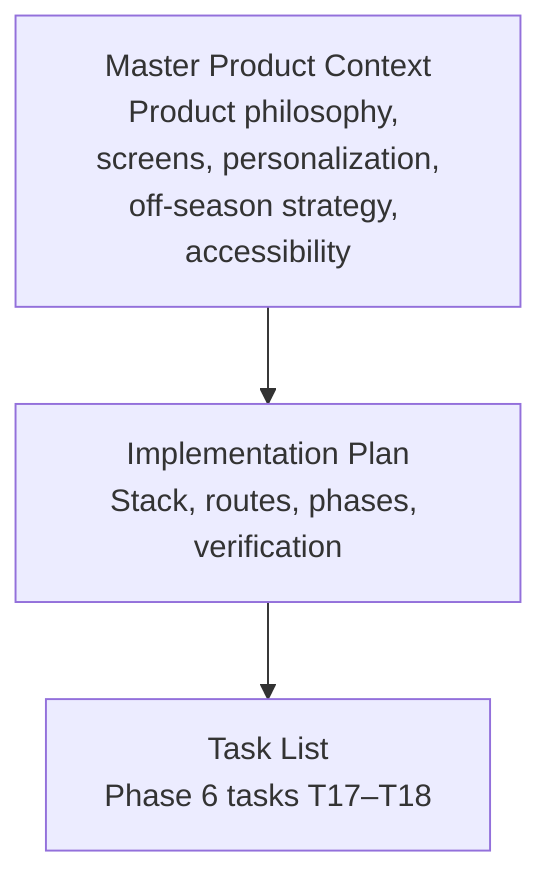
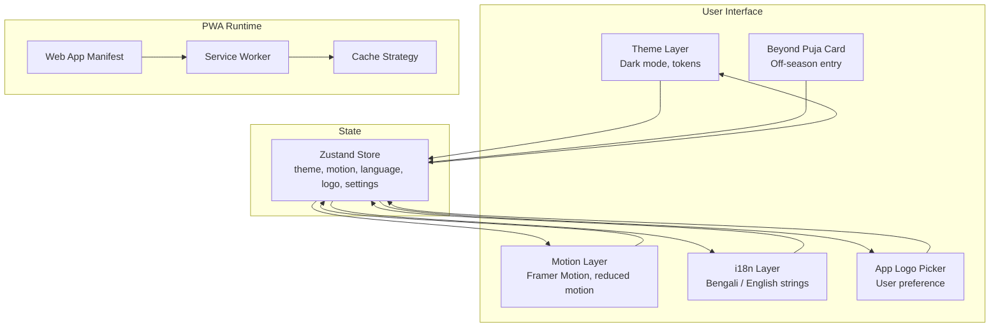
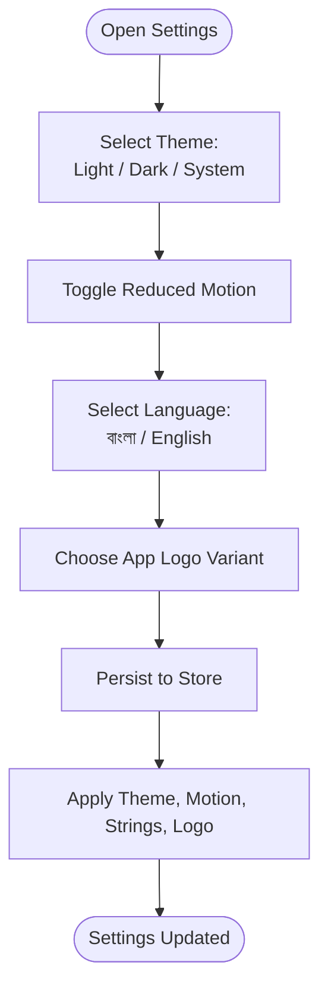
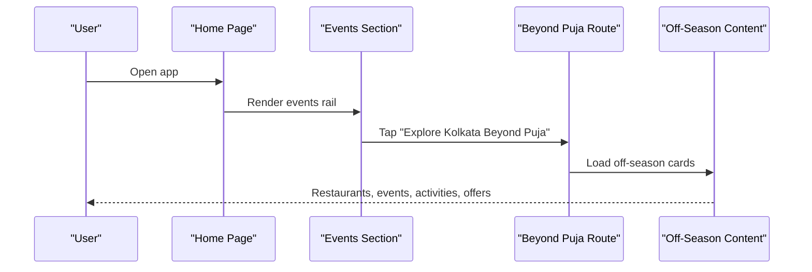
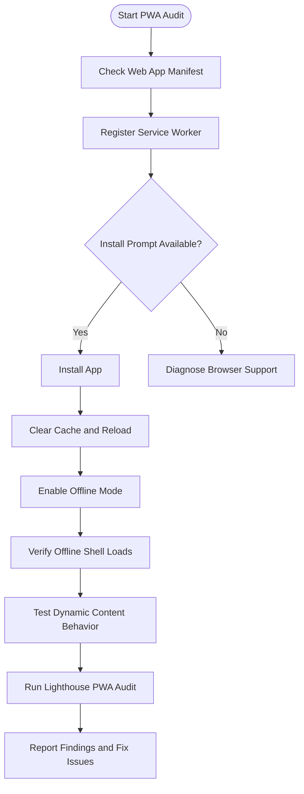
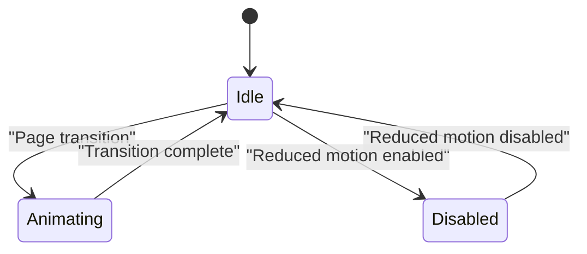
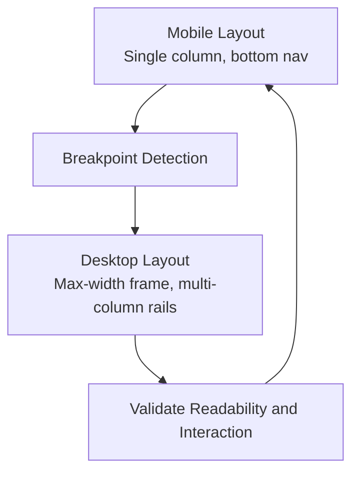
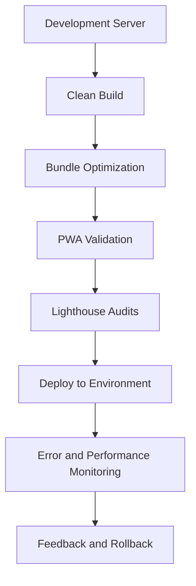
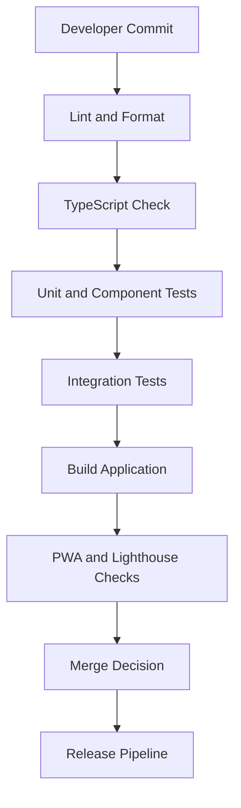
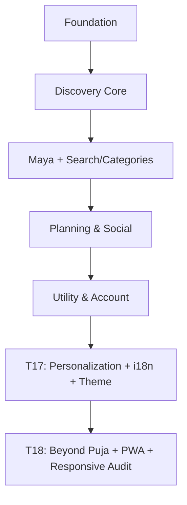

# Phase 6: Polish & Deployment

<cite>
**Referenced Files in This Document**
- [Pujo_Sahayak_Master_Project_Context.md](file://Pujo_Sahayak_Master_Project_Context.md)
- [plan.md](file://tasks/plan.md)
- [todo.md](file://tasks/todo.md)
</cite>

## Table of Contents
1. [Introduction](#introduction)
2. [Project Structure](#project-structure)
3. [Core Components](#core-components)
4. [Architecture Overview](#architecture-overview)
5. [Detailed Component Analysis](#detailed-component-analysis)
6. [Dependency Analysis](#dependency-analysis)
7. [Performance Considerations](#performance-considerations)
8. [Troubleshooting Guide](#troubleshooting-guide)
9. [Conclusion](#conclusion)
10. [Appendices](#appendices)

## Introduction
This document defines the Phase 6 scope for Pujo Sahayak: polish and deployment preparation. It focuses on personalization, off-season usability, PWA offline readiness, motion quality, responsive desktop adaptation, build optimization, monitoring, code quality, automated testing, continuous integration, maintenance, update strategies, and production operations. The guidance is grounded in the project’s master product context and implementation plan, which describe a mobile-first React + Vite PWA with Tailwind CSS v4, React Router, Zustand, Framer Motion, Leaflet, and `vite-plugin-pwa`.

The product philosophy emphasizes continuity beyond Durga Puja, so Phase 6 ensures that the app remains useful year-round, feels polished across devices, and ships as a reliable installable PWA.

## Project Structure
At this stage, the repository contains:
- A master product context describing features, flows, and constraints.
- An implementation plan outlining phases, architecture decisions, routes, and verification criteria.
- A task list tracking progress through foundation, discovery, Maya, planning, utility, and polish phases.

**Diagram sources**
- [Pujo_Sahayak_Master_Project_Context.md:1-1200](file://Pujo_Sahayak_Master_Project_Context.md#L1-L1200)
- [plan.md:1-86](file://tasks/plan.md#L1-L86)
- [todo.md:1-81](file://tasks/todo.md#L1-L81)

**Section sources**
- [Pujo_Sahayak_Master_Project_Context.md:1-1200](file://Pujo_Sahayak_Master_Project_Context.md#L1-L1200)
- [plan.md:1-86](file://tasks/plan.md#L1-L86)
- [todo.md:1-81](file://tasks/todo.md#L1-L81)

## Core Components
Phase 6 centers on six deliverables:

| Deliverable | Purpose | Key Requirements |
|---|---|---|
| Personalization | Let users tailor appearance and language | Dark mode, reduced motion, Bengali/English i18n strings, app logo picker |
| Beyond Puja card | Keep the app useful outside the festival season | Off-season content entry point from Home events |
| PWA offline audit | Ensure installability and offline shell behavior | Service worker configuration, caching strategy, install prompt, offline tests |
| Motion polish pass | Smooth animations while respecting preferences | Page fades, card scale, scan frame, waveform; disabled when reduced motion is enabled |
| Responsive desktop adaptation | Cross-device compatibility | Max-width app frame, multi-column rails, readable typography at larger breakpoints |
| Deployment readiness | Clean builds, performance monitoring, CI, maintenance | Build optimization, Lighthouse checks, error monitoring, release notes, rollback plan |

**Section sources**
- [todo.md:69-81](file://tasks/todo.md#L69-L81)
- [plan.md:1-86](file://tasks/plan.md#L1-L86)

## Architecture Overview
The Phase 6 changes extend existing UI and state layers without altering core data or routing contracts.

**Diagram sources**
- [plan.md:7-18](file://tasks/plan.md#L7-L18)
- [todo.md:69-81](file://tasks/todo.md#L69-L81)

## Detailed Component Analysis

### Personalization: Dark Mode, Reduced Motion, Bengali/English i18n, App Logo Picker
Personalization is defined in the product context as part of profile/settings. It includes light/dark/system theme options, reduced motion, and an app logo picker. The implementation plan specifies dark mode, reduced motion, full Bengali/English string coverage, and app-logo variants.

Key behaviors:
- Theme selection persists via the client store and applies instantly.
- Reduced motion disables nonessential animations and transitions.
- Bengali and English strings are selected based on user language preference.
- App logo variants are stored as a user preference and applied to the app header or splash area.

**Diagram sources**
- [Pujo_Sahayak_Master_Project_Context.md:1055-1074](file://Pujo_Sahayak_Master_Project_Context.md#L1055-L1074)
- [todo.md:69-81](file://tasks/todo.md#L69-L81)

Verification checklist:
- Toggle dark mode and confirm UI adapts immediately.
- Enable reduced motion and verify animations are minimized or disabled.
- Switch between Bengali and English and confirm all visible strings update.
- Change the app logo variant and confirm it persists after reload.

**Section sources**
- [Pujo_Sahayak_Master_Project_Context.md:1055-1074](file://Pujo_Sahayak_Master_Project_Context.md#L1055-L1074)
- [todo.md:69-81](file://tasks/todo.md#L69-L81)

### Beyond Puja: Off-Season Card and Year-Round Usability
The product context explicitly states that the platform should transition from Puja discovery to Kolkata local discovery after the festival. The implementation plan adds a dedicated “Beyond Puja” route and task.

Design intent:
- Provide a clear entry point from the Home page events section.
- Promote restaurants, events, activities, meetups, offers, and local experiences during off-season periods.
- Maintain the same place-based structure while shifting dominant content away from pandals.

**Diagram sources**
- [Pujo_Sahayak_Master_Project_Context.md:1093-1142](file://Pujo_Sahayak_Master_Project_Context.md#L1093-L1142)
- [plan.md:19-40](file://tasks/plan.md#L19-L40)
- [todo.md:69-81](file://tasks/todo.md#L69-L81)

Verification checklist:
- Confirm the “Beyond Puja” card appears in the Home events section.
- Navigate to the off-season route and verify relevant content loads.
- Ensure the experience does not rely solely on puja-specific data.

**Section sources**
- [Pujo_Sahayak_Master_Project_Context.md:1093-1142](file://Pujo_Sahayak_Master_Project_Context.md#L1093-L1142)
- [plan.md:19-40](file://tasks/plan.md#L19-L40)
- [todo.md:69-81](file://tasks/todo.md#L69-L81)

### PWA Offline Audit: Service Worker, Caching, Installability, Offline Testing
The implementation plan uses `vite-plugin-pwa` for manifest, icons, and service worker setup. Phase 6 requires an offline audit covering install prompts, shell caching, and offline functionality testing.

Recommended audit steps:
1. Verify the web app manifest exists and declares appropriate metadata.
2. Confirm the service worker registers and installs successfully.
3. Test the install prompt on supported browsers.
4. Clear cache and reload to validate offline shell availability.
5. Simulate offline mode and verify critical UI elements load.
6. Validate network requests for dynamic content fail gracefully when offline.
7. Record Lighthouse PWA scores and address failures.

**Diagram sources**
- [plan.md:7-18](file://tasks/plan.md#L7-L18)
- [todo.md:69-81](file://tasks/todo.md#L69-L81)

Caching strategy considerations:
- Cache static assets (HTML, JS, CSS, fonts, icons) for fast cold starts.
- Decide whether to cache API responses or only shell resources.
- Avoid caching volatile user data unless intentional.
- Use cache-busting for versioned assets.
- Provide fallbacks for images and media when offline.

**Section sources**
- [plan.md:7-18](file://tasks/plan.md#L7-L18)
- [todo.md:69-81](file://tasks/todo.md#L69-L81)

### Motion Polish Pass: Smooth Animations and Reduced Motion Respect
The implementation plan specifies Framer Motion for soft page fades, subtle card scale, animated scan frame, and voice waveform. Phase 6 requires honoring reduced-motion preferences and ensuring smooth transitions.

Guidelines:
- Use motion primitives consistently across pages.
- Disable or simplify animations when reduced motion is enabled.
- Avoid layout thrashing by animating transform and opacity where possible.
- Keep animation durations short and purposeful.
- Ensure keyboard and screen-reader interactions remain accessible.

**Diagram sources**
- [plan.md:7-18](file://tasks/plan.md#L7-L18)
- [todo.md:69-81](file://tasks/todo.md#L69-L81)

Verification checklist:
- Confirm page transitions are smooth and consistent.
- Verify animations do not cause jank on low-end devices.
- Test reduced motion toggle and ensure animations are disabled or simplified.
- Validate accessibility of interactive elements during transitions.

**Section sources**
- [plan.md:7-18](file://tasks/plan.md#L7-L18)
- [todo.md:69-81](file://tasks/todo.md#L69-L81)

### Responsive Desktop Adaptation: Cross-Device Compatibility
Phase 6 requires responsive desktop adaptation alongside mobile-first design. The goal is to keep the app usable on large screens without breaking the mobile experience.

Techniques:
- Constrain the app width with a max-width container.
- Convert single-column rails into multi-column layouts at larger breakpoints.
- Adjust typography scales for readability on desktop.
- Preserve bottom navigation behavior on mobile and adapt navigation for desktop if needed.
- Ensure maps, cards, and media scale appropriately.

**Diagram sources**
- [todo.md:69-81](file://tasks/todo.md#L69-L81)

Verification checklist:
- Test at narrow mobile widths and wide desktop widths.
- Confirm no horizontal scrolling occurs unintentionally.
- Verify touch targets remain usable on both devices.
- Ensure map and media components render correctly at different sizes.

**Section sources**
- [todo.md:69-81](file://tasks/todo.md#L69-L81)

### Deployment Strategies: Development, Production, Build Optimization, Monitoring
Deployment preparation covers clean builds, environment-aware configuration, performance monitoring, and operational procedures.

Development:
- Run the dev server with hot module replacement.
- Verify all routes are reachable via bottom navigation or deep links.
- Inspect console errors and network requests.

Production:
- Perform a clean build and verify no TypeScript errors.
- Validate asset sizes and bundle composition.
- Confirm service worker registration and manifest correctness.
- Run Lighthouse audits for performance, accessibility, best practices, and PWA.

Build optimization:
- Enable production optimizations in the build tooling.
- Minify and tree-shake unused code.
- Optimize images and fonts.
- Avoid unnecessary dependencies.

Monitoring setup:
- Instrument error reporting for runtime exceptions.
- Track key user actions such as navigation, saves, and Maya interactions.
- Monitor performance metrics such as first meaningful paint, time to interactive, and bundle size.
- Set up alerts for recurring errors and performance regressions.

**Diagram sources**
- [plan.md:63-86](file://tasks/plan.md#L63-L86)
- [todo.md:69-81](file://tasks/todo.md#L69-L81)

**Section sources**
- [plan.md:63-86](file://tasks/plan.md#L63-L86)
- [todo.md:69-81](file://tasks/todo.md#L69-L81)

### Code Quality Checks, Automated Testing, and Continuous Integration
Quality gates should prevent regressions before deployment.

Code quality:
- Enforce TypeScript compilation without errors.
- Run linting rules consistently.
- Format code automatically.
- Review changes against mockup fidelity and product context.

Automated testing:
- Add unit tests for utilities, stores, and pure logic.
- Add component tests for critical UI flows.
- Add integration tests for navigation and persistence.
- Include PWA-related checks where feasible.

Continuous integration:
- Run lint, type check, tests, and build on every commit.
- Fail the pipeline on TypeScript errors or test failures.
- Generate artifacts for review.
- Automate Lighthouse or performance checks for pull requests.

**Diagram sources**
- [plan.md:63-86](file://tasks/plan.md#L63-L86)
- [todo.md:69-81](file://tasks/todo.md#L69-L81)

**Section sources**
- [plan.md:63-86](file://tasks/plan.md#L63-L86)
- [todo.md:69-81](file://tasks/todo.md#L69-L81)

### Maintenance Procedures, Update Strategies, and Production Monitoring
Maintenance ensures long-term stability and user trust.

Update strategies:
- Version the application and assets.
- Communicate changes through release notes.
- Use feature flags for risky updates.
- Gradually roll out changes to a subset of users if needed.
- Prepare rollback procedures for failed deployments.

Monitoring:
- Track runtime errors and stack traces.
- Monitor performance budgets and regressions.
- Observe user engagement with personalization, Beyond Puja, and Maya.
- Alert on service worker installation failures or offline shell issues.

Operational procedures:
- Define incident response steps.
- Maintain runbooks for common failures.
- Review logs regularly.
- Schedule periodic performance and security reviews.

**Section sources**
- [plan.md:63-86](file://tasks/plan.md#L63-L86)
- [todo.md:69-81](file://tasks/todo.md#L69-L81)

## Dependency Analysis
Phase 6 depends on earlier phases being complete. The main relationships are:

- Personalization depends on the store, theme layer, i18n strings, and settings UI.
- Beyond Puja depends on Home navigation and off-season content.
- PWA offline audit depends on manifest, service worker, and caching configuration.
- Motion polish depends on Framer Motion and reduced-motion preferences.
- Responsive adaptation depends on Tailwind CSS breakpoints and layout components.
- Deployment readiness depends on build tooling, monitoring, and CI pipelines.

**Diagram sources**
- [todo.md:5-81](file://tasks/todo.md#L5-L81)

**Section sources**
- [todo.md:5-81](file://tasks/todo.md#L5-L81)

## Performance Considerations
- Keep animations lightweight and avoid blocking the main thread.
- Prefer transform and opacity animations for smoother compositing.
- Limit image sizes and use appropriate formats.
- Avoid excessive re-renders in personalized UI.
- Monitor bundle size growth as new features are added.
- Validate offline shell performance under simulated poor networks.

[No sources needed since this section provides general guidance]

## Troubleshooting Guide
Common Phase 6 issues and resolutions:

| Issue | Likely Cause | Resolution |
|---|---|---|
| Dark mode does not apply | Theme state not persisted or CSS variables missing | Verify store persistence and token application |
| Reduced motion does not disable animations | Motion layer ignores preference | Ensure reduced motion flag controls Framer Motion settings |
| Bengali text does not render correctly | Font loading or fallback issue | Verify font inclusion and system fallback |
| App logo does not change | Logo preference not saved or UI not updated | Check store write and UI read paths |
| Beyond Puja card not visible | Navigation or content mapping missing | Confirm Home events section and route mapping |
| Service worker not registering | Manifest or plugin misconfiguration | Validate manifest and plugin setup |
| Offline shell fails | Cache strategy incorrect | Review cached assets and fallback behavior |
| Desktop layout breaks | Breakpoints or container constraints missing | Adjust max-width and multi-column layout |
| Lighthouse PWA score low | Missing installability or offline support | Fix manifest, service worker, and caching |

**Section sources**
- [todo.md:69-81](file://tasks/todo.md#L69-L81)
- [plan.md:63-86](file://tasks/plan.md#L63-L86)

## Conclusion
Phase 6 transforms Pujo Sahayak from a functional prototype into a polished, deployable product. Personalization makes the app feel personal, Beyond Puja keeps it relevant year-round, PWA offline readiness ensures reliability, motion polish improves perceived quality, and responsive adaptation guarantees cross-device usability. With disciplined build optimization, monitoring, code quality checks, automated testing, and continuous integration, the team can ship confidently and maintain the app over time.

[No sources needed since this section summarizes without analyzing specific files]

## Appendices

### Phase 6 Task Summary
- T17: Personalization, Bengali/English i18n, dark mode, reduced motion, app logo picker.
- T18: Beyond Puja off-season card, PWA offline audit, responsive desktop adaptation, final motion pass.

**Section sources**
- [todo.md:69-81](file://tasks/todo.md#L69-L81)