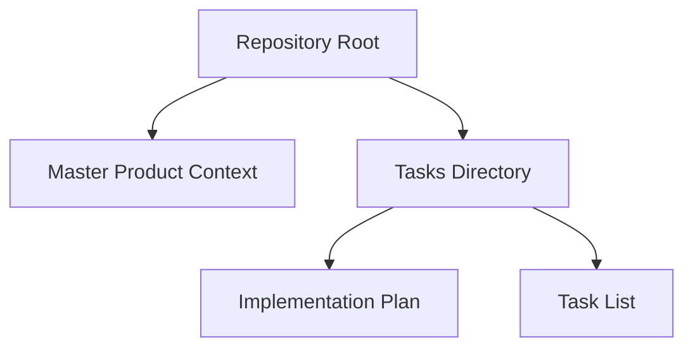
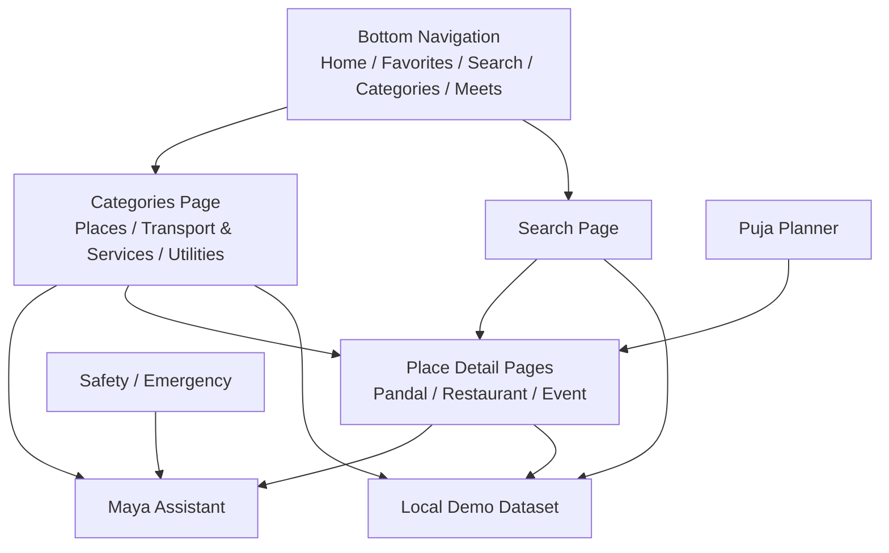
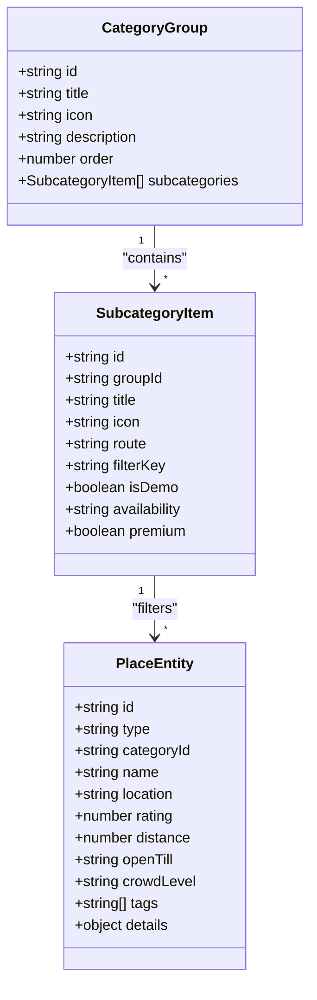
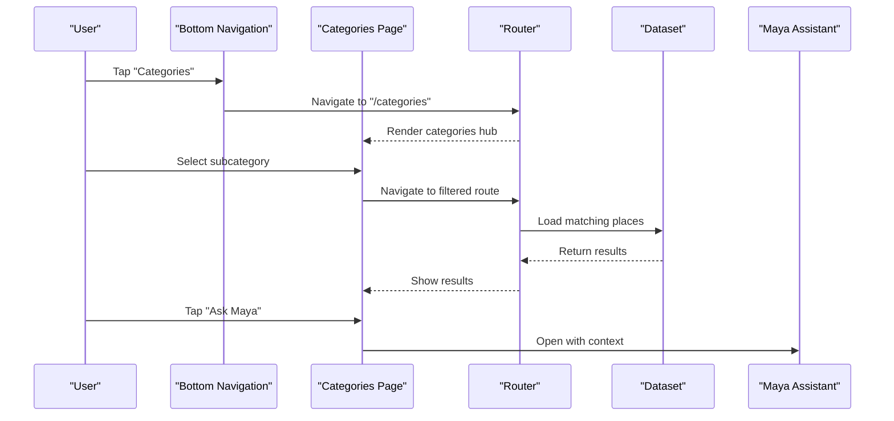
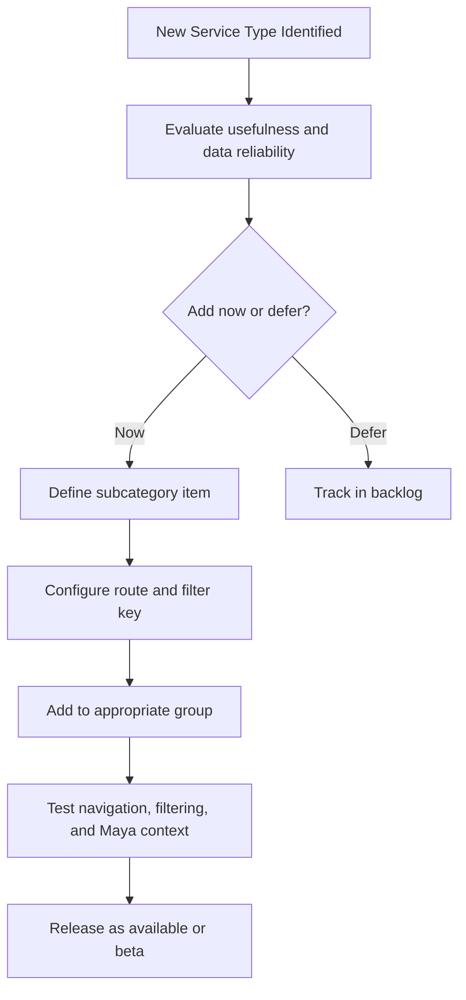
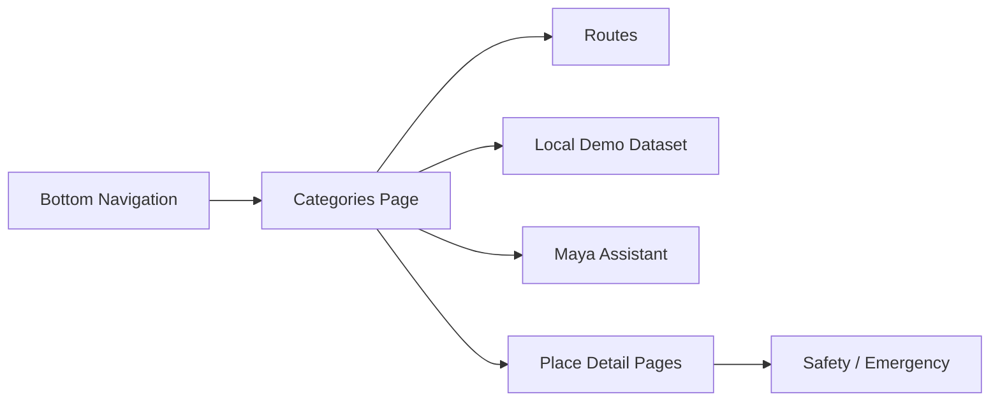

# Categories and Navigation Hub

<cite>
**Referenced Files in This Document**
- [Pujo_Sahayak_Master_Project_Context.md](file://Pujo_Sahayak_Master_Project_Context.md)
- [plan.md](file://tasks/plan.md)
- [todo.md](file://tasks/todo.md)
</cite>

## Table of Contents
1. [Introduction](#introduction)
2. [Project Structure](#project-structure)
3. [Core Components](#core-components)
4. [Architecture Overview](#architecture-overview)
5. [Detailed Component Analysis](#detailed-component-analysis)
6. [Dependency Analysis](#dependency-analysis)
7. [Performance Considerations](#performance-considerations)
8. [Troubleshooting Guide](#troubleshooting-guide)
9. [Conclusion](#conclusion)
10. [Appendices](#appendices)

## Introduction
This document defines the categories and navigation hub for Puja Sahayak. It explains how the structured discovery hub organizes content into three primary groups: Places, Transport & Services, and Utilities. It also documents the extensible category system design that supports future growth while keeping the current interface simple. The guidance covers category data models, navigation patterns, responsive design considerations, and scalability planning for additional service types.

The categories page is intentionally a discovery surface rather than a rigid directory. It should help users quickly find what they need during Durga Puja and beyond, while remaining consistent with the broader product philosophy of discover, explore, understand, plan, visit, share, meet, and continue discovering.

## Project Structure
At this stage, the repository contains:
- A master product context describing the overall product vision, navigation structure, and feature map.
- An implementation plan outlining phases, routes, and verification criteria.
- A task list tracking progress across foundation, discovery, Maya, search/categories, planning, social, utility, and polish phases.

**Diagram sources**
- [Pujo_Sahayak_Master_Project_Context.md:1-20](file://Pujo_Sahayak_Master_Project_Context.md#L1-L20)
- [plan.md:1-18](file://tasks/plan.md#L1-L18)
- [todo.md:1-16](file://tasks/todo.md#L1-L16)

**Section sources**
- [Pujo_Sahayak_Master_Project_Context.md:1-20](file://Pujo_Sahayak_Master_Project_Context.md#L1-L20)
- [plan.md:1-18](file://tasks/plan.md#L1-L18)
- [todo.md:1-16](file://tasks/todo.md#L1-L16)

## Core Components
The categories and navigation hub centers on three main components:

1. **Categories Page**
   - Acts as the structured discovery hub.
   - Groups items under Places, Transport & Services, and Utilities.
   - Includes an “Ask Maya” call-to-action to connect discovery with AI assistance.

2. **Category Group Model**
   - Represents a broad grouping such as Places, Transport & Services, or Utilities.
   - Holds metadata like title, icon, description, and ordered subcategories.

3. **Subcategory Item Model**
   - Represents a specific entry such as Pandals, Metro, Hospital, ATM, etc.
   - Links to a route, dataset filter, icon, and optional metadata like availability or premium status.

These components support:
- A stable top-level navigation including Home, Favorites, Search, Categories, and Meets.
- A clear separation between discovery (categories), exploration (search/explore), and planning (planner/meets).
- Extensibility for new categories without changing core navigation.

**Section sources**
- [Pujo_Sahayak_Master_Project_Context.md:140-157](file://Pujo_Sahayak_Master_Project_Context.md#L140-L157)
- [Pujo_Sahayak_Master_Project_Context.md:495-556](file://Pujo_Sahayak_Master_Project_Context.md#L495-L556)
- [todo.md:42-43](file://tasks/todo.md#L42-L43)

## Architecture Overview
The categories hub sits alongside other major screens and connects to the rest of the app through routing, shared data models, and the Maya assistant.

**Diagram sources**
- [Pujo_Sahayak_Master_Project_Context.md:140-157](file://Pujo_Sahayak_Master_Project_Context.md#L140-L157)
- [Pujo_Sahayak_Master_Project_Context.md:495-556](file://Pujo_Sahayak_Master_Project_Context.md#L495-L556)
- [plan.md:19-39](file://tasks/plan.md#L19-L39)
- [todo.md:42-43](file://tasks/todo.md#L42-L43)

## Detailed Component Analysis

### Categories Page
The categories page is a structured discovery hub. It currently groups content into:

- **Places**
  - Current entries: Pandals, Restaurants, Places.
  - Potential future additions: Attractions, Events, Shopping.
- **Transport & Services**
  - Current entries: Metro, Bus, Parking.
  - Potential future additions: Cab/ride information, Fuel, Charging.
- **Utilities**
  - Current entries: Police Station, Hospital, ATM, Pharmacy.
  - Potential future additions: Medical camp, Toilet, Help desk, Drinking water, Parking.

The page should include a purple “Ask Maya” CTA so users can transition from browsing categories to asking contextual questions.

```mermaid
flowchart TD
Start(["Open Categories Page"]) --> GroupPlaces["Group: Places"]
Start --> GroupTransport["Group: Transport & Services"]
Start --> GroupUtilities["Group: Utilities"]
GroupPlaces --> Pandal["Pandals"]
GroupPlaces --> Restaurant["Restaurants"]
GroupPlaces --> GenericPlaces["Places"]
GroupPlaces --> FutureAttractions["Future: Attractions"]
GroupPlaces --> FutureEvents["Future: Events"]
GroupPlaces --> FutureShopping["Future: Shopping"]
GroupTransport --> Metro["Metro"]
GroupTransport --> Bus["Bus"]
GroupTransport --> Parking["Parking"]
GroupTransport --> FutureCab["Future: Cab / Ride Information"]
GroupTransport --> FutureFuel["Future: Fuel"]
GroupTransport --> FutureCharging["Future: Charging"]
GroupUtilities --> Police["Police Station"]
GroupUtilities --> Hospital["Hospital"]
GroupUtilities --> Atm["ATM"]
GroupUtilities --> Pharmacy["Pharmacy"]
GroupUtilities --> FutureMedicalCamp["Future: Medical Camp"]
GroupUtilities --> FutureToilet["Future: Toilet"]
GroupUtilities --> FutureHelpDesk["Future: Help Desk"]
GroupUtilities --> FutureDrinkingWater["Future: Drinking Water"]
Start --> AskMaya["Ask Maya CTA"]
```

**Diagram sources**
- [Pujo_Sahayak_Master_Project_Context.md:495-556](file://Pujo_Sahayak_Master_Project_Context.md#L495-L556)

**Section sources**
- [Pujo_Sahayak_Master_Project_Context.md:495-556](file://Pujo_Sahayak_Master_Project_Context.md#L495-L556)
- [todo.md:42-43](file://tasks/todo.md#L42-L43)

### Category Data Models
A scalable category system should separate group-level metadata from item-level metadata.

#### CategoryGroup
- `id`: Unique identifier for the group.
- `title`: Display name such as “Places”, “Transport & Services”, “Utilities”.
- `icon`: Visual marker for the group.
- `description`: Optional short explanation of the group’s purpose.
- `order`: Sorting position within the categories page.
- `subcategories`: Ordered list of subcategory references.

#### SubcategoryItem
- `id`: Unique identifier for the subcategory.
- `groupId`: Reference to the parent group.
- `title`: Display name such as “Pandals”, “Metro”, “Hospital”.
- `icon`: Visual marker for the subcategory.
- `route`: Route path or deep link target.
- `filterKey`: Key used to filter the local dataset.
- `isDemo`: Whether the entry is demo-only.
- `availability`: Optional status such as “always”, “seasonal”, “beta”.
- `premium`: Optional flag indicating premium-only access.

#### PlaceEntity
- `id`: Unique identifier for the place.
- `type`: Discriminator such as “pandal”, “restaurant”, “event”, “attraction”, “service”.
- `categoryId`: Reference to a subcategory.
- `name`, `location`, `rating`, `distance`, `openTill`, `crowdLevel`, `tags`.
- `details`: Rich content such as theme, story, facilities, safety notes.

**Diagram sources**
- [Pujo_Sahayak_Master_Project_Context.md:124-137](file://Pujo_Sahayak_Master_Project_Context.md#L124-L137)
- [Pujo_Sahayak_Master_Project_Context.md:495-556](file://Pujo_Sahayak_Master_Project_Context.md#L495-L556)
- [todo.md:13-14](file://tasks/todo.md#L13-L14)

**Section sources**
- [Pujo_Sahayak_Master_Project_Context.md:124-137](file://Pujo_Sahayak_Master_Project_Context.md#L124-L137)
- [Pujo_Sahayak_Master_Project_Context.md:495-556](file://Pujo_Sahayak_Master_Project_Context.md#L495-L556)
- [todo.md:13-14](file://tasks/todo.md#L13-L14)

### Navigation Patterns
The categories page integrates into the primary bottom navigation and works together with search, detail pages, and Maya.

- Primary navigation includes Home, Favorites, Search, Categories, and Meets.
- Categories should be reachable directly from the bottom nav.
- Each subcategory should navigate to either:
  - A filtered view of the dataset.
  - A dedicated listing page.
  - A detail page when only one entity exists.
- The “Ask Maya” CTA should pass context such as the selected group or subcategory.

**Diagram sources**
- [Pujo_Sahayak_Master_Project_Context.md:140-157](file://Pujo_Sahayak_Master_Project_Context.md#L140-L157)
- [Pujo_Sahayak_Master_Project_Context.md:495-556](file://Pujo_Sahayak_Master_Project_Context.md#L495-L556)
- [plan.md:19-39](file://tasks/plan.md#L19-L39)
- [todo.md:42-43](file://tasks/todo.md#L42-L43)

**Section sources**
- [Pujo_Sahayak_Master_Project_Context.md:140-157](file://Pujo_Sahayak_Master_Project_Context.md#L140-L157)
- [plan.md:19-39](file://tasks/plan.md#L19-L39)
- [todo.md:42-43](file://tasks/todo.md#L42-L43)

### Responsive Design Considerations
The categories hub should remain mobile-first while scaling gracefully to larger screens.

- Mobile layout
  - Vertical scrolling groups.
  - Icon grids for subcategories.
  - Sticky or prominent “Ask Maya” action.
  - Large touch targets for accessibility.
- Tablet and desktop layout
  - Multi-column grid for subcategories.
  - Side-by-side preview or quick-filter rail.
  - Wider cards for richer previews.
- Accessibility
  - Clear labels for icons.
  - Keyboard navigation for groups and items.
  - Sufficient color contrast.
  - Reduced-motion support where animations are used.

[No sources needed since this section provides general guidance]

### Scalability Planning
The category system should grow without becoming unwieldy.

- Add new subcategories by extending the dataset and category configuration.
- Avoid hard-coding category names in UI logic; use data-driven rendering.
- Use `filterKey` to reuse existing listing and filtering logic.
- Mark experimental or seasonal features with `availability` and `isDemo`.
- Reserve premium-only categories behind a permission layer rather than hiding them completely.
- Keep the number of visible top-level groups small; prefer grouping over flat expansion.

**Diagram sources**
- [Pujo_Sahayak_Master_Project_Context.md:495-556](file://Pujo_Sahayak_Master_Project_Context.md#L495-L556)
- [todo.md:13-14](file://tasks/todo.md#L13-L14)

**Section sources**
- [Pujo_Sahayak_Master_Project_Context.md:495-556](file://Pujo_Sahayak_Master_Project_Context.md#L495-L556)
- [todo.md:13-14](file://tasks/todo.md#L13-L14)

## Dependency Analysis
The categories hub depends on several parts of the application:

- **Primary navigation**: Categories must be part of the five-tab bottom navigation.
- **Routing**: Categories maps to `/categories`; subcategories may map to filtered views or dedicated routes.
- **Dataset**: Categories drives filtering of the local demo dataset.
- **Maya**: Categories should provide context-aware prompts for Maya.
- **Detail pages**: Categories should lead to place detail pages for pandals, restaurants, events, and services.
- **Safety and emergency**: Utilities such as police stations and hospitals connect to safety flows.

**Diagram sources**
- [Pujo_Sahayak_Master_Project_Context.md:140-157](file://Pujo_Sahayak_Master_Project_Context.md#L140-L157)
- [Pujo_Sahayak_Master_Project_Context.md:495-556](file://Pujo_Sahayak_Master_Project_Context.md#L495-L556)
- [plan.md:19-39](file://tasks/plan.md#L19-L39)
- [todo.md:42-43](file://tasks/todo.md#L42-L43)

**Section sources**
- [Pujo_Sahayak_Master_Project_Context.md:140-157](file://Pujo_Sahayak_Master_Project_Context.md#L140-L157)
- [Pujo_Sahayak_Master_Project_Context.md:495-556](file://Pujo_Sahayak_Master_Project_Context.md#L495-L556)
- [plan.md:19-39](file://tasks/plan.md#L19-L39)
- [todo.md:42-43](file://tasks/todo.md#L42-L43)

## Performance Considerations
- Keep the categories page lightweight by rendering groups and subcategories from a small configuration object.
- Defer heavy detail content until the user navigates into a subcategory or detail page.
- Use lazy loading for images and rich media.
- Cache filtered results locally if the same category is revisited frequently.
- Avoid unnecessary re-renders by separating group state from item state.
- Respect reduced-motion preferences for any animated transitions.

[No sources needed since this section provides general guidance]

## Troubleshooting Guide
Common issues and resolutions for the categories and navigation hub:

- Categories not reachable from bottom navigation
  - Verify the bottom navigation includes the Categories tab.
  - Confirm the route `/categories` is registered.
- Subcategory taps do nothing
  - Check that each subcategory has a valid route or filter key.
  - Ensure the dataset contains entries matching the filter.
- “Ask Maya” does not pass context
  - Confirm the CTA passes the selected group or subcategory into Maya’s context.
- Missing or incorrect icons
  - Validate icon mappings in the category configuration.
- Overcrowded layout on mobile
  - Review spacing, icon size, and text truncation rules.
  - Ensure touch targets meet accessibility guidelines.

**Section sources**
- [Pujo_Sahayak_Master_Project_Context.md:140-157](file://Pujo_Sahayak_Master_Project_Context.md#L140-L157)
- [Pujo_Sahayak_Master_Project_Context.md:495-556](file://Pujo_Sahayak_Master_Project_Context.md#L495-L556)
- [todo.md:42-43](file://tasks/todo.md#L42-L43)

## Conclusion
The categories and navigation hub is the structured discovery entry point for Puja Sahayak. It organizes content into Places, Transport & Services, and Utilities, while leaving room for future growth. The extensible category model separates group-level and item-level concerns, enabling new services to be added without disrupting the core experience. Combined with clear navigation patterns, responsive design, and careful scalability planning, the hub can evolve from a seasonal discovery tool into a broader local-experience platform.

[No sources needed since this section summarizes without analyzing specific files]

## Appendices

### Appendix A: Current Category Inventory
- Places
  - Pandals
  - Restaurants
  - Places
  - Potential: Attractions, Events, Shopping
- Transport & Services
  - Metro
  - Bus
  - Parking
  - Potential: Cab/ride information, Fuel, Charging
- Utilities
  - Police Station
  - Hospital
  - ATM
  - Pharmacy
  - Potential: Medical camp, Toilet, Help desk, Drinking water, Parking

**Section sources**
- [Pujo_Sahayak_Master_Project_Context.md:495-556](file://Pujo_Sahayak_Master_Project_Context.md#L495-L556)

### Appendix B: Implementation Checklist
- Implement the Categories page at `/categories`.
- Render Places, Transport & Services, and Utilities groups.
- Connect subcategories to routes or filtered dataset views.
- Add the “Ask Maya” CTA with context awareness.
- Verify reachability from the bottom navigation.
- Ensure the design remains mobile-first and accessible.

**Section sources**
- [plan.md:19-39](file://tasks/plan.md#L19-L39)
- [todo.md:42-43](file://tasks/todo.md#L42-L43)