# Feature Specifications and Requirements

<cite>
**Referenced Files in This Document**
- [Pujo_Sahayak_Master_Project_Context.md](file://Pujo_Sahayak_Master_Project_Context.md)
- [plan.md](file://tasks\plan.md)
- [todo.md](file://tasks\todo.md)
</cite>

## Table of Contents
1. [Introduction](#introduction)
2. [Project Structure](#project-structure)
3. [Core Components](#core-components)
4. [Architecture Overview](#architecture-overview)
5. [Detailed Component Analysis](#detailed-component-analysis)
6. [Dependency Analysis](#dependency-analysis)
7. [Performance Considerations](#performance-considerations)
8. [Troubleshooting Guide](#troubleshooting-guide)
9. [Conclusion](#conclusion)
10. [Appendices](#appendices)

## Introduction
This document defines the feature specifications and requirements for Puja Sahayak, a mobile-first web application and progressive web app designed as a digital companion for exploring Kolkata during Durga Puja while remaining useful throughout the year. The product combines place discovery, AI assistance, route planning, social meetups, safety utilities, user-generated content, personalization, and monetization concepts.

The core user journey is:
Discover → Explore → Understand → Plan → Visit → Share / Review → Meet people → Discover something else.

At a high level, the application should help users:
- Find pandals, restaurants, events, and local experiences.
- Ask contextual questions through the Maya AI assistant.
- Build multi-day Puja itineraries.
- Connect with others through meetups.
- Access transport, emergency, and nearby-service information.
- Save places, track visited locations, and receive recommendations.
- Remain engaged outside the Puja season through broader local discovery.

**Section sources**
- [Pujo_Sahayak_Master_Project_Context.md:1-18](file://Pujo_Sahayak_Master_Project_Context.md#L1-L18)
- [Pujo_Sahayak_Master_Project_Context.md:21-100](file://Pujo_Sahayak_Master_Project_Context.md#L21-L100)

## Project Structure
The repository currently contains:
- A master product context file describing the full scope, philosophy, navigation model, and feature definitions.
- An implementation plan outlining the React + Vite PWA architecture, screen-to-route mapping, task phases, verification criteria, risks, and open questions.
- A task checklist tracking progress across foundation, discovery, Maya, search/categories, planning, social, utility, and polish phases.

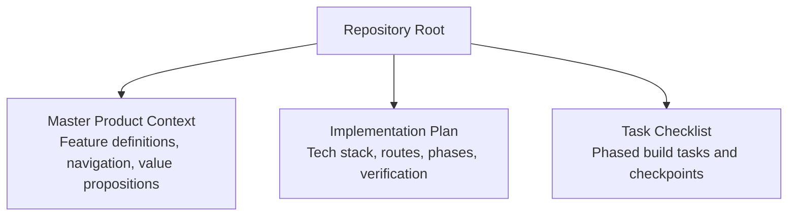

**Diagram sources**
- [Pujo_Sahayak_Master_Project_Context.md:1-18](file://Pujo_Sahayak_Master_Project_Context.md#L1-L18)
- [plan.md:1-18](file://tasks\plan.md#L1-L18)
- [todo.md:1-16](file://tasks\todo.md#L1-L16)

**Section sources**
- [Pujo_Sahayak_Master_Project_Context.md:1-18](file://Pujo_Sahayak_Master_Project_Context.md#L1-L18)
- [plan.md:1-18](file://tasks\plan.md#L1-L18)
- [todo.md:1-16](file://tasks\todo.md#L1-L16)

## Core Components
The major feature areas defined by the project are:

- Home page with sponsored spotlight, explore spotlight, restaurants, offers, shopping, and events sections.
- Continue Where You Left Off retention feature.
- Favorites page with saved pandals, visited places, and recommendations.
- Puja Planner for multi-day itinerary creation across Panchami through Dashami.
- AI-Based Planning via natural language requests for route optimization.
- Search experience with category shortcuts, trending pandals, and popular nearby places.
- Categories page organizing Places, Transport & Services, and Utilities.
- Maya AI assistant for contextual answers, camera-based identification, and planning support.
- Meets page for discovering or creating activity-based meetups.
- Safety and utility features including emergency shortcuts and missing person reporting.

These components form an integrated ecosystem rather than isolated screens.

**Section sources**
- [Pujo_Sahayak_Master_Project_Context.md:140-157](file://Pujo_Sahayak_Master_Project_Context.md#L140-L157)
- [Pujo_Sahayak_Master_Project_Context.md:160-283](file://Pujo_Sahayak_Master_Project_Context.md#L160-L283)
- [Pujo_Sahayak_Master_Project_Context.md:286-350](file://Pujo_Sahayak_Master_Project_Context.md#L286-L350)
- [Pujo_Sahayak_Master_Project_Context.md:353-444](file://Pujo_Sahayak_Master_Project_Context.md#L353-L444)
- [Pujo_Sahayak_Master_Project_Context.md:447-555](file://Pujo_Sahayak_Master_Project_Context.md#L447-L555)
- [Pujo_Sahayak_Master_Project_Context.md:558-662](file://Pujo_Sahayak_Master_Project_Context.md#L558-L662)
- [Pujo_Sahayak_Master_Project_Context.md:664-771](file://Pujo_Sahayak_Master_Project_Context.md#L664-L771)

## Architecture Overview
The planned architecture centers on a mobile-first React + Vite PWA with:
- React Router for navigation.
- Zustand for client state persistence.
- Tailwind CSS for design tokens and responsive layout.
- Leaflet for maps and route visualization.
- Framer Motion for animations respecting reduced-motion preferences.
- Local demo data grounded in real Kolkata locations.
- Maya as a UI-complete, locally simulated AI assistant that retrieves answers from dataset fields rather than hallucinating facts.

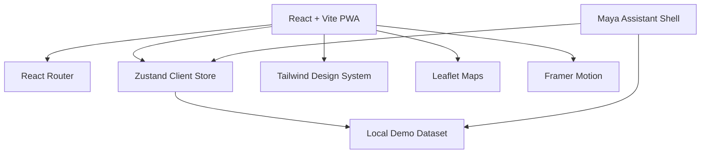

**Diagram sources**
- [plan.md:7-18](file://tasks\plan.md#L7-L18)
- [todo.md:1-16](file://tasks\todo.md#L1-L16)

**Section sources**
- [plan.md:7-18](file://tasks\plan.md#L7-L18)
- [todo.md:1-16](file://tasks\todo.md#L1-L16)

## Detailed Component Analysis

### Home Page
The Home page is the primary discovery surface. It should not only show pandals; it must dynamically present relevant content based on context and seasonality.

Key sections:
- Sponsored Spotlight: native-looking sponsored card clearly distinguished from organic content.
- Explore Spotlight: editorial-style section featuring images/videos, name, and short description for pandals, restaurants, events, or local experiences.
- Restaurants: cards showing image, name, rating, distance, cuisine/category, and optional tags such as open now, price range, and nearby.
- Offers & Discounts: sponsor offers, local business offers, Puja-related discounts, and partner promotions without making the app feel like a coupon site.
- Shopping: proposed concept for trending Puja-related wearables/products; status is under consideration, not a locked requirement.
- Events / Local Experiences: local events, activities, classes, and other experiences to keep the app useful beyond Puja.

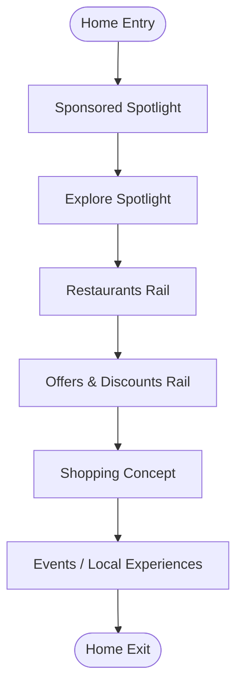

**Diagram sources**
- [Pujo_Sahayak_Master_Project_Context.md:168-283](file://Pujo_Sahayak_Master_Project_Context.md#L168-L283)

User stories and acceptance criteria:
- As a first-time visitor, I want to see a clear sponsored card so I understand which content is promotional.
  - Acceptance criteria:
    - Sponsored card is visually distinct from organic content.
    - Label indicates sponsorship.
    - Tapping navigates to the promoted place or action.
- As a user, I want to see an editorial spotlight so I can discover featured places quickly.
  - Acceptance criteria:
    - Spotlight includes image/video, name, and short description.
    - During Puja, pandals dominate; outside Puja, other local experiences appear.
- As a food explorer, I want nearby restaurant cards with ratings and distance.
  - Acceptance criteria:
    - Cards display image, name, rating, distance, and cuisine/category.
    - Optional tags such as open now and price range are shown when available.
- As a bargain seeker, I want offers and discounts without feeling overwhelmed.
  - Acceptance criteria:
    - Offers are presented as rails, not intrusive banners.
    - Content remains focused on exploration rather than coupon browsing.
- As a shopper, I want to see trending Puja-related products if this concept is enabled.
  - Acceptance criteria:
    - Shopping section is marked as conceptual until finalized.
    - Items relate to Puja wearables, accessories, traditional wear, decorations, or festival merchandise.
- As a community participant, I want events and local experiences to keep using the app after Puja.
  - Acceptance criteria:
    - Events rail includes local activities and experiences.
    - Category labels remain flexible for future refinement.

**Section sources**
- [Pujo_Sahayak_Master_Project_Context.md:160-283](file://Pujo_Sahayak_Master_Project_Context.md#L160-L283)
- [todo.md:23-25](file://tasks\todo.md#L23-L25)

### Continue Where You Left Off
This retention feature allows users to resume their previous exploration session instead of starting over.

Supported continuations include:
- Unfinished route.
- Unfinished search.
- Partially explored category.
- Saved restaurant.
- Meetup discovery session.

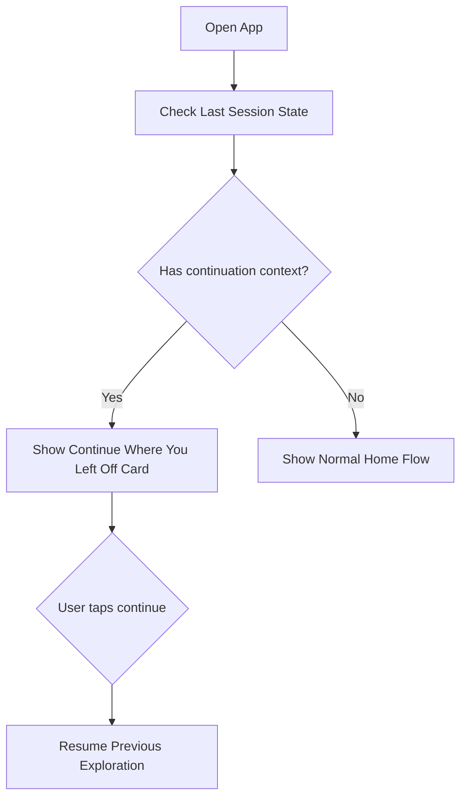

**Diagram sources**
- [Pujo_Sahayak_Master_Project_Context.md:286-317](file://Pujo_Sahayak_Master_Project_Context.md#L286-L317)
- [todo.md:23-25](file://tasks\todo.md#L23-L25)

User stories and acceptance criteria:
- As a returning user, I want to resume my last exploration so I do not lose context.
  - Acceptance criteria:
    - App detects unfinished route, search, category, saved place, or meetup session.
    - Continue Where You Left Off card appears before normal home flow.
    - Tapping continue navigates to the correct previous context.
- As a privacy-conscious user, I want continuity without forced re-authentication.
  - Acceptance criteria:
    - Continuation state persists locally.
    - No hard requirement for authentication in v1.

**Section sources**
- [Pujo_Sahayak_Master_Project_Context.md:286-317](file://Pujo_Sahayak_Master_Project_Context.md#L286-L317)
- [todo.md:23-25](file://tasks\todo.md#L23-L25)

### Favorites Page
The Favorites page is more than a bookmark list. It organizes saved places, visited history, and recommendations.

Sections:
- Saved Pandals: places explicitly saved by the user.
- Places You've Been: previously visited places including pandals, restaurants, events, and other places.
- You Might Like: recommendations based on saved places, visited places, location, categories, preferences, and potentially AI-assisted suggestions.

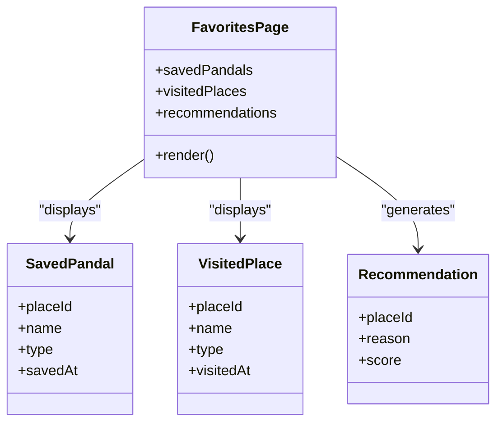

**Diagram sources**
- [Pujo_Sahayak_Master_Project_Context.md:320-350](file://Pujo_Sahayak_Master_Project_Context.md#L320-L350)
- [todo.md:47-48](file://tasks\todo.md#L47-L48)

User stories and acceptance criteria:
- As a saver, I want to view all saved pandals in one place.
  - Acceptance criteria:
    - Saved places persist across reloads.
    - Each entry shows place type and basic details.
- As a visitor tracker, I want to see places I have already been to.
  - Acceptance criteria:
    - Visited places include pandals, restaurants, events, and other places.
    - Visited timestamp is recorded where applicable.
- As a discovery user, I want personalized recommendations labeled as suggestions.
  - Acceptance criteria:
    - Recommendations use wording such as "You might like."
    - Suggestions are based on saved places, visited places, location, categories, and preferences.

**Section sources**
- [Pujo_Sahayak_Master_Project_Context.md:320-350](file://Pujo_Sahayak_Master_Project_Context.md#L320-L350)
- [todo.md:47-48](file://tasks\todo.md#L47-L48)

### Puja Planner
The Puja Planner enables detailed multi-day itinerary creation across the six main days: Panchami, Shashthi, Saptami, Ashtami, Navami, and Dashami.

A plan can contain:
- Pandals.
- Restaurants.
- Events.
- Local attractions.
- Transportation/travel segments.
- Approximate timings.

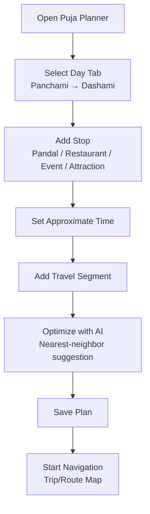

**Diagram sources**
- [Pujo_Sahayak_Master_Project_Context.md:353-401](file://Pujo_Sahayak_Master_Project_Context.md#L353-L401)
- [todo.md:50-51](file://tasks\todo.md#L50-L51)

User stories and acceptance criteria:
- As a planner, I want to create a day-by-day itinerary from Panchami to Dashami.
  - Acceptance criteria:
    - Six day tabs are available.
    - Stops can be added with type, time, and travel segments.
    - Plan persists across reloads.
- As a user who wants efficient routing, I want AI-assisted optimization suggestions.
  - Acceptance criteria:
    - Optimization is presented as a suggestion, not a guaranteed optimal route.
    - Reordering uses nearest-neighbor logic against available stops.
- As a navigator, I want to start trip navigation from a saved plan day.
  - Acceptance criteria:
    - Trip/Route Map renders the selected day’s stops.
    - Route visualization is available.

**Section sources**
- [Pujo_Sahayak_Master_Project_Context.md:353-401](file://Pujo_Sahayak_Master_Project_Context.md#L353-L401)
- [todo.md:50-51](file://tasks\todo.md#L50-L51)

### AI-Based Planning
AI-Based Planning allows natural language requests such as covering a specific area on a particular day, avoiding crowded places, and scheduling dinner around a preferred time.

Inputs considered by the system:
- Location.
- Distance.
- Operating hours.
- Crowd information.
- User preferences.
- Saved places.
- Available events.

Important constraint: generated plans must be presented as suggestions, not guaranteed optimal routes.

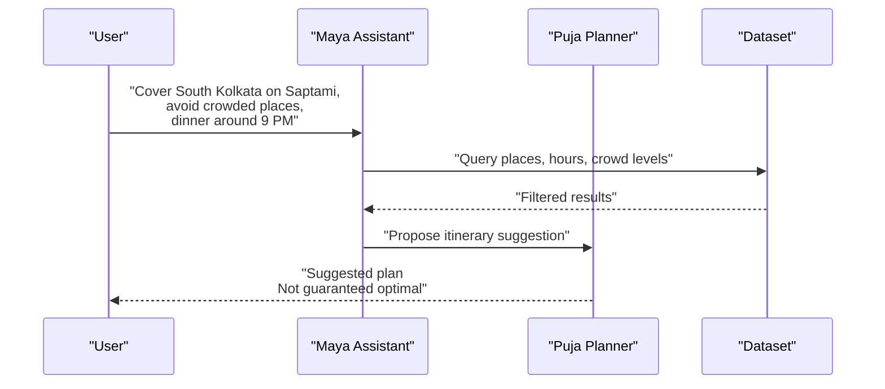

**Diagram sources**
- [Pujo_Sahayak_Master_Project_Context.md:404-421](file://Pujo_Sahayak_Master_Project_Context.md#L404-L421)
- [todo.md:50-51](file://tasks\todo.md#L50-L51)

User stories and acceptance criteria:
- As a planner, I want to describe my preferences in natural language.
  - Acceptance criteria:
    - Maya accepts natural language input.
    - Responses reference location, hours, crowd levels, and saved places.
- As a cautious user, I want AI outputs labeled as suggestions.
  - Acceptance criteria:
    - UI does not claim guaranteed optimal routes.
    - Users can edit or reject suggested plans.

**Section sources**
- [Pujo_Sahayak_Master_Project_Context.md:404-421](file://Pujo_Sahayak_Master_Project_Context.md#L404-L421)
- [todo.md:50-51](file://tasks\todo.md#L50-L51)

### Search Experience
The Search experience covers the entire local ecosystem.

Key elements:
- Search bar at the top.
- Category shortcuts: All, Pandals, Restaurants, Events, Places.
- Trending Pandals: currently popular or trending pandals based on views, saves, recent interactions, visits, or engagement.
- Popular Nearby Places: location-aware suggestions helping users discover what is around them.

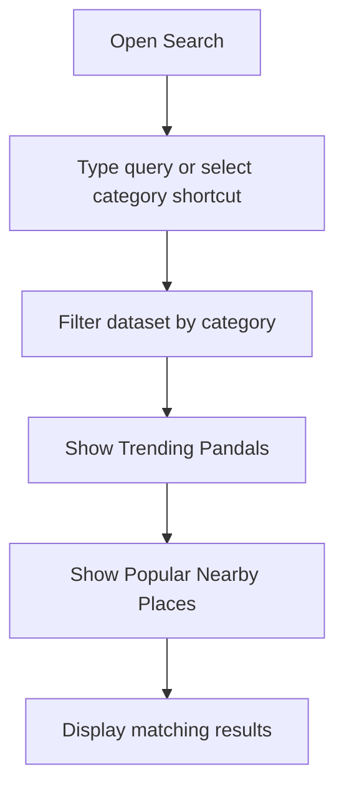

**Diagram sources**
- [Pujo_Sahayak_Master_Project_Context.md:447-492](file://Pujo_Sahayak_Master_Project_Context.md#L447-L492)
- [todo.md:42-43](file://tasks\todo.md#L42-L43)

User stories and acceptance criteria:
- As a searcher, I want quick category filters so I do not type everything.
  - Acceptance criteria:
    - Category pills include All, Pandals, Restaurants, Events, and Places.
    - Filtering updates results live.
- As a trend follower, I want to see trending pandals.
  - Acceptance criteria:
    - Trending is based on measurable signals such as views, saves, interactions, or visits.
    - Rankings are not fabricated without underlying metrics.
- As a local explorer, I want popular nearby places.
  - Acceptance criteria:
    - Nearby results use location context.
    - Results help users discover immediate options.

**Section sources**
- [Pujo_Sahayak_Master_Project_Context.md:447-492](file://Pujo_Sahayak_Master_Project_Context.md#L447-L492)
- [todo.md:42-43](file://tasks\todo.md#L42-L43)

### Categories Page
The Categories page is a structured discovery hub organized into three broad groups.

Groups:
- Places: Pandals, Restaurants, Places; potential future additions include Attractions, Events, and Shopping.
- Transport & Services: Metro, Bus, Parking; potential future additions include cab/ride information, fuel, and charging.
- Utilities: Police Station, Hospital, ATM, Pharmacy; potential additions include medical camp, toilet, help desk, drinking water, and parking.

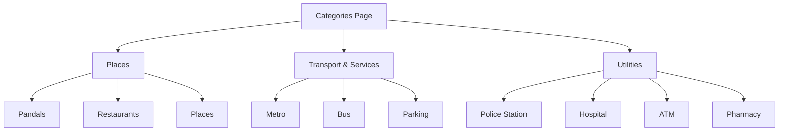

**Diagram sources**
- [Pujo_Sahayak_Master_Project_Context.md:495-555](file://Pujo_Sahayak_Master_Project_Context.md#L495-L555)
- [todo.md:42-43](file://tasks\todo.md#L42-L43)

User stories and acceptance criteria:
- As a finder, I want categories grouped logically so I can navigate quickly.
  - Acceptance criteria:
    - Places, Transport & Services, and Utilities are clearly separated.
    - Icons and labels match mockup intent.
- As a future planner, I want room for additional categories.
  - Acceptance criteria:
    - Category structure supports future additions without breaking existing flows.
- As a safety-focused user, I want utilities such as hospitals and police stations visible.
  - Acceptance criteria:
    - Utility categories include essential services.
    - Only supported and reliable services are added.

**Section sources**
- [Pujo_Sahayak_Master_Project_Context.md:495-555](file://Pujo_Sahayak_Master_Project_Context.md#L495-L555)
- [todo.md:42-43](file://tasks\todo.md#L42-L43)

### Maya AI Assistant
Maya is the named AI assistant for Puja Sahayak. She should not be a generic chatbot; she should understand application data and context.

Capabilities include:
- Answering questions about pandal themes, symbolism, artist information, visit details, nearby transport, dining, crowd levels, and safety.
- Providing contextual answers based on current location, selected place, saved locations, current trip, language, and category.
- Supporting camera-based identification where the user points the camera at a pandal and receives an explanation.
- Integrating with planning and search flows.

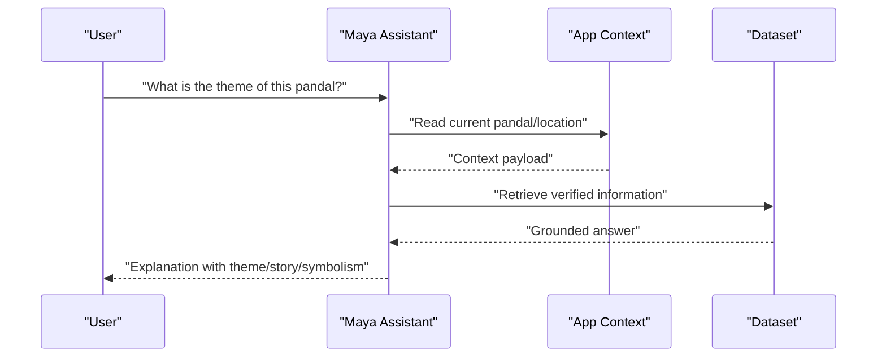

**Diagram sources**
- [Pujo_Sahayak_Master_Project_Context.md:558-662](file://Pujo_Sahayak_Master_Project_Context.md#L558-L662)
- [todo.md:36-40](file://tasks\todo.md#L36-L40)

User stories and acceptance criteria:
- As a curious visitor, I want Maya to explain what I am seeing.
  - Acceptance criteria:
    - Maya responds with grounded information from the dataset.
    - Answers cover theme, story, symbolism, artist info, and visit details.
- As a traveler, I want Maya to know my current context.
  - Acceptance criteria:
    - Opening Maya from a pandal or restaurant preloads relevant context.
    - Users do not need to repeat location or place details.
- As a scanner user, I want to point my camera at a pandal and get information.
  - Acceptance criteria:
    - Camera preview opens with permission handling.
    - Identification result is honest and marked as demo where applicable.
    - Result navigates to the corresponding detail page.

**Section sources**
- [Pujo_Sahayak_Master_Project_Context.md:558-662](file://Pujo_Sahayak_Master_Project_Context.md#L558-L662)
- [todo.md:36-40](file://tasks\todo.md#L36-L40)

### Meets Page
The Meets page provides a social layer for activity-based discovery.

Features:
- Existing meetups with name, date, time, location, participants, and short description.
- Create your own meetup with title, date, time, location, description, interest/vibe, maximum participants, and visibility.
- Find people based on shared interests such as photography, pandal hopping, food, music, art, night exploration, heritage, and family-friendly exploration.
- Monetization concepts including free, paid, and premium-only meetups, treated as business-model concepts rather than finalized pricing rules.

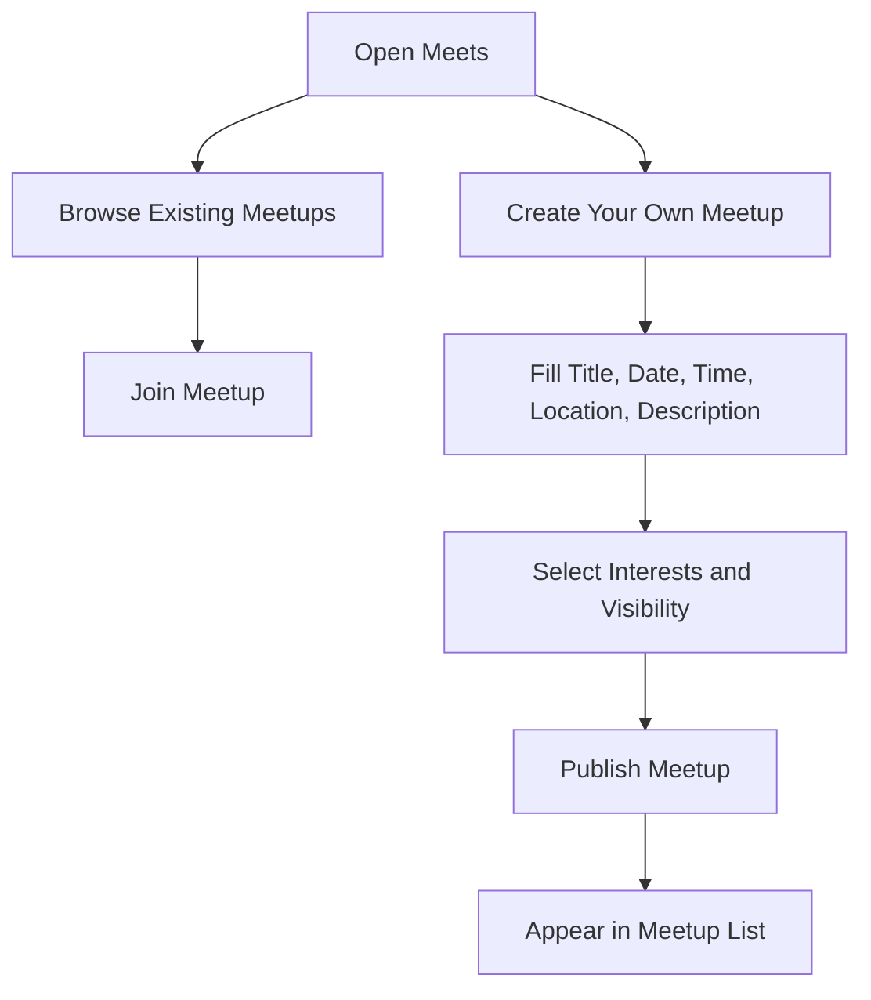

**Diagram sources**
- [Pujo_Sahayak_Master_Project_Context.md:664-771](file://Pujo_Sahayak_Master_Project_Context.md#L664-L771)
- [todo.md:53-54](file://tasks\todo.md#L53-L54)

User stories and acceptance criteria:
- As a social explorer, I want to find meetups near me or aligned with my interests.
  - Acceptance criteria:
    - Meetup cards display essential details.
    - Filters include All, Nearby, and My Interests.
- As an organizer, I want to create a meetup easily.
  - Acceptance criteria:
    - Creation form captures required fields.
    - Created meetups appear in the list.
- As a participant, I want to join meetups without confusion.
  - Acceptance criteria:
    - Join action updates participation state.
    - Pricing models are conceptually supported but not hard-coded.

**Section sources**
- [Pujo_Sahayak_Master_Project_Context.md:664-771](file://Pujo_Sahayak_Master_Project_Context.md#L664-L771)
- [todo.md:53-54](file://tasks\todo.md#L53-L54)

## Dependency Analysis
The feature dependencies follow a phased build approach:

- Foundation depends on scaffold, design system, and typed data model.
- Discovery core depends on foundation and dataset.
- Maya, Search, and Categories depend on foundation and dataset.
- Planning and social depend on favorites and dataset.
- Utility and account depend on earlier phases.
- Polish depends on all functional phases.

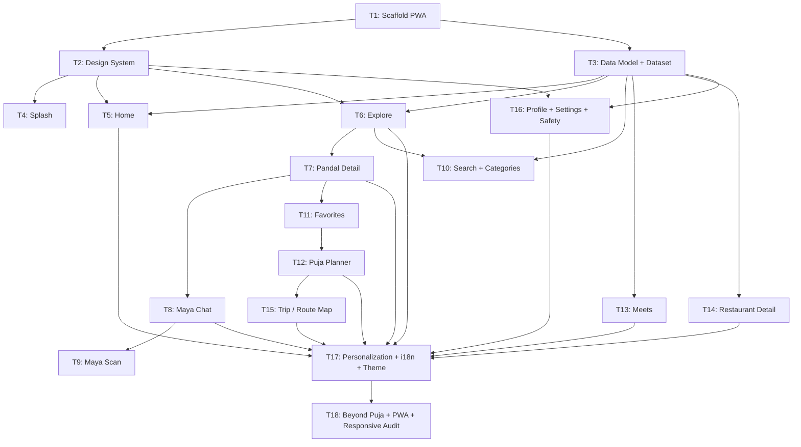

**Diagram sources**
- [todo.md:5-75](file://tasks\todo.md#L5-L75)

**Section sources**
- [todo.md:5-75](file://tasks\todo.md#L5-L75)

## Performance Considerations
Based on the implementation plan and task breakdown, performance and responsiveness considerations include:

- Mobile-first design with Tailwind CSS for lightweight styling and responsive layouts.
- PWA shell caching via `vite-plugin-pwa` for installability and offline shell behavior.
- Reduced-motion support honoring accessibility preferences.
- Local dataset retrieval for Maya responses to avoid unnecessary network calls in v1.
- Leaflet maps for route visualization without requiring external map API keys.
- Image-agnostic layout with gradient or placeholder fallbacks to prevent layout breaks when images are unavailable.
- Desktop adaptation through max-width app frames and multi-column rails.
- Lighthouse PWA audit for installability and service worker behavior.

[No sources needed since this section provides general guidance]

## Troubleshooting Guide
Common troubleshooting areas derived from the project documentation:

- Build and setup issues:
  - Ensure `npm run build` is clean and TypeScript compiles without errors.
  - Verify dev server serves the app shell and every route is reachable via bottom navigation or documented deep links.
- Persistence issues:
  - Saves, visits, plans, and settings must survive reloads because they persist to localStorage.
- Maya behavior:
  - Maya must never invent facts; answers are retrieved from the local dataset.
  - Camera scan should open with permission handling and return honest demo results.
- Data honesty:
  - Reviews, photos, crowd levels, and operating hours must come from the dataset and be marked as demo where applicable.
- Mockup fidelity:
  - Screen-by-screen comparison should verify IA matches element presence and order.
- PWA and responsiveness:
  - Verify install prompt, shell cache, and layout at both mobile and desktop breakpoints.

**Section sources**
- [plan.md:63-85](file://tasks\plan.md#L63-L85)
- [todo.md:63-80](file://tasks\todo.md#L63-L80)

## Conclusion
Puja Sahayak is designed as a cohesive ecosystem centered on discovery, understanding, planning, visiting, sharing, meeting, and continued exploration. The Home page, Continue Where You Left Off, Favorites, Puja Planner, AI-Based Planning, Search, Categories, Maya, Meets, and utility features together form a seasonal core with broader local-discovery capabilities.

The implementation plan emphasizes:
- Mobile-first React + Vite PWA architecture.
- Clear separation between UI, state, data, and maps.
- Honest demo data and non-hallucinated AI responses.
- Phased delivery with runnable checkpoints.
- Accessibility, personalization, and PWA readiness.

Future work may expand premium features, monetization models, and off-season discovery, but these should remain configurable and not hard-coded prematurely.

[No sources needed since this section summarizes without analyzing specific files]

## Appendices

### Non-Functional Requirements Summary
- Performance:
  - Clean build, no TypeScript errors.
  - PWA installable and offline-capable shell.
  - Optimized for mobile-first usage.
- Accessibility:
  - Reduced-motion support.
  - Clear distinction between sponsored and organic content.
  - Grounded, honest AI responses.
- Mobile Responsiveness:
  - Bottom navigation mapped to routes.
  - Desktop adaptation with max-width frame and multi-column rails.
  - Layout resilient to missing images.

**Section sources**
- [plan.md:7-18](file://tasks\plan.md#L7-L18)
- [plan.md:63-85](file://tasks\plan.md#L63-L85)
- [todo.md:63-80](file://tasks\todo.md#L63-L80)