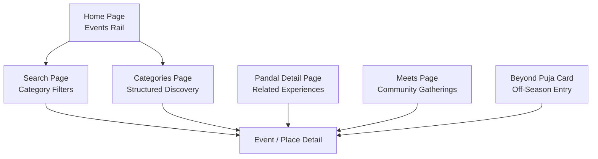
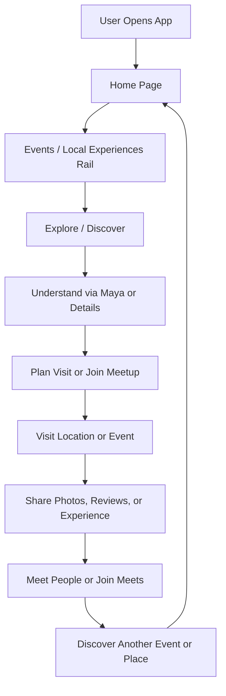
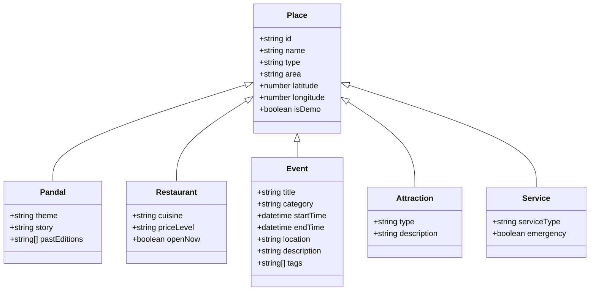
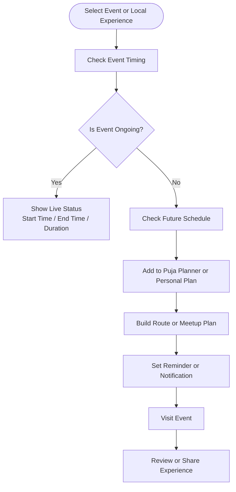
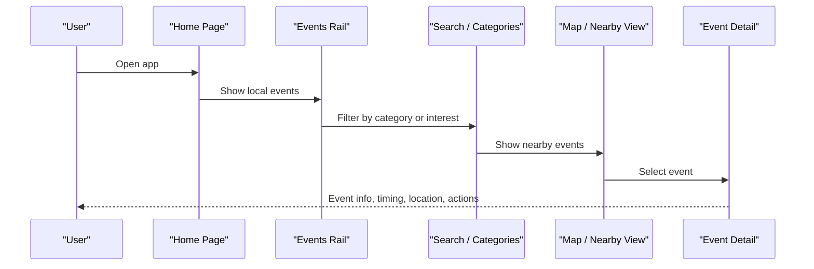
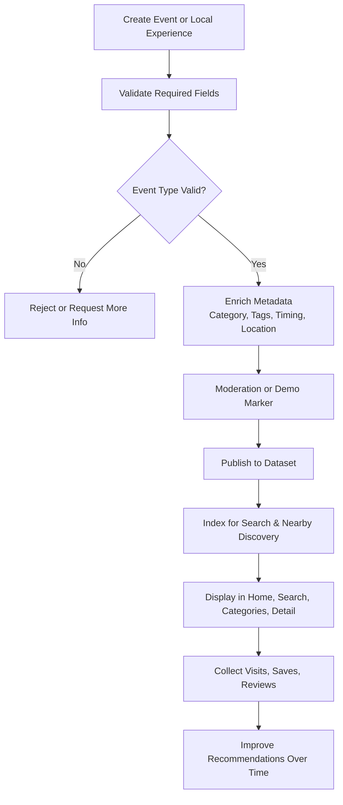
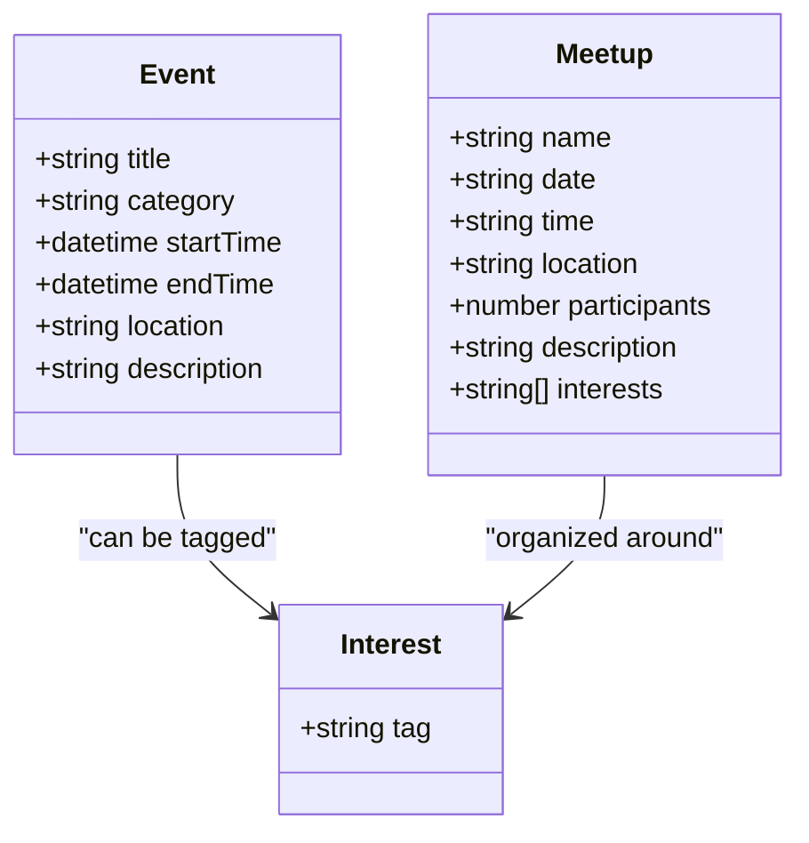
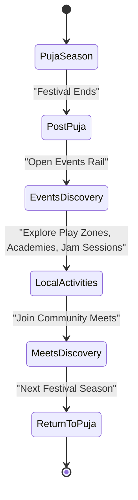
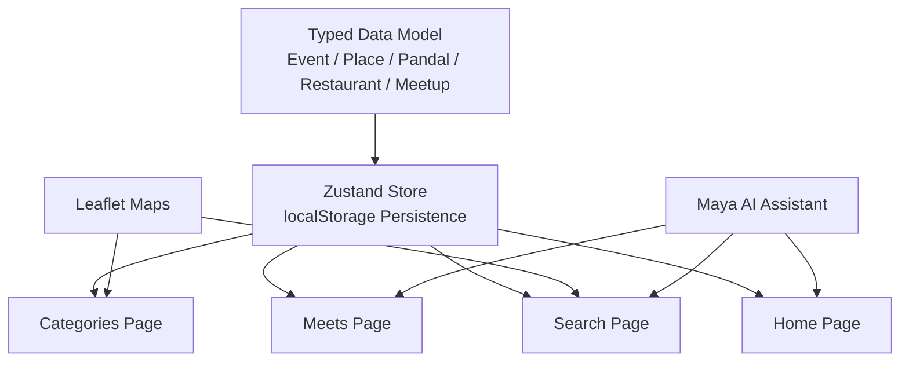

# Events & Local Experiences

<cite>
**Referenced Files in This Document**
- [Pujo_Sahayak_Master_Project_Context.md](file://Pujo_Sahayak_Master_Project_Context.md)
- [plan.md](file://tasks/plan.md)
- [todo.md](file://tasks/todo.md)
</cite>

## Table of Contents
1. [Introduction](#introduction)
2. [Project Structure](#project-structure)
3. [Core Components](#core-components)
4. [Architecture Overview](#architecture-overview)
5. [Detailed Component Analysis](#detailed-component-analysis)
6. [Dependency Analysis](#dependency-analysis)
7. [Performance Considerations](#performance-considerations)
8. [Troubleshooting Guide](#troubleshooting-guide)
9. [Conclusion](#conclusion)

## Introduction
This document defines the strategy, structure, and implementation guidelines for the **Events & Local Experiences** section of Pujo Sahayak. It focuses on keeping users engaged year-round by extending the app beyond the core Durga Puja pandal experience into local events, jamming sessions, play zones, local activities, academies/classes, and similar experiences.

The product context is intentionally seasonal at launch but broader in scope: Durga Puja drives initial discovery, while restaurants, events, local activities, offers, and other discovery features keep the app useful outside the festival season. The Home page should therefore include an “Events / Local Experiences” rail that can promote relevant local content even after Puja ends.

**Section sources**
- [Pujo_Sahayak_Master_Project_Context.md:7-11](file://Pujo_Sahayak_Master_Project_Context.md#L7-L11)
- [Pujo_Sahayak_Master_Project_Context.md:77-100](file://Pujo_Sahayak_Master_Project_Context.md#L77-L100)
- [Pujo_Sahayak_Master_Project_Context.md:104-136](file://Pujo_Sahayak_Master_Project_Context.md#L104-L136)
- [Pujo_Sahayak_Master_Project_Context.md:268-283](file://Pujo_Sahayak_Master_Project_Context.md#L268-L283)

## Project Structure
At a high level, the Events & Local Experiences feature spans several parts of the application:

- **Home page**: Includes an “Events / Local Experiences” rail that surfaces local events, jamming sessions, play zones, local activities, and academies/classes.
- **Search page**: Supports filtering across categories such as All, Pandals, Restaurants, Events, and Places.
- **Categories page**: Provides structured discovery hubs where Events may be added under Places or a dedicated category group.
- **Pandal Detail page**: Can surface related meetups or nearby local experiences to extend the visit journey.
- **Meets page**: Represents community-driven social gatherings, which are closely related to event-style experiences.
- **Beyond Puja card**: A dedicated off-season entry point that reinforces the idea that the app remains useful after Puja.
- **Data model**: Uses a typed `Event` entity alongside `Place`, `Pandal`, `Restaurant`, `Meetup`, and other entities.

**Diagram sources**
- [Pujo_Sahayak_Master_Project_Context.md:140-157](file://Pujo_Sahayak_Master_Project_Context.md#L140-L157)
- [Pujo_Sahayak_Master_Project_Context.md:160-207](file://Pujo_Sahayak_Master_Project_Context.md#L160-L207)
- [Pujo_Sahayak_Master_Project_Context.md:268-283](file://Pujo_Sahayak_Master_Project_Context.md#L268-L283)
- [Pujo_Sahayak_Master_Project_Context.md:447-493](file://Pujo_Sahayak_Master_Project_Context.md#L447-L493)
- [Pujo_Sahayak_Master_Project_Context.md:495-556](file://Pujo_Sahayak_Master_Project_Context.md#L495-L556)
- [Pujo_Sahayak_Master_Project_Context.md:664-771](file://Pujo_Sahayak_Master_Project_Context.md#L664-L771)
- [plan.md:19-39](file://tasks/plan.md#L19-L39)
- [todo.md:23-30](file://tasks/todo.md#L23-L30)
- [todo.md:42-54](file://tasks/todo.md#L42-L54)
- [todo.md:74-75](file://tasks/todo.md#L74-L75)

**Section sources**
- [Pujo_Sahayak_Master_Project_Context.md:140-157](file://Pujo_Sahayak_Master_Project_Context.md#L140-L157)
- [Pujo_Sahayak_Master_Project_Context.md:160-207](file://Pujo_Sahayak_Master_Project_Context.md#L160-L207)
- [Pujo_Sahayak_Master_Project_Context.md:268-283](file://Pujo_Sahayak_Master_Project_Context.md#L268-L283)
- [Pujo_Sahayak_Master_Project_Context.md:447-493](file://Pujo_Sahayak_Master_Project_Context.md#L447-L493)
- [Pujo_Sahayak_Master_Project_Context.md:495-556](file://Pujo_Sahayak_Master_Project_Context.md#L495-L556)
- [Pujo_Sahayak_Master_Project_Context.md:664-771](file://Pujo_Sahayak_Master_Project_Context.md#L664-L771)
- [plan.md:19-39](file://tasks/plan.md#L19-L39)
- [todo.md:23-30](file://tasks/todo.md#L23-L30)
- [todo.md:42-54](file://tasks/todo.md#L42-L54)
- [todo.md:74-75](file://tasks/todo.md#L74-L75)

## Core Components
The Events & Local Experiences capability is built around these core components:

| Component | Responsibility | Relevance to Year-Round Engagement |
|---|---|---|
| Events Rail (Home) | Surfaces curated local events and experiences near the user’s location or interests. | Keeps the app useful when pandals are not the dominant focus. |
| Event Category System | Classifies items as pandals, restaurants, events, attractions, services, or other local experiences. | Enables flexible discovery beyond Puja. |
| Search with Category Filters | Lets users filter across All, Pandals, Restaurants, Events, and Places. | Helps users quickly find non-Puja activities. |
| Categories Hub | Organizes discovery into Places, Transport & Services, and Utilities; can evolve to highlight Events. | Provides structured navigation for diverse local experiences. |
| Meetups | Community-driven gatherings with title, date, time, location, participants, and description. | Bridges scheduled events with social discovery. |
| Beyond Puja Entry Point | Explicitly signals that the app continues to offer value after the festival. | Reinforces retention and long-term utility. |
| Data Model Entity: Event | Typed representation of an event or local experience within the demo dataset. | Ensures consistent handling of events alongside places and restaurants. |

**Section sources**
- [Pujo_Sahayak_Master_Project_Context.md:77-100](file://Pujo_Sahayak_Master_Project_Context.md#L77-L100)
- [Pujo_Sahayak_Master_Project_Context.md:104-136](file://Pujo_Sahayak_Master_Project_Context.md#L104-L136)
- [Pujo_Sahayak_Master_Project_Context.md:268-283](file://Pujo_Sahayak_Master_Project_Context.md#L268-L283)
- [Pujo_Sahayak_Master_Project_Context.md:447-493](file://Pujo_Sahayak_Master_Project_Context.md#L447-L493)
- [Pujo_Sahayak_Master_Project_Context.md:495-556](file://Pujo_Sahayak_Master_Project_Context.md#L495-L556)
- [Pujo_Sahayak_Master_Project_Context.md:664-771](file://Pujo_Sahayak_Master_Project_Context.md#L664-L771)
- [plan.md:45-46](file://tasks/plan.md#L45-L46)
- [todo.md:13-14](file://tasks/todo.md#L13-L14)

## Architecture Overview
The Events & Local Experiences architecture follows the product’s continuous discovery loop: discover, explore, understand, plan, visit, share/review, meet people, and discover something else. Events and local experiences fit naturally into this loop as both destinations and reasons to return to the app.

**Diagram sources**
- [Pujo_Sahayak_Master_Project_Context.md:21-43](file://Pujo_Sahayak_Master_Project_Context.md#L21-L43)
- [Pujo_Sahayak_Master_Project_Context.md:268-283](file://Pujo_Sahayak_Master_Project_Context.md#L268-L283)
- [Pujo_Sahayak_Master_Project_Context.md:664-771](file://Pujo_Sahayak_Master_Project_Context.md#L664-L771)

## Detailed Component Analysis

### Event Categorization Strategy
The product explicitly treats the platform as more than a Puja-only app. The conceptual hierarchy includes:

- Place
  - Pandal
  - Restaurant
  - Event
  - Attraction
  - Service
  - Other local experience

During Puja, pandals dominate. Outside Puja, the same system should support events, local activities, academies, classes, play zones, and jamming sessions. The exact categories are not locked and should remain extensible.

**Diagram sources**
- [Pujo_Sahayak_Master_Project_Context.md:124-136](file://Pujo_Sahayak_Master_Project_Context.md#L124-L136)
- [plan.md:45-46](file://tasks/plan.md#L45-L46)
- [todo.md:13-14](file://tasks/todo.md#L13-L14)

**Implementation guidance**
- Treat `Event` as a first-class place-like entity rather than a secondary feature.
- Use a `category` field to distinguish jamming sessions, play zones, local activities, academies/classes, festivals, workshops, and similar experiences.
- Keep categories configurable so they can evolve without breaking the UI.
- Avoid hard-coding a fixed set of event types unless the product explicitly finalizes them.

**Section sources**
- [Pujo_Sahayak_Master_Project_Context.md:104-136](file://Pujo_Sahayak_Master_Project_Context.md#L104-L136)
- [Pujo_Sahayak_Master_Project_Context.md:268-283](file://Pujo_Sahayak_Master_Project_Context.md#L268-L283)
- [plan.md:45-46](file://tasks/plan.md#L45-L46)
- [todo.md:13-14](file://tasks/todo.md#L13-L14)

### Scheduling System for Events and Local Experiences
Events and local experiences require scheduling-aware behavior because many are time-bound. The planning system already supports multi-day itineraries with stops, durations, travel segments, and approximate timings. Events should integrate with this model.

**Diagram sources**
- [Pujo_Sahayak_Master_Project_Context.md:353-421](file://Pujo_Sahayak_Master_Project_Context.md#L353-L421)
- [todo.md:47-54](file://tasks/todo.md#L47-L54)

**Implementation guidance**
- Store start time, end time, and duration for each event.
- Support recurring events for weekly jamming sessions, regular classes, or weekly play-zone schedules.
- Integrate event entries into the planner alongside pandals, restaurants, and meetups.
- Present generated plans as suggestions, not guaranteed optimal routes.
- Allow users to add events to personal plans even outside the Puja season.

**Section sources**
- [Pujo_Sahayak_Master_Project_Context.md:353-421](file://Pujo_Sahayak_Master_Project_Context.md#L353-L421)
- [todo.md:47-54](file://tasks/todo.md#L47-L54)

### Location-Based Discovery for Events
Location context is central to the app’s discovery model. Nearby restaurants, popular places, safety points, and transport options are all location-aware. Events and local experiences should follow the same pattern.

**Diagram sources**
- [Pujo_Sahayak_Master_Project_Context.md:160-207](file://Pujo_Sahayak_Master_Project_Context.md#L160-L207)
- [Pujo_Sahayak_Master_Project_Context.md:447-493](file://Pujo_Sahayak_Master_Project_Context.md#L447-L493)
- [todo.md:23-30](file://tasks/todo.md#L23-L30)
- [todo.md:42-54](file://tasks/todo.md#L42-L54)

**Implementation guidance**
- Surface events from the Home page based on proximity and relevance.
- Support filters by area, distance, category, crowd level, and timing.
- Use Leaflet-based maps for list/map toggle views, consistent with the existing exploration flow.
- Ensure event cards show key metadata: name, category, distance, timing, and short description.
- Allow deep linking into event detail pages from Home, Search, Categories, and Meets.

**Section sources**
- [Pujo_Sahayak_Master_Project_Context.md:160-207](file://Pujo_Sahayak_Master_Project_Context.md#L160-L207)
- [Pujo_Sahayak_Master_Project_Context.md:447-493](file://Pujo_Sahayak_Master_Project_Context.md#L447-L493)
- [plan.md:19-39](file://tasks/plan.md#L19-L39)
- [todo.md:23-30](file://tasks/todo.md#L23-L30)
- [todo.md:42-54](file://tasks/todo.md#L42-L54)

### Content Management for Diverse Local Experiences
Content management must support a wide variety of local experiences while preserving clarity and trust. The product emphasizes grounded data, honest demo markers, and avoiding fabricated statistics.

**Diagram sources**
- [plan.md:15-17](file://tasks/plan.md#L15-L17)
- [todo.md:13-14](file://tasks/todo.md#L13-L14)

**Implementation guidance**
- Require essential fields: title, category, timing, location, and description.
- Support optional fields: tags, audience type, accessibility, cost, capacity, and media.
- Mark demo content clearly and avoid presenting unverified data as production facts.
- Separate editorial spotlight content from organic event listings.
- Allow sponsored or partner promotions only when clearly labeled as sponsored.

**Section sources**
- [Pujo_Sahayak_Master_Project_Context.md:168-187](file://Pujo_Sahayak_Master_Project_Context.md#L168-L187)
- [Pujo_Sahayak_Master_Project_Context.md:235-247](file://Pujo_Sahayak_Master_Project_Context.md#L235-L247)
- [plan.md:15-17](file://tasks/plan.md#L15-L17)
- [todo.md:13-14](file://tasks/todo.md#L13-L14)

### Relationship Between Events, Local Activities, and Meets
Events and Meets are related but distinct. Events are generally place- or activity-focused, while Meets are community-driven gatherings around shared interests. Both contribute to year-round engagement.

**Diagram sources**
- [Pujo_Sahayak_Master_Project_Context.md:664-771](file://Pujo_Sahayak_Master_Project_Context.md#L664-L771)
- [plan.md:45-46](file://tasks/plan.md#L45-L46)
- [todo.md:53-54](file://tasks/todo.md#L53-L54)

**Implementation guidance**
- Keep Events and Meets as separate entities with overlapping metadata such as location, timing, and description.
- Allow users to discover Meets through interest-based filters like photography, music, art, night exploration, heritage, and family-friendly exploration.
- Do not treat Meets as a dating feature; frame it as activity-based social discovery.
- Support free, paid, and premium-only Meets conceptually without hard-coding pricing logic prematurely.

**Section sources**
- [Pujo_Sahayak_Master_Project_Context.md:664-771](file://Pujo_Sahayak_Master_Project_Context.md#L664-L771)
- [todo.md:53-54](file://tasks/todo.md#L53-L54)

### Beyond Puja Retention Strategy
The strategic importance of Events & Local Experiences is retention. The product explicitly states that even after Puja is over, users should still have reasons to open the app. The Home page’s Events rail and the “Beyond Puja” card reinforce this continuity.

**Diagram sources**
- [Pujo_Sahayak_Master_Project_Context.md:99-100](file://Pujo_Sahayak_Master_Project_Context.md#L99-L100)
- [Pujo_Sahayak_Master_Project_Context.md:268-283](file://Pujo_Sahayak_Master_Project_Context.md#L268-L283)
- [todo.md:74-75](file://tasks/todo.md#L74-L75)

**Implementation guidance**
- Promote non-Puja events prominently during off-season months.
- Use personalized recommendations based on saved places, visited places, location, categories, and preferences.
- Maintain the “Continue Where You Left Off” experience so users can return to unfinished searches, routes, or event discovery sessions.
- Avoid turning the app into a generic coupon or directory site; keep discovery contextual and experience-focused.

**Section sources**
- [Pujo_Sahayak_Master_Project_Context.md:99-100](file://Pujo_Sahayak_Master_Project_Context.md#L99-L100)
- [Pujo_Sahayak_Master_Project_Context.md:286-317](file://Pujo_Sahayak_Master_Project_Context.md#L286-L317)
- [Pujo_Sahayak_Master_Project_Context.md:268-283](file://Pujo_Sahayak_Master_Project_Context.md#L268-L283)
- [todo.md:74-75](file://tasks/todo.md#L74-L75)

## Dependency Analysis
Events & Local Experiences depend on several foundational systems:

- **Data model**: Requires a typed `Event` entity and a Kolkata demo dataset.
- **Navigation**: Integrates with Home, Search, Categories, Pandal Detail, Meets, and Beyond Puja routes.
- **State persistence**: Uses Zustand with localStorage for saves, visits, plans, and settings.
- **Maps**: Uses Leaflet for nearby discovery and route visualization.
- **AI assistant**: Maya can answer questions about events, nearby activities, and planning.

**Diagram sources**
- [plan.md:7-17](file://tasks/plan.md#L7-L17)
- [plan.md:19-39](file://tasks/plan.md#L19-L39)
- [todo.md:13-14](file://tasks/todo.md#L13-L14)
- [todo.md:23-30](file://tasks/todo.md#L23-L30)
- [todo.md:42-54](file://tasks/todo.md#L42-L54)

**Section sources**
- [plan.md:7-17](file://tasks/plan.md#L7-L17)
- [plan.md:19-39](file://tasks/plan.md#L19-L39)
- [todo.md:13-14](file://tasks/todo.md#L13-L14)
- [todo.md:23-30](file://tasks/todo.md#L23-L30)
- [todo.md:42-54](file://tasks/todo.md#L42-L54)

## Performance Considerations
- Keep event cards lightweight: image, name, category, distance, timing, and short description.
- Defer heavy media until the user opens event detail.
- Use location-based filtering efficiently to avoid loading all events globally.
- Cache nearby events and popular local experiences to reduce repeated queries.
- Respect reduced-motion preferences when animating event rails or transitions.
- Avoid fabricating trending metrics; only display rankings if underlying data exists.

[No sources needed since this section provides general guidance]

## Troubleshooting Guide
Common issues and how to address them:

| Issue | Likely Cause | Resolution |
|---|---|---|
| Events do not appear in Home rail | Missing or incomplete event data | Ensure required fields exist and the dataset loads correctly. |
| Events appear far away unexpectedly | Incorrect coordinates or missing location | Validate latitude/longitude and area metadata. |
| Event timing looks wrong | Missing start/end times or timezone assumptions | Store explicit timing fields and present relative timing clearly. |
| Event search returns no results | Category mismatch or overly strict filters | Relax filters and verify category/tag alignment. |
| Sponsored events look like organic content | Missing sponsorship label | Clearly distinguish sponsored content from organic recommendations. |
| Meets feel unrelated to events | Weak interest or location linkage | Add interest tags and location context to improve matching. |

**Section sources**
- [Pujo_Sahayak_Master_Project_Context.md:168-187](file://Pujo_Sahayak_Master_Project_Context.md#L168-L187)
- [Pujo_Sahayak_Master_Project_Context.md:447-493](file://Pujo_Sahayak_Master_Project_Context.md#L447-L493)
- [plan.md:15-17](file://tasks/plan.md#L15-L17)
- [todo.md:13-14](file://tasks/todo.md#L13-L14)

## Conclusion
The Events & Local Experiences section is essential to transforming Pujo Sahayak from a seasonal Puja app into a year-round local discovery companion. By implementing robust event categorization, scheduling awareness, location-based discovery, and thoughtful content management, the app can retain users beyond the Durga Puja season through jamming sessions, play zones, local activities, academies/classes, and community Meets.

The strategic goal is simple: give users reasons to open the app even after Puja ends, while keeping the experience grounded, trustworthy, and aligned with the broader discovery loop.

[No sources needed since this section summarizes without analyzing specific files]