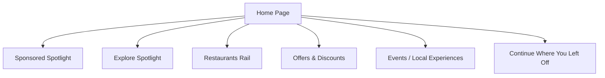
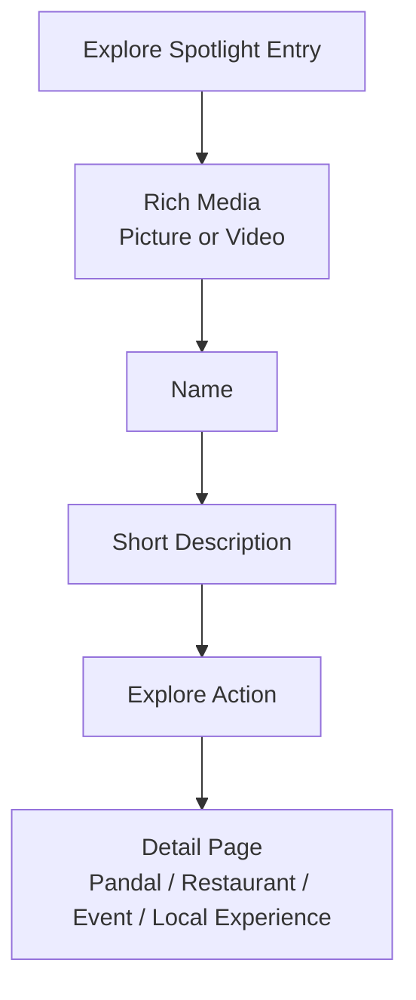
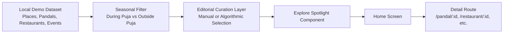
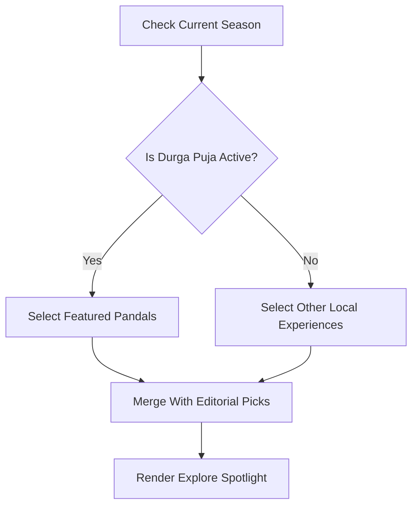
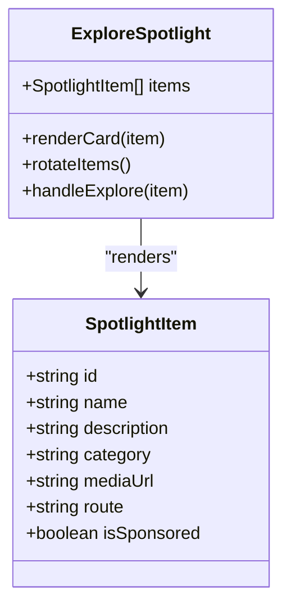
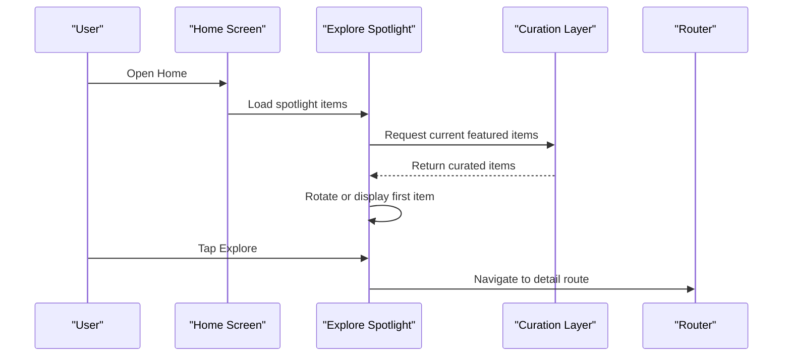
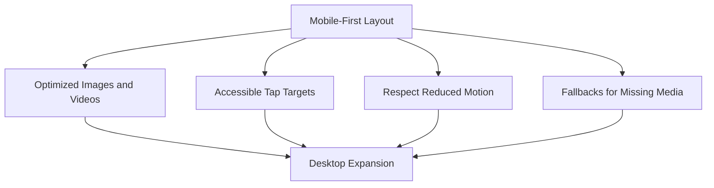
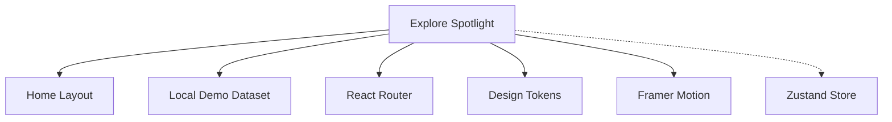

# Explore Spotlight Section

<cite>
**Referenced Files in This Document**
- [Pujo_Sahayak_Master_Project_Context.md](file://Pujo_Sahayak_Master_Project_Context.md)
- [plan.md](file://tasks/plan.md)
- [todo.md](file://tasks/todo.md)
</cite>

## Table of Contents
1. [Introduction](#introduction)
2. [Project Structure](#project-structure)
3. [Core Components](#core-components)
4. [Architecture Overview](#architecture-overview)
5. [Detailed Component Analysis](#detailed-component-analysis)
6. [Dependency Analysis](#dependency-analysis)
7. [Performance Considerations](#performance-considerations)
8. [Troubleshooting Guide](#troubleshooting-guide)
9. [Conclusion](#conclusion)

## Introduction
The Explore Spotlight section is a larger editorial-style feature on the Home page that showcases rich media and short contextual information about places users should explore. It can highlight:
- Pandals
- Restaurants
- Events
- Local experiences

Its main purpose is to make discovery feel curated, seasonal, and visually engaging rather than like a generic list. During Durga Puja, pandals should dominate the spotlight. Outside the festival season, the same component should promote other local experiences so the app remains useful year-round.

This document explains how the section fits into the overall product, what content it presents, how seasonal adaptation works, and how to implement dynamic rotation, editorial curation, and responsive mobile presentation.

**Section sources**
- [Pujo_Sahayak_Master_Project_Context.md:160-207](file://Pujo_Sahayak_Master_Project_Context.md#L160-L207)
- [Pujo_Sahayak_Master_Project_Context.md:104-138](file://Pujo_Sahayak_Master_Project_Context.md#L104-L138)

## Project Structure
At a high level, the Explore Spotlight belongs to the Home page discovery surface. The master context defines the Home page as the primary place where users discover pandals, restaurants, events, offers, shopping ideas, and local experiences. The Explore Spotlight sits alongside sponsored content, restaurant rails, offers, events, and “Continue Where You Left Off.”

**Diagram sources**
- [Pujo_Sahayak_Master_Project_Context.md:160-207](file://Pujo_Sahayak_Master_Project_Context.md#L160-L207)
- [Pujo_Sahayak_Master_Project_Context.md:268-283](file://Pujo_Sahayak_Master_Project_Context.md#L268-L283)

The implementation plan identifies the Home page as part of Phase 2, with the task explicitly listing the Explore Spotlight among the required sections. The task checklist also confirms that the Home page should render all sections from the dataset and support language toggling.

**Section sources**
- [Pujo_Sahayak_Master_Project_Context.md:160-207](file://Pujo_Sahayak_Master_Project_Context.md#L160-L207)
- [plan.md:41-49](file://tasks/plan.md#L41-L49)
- [todo.md:23-24](file://tasks/todo.md#L23-L24)

## Core Components
The Explore Spotlight is an editorial showcase card or carousel-like area that presents:
- Pictures or videos
- Name
- Short description
- A clear call to explore the item

It is not limited to one category. The same component can display:
- A featured pandal
- A featured restaurant
- A featured event
- A featured local experience

The key design rule is that the spotlight should feel native and editorial, not like an intrusive banner. It should be visually distinct from organic recommendations while still fitting naturally into the Home page flow.

**Diagram sources**
- [Pujo_Sahayak_Master_Project_Context.md:189-207](file://Pujo_Sahayak_Master_Project_Context.md#L189-L207)

### Content Model
Each spotlight item should conceptually include:
- Media asset (image or video)
- Title/name
- Short description
- Category type
- Destination route
- Optional metadata such as location, rating, distance, or tags depending on the item type

The data model defined in the implementation plan includes types for Place, Pandal, Restaurant, Event, Meetup, Review, Photo, Plan, Offer, SafetyPoint, and Category. The spotlight should reuse these typed entities rather than introducing a separate untyped structure.

**Section sources**
- [Pujo_Sahayak_Master_Project_Context.md:189-207](file://Pujo_Sahayak_Master_Project_Context.md#L189-L207)
- [plan.md:45-46](file://tasks/plan.md#L45-L46)

## Architecture Overview
The Explore Spotlight is part of the Home page’s discovery architecture. It receives curated items from the application’s local demo dataset and renders them as rich cards. Seasonal logic determines whether pandals or other local experiences are promoted.

**Diagram sources**
- [Pujo_Sahayak_Master_Project_Context.md:189-207](file://Pujo_Sahayak_Master_Project_Context.md#L189-L207)
- [plan.md:45-49](file://tasks/plan.md#L45-L49)

### Seasonal Adaptation Logic
The master context states clearly:
- During Puja, pandals should dominate the spotlight.
- Outside Puja, the same component can promote other local experiences.

This means the spotlight is not a static list; it is a dynamic showcase whose composition changes based on time, season, or editorial policy.

**Diagram sources**
- [Pujo_Sahayak_Master_Project_Context.md:189-207](file://Pujo_Sahayak_Master_Project_Context.md#L189-L207)
- [Pujo_Sahayak_Master_Project_Context.md:104-138](file://Pujo_Sahayak_Master_Project_Context.md#L104-L138)

## Detailed Component Analysis

### Explore Spotlight Card
The spotlight card should emphasize visual storytelling. It is larger than ordinary recommendation cards and should allow rich media to carry the user’s attention. The card should show:
- A dominant image or video
- A concise title
- A short description
- An action to explore further

Because the product is mobile-first, the card must work well on small screens without requiring excessive scrolling or heavy interactions.

**Diagram sources**
- [Pujo_Sahayak_Master_Project_Context.md:189-207](file://Pujo_Sahayak_Master_Project_Context.md#L189-L207)

### Dynamic Content Rotation
Dynamic rotation means the spotlight should not always show the same item. Rotation can be driven by:
- Time-based rotation during a session
- Swipe or scroll interaction
- Automatic cycling with pause-on-hover or pause-on-focus
- Editorial overrides for featured items

Rotation should be subtle and accessible. Users should be able to understand which item is active, navigate between items, and avoid unexpected movement when interacting with the screen.

**Diagram sources**
- [Pujo_Sahayak_Master_Project_Context.md:189-207](file://Pujo_Sahayak_Master_Project_Context.md#L189-L207)
- [plan.md:45-49](file://tasks/plan.md#L45-L49)

### Editorial Curation Patterns
The master context describes the Explore Spotlight as editorial-style. This implies that content selection should not be purely algorithmic. Editorial control may include:
- Manual curation by editors or operators
- Promoted items for special pandals, restaurants, or events
- Seasonal overrides
- Balance between popular, new, and culturally significant items
- Clear distinction between organic recommendations and sponsored content

The sponsored spotlight concept already requires a visual distinction from organic recommendations. The Explore Spotlight should follow the same principle: if any spotlight item is sponsored, it must be labeled and visually differentiated.

**Section sources**
- [Pujo_Sahayak_Master_Project_Context.md:168-187](file://Pujo_Sahayak_Master_Project_Context.md#L168-L187)
- [Pujo_Sahayak_Master_Project_Context.md:189-207](file://Pujo_Sahayak_Master_Project_Context.md#L189-L207)

### Responsive Design for Mobile Devices
The project is explicitly mobile-first. The Explore Spotlight should therefore prioritize:
- Large, readable media on narrow screens
- Minimal text density
- Touch-friendly tap targets
- Smooth transitions that respect reduced-motion preferences
- Graceful fallbacks when images or videos are unavailable

On desktop, the same component can expand into wider layouts, multi-column rails, or larger carousels, but mobile usability must remain the baseline.

**Diagram sources**
- [plan.md:9-17](file://tasks/plan.md#L9-L17)
- [todo.md:74-75](file://tasks/todo.md#L74-L75)

### Implementation Guidelines

#### Data and Types
- Use the existing typed data model for places, pandals, restaurants, events, and local experiences.
- Mark demo data clearly as demo data.
- Ensure every spotlight item has enough metadata to render name, description, media, and destination.

#### Seasonal Logic
- Implement a seasonal check that distinguishes Durga Puja from off-season periods.
- During Puja, prioritize pandals in the spotlight.
- Outside Puja, promote restaurants, events, and local experiences.
- Allow editorial overrides so important non-pandal items can still appear during Puja.

#### Rotation Behavior
- Support automatic rotation with user controls.
- Pause rotation on interaction.
- Provide visible indicators for the active item.
- Avoid jarring animations; use soft fades or subtle scale transitions.

#### Accessibility
- Ensure keyboard navigation between spotlight items.
- Provide meaningful labels for images and actions.
- Respect reduced-motion settings.
- Maintain sufficient color contrast for titles and descriptions.

#### Performance
- Lazy-load images and videos.
- Prefer optimized media formats.
- Avoid blocking the main thread with heavy rotations.
- Cache frequently viewed spotlight items locally when appropriate.

**Section sources**
- [plan.md:9-17](file://tasks/plan.md#L9-L17)
- [plan.md:45-49](file://tasks/plan.md#L45-L49)
- [todo.md:23-24](file://tasks/todo.md#L23-L24)

## Dependency Analysis
The Explore Spotlight depends on several parts of the application:
- The Home screen layout
- The local demo dataset
- The routing system for detail pages
- The design system tokens and shared components
- The motion system for smooth transitions
- The persistence layer only indirectly, through store-backed state such as saved places or continue-where-you-left-off behavior

**Diagram sources**
- [plan.md:9-17](file://tasks/plan.md#L9-L17)
- [plan.md:45-49](file://tasks/plan.md#L45-L49)

**Section sources**
- [plan.md:9-17](file://tasks/plan.md#L9-L17)
- [plan.md:45-49](file://tasks/plan.md#L45-L49)

## Performance Considerations
- Keep spotlight media lightweight and appropriately sized for mobile networks.
- Defer loading non-visible items until they enter the viewport.
- Avoid autoplaying videos by default; let users choose to play media.
- Use lazy loading for images and defer heavy animations until after initial paint.
- Test rotation performance on low-end devices.
- Validate that the Home page remains fast even when multiple rails are present.

[No sources needed since this section provides general guidance]

## Troubleshooting Guide
Common issues and resolutions:
- **Spotlight shows wrong category during Puja:** Verify the seasonal filter logic and ensure pandals have higher priority during the festival period.
- **Sponsored content looks like organic recommendation:** Add clear sponsorship labeling and visual distinction.
- **Rotation feels disruptive:** Reduce animation intensity and honor reduced-motion preferences.
- **Images or videos fail to load:** Provide fallback placeholders and ensure media URLs are valid.
- **Navigation does not open the correct detail page:** Confirm that each spotlight item maps to the correct route and identifier.
- **Language toggle does not affect spotlight text:** Ensure strings are localized and the component reads from the active language store.

**Section sources**
- [Pujo_Sahayak_Master_Project_Context.md:168-187](file://Pujo_Sahayak_Master_Project_Context.md#L168-L187)
- [todo.md:23-24](file://tasks/todo.md#L23-L24)

## Conclusion
The Explore Spotlight is a central editorial showcase on the Home page. It makes discovery visually compelling by combining rich media, names, and short descriptions for pandals, restaurants, events, and local experiences. Its most important behavioral rule is seasonal adaptation: pandals dominate during Durga Puja, while other local experiences take prominence outside the festival season.

For implementation, treat the spotlight as a dynamic, editorially controlled component. Prioritize mobile-first design, accessible interactions, smooth but restrained motion, and clear separation between sponsored and organic content. When built correctly, the Explore Spotlight becomes a strong entry point into the broader Pujo Sahayak ecosystem of discovery, planning, community, and local exploration.

[No sources needed since this section summarizes without analyzing specific files]