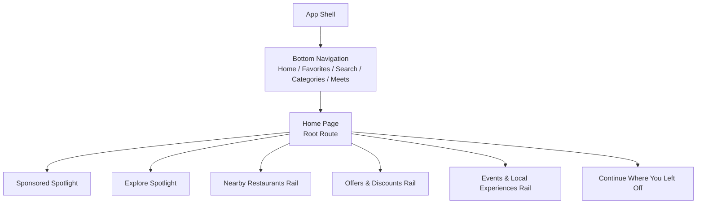
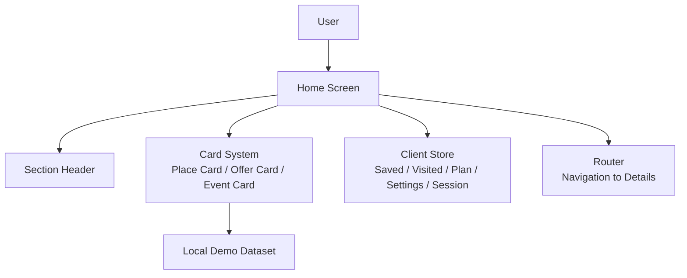
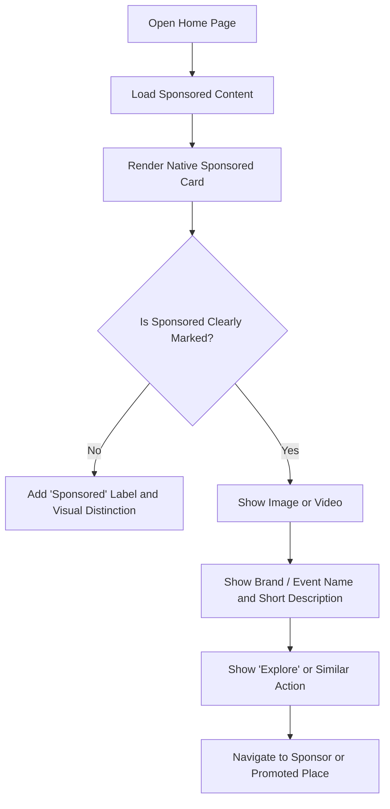
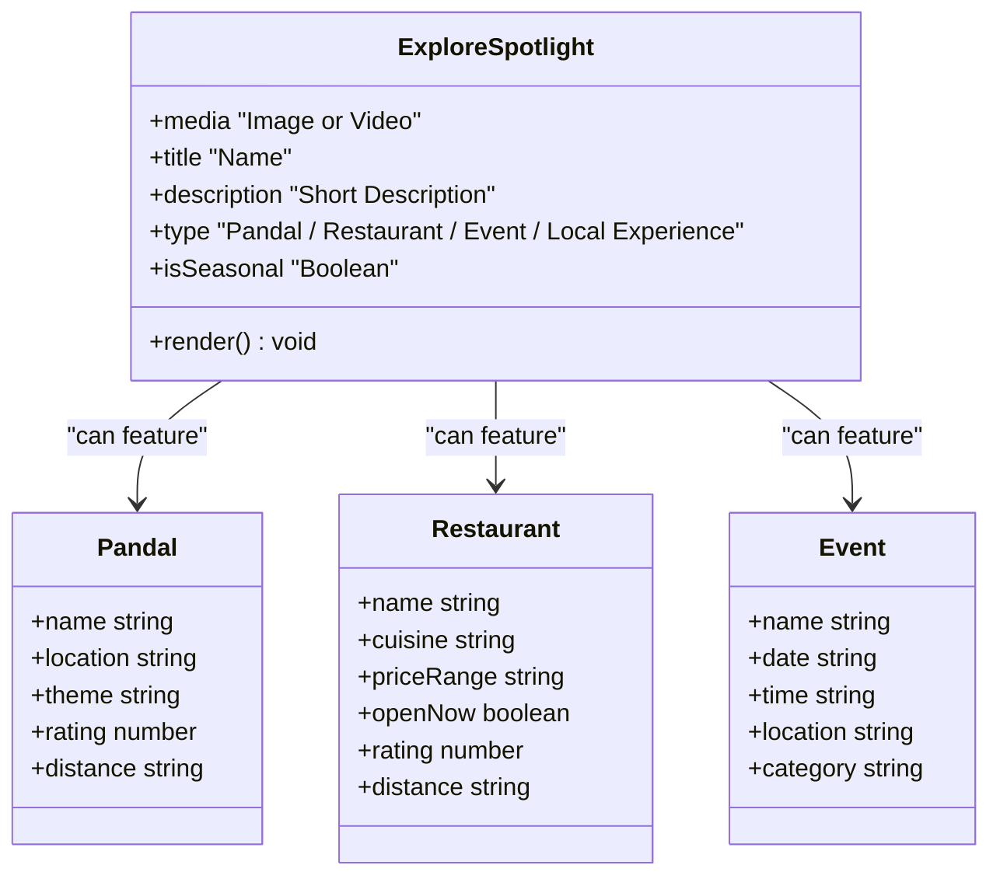
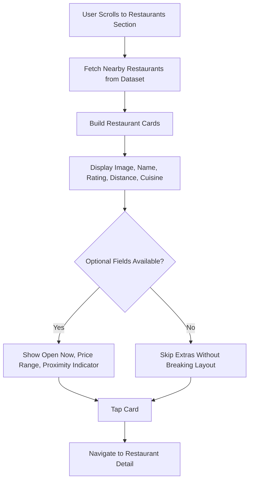
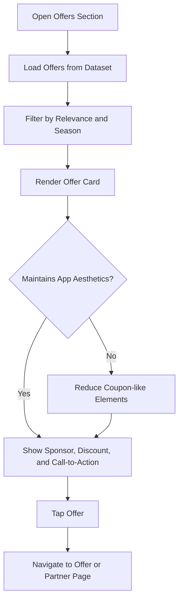
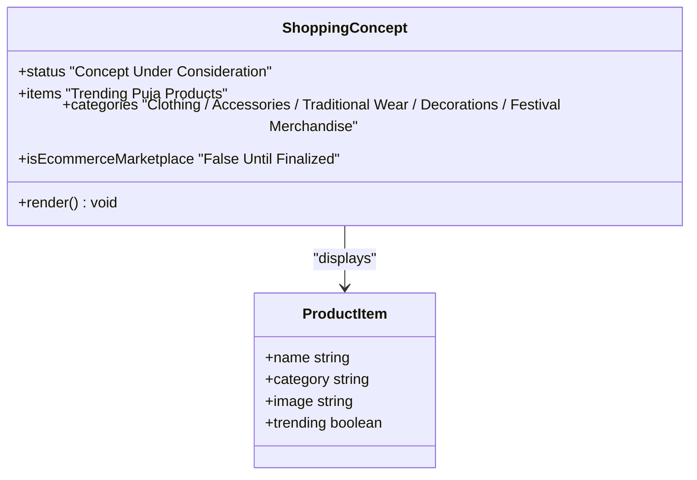
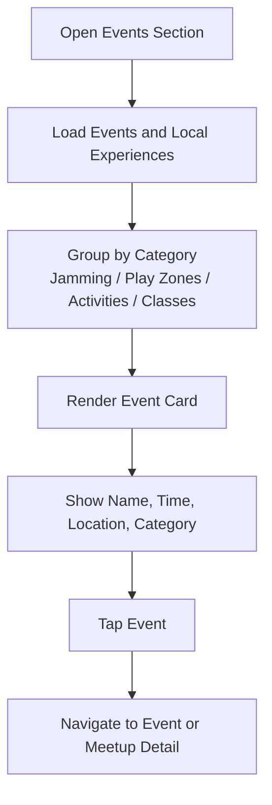
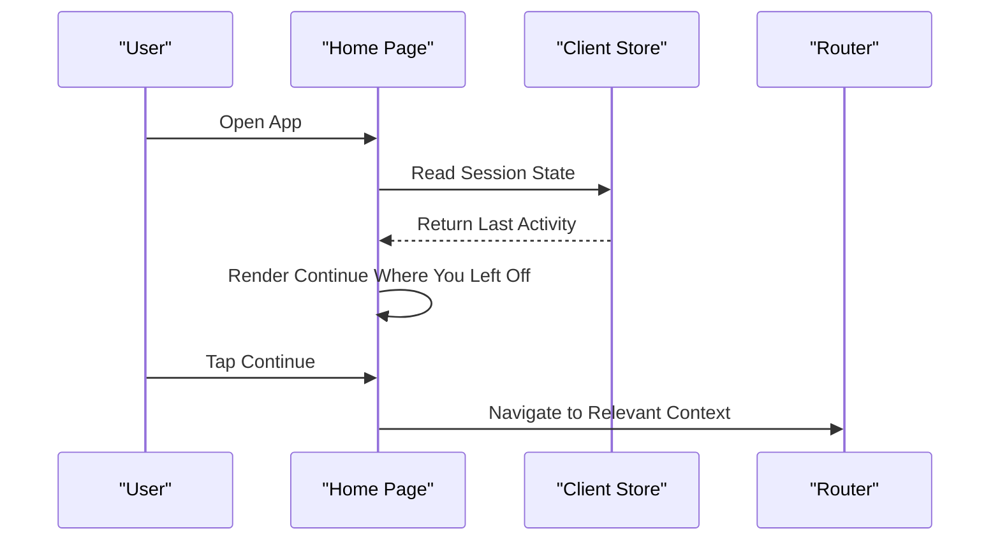
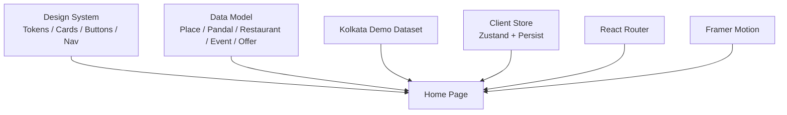

# Home Page Features

<cite>
**Referenced Files in This Document**
- [Pujo_Sahayak_Master_Project_Context.md](file://Pujo_Sahayak_Master_Project_Context.md)
- [plan.md](file://tasks/plan.md)
- [todo.md](file://tasks/todo.md)
</cite>

## Table of Contents
1. [Introduction](#introduction)
2. [Project Structure](#project-structure)
3. [Core Components](#core-components)
4. [Architecture Overview](#architecture-overview)
5. [Detailed Component Analysis](#detailed-component-analysis)
6. [Dependency Analysis](#dependency-analysis)
7. [Performance Considerations](#performance-considerations)
8. [Troubleshooting Guide](#troubleshooting-guide)
9. [Conclusion](#conclusion)

## Introduction
This document explains the Home page features for Puja Sahayak, focusing on how discovery, sponsorship, editorial curation, restaurants, offers, shopping concepts, and local experiences should be presented to users. The Home page is intentionally designed as the main discovery surface rather than a static directory: it should dynamically show what is relevant to the user based on context such as location, season, saved places, recent activity, and category preferences.

The product philosophy emphasizes a continuous journey from discovery through exploration, understanding, planning, visiting, sharing, meeting people, and discovering more. During Durga Puja, pandals dominate; outside the festival, the same Home structure should promote restaurants, events, activities, and other local experiences so the app remains useful year-round.

**Section sources**
- [Pujo_Sahayak_Master_Project_Context.md:21-43](file://Pujo_Sahayak_Master_Project_Context.md#L21-L43)
- [Pujo_Sahayak_Master_Project_Context.md:77-101](file://Pujo_Sahayak_Master_Project_Context.md#L77-L101)
- [Pujo_Sahayak_Master_Project_Context.md:104-138](file://Pujo_Sahayak_Master_Project_Context.md#L104-L138)
- [Pujo_Sahayak_Master_Project_Context.md:160-167](file://Pujo_Sahayak_Master_Project_Context.md#L160-L167)

## Project Structure
At a high level, the Home page is one of several primary screens in the application. The implementation plan maps the Home screen to the root route and describes it as including greeting, language toggle, sponsored content, explore spotlight, nearby restaurants, offers and discounts, events, and a “continue where you left off” section. The task list further confirms that the Home page should render all sections from the dataset and support language toggling.

**Diagram sources**
- [plan.md:19-39](file://tasks/plan.md#L19-L39)
- [todo.md:23-24](file://tasks/todo.md#L23-L24)

**Section sources**
- [plan.md:19-39](file://tasks/plan.md#L19-L39)
- [todo.md:23-24](file://tasks/todo.md#L23-L24)

## Core Components
The Home page consists of several distinct but related components:

| Component | Purpose | Key Data or UI Signals |
|---|---|---|
| Sponsored Spotlight | Shows native ad cards that clearly distinguish paid or promoted content from organic recommendations | Label such as “Sponsored”, image or video, brand or event name, short description, call-to-action |
| Explore Spotlight | Editorial-style feature highlighting curated places and experiences | Image or video, name, short description, type such as pandal, restaurant, event, or local experience |
| Restaurant Discovery Cards | Helps users find nearby dining options while exploring | Image, name, rating, distance, cuisine or category, open status, price range, proximity indicator |
| Offers & Discounts | Surfaces sponsor offers, local business promotions, and partner deals without turning the app into a coupon site | Offer title, sponsor or partner, discount or promotion text, visual card layout consistent with app aesthetics |
| Shopping Concept | Proposed section for trending Puja-related products | Clothing, accessories, traditional wear, decorations, festival merchandise; marked as concept under consideration |
| Events & Local Experiences | Keeps the app useful beyond the core pandal experience | Jamming sessions, play zones, activities, classes, academies, and similar local experiences |
| Continue Where You Left Off | Retains continuity by remembering unfinished exploration | Last viewed place, unfinished route, unfinished search, partially explored category, saved place, meetup session |

These components together form a layered discovery experience: sponsored content at the top, followed by editorial curation, practical discovery (restaurants), commercial opportunities (offers), seasonal or proposed lifestyle content (shopping), and ongoing local utility (events).

**Section sources**
- [Pujo_Sahayak_Master_Project_Context.md:168-283](file://Pujo_Sahayak_Master_Project_Context.md#L168-L283)
- [todo.md:23-24](file://tasks/todo.md#L23-L24)

## Architecture Overview
The Home page is not a single monolithic block. It is better understood as a composition of sections that share common design tokens, data models, and navigation patterns.

This architecture supports:
- Consistent card-based presentation across sponsored, editorial, restaurant, offer, and event content.
- Dynamic content selection based on user context stored in the client store.
- Clear navigation from Home cards to detail pages for pandals, restaurants, events, and meetups.
- A design system that keeps sponsored and organic content visually coherent while still distinguishing them.

**Diagram sources**
- [plan.md:7-17](file://tasks/plan.md#L7-L17)
- [todo.md:10-14](file://tasks/todo.md#L10-L14)

## Detailed Component Analysis

### Sponsored Spotlight
The sponsored spotlight is an advertising or spotlight area near the top of the Home page. Its purpose is to present native sponsored cards rather than intrusive banners. Each card should include media, a brand or event name, a short description, and an action such as “Explore”.

Important design rules:
- Sponsored content must be visually distinct from organic recommendations.
- The distinction should be clear but not disruptive to the overall app aesthetic.
- The card should feel native to the app’s card system rather than like an external ad unit.

Implementation guidance:
- Use a dedicated “sponsored” label or badge.
- Keep spacing, typography, and motion consistent with organic cards.
- Avoid making sponsored cards look like full-screen ads.
- Ensure accessibility by labeling sponsored content for screen readers.

**Section sources**
- [Pujo_Sahayak_Master_Project_Context.md:168-188](file://Pujo_Sahayak_Master_Project_Context.md#L168-L188)

### Explore Spotlight
The explore spotlight is an editorial-style feature section. It showcases curated content such as a pandal, restaurant, event, or local experience. Each entry should include an image or video, a name, and a short description. During Puja, pandals should dominate this section; outside Puja, the same component can promote other local experiences.

Implementation guidance:
- Treat the explore spotlight as a curated feed rather than a purely algorithmic ranking.
- Allow editorial control over which items are featured.
- Adjust prominence by season: pandals during Puja, broader local experiences otherwise.
- Keep descriptions concise and informative.

**Diagram sources**
- [Pujo_Sahayak_Master_Project_Context.md:189-208](file://Pujo_Sahayak_Master_Project_Context.md#L189-L208)

**Section sources**
- [Pujo_Sahayak_Master_Project_Context.md:189-208](file://Pujo_Sahayak_Master_Project_Context.md#L189-L208)

### Restaurant Discovery Cards
Restaurant discovery on the Home page is part of the broader pandal-hopping and local exploration ecosystem, not a food-delivery platform. Cards should show image, name, rating, distance, cuisine or category, and optionally open status, price range, and proximity indicators.

Implementation guidance:
- Prioritize clarity and scannability.
- Use consistent rating and distance formats.
- Show open status only when reliable data exists.
- Use subtle proximity indicators such as “Nearby” rather than exaggerated marketing language.
- Keep the restaurant section aligned with exploration rather than delivery.

**Section sources**
- [Pujo_Sahayak_Master_Project_Context.md:209-234](file://Pujo_Sahayak_Master_Project_Context.md#L209-L234)
- [todo.md:60-61](file://tasks/todo.md#L60-L61)

### Offers and Discounts
The offers and discounts section surfaces sponsor offers, local business promotions, Puja-related discounts, and partner promotions. The key constraint is aesthetic: the UI should avoid making the app look like a coupon website.

Implementation guidance:
- Use the same card system as other Home sections.
- Avoid excessive urgency cues such as flashing timers or aggressive coupon styling.
- Clearly identify sponsors or partners when appropriate.
- Keep descriptions concise and focused on value rather than discount percentage alone.

**Section sources**
- [Pujo_Sahayak_Master_Project_Context.md:235-247](file://Pujo_Sahayak_Master_Project_Context.md#L235-L247)

### Shopping Concept
Shopping is explicitly marked as a proposed feature and not a locked requirement. The current idea is to show trending Puja-related products such as clothing, accessories, traditional wear, decorations, and festival merchandise. It should not become a generic e-commerce marketplace unless that direction is finalized.

Implementation guidance:
- Treat shopping as exploratory and seasonal.
- Do not hard-code checkout, cart, or payment flows until the feature is officially approved.
- Use the same card system to keep the Home page cohesive.
- Clearly mark trending items without fabricating rankings unless underlying metrics exist.

**Diagram sources**
- [Pujo_Sahayak_Master_Project_Context.md:248-267](file://Pujo_Sahayak_Master_Project_Context.md#L248-L267)

**Section sources**
- [Pujo_Sahayak_Master_Project_Context.md:248-267](file://Pujo_Sahayak_Master_Project_Context.md#L248-L267)

### Events and Local Experiences
The events and local experiences section helps maintain year-round utility. It can include jamming sessions, play zones, activities, classes, and similar local experiences. The exact categories may be finalized later, but the principle is that users should have reasons to open the app even after Puja ends.

Implementation guidance:
- Keep event cards consistent with other Home cards.
- Include time, location, and category information where available.
- Allow future expansion of categories without breaking existing layouts.
- Connect events to the broader social layer, such as meetups, where appropriate.

**Section sources**
- [Pujo_Sahayak_Master_Project_Context.md:268-283](file://Pujo_Sahayak_Master_Project_Context.md#L268-L283)
- [todo.md:53-54](file://tasks/todo.md#L53-L54)

### Continue Where You Left Off
The “continue where you left off” feature is a retention mechanism. It remembers the user’s last exploration state, such as a last viewed pandal, an unfinished route, an unfinished search, a partially explored category, a saved restaurant, or a meetup discovery session.

Implementation guidance:
- Persist session state using the client store.
- Make the continue action contextual: if the user was exploring South Kolkata pandals, the continuation should reflect that context.
- Avoid overwhelming the user with too many continuation options.
- Reset or update the continuation state when the user starts a new meaningful flow.

**Diagram sources**
- [Pujo_Sahayak_Master_Project_Context.md:286-317](file://Pujo_Sahayak_Master_Project_Context.md#L286-L317)
- [todo.md:23-24](file://tasks/todo.md#L23-L24)

**Section sources**
- [Pujo_Sahayak_Master_Project_Context.md:286-317](file://Pujo_Sahayak_Master_Project_Context.md#L286-L317)

## Dependency Analysis
The Home page depends on several shared systems:

- **Design system**: Tokens, cards, chips, buttons, section headers, bottom navigation, and motion primitives ensure consistent presentation across sponsored, editorial, restaurant, offer, and event content.
- **Data model and dataset**: Typed models for places, pandals, restaurants, events, offers, and related entities power dynamic rendering.
- **Client store**: Zustand-based state manages saved places, visited places, plans, settings, and session continuity.
- **Routing**: React Router connects Home cards to detail pages and deeper flows.
- **Motion**: Framer Motion provides soft transitions and subtle interactions while respecting reduced-motion preferences.

**Diagram sources**
- [plan.md:7-17](file://tasks/plan.md#L7-L17)
- [todo.md:10-14](file://tasks/todo.md#L10-L14)

**Section sources**
- [plan.md:7-17](file://tasks/plan.md#L7-L17)
- [todo.md:10-14](file://tasks/todo.md#L10-L14)

## Performance Considerations
- Prefer lazy loading for images and videos in sponsored, explore, restaurant, offer, and event cards.
- Avoid heavy animations on low-end devices; honor reduced-motion settings.
- Cache frequently accessed Home sections locally where possible.
- Keep dataset queries efficient by filtering early and avoiding unnecessary re-renders.
- Use stable keys for cards to prevent layout thrashing when content updates.
- Defer non-critical actions such as analytics or secondary metadata fetching until after initial render.

[No sources needed since this section provides general guidance]

## Troubleshooting Guide
Common issues and resolutions for Home page features:

| Issue | Likely Cause | Resolution |
|---|---|---|
| Sponsored cards look like intrusive banners | Missing distinction between sponsored and organic content | Add clear “Sponsored” labeling and adjust visual hierarchy without breaking app aesthetics |
| Explore spotlight shows irrelevant content | Lack of editorial or seasonal logic | Apply seasonal weighting and editorial curation rules |
| Restaurant cards show inconsistent fields | Optional data missing | Gracefully hide optional fields such as open status or price range when unavailable |
| Offers section feels like a coupon site | Overemphasis on discounts | Simplify visuals, reduce urgency cues, and focus on sponsor value |
| Shopping section breaks layout | Premature ecommerce assumptions | Treat shopping as conceptual and use lightweight cards until finalized |
| Events section lacks variety | Limited dataset or categories | Expand event types gradually and allow flexible categorization |
| “Continue where you left off” resets unexpectedly | Session state not persisted | Verify client store persistence and session updates |

**Section sources**
- [Pujo_Sahayak_Master_Project_Context.md:168-283](file://Pujo_Sahayak_Master_Project_Context.md#L168-L283)
- [todo.md:23-24](file://tasks/todo.md#L23-L24)

## Conclusion
The Home page for Puja Sahayak is a layered discovery surface. Sponsored spotlight cards introduce monetization while maintaining trust through clear distinction. The explore spotlight provides editorial curation that adapts to season and context. Restaurant discovery supports exploration without shifting the product into delivery. Offers and discounts integrate sponsor value without compromising aesthetics. The shopping concept remains a proposed, seasonal feature. Events and local experiences ensure year-round relevance. Finally, “continue where you left off” preserves continuity and improves retention.

When implementing these features, prioritize consistency, clarity, and context-awareness. Keep sponsored and organic content visually coherent but distinguishable, ground recommendations in real data, and design for both the peak Puja season and the broader local discovery experience.

[No sources needed since this section summarizes without analyzing specific files]