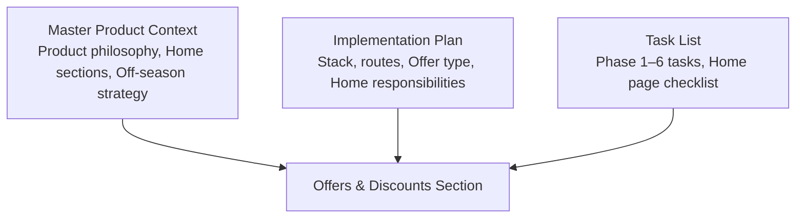
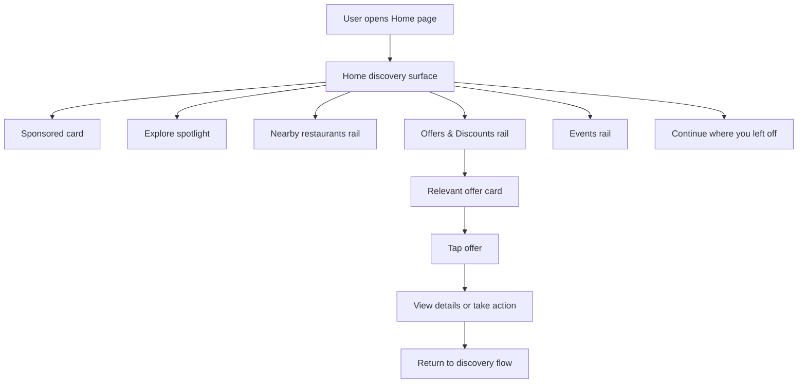
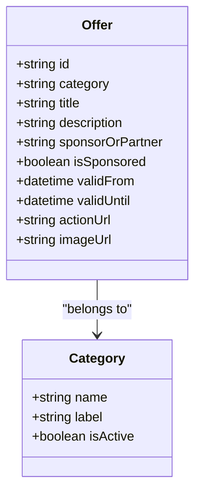
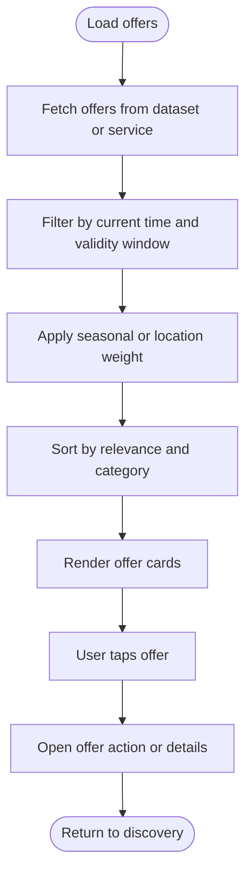
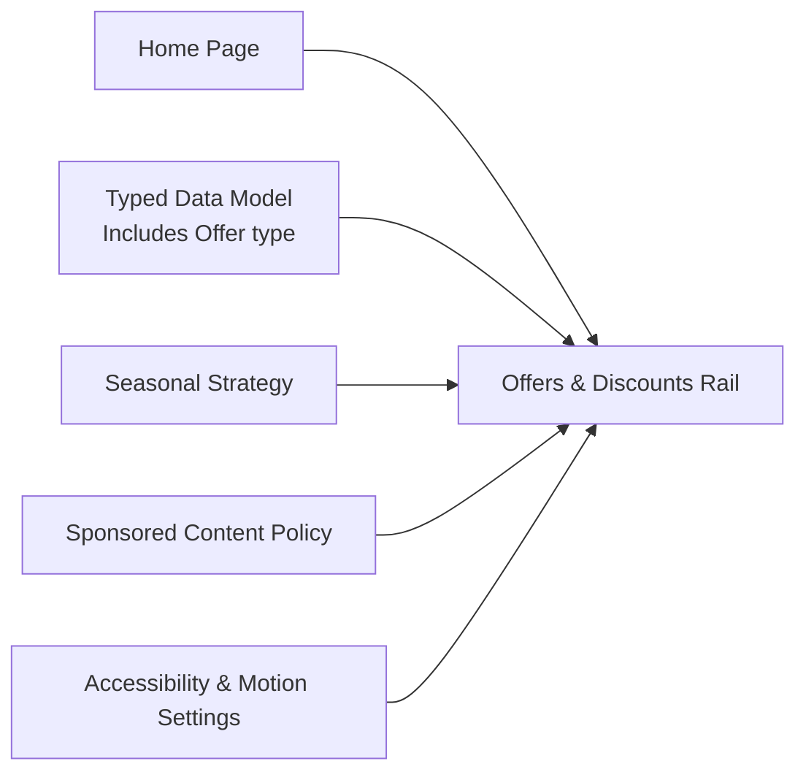

# Offers & Discounts Section

<cite>
**Referenced Files in This Document**
- [Pujo_Sahayak_Master_Project_Context.md](file://Pujo_Sahayak_Master_Project_Context.md)
- [plan.md](file://tasks/plan.md)
- [todo.md](file://tasks/todo.md)
</cite>

## Table of Contents
1. [Introduction](#introduction)
2. [Project Structure](#project-structure)
3. [Core Components](#core-components)
4. [Architecture Overview](#architecture-overview)
5. [Detailed Component Analysis](#detailed-component-analysis)
6. [Dependency Analysis](#dependency-analysis)
7. [Performance Considerations](#performance-considerations)
8. [Troubleshooting Guide](#troubleshooting-guide)
9. [Conclusion](#conclusion)

## Introduction
This document explains the **Offers & Discounts** section for Pujo Sahayak. It covers how sponsor offers, local business promotions, Puja-related discounts, and partner deals should be presented without making the app feel like a coupon website. The goal is to keep promotional content relevant, visually consistent with the discovery experience, and useful during both the Puja season and the off-season.

The broader product context defines Pujo Sahayak as a digital companion for exploring Kolkata around Durga Puja, combining place discovery, AI assistance, planning, community meetups, safety, user-generated content, personalization, and monetization. Offers are one part of that ecosystem, not the main identity of the app.

**Section sources**
- [Pujo_Sahayak_Master_Project_Context.md:1-18](file://Pujo_Sahayak_Master_Project_Context.md#L1-L18)
- [Pujo_Sahayak_Master_Project_Context.md:77-101](file://Pujo_Sahayak_Master_Project_Context.md#L77-L101)

## Project Structure
At this stage, the repository contains:
- A master product context document describing the overall product philosophy, navigation, home page sections, detail pages, social features, profile, payments, and off-season strategy.
- An implementation plan describing the React + Vite PWA stack, screen-to-route mapping, task phases, verification criteria, risks, and open questions.
- A task list tracking foundation, discovery core, Maya, planning, utility, and polish work.

For the Offers & Discounts section specifically:
- The product context introduces an **Offers & Discounts** area on the Home page.
- The implementation plan includes an `Offer` type in the data model and lists the Home page as including an “Offers & Discounts rail.”
- The task list marks the Home page as responsible for rendering sponsored content, spotlight, restaurants, offers, events, and continuity features.

**Diagram sources**
- [Pujo_Sahayak_Master_Project_Context.md:235-247](file://Pujo_Sahayak_Master_Project_Context.md#L235-L247)
- [plan.md:45-49](file://tasks/plan.md#L45-L49)
- [todo.md:23-25](file://tasks/todo.md#L23-L25)

**Section sources**
- [Pujo_Sahayak_Master_Project_Context.md:235-247](file://Pujo_Sahayak_Master_Project_Context.md#L235-L247)
- [plan.md:45-49](file://tasks/plan.md#L45-L49)
- [todo.md:23-25](file://tasks/todo.md#L23-L25)

## Core Components
The Offers & Discounts section is designed around four offer categories:
- Sponsor offers
- Local business offers
- Puja-related discounts
- Partner promotions

These offers must appear alongside other Home page elements such as sponsored cards, explore spotlight, nearby restaurants, events, and “Continue where you left off.” The critical design rule is explicit: the UI should avoid making the app look like a coupon website.

The Home page is the primary surface for these offers. During Puja, offers can lean toward Puja-related experiences; after Puja, they can transition into general local offers while keeping the same structural pattern.

**Section sources**
- [Pujo_Sahayak_Master_Project_Context.md:160-187](file://Pujo_Sahayak_Master_Project_Context.md#L160-L187)
- [Pujo_Sahayak_Master_Project_Context.md:235-247](file://Pujo_Sahayak_Master_Project_Context.md#L235-L247)
- [Pujo_Sahayak_Master_Project_Context.md:1093-1142](file://Pujo_Sahayak_Master_Project_Context.md#L1093-L1142)
- [todo.md:23-25](file://tasks/todo.md#L23-L25)

## Architecture Overview
The Offers & Discounts section sits inside the Home page flow and integrates with the broader discovery system. Conceptually:

This diagram is conceptual and shows how offers fit into the Home page rather than mapping to specific source files.

[No sources needed since this diagram shows conceptual workflow, not actual code structure]

## Detailed Component Analysis

### Design Principle: Not a Coupon Website
The most important constraint is aesthetic and experiential:
- Promotional content should feel native to the app.
- It should not dominate the interface.
- It should not use aggressive coupon-style layouts, excessive discount badges, or cluttered deal grids.
- It should preserve the app’s identity as a discovery and exploration platform.

The product context explicitly warns against turning the app into a coupon website. This means offers should be presented as contextual recommendations rather than a marketplace of deals.

Recommended presentation patterns:
- Use clean cards similar to restaurant or event cards.
- Keep visuals editorial and image-led.
- Show only essential offer metadata: title, short description, sponsor or partner name, and a clear but non-aggressive call to action.
- Avoid stacking multiple discount percentages, expiry countdowns, or coupon codes prominently unless they add real value.

**Section sources**
- [Pujo_Sahayak_Master_Project_Context.md:235-247](file://Pujo_Sahayak_Master_Project_Context.md#L235-L247)

### Offer Categories and Categorization Guidelines
The documented categories are:
- Sponsor offers
- Local business offers
- Puja-related discounts
- Partner promotions

Categorization guidelines derived from the product context:
- Treat all offers as part of the local discovery ecosystem.
- Allow seasonal weighting: Puja-related offers may be more prominent during the festival.
- Keep sponsor content clearly distinguishable from organic recommendations.
- Do not force every offer into a rigid taxonomy if it harms relevance; allow flexible tagging when necessary.

This class diagram is conceptual and represents the intended offer model described by the documentation rather than a concrete implementation file.

[No sources needed since this diagram shows conceptual model, not actual code structure]

**Section sources**
- [Pujo_Sahayak_Master_Project_Context.md:235-247](file://Pujo_Sahayak_Master_Project_Context.md#L235-L247)

### Displaying Promotional Content Naturally
The Home page already has a concept for sponsored content near the top, described as a native sponsored card rather than an intrusive banner. Offers should follow the same principle:
- Visually distinct from organic content.
- Clearly labeled as sponsored when required.
- Integrated into rails or cards that match the rest of the UI.
- Clickable and actionable without breaking the discovery flow.

The implementation plan identifies the Home page as responsible for rendering sponsored content, spotlight, restaurants, offers, events, and continuity features. This confirms that offers are a first-class Home page component, not a separate coupon module.

**Section sources**
- [Pujo_Sahayak_Master_Project_Context.md:168-187](file://Pujo_Sahayak_Master_Project_Context.md#L168-L187)
- [plan.md:45-49](file://tasks/plan.md#L45-L49)
- [todo.md:23-25](file://tasks/todo.md#L23-L25)

### Expiration Handling
The product context does not define detailed expiration rules for offers. Therefore, expiration handling should be implemented carefully:
- Store validity windows (start and end dates/times).
- Hide expired offers from the default view.
- Optionally show recently expired offers in a limited way if it helps transparency.
- Never display misleading “still active” status.
- Treat expiration as a filtering and visibility concern, not a reason to aggressively push urgency through UI.

A safe approach is to treat expiration as backend-driven filtering, with the frontend simply displaying what is currently valid and relevant.

This flowchart is conceptual and reflects recommended behavior based on the product context and implementation plan.

[No sources needed since this diagram shows conceptual workflow, not actual code structure]

### User Engagement Patterns
Offers should support natural engagement rather than forced conversion:
- Primary interaction: tap to learn more or take action.
- Secondary interactions: save, share, or navigate to a related place.
- Avoid pop-ups, auto-playing discount animations, or persistent coupon banners.
- Respect reduced-motion preferences and accessibility needs.
- Keep the user in the discovery flow; do not drop them into a disconnected coupon experience.

The product emphasizes that the app should feel alive and context-aware, changing based on season, time, location, user activity, and current events. Offers should follow the same adaptive logic.

**Section sources**
- [Pujo_Sahayak_Master_Project_Context.md:1144-1178](file://Pujo_Sahayak_Master_Project_Context.md#L1144-L1178)

### Integration With Discovery Experience
Offers should not exist in isolation. They should connect naturally to:
- Nearby places
- Restaurants
- Events
- Pandal discovery
- Meetups
- Planning

For example, a restaurant offer could link to the restaurant detail page; a Puja-related discount could link to a pandal or event; a partner promotion could link to a local experience. This keeps offers part of the broader Pujo Sahayak journey rather than a standalone marketing channel.

**Section sources**
- [Pujo_Sahayak_Master_Project_Context.md:27-43](file://Pujo_Sahayak_Master_Project_Context.md#L27-L43)
- [Pujo_Sahayak_Master_Project_Context.md:913-950](file://Pujo_Sahayak_Master_Project_Context.md#L913-L950)

## Dependency Analysis
The Offers & Discounts section depends on several higher-level project decisions:

| Dependency | Relationship |
|---|---|
| Home page | Offers are rendered as part of the Home discovery surface. |
| Data model | The implementation plan includes an `Offer` type in the typed demo dataset. |
| Seasonal strategy | Offers should adapt between Puja and off-season contexts. |
| Sponsored content policy | Offers must remain visually native and distinguishable from organic content. |
| Accessibility and motion settings | Offer interactions should respect reduced-motion and accessibility preferences. |

**Diagram sources**
- [Pujo_Sahayak_Master_Project_Context.md:160-187](file://Pujo_Sahayak_Master_Project_Context.md#L160-L187)
- [Pujo_Sahayak_Master_Project_Context.md:1093-1178](file://Pujo_Sahayak_Master_Project_Context.md#L1093-L1178)
- [plan.md:45-49](file://tasks/plan.md#L45-L49)
- [todo.md:23-25](file://tasks/todo.md#L23-L25)

**Section sources**
- [Pujo_Sahayak_Master_Project_Context.md:160-187](file://Pujo_Sahayak_Master_Project_Context.md#L160-L187)
- [Pujo_Sahayak_Master_Project_Context.md:1093-1178](file://Pujo_Sahayak_Master_Project_Context.md#L1093-L1178)
- [plan.md:45-49](file://tasks/plan.md#L45-L49)
- [todo.md:23-25](file://tasks/todo.md#L23-L25)

## Performance Considerations
Since the current repository does not include application source code, performance guidance for the Offers & Discounts section should be conservative and aligned with the stated architecture:
- Keep offer cards lightweight and image-optimized.
- Avoid heavy animations for promotional content.
- Respect the reduced-motion preference defined in the implementation plan.
- Load offers lazily within the Home page rail if the Home page grows large.
- Prefer client-side filtering over unnecessary re-renders.
- Keep offer metadata minimal so it fits cleanly into existing card components.

The implementation plan emphasizes Tailwind-based design tokens, Framer Motion with reduced-motion support, and a mobile-first PWA. Offers should inherit these constraints rather than introduce new performance-heavy patterns.

**Section sources**
- [plan.md:9-17](file://tasks/plan.md#L9-L17)
- [todo.md:10-11](file://tasks/todo.md#L10-L11)

## Troubleshooting Guide
Common issues and how to address them based on the project context:

| Issue | Likely Cause | Recommended Fix |
|---|---|---|
| Offers look like a coupon site | Too many discount badges, aggressive CTAs, or coupon-style layout | Reduce visual noise; use native card styling; emphasize relevance over urgency |
| Offers feel unrelated | Missing category or location context | Tie offers to nearby places, restaurants, events, or Puja experiences |
| Expired offers still visible | Missing validity filtering | Implement start/end date checks and hide expired offers |
| Offers disrupt discovery flow | Poor placement or intrusive interactions | Place offers in the Home rail; keep interactions simple and return-oriented |
| Offers break accessibility or motion settings | Ignoring reduced-motion or accessibility preferences | Follow the app’s motion and accessibility configuration |

**Section sources**
- [Pujo_Sahayak_Master_Project_Context.md:235-247](file://Pujo_Sahayak_Master_Project_Context.md#L235-L247)
- [Pujo_Sahayak_Master_Project_Context.md:1144-1178](file://Pujo_Sahayak_Master_Project_Context.md#L1144-L1178)
- [plan.md:9-17](file://tasks/plan.md#L9-L17)

## Conclusion
The Offers & Discounts section should provide real value through sponsor offers, local business promotions, Puja-related discounts, and partner deals, while preserving Pujo Sahayak’s identity as a discovery and exploration platform. The most important rule is to avoid making the app look like a coupon website. Offers should be visually native, contextually relevant, seasonally aware, and integrated into the Home page discovery flow.

In practice, this means:
- Present offers as clean, editorial-style cards.
- Keep sponsorship transparent but unobtrusive.
- Filter by validity and relevance.
- Connect offers to places, restaurants, events, and planning.
- Respect accessibility, motion preferences, and the broader product philosophy.

**Section sources**
- [Pujo_Sahayak_Master_Project_Context.md:235-247](file://Pujo_Sahayak_Master_Project_Context.md#L235-L247)
- [Pujo_Sahayak_Master_Project_Context.md:1093-1178](file://Pujo_Sahayak_Master_Project_Context.md#L1093-L1178)
- [plan.md:45-49](file://tasks/plan.md#L45-L49)
- [todo.md:23-25](file://tasks/todo.md#L23-L25)