# Restaurant Discovery Cards

<cite>
**Referenced Files in This Document**
- [Pujo_Sahayak_Master_Project_Context.md](file://Pujo_Sahayak_Master_Project_Context.md)
- [plan.md](file://tasks/plan.md)
- [todo.md](file://tasks/todo.md)
</cite>

## Table of Contents
1. [Introduction](#introduction)
2. [Project Structure](#project-structure)
3. [Core Components](#core-components)
4. [Architecture Overview](#architecture-overview)
5. [Detailed Component Analysis](#detailed-component-analysis)
6. [Dependency Analysis](#dependency-analysis)
7. [Performance Considerations](#performance-considerations)
8. [Troubleshooting Guide](#troubleshooting-guide)
9. [Conclusion](#conclusion)

## Introduction
This document explains the restaurant discovery cards that appear on the Home page and related discovery surfaces of Pujo Sahayak. The cards are not food-delivery widgets; they are part of a broader place-discovery ecosystem where restaurants support pandal-hopping, local exploration, planning, and community activities.

The product is intentionally designed as a location-aware local discovery platform with a specialized Durga Puja experience. Restaurants are one category among many places: pandals, events, attractions, services, and other local experiences. During Puja, restaurants complement the main journey of discovering and visiting pandals. Outside Puja, they remain a core part of Kolkata’s ongoing local discovery experience.

Key design principles for restaurant cards:
- They show image, restaurant name, rating, distance, cuisine/category, open status, price range (₹₹), and nearby indicators.
- They integrate with the Home page, Explore, Search, Categories, Pandal Detail, Favorites, Planner, Meets, and Profile flows.
- They do not introduce delivery ordering as a primary action. Ordering can be disabled or marked “coming soon” until a real integration exists.
- Location, time, and user context influence which restaurants are shown and how they are ranked.

**Section sources**
- [Pujo_Sahayak_Master_Project_Context.md:104-138](file://Pujo_Sahayak_Master_Project_Context.md#L104-L138)
- [Pujo_Sahayak_Master_Project_Context.md:160-234](file://Pujo_Sahayak_Master_Project_Context.md#L160-L234)
- [Pujo_Sahayak_Master_Project_Context.md:1734-1740](file://Pujo_Sahayak_Master_Project_Context.md#L1734-L1740)

## Project Structure
At this stage, the repository contains:
- A master product context document describing the full product vision, navigation, Home page sections, data model, AI assistant, safety, off-season strategy, and final product map.
- An implementation plan describing React + Vite + TypeScript + Tailwind + Zustand + Framer Motion + Leaflet.
- A task list breaking the build into phases, including Home, Explore, Pandal Detail, Maya, Search, Categories, Favorites, Planner, Meets, Restaurant Detail, Trip Map, Profile, Safety, and Beyond Puja.

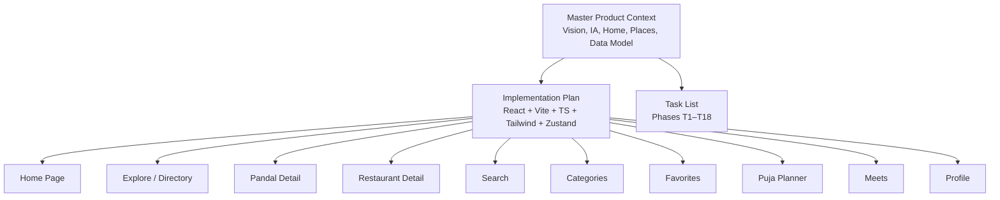

**Diagram sources**
- [Pujo_Sahayak_Master_Project_Context.md:140-158](file://Pujo_Sahayak_Master_Project_Context.md#L140-L158)
- [Pujo_Sahayak_Master_Project_Context.md:160-284](file://Pujo_Sahayak_Master_Project_Context.md#L160-L284)
- [plan.md:1-18](file://tasks/plan.md#L1-L18)
- [plan.md:19-39](file://tasks/plan.md#L19-L39)
- [todo.md:1-14](file://tasks/todo.md#L1-L14)

**Section sources**
- [Pujo_Sahayak_Master_Project_Context.md:140-158](file://Pujo_Sahayak_Master_Project_Context.md#L140-L158)
- [Pujo_Sahayak_Master_Project_Context.md:160-284](file://Pujo_Sahayak_Master_Project_Context.md#L160-L284)
- [plan.md:1-18](file://tasks/plan.md#L1-L18)
- [plan.md:19-39](file://tasks/plan.md#L19-L39)
- [todo.md:1-14](file://tasks/todo.md#L1-L14)

## Core Components
The restaurant discovery card is a reusable UI component used across multiple screens. Its responsibilities include:
- Displaying a representative image.
- Showing the restaurant name.
- Rendering rating and review count.
- Showing distance from the current or selected location.
- Showing cuisine or category.
- Showing open/closed status based on time and operating hours.
- Showing price range using rupee symbols such as ₹₹.
- Showing proximity indicators like “Nearby”.
- Providing actions such as View Details, Save, Route, Call, or Order depending on screen context.

Card variants:
- Home rail card: compact, optimized for horizontal scrolling.
- Explore card: may include crowd or theme tags when applicable to the parent entity.
- Pandal Detail nearby section card: emphasizes proximity to the selected pandal.
- Search result card: supports filtering by All/Pandals/Restaurants/Events.
- Category card: appears under the Restaurants category grid.
- Favorites card: reflects saved or visited state.
- Planner stop card: shows type, duration, and travel context.
- Meets-related card: may highlight food-focused meetups.

Important behavior:
- Distance should use haversine-style calculations against stored latitude/longitude.
- Open status should reflect current time against operating hours.
- Nearby indicators should be derived from distance thresholds rather than arbitrary labels.
- Price range should come from structured data, not inferred from images.
- Images should be optional and never break layout if missing.

**Section sources**
- [Pujo_Sahayak_Master_Project_Context.md:209-234](file://Pujo_Sahayak_Master_Project_Context.md#L209-L234)
- [Pujo_Sahayak_Master_Project_Context.md:913-933](file://Pujo_Sahayak_Master_Project_Context.md#L913-L933)
- [todo.md:60-64](file://tasks/todo.md#L60-L64)

## Architecture Overview
Restaurant cards live inside a place-based architecture. A Place is the base concept; Restaurant is a specialized type. This allows the same discovery, detail, favorites, planner, search, categories, and recommendation systems to work consistently across pandals, restaurants, events, and other local experiences.

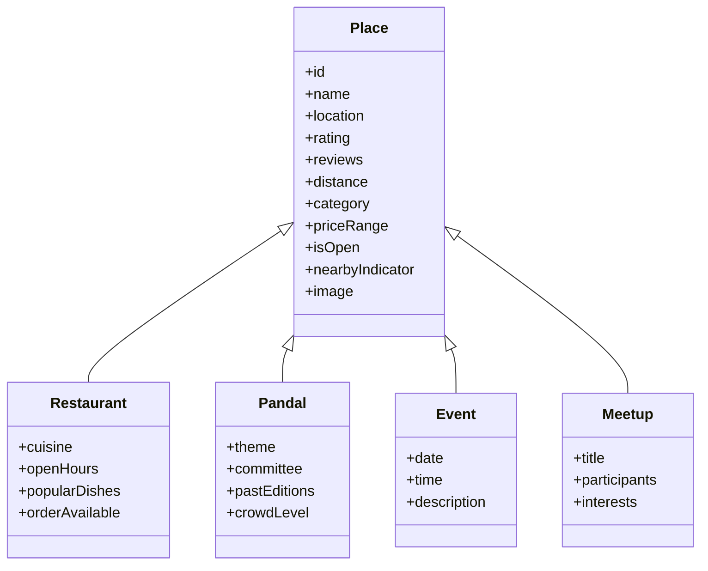

**Diagram sources**
- [Pujo_Sahayak_Master_Project_Context.md:1232-1260](file://Pujo_Sahayak_Master_Project_Context.md#L1232-L1260)
- [plan.md:45-46](file://tasks/plan.md#L45-L46)
- [todo.md:13-14](file://tasks/todo.md#L13-L14)

### Home Page Integration
On the Home page, restaurants appear as a dedicated section after Sponsored Spotlight and Explore Spotlight. The section is called out as “Restaurants” and uses cards showing image, name, rating, distance, cuisine/category, and optionally open now, price range, and nearby indicators.

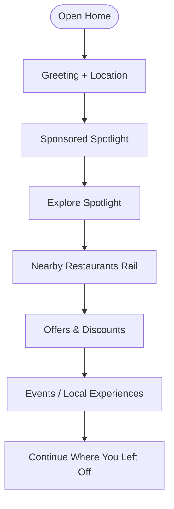

**Diagram sources**
- [Pujo_Sahayak_Master_Project_Context.md:168-234](file://Pujo_Sahayak_Master_Project_Context.md#L168-L234)
- [todo.md:23-25](file://tasks/todo.md#L23-L25)

**Section sources**
- [Pujo_Sahayak_Master_Project_Context.md:160-234](file://Pujo_Sahayak_Master_Project_Context.md#L160-L234)
- [todo.md:23-25](file://tasks/todo.md#L23-L25)

## Detailed Component Analysis

### Card Visual Anatomy
A restaurant card should expose these information layers:
- Primary visual: image or placeholder gradient.
- Primary identity: restaurant name.
- Quality signal: star rating and review count.
- Proximity signal: distance and “Nearby” indicator.
- Category signal: cuisine or category label.
- Availability signal: “Open now” or closed state.
- Cost signal: price range such as ₹₹.
- Actions: View Details, Save, Route, Call, Order.

Accessibility and clarity rules:
- Do not confuse sponsored cards with organic recommendations.
- Use consistent wording for open/closed states.
- Show distance in human-readable form, not raw coordinates.
- Avoid fake ratings or fabricated popularity metrics.
- Keep the card readable at mobile widths.

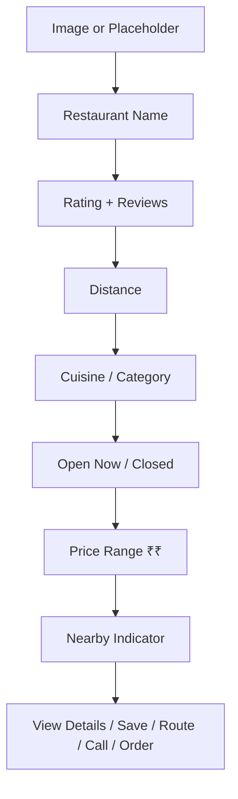

[No sources needed since this diagram shows conceptual card anatomy]

### Location-Based Filtering
Location-based filtering determines which restaurants appear in each section:
- Current GPS location provides the user’s position.
- Nearby places are computed from stored lat-lng values.
- The system may suggest a possible current context but must not claim exact indoor placement.
- Wording should use “You’re near…” rather than absolute claims.
- Filters can combine distance, category, open status, price range, and user preferences.

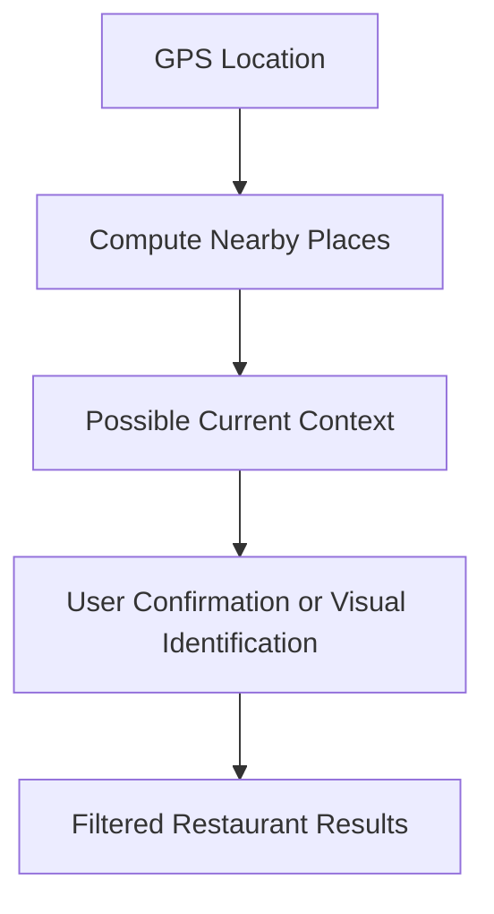

**Diagram sources**
- [Pujo_Sahayak_Master_Project_Context.md:1360-1388](file://Pujo_Sahayak_Master_Project_Context.md#L1360-L1388)

**Section sources**
- [Pujo_Sahayak_Master_Project_Context.md:1360-1388](file://Pujo_Sahayak_Master_Project_Context.md#L1360-L1388)

### Real-Time Open/Closed Status Display
Open/closed status should be calculated from:
- Current time.
- Operating hours stored per restaurant.
- Special cases such as holiday closures or temporary updates.
- Timezone and locale considerations.

Display rules:
- Show “Open now” when the current time falls within operating hours.
- Show “Closed” otherwise.
- If hours are unknown, avoid claiming open or closed; indicate that availability is unavailable.
- Do not fabricate crowd levels or hours beyond dataset fields.

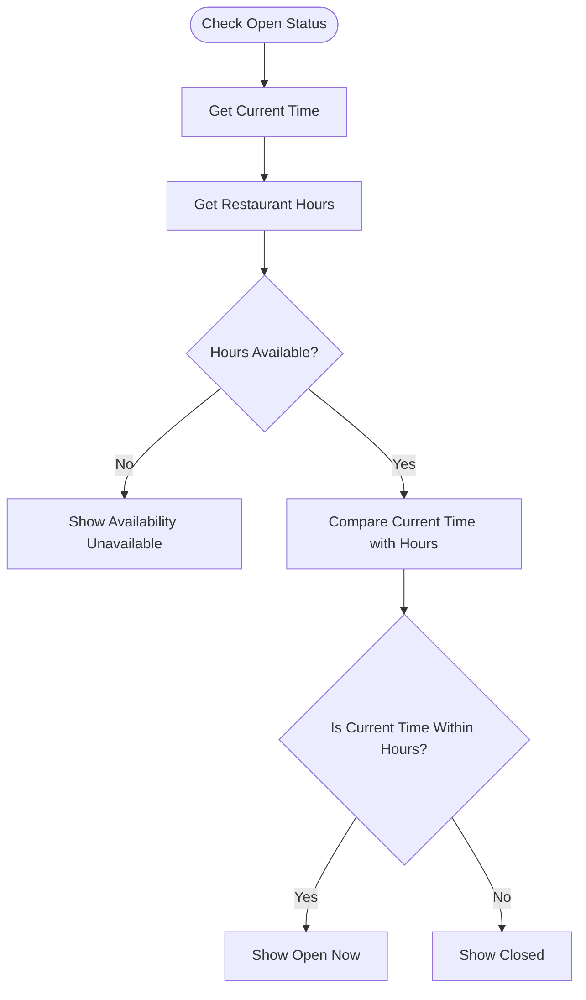

**Diagram sources**
- [todo.md:60-64](file://tasks/todo.md#L60-L64)
- [plan.md:15-17](file://tasks/plan.md#L15-L17)

**Section sources**
- [todo.md:60-64](file://tasks/todo.md#L60-L64)
- [plan.md:15-17](file://tasks/plan.md#L15-L17)

### Proximity Calculations
Proximity calculations should:
- Use latitude and longitude for both user and restaurant.
- Compute distance using a standard geospatial formula such as haversine.
- Convert meters to kilometers or miles for display.
- Support threshold-based labels like “Nearby”, “Close”, or “Far”.
- Update dynamically when the user moves or changes location.

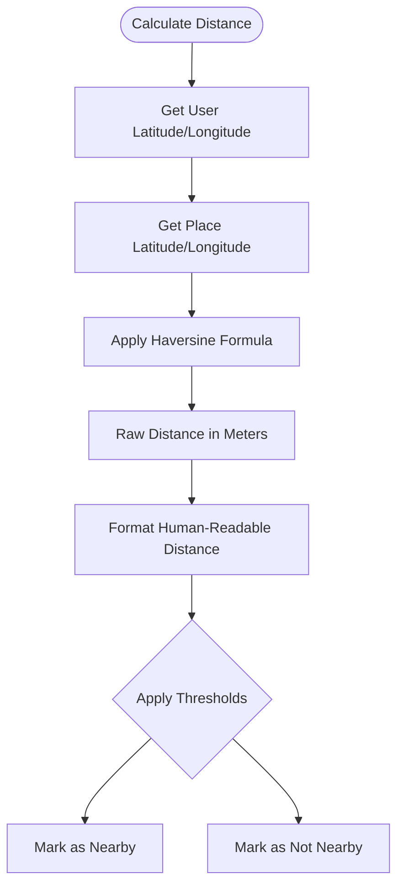

**Diagram sources**
- [todo.md:63-64](file://tasks/todo.md#L63-L64)

**Section sources**
- [todo.md:63-64](file://tasks/todo.md#L63-L64)

### Integration With the Broader Place Discovery System
Restaurant cards connect to multiple parts of the app:

- Home page: Nearby Restaurants rail.
- Explore: filtered list of restaurants with map/list toggle.
- Search: results under Restaurants or All.
- Categories: Restaurants category grid.
- Pandal Detail: “Nearby Restaurants” section.
- Favorites: saved restaurants and “Places You’ve Been”.
- Planner: dinner stops integrated into multi-day itineraries.
- Meets: food-focused meetups and activity-based social discovery.
- Profile: unified activity history including restaurants.

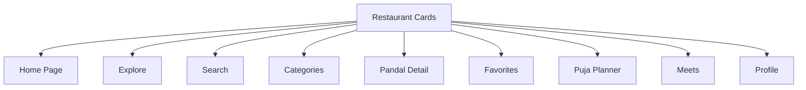

**Diagram sources**
- [Pujo_Sahayak_Master_Project_Context.md:160-284](file://Pujo_Sahayak_Master_Project_Context.md#L160-L284)
- [Pujo_Sahayak_Master_Project_Context.md:913-933](file://Pujo_Sahayak_Master_Project_Context.md#L913-L933)
- [Pujo_Sahayak_Master_Project_Context.md:1783-1858](file://Pujo_Sahayak_Master_Project_Context.md#L1783-L1858)
- [todo.md:23-67](file://tasks/todo.md#L23-L67)

**Section sources**
- [Pujo_Sahayak_Master_Project_Context.md:160-284](file://Pujo_Sahayak_Master_Project_Context.md#L160-L284)
- [Pujo_Sahayak_Master_Project_Context.md:913-933](file://Pujo_Sahayak_Master_Project_Context.md#L913-L933)
- [Pujo_Sahayak_Master_Project_Context.md:1783-1858](file://Pujo_Sahayak_Master_Project_Context.md#L1783-L1858)
- [todo.md:23-67](file://tasks/todo.md#L23-L67)

### Card Implementation Patterns
Recommended implementation patterns:
- Treat Restaurant as a subtype of Place so cards reuse shared rendering logic.
- Pass card props from a data layer rather than hardcoding values.
- Separate presentation from business logic: distance calculation, open status, and nearby labeling should be computed before rendering.
- Use Zustand store for saved places, visited places, language, theme, and “continue where you left off”.
- Use React Router for navigation to `/restaurant/:id`.
- Use Framer Motion for subtle card interactions while respecting reduced motion.
- Use Tailwind tokens for colors, typography, radii, and spacing instead of ad hoc styles.

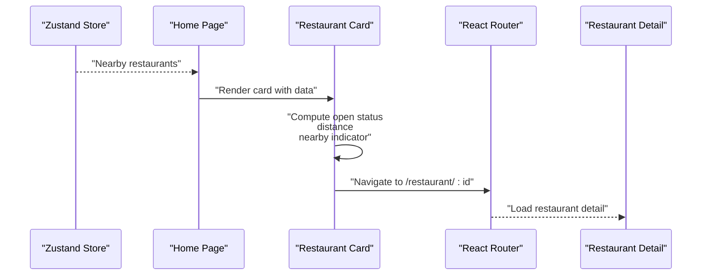

**Diagram sources**
- [plan.md:9-17](file://tasks/plan.md#L9-L17)
- [plan.md:19-39](file://tasks/plan.md#L19-L39)
- [todo.md:60-64](file://tasks/todo.md#L60-L64)

**Section sources**
- [plan.md:9-17](file://tasks/plan.md#L9-L17)
- [plan.md:19-39](file://tasks/plan.md#L19-L39)
- [todo.md:60-64](file://tasks/todo.md#L60-L64)

### Conceptual Overview
Conceptually, restaurant cards exist to help users decide where to eat during or after exploring a place. They are not standalone commerce widgets. Their purpose is to support:
- Pandal hopping.
- Evening plans.
- Food crawls.
- Local exploration.
- Community meetups.
- Off-season discovery.

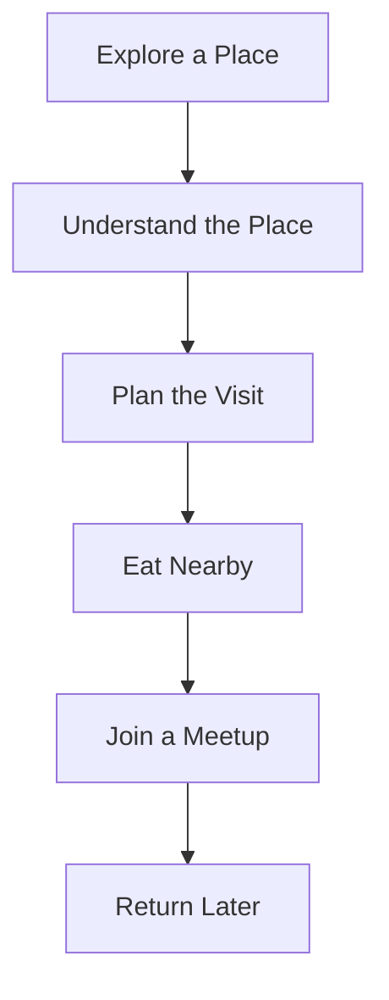

[No sources needed since this diagram shows conceptual workflow]

## Dependency Analysis
Restaurant cards depend on several layers:
- Data model: Place and Restaurant types.
- Demo dataset: Kolkata-based restaurants with location, rating, reviews, cuisine, price range, and hours.
- Location service: GPS and nearby computation.
- Store: saved places, visited places, preferences, and session state.
- Routing: navigation to restaurant detail.
- UI primitives: cards, chips, buttons, bottom nav, and motion components.

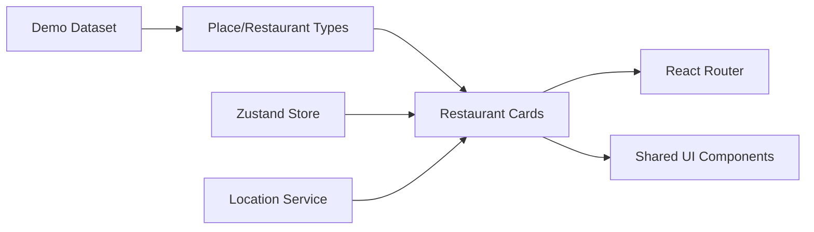

**Diagram sources**
- [plan.md:9-17](file://tasks/plan.md#L9-L17)
- [plan.md:45-46](file://tasks/plan.md#L45-L46)
- [todo.md:13-14](file://tasks/todo.md#L13-L14)

**Section sources**
- [plan.md:9-17](file://tasks/plan.md#L9-L17)
- [plan.md:45-46](file://tasks/plan.md#L45-L46)
- [todo.md:13-14](file://tasks/todo.md#L13-L14)

## Performance Considerations
- Avoid recomputing distance and open status on every render; memoize or compute once per data change.
- Lazy-load images and placeholders to reduce initial bundle and network cost.
- Limit the number of nearby restaurants shown in rails; paginate or filter further when needed.
- Debounce location updates to prevent excessive recalculations.
- Keep card animations subtle and respect reduced-motion settings.
- Avoid heavy computations on the main thread; move complex filtering to workers if necessary.
- Cache nearby results per location region to reduce repeated calculations.

[No sources needed since this section provides general guidance]

## Troubleshooting Guide
Common issues and resolutions:
- Missing image: ensure fallback gradients or placeholders are rendered without breaking layout.
- Incorrect open status: verify timezone, current time source, and operating hours data.
- Wrong distance: check latitude/longitude format and haversine implementation.
- Fake popularity or reviews: only use dataset-provided values; do not invent statistics.
- Confusing sponsored vs organic content: clearly label sponsored cards.
- Overuse of AI: keep normal software responsible for saves, visits, search, maps, payments, meetups, reviews, categories, and pricing; reserve AI for identification, explanations, multilingual assistance, voice interaction, recommendations, and itinerary assistance.

**Section sources**
- [plan.md:15-17](file://tasks/plan.md#L15-L17)
- [Pujo_Sahayak_Master_Project_Context.md:1297-1327](file://Pujo_Sahayak_Master_Project_Context.md#L1297-L1327)
- [Pujo_Sahayak_Master_Project_Context.md:1742-1779](file://Pujo_Sahayak_Master_Project_Context.md#L1742-L1779)

## Conclusion
Restaurant discovery cards in Pujo Sahayak are small but important pieces of a larger place-discovery ecosystem. They should look clean, behave predictably, and support the user’s journey from discovering a pandal or local place to planning, visiting, eating nearby, joining a meetup, and returning later. Their implementation should emphasize location accuracy, honest data, clear UI, and integration with the broader platform rather than treating restaurants as an isolated food-delivery feature.

[No sources needed since this section summarizes without analyzing specific files]