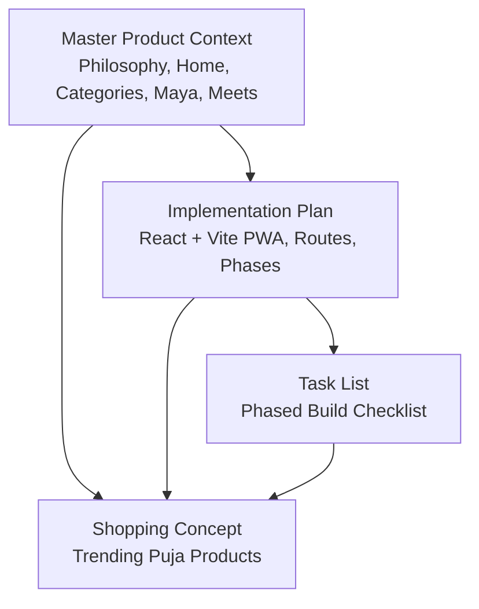
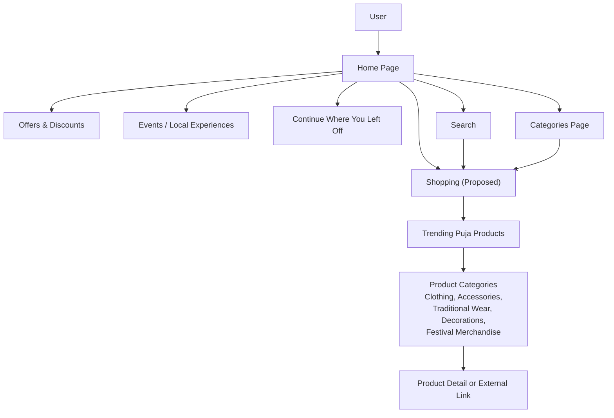
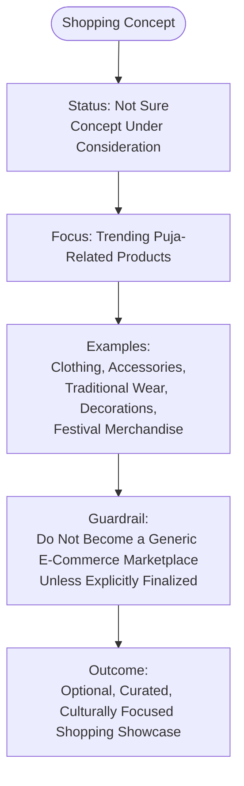
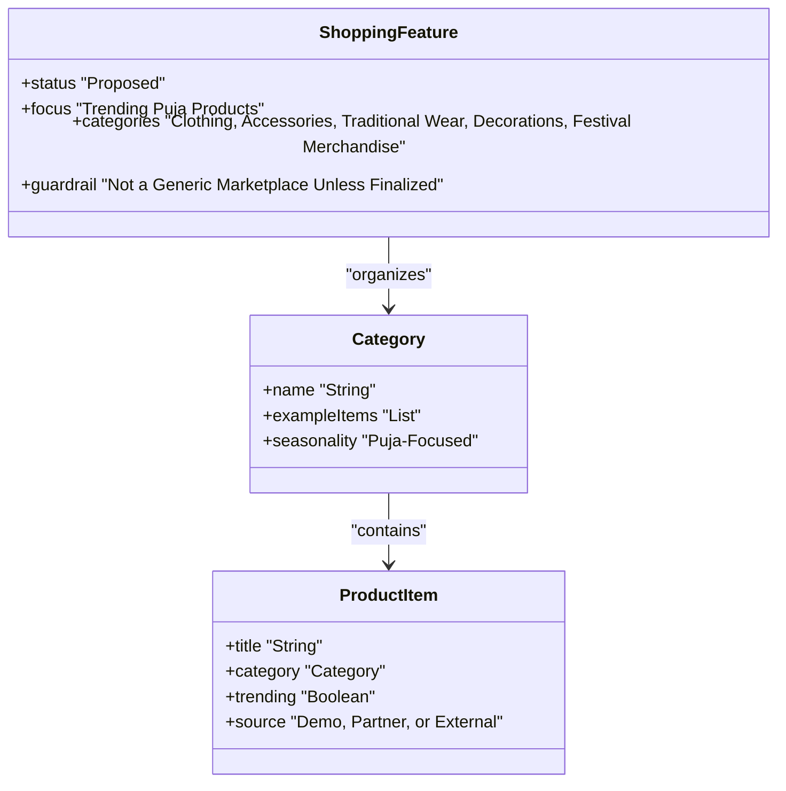
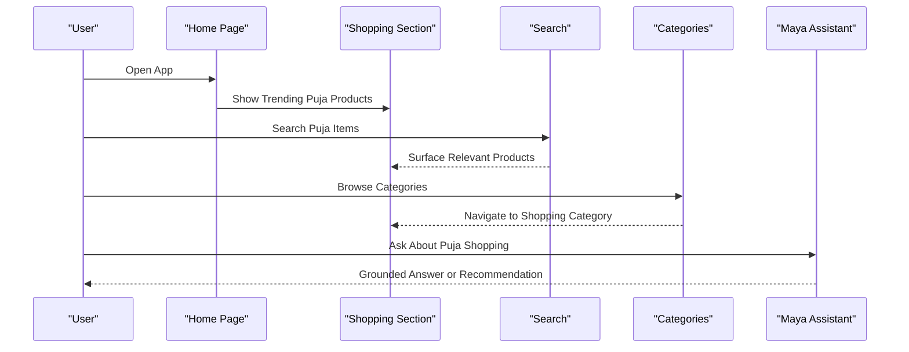
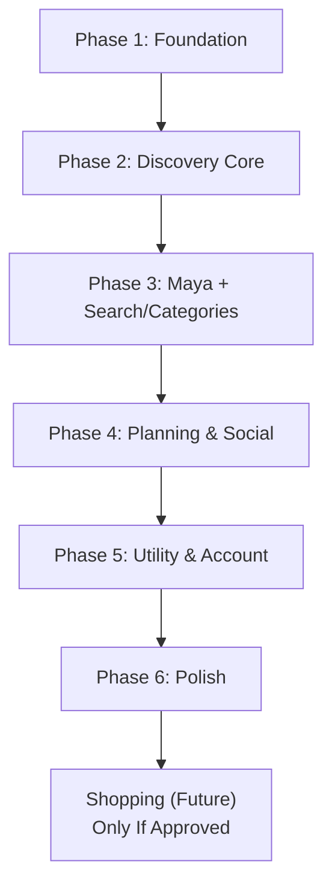
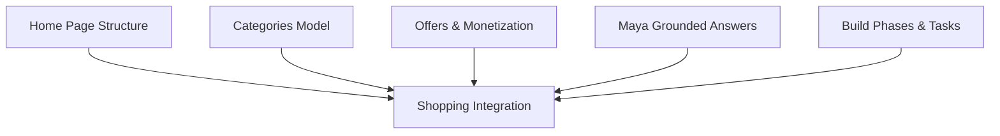

# Shopping Feature (Proposed)

<cite>
**Referenced Files in This Document **
- [Pujo_Sahayak_Master_Project_Context.md](file://Pujo_Sahayak_Master_Project_Context.md)
- [plan.md](file://tasks/plan.md)
- [todo.md](file://tasks/todo.md)
</cite>

## Table of Contents
1. [Introduction](#introduction)
2. [Project Structure](#project-structure)
3. [Core Components](#core-components)
4. [Architecture Overview](#architecture-overview)
5. [Detailed Component Analysis](#detailed-component-analysis)
6. [Dependency Analysis](#dependency-analysis)
7. [Performance Considerations](#performance-considerations)
8. [Troubleshooting Guide](#troubleshooting-guide)
9. [Conclusion](#conclusion)

## Introduction
This document describes the proposed shopping feature for Pujo Sahayak. It is currently marked as “Not Sure” and should be treated as a concept under consideration, not a locked requirement. The idea centers on showcasing trending Puja-related products such as clothing, accessories, traditional wear, decorations, and festival merchandise. The goal is to support the cultural shopping experience around Durga Puja without turning the app into a generic e-commerce marketplace unless that direction is explicitly finalized later.

The shopping concept fits into the broader discovery ecosystem: it complements pandal exploration, restaurant discovery, events, offers, planning, social meetups, and AI assistance through Maya. If implemented, shopping content should feel like part of the local experience rather than an unrelated storefront.

## Project Structure
At this stage, the repository contains:
- A master product context document describing the overall philosophy, navigation, home page sections, categories, Maya, meets, planner, and related features.
- An implementation plan outlining the React + Vite PWA build, routes, phases, and verification steps.
- A task list tracking phased development work.

**Diagram sources **
- [Pujo_Sahayak_Master_Project_Context.md:1-100](file://Pujo_Sahayak_Master_Project_Context.md#L1-L100)
- [plan.md:1-20](file://tasks/plan.md#L1-L20)
- [todo.md:1-15](file://tasks/todo.md#L1-L15)

**Section sources**
- [Pujo_Sahayak_Master_Project_Context.md:1-100](file://Pujo_Sahayak_Master_Project_Context.md#L1-L100)
- [plan.md:1-20](file://tasks/plan.md#L1-L20)
- [todo.md:1-15](file://tasks/todo.md#L1-L15)

## Core Components
The shopping concept is defined by several key ideas:

- Proposed status: The sketch marks shopping as “Not Sure,” so it must remain optional until explicitly approved.
- Trending focus: The initial idea is to highlight trending Puja-related wearables and products, possibly including what users are buying during the festival.
- Category examples: Clothing, accessories, traditional wear, decorations, and festival merchandise.
- Scope guardrail: Do not make the app a generic e-commerce marketplace unless that decision is finalized.
- Integration intent: Shopping can coexist with offers, discounts, sponsor content, and the broader local discovery flow.

These points ensure shopping remains culturally focused and aligned with the app’s identity as a digital companion for exploring Kolkata during Puja.

**Section sources**
- [Pujo_Sahayak_Master_Project_Context.md:248-267](file://Pujo_Sahayak_Master_Project_Context.md#L248-L267)

## Architecture Overview
The shopping concept should integrate with the existing discovery architecture rather than introducing a separate marketplace layer.

**Diagram sources **
- [Pujo_Sahayak_Master_Project_Context.md:160-284](file://Pujo_Sahayak_Master_Project_Context.md#L160-L284)
- [Pujo_Sahayak_Master_Project_Context.md:447-556](file://Pujo_Sahayak_Master_Project_Context.md#L447-L556)

The diagram shows how shopping would sit alongside offers, events, search, and categories. It also emphasizes that shopping should connect to trending items and curated categories instead of becoming a full marketplace.

## Detailed Component Analysis

### Shopping Concept Definition
The shopping feature is best understood as a curated showcase of Puja-related products. It should:
- Highlight trending items during the festival season.
- Support categories such as clothing, accessories, traditional wear, decorations, and festival merchandise.
- Avoid generic marketplace behavior unless explicitly decided later.
- Remain optional while the project team evaluates whether shopping adds value to the core discovery journey.

**Diagram sources **
- [Pujo_Sahayak_Master_Project_Context.md:248-267](file://Pujo_Sahayak_Master_Project_Context.md#L248-L267)

**Section sources**
- [Pujo_Sahayak_Master_Project_Context.md:248-267](file://Pujo_Sahayak_Master_Project_Context.md#L248-L267)

### Implementation Guidelines for Future Development
If shopping is later approved, follow these guidelines to keep it consistent with the rest of the app:

1. Treat shopping as a proposed section, not a hard requirement.
2. Start with a small set of trending items rather than a large catalog.
3. Use clear labels indicating demo or partner data where appropriate.
4. Keep the UI style consistent with the app’s design tokens and avoid generic marketplace patterns.
5. Integrate shopping near offers, discounts, and sponsored content if it makes sense.
6. Provide category shortcuts similar to Places, Restaurants, Events, and Places already present in the app.
7. Ensure shopping does not distract from the primary journey: discover, explore, understand, plan, visit, share, meet, and discover again.

These guidelines help prevent scope creep and maintain the app’s cultural and local-discovery focus.

**Section sources**
- [Pujo_Sahayak_Master_Project_Context.md:21-73](file://Pujo_Sahayak_Master_Project_Context.md#L21-L73)
- [Pujo_Sahayak_Master_Project_Context.md:248-267](file://Pujo_Sahayak_Master_Project_Context.md#L248-L267)

### Product Categorization Strategy
A practical categorization strategy should reflect Puja culture and user intent:

- Clothing: Puja outfits, festive shirts, kurtas, sarees, dhotis, and other seasonal garments.
- Accessories: Jewelry, bangles, bindi sets, clutches, and small festive accessories.
- Traditional Wear: Cultural attire, regional styles, and Puja-season fashion.
- Decorations: Pandal-style decor, home puja items, lighting, rangoli materials, and festive ornaments.
- Festival Merchandise: Souvenirs, themed gifts, cultural items, and seasonal collectibles.

Categories should be lightweight at first. They can expand later if shopping becomes a confirmed feature.

**Diagram sources **
- [Pujo_Sahayak_Master_Project_Context.md:248-267](file://Pujo_Sahayak_Master_Project_Context.md#L248-L267)

**Section sources**
- [Pujo_Sahayak_Master_Project_Context.md:248-267](file://Pujo_Sahayak_Master_Project_Context.md#L248-L267)

### Integration With the Existing Discovery Ecosystem
Shopping should integrate with the current discovery surfaces:

- Home page: A dedicated shopping rail or card can appear alongside sponsored content, offers, restaurants, and events.
- Offers & discounts: Shopping can overlap with partner promotions and Puja-related discounts.
- Search: Users searching for Puja-related terms may see trending products alongside places and events.
- Categories: Shopping can eventually become a category group under Places or its own section once finalized.
- Maya: The assistant can answer questions about Puja shopping trends, nearby shops, or cultural context when shopping is active.

**Diagram sources **
- [Pujo_Sahayak_Master_Project_Context.md:160-284](file://Pujo_Sahayak_Master_Project_Context.md#L160-L284)
- [Pujo_Sahayak_Master_Project_Context.md:447-556](file://Pujo_Sahayak_Master_Project_Context.md#L447-L556)
- [Pujo_Sahayak_Master_Project_Context.md:558-662](file://Pujo_Sahayak_Master_Project_Context.md#L558-L662)

**Section sources**
- [Pujo_Sahayak_Master_Project_Context.md:160-284](file://Pujo_Sahayak_Master_Project_Context.md#L160-L284)
- [Pujo_Sahayak_Master_Project_Context.md:447-556](file://Pujo_Sahayak_Master_Project_Context.md#L447-L556)
- [Pujo_Sahayak_Master_Project_Context.md:558-662](file://Pujo_Sahayak_Master_Project_Context.md#L558-L662)

### Relationship to Current Build Phases
The current implementation plan focuses on discovery, Maya, planner, meets, utility screens, and polish. Shopping is not part of the active build checklist yet. If shopping is later approved, it should be added as a new phase or task with clear boundaries to avoid expanding into a full marketplace.

**Diagram sources **
- [plan.md:41-61](file://tasks/plan.md#L41-L61)
- [todo.md:5-75](file://tasks/todo.md#L5-L75)

**Section sources**
- [plan.md:41-61](file://tasks/plan.md#L41-L61)
- [todo.md:5-75](file://tasks/todo.md#L5-L75)

## Dependency Analysis
Shopping depends on decisions made elsewhere in the product context:

- Home page structure: Shopping would need a place among sponsored content, offers, restaurants, events, and continue-where-you-left-off sections.
- Categories model: Shopping could reuse or extend the existing category system.
- Offers and monetization: Shopping may align with sponsor offers, partner promotions, and future monetization models.
- Maya integration: Any shopping-related answers must remain grounded in dataset or clearly labeled demo/partner information.
- Build phases: Shopping is not currently tracked in the task list, so adding it requires explicit planning and prioritization.

**Diagram sources **
- [Pujo_Sahayak_Master_Project_Context.md:160-284](file://Pujo_Sahayak_Master_Project_Context.md#L160-L284)
- [Pujo_Sahayak_Master_Project_Context.md:447-556](file://Pujo_Sahayak_Master_Project_Context.md#L447-L556)
- [plan.md:41-61](file://tasks/plan.md#L41-L61)
- [todo.md:5-75](file://tasks/todo.md#L5-L75)

**Section sources**
- [Pujo_Sahayak_Master_Project_Context.md:160-284](file://Pujo_Sahayak_Master_Project_Context.md#L160-L284)
- [Pujo_Sahayak_Master_Project_Context.md:447-556](file://Pujo_Sahayak_Master_Project_Context.md#L447-L556)
- [plan.md:41-61](file://tasks/plan.md#L41-L61)
- [todo.md:5-75](file://tasks/todo.md#L5-L75)

## Performance Considerations
Since shopping is only a concept right now, performance concerns should be deferred until implementation begins. When shopping is eventually built, consider:

- Keeping the initial product set small to avoid heavy catalogs.
- Using lazy loading for images and product details.
- Avoiding unnecessary API calls if using external partners.
- Ensuring shopping cards do not slow down the home page or discovery flows.
- Respecting reduced-motion and accessibility preferences already present in the app.

[No sources needed since this section provides general guidance]

## Troubleshooting Guide
Common pitfalls to avoid when considering shopping:

- Treating shopping as a locked requirement when it is marked “Not Sure.”
- Expanding into a generic marketplace before final approval.
- Adding too many categories or products too early.
- Making shopping feel disconnected from Puja culture and local discovery.
- Hard-coding complex commerce logic before the feature is officially scoped.

If shopping is later added, verify that:
- It appears in the intended location on the home page.
- It does not overshadow restaurants, offers, events, or planning.
- It uses clear labeling for demo or partner data.
- It integrates cleanly with search and categories.
- It does not break existing routes or persistence.

**Section sources**
- [Pujo_Sahayak_Master_Project_Context.md:248-267](file://Pujo_Sahayak_Master_Project_Context.md#L248-L267)
- [plan.md:63-86](file://tasks/plan.md#L63-L86)
- [todo.md:63-81](file://tasks/todo.md#L63-L81)

## Conclusion
The shopping feature is a proposed concept focused on trending Puja-related products. It should remain optional and culturally focused, avoiding a generic e-commerce marketplace unless explicitly finalized. If approved, shopping should integrate thoughtfully with the home page, offers, search, categories, and Maya, while staying aligned with Pujo Sahayak’s core mission of helping users discover, explore, understand, plan, visit, share, and meet around Kolkata’s local experiences.

[No sources needed since this section summarizes without analyzing specific files]