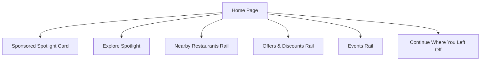
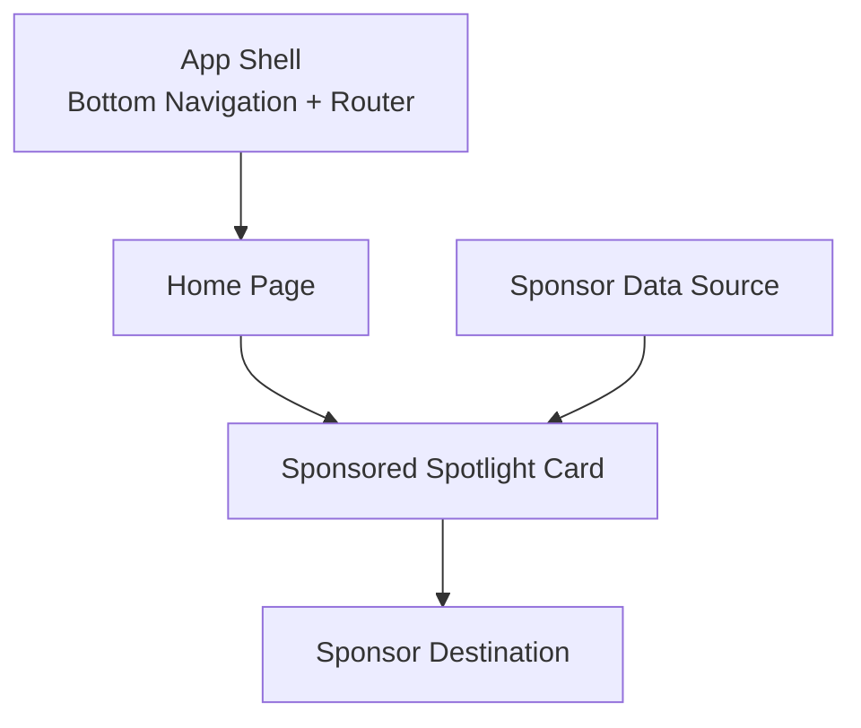
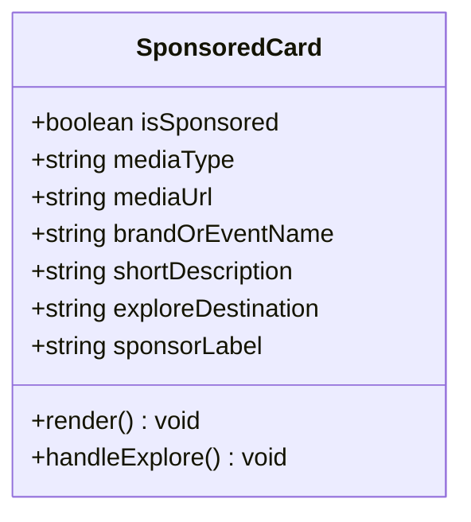
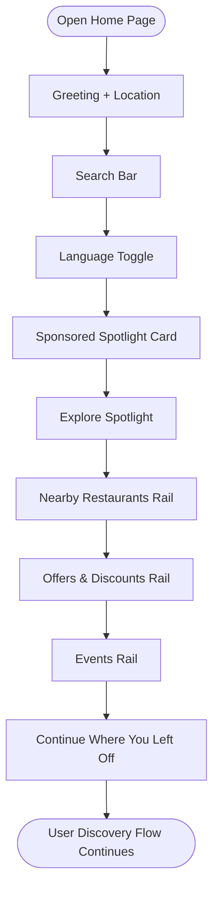
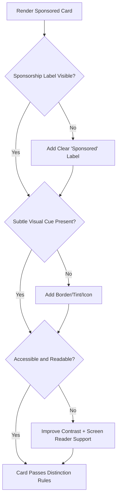
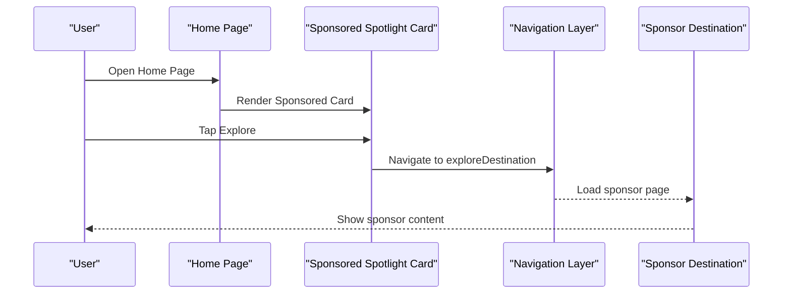
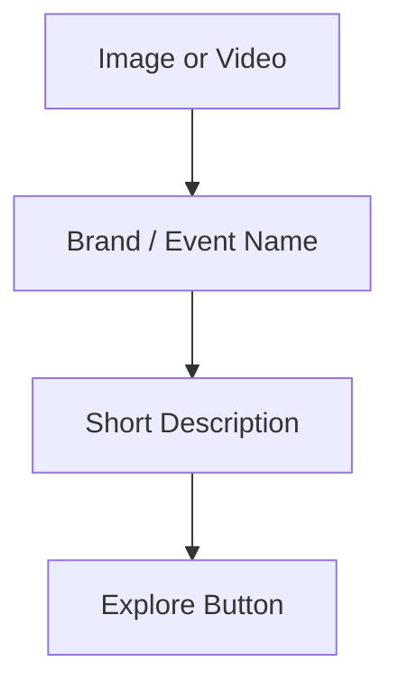
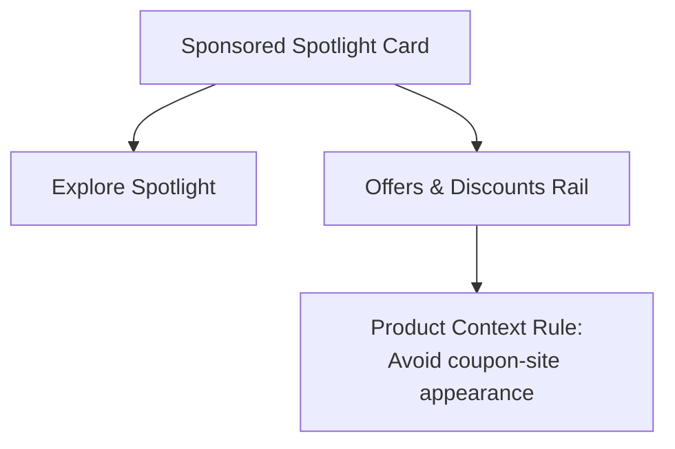
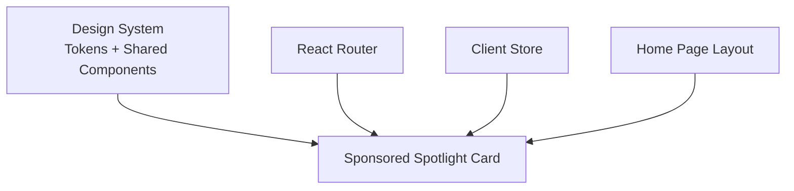

# Sponsored Spotlight Section

<cite>
**Referenced Files in This Document**
- [Pujo_Sahayak_Master_Project_Context.md](file://Pujo_Sahayak_Master_Project_Context.md)
- [tasks/plan.md](file://tasks/plan.md)
- [tasks/todo.md](file://tasks/todo.md)
</cite>

## Table of Contents
1. [Introduction](#introduction)
2. [Project Structure](#project-structure)
3. [Core Components](#core-components)
4. [Architecture Overview](#architecture-overview)
5. [Detailed Component Analysis](#detailed-component-analysis)
6. [Dependency Analysis](#dependency-analysis)
7. [Performance Considerations](#performance-considerations)
8. [Troubleshooting Guide](#troubleshooting-guide)
9. [Conclusion](#conclusion)

## Introduction
This document defines the Sponsored Spotlight section for Puja Sahayak’s Home page. It explains how sponsored content should be presented as a native ad card that feels part of the discovery experience, rather than an intrusive banner. The goal is to support monetization while preserving trust, clarity, and the natural flow from discovering pandals, restaurants, events, and local experiences.

The Sponsored Spotlight must:
- Appear near the top of the Home page.
- Display a visual asset (image or video).
- Show a brand or event name.
- Include a short description.
- Provide an Explore action button.
- Be visually distinct from organic recommendations.
- Maintain the app’s aesthetic and mobile-first design language.

## Project Structure
The Sponsored Spotlight is part of the Home page, which is the primary discovery surface. The product context describes the Home page as dynamic and user-relevant, with multiple sections including advertisements, editorial spotlight, restaurants, offers, shopping, and events. The implementation plan identifies the Home screen as a core Phase 2 task, explicitly listing “Sponsored” among its required elements. The task list further confirms that the Home page should include a greeting, search bar, language toggle, Sponsored card, Explore Spotlight, Nearby Restaurants rail, Offers & Discounts rail, Events rail, and Continue Where You Left Off.

**Diagram sources**
- [Pujo_Sahayak_Master_Project_Context.md:160-284](file://Pujo_Sahayak_Master_Project_Context.md#L160-L284)
- [tasks/plan.md:48-50](file://tasks/plan.md#L48-L50)
- [tasks/todo.md:23-25](file://tasks/todo.md#L23-L25)

**Section sources**
- [Pujo_Sahayak_Master_Project_Context.md:160-284](file://Pujo_Sahayak_Master_Project_Context.md#L160-L284)
- [tasks/plan.md:48-50](file://tasks/plan.md#L48-L50)
- [tasks/todo.md:23-25](file://tasks/todo.md#L23-L25)

## Core Components
The Sponsored Spotlight is a single native card component with the following structure:
- Sponsorship label: clearly indicates that the content is sponsored.
- Media area: supports image or video.
- Brand or event name: concise, readable title.
- Short description: brief explanation of what the sponsor is offering.
- Explore button: primary call-to-action leading to the sponsor’s destination.

The card should follow the app’s shared design system:
- Mobile-first layout.
- Ivory surfaces, vermilion primary, charcoal ink, muted gold accents.
- Consistent radii, spacing, and typography.
- Optional dark mode adaptation.
- Reduced-motion support where applicable.

The card must not look like a traditional banner ad. Instead, it should resemble other cards on the Home page while remaining distinguishable through labeling, subtle visual cues, and consistent placement.

**Section sources**
- [Pujo_Sahayak_Master_Project_Context.md:168-187](file://Pujo_Sahayak_Master_Project_Context.md#L168-L187)
- [tasks/plan.md:9-10](file://tasks/plan.md#L9-L10)
- [tasks/todo.md:10-11](file://tasks/todo.md#L10-L11)

## Architecture Overview
At a high level, the Sponsored Spotlight integrates into the Home page as one of several discovery sections. It sits above the editorial Explore Spotlight and alongside other rails such as restaurants, offers, and events. The card is data-driven: it receives sponsor metadata, media, and a destination action. Its behavior is simple: render the card and navigate when the user taps Explore.

**Diagram sources**
- [tasks/plan.md:19-39](file://tasks/plan.md#L19-L39)
- [tasks/todo.md:23-25](file://tasks/todo.md#L23-L25)

## Detailed Component Analysis

### Sponsored Card Content Model
The Sponsored Spotlight card is defined by a small set of fields:
- `isSponsored`: boolean flag indicating paid or promoted content.
- `mediaType`: image or video.
- `mediaUrl`: URL or local path to the asset.
- `brandOrEventName`: display title.
- `shortDescription`: concise copy explaining the offer or event.
- `exploreDestination`: route, deep link, or external destination.
- `sponsorLabel`: localized text such as “Sponsored”.

This model keeps the card lightweight and compatible with the existing Place/Pandal/Restaurant/Event/Offer types already outlined in the project’s data model.

**Diagram sources**
- [Pujo_Sahayak_Master_Project_Context.md:168-187](file://Pujo_Sahayak_Master_Project_Context.md#L168-L187)
- [tasks/todo.md:13-14](file://tasks/todo.md#L13-L14)

### Placement and Hierarchy on the Home Page
The Sponsored Spotlight belongs at the top of the Home page, immediately after the greeting, search bar, and language toggle. It should appear before the editorial Explore Spotlight so that users see sponsored content first, but without interrupting their initial orientation.

Recommended order:
1. Greeting and location context.
2. Search input.
3. Language toggle.
4. Sponsored Spotlight card.
5. Explore Spotlight.
6. Nearby Restaurants rail.
7. Offers & Discounts rail.
8. Events rail.
9. Continue Where You Left Off.

This ordering preserves the discovery flow while giving sponsors early visibility.

**Diagram sources**
- [tasks/todo.md:23-25](file://tasks/todo.md#L23-L25)
- [Pujo_Sahayak_Master_Project_Context.md:160-284](file://Pujo_Sahayak_Master_Project_Context.md#L160-L284)

### Visual Distinction From Organic Recommendations
The most critical requirement is clear distinction between sponsored and organic content. Users must never mistake a sponsored card for an editorial recommendation.

Guidelines:
- Always show a sponsorship label near the card header.
- Use a subtle border, background tint, or icon to signal sponsorship without breaking the design system.
- Keep the card shape and interaction similar to other cards so it feels native.
- Avoid exaggerated colors, flashing animations, or oversized banners.
- Do not hide the sponsorship label behind tooltips or secondary actions.
- Ensure accessibility: the label should be readable by screen readers and visible in both light and dark modes.

**Diagram sources**
- [Pujo_Sahayak_Master_Project_Context.md:185-187](file://Pujo_Sahayak_Master_Project_Context.md#L185-L187)

### User Interaction Flow
When a user taps the Explore button on the Sponsored Spotlight card, the app should navigate to the sponsor’s destination. This can be:
- An internal route, such as a dedicated landing page or event detail.
- A partner page within the app.
- An external link, if appropriate and disclosed.

The interaction should feel smooth and immediate, matching the rest of the app’s navigation patterns.

**Diagram sources**
- [Pujo_Sahayak_Master_Project_Context.md:174-183](file://Pujo_Sahayak_Master_Project_Context.md#L174-L183)
- [tasks/plan.md:19-39](file://tasks/plan.md#L19-L39)

### Content Structure Patterns
The Sponsored Spotlight should reuse the same structural pattern as other cards in the app:
- Media at the top.
- Title below the media.
- Short description under the title.
- Primary action button at the bottom.

This consistency helps users understand the card quickly. The only difference from organic cards should be the sponsorship indicators and possibly the destination behavior.

**Diagram sources**
- [Pujo_Sahayak_Master_Project_Context.md:174-183](file://Pujo_Sahayak_Master_Project_Context.md#L174-L183)

### Relationship With Other Home Sections
The Sponsored Spotlight should not compete with the editorial Explore Spotlight. The Explore Spotlight is larger and editorial; the Sponsored Spotlight is compact and clearly labeled as sponsored. Keeping these sections separate prevents confusion and maintains trust.

Similarly, the Offers & Discounts rail may contain sponsor offers, but those should be presented as discounts or promotions rather than full branded spotlight cards. The UI must avoid making the app look like a coupon website.

**Diagram sources**
- [Pujo_Sahayak_Master_Project_Context.md:189-246](file://Pujo_Sahayak_Master_Project_Context.md#L189-L246)

## Dependency Analysis
The Sponsored Spotlight depends on:
- The Home page layout and section ordering.
- Shared design tokens and components.
- A sponsor data source.
- The routing/navigation layer.
- Accessibility and motion preferences.

It should not introduce heavy dependencies. The card should remain lightweight, fast-loading, and compatible with the PWA shell.

**Diagram sources**
- [tasks/plan.md:9-15](file://tasks/plan.md#L9-L15)
- [tasks/todo.md:10-14](file://tasks/todo.md#L10-L14)

**Section sources**
- [tasks/plan.md:9-15](file://tasks/plan.md#L9-L15)
- [tasks/todo.md:10-14](file://tasks/todo.md#L10-L14)

## Performance Considerations
- Prefer images over videos for the default Sponsored Spotlight to keep load times low.
- Lazy-load media assets.
- Use responsive image sizes.
- Avoid autoplaying videos unless explicitly supported by the sponsor contract and user preference.
- Respect reduced-motion settings.
- Keep the card interactive without blocking the main thread.
- Cache sponsor assets where appropriate in the PWA shell.

[No sources needed since this section provides general guidance]

## Troubleshooting Guide
Common issues and resolutions:
- **Sponsorship label missing**: Add a visible “Sponsored” label and ensure it is accessible.
- **Card looks like a banner**: Reduce size, remove aggressive styling, and align with the native card pattern.
- **Confusion with organic recommendations**: Strengthen visual distinction through label, subtle border, or tint.
- **Explore button does nothing**: Verify the destination route or link is configured.
- **Media fails to load**: Provide fallback placeholders and ensure image/video URLs are valid.
- **Accessibility problems**: Confirm contrast, screen reader labels, and keyboard focus behavior.

**Section sources**
- [Pujo_Sahayak_Master_Project_Context.md:185-187](file://Pujo_Sahayak_Master_Project_Context.md#L185-L187)

## Conclusion
The Sponsored Spotlight should be a native, trustworthy, and non-intrusive advertising element on the Home page. It must clearly communicate sponsorship while fitting seamlessly into Puja Sahayak’s discovery flow. By placing the card near the top, using a consistent card structure, and maintaining strong visual distinction from organic recommendations, the app can monetize effectively without compromising user experience.

[No sources needed since this section summarizes without analyzing specific files]