# Planning and Itinerary System

<cite>
**Referenced Files in This Document**
- [Pujo_Sahayak_Master_Project_Context.md](file://Pujo_Sahayak_Master_Project_Context.md)
- [plan.md](file://tasks/plan.md)
- [todo.md](file://tasks/todo.md)
</cite>

## Table of Contents
1. [Introduction](#introduction)
2. [Project Structure](#project-structure)
3. [Core Components](#core-components)
4. [Architecture Overview](#architecture-overview)
5. [Detailed Component Analysis](#detailed-component-analysis)
6. [Dependency Analysis](#dependency-analysis)
7. [Performance Considerations](#performance-considerations)
8. [Troubleshooting Guide](#troubleshooting-guide)
9. [Conclusion](#conclusion)

## Introduction
This document explains the planning and itinerary system for Puja Sahayak, focusing on multi-day Puja planning from Panchami through Dashami, AI-assisted planning, premium feature gating, and implementation guidance for data structures, scheduling logic, and timeline visualization. The product is a mobile-first digital companion for exploring Kolkata during Durga Puja, combining discovery, intelligence, planning, community, utility, memory, and continuity beyond the festival season.

The planning system sits inside a broader user journey: discover places, explore details, understand context with Maya, plan multi-stop itineraries, visit locations, share experiences, meet people, and continue discovering new places. During Puja, pandals are the primary focus; outside Puja, restaurants, events, attractions, and local activities keep the app useful.

**Section sources**
- [Pujo_Sahayak_Master_Project_Context.md:21-43](file://Pujo_Sahayak_Master_Project_Context.md#L21-L43)
- [Pujo_Sahayak_Master_Project_Context.md:77-100](file://Pujo_Sahayak_Master_Project_Context.md#L77-L100)
- [Pujo_Sahayak_Master_Project_Context.md:104-138](file://Pujo_Sahayak_Master_Project_Context.md#L104-L138)

## Project Structure
At the documentation level, the planning system is defined by three key artifacts:

- Master product context describing the overall product philosophy, navigation, discovery surfaces, planner concept, AI assistant behavior, and premium model.
- Implementation plan describing the React + Vite PWA stack, routes, state management, maps, AI simulation, and phased task breakdown.
- Task list detailing the specific build tasks, including the Puja Planner screen, trip route map, and related features.

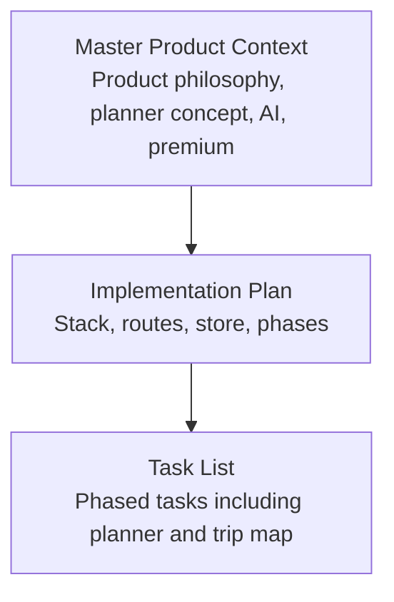

**Diagram sources**
- [Pujo_Sahayak_Master_Project_Context.md:1-20](file://Pujo_Sahayak_Master_Project_Context.md#L1-L20)
- [plan.md:1-18](file://tasks/plan.md#L1-L18)
- [todo.md:1-16](file://tasks/todo.md#L1-L16)

**Section sources**
- [Pujo_Sahayak_Master_Project_Context.md:1-20](file://Pujo_Sahayak_Master_Project_Context.md#L1-L20)
- [plan.md:1-18](file://tasks/plan.md#L1-L18)
- [todo.md:1-16](file://tasks/todo.md#L1-L16)

## Core Components
The planning and itinerary system has several core components:

- **Multi-day planner**: A six-day planner covering Panchami, Shashthi, Saptami, Ashtami, Navami, and Dashami. Each day contains stops such as pandals, restaurants, events, local attractions, transportation segments, and approximate timings.
- **Stop types**: Places include pandals, restaurants, events, and other local attractions. Transportation segments represent travel between stops.
- **Timeline view**: Daily schedules show ordered stops with approximate times, durations, and travel intervals.
- **AI-assisted planning**: Natural language requests can propose optimized routes, crowd avoidance, timing preferences, and suggestions grounded in location, distance, operating hours, crowd information, saved places, and available events.
- **Premium gating**: Detailed multi-day itinerary planning and AI-assisted planning are positioned as potential premium features, while basic discovery and saved places remain free.
- **Trip and route map**: A dedicated trip route map visualizes a selected day’s stops, markers, polyline, distances, and estimated travel time.

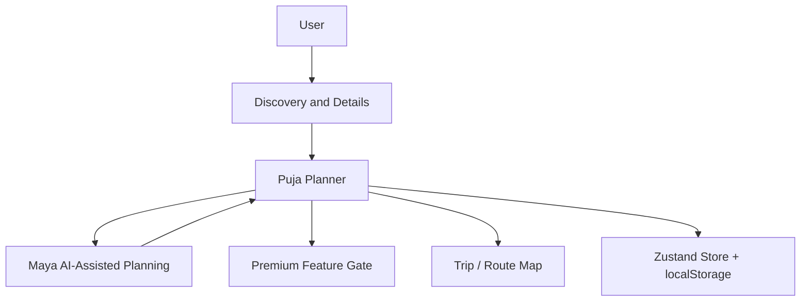

**Diagram sources**
- [Pujo_Sahayak_Master_Project_Context.md:353-402](file://Pujo_Sahayak_Master_Project_Context.md#L353-L402)
- [Pujo_Sahayak_Master_Project_Context.md:404-445](file://Pujo_Sahayak_Master_Project_Context.md#L404-L445)
- [plan.md:19-39](file://tasks/plan.md#L19-L39)
- [todo.md:45-64](file://tasks/todo.md#L45-L64)

**Section sources**
- [Pujo_Sahayak_Master_Project_Context.md:353-402](file://Pujo_Sahayak_Master_Project_Context.md#L353-L402)
- [Pujo_Sahayak_Master_Project_Context.md:404-445](file://Pujo_Sahayak_Master_Project_Context.md#L404-L445)
- [plan.md:19-39](file://tasks/plan.md#L19-L39)
- [todo.md:45-64](file://tasks/todo.md#L45-L64)

## Architecture Overview
The planning system integrates with the broader application architecture:

- **Frontend stack**: React 18, TypeScript, Vite, Tailwind CSS v4, React Router v6, Zustand with persistence, Framer Motion, Leaflet with OpenStreetMap tiles.
- **State management**: One client store holds saved places, visited places, the Puja plan with six day slots, meetups, language, theme, logo choice, and “continue where you left off” session data.
- **Routing**: The planner is accessible at `/planner`, and each day’s trip route map is at `/trip/:planDayId`.
- **Data layer**: Typed local demo dataset includes real Kolkata pandals, restaurants, events, meetups, offers, and safety points. Crowd levels and opening hours come from dataset fields.
- **AI simulation**: Maya is UI-complete but locally simulated; answers are retrieved from the dataset rather than hallucinated. The architecture keeps a clean swap-in point for a real LLM API later.

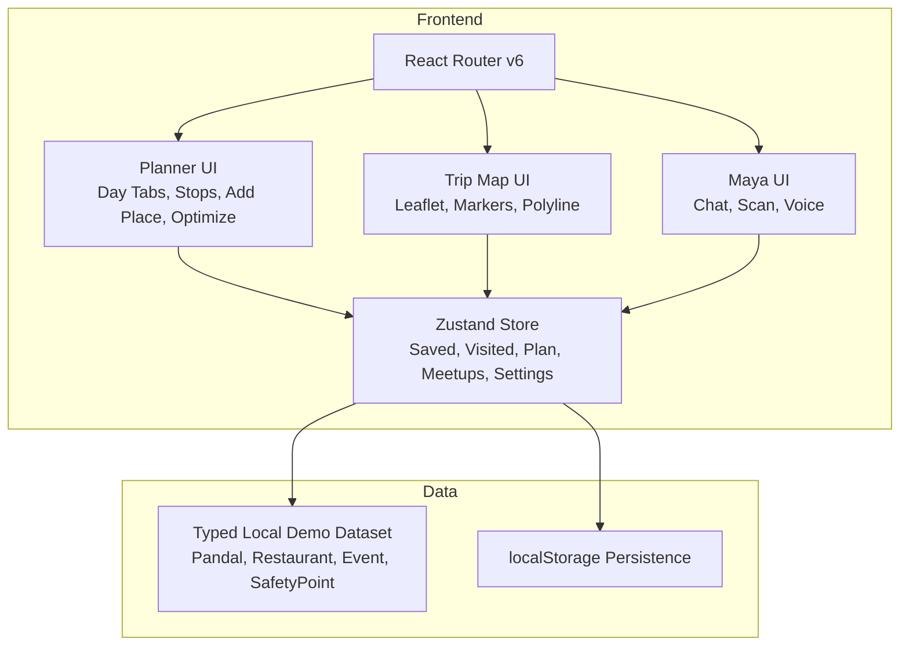

**Diagram sources**
- [plan.md:7-18](file://tasks/plan.md#L7-L18)
- [plan.md:19-39](file://tasks/plan.md#L19-L39)
- [todo.md:13-14](file://tasks/todo.md#L13-L14)
- [todo.md:45-64](file://tasks/todo.md#L45-L64)

**Section sources**
- [plan.md:7-18](file://tasks/plan.md#L7-L18)
- [plan.md:19-39](file://tasks/plan.md#L19-L39)
- [todo.md:13-14](file://tasks/todo.md#L13-L14)
- [todo.md:45-64](file://tasks/todo.md#L45-L64)

## Detailed Component Analysis

### Multi-Day Planner Data Model
The planner stores one plan with six day slots corresponding to the main Puja days. Each day slot contains an ordered list of stops. Stops can be different place types, plus transportation segments and approximate timings.

Recommended data model:

- `Plan`: Contains multiple `PlanDay` entries.
- `PlanDay`: Represents one day (for example, Saptami). Includes display label, ordered `PlanStop[]`, optional metadata like notes or tags.
- `PlanStop`: Represents a scheduled item. Includes type (`pandal`, `restaurant`, `event`, `attraction`, `transportation`), reference to a place or custom entry, start time, duration, travel segment details, and optional notes.
- `Place`: Base entity shared across the app, extended by `Pandal`, `Restaurant`, `Event`, and other attraction types.

Complexity considerations:
- Adding a stop is O(1) if appended to the end of the day’s stop array.
- Reordering stops via AI optimization may involve sorting or nearest-neighbor computation over geographic coordinates.
- Persisting the plan is constant-time per day and stop, assuming serialized JSON storage.

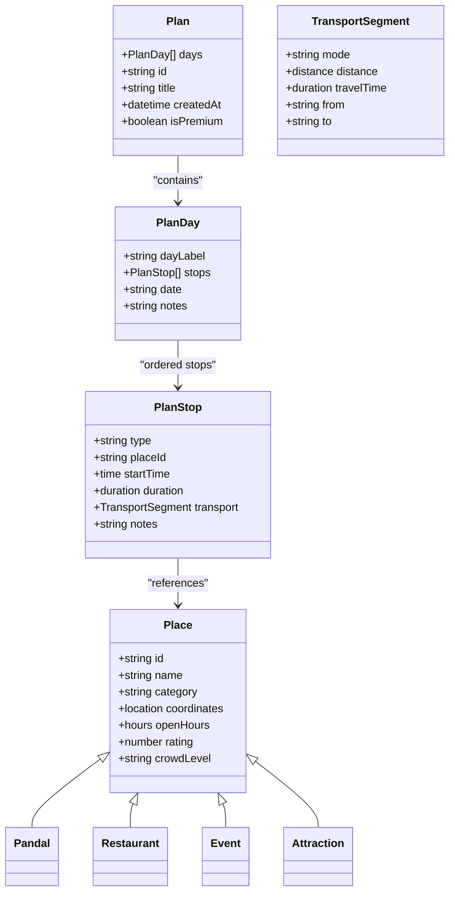

**Diagram sources**
- [todo.md:13-14](file://tasks/todo.md#L13-L14)
- [todo.md:45-64](file://tasks/todo.md#L45-L64)

**Section sources**
- [todo.md:13-14](file://tasks/todo.md#L13-L14)
- [todo.md:45-64](file://tasks/todo.md#L45-L64)

### Daily Schedule Example
A daily schedule should present stops in chronological order with approximate timings. For example, an evening Saptami schedule might include:

- 6:00 PM: Pandal A
- 7:00 PM: Pandal B
- 8:15 PM: Dinner at a restaurant
- 9:30 PM: Pandal C
- 11:00 PM: Return home

Each stop should show:
- Name and type
- Approximate start time
- Estimated duration
- Travel interval to the next stop
- Optional notes such as crowd level, theme, cuisine, or event highlights

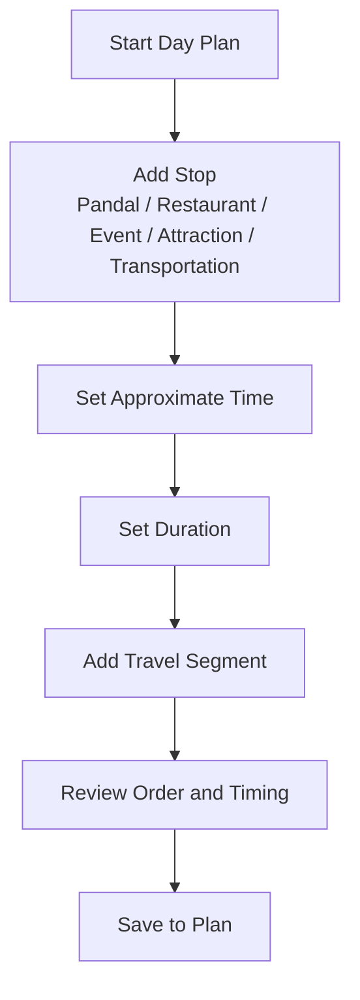

**Diagram sources**
- [Pujo_Sahayak_Master_Project_Context.md:370-398](file://Pujo_Sahayak_Master_Project_Context.md#L370-L398)
- [todo.md:45-64](file://tasks/todo.md#L45-L64)

**Section sources**
- [Pujo_Sahayak_Master_Project_Context.md:370-398](file://Pujo_Sahayak_Master_Project_Context.md#L370-L398)
- [todo.md:45-64](file://tasks/todo.md#L45-L64)

### AI-Based Planning Functionality
AI-based planning allows users to express natural language requests such as:

- Cover South Kolkata on Saptami
- Avoid very crowded places
- Have dinner around 9 PM
- Optimize route order
- Prefer nearby places
- Respect operating hours

The system should generate suggestions based on:
- Current location
- Distance between stops
- Operating hours
- Crowd information
- User preferences
- Saved places
- Available events

Important constraints:
- Generated plans must be presented as suggestions, not guaranteed optimal routes.
- AI responses should be grounded in application data.
- The current implementation simulates AI locally using the dataset, with a clear path to integrate a real LLM later.

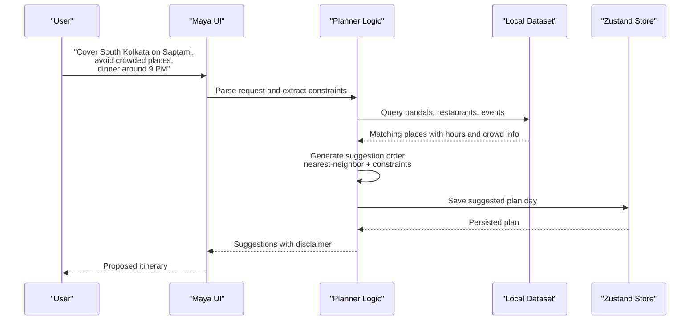

**Diagram sources**
- [Pujo_Sahayak_Master_Project_Context.md:404-421](file://Pujo_Sahayak_Master_Project_Context.md#L404-L421)
- [plan.md:15-17](file://tasks/plan.md#L15-L17)
- [todo.md:45-64](file://tasks/todo.md#L45-L64)

**Section sources**
- [Pujo_Sahayak_Master_Project_Context.md:404-421](file://Pujo_Sahayak_Master_Project_Context.md#L404-L421)
- [plan.md:15-17](file://tasks/plan.md#L15-L17)
- [todo.md:45-64](file://tasks/todo.md#L45-L64)

### Premium Planning Model
The premium model distinguishes free basic discovery from advanced planning capabilities:

- **Free tier**: Basic discovery, saved places, normal exploration, and potentially limited planning interactions.
- **Premium tier**: Advanced features such as multi-day itinerary planning, AI-assisted planning, potentially advanced recommendations, and potentially advanced meetup capabilities.

Implementation guidance:
- Do not hard-code a large subscription system prematurely.
- Use a feature flag or capability check for premium actions.
- Clearly communicate that generated plans are suggestions.
- Keep premium gating extensible so future features can be added without breaking existing flows.

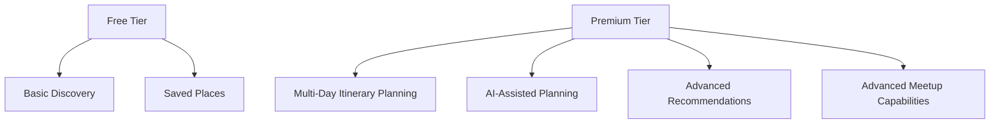

**Diagram sources**
- [Pujo_Sahayak_Master_Project_Context.md:424-445](file://Pujo_Sahayak_Master_Project_Context.md#L424-L445)

**Section sources**
- [Pujo_Sahayak_Master_Project_Context.md:424-445](file://Pujo_Sahayak_Master_Project_Context.md#L424-L445)

### Implementation Guidelines for Plan Data Structures
Guidelines for implementing plan data structures:

- Use strongly typed models for `Plan`, `PlanDay`, `PlanStop`, and `Place`.
- Ensure each `PlanStop` has a clear type discriminator so the UI can render appropriate icons and actions.
- Store approximate start times and durations as normalized values (for example, minutes from midnight or ISO timestamps).
- Include optional transportation segments with mode, distance, and travel time.
- Persist the full plan in Zustand with localStorage so it survives reloads.
- Validate that stops do not overlap unintentionally and that travel segments make sense geographically.

**Section sources**
- [todo.md:13-14](file://tasks/todo.md#L13-L14)
- [todo.md:45-64](file://tasks/todo.md#L45-L64)

### Scheduling Algorithms
Scheduling algorithms should support:

- Manual ordering by dragging or reordering controls.
- AI-assisted nearest-neighbor reordering based on geographic proximity.
- Constraint-aware suggestions such as avoiding crowded places and respecting dinner timing.
- Disclaimer messaging that outputs are suggestions, not guarantees.

Algorithmic approach:
- Compute distances between consecutive stops using haversine or similar formula.
- Apply preference weights for crowd level, operating hours, and user-specified time windows.
- Produce a candidate route and allow manual adjustment afterward.

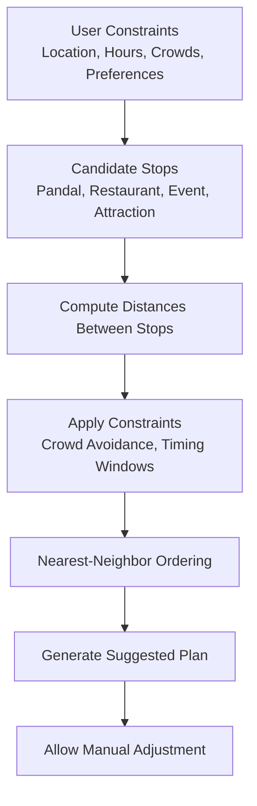

**Diagram sources**
- [Pujo_Sahayak_Master_Project_Context.md:404-421](file://Pujo_Sahayak_Master_Project_Context.md#L404-L421)
- [todo.md:45-64](file://tasks/todo.md#L45-L64)

**Section sources**
- [Pujo_Sahayak_Master_Project_Context.md:404-421](file://Pujo_Sahayak_Master_Project_Context.md#L404-L421)
- [todo.md:45-64](file://tasks/todo.md#L45-L64)

### User Interface Patterns for Timeline Visualization
Recommended UI patterns for the planner:

- **Day tabs**: Horizontal or vertical tabs for Panchami through Dashami.
- **Stop cards**: Each stop shows image, name, type, duration, and travel-between rows.
- **Add Place picker**: Allows selecting from dataset or saved places.
- **Optimize with AI button**: Triggers nearest-neighbor suggestion with disclaimer wording.
- **Start Navigation**: Navigates to `/trip/:planDayId` for map visualization.
- **Timeline visualization**: Vertical timeline showing time, stop, and travel segments.

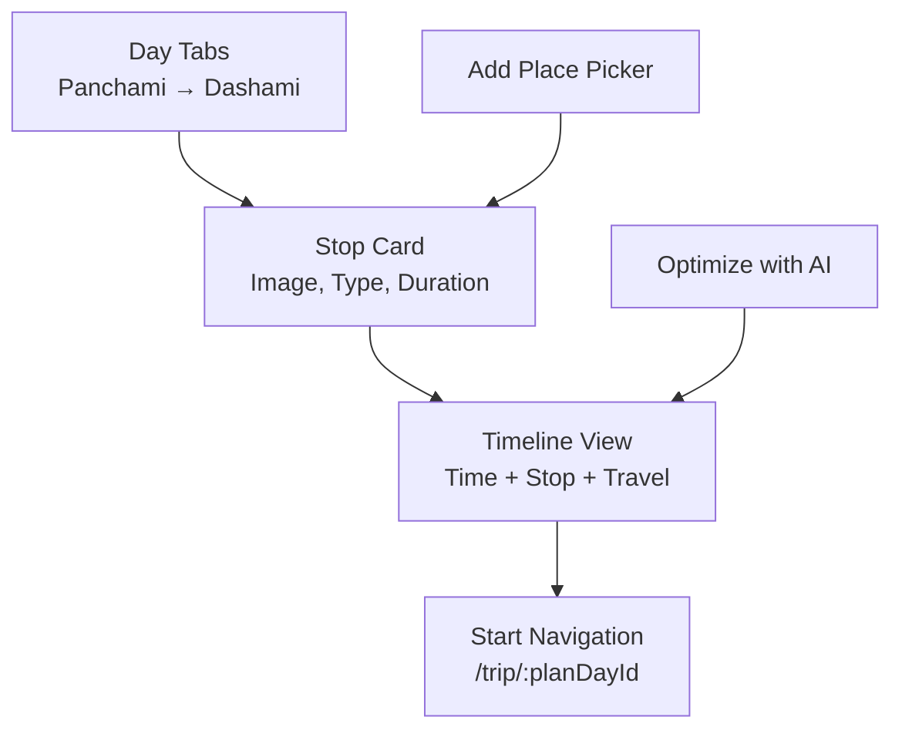

**Diagram sources**
- [todo.md:45-64](file://tasks/todo.md#L45-L64)

**Section sources**
- [todo.md:45-64](file://tasks/todo.md#L45-L64)

### Trip and Route Map Integration
The trip route map visualizes a selected day’s itinerary:

- Numbered markers for each stop.
- Polyline connecting stops.
- Stop list with times.
- Total distance and estimated time.
- Start navigation action.

This complements the planner by providing a spatial view of the planned route.

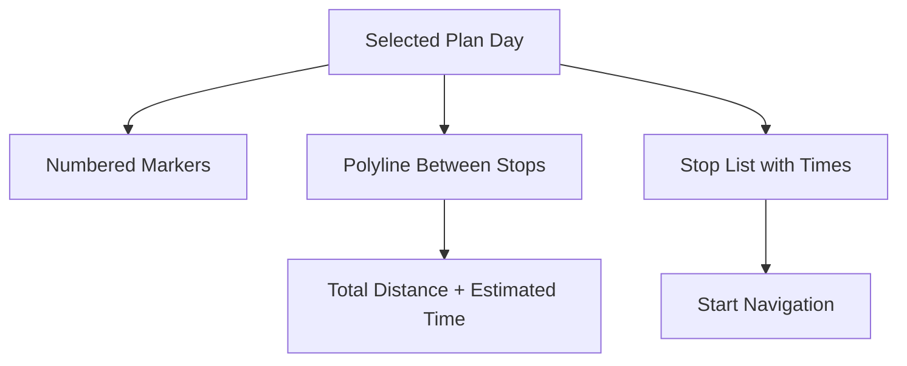

**Diagram sources**
- [todo.md:45-64](file://tasks/todo.md#L45-L64)

**Section sources**
- [todo.md:45-64](file://tasks/todo.md#L45-L64)

## Dependency Analysis
The planning system depends on several interconnected parts of the application:

- **Store dependency**: The planner reads and writes to the Zustand store, which persists plan data to localStorage.
- **Dataset dependency**: AI-assisted planning relies on the local dataset for place information, hours, crowd levels, and coordinates.
- **Route dependency**: The planner navigates to the trip route map using React Router.
- **Maya dependency**: AI-assisted planning is exposed through the Maya UI, which parses natural language and returns grounded suggestions.

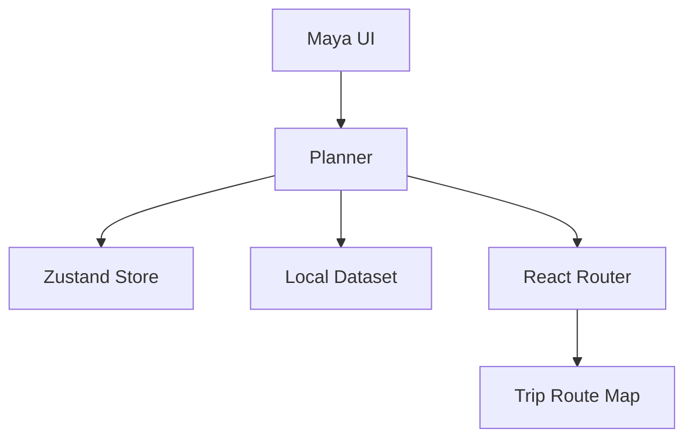

**Diagram sources**
- [plan.md:7-18](file://tasks/plan.md#L7-L18)
- [plan.md:19-39](file://tasks/plan.md#L19-L39)
- [todo.md:45-64](file://tasks/todo.md#L45-L64)

**Section sources**
- [plan.md:7-18](file://tasks/plan.md#L7-L18)
- [plan.md:19-39](file://tasks/plan.md#L19-L39)
- [todo.md:45-64](file://tasks/todo.md#L45-L64)

## Performance Considerations
- Keep planner operations lightweight on the client since the dataset is local.
- Avoid expensive recomputation when users manually reorder stops; only recalculate when AI optimization is triggered.
- Use memoization for rendered stop lists and timeline views.
- Defer heavy map rendering until the trip route map is opened.
- Persist plan changes incrementally to avoid unnecessary localStorage writes.
- Ensure reduced-motion preferences are respected for animations in the timeline and map.

[No sources needed since this section provides general guidance]

## Troubleshooting Guide
Common issues and resolutions:

- **Plan does not persist after reload**: Verify Zustand persistence middleware and localStorage access.
- **AI suggestions appear incorrect**: Confirm dataset fields for hours, crowd levels, and coordinates are populated.
- **Trip map does not render**: Check Leaflet initialization, marker coordinates, and polyline data.
- **Premium feature blocked unexpectedly**: Inspect feature flags or capability checks for premium gating.
- **Timeline overlaps or invalid times**: Validate start times, durations, and travel segments before saving.

**Section sources**
- [plan.md:15-17](file://tasks/plan.md#L15-L17)
- [todo.md:45-64](file://tasks/todo.md#L45-L64)

## Conclusion
The planning and itinerary system in Puja Sahayak centers on a multi-day planner spanning Panchami through Dashami, with detailed stop types, approximate timings, and AI-assisted suggestions. The system balances free discovery with premium planning capabilities, uses a typed local dataset, and integrates with a trip route map for spatial visualization. Implementation should prioritize clear data structures, constraint-aware scheduling, premium feature gating, and intuitive timeline visualization, while keeping AI outputs as suggestions grounded in real application data.

[No sources needed since this section summarizes without analyzing specific files]